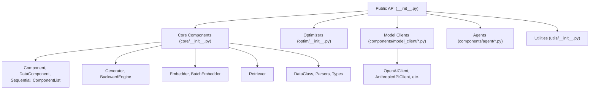
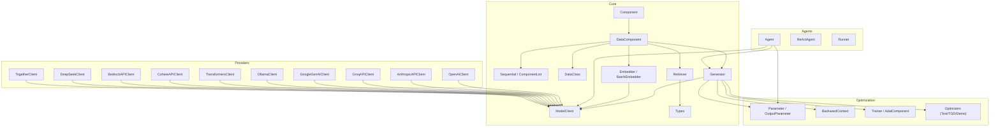
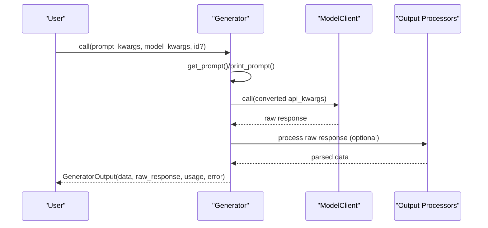
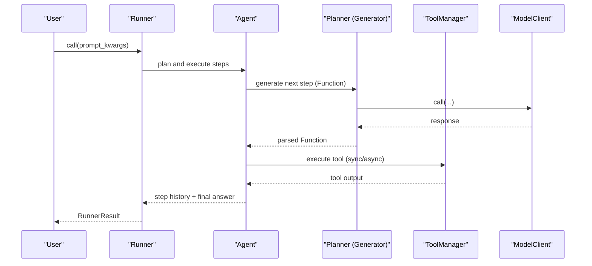
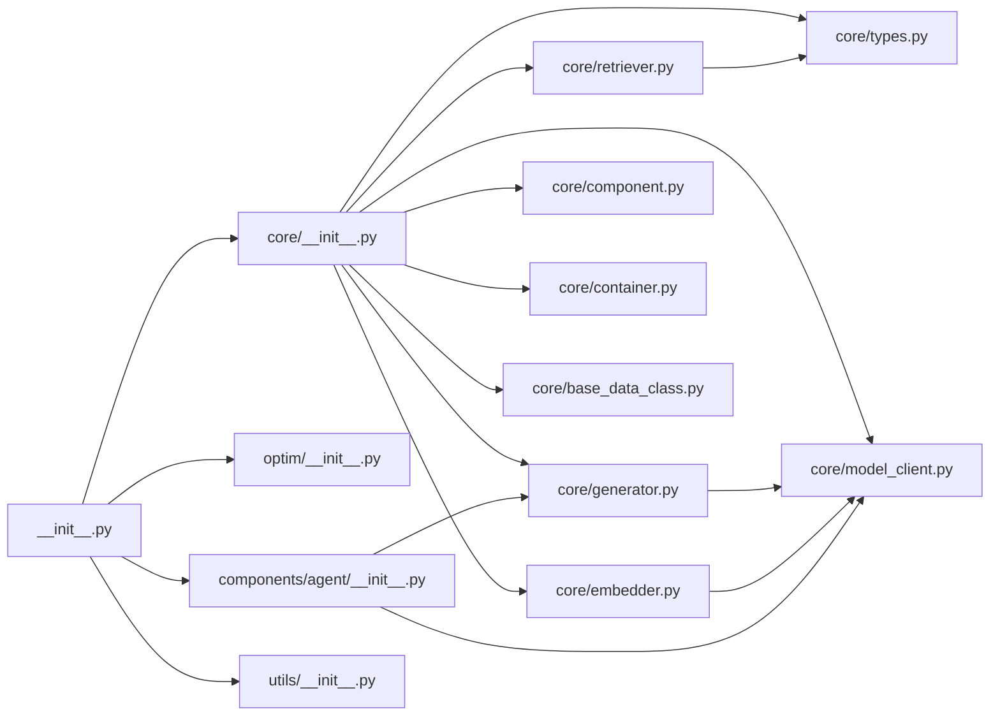

# API Reference

<cite>
**Referenced Files in This Document**
- [adalflow/adalflow/__init__.py](file://adalflow/adalflow/__init__.py)
- [adalflow/adalflow/core/__init__.py](file://adalflow/adalflow/core/__init__.py)
- [adalflow/adalflow/core/component.py](file://adalflow/adalflow/core/component.py)
- [adalflow/adalflow/core/base_data_class.py](file://adalflow/adalflow/core/base_data_class.py)
- [adalflow/adalflow/core/generator.py](file://adalflow/adalflow/core/generator.py)
- [adalflow/adalflow/core/types.py](file://adalflow/adalflow/core/types.py)
- [adalflow/adalflow/core/model_client.py](file://adalflow/adalflow/core/model_client.py)
- [adalflow/adalflow/core/embedder.py](file://adalflow/adalflow/core/embedder.py)
- [adalflow/adalflow/core/retriever.py](file://adalflow/adalflow/core/retriever.py)
- [adalflow/adalflow/core/container.py](file://adalflow/adalflow/core/container.py)
- [adalflow/adalflow/components/model_client/openai_client.py](file://adalflow/adalflow/components/model_client/openai_client.py)
- [adalflow/adalflow/components/agent/agent.py](file://adalflow/adalflow/components/agent/agent.py)
- [adalflow/adalflow/optim/__init__.py](file://adalflow/adalflow/optim/__init__.py)
- [adalflow/adalflow/utils/__init__.py](file://adalflow/adalflow/utils/__init__.py)
- [pyproject.toml](file://pyproject.toml)
- [README.md](file://README.md)
</cite>

## Table of Contents
1. [Introduction](#introduction)
2. [Project Structure](#project-structure)
3. [Core Components](#core-components)
4. [Architecture Overview](#architecture-overview)
5. [Detailed Component Analysis](#detailed-component-analysis)
6. [Dependency Analysis](#dependency-analysis)
7. [Performance Considerations](#performance-considerations)
8. [Troubleshooting Guide](#troubleshooting-guide)
9. [Conclusion](#conclusion)
10. [Appendices](#appendices)

## Introduction
This API reference documents AdalFlow’s complete public interface. It covers core classes, methods, functions, parameters, return types, configuration options, error handling, and usage patterns across the framework. The documentation is organized by functional areas (Core, Generators, Embedders, Retrievers, Agents, Optimization, Utilities) and includes cross-references, diagrams, and best practices.

## Project Structure
AdalFlow exposes a unified public API surface via top-level imports. The primary entry point aggregates core components, types, parsers, optimizers, model clients, and agents.

**Diagram sources**
- [adalflow/adalflow/__init__.py](file://adalflow/adalflow/__init__.py#L1-L154)
- [adalflow/adalflow/core/__init__.py](file://adalflow/adalflow/core/__init__.py#L1-L134)
- [adalflow/adalflow/optim/__init__.py](file://adalflow/adalflow/optim/__init__.py#L1-L39)
- [adalflow/adalflow/utils/__init__.py](file://adalflow/adalflow/utils/__init__.py#L1-L55)

**Section sources**
- [adalflow/adalflow/__init__.py](file://adalflow/adalflow/__init__.py#L1-L154)
- [pyproject.toml](file://pyproject.toml#L1-L87)

## Core Components
This section documents the foundational building blocks used across the framework.

- Component
  - Purpose: Base class for all pipeline components. Provides training, tracing, parameter registration, serialization, and nested composition.
  - Key methods: train(mode), trace(mode), use_teacher(mode), register_parameter(name, param), parameters(), named_parameters(), add_component(name, component), children(), forward(...)/call(...)/bicall(...), acall(...), state_dict(), load_state_dict(), to_dict(), from_dict().
  - Notes: Supports nested composition and parameter tracking for auto-differentiation and optimization.

- DataComponent
  - Purpose: Specialized component for data transformations and I/O processing.

- Sequential and ComponentList
  - Purpose: Compose multiple components into pipelines. Sequential chains outputs to inputs; ComponentList manages unordered collections while registering children.

- DataClass
  - Purpose: Schema-first data interchange with LLMs. Provides ordered serialization, schema/signature/example formatting, and conversion helpers.
  - Key methods: to_dict(...), from_dict(...), to_json(...), to_yaml(...), to_schema(...), to_json_signature(...), to_yaml_signature(...), format_class_str(...), format_example_str(...), pydantic_to_dataclass(...), to_pydantic(...).

- Generator
  - Purpose: Orchestrates prompt rendering, model client calls, output processing, and backward pass for textual gradients.
  - Key methods: call(...), acall(...), forward(...), set_parameters(...), set_cache_path(...), get_prompt(...), print_prompt(...), create_demo_data_instance(...), set_backward_engine(...), set_teacher_generator(...), update_default_backward_pass_setup(...).
  - Output: GeneratorOutput with fields for data, raw_response, usage, error, metadata.

- Embedder and BatchEmbedder
  - Purpose: Compute embeddings via a ModelClient with optional post-processing and batching.
  - Key methods: call(...), acall(...), from_config(...).

- Retriever
  - Purpose: Retrieve documents for RAG pipelines with gradient-aware forward pass.
  - Key methods: call(...), acall(...), forward(...), build_index_from_documents(...), reset_index(), save_to_file(...), load_from_file(...).

- ModelClient
  - Purpose: Protocol for model providers. Encapsulates initialization, input conversion, API calls, response parsing, and usage tracking.
  - Key methods: init_sync_client(), init_async_client(), call(...), acall(...), convert_inputs_to_api_kwargs(...), parse_chat_completion(...), parse_embedding_response(...), track_completion_usage(...), list_models(...).

- Types
  - Purpose: Shared data models and enums (ModelType, EmbedderOutput, RetrieverOutput, GeneratorOutput, Function/FunctionExpression/FunctionDefinition, TokenLogProb, CompletionUsage, ResponseUsage, etc.).

**Section sources**
- [adalflow/adalflow/core/component.py](file://adalflow/adalflow/core/component.py#L51-L800)
- [adalflow/adalflow/core/container.py](file://adalflow/adalflow/core/container.py#L62-L537)
- [adalflow/adalflow/core/base_data_class.py](file://adalflow/adalflow/core/base_data_class.py#L97-L800)
- [adalflow/adalflow/core/generator.py](file://adalflow/adalflow/core/generator.py#L82-L800)
- [adalflow/adalflow/core/embedder.py](file://adalflow/adalflow/core/embedder.py#L23-L236)
- [adalflow/adalflow/core/retriever.py](file://adalflow/adalflow/core/retriever.py#L22-L143)
- [adalflow/adalflow/core/model_client.py](file://adalflow/adalflow/core/model_client.py#L16-L128)
- [adalflow/adalflow/core/types.py](file://adalflow/adalflow/core/types.py#L55-L800)

## Architecture Overview
The framework follows a modular, component-based design with auto-differentiation and tracing capabilities.

**Diagram sources**
- [adalflow/adalflow/core/__init__.py](file://adalflow/adalflow/core/__init__.py#L1-L134)
- [adalflow/adalflow/optim/__init__.py](file://adalflow/adalflow/optim/__init__.py#L1-L39)
- [adalflow/adalflow/components/agent/agent.py](file://adalflow/adalflow/components/agent/agent.py#L1-L200)
- [adalflow/adalflow/components/model_client/openai_client.py](file://adalflow/adalflow/components/model_client/openai_client.py#L1-L200)

## Detailed Component Analysis

### Component and DataComponent
- Responsibilities
  - Lifecycle: train/eval, trace/use_teacher, nested composition via add_component/register_component.
  - Serialization: to_dict/from_dict, state_dict/load_state_dict, pickle support.
  - Parameter management: register_parameter, parameters/named_parameters, peer relationships.
  - Execution: call/acall/bicall with validation based on training mode.
- Parameters
  - name: Optional[str] – component identity.
  - training/teacher_mode/tracing: Flags controlling behavior.
- Returns
  - Methods return component instances or iterators over parameters/components.
- Exceptions
  - Raises ValueError for invalid mode flags or unsupported call signatures.
- Best Practices
  - Always initialize nested components via add_component.
  - Use register_parameter for trainable or traced parameters.
  - Prefer from_config for declarative construction.

**Section sources**
- [adalflow/adalflow/core/component.py](file://adalflow/adalflow/core/component.py#L51-L800)

### Sequential and ComponentList
- Responsibilities
  - Sequential: Ordered chaining of components; supports indexing, slicing, addition, iteration, and both sync and async call patterns.
  - ComponentList: List-like collection of components with registration and indexing.
- Parameters
  - Sequential: Components passed to constructor or appended later.
  - ComponentList: Optional initial iterable of components.
- Returns
  - call/acall return transformed inputs/outputs; acall can improve performance for async workloads.
- Best Practices
  - Use Sequential for deterministic pipelines; use ComponentList for heterogeneous collections.

**Section sources**
- [adalflow/adalflow/core/container.py](file://adalflow/adalflow/core/container.py#L62-L537)

### DataClass
- Responsibilities
  - Schema/signature/example formatting for LLM prompts.
  - Ordered serialization with include/exclude semantics.
  - Conversion to/from JSON/YAML and Pydantic compatibility.
- Parameters
  - exclude/include: Field selection for serialization/formatting.
  - format_type: Controls output format (schema, signature, example).
- Returns
  - Formatted strings or dictionaries per format type.
- Best Practices
  - Define metadata.desc for each field to guide LLM behavior.
  - Use input/output field ordering to control prompt structure.

**Section sources**
- [adalflow/adalflow/core/base_data_class.py](file://adalflow/adalflow/core/base_data_class.py#L97-L800)

### Generator
- Responsibilities
  - Orchestrate prompt rendering, model client calls, output processors, and backward pass.
  - Support caching, streaming, and tracing of demos and gradients.
- Parameters
  - model_client: ModelClient instance.
  - model_kwargs: Provider-specific arguments.
  - model_type: ModelType (e.g., LLM, LLM_REASONING).
  - template/prompt_kwargs: Prompt template and preset variables.
  - output_processors: Post-processing component for structured outputs.
  - cache_path/use_cache: Caching configuration.
- Returns
  - GeneratorOutput with data/raw_response/error/usage/metadata.
- Exceptions
  - Raises ValueError for invalid modes or missing teacher generator in teacher mode.
- Best Practices
  - Use OutputParameter for gradient-aware outputs.
  - Enable caching for repeated prompts; avoid caching streaming responses.
  - Use set_backward_engine and update_default_backward_pass_setup for advanced optimization.

**Diagram sources**
- [adalflow/adalflow/core/generator.py](file://adalflow/adalflow/core/generator.py#L463-L544)
- [adalflow/adalflow/core/model_client.py](file://adalflow/adalflow/core/model_client.py#L58-L97)

**Section sources**
- [adalflow/adalflow/core/generator.py](file://adalflow/adalflow/core/generator.py#L82-L800)
- [adalflow/adalflow/core/types.py](file://adalflow/adalflow/core/types.py#L486-L674)

### Embedder and BatchEmbedder
- Responsibilities
  - Compute embeddings via a ModelClient; BatchEmbedder batches large inputs.
- Parameters
  - model_client: Embedding-capable provider.
  - model_kwargs: Provider-specific arguments (e.g., dimensions).
  - output_processors: Optional post-processing on EmbedderOutput.
  - batch_size: Size for batching (BatchEmbedder).
- Returns
  - EmbedderOutput with data, usage, error, raw_response, input.
- Best Practices
  - Use BatchEmbedder for large document sets to manage memory and throughput.

**Section sources**
- [adalflow/adalflow/core/embedder.py](file://adalflow/adalflow/core/embedder.py#L23-L236)
- [adalflow/adalflow/core/types.py](file://adalflow/adalflow/core/types.py#L140-L214)

### Retriever
- Responsibilities
  - Build and query indexes; return RetrieverOutput with ranked documents.
- Parameters
  - indexed/index_keys: Index lifecycle and persistence keys.
  - top_k: Number of documents to retrieve.
- Returns
  - RetrieverOutput with id, doc_indices, doc_scores, query, documents.
- Best Practices
  - Implement reset_index/build_index_from_documents for reproducible indices.

**Section sources**
- [adalflow/adalflow/core/retriever.py](file://adalflow/adalflow/core/retriever.py#L22-L143)
- [adalflow/adalflow/core/types.py](file://adalflow/adalflow/core/types.py#L291-L316)

### ModelClient
- Responsibilities
  - Abstract provider-specific clients; convert inputs, call APIs, parse responses, track usage.
- Parameters
  - Provider-specific initialization and configuration.
- Returns
  - Provider-specific responses parsed into standardized types.
- Best Practices
  - Implement robust error handling and retries in subclasses.

**Section sources**
- [adalflow/adalflow/core/model_client.py](file://adalflow/adalflow/core/model_client.py#L16-L128)

### Model Clients (Provider Integrations)
- OpenAIClient
  - Features: Response API parsing, structured content extraction (text/images/tool_calls/reasoning/code_outputs), usage tracking, streaming support.
  - Parameters: Provider credentials and model-specific kwargs.
  - Returns: GeneratorOutput/EmbedderOutput with parsed content and usage.
- Other providers
  - Anthropic, Groq, Google, Ollama, Transformers, Cohere, Bedrock, DeepSeek, Together integrate via ModelClient protocol.

**Section sources**
- [adalflow/adalflow/components/model_client/openai_client.py](file://adalflow/adalflow/components/model_client/openai_client.py#L1-L200)
- [adalflow/adalflow/core/model_client.py](file://adalflow/adalflow/core/model_client.py#L16-L128)

### Agents
- Agent
  - Purpose: Orchestrates tool use, planning, and execution with a Generator-based planner and ToolManager.
  - Key methods: create_default_tool_manager(...), create_default_planner(...).
  - Parameters: tools, context_variables, model_client/model_kwargs, role_desc/template, max_steps, is_thinking_model, answer_data_type.
  - Returns: Generator configured as the planner.
- Runner
  - Purpose: Executes Agent workflows synchronously or asynchronously, supporting streaming events.
  - Methods: call(...), acall(...), astream(...), stream_events().
  - Parameters: agent, prompt_kwargs, stream mode flags.
  - Returns: RunnerResult with step history and final answer.

**Diagram sources**
- [adalflow/adalflow/components/agent/agent.py](file://adalflow/adalflow/components/agent/agent.py#L1-L200)
- [adalflow/adalflow/core/generator.py](file://adalflow/adalflow/core/generator.py#L120-L210)

**Section sources**
- [adalflow/adalflow/components/agent/agent.py](file://adalflow/adalflow/components/agent/agent.py#L1-L200)
- [README.md](file://README.md#L119-L239)

### Optimization and Training
- Optimizers
  - TextOptimizer, TGDOptimizer, DemoOptimizer, BootstrapFewShot.
  - Parameter, OutputParameter, BackwardContext, Trainer, AdalComponent.
- Types
  - ParameterType, Gradient, GradientContext.

**Section sources**
- [adalflow/adalflow/optim/__init__.py](file://adalflow/adalflow/optim/__init__.py#L1-L39)
- [adalflow/adalflow/core/types.py](file://adalflow/adalflow/core/types.py#L768-L800)

### Utilities
- Serialization: default, serialize, deserialize.
- File IO: save/load, save_json/load_json, save_pickle/load_pickle, JSONL helpers.
- Logger: printc, get_logger.
- Registry: EntityMapping.
- Config: new_components_from_config, new_component.
- Environment: setup_env.
- Data: DataLoader, Dataset, Subset.
- Global config: get_adalflow_default_root_path.
- Cache: CachedEngine.

**Section sources**
- [adalflow/adalflow/utils/__init__.py](file://adalflow/adalflow/utils/__init__.py#L1-L55)

## Dependency Analysis
- Public API surface
  - Top-level imports aggregate core components, types, parsers, optimizers, model clients, and agents.
- Internal dependencies
  - Component is the foundation; Generator/Embedder/Retriever depend on ModelClient and DataComponent.
  - Agents depend on Generator and ToolManager; Runner coordinates Agent execution.
  - Optimizers depend on Parameter and BackwardContext; Trainer/AdalComponent coordinate training loops.

**Diagram sources**
- [adalflow/adalflow/__init__.py](file://adalflow/adalflow/__init__.py#L1-L154)
- [adalflow/adalflow/core/__init__.py](file://adalflow/adalflow/core/__init__.py#L1-L134)

**Section sources**
- [adalflow/adalflow/__init__.py](file://adalflow/adalflow/__init__.py#L1-L154)
- [adalflow/adalflow/core/__init__.py](file://adalflow/adalflow/core/__init__.py#L1-L134)

## Performance Considerations
- Caching
  - Generator caches non-streaming responses by default; configure cache_path and use_cache to reduce latency and cost.
- Batching
  - Use BatchEmbedder for large document sets to manage memory and throughput.
- Streaming
  - Prefer streaming for long-running responses; avoid caching streaming responses.
- Token estimation
  - Generator tracks estimated token counts; consider truncation and max_tokens to stay within limits.
- Async execution
  - Use acall/astream for concurrent operations in agents and pipelines.

[No sources needed since this section provides general guidance]

## Troubleshooting Guide
- Common errors
  - Missing or invalid model_client: Ensure a ModelClient instance is provided to Generator/Embedder.
  - Invalid mode flags: train/trace/use_teacher expect booleans.
  - Missing teacher generator in teacher mode: Set teacher via set_teacher_generator.
  - Serialization issues: Use to_dict/from_dict; ensure nested components are serializable.
- Logging
  - Use get_logger to obtain component-specific loggers; enable info/warning logs for diagnostics.
- Provider-specific issues
  - OpenAIClient handles timeouts, rate limits, and malformed requests; review parsed content and usage.

**Section sources**
- [adalflow/adalflow/core/generator.py](file://adalflow/adalflow/core/generator.py#L584-L620)
- [adalflow/adalflow/components/model_client/openai_client.py](file://adalflow/adalflow/components/model_client/openai_client.py#L1-L200)
- [adalflow/adalflow/utils/__init__.py](file://adalflow/adalflow/utils/__init__.py#L17-L24)

## Conclusion
AdalFlow provides a cohesive, model-agnostic framework for building and optimizing LLM workflows. Its public API centers around Component/DataComponent abstractions, with specialized components for generation, embedding, retrieval, agents, and optimization. By leveraging standardized types, caching, batching, and tracing, developers can construct efficient, maintainable pipelines spanning chatbots, RAG, and agents.

[No sources needed since this section summarizes without analyzing specific files]

## Appendices

### API Index by Functional Area
- Core
  - Component, DataComponent, Sequential, ComponentList, DataClass, Generator, Embedder, BatchEmbedder, Retriever, ModelClient, Types
- Optimization
  - Parameter, OutputParameter, BackwardContext, Trainer, AdalComponent, Optimizers
- Agents
  - Agent, Runner
- Utilities
  - Serialization, File IO, Logger, Registry, Config, Environment, Data, Global config, Cache

**Section sources**
- [adalflow/adalflow/core/__init__.py](file://adalflow/adalflow/core/__init__.py#L1-L134)
- [adalflow/adalflow/optim/__init__.py](file://adalflow/adalflow/optim/__init__.py#L1-L39)
- [adalflow/adalflow/utils/__init__.py](file://adalflow/adalflow/utils/__init__.py#L1-L55)