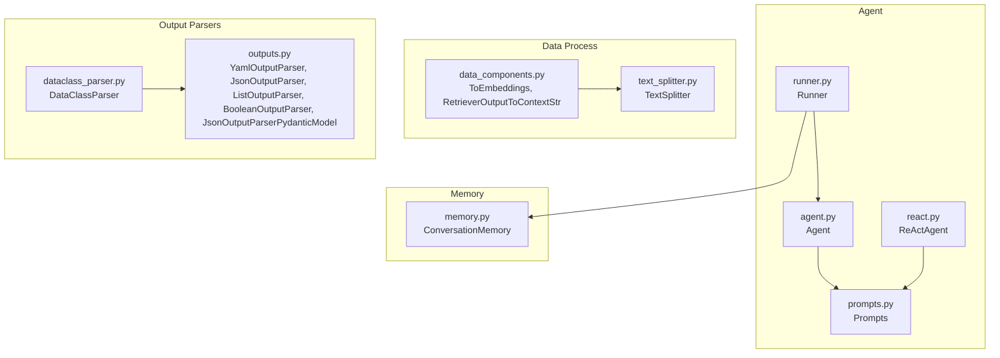
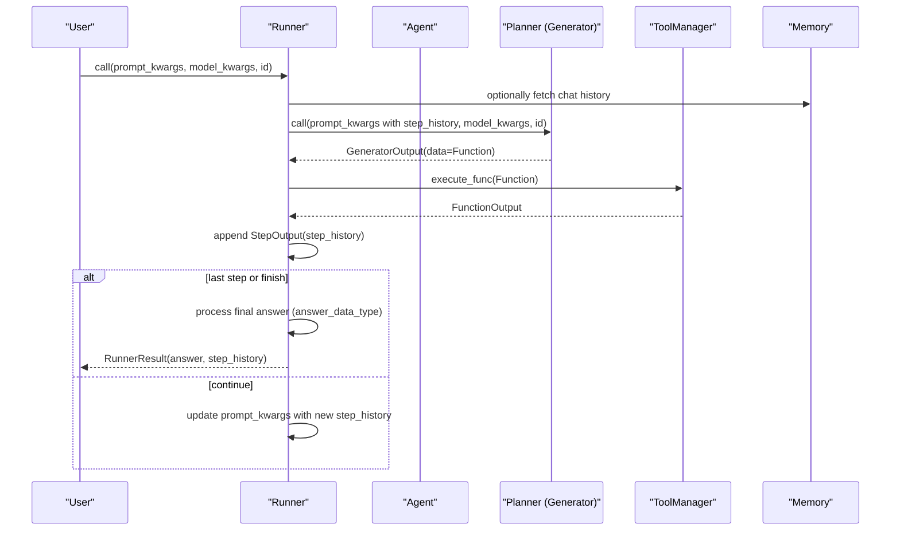
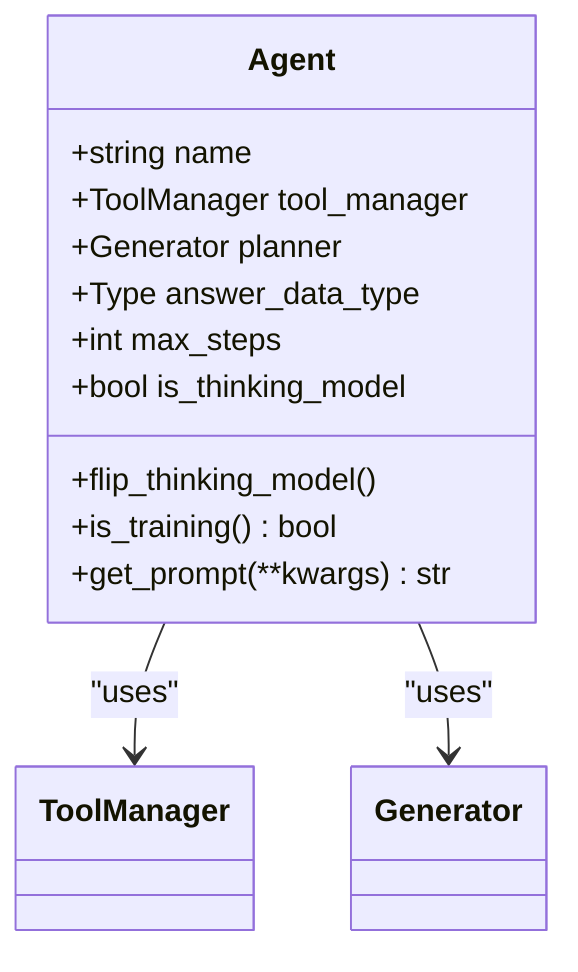
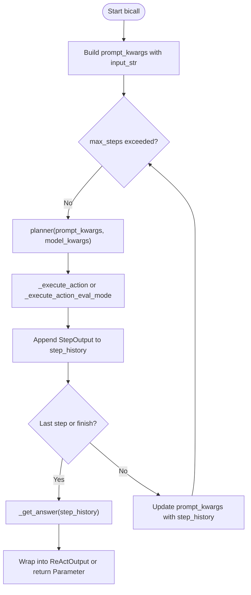
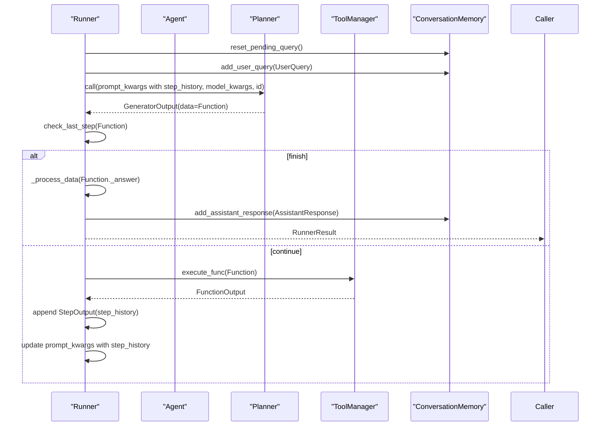
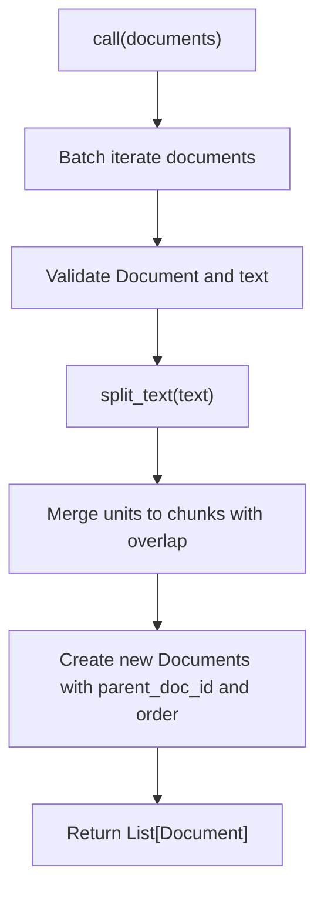
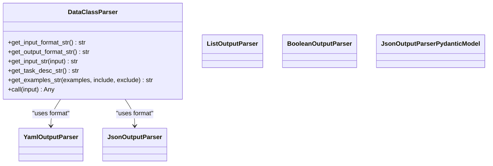
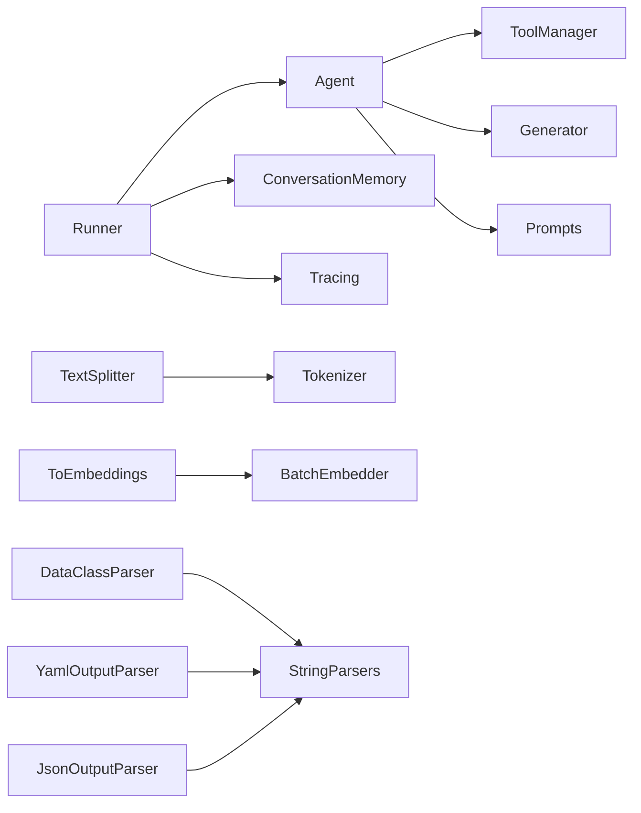

# Components API

<cite>
**Referenced Files in This Document**
- [agent.py](file://adalflow/adalflow/components/agent/agent.py)
- [react.py](file://adalflow/adalflow/components/agent/react.py)
- [runner.py](file://adalflow/adalflow/components/agent/runner.py)
- [prompts.py](file://adalflow/adalflow/components/agent/prompts.py)
- [text_splitter.py](file://adalflow/adalflow/components/data_process/text_splitter.py)
- [data_components.py](file://adalflow/adalflow/components/data_process/data_components.py)
- [dataclass_parser.py](file://adalflow/adalflow/components/output_parsers/dataclass_parser.py)
- [outputs.py](file://adalflow/adalflow/components/output_parsers/outputs.py)
- [memory.py](file://adalflow/adalflow/components/memory/memory.py)
- [__init__.py (agent)](file://adalflow/adalflow/components/agent/__init__.py)
- [__init__.py (data_process)](file://adalflow/adalflow/components/data_process/__init__.py)
- [__init__.py (output_parsers)](file://adalflow/adalflow/components/output_parsers/__init__.py)
- [__init__.py (memory)](file://adalflow/adalflow/components/memory/__init__.py)
- [test_agent.py](file://adalflow/tests/test_agent.py)
- [test_runner.py](file://adalflow/tests/test_runner.py)
- [test_data_class_parser.py](file://adalflow/tests/test_data_class_parser.py)
</cite>

## Table of Contents
1. [Introduction](#introduction)
2. [Project Structure](#project-structure)
3. [Core Components](#core-components)
4. [Architecture Overview](#architecture-overview)
5. [Detailed Component Analysis](#detailed-component-analysis)
6. [Dependency Analysis](#dependency-analysis)
7. [Performance Considerations](#performance-considerations)
8. [Troubleshooting Guide](#troubleshooting-guide)
9. [Conclusion](#conclusion)
10. [Appendices](#appendices)

## Introduction
This document provides comprehensive API documentation for AdalFlow’s specialized components, focusing on agent orchestration, data processing, output parsing, and memory. It covers:
- Agent components: Agent, ReactAgent, and AgentRunner (Runner)
- Data processing components: TextSplitter and data components
- Output parsers: DataclassParser and string-based parsers
- Memory components and their interfaces
- Method signatures, parameters, return types, lifecycle, state management, performance considerations, and composition patterns

## Project Structure
AdalFlow organizes components under dedicated subpackages:
- Agent components: components/agent
- Data processing: components/data_process
- Output parsers: components/output_parsers
- Memory: components/memory

**Diagram sources**
- [agent.py](file://adalflow/adalflow/components/agent/agent.py#L216-L387)
- [react.py](file://adalflow/adalflow/components/agent/react.py#L182-L768)
- [runner.py](file://adalflow/adalflow/components/agent/runner.py#L107-L800)
- [prompts.py](file://adalflow/adalflow/components/agent/prompts.py#L1-L121)
- [text_splitter.py](file://adalflow/adalflow/components/data_process/text_splitter.py#L47-L357)
- [data_components.py](file://adalflow/adalflow/components/data_process/data_components.py#L74-L132)
- [outputs.py](file://adalflow/adalflow/components/output_parsers/outputs.py#L130-L545)
- [dataclass_parser.py](file://adalflow/adalflow/components/output_parsers/dataclass_parser.py#L56-L196)
- [memory.py](file://adalflow/adalflow/components/memory/memory.py#L52-L226)

**Section sources**
- [__init__.py (agent)](file://adalflow/adalflow/components/agent/__init__.py#L1-L24)
- [__init__.py (data_process)](file://adalflow/adalflow/components/data_process/__init__.py#L1-L12)
- [__init__.py (output_parsers)](file://adalflow/adalflow/components/output_parsers/__init__.py#L1-L20)
- [__init__.py (memory)](file://adalflow/adalflow/components/memory/__init__.py#L1-L4)

## Core Components
- Agent: Orchestrates planning and tool execution with a ReAct-style loop, integrates a planner (Generator) and a tool manager.
- ReActAgent: Legacy ReAct implementation with explicit step history and finish action.
- Runner: Executes Agent workflows synchronously/asynchronously, manages streaming, tracing, permissions, and memory.
- TextSplitter: Splits documents into chunks using configurable separators or tokenization.
- Data components: ToEmbeddings and RetrieverOutputToContextStr for embeddings and context construction.
- Output parsers: DataClassParser and string-based parsers (Yaml, Json, List, Boolean) with schema-driven instructions.
- Memory: ConversationMemory for maintaining user-assistant dialog history.

**Section sources**
- [agent.py](file://adalflow/adalflow/components/agent/agent.py#L216-L387)
- [react.py](file://adalflow/adalflow/components/agent/react.py#L182-L768)
- [runner.py](file://adalflow/adalflow/components/agent/runner.py#L107-L800)
- [text_splitter.py](file://adalflow/adalflow/components/data_process/text_splitter.py#L47-L357)
- [data_components.py](file://adalflow/adalflow/components/data_process/data_components.py#L74-L132)
- [dataclass_parser.py](file://adalflow/adalflow/components/output_parsers/dataclass_parser.py#L56-L196)
- [outputs.py](file://adalflow/adalflow/components/output_parsers/outputs.py#L130-L545)
- [memory.py](file://adalflow/adalflow/components/memory/memory.py#L52-L226)

## Architecture Overview
High-level flow:
- Agent composes a planner (Generator) and a tool manager (ToolManager).
- Runner drives Agent execution, invoking the planner, executing tools, and collecting step history.
- Memory augments prompts with conversation context.
- Data components transform documents and embeddings; output parsers enforce structured output formats.

**Diagram sources**
- [runner.py](file://adalflow/adalflow/components/agent/runner.py#L529-L800)
- [agent.py](file://adalflow/adalflow/components/agent/agent.py#L216-L387)
- [prompts.py](file://adalflow/adalflow/components/agent/prompts.py#L32-L121)
- [memory.py](file://adalflow/adalflow/components/memory/memory.py#L77-L98)

## Detailed Component Analysis

### Agent
- Purpose: High-level orchestrator combining a planner and tool manager with ReAct-style iteration.
- Key methods and parameters:
  - Constructor parameters:
    - name: str
    - tools: Optional[List]
    - context_variables: Optional[Dict]
    - add_llm_as_fallback: bool
    - model_client: Optional[ModelClient]
    - model_kwargs: Optional[Dict]
    - model_type: Optional[ModelType]
    - template: Optional[str]
    - role_desc: Optional[Union[str, Prompt]]
    - cache_path: Optional[str]
    - use_cache: Optional[bool]
    - answer_data_type: Optional[Type]
    - max_steps: Optional[int]
    - is_thinking_model: Optional[bool]
    - tool_manager: Optional[ToolManager]
    - planner: Optional[Generator]
  - Methods:
    - flip_thinking_model(): Toggle thinking model and rebuild planner
    - is_training() -> bool: Mirror planner training state
    - get_prompt(**kwargs) -> str: Delegate to planner.get_prompt
- Lifecycle and state:
  - Initializes planner and tool manager; validates max_steps > 0.
  - Supports toggling thinking model to adjust output schema expectations.
- Practical usage:
  - Provide tools and model_client/model_kwargs; optionally add LLM as fallback.
  - Use answer_data_type to guide Runner final answer processing.

**Diagram sources**
- [agent.py](file://adalflow/adalflow/components/agent/agent.py#L216-L387)

**Section sources**
- [agent.py](file://adalflow/adalflow/components/agent/agent.py#L241-L387)
- [prompts.py](file://adalflow/adalflow/components/agent/prompts.py#L1-L121)
- [test_agent.py](file://adalflow/tests/test_agent.py#L51-L200)

### ReactAgent (Legacy)
- Purpose: Implements ReAct with explicit step history and finish action.
- Key methods and parameters:
  - Constructor parameters:
    - tools: List[Union[Callable, AsyncCallable, FunctionTool]]
    - max_steps: int
    - add_llm_as_fallback: bool
    - examples: Optional[Union[List[Function], List[str]]]
    - model_client: ModelClient
    - model_kwargs: Dict
    - template: Optional[str]
    - role_desc: Optional[str]
    - context_variables: Optional[Dict]
    - is_thinking_model: bool
    - use_cache: bool
    - debug: bool
    - answer_data_type: Type[T]
  - Methods:
    - _init_tools(...): Build tool list with optional LLM fallback and finish tool
    - _execute_action(...)
    - _execute_action_eval_mode(...)
    - _run_one_step(...)
    - _check_last_step(step_history) -> bool
    - _get_answer(step_history) -> Union[str, Parameter]
    - bicall(...) -> Union[Parameter, ReActOutput]
    - call(...) -> ReActOutput
- Notes:
  - Uses JsonOutputParser with include_fields controlled by is_thinking_model.
  - Provides ReActOutput with step_history and final answer.

**Diagram sources**
- [react.py](file://adalflow/adalflow/components/agent/react.py#L720-L763)

**Section sources**
- [react.py](file://adalflow/adalflow/components/agent/react.py#L239-L768)

### Runner
- Purpose: Executes Agent workflows with step iteration, tool execution, streaming, tracing, permissions, and memory.
- Key methods and parameters:
  - Constructor parameters:
    - agent: Agent
    - ctx: Optional[Dict]
    - max_steps: Optional[int] (overrides agent.max_steps)
    - permission_manager: Optional[PermissionManager]
    - conversation_memory: Optional[ConversationMemory]
  - Methods:
    - call(prompt_kwargs, model_kwargs=None, use_cache=None, id=None) -> RunnerResult
    - _tool_execute_sync(function) -> FunctionOutput
    - _process_data(data, id=None) -> T
    - _check_last_step(function) -> bool
    - _get_final_answer(function) -> Any
    - is_cancelled() -> bool
    - register_cancel_callback(callback) -> None
    - cancel() -> None
    - get_token_consumption() -> Dict[str, Any]
    - _update_token_consumption() -> None
- Streaming and tracing:
  - Emits RunItemStreamEvent items; supports cancellation and completion events.
  - Integrates tracing spans for runner, step, tool, and response.
- Memory integration:
  - Optionally appends user/assistant turns and formats chat history for prompts.
- Permissions:
  - Registers tools with PermissionManager requiring approvals.

**Diagram sources**
- [runner.py](file://adalflow/adalflow/components/agent/runner.py#L529-L800)
- [memory.py](file://adalflow/adalflow/components/memory/memory.py#L137-L221)

**Section sources**
- [runner.py](file://adalflow/adalflow/components/agent/runner.py#L136-L800)
- [test_runner.py](file://adalflow/tests/test_runner.py#L162-L200)

### TextSplitter
- Purpose: Split documents into overlapping chunks using separators or tokenization.
- Key methods and parameters:
  - Constructor parameters:
    - split_by: Literal["word","sentence","page","passage","token"]
    - chunk_size: int
    - chunk_overlap: int
    - batch_size: int
    - separators: Optional[dict]
  - Methods:
    - split_text(text: str) -> List[str]
    - call(documents: List[Document]) -> List[Document]
- Behavior:
  - Validates chunk_size and chunk_overlap.
  - Supports tokenization via Tokenizer for accurate model token counts.
  - Maintains original spacing/punctuation except for last segment.

**Diagram sources**
- [text_splitter.py](file://adalflow/adalflow/components/data_process/text_splitter.py#L238-L301)

**Section sources**
- [text_splitter.py](file://adalflow/adalflow/components/data_process/text_splitter.py#L159-L357)

### Data Components
- ToEmbeddings
  - Transforms a sequence of Documents to embeddings using a BatchEmbedder.
  - Preserves input order and writes embeddings back to each Document.vector.
- RetrieverOutputToContextStr
  - Converts RetrieverOutput (or list) to a concatenated context string.
  - Optional deduplication by chunk id.

**Section sources**
- [data_components.py](file://adalflow/adalflow/components/data_process/data_components.py#L74-L132)

### Output Parsers
- DataClassParser
  - Parses structured output using a DataClass schema.
  - Supports JSON/YAML output formats with format instructions.
  - Methods:
    - get_input_format_str() -> str
    - get_output_format_str() -> str
    - get_input_str(input: DataClass) -> str
    - get_task_desc_str() -> str
    - get_examples_str(examples, include, exclude) -> str
    - call(input: str) -> Any
- String-based parsers (YamlOutputParser, JsonOutputParser, ListOutputParser, BooleanOutputParser, JsonOutputParserPydanticModel)
  - Provide format instructions and parse outputs to dicts, lists, booleans, or Pydantic models.
  - JsonOutputParserPydanticModel offers schema-driven validation with Pydantic.

**Diagram sources**
- [dataclass_parser.py](file://adalflow/adalflow/components/output_parsers/dataclass_parser.py#L56-L196)
- [outputs.py](file://adalflow/adalflow/components/output_parsers/outputs.py#L130-L545)

**Section sources**
- [dataclass_parser.py](file://adalflow/adalflow/components/output_parsers/dataclass_parser.py#L98-L196)
- [outputs.py](file://adalflow/adalflow/components/output_parsers/outputs.py#L158-L545)
- [test_data_class_parser.py](file://adalflow/tests/test_data_class_parser.py#L27-L143)

### Memory
- ConversationMemory
  - Stores current conversation and persists turns.
  - Formats conversation history via a Jinja2 template.
  - Methods:
    - call(metadata_filter: Optional[List[str]]) -> str
    - add_user_query(user_query: Union[str, UserQuery]) -> str
    - add_assistant_response(assistant_response: Union[str, AssistantResponse]) -> str
    - clear_conversation_turns()
    - new_conversation()
    - reset_pending_query()

**Section sources**
- [memory.py](file://adalflow/adalflow/components/memory/memory.py#L52-L226)

## Dependency Analysis
- Agent depends on:
  - ToolManager for tool execution
  - Generator (planner) for step-wise reasoning
  - Prompts for system/task descriptions
- Runner depends on:
  - Agent (planner and tool_manager)
  - ConversationMemory for context
  - Tracing utilities for observability
- Data components depend on:
  - Embedder/BatchEmbedder for embeddings
  - Tokenizer for TextSplitter
- Output parsers depend on:
  - String parsers (YamlParser, JsonParser, ListParser)
  - DataClass schema introspection

**Diagram sources**
- [agent.py](file://adalflow/adalflow/components/agent/agent.py#L216-L387)
- [runner.py](file://adalflow/adalflow/components/agent/runner.py#L107-L800)
- [text_splitter.py](file://adalflow/adalflow/components/data_process/text_splitter.py#L47-L357)
- [data_components.py](file://adalflow/adalflow/components/data_process/data_components.py#L74-L132)
- [outputs.py](file://adalflow/adalflow/components/output_parsers/outputs.py#L130-L545)
- [dataclass_parser.py](file://adalflow/adalflow/components/output_parsers/dataclass_parser.py#L56-L196)

**Section sources**
- [agent.py](file://adalflow/adalflow/components/agent/agent.py#L216-L387)
- [runner.py](file://adalflow/adalflow/components/agent/runner.py#L107-L800)
- [text_splitter.py](file://adalflow/adalflow/components/data_process/text_splitter.py#L47-L357)
- [data_components.py](file://adalflow/adalflow/components/data_process/data_components.py#L74-L132)
- [outputs.py](file://adalflow/adalflow/components/output_parsers/outputs.py#L130-L545)
- [dataclass_parser.py](file://adalflow/adalflow/components/output_parsers/dataclass_parser.py#L56-L196)

## Performance Considerations
- Token accounting:
  - Runner tracks estimated token consumption per step and total prompt tokens.
- Caching:
  - Agent and Runner accept use_cache and cache_path to reuse planner outputs.
- Streaming:
  - Runner supports async streaming with intermediate events; use for long-running steps.
- Memory:
  - ConversationMemory appends minimal metadata; filter selectively via metadata_filter.
- TextSplitter:
  - Tune chunk_size and chunk_overlap to balance context retention and cost.
  - Use token-based splitting for accurate model token budgets.

[No sources needed since this section provides general guidance]

## Troubleshooting Guide
- Agent initialization errors:
  - Ensure model_client and model_kwargs are provided when add_llm_as_fallback is enabled.
  - Validate max_steps > 0.
- Runner unrecoverable errors:
  - Certain HTTP error strings and connection errors are treated as unrecoverable; the loop stops early.
- Output parsing failures:
  - DataClassParser and string parsers raise exceptions on invalid formats; verify schema and format_type.
- Memory state:
  - Ensure add_assistant_response follows add_user_query; otherwise raises validation errors.

**Section sources**
- [agent.py](file://adalflow/adalflow/components/agent/agent.py#L345-L352)
- [runner.py](file://adalflow/adalflow/components/agent/runner.py#L634-L646)
- [dataclass_parser.py](file://adalflow/adalflow/components/output_parsers/dataclass_parser.py#L180-L190)
- [memory.py](file://adalflow/adalflow/components/memory/memory.py#L184-L188)

## Conclusion
AdalFlow’s components provide a cohesive framework for building intelligent agents:
- Agent and Runner encapsulate planning, tool execution, and lifecycle management.
- Data components streamline document processing and retrieval context assembly.
- Output parsers enforce structured, schema-driven responses.
- Memory enables contextual conversation persistence.
Use composition patterns to plug in custom tools, parsers, and memory providers, and leverage streaming/tracing for production-grade observability.

[No sources needed since this section summarizes without analyzing specific files]

## Appendices

### Component Composition Patterns
- Agent + Runner:
  - Pass an Agent instance to Runner; Runner controls max_steps and integrates memory and permissions.
- Data pipeline:
  - TextSplitter → ToEmbeddings → Retriever → RetrieverOutputToContextStr → Generator with output processors.
- Output formatting:
  - Use DataClassParser or Yaml/Json parsers to constrain LLM output to structured formats.

**Section sources**
- [runner.py](file://adalflow/adalflow/components/agent/runner.py#L136-L190)
- [text_splitter.py](file://adalflow/adalflow/components/data_process/text_splitter.py#L238-L301)
- [data_components.py](file://adalflow/adalflow/components/data_process/data_components.py#L74-L132)
- [dataclass_parser.py](file://adalflow/adalflow/components/output_parsers/dataclass_parser.py#L98-L196)
- [outputs.py](file://adalflow/adalflow/components/output_parsers/outputs.py#L158-L545)

### Configuration Options Summary
- Agent:
  - model_client, model_kwargs, model_type, template, role_desc, cache_path, use_cache, answer_data_type, max_steps, is_thinking_model, tool_manager, planner
- Runner:
  - agent, ctx, max_steps, permission_manager, conversation_memory
- TextSplitter:
  - split_by, chunk_size, chunk_overlap, batch_size, separators
- DataClassParser:
  - data_class, return_data_class, format_type
- String parsers:
  - include_fields, exclude_fields, examples, return_data_class or return_pydantic_object
- Memory:
  - turn_db, user_id

**Section sources**
- [agent.py](file://adalflow/adalflow/components/agent/agent.py#L241-L343)
- [runner.py](file://adalflow/adalflow/components/agent/runner.py#L136-L190)
- [text_splitter.py](file://adalflow/adalflow/components/data_process/text_splitter.py#L159-L213)
- [dataclass_parser.py](file://adalflow/adalflow/components/output_parsers/dataclass_parser.py#L98-L124)
- [outputs.py](file://adalflow/adalflow/components/output_parsers/outputs.py#L202-L492)
- [memory.py](file://adalflow/adalflow/components/memory/memory.py#L52-L66)