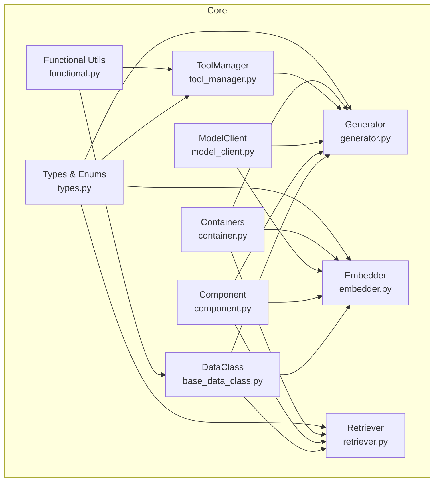
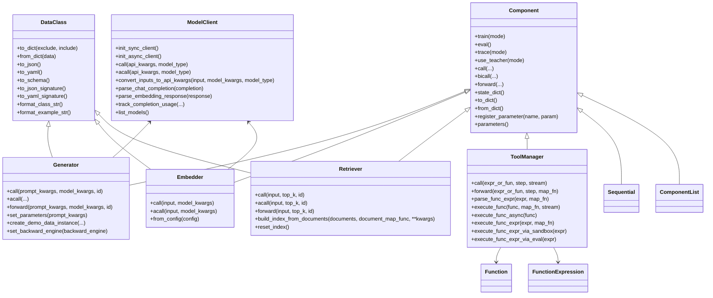
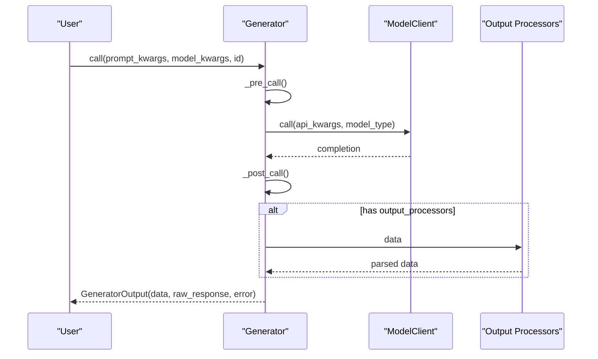
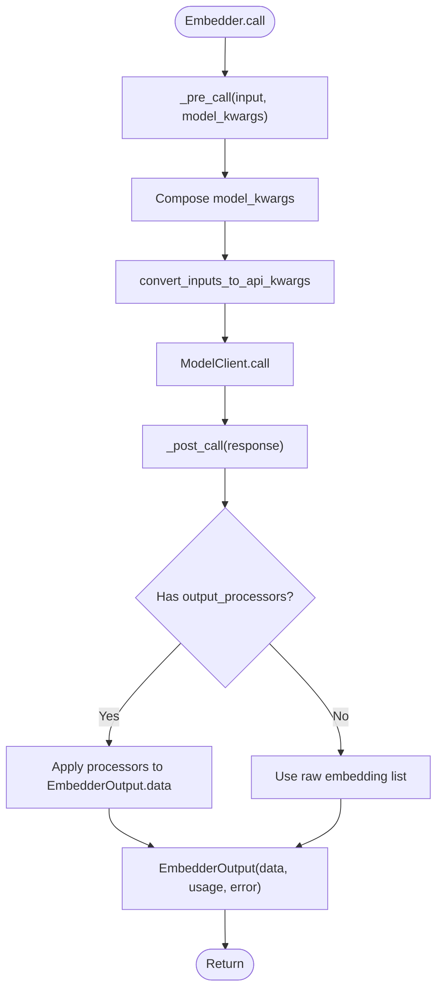
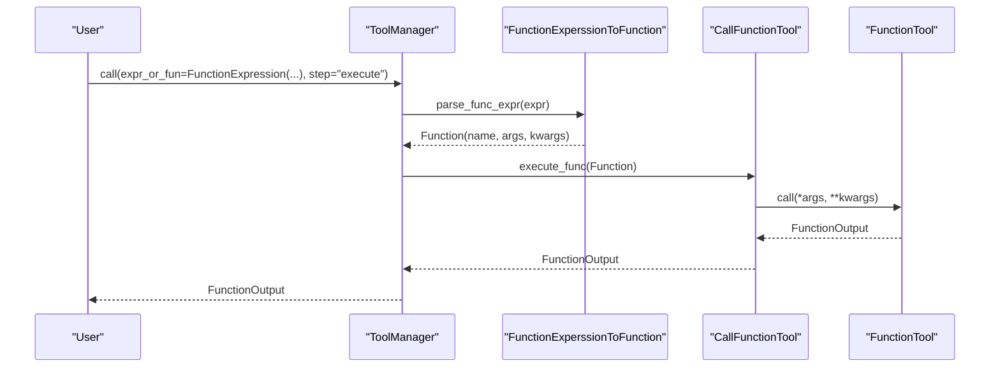
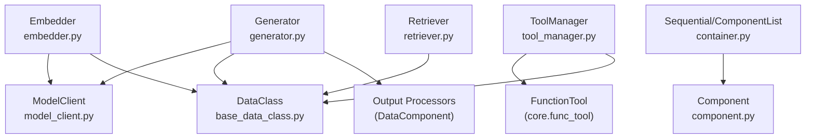

# Core API

<cite>
**Referenced Files in This Document**
- [base_data_class.py](file://adalflow/adalflow/core/base_data_class.py)
- [component.py](file://adalflow/adalflow/core/component.py)
- [generator.py](file://adalflow/adalflow/core/generator.py)
- [embedder.py](file://adalflow/adalflow/core/embedder.py)
- [retriever.py](file://adalflow/adalflow/core/retriever.py)
- [model_client.py](file://adalflow/adalflow/core/model_client.py)
- [tool_manager.py](file://adalflow/adalflow/core/tool_manager.py)
- [types.py](file://adalflow/adalflow/core/types.py)
- [functional.py](file://adalflow/adalflow/core/functional.py)
- [container.py](file://adalflow/adalflow/core/container.py)
- [__init__.py](file://adalflow/adalflow/core/__init__.py)
</cite>

## Table of Contents
1. [Introduction](#introduction)
2. [Project Structure](#project-structure)
3. [Core Components](#core-components)
4. [Architecture Overview](#architecture-overview)
5. [Detailed Component Analysis](#detailed-component-analysis)
6. [Dependency Analysis](#dependency-analysis)
7. [Performance Considerations](#performance-considerations)
8. [Troubleshooting Guide](#troubleshooting-guide)
9. [Conclusion](#conclusion)
10. [Appendices](#appendices)

## Introduction
This document provides comprehensive API documentation for AdalFlow’s core building blocks. It focuses on the foundational classes and utilities that power LLM pipelines: DataClass, Component, Generator, Embedder, Retriever, ModelClient, ToolManager, and supporting types and utilities. For each class, we describe initialization parameters, method signatures, return types, configuration options, runtime behaviors, and usage patterns. We also include class hierarchies, inheritance relationships, interface contracts, and practical examples drawn from the repository.

## Project Structure
The core API resides primarily under adalflow/adalflow/core/. Key modules include:
- base_data_class.py: DataClass and related helpers for structured data handling
- component.py: Base Component and related pipeline utilities
- generator.py: Generator orchestration for LLM calls
- embedder.py: Embedder for vector embeddings
- retriever.py: Retrieval abstraction
- model_client.py: Protocol for model providers
- tool_manager.py: Tool execution and function call management
- types.py: Shared data models and enums
- functional.py: Utilities for dataclass schemas, function parsing, and conversions
- container.py: Composition containers (Sequential, ComponentList)
- __init__.py: Public exports and registry registration

**Diagram sources**
- [base_data_class.py](file://adalflow/adalflow/core/base_data_class.py#L97-L761)
- [component.py](file://adalflow/adalflow/core/component.py#L51-L800)
- [generator.py](file://adalflow/adalflow/core/generator.py#L82-L774)
- [embedder.py](file://adalflow/adalflow/core/embedder.py#L23-L189)
- [retriever.py](file://adalflow/adalflow/core/retriever.py#L22-L143)
- [model_client.py](file://adalflow/adalflow/core/model_client.py#L16-L128)
- [tool_manager.py](file://adalflow/adalflow/core/tool_manager.py#L134-L575)
- [types.py](file://adalflow/adalflow/core/types.py#L55-L135)
- [functional.py](file://adalflow/adalflow/core/functional.py#L48-L570)
- [container.py](file://adalflow/adalflow/core/container.py#L62-L537)

**Section sources**
- [__init__.py](file://adalflow/adalflow/core/__init__.py#L1-L134)

## Core Components
This section summarizes the primary classes and their roles, focusing on initialization parameters, key methods, and runtime behaviors.

- DataClass
  - Purpose: Structured data with schema/signature/example generation and serialization
  - Key methods: to_dict, from_dict, to_json, to_yaml, to_schema, to_json_signature, to_yaml_signature, format_class_str, format_example_str
  - Configuration: input/output field ordering, format types, exclusion/inclusion rules
  - Usage: Define structured outputs for LLMs; generate signatures/examples for prompts

- Component
  - Purpose: Base class for all pipeline components; supports training, tracing, parameter registration, serialization
  - Key methods: train, eval, trace, use_teacher, call, bicall, forward, state_dict, load_state_dict, to_dict, from_dict, register_parameter, named_parameters
  - Runtime: Mode flags (training, tracing, teacher_mode); parameter graph wiring; serialization with pickling fallback

- Generator
  - Purpose: Orchestrates Prompt + ModelClient + Output processors for LLM calls
  - Key methods: call, acall, forward, _pre_call, _post_call, _async_post_call, set_parameters, create_demo_data_instance, set_backward_engine
  - Configuration: model_client, model_kwargs, model_type, template, prompt_kwargs, output_processors, cache_path, use_cache
  - Streaming: Supports async streaming; async post-processing pipeline

- Embedder
  - Purpose: Vector embedding orchestration via ModelClient and optional output processors
  - Key methods: call, acall, _pre_call, _post_call, from_config
  - Configuration: model_client, model_kwargs, output_processors
  - BatchEmbedder: Automatic batching wrapper

- Retriever
  - Purpose: Retrieval abstraction with index lifecycle and parameterized forward pass
  - Key methods: call, acall, forward, build_index_from_documents, reset_index
  - Configuration: indexed, index_keys, top_k

- ModelClient
  - Purpose: Protocol for model providers; bridges standardized inputs to provider APIs
  - Key methods: init_sync_client, init_async_client, call, acall, convert_inputs_to_api_kwargs, parse_chat_completion, parse_embedding_response, track_completion_usage, list_models

- ToolManager
  - Purpose: Manage tools, context, and function execution; supports parsing and executing function expressions
  - Key methods: call, forward, parse_func_expr, execute_func, execute_func_async, execute_func_expr, execute_func_expr_via_sandbox, execute_func_expr_via_eval
  - Configuration: tools, additional_context

- Types and Functional Utilities
  - Types: ModelType, EmbedderOutput, GeneratorOutput, RetrieverOutput, Function/FunctionExpression/FunctionOutput, CompletionUsage, Embedding, Usage
  - Functional: Schema generation, dataclass conversion, function parsing, sandbox execution

**Section sources**
- [base_data_class.py](file://adalflow/adalflow/core/base_data_class.py#L97-L761)
- [component.py](file://adalflow/adalflow/core/component.py#L51-L800)
- [generator.py](file://adalflow/adalflow/core/generator.py#L82-L774)
- [embedder.py](file://adalflow/adalflow/core/embedder.py#L23-L189)
- [retriever.py](file://adalflow/adalflow/core/retriever.py#L22-L143)
- [model_client.py](file://adalflow/adalflow/core/model_client.py#L16-L128)
- [tool_manager.py](file://adalflow/adalflow/core/tool_manager.py#L134-L575)
- [types.py](file://adalflow/adalflow/core/types.py#L55-L135)
- [functional.py](file://adalflow/adalflow/core/functional.py#L48-L570)

## Architecture Overview
The core architecture centers around Component as the base class, with specialized components (Generator, Embedder, Retriever) consuming ModelClient implementations. DataClass provides structured data contracts and serialization. ToolManager integrates external functions into the pipeline. Containers enable composition.

**Diagram sources**
- [component.py](file://adalflow/adalflow/core/component.py#L51-L800)
- [base_data_class.py](file://adalflow/adalflow/core/base_data_class.py#L97-L761)
- [model_client.py](file://adalflow/adalflow/core/model_client.py#L16-L128)
- [generator.py](file://adalflow/adalflow/core/generator.py#L82-L774)
- [embedder.py](file://adalflow/adalflow/core/embedder.py#L23-L189)
- [retriever.py](file://adalflow/adalflow/core/retriever.py#L22-L143)
- [tool_manager.py](file://adalflow/adalflow/core/tool_manager.py#L134-L575)
- [container.py](file://adalflow/adalflow/core/container.py#L62-L537)

## Detailed Component Analysis

### DataClass
- Purpose: Provides structured data handling with schema/signature/example generation and serialization.
- Initialization parameters:
  - None (class-level behavior)
- Key methods and signatures:
  - to_dict(exclude: ExcludeType = None, include: IncludeType = None) -> Dict[str, Any]
  - from_dict(data: Dict[str, Any]) -> DataClass
  - to_json(exclude: ExcludeType = None, include: IncludeType = None) -> str
  - to_yaml(exclude: ExcludeType = None, include: IncludeType = None) -> str
  - to_schema(exclude: ExcludeType = None, include: IncludeType = None) -> Dict[str, Dict[str, Any]]
  - to_json_signature(exclude: ExcludeType = None, include: IncludeType = None) -> str
  - to_yaml_signature(exclude: ExcludeType = None, include: IncludeType = None) -> str
  - format_class_str(format_type: DataClassFormatType, exclude: ExcludeType = None, include: IncludeType = None) -> str
  - format_example_str(format_type: DataClassFormatType, exclude: ExcludeType = None, include: IncludeType = None) -> str
- Configuration options:
  - __input_fields__, __output_fields__: Control serialization order
  - Metadata “desc” and “prefix” per field for schema/signature
- Usage patterns:
  - Define outputs as dataclasses inheriting from DataClass
  - Use to_json_signature/to_yaml_signature for LLM prompts
  - Use to_dict/from_dict for serialization and state saving
- Error handling:
  - ValueError for invalid usage (e.g., mixing include/exclude)
  - TypeError for missing required fields when loading from dict
- Best practices:
  - Prefer explicit metadata “desc” for clarity
  - Use input/output field ordering to guide prompt construction

**Section sources**
- [base_data_class.py](file://adalflow/adalflow/core/base_data_class.py#L97-L761)

### Component
- Purpose: Base class for all pipeline components; supports training/tracing modes, parameter registration, and serialization.
- Initialization parameters:
  - name: Optional[str] = None
- Key methods and signatures:
  - train(mode: bool = True) -> Self
  - eval() -> Self
  - trace(mode: bool = True) -> Self
  - use_teacher(mode: bool = True) -> Self
  - call(*args, **kwargs) -> Any
  - bicall(*args, **kwargs) -> Any
  - forward(*args, **kwargs) -> Any
  - state_dict(destination: Optional[Dict] = None, prefix: Optional[str] = "") -> Dict[str, Any]
  - load_state_dict(state_dict: Mapping[str, Any], strict: bool = True) -> None
  - to_dict(exclude: Optional[List[str]] = None) -> Dict[str, Any]
  - from_dict(data: Dict[str, Any]) -> Self
  - register_parameter(name: str, param: Optional["Parameter"] = None) -> None
  - parameters(recursive: bool = True) -> Iterable["Parameter"]
  - named_parameters(prefix: str = "", recursive: bool = True, remove_duplicate: bool = True) -> Iterable[Tuple[str, "Parameter"]]
- Runtime behaviors:
  - Mode flags propagate to child components
  - Parameter graph wiring enforced in training mode
  - Serialization supports nested components and fallback to pickling
- Error handling:
  - ValueError for invalid mode values
  - TypeError for invalid parameter assignment
- Best practices:
  - Always call super().__init__() and register parameters early
  - Use named_parameters for optimizer integration

**Section sources**
- [component.py](file://adalflow/adalflow/core/component.py#L51-L800)

### Generator
- Purpose: Orchestrates Prompt + ModelClient + Output processors for LLM calls with optional caching and backward pass support.
- Initialization parameters:
  - model_client: ModelClient
  - model_kwargs: Dict[str, Any] = {}
  - model_type: Optional[ModelType] = ModelType.LLM
  - template: Optional[str] = DEFAULT_ADALFLOW_SYSTEM_PROMPT
  - prompt_kwargs: Optional[Dict] = {}
  - output_processors: Optional[DataComponent] = None
  - name: Optional[str] = None
  - cache_path: Optional[str] = None
  - use_cache: bool = True
- Key methods and signatures:
  - call(prompt_kwargs: Optional[Dict[str, Union[str, Parameter]]] = {}, model_kwargs: Optional[Dict] = {}, id: Optional[str] = {}) -> Any
  - acall(...) -> Any
  - forward(prompt_kwargs: Optional[Dict] = {}, model_kwargs: Optional[Dict] = {}, id: Optional[str] = {}) -> "Parameter"
  - _pre_call(prompt_kwargs: Dict, model_kwargs: Dict) -> Dict[str, Any]
  - _post_call(completion: Any) -> GeneratorOutput
  - _async_post_call(completion: Any) -> GeneratorOutput
  - set_parameters(prompt_kwargs: PromptArgType)
  - create_demo_data_instance(input_prompt_kwargs: Dict[str, Any], output: GeneratorOutput, id: Optional[str] = None)
  - set_backward_engine(backward_engine: Optional["BackwardEngine"] = None)
  - set_cache_path(cache_path: str, model_client: object, model: str)
  - get_cache_path() -> str
  - print_prompt(**kwargs) -> str
  - get_prompt(**kwargs) -> str
- Configuration options:
  - model_type: LLM, LLM_REASONING, IMAGE_GENERATION, etc.
  - cache_path and use_cache for caching completions
  - output_processors for post-processing raw responses
- Runtime behaviors:
  - Token estimation via tokenizer
  - Streaming support via async iterators
  - Backward pass via BackwardEngine and Parameter graph
- Error handling:
  - ValueError for missing teacher generator in teacher mode
  - ValueError for invalid output types
- Best practices:
  - Use output_processors for structured parsing
  - Enable caching for repeated prompts
  - Provide ids for tracing and demo collection

**Diagram sources**
- [generator.py](file://adalflow/adalflow/core/generator.py#L463-L495)
- [generator.py](file://adalflow/adalflow/core/generator.py#L519-L544)
- [generator.py](file://adalflow/adalflow/core/generator.py#L357-L380)

**Section sources**
- [generator.py](file://adalflow/adalflow/core/generator.py#L82-L774)
- [types.py](file://adalflow/adalflow/core/types.py#L486-L675)

### Embedder
- Purpose: Produces embeddings via ModelClient with optional output processors.
- Initialization parameters:
  - model_client: ModelClient
  - model_kwargs: Dict[str, Any] = {}
  - output_processors: Optional[DataComponent] = None
- Key methods and signatures:
  - call(input: EmbedderInputType, model_kwargs: Optional[Dict] = {}) -> EmbedderOutputType
  - acall(input: EmbedderInputType, model_kwargs: Optional[Dict] = {}) -> EmbedderOutputType
  - from_config(config: Dict[str, Any]) -> Embedder
  - _pre_call(input: EmbedderInputType, model_kwargs: Optional[Dict] = {}) -> Dict
  - _post_call(response: Any) -> EmbedderOutputType
- Configuration options:
  - model_kwargs validated and composed
  - output_processors operate on EmbedderOutput.data
- Runtime behaviors:
  - Supports single or batched inputs
  - Adds input back to output for provenance
- Error handling:
  - ValueError for invalid model_client type
  - Error captured in EmbedderOutput.error
- Best practices:
  - Use BatchEmbedder for large batches
  - Configure dimensions and encoding format via model_kwargs

**Diagram sources**
- [embedder.py](file://adalflow/adalflow/core/embedder.py#L96-L108)
- [embedder.py](file://adalflow/adalflow/core/embedder.py#L110-L132)

**Section sources**
- [embedder.py](file://adalflow/adalflow/core/embedder.py#L23-L189)
- [types.py](file://adalflow/adalflow/core/types.py#L140-L215)

### Retriever
- Purpose: Retrieves documents for queries with index lifecycle and parameterized forward pass.
- Initialization parameters:
  - indexed: bool = False
  - index_keys: List[str] = []
- Key methods and signatures:
  - call(input: RetrieverQueriesType, top_k: Optional[int] = None, id: str = None, **kwargs) -> RetrieverOutputType
  - acall(input: RetrieverQueriesType, top_k: Optional[int] = None, id: str = None, **kwargs) -> RetrieverOutputType
  - forward(input: Union[RetrieverQueriesType, Parameter], top_k: Optional[int] = None, id: str = None, **kwargs) -> Parameter
  - build_index_from_documents(documents: RetrieverDocumentsType, document_map_func: Optional[Callable] = None, **kwargs)
  - reset_index()
  - save_to_file(path: str)
  - load_from_file(cls, path: str)
- Configuration options:
  - top_k hyperparameter tracked as Parameter
- Runtime behaviors:
  - Forward pass wires input and top_k into OutputParameter
  - Index lifecycle managed by subclass implementations
- Error handling:
  - NotImplementedError for abstract methods
- Best practices:
  - Implement reset_index and build_index_from_documents in subclasses
  - Use save_to_file/load_from_file for persistence

**Section sources**
- [retriever.py](file://adalflow/adalflow/core/retriever.py#L22-L143)

### ModelClient
- Purpose: Protocol for model providers; converts standardized inputs to provider-specific API calls.
- Key methods and signatures:
  - init_sync_client()
  - init_async_client()
  - call(api_kwargs: Dict = {}, model_type: ModelType = ModelType.UNDEFINED)
  - acall(api_kwargs: Dict = {}, model_type: ModelType = ModelType.UNDEFINED)
  - convert_inputs_to_api_kwargs(input: Optional[Any] = None, model_kwargs: Dict = {}, model_type: ModelType = ModelType.UNDEFINED) -> Dict
  - parse_chat_completion(completion: Any) -> GeneratorOutput
  - parse_embedding_response(response: Any) -> EmbedderOutput
  - track_completion_usage(*args, **kwargs) -> CompletionUsage
  - list_models()
- Configuration options:
  - Provider-specific model_kwargs and model_type routing
- Runtime behaviors:
  - Subclasses implement provider-specific logic and error handling
- Error handling:
  - NotImplementedError for abstract methods
- Best practices:
  - Implement robust error handling and retries in subclasses
  - Normalize provider responses to shared output types

**Section sources**
- [model_client.py](file://adalflow/adalflow/core/model_client.py#L16-L128)

### ToolManager
- Purpose: Manages tools, context, and function execution; parses and executes function expressions.
- Initialization parameters:
  - tools: ToolsType = []
  - additional_context: Optional[Dict[str, object]] = {}
- Key methods and signatures:
  - call(expr_or_fun: Union[FunctionExpression, Function], step: Literal["parse","execute"] = "execute", stream: bool = False)
  - forward(expr_or_fun: Union[FunctionExpression, Function, Parameter], step: Literal["parse","execute"] = "execute", map_fn: Callable = lambda x: x.data)
  - parse_func_expr(expr: Union[FunctionExpression, Parameter], map_fn: Callable = lambda x: x.data) -> Union[Function, Parameter]
  - execute_func(func: Union[Function, Parameter], map_fn: Callable = lambda x: x.data, stream: bool = False) -> Union[FunctionOutput, Parameter]
  - execute_func_async(func: Function) -> FunctionOutput
  - execute_func_expr(expr: Union[FunctionExpression, Parameter], map_fn: Callable = lambda x: x.data) -> Union[FunctionOutput, Parameter]
  - execute_func_expr_via_sandbox(expr: FunctionExpression) -> FunctionOutput
  - execute_func_expr_via_eval(expr: FunctionExpression) -> FunctionOutput
- Configuration options:
  - Tools can be FunctionTool, callable, or awaitable
  - Context map built from tools and additional_context
- Runtime behaviors:
  - Supports sync and async tool execution
  - Parses function expressions into Function objects
  - Sandboxed and eval-based execution paths
- Error handling:
  - ValueError for invalid inputs and parsing/executing errors
- Best practices:
  - Ensure unique tool names in context map
  - Use stream flag for streaming-compatible tools

**Diagram sources**
- [tool_manager.py](file://adalflow/adalflow/core/tool_manager.py#L211-L233)
- [tool_manager.py](file://adalflow/adalflow/core/tool_manager.py#L310-L351)
- [tool_manager.py](file://adalflow/adalflow/core/tool_manager.py#L491-L524)

**Section sources**
- [tool_manager.py](file://adalflow/adalflow/core/tool_manager.py#L134-L575)

### Supporting Utilities and Types
- Types and Enums:
  - ModelType: EMBEDDER, LLM, LLM_REASONING, RERANKER, IMAGE_GENERATION, UNDEFINED
  - EmbedderOutput, GeneratorOutput, RetrieverOutput, Function/FunctionExpression/FunctionOutput, CompletionUsage, Embedding, Usage
- Functional Utilities:
  - Schema generation: get_dataclass_schema, convert_schema_to_signature, get_type_schema
  - Dataclass conversion: custom_asdict, dataclass_obj_from_dict
  - Function parsing: parse_function_call_expr, generate_function_call_expression_from_callable
  - Sandbox execution: sandbox_exec

**Section sources**
- [types.py](file://adalflow/adalflow/core/types.py#L55-L135)
- [types.py](file://adalflow/adalflow/core/types.py#L486-L675)
- [functional.py](file://adalflow/adalflow/core/functional.py#L48-L570)

## Dependency Analysis
This section outlines key dependencies and relationships among core components.

**Diagram sources**
- [generator.py](file://adalflow/adalflow/core/generator.py#L82-L205)
- [embedder.py](file://adalflow/adalflow/core/embedder.py#L23-L65)
- [retriever.py](file://adalflow/adalflow/core/retriever.py#L22-L47)
- [tool_manager.py](file://adalflow/adalflow/core/tool_manager.py#L134-L168)
- [container.py](file://adalflow/adalflow/core/container.py#L62-L537)
- [component.py](file://adalflow/adalflow/core/component.py#L51-L144)

**Section sources**
- [generator.py](file://adalflow/adalflow/core/generator.py#L82-L205)
- [embedder.py](file://adalflow/adalflow/core/embedder.py#L23-L65)
- [retriever.py](file://adalflow/adalflow/core/retriever.py#L22-L47)
- [tool_manager.py](file://adalflow/adalflow/core/tool_manager.py#L134-L168)
- [container.py](file://adalflow/adalflow/core/container.py#L62-L537)
- [component.py](file://adalflow/adalflow/core/component.py#L51-L144)

## Performance Considerations
- Caching:
  - Generator supports caching completions to reduce latency and cost. Use cache_path and use_cache appropriately.
- Streaming:
  - Generator supports async streaming; avoid output_processors during streaming to prevent premature consumption.
- Embedding:
  - Use BatchEmbedder for large-scale embeddings to amortize overhead.
- Serialization:
  - Component.to_dict supports nested components; fallback to pickle for non-serializable objects.
- Tokenization:
  - Generator estimates tokens for prompts; consider truncation or summarization for long prompts.

[No sources needed since this section provides general guidance]

## Troubleshooting Guide
- DataClass
  - Mixing include/exclude raises ValueError; ensure only one is used.
  - Missing required fields in from_dict raises ValueError.
- Component
  - Invalid mode values raise ValueError; ensure boolean flags.
  - Parameter registration requires Component.__init__ to be called.
- Generator
  - Missing teacher generator in teacher mode raises ValueError.
  - Output type mismatch raises ValueError in training mode.
- Embedder
  - Invalid model_client type raises TypeError.
  - Errors captured in EmbedderOutput.error.
- Retriever
  - Abstract methods raise NotImplementedError; implement in subclass.
- ModelClient
  - Subclasses must implement all abstract methods; otherwise NotImplementedError is raised.
- ToolManager
  - Duplicate tool names in context map trigger warnings; ensure unique names.
  - Parsing/executing errors raise ValueError with details.

**Section sources**
- [base_data_class.py](file://adalflow/adalflow/core/base_data_class.py#L314-L316)
- [component.py](file://adalflow/adalflow/core/component.py#L147-L149)
- [generator.py](file://adalflow/adalflow/core/generator.py#L666-L667)
- [generator.py](file://adalflow/adalflow/core/generator.py#L688-L691)
- [embedder.py](file://adalflow/adalflow/core/embedder.py#L53-L62)
- [retriever.py](file://adalflow/adalflow/core/retriever.py#L50-L62)
- [model_client.py](file://adalflow/adalflow/core/model_client.py#L48-L66)
- [tool_manager.py](file://adalflow/adalflow/core/tool_manager.py#L187-L189)
- [tool_manager.py](file://adalflow/adalflow/core/tool_manager.py#L325-L329)

## Conclusion
AdalFlow’s core API provides a cohesive framework for building LLM pipelines. DataClass ensures structured, serializable outputs; Component offers a robust base with training/tracing capabilities; Generator, Embedder, and Retriever encapsulate provider-agnostic orchestration; ModelClient defines the provider interface; ToolManager integrates external functions; and supporting types and utilities standardize data contracts and parsing. Together, these components enable scalable, maintainable, and extensible AI systems.

[No sources needed since this section summarizes without analyzing specific files]

## Appendices
- Practical usage examples (paths only):
  - DataClass: [examples in docstrings](file://adalflow/adalflow/core/base_data_class.py#L149-L189)
  - Component: [usage in Generator](file://adalflow/adalflow/core/generator.py#L76-L102)
  - Generator: [from_config usage](file://adalflow/adalflow/core/generator.py#L306-L326)
  - Embedder: [from_config usage](file://adalflow/adalflow/core/embedder.py#L67-L90)
  - ToolManager: [execution examples](file://adalflow/adalflow/core/tool_manager.py#L577-L626)

**Section sources**
- [base_data_class.py](file://adalflow/adalflow/core/base_data_class.py#L149-L189)
- [generator.py](file://adalflow/adalflow/core/generator.py#L76-L102)
- [generator.py](file://adalflow/adalflow/core/generator.py#L306-L326)
- [embedder.py](file://adalflow/adalflow/core/embedder.py#L67-L90)
- [tool_manager.py](file://adalflow/adalflow/core/tool_manager.py#L577-L626)