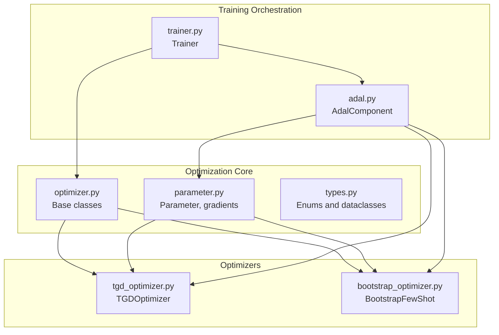
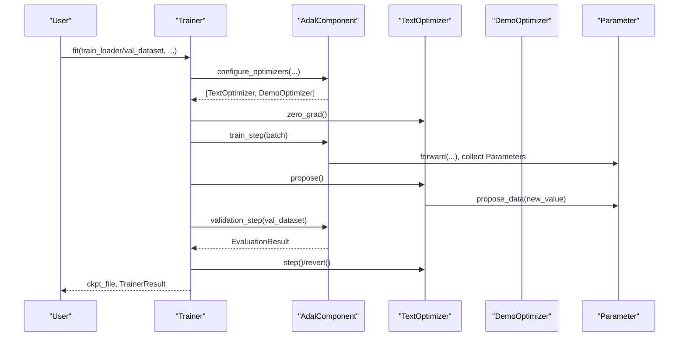
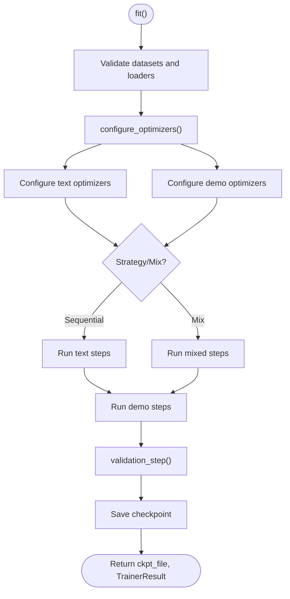
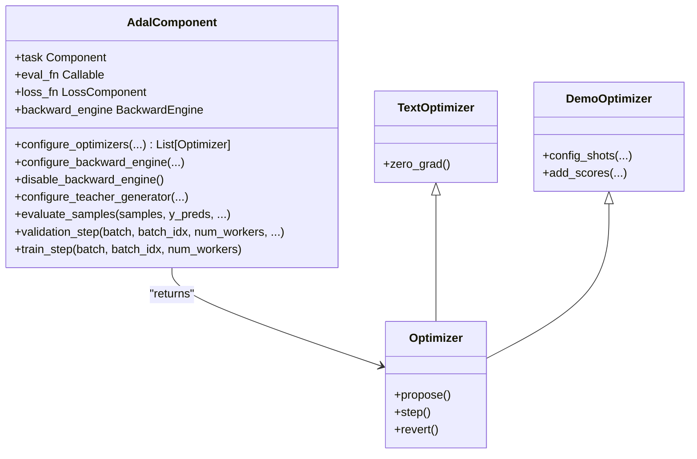
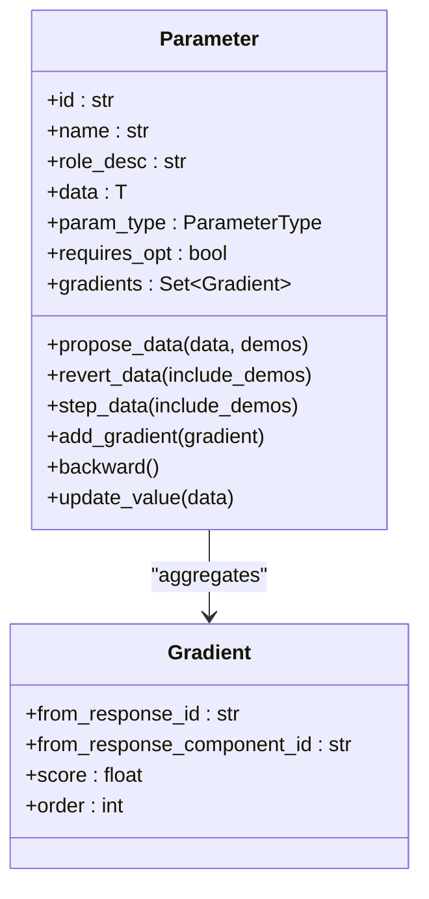
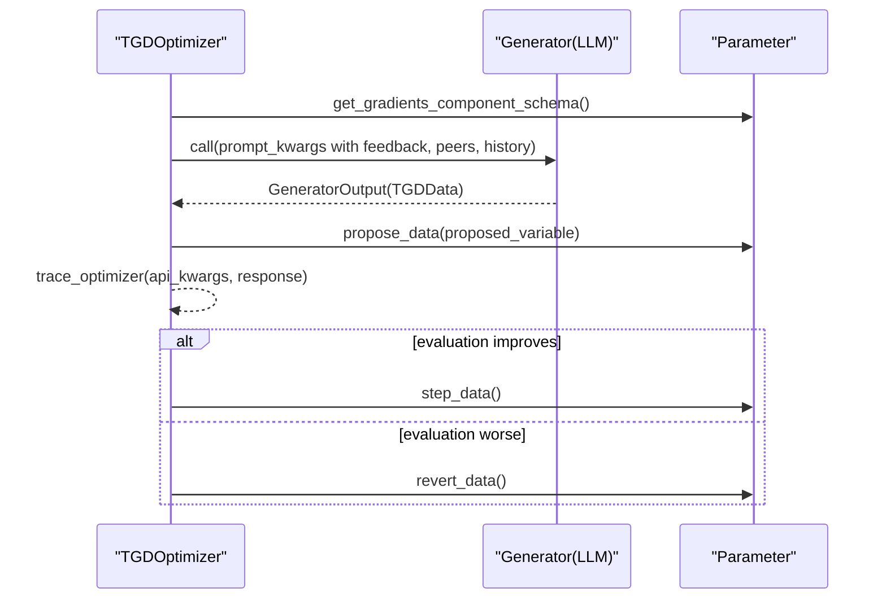
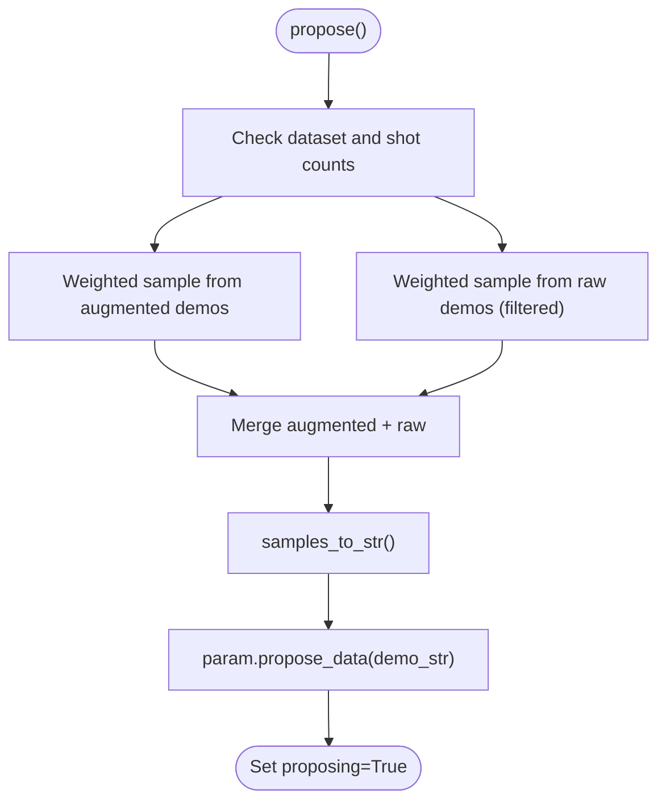
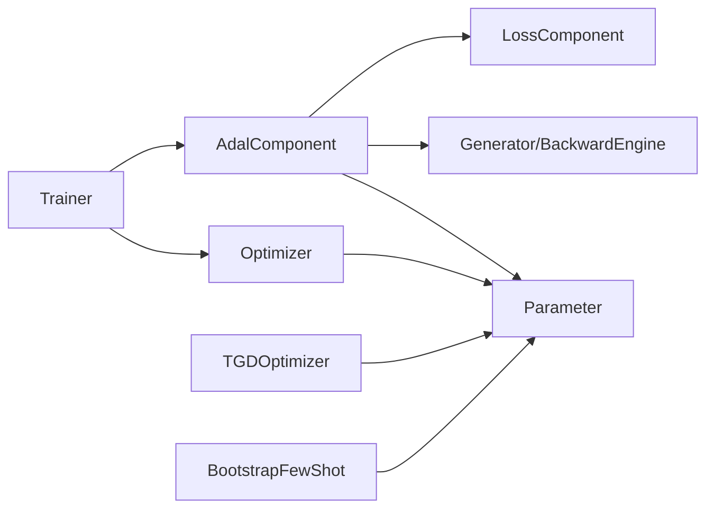

# Optimization API

<cite>
**Referenced Files in This Document**
- [__init__.py](file://adalflow/adalflow/optim/__init__.py)
- [optimizer.py](file://adalflow/adalflow/optim/optimizer.py)
- [parameter.py](file://adalflow/adalflow/optim/parameter.py)
- [types.py](file://adalflow/adalflow/optim/types.py)
- [trainer.py](file://adalflow/adalflow/optim/trainer/trainer.py)
- [adal.py](file://adalflow/adalflow/optim/trainer/adal.py)
- [bootstrap_optimizer.py](file://adalflow/adalflow/optim/few_shot/bootstrap_optimizer.py)
- [tgd_optimizer.py](file://adalflow/adalflow/optim/text_grad/tgd_optimizer.py)
- [test_trainer.py](file://adalflow/tests/test_trainer.py)
- [test_parameter.py](file://adalflow/tests/test_parameter.py)
</cite>

## Table of Contents
1. [Introduction](#introduction)
2. [Project Structure](#project-structure)
3. [Core Components](#core-components)
4. [Architecture Overview](#architecture-overview)
5. [Detailed Component Analysis](#detailed-component-analysis)
6. [Dependency Analysis](#dependency-analysis)
7. [Performance Considerations](#performance-considerations)
8. [Troubleshooting Guide](#troubleshooting-guide)
9. [Conclusion](#conclusion)
10. [Appendices](#appendices)

## Introduction
This document provides comprehensive API documentation for AdalFlow’s optimization framework. It covers the Trainer, Textual Gradient Descent (TGD) Optimizer, Bootstrap Few-Shot Optimizer, and Parameter classes. For each component, you will find detailed method signatures, parameter specifications, return types, configuration options, and usage examples. The document also explains training workflows, optimization algorithms, hyperparameter configurations, custom optimizer creation, parameter tracking, and integration with generators and components for automated optimization workflows.

## Project Structure
The optimization module is organized around reusable building blocks:
- Base optimizer abstractions (Optimizer, TextOptimizer, DemoOptimizer)
- Parameter containers and gradient tracking
- Trainer and AdalComponent orchestration
- Textual gradient descent optimizer (TGD)
- Bootstrap few-shot optimizer
- Shared types and data structures

**Diagram sources**
- [optimizer.py](file://adalflow/adalflow/optim/optimizer.py#L1-L92)
- [parameter.py](file://adalflow/adalflow/optim/parameter.py#L119-L800)
- [types.py](file://adalflow/adalflow/optim/types.py#L1-L163)
- [trainer.py](file://adalflow/adalflow/optim/trainer/trainer.py#L42-L800)
- [adal.py](file://adalflow/adalflow/optim/trainer/adal.py#L30-L800)
- [tgd_optimizer.py](file://adalflow/adalflow/optim/text_grad/tgd_optimizer.py#L357-L800)
- [bootstrap_optimizer.py](file://adalflow/adalflow/optim/few_shot/bootstrap_optimizer.py#L22-L308)

**Section sources**
- [__init__.py](file://adalflow/adalflow/optim/__init__.py#L1-L39)

## Core Components
- Optimizer: Base class for all optimizers with propose, step, revert, and state_dict hooks.
- TextOptimizer: Optimizer for text-based parameters (e.g., prompts) using textual gradients.
- DemoOptimizer: Optimizer for demonstration parameters using raw and bootstrap sampling.
- Parameter: Container for trainable and non-trainable values, gradient aggregation, and proposal lifecycle.
- Types: Enums and dataclasses for parameter types, evaluation results, and trainer outputs.
- Trainer: End-to-end training orchestrator integrating AdalComponent, optimizers, and evaluation.
- AdalComponent: Task pipeline wrapper that prepares task, loss, evaluation, and configures generators/backward engines.

**Section sources**
- [optimizer.py](file://adalflow/adalflow/optim/optimizer.py#L12-L92)
- [parameter.py](file://adalflow/adalflow/optim/parameter.py#L119-L800)
- [types.py](file://adalflow/adalflow/optim/types.py#L13-L163)
- [trainer.py](file://adalflow/adalflow/optim/trainer/trainer.py#L42-L800)
- [adal.py](file://adalflow/adalflow/optim/trainer/adal.py#L30-L800)

## Architecture Overview
The optimization workflow integrates Parameter, AdalComponent, and Optimizers with Trainer. AdalComponent defines prepare_task, prepare_loss, prepare_eval, and configure_* helpers. Trainer coordinates training/validation loops, manages optimizer lifecycles, and persists checkpoints.

**Diagram sources**
- [trainer.py](file://adalflow/adalflow/optim/trainer/trainer.py#L418-L698)
- [adal.py](file://adalflow/adalflow/optim/trainer/adal.py#L336-L576)
- [optimizer.py](file://adalflow/adalflow/optim/optimizer.py#L12-L92)
- [parameter.py](file://adalflow/adalflow/optim/parameter.py#L610-L645)

## Detailed Component Analysis

### Trainer
- Purpose: End-to-end training loop for LLM task pipelines. Supports random/constrained strategies, sequential/mixed optimization orders, and checkpointing.
- Key configuration:
  - adaltask: AdalComponent instance
  - strategy: "random" or "constrained"
  - optimization_order: "sequential" or "mix"
  - max_steps, num_workers, ckpt_path, train_batch_size
  - Validation/test datasets, thresholds for early skipping batches
  - Debug flags and backward engine toggles
- Methods:
  - fit: Main training loop; validates inputs, configures optimizers, runs text/demo steps, evaluates, saves checkpoints
  - diagnose: Evaluates dataset and writes diagnostic logs and stats
  - initial_validation: Computes initial validation/test scores
  - gather_trainer_states/prep_ckpt_file_path: Prepare checkpoint paths and metadata
- Usage example paths:
  - [Trainer.fit](file://adalflow/adalflow/optim/trainer/trainer.py#L418-L698)
  - [Trainer.diagnose](file://adalflow/adalflow/optim/trainer/trainer.py#L197-L316)
  - [Trainer.initial_validation](file://adalflow/adalflow/optim/trainer/trainer.py#L705-L732)

**Diagram sources**
- [trainer.py](file://adalflow/adalflow/optim/trainer/trainer.py#L418-L698)
- [adal.py](file://adalflow/adalflow/optim/trainer/adal.py#L508-L576)

**Section sources**
- [trainer.py](file://adalflow/adalflow/optim/trainer/trainer.py#L42-L800)
- [test_trainer.py](file://adalflow/tests/test_trainer.py#L1-L29)

### AdalComponent
- Purpose: Encapsulates a task pipeline with prepare_task, prepare_loss, prepare_eval, and configure_* helpers. Manages parameter retrieval and updates, evaluation, and generator/backward engine configuration.
- Key methods:
  - prepare_task/prepare_loss/prepare_eval/prepare_loss_eval: Define how to run task, compute loss, and evaluate
  - configure_optimizers: Builds text and demo optimizers
  - configure_backward_engine/disable_backward_engine: Configure or disable backward engine
  - configure_teacher_generator: Attach teacher generator to all generators
  - evaluate_samples/pred_step/validation_step/train_step: Parallel evaluation and prediction
  - run_one_task_sample/run_one_loss_sample: Debug helpers
- Usage example paths:
  - [AdalComponent.prepare_task](file://adalflow/adalflow/optim/trainer/adal.py#L98-L115)
  - [AdalComponent.prepare_loss](file://adalflow/adalflow/optim/trainer/adal.py#L117-L148)
  - [AdalComponent.configure_optimizers](file://adalflow/adalflow/optim/trainer/adal.py#L175-L190)
  - [AdalComponent.validation_step](file://adalflow/adalflow/optim/trainer/adal.py#L508-L576)

**Diagram sources**
- [adal.py](file://adalflow/adalflow/optim/trainer/adal.py#L30-L800)
- [optimizer.py](file://adalflow/adalflow/optim/optimizer.py#L12-L92)

**Section sources**
- [adal.py](file://adalflow/adalflow/optim/trainer/adal.py#L30-L800)

### Parameter
- Purpose: Container for optimization parameters with typed data, gradient tracking, proposal lifecycle, and tracing.
- Key fields:
  - id, name, role_desc, data, data_id, param_type, requires_opt
  - predecessors, peers, eval_input, successor_map_fn
  - gradients, tgd_optimizer_trace, _traces/_student_traces, score
- Key methods:
  - propose_data/revert_data/step_data: Proposal lifecycle
  - add_gradient/reset_gradients/get_gradients_str/get_gradient_and_context_text: Gradient aggregation
  - set_predecessors/set_peers/add_dataclass_to_trace/add_score_to_trace: Tracing and scoring
  - backward: Reverse traversal and gradient application
  - update_value/get_prompt_data/map_to_successor: Value updates and prompt formatting
- Usage example paths:
  - [Parameter.propose_data](file://adalflow/adalflow/optim/parameter.py#L610-L645)
  - [Parameter.add_gradient](file://adalflow/adalflow/optim/parameter.py#L286-L301)
  - [Parameter.backward](file://adalflow/adalflow/optim/parameter.py#L711-L750)
  - [test_parameter.py](file://adalflow/tests/test_parameter.py#L1-L90)

**Diagram sources**
- [parameter.py](file://adalflow/adalflow/optim/parameter.py#L119-L800)

**Section sources**
- [parameter.py](file://adalflow/adalflow/optim/parameter.py#L119-L800)
- [test_parameter.py](file://adalflow/tests/test_parameter.py#L1-L90)

### TGDOptimizer (Textual Gradient Descent)
- Purpose: Text-based optimizer using textual gradients. Generates improved variable values guided by feedback, peer/system awareness, constraints, and history.
- Key configuration:
  - model_client/model_kwargs: LLM for optimization
  - constraints: List of constraint strings
  - in_context_examples: Example demonstrations
  - max_past_history/max_failed_proposals: History management
  - one_parameter_at_a_time: Cycle through target parameters
- Methods:
  - propose: Generate new values per parameter and save traces
  - step/revert: Commit or discard proposals
  - zero_grad: Reset gradients and failed proposals
  - add_score_to_params/add_score_to_current_param: Track validation scores
  - render_history/render_failed_proposals: Build optimizer prompts
  - gumbel_top_k/generate_top_k_scoring_function: Sampling utilities
- Usage example paths:
  - [TGDOptimizer.__init__](file://adalflow/adalflow/optim/text_grad/tgd_optimizer.py#L370-L424)
  - [TGDOptimizer.propose](file://adalflow/adalflow/optim/text_grad/tgd_optimizer.py#L614-L686)
  - [TGDOptimizer.step/revert](file://adalflow/adalflow/optim/text_grad/tgd_optimizer.py#L687-L712)

**Diagram sources**
- [tgd_optimizer.py](file://adalflow/adalflow/optim/text_grad/tgd_optimizer.py#L357-L800)
- [parameter.py](file://adalflow/adalflow/optim/parameter.py#L551-L558)

**Section sources**
- [tgd_optimizer.py](file://adalflow/adalflow/optim/text_grad/tgd_optimizer.py#L357-L800)

### BootstrapFewShot
- Purpose: Demonstrations optimizer using raw and bootstrap sampling with weighted selection based on scores.
- Key configuration:
  - raw_shots/bootstrap_shots: Number of shots
  - weighted: Enable weighted sampling
  - exclude_input_fields_from_bootstrap_demos: Exclude inputs from augmented demos
- Methods:
  - config_shots: Set shot counts
  - add_scores: Register teacher/student scores
  - sample: Weighted sampling from augmented and raw demos
  - propose: Build demo string and propose
  - step/revert: Commit or discard proposals
- Usage example paths:
  - [BootstrapFewShot.__init__](file://adalflow/adalflow/optim/few_shot/bootstrap_optimizer.py#L41-L68)
  - [BootstrapFewShot.propose](file://adalflow/adalflow/optim/few_shot/bootstrap_optimizer.py#L233-L278)

**Diagram sources**
- [bootstrap_optimizer.py](file://adalflow/adalflow/optim/few_shot/bootstrap_optimizer.py#L114-L205)
- [bootstrap_optimizer.py](file://adalflow/adalflow/optim/few_shot/bootstrap_optimizer.py#L233-L278)

**Section sources**
- [bootstrap_optimizer.py](file://adalflow/adalflow/optim/few_shot/bootstrap_optimizer.py#L22-L308)

### Types and Enums
- ParameterType: Enumerates parameter categories (PROMPT, DEMOS, INPUT, OUTPUT, HYPERPARAM, etc.) with descriptions and default_trainable flags.
- Dataclasses: EvaluationResult, PromptData, TrainerStepResult, TrainerValidateStats, TrainerResult for structured outputs and checkpoints.

**Section sources**
- [types.py](file://adalflow/adalflow/optim/types.py#L13-L163)

## Dependency Analysis
- Trainer depends on AdalComponent, Optimizer, and evaluation utilities.
- AdalComponent depends on Parameter, Generator, BackwardEngine, and LossComponent.
- TextOptimizer and DemoOptimizer depend on Parameter and external model clients.
- Parameter aggregates Gradient and maintains predecessor/successor relationships.

**Diagram sources**
- [trainer.py](file://adalflow/adalflow/optim/trainer/trainer.py#L42-L800)
- [adal.py](file://adalflow/adalflow/optim/trainer/adal.py#L30-L800)
- [optimizer.py](file://adalflow/adalflow/optim/optimizer.py#L12-L92)
- [parameter.py](file://adalflow/adalflow/optim/parameter.py#L119-L800)

**Section sources**
- [optimizer.py](file://adalflow/adalflow/optim/optimizer.py#L12-L92)
- [parameter.py](file://adalflow/adalflow/optim/parameter.py#L119-L800)

## Performance Considerations
- Concurrency: AdalComponent uses ThreadPoolExecutor for parallel evaluation and prediction to speed up batch processing.
- Early stopping: Trainer supports thresholds to skip batches with high-enough scores and minimum potential score checks during validation.
- Backward engine toggles: Disable backward engine when not needed to reduce overhead.
- Sampling diversity: BootstrapFewShot uses weighted sampling to prioritize failed examples and student vs teacher scores.
- Checkpointing: Trainer writes checkpoints periodically and supports resuming from best validation scores.

[No sources needed since this section provides general guidance]

## Troubleshooting Guide
- Validation errors:
  - Trainer.fit raises ValueError if datasets are tuples or missing required datasets.
  - AdalComponent.validation_step raises ValueError on evaluation errors.
- Parameter misuse:
  - Parameter.update_value enforces type safety; mismatches raise TypeError.
  - Parameter.backward requires grad_fn to be set for nodes requiring optimization.
- Optimizer state:
  - TGDOptimizer/TGDOptimizer.revert/step must be called after propose; otherwise, inconsistent state is detected.
  - BootstrapFewShot.propose requires dataset and shot counts; otherwise, ValueError is raised.

**Section sources**
- [trainer.py](file://adalflow/adalflow/optim/trainer/trainer.py#L462-L500)
- [adal.py](file://adalflow/adalflow/optim/trainer/adal.py#L515-L576)
- [parameter.py](file://adalflow/adalflow/optim/parameter.py#L649-L661)
- [tgd_optimizer.py](file://adalflow/adalflow/optim/text_grad/tgd_optimizer.py#L687-L712)
- [bootstrap_optimizer.py](file://adalflow/adalflow/optim/few_shot/bootstrap_optimizer.py#L100-L104)

## Conclusion
AdalFlow’s optimization framework provides a modular, extensible system for training LLM pipelines. Trainer orchestrates end-to-end training with configurable strategies and evaluation. AdalComponent encapsulates task logic and integrates with Parameter, TextOptimizer, and DemoOptimizer. Parameter offers robust gradient tracking and proposal lifecycle management. TGDOptimizer and BootstrapFewShot implement advanced text and demonstration optimization techniques, respectively. Together, these components enable automated, scalable optimization workflows.

[No sources needed since this section summarizes without analyzing specific files]

## Appendices

### API Quick Reference

- Trainer
  - fit(train_loader/train_dataset, val_dataset/test_dataset, ...)
  - diagnose(dataset, split, resume_from_ckpt)
  - initial_validation(val_dataset, test_dataset)
  - gather_trainer_states(), prep_ckpt_file_path()

- AdalComponent
  - configure_optimizers(...)
  - configure_backward_engine(...), disable_backward_engine()
  - configure_teacher_generator(...)
  - prepare_task/prepare_loss/prepare_eval/prepare_loss_eval
  - evaluate_samples(...), validation_step(...), train_step(...)

- Parameter
  - propose_data(data, demos), step_data(), revert_data()
  - add_gradient(gradient), reset_gradients(), get_gradients_str()
  - backward(), update_value(data), get_prompt_data()

- TGDOptimizer
  - propose(), step(), revert(), zero_grad()
  - add_score_to_params(score), render_history(), render_failed_proposals()
  - gumbel_top_k(), generate_top_k_scoring_function()

- BootstrapFewShot
  - config_shots(raw_shots, bootstrap_shots)
  - add_scores(ids, scores, is_teacher)
  - sample(augmented_demos, demos, dataset, raw_shots, bootstrap_shots, weighted)
  - propose(), step(), revert()

**Section sources**
- [trainer.py](file://adalflow/adalflow/optim/trainer/trainer.py#L418-L698)
- [adal.py](file://adalflow/adalflow/optim/trainer/adal.py#L175-L704)
- [parameter.py](file://adalflow/adalflow/optim/parameter.py#L610-L750)
- [tgd_optimizer.py](file://adalflow/adalflow/optim/text_grad/tgd_optimizer.py#L614-L800)
- [bootstrap_optimizer.py](file://adalflow/adalflow/optim/few_shot/bootstrap_optimizer.py#L93-L308)