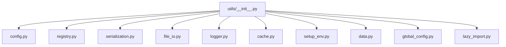
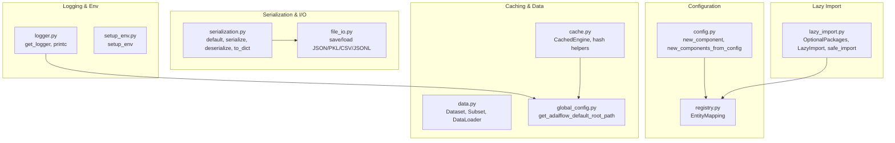
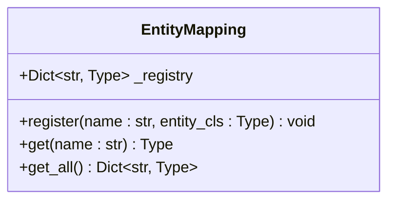
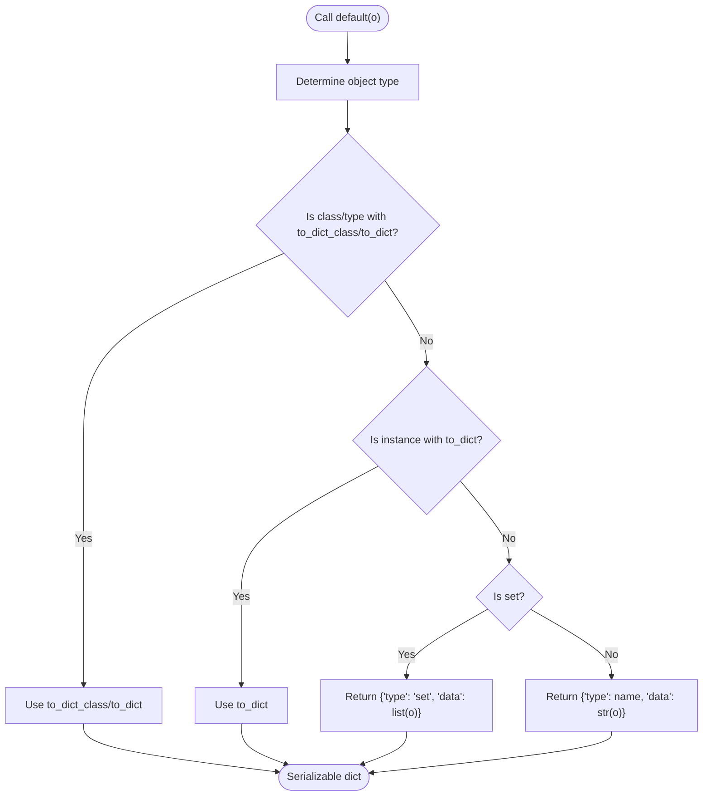
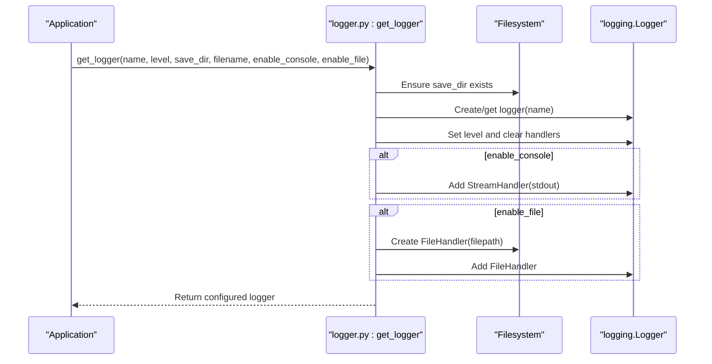
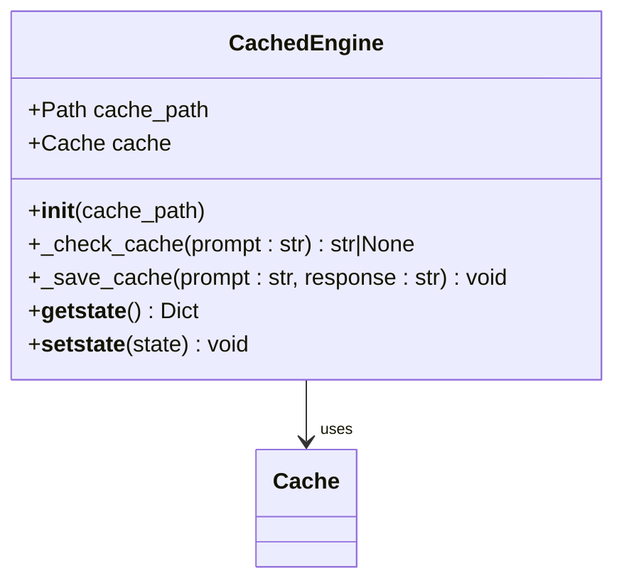
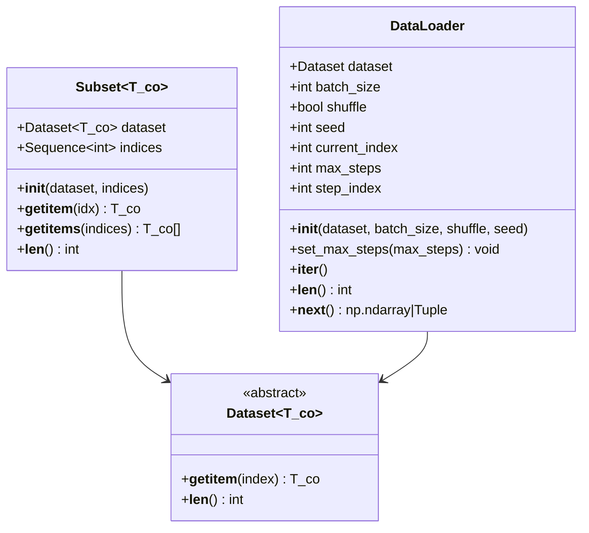
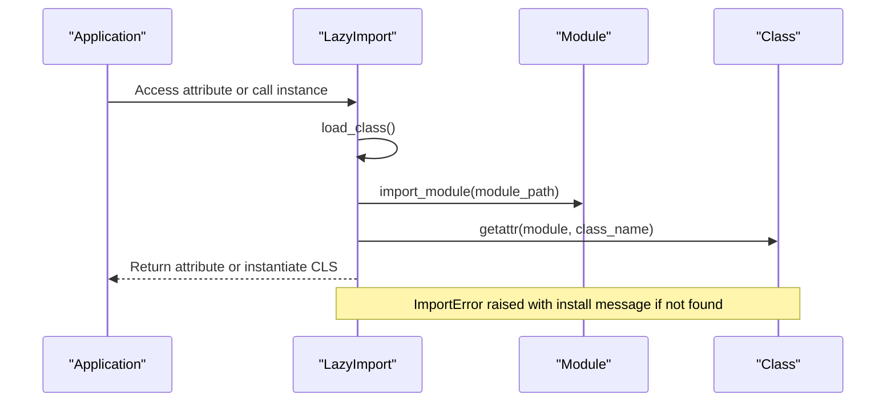
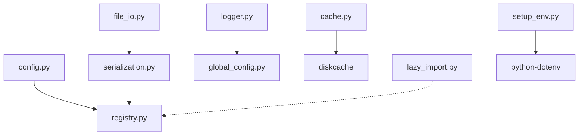

# Utilities API

<cite>
**Referenced Files in This Document**
- [__init__.py](file://adalflow/adalflow/utils/__init__.py)
- [cache.py](file://adalflow/adalflow/utils/cache.py)
- [config.py](file://adalflow/adalflow/utils/config.py)
- [logger.py](file://adalflow/adalflow/utils/logger.py)
- [registry.py](file://adalflow/adalflow/utils/registry.py)
- [serialization.py](file://adalflow/adalflow/utils/serialization.py)
- [file_io.py](file://adalflow/adalflow/utils/file_io.py)
- [data.py](file://adalflow/adalflow/utils/data.py)
- [global_config.py](file://adalflow/adalflow/utils/global_config.py)
- [lazy_import.py](file://adalflow/adalflow/utils/lazy_import.py)
- [setup_env.py](file://adalflow/adalflow/utils/setup_env.py)
- [test_logger.py](file://adalflow/tests/test_logger.py)
- [test_lazy_import.py](file://adalflow/tests/test_lazy_import.py)
- [rag.yaml](file://use_cases/configs/rag.yaml)
</cite>

## Table of Contents
1. [Introduction](#introduction)
2. [Project Structure](#project-structure)
3. [Core Components](#core-components)
4. [Architecture Overview](#architecture-overview)
5. [Detailed Component Analysis](#detailed-component-analysis)
6. [Dependency Analysis](#dependency-analysis)
7. [Performance Considerations](#performance-considerations)
8. [Troubleshooting Guide](#troubleshooting-guide)
9. [Conclusion](#conclusion)
10. [Appendices](#appendices)

## Introduction
This document provides comprehensive API documentation for AdalFlow’s utility functions and helper classes. It covers configuration management, caching, logging, registry patterns, serialization, file I/O, environment setup, and data utilities. For each utility component, you will find method signatures, parameter specifications, return types, and practical usage examples. The guide also explains how these utilities integrate with the main framework components and outlines best practices for usage.

## Project Structure
The utilities live under the adalflow/adalflow/utils package and expose a consolidated public API via the __init__.py module. The primary modules include:
- Configuration and component construction
- Registry pattern for entity mapping
- Serialization helpers
- File I/O helpers
- Logging utilities
- Caching engine
- Environment setup
- Data utilities (Dataset, DataLoader, Subset)
- Global configuration for default paths
- Lazy import and optional packages

**Diagram sources**
- [__init__.py](file://adalflow/adalflow/utils/__init__.py#L1-L55)

**Section sources**
- [__init__.py](file://adalflow/adalflow/utils/__init__.py#L1-L55)

## Core Components
Below are the main utility APIs grouped by category with concise descriptions and usage guidance.

- Configuration Management
  - new_component(config): Construct a single component from a configuration dictionary.
  - new_components_from_config(config): Build multiple components from a configuration dictionary.

- Registry Pattern
  - EntityMapping: Central registry for classes/functions keyed by name.

- Serialization Helpers
  - default(o): Custom JSON encoder for internal and external objects.
  - serialize(obj): Serialize an object to a JSON string.
  - deserialize(data): Deserialize a JSON string back to an object.
  - to_dict(obj): Convert an object to a dictionary.

- File I/O Helpers
  - save_json(obj, f): Save an object to a JSON file using serialization.
  - load_json(f): Load and deserialize a JSON file.
  - save_pickle(obj, f): Save an object to a pickle file.
  - load_pickle(f): Load an object from a pickle file.
  - save(obj, f): Save both JSON and pickle versions.
  - load(f): Load both JSON and pickle files.
  - load_jsonl(f): Load a JSON Lines file.
  - append_to_jsonl(f, data): Append serialized data to a JSON Lines file.
  - write_list_to_jsonl(f, data): Write a list to a JSON Lines file.
  - save_csv(obj, f, fieldnames): Save a list of dicts to CSV with JSON-serialized values.

- Logging System
  - get_logger(name, level, save_dir, filename, enable_console, enable_file): Configure and return a logger with console and/or file handlers.
  - printc(text, color): Print colored console output with caller location and timestamp.

- Caching Mechanisms
  - hash_text(text), hash_text_sha1(text), direct(text): Hashing helpers.
  - CachedEngine(cache_path): Disk-backed cache using diskcache with hashing.

- Environment Setup
  - setup_env(dotenv_path): Load environment variables from a .env file.

- Data Utilities
  - Dataset, Subset, DataLoader: Minimal PyTorch-like dataset abstractions and iterator.
  - subset_dataset(dataset, num_samples): Create a random subset for testing.

- Global Configuration
  - get_adalflow_default_root_path(): Platform-specific default root path for logs, cache, datasets, etc.

- Lazy Import and Optional Packages
  - OptionalPackages: Enum of optional packages with install messages.
  - LazyImport: Proxy class to lazily import modules/classes.
  - safe_import(module_names, install_message): Safely import one or more modules.

**Section sources**
- [config.py](file://adalflow/adalflow/utils/config.py#L66-L101)
- [registry.py](file://adalflow/adalflow/utils/registry.py#L4-L22)
- [serialization.py](file://adalflow/adalflow/utils/serialization.py#L30-L138)
- [file_io.py](file://adalflow/adalflow/utils/file_io.py#L13-L257)
- [logger.py](file://adalflow/adalflow/utils/logger.py#L52-L219)
- [cache.py](file://adalflow/adalflow/utils/cache.py#L7-L48)
- [setup_env.py](file://adalflow/adalflow/utils/setup_env.py#L8-L19)
- [data.py](file://adalflow/adalflow/utils/data.py#L13-L143)
- [global_config.py](file://adalflow/adalflow/utils/global_config.py#L5-L13)
- [lazy_import.py](file://adalflow/adalflow/utils/lazy_import.py#L13-L227)
- [__init__.py](file://adalflow/adalflow/utils/__init__.py#L1-L55)

## Architecture Overview
The utilities form a cohesive toolkit that supports configuration-driven instantiation, robust serialization, flexible I/O, configurable logging, efficient caching, environment setup, and optional package management. They are designed to be low-level building blocks consumed by higher-level components such as generators, retrievers, and data processors.

**Diagram sources**
- [config.py](file://adalflow/adalflow/utils/config.py#L66-L101)
- [registry.py](file://adalflow/adalflow/utils/registry.py#L4-L22)
- [serialization.py](file://adalflow/adalflow/utils/serialization.py#L30-L138)
- [file_io.py](file://adalflow/adalflow/utils/file_io.py#L13-L257)
- [logger.py](file://adalflow/adalflow/utils/logger.py#L52-L219)
- [cache.py](file://adalflow/adalflow/utils/cache.py#L7-L48)
- [data.py](file://adalflow/adalflow/utils/data.py#L13-L143)
- [global_config.py](file://adalflow/adalflow/utils/global_config.py#L5-L13)
- [lazy_import.py](file://adalflow/adalflow/utils/lazy_import.py#L13-L227)
- [setup_env.py](file://adalflow/adalflow/utils/setup_env.py#L8-L19)

## Detailed Component Analysis

### Configuration Management Utilities
- new_component(config)
  - Purpose: Instantiate a single component from a configuration dictionary.
  - Parameters:
    - config (Dict[str, Any]): Must include component_name and optionally component_config. Nested dicts with component_name are recursively constructed.
  - Returns: An instance of the resolved class.
  - Behavior: Uses EntityMapping to resolve the class by name and passes initialized_config to the constructor.
  - Example usage: Construct a component pipeline from a YAML/JSON config.
  - Related example: [rag.yaml](file://use_cases/configs/rag.yaml#L1-L20)

- new_components_from_config(config)
  - Purpose: Build multiple components from a top-level config mapping attribute names to component configurations.
  - Parameters:
    - config (Dict[str, Dict[str, Any]]): Outer keys are attribute names; each value is a component config compatible with new_component.
  - Returns: Dict[str, Any] of constructed components.
  - Behavior: Iterates over entries and calls new_component for each.

**Section sources**
- [config.py](file://adalflow/adalflow/utils/config.py#L66-L101)
- [rag.yaml](file://use_cases/configs/rag.yaml#L1-L20)

### Registry Pattern
- EntityMapping
  - Purpose: Central registry to map string names to classes/functions.
  - Methods:
    - register(name: str, entity_cls: Type) -> None
    - get(name: str) -> Type
    - get_all() -> Dict[str, Type]
  - Usage: Register framework components and retrieve them by name during configuration-driven instantiation.

**Diagram sources**
- [registry.py](file://adalflow/adalflow/utils/registry.py#L4-L22)

**Section sources**
- [registry.py](file://adalflow/adalflow/utils/registry.py#L4-L22)

### Serialization Helpers
- default(o)
  - Purpose: Custom JSON encoder for internal and external objects.
  - Behavior:
    - If object is a class/type with to_dict_class/to_dict, use those methods.
    - If object is an instance with to_dict, use it.
    - Otherwise fallback to {"type": name, "data": str(o)}.
    - Special handling for sets.
  - Returns: Serializable dict or str.

- serialize(obj)
  - Purpose: Serialize an object to a JSON string using default(o).
  - Returns: str.

- deserialize(data)
  - Purpose: Deserialize a JSON string back to an object.
  - Behavior: Uses object_hook to reconstruct special types and falls back to original dict.

- to_dict(obj)
  - Purpose: Convert an object to a dictionary via serialize + json.loads.

**Diagram sources**
- [serialization.py](file://adalflow/adalflow/utils/serialization.py#L20-L88)

**Section sources**
- [serialization.py](file://adalflow/adalflow/utils/serialization.py#L30-L138)

### File I/O Helpers
- save_json(obj, f)
  - Purpose: Save an object to a JSON file using serialization.
  - Parameters:
    - obj (Mapping[str, Any]): Object to serialize and save.
    - f (str): File path.
  - Returns: None.

- load_json(f)
  - Purpose: Load and deserialize a JSON file.
  - Parameters:
    - f (str): File path.
  - Returns: Any (deserialized object).

- save_pickle(obj, f)
  - Purpose: Save an object to a pickle file.
  - Parameters:
    - obj (Mapping[str, Any]): Object to pickle.
    - f (str): File path.
  - Returns: None.

- load_pickle(f)
  - Purpose: Load an object from a pickle file.
  - Parameters:
    - f (str): File path.
  - Returns: Any | None.

- save(obj, f)
  - Purpose: Save both JSON and pickle versions.
  - Parameters:
    - obj (Mapping[str, Any]): Object to save.
    - f (str): Base file name (without extension).
  - Returns: None.

- load(f)
  - Purpose: Load both JSON and pickle files.
  - Parameters:
    - f (str): Base file name.
  - Returns: Tuple[Any, Any] (json_obj, pickle_obj).

- load_jsonl(f)
  - Purpose: Load a JSON Lines file.
  - Parameters:
    - f (str): File path.
  - Returns: List[Dict[str, Any]].

- append_to_jsonl(f, data)
  - Purpose: Append serialized data to a JSON Lines file.
  - Parameters:
    - f (str): File path.
    - data (Dict[str, Any]): Data to append.
  - Returns: None.

- write_list_to_jsonl(f, data)
  - Purpose: Write a list of dictionaries to a JSON Lines file.
  - Parameters:
    - f (str): File path.
    - data (List[Dict[str, Any]]): Data to write.
  - Returns: None.

- save_csv(obj, f, fieldnames)
  - Purpose: Save a list of dicts to CSV with JSON-serialized nested values.
  - Parameters:
    - obj (List[Dict[str, Any]]): Rows to write.
    - f (str): File path.
    - fieldnames (List[str]): Field names.
  - Returns: None.

**Section sources**
- [file_io.py](file://adalflow/adalflow/utils/file_io.py#L13-L257)

### Logging System
- get_logger(name=None, level="INFO", save_dir=None, filename=None, enable_console=True, enable_file=True)
  - Purpose: Configure and return a logger with console and/or file handlers.
  - Behavior:
    - Uses platform-specific default root path via get_adalflow_default_root_path().
    - Creates handlers based on flags and applies a standardized formatter.
    - Named loggers do not propagate to root.
  - Returns: logging.Logger.

- printc(text, color="cyan")
  - Purpose: Print colored console output with timestamp and caller location.
  - Behavior:
    - Captures caller frame info (script name, line number, function name).
    - Applies color code mapping and prints.

**Diagram sources**
- [logger.py](file://adalflow/adalflow/utils/logger.py#L100-L169)
- [global_config.py](file://adalflow/adalflow/utils/global_config.py#L5-L13)

**Section sources**
- [logger.py](file://adalflow/adalflow/utils/logger.py#L52-L219)
- [global_config.py](file://adalflow/adalflow/utils/global_config.py#L5-L13)

### Caching Mechanisms
- hash_text(text), hash_text_sha1(text), direct(text)
  - Purpose: Provide hashing strategies for cache keys.
- CachedEngine(cache_path)
  - Purpose: Disk-backed cache using diskcache with SHA-256 hashing of prompts.
  - Methods:
    - __init__(cache_path: Union[str, Path])
    - _check_cache(prompt: str) -> str | None
    - _save_cache(prompt: str, response: str) -> None
    - __getstate__(), __setstate__(state) -> None (for pickling/unpickling)
  - Behavior:
    - Ensures cache directory exists.
    - Uses hash_text to normalize keys.
    - Handles pickling by excluding the cache instance and recreating it after unpickling.

**Diagram sources**
- [cache.py](file://adalflow/adalflow/utils/cache.py#L19-L48)

**Section sources**
- [cache.py](file://adalflow/adalflow/utils/cache.py#L7-L48)

### Environment Setup
- setup_env(dotenv_path=".env")
  - Purpose: Load environment variables from a .env file.
  - Behavior:
    - Validates file existence.
    - Loads variables with dotenv.load_dotenv and logs verbose output.
  - Exceptions: Raises FileNotFoundError if file is missing; re-raises other exceptions.

**Section sources**
- [setup_env.py](file://adalflow/adalflow/utils/setup_env.py#L8-L19)

### Data Utilities
- Dataset, Subset, DataLoader
  - Purpose: Provide minimal dataset abstractions and batching similar to PyTorch.
  - Features:
    - Dataset: Abstract base with __getitem__ and optional __len__.
    - Subset: Wraps a dataset with a subset of indices and supports batched retrieval if parent supports it.
    - DataLoader: Iterates over batches with optional shuffling and fixed batch size.
  - Helper:
    - subset_dataset(dataset, num_samples): Random subset for quick testing.

**Diagram sources**
- [data.py](file://adalflow/adalflow/utils/data.py#L13-L143)

**Section sources**
- [data.py](file://adalflow/adalflow/utils/data.py#L13-L143)

### Global Configuration
- get_adalflow_default_root_path()
  - Purpose: Return a platform-specific default root path for logs, cache, datasets, etc.
  - Behavior:
    - On Windows: APPDATA/adalflow
    - Else: ~/.adalflow

**Section sources**
- [global_config.py](file://adalflow/adalflow/utils/global_config.py#L5-L13)

### Lazy Import and Optional Packages
- OptionalPackages
  - Purpose: Enumerates optional packages with their import names and install messages.
  - Examples include model SDKs (e.g., openai, anthropic), AWS (boto3), Azure (azure-identity), FAISS, SQLAlchemy, Qdrant, etc.
- LazyImport
  - Purpose: Proxy class that lazily imports a module/class on first access.
  - Methods:
    - load_class() -> Type
    - __getattr__(name) -> Any
    - __call__(*args, **kwargs) -> Instance
  - Behavior:
    - Parses import path, imports module and resolves class.
    - Raises ImportError with the associated install message if not found.
- safe_import(module_names, install_message)
  - Purpose: Safely import one or more modules; raises ImportError with install message if any are missing.
  - Returns: ModuleType or List[ModuleType].

**Diagram sources**
- [lazy_import.py](file://adalflow/adalflow/utils/lazy_import.py#L145-L172)

**Section sources**
- [lazy_import.py](file://adalflow/adalflow/utils/lazy_import.py#L13-L227)

## Dependency Analysis
The utilities are loosely coupled and designed for composability. Key dependency relationships:
- config.py depends on registry.py for class resolution.
- serialization.py depends on registry.py for deserialization hooks.
- file_io.py depends on serialization.py for JSON serialization/deserialization.
- logger.py depends on global_config.py for default log root path.
- cache.py depends on diskcache and pathlib.
- lazy_import.py is used across model clients to conditionally import optional packages.
- setup_env.py depends on python-dotenv.

**Diagram sources**
- [config.py](file://adalflow/adalflow/utils/config.py#L63-L92)
- [serialization.py](file://adalflow/adalflow/utils/serialization.py#L8-L125)
- [file_io.py](file://adalflow/adalflow/utils/file_io.py#L8-L135)
- [logger.py](file://adalflow/adalflow/utils/logger.py#L27-L146)
- [cache.py](file://adalflow/adalflow/utils/cache.py#L2-L25)
- [lazy_import.py](file://adalflow/adalflow/utils/lazy_import.py#L1-L227)
- [setup_env.py](file://adalflow/adalflow/utils/setup_env.py#L1-L18)

**Section sources**
- [config.py](file://adalflow/adalflow/utils/config.py#L63-L101)
- [serialization.py](file://adalflow/adalflow/utils/serialization.py#L8-L138)
- [file_io.py](file://adalflow/adalflow/utils/file_io.py#L8-L257)
- [logger.py](file://adalflow/adalflow/utils/logger.py#L27-L219)
- [cache.py](file://adalflow/adalflow/utils/cache.py#L2-L48)
- [lazy_import.py](file://adalflow/adalflow/utils/lazy_import.py#L1-L227)
- [setup_env.py](file://adalflow/adalflow/utils/setup_env.py#L1-L19)

## Performance Considerations
- Serialization:
  - Prefer to_dict() and serialize() for cross-language/portable storage.
  - For large objects, consider pickle for native Python objects when portability is not required.
- Caching:
  - Use CachedEngine for prompt-response caching to avoid repeated expensive calls.
  - Ensure cache_path is on fast storage for I/O-bound workloads.
- Logging:
  - Disable file handlers in production if not needed; console-only logging reduces I/O overhead.
  - Use appropriate log levels to minimize noise.
- Data utilities:
  - DataLoader supports batched sampling; leverage __getitems__ in parent datasets for speedups.
- Lazy import:
  - Use LazyImport/safe_import to defer heavy imports until actually needed, reducing startup time.

[No sources needed since this section provides general guidance]

## Troubleshooting Guide
- Logger configuration:
  - If no handlers appear, ensure enable_console or enable_file is True.
  - For Windows terminals lacking ANSI support, initialize colorama before printing colored logs.
  - References: [test_logger.py](file://adalflow/tests/test_logger.py#L7-L61), [logger.py](file://adalflow/adalflow/utils/logger.py#L100-L169)

- Lazy import failures:
  - ImportError indicates missing optional packages; follow the install message.
  - For Azure or AWS groups, ensure all listed packages are installed.
  - References: [test_lazy_import.py](file://adalflow/tests/test_lazy_import.py#L8-L136), [lazy_import.py](file://adalflow/adalflow/utils/lazy_import.py#L174-L227)

- File I/O errors:
  - JSON decode errors indicate malformed JSON; verify serialization via serialize() before writing.
  - Missing JSONL dependency: install jsonlines to use JSONL helpers.
  - References: [file_io.py](file://adalflow/adalflow/utils/file_io.py#L193-L257)

- Configuration resolution:
  - Missing component_name in config leads to assertion failure.
  - Ensure nested component configs also include component_name for recursive construction.
  - References: [config.py](file://adalflow/adalflow/utils/config.py#L75-L92)

**Section sources**
- [test_logger.py](file://adalflow/tests/test_logger.py#L7-L83)
- [test_lazy_import.py](file://adalflow/tests/test_lazy_import.py#L8-L140)
- [file_io.py](file://adalflow/adalflow/utils/file_io.py#L193-L257)
- [config.py](file://adalflow/adalflow/utils/config.py#L75-L92)

## Conclusion
AdalFlow’s utilities provide a robust foundation for configuration-driven composition, serialization, I/O, logging, caching, environment setup, and optional package management. By leveraging these utilities, developers can build scalable and maintainable pipelines while keeping startup costs low and runtime performance high.

[No sources needed since this section summarizes without analyzing specific files]

## Appendices

### Practical Usage Examples (by reference)
- Configuration-driven component creation:
  - See [config.py](file://adalflow/adalflow/utils/config.py#L66-L101) and [rag.yaml](file://use_cases/configs/rag.yaml#L1-L20)
- Logging:
  - See [logger.py](file://adalflow/adalflow/utils/logger.py#L100-L169) and [test_logger.py](file://adalflow/tests/test_logger.py#L7-L61)
- Serialization:
  - See [serialization.py](file://adalflow/adalflow/utils/serialization.py#L30-L138)
- File I/O:
  - See [file_io.py](file://adalflow/adalflow/utils/file_io.py#L13-L257)
- Caching:
  - See [cache.py](file://adalflow/adalflow/utils/cache.py#L19-L48)
- Environment setup:
  - See [setup_env.py](file://adalflow/adalflow/utils/setup_env.py#L8-L19)
- Data utilities:
  - See [data.py](file://adalflow/adalflow/utils/data.py#L13-L143)
- Lazy import:
  - See [lazy_import.py](file://adalflow/adalflow/utils/lazy_import.py#L145-L172)