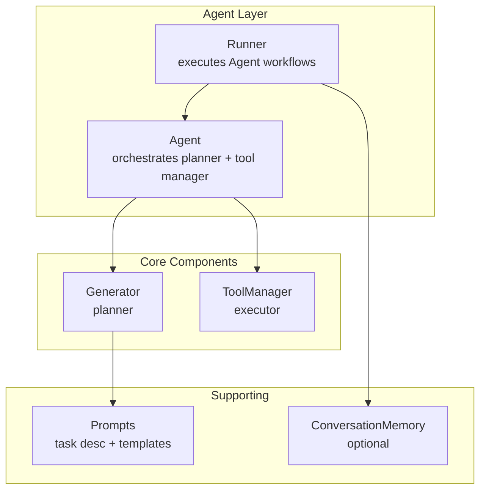
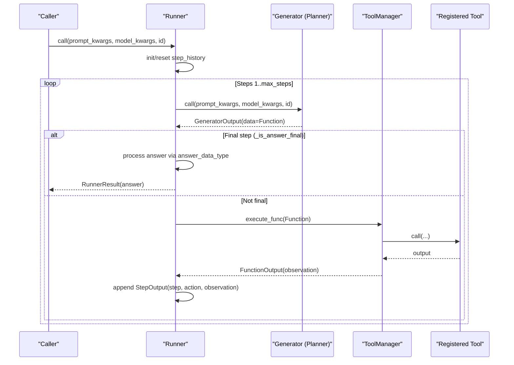
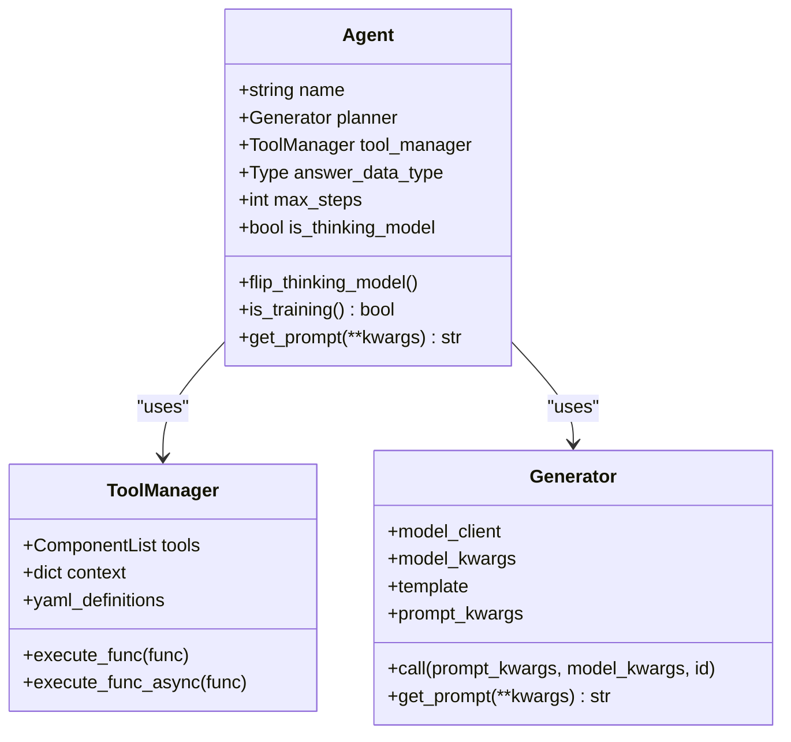
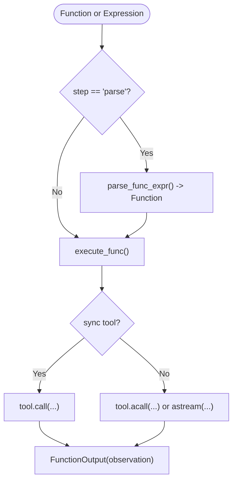
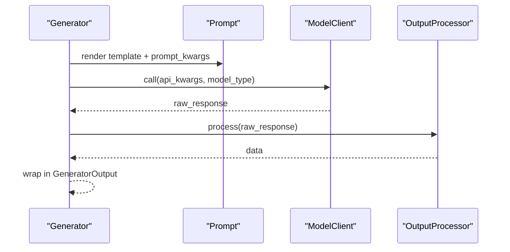
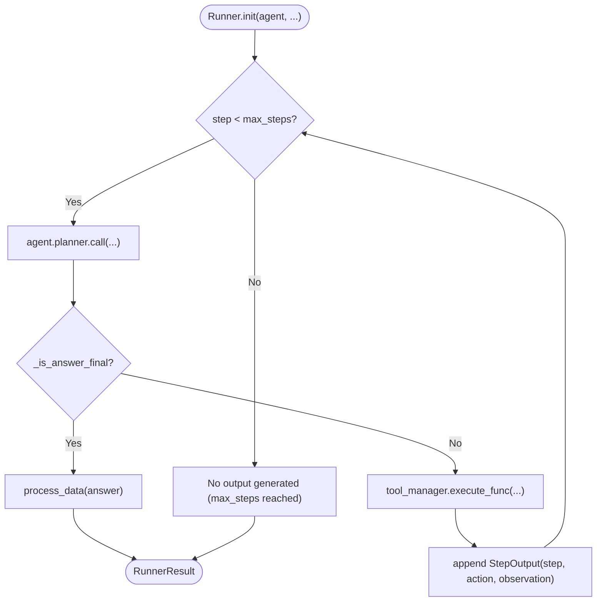
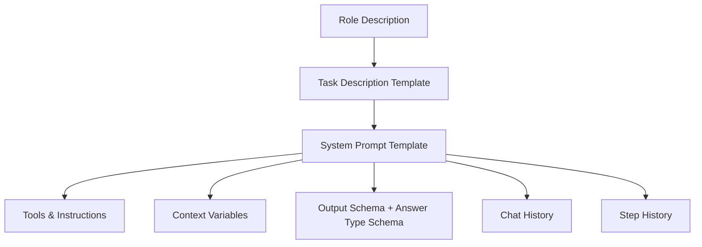
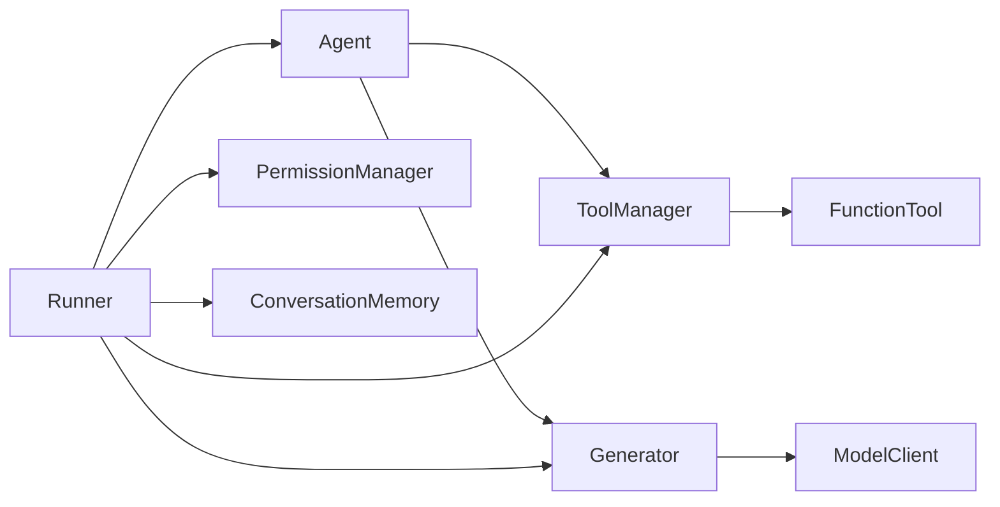

# Agent Architecture and Core Concepts

<cite>
**Referenced Files in This Document**
- [agent.py](file://adalflow/adalflow/components/agent/agent.py)
- [prompts.py](file://adalflow/adalflow/components/agent/prompts.py)
- [runner.py](file://adalflow/adalflow/components/agent/runner.py)
- [tool_manager.py](file://adalflow/adalflow/core/tool_manager.py)
- [generator.py](file://adalflow/adalflow/core/generator.py)
- [tutorial_agent_basic.py](file://tutorials/agent/tutorial_agent_basic.py)
- [agent_demo.py](file://tutorials/agent/agent_demo.py)
- [test_agent.py](file://adalflow/tests/test_agent.py)
- [test_runner.py](file://adalflow/tests/test_runner.py)
</cite>

## Table of Contents
1. [Introduction](#introduction)
2. [Project Structure](#project-structure)
3. [Core Components](#core-components)
4. [Architecture Overview](#architecture-overview)
5. [Detailed Component Analysis](#detailed-component-analysis)
6. [Dependency Analysis](#dependency-analysis)
7. [Performance Considerations](#performance-considerations)
8. [Troubleshooting Guide](#troubleshooting-guide)
9. [Conclusion](#conclusion)
10. [Appendices](#appendices)

## Introduction
This document explains AdalFlow’s ReAct-style agent design and its dual-component architecture. The Agent orchestrates a planner (Generator) and an executor (ToolManager) to iteratively decompose tasks, reason about next steps, and execute tools until a final answer is produced. The Agent integrates with a Runner for lifecycle management, memory, streaming, and tracing. This guide covers the Agent class structure, its relationship with ToolManager and Generator, the ReAct reasoning pattern, configuration options, state management, default prompts, and practical usage patterns.

## Project Structure
The agent system lives under components/agent and integrates with core components for prompting, generation, and tool execution:
- Agent: Orchestrates planner and tool manager, exposes configuration and lifecycle helpers
- Prompts: Provides default task descriptions and system prompt templates
- Runner: Executes Agent workflows with step history, streaming, permissions, and memory
- ToolManager: Centralizes tool definitions, context, and execution
- Generator: LLM orchestration with caching, output processing, and tracing

**Diagram sources**
- [agent.py](file://adalflow/adalflow/components/agent/agent.py#L216-L387)
- [runner.py](file://adalflow/adalflow/components/agent/runner.py#L107-L190)
- [prompts.py](file://adalflow/adalflow/components/agent/prompts.py#L9-L121)
- [tool_manager.py](file://adalflow/adalflow/core/tool_manager.py#L134-L210)
- [generator.py](file://adalflow/adalflow/core/generator.py#L82-L120)

**Section sources**
- [agent.py](file://adalflow/adalflow/components/agent/agent.py#L1-L387)
- [runner.py](file://adalflow/adalflow/components/agent/runner.py#L1-L1828)
- [prompts.py](file://adalflow/adalflow/components/agent/prompts.py#L1-L121)
- [tool_manager.py](file://adalflow/adalflow/core/tool_manager.py#L1-L626)
- [generator.py](file://adalflow/adalflow/core/generator.py#L1-L800)

## Core Components
- Agent: Dual-component orchestrator with a configurable planner (Generator) and tool manager (ToolManager). Supports role customization, thinking model toggle, and answer type shaping.
- ToolManager: Manages tools, builds execution context, parses function expressions, and executes functions synchronously or asynchronously.
- Generator: LLM orchestration with prompt templating, output processors, caching, and tracing.
- Runner: Executes Agent workflows end-to-end, handles streaming, permissions, conversation memory, and token accounting.

Key responsibilities:
- Agent: Creates planner and tool manager, wires parameters, exposes lifecycle helpers (training, prompt retrieval).
- ToolManager: Exposes tool definitions, parses/executes functions, supports sync/async execution.
- Generator: Renders prompts, calls model clients, applies output processors, caches responses.
- Runner: Iterative ReAct loop, step history, final answer processing, streaming, memory integration.

**Section sources**
- [agent.py](file://adalflow/adalflow/components/agent/agent.py#L216-L387)
- [tool_manager.py](file://adalflow/adalflow/core/tool_manager.py#L134-L210)
- [generator.py](file://adalflow/adalflow/core/generator.py#L82-L120)
- [runner.py](file://adalflow/adalflow/components/agent/runner.py#L107-L190)

## Architecture Overview
AdalFlow’s ReAct agent follows a dual-component design:
- Planner (Generator): Generates structured Function calls with thought/action/observation fields, guided by default prompts and tool/function definitions.
- Executor (ToolManager): Executes the Function calls against registered tools and returns observations.

The Runner coordinates the ReAct loop:
- For each step up to max_steps:
  - Planner produces a Function (thought + action)
  - ToolManager executes the action and returns observation
  - Runner updates step history and checks termination condition
- Final answer is extracted and processed according to answer_data_type.

**Diagram sources**
- [runner.py](file://adalflow/adalflow/components/agent/runner.py#L529-L800)
- [generator.py](file://adalflow/adalflow/core/generator.py#L621-L774)
- [tool_manager.py](file://adalflow/adalflow/core/tool_manager.py#L310-L351)
- [agent.py](file://adalflow/adalflow/components/agent/agent.py#L216-L387)

## Detailed Component Analysis

### Agent Class Structure and Configuration
- Purpose: Orchestrates a ReAct-style agent with a planner (Generator) and executor (ToolManager).
- Key attributes:
  - name, planner, tool_manager, answer_data_type, max_steps, is_thinking_model
- Construction:
  - Accepts tools, context_variables, add_llm_as_fallback, model_client, model_kwargs, template, role_desc, cache_path, use_cache, answer_data_type, max_steps, is_thinking_model
  - Creates default planner and tool manager if not provided
- Helper methods:
  - flip_thinking_model(): toggles thinking model mode and recreates planner
  - is_training(): mirrors planner training state
  - get_prompt(): delegates to planner for prompt rendering

Default configuration:
- DEFAULT_MAX_STEPS = 10
- DEFAULT_ROLE_DESC = "You are an excellent task planner."

**Diagram sources**
- [agent.py](file://adalflow/adalflow/components/agent/agent.py#L216-L387)
- [tool_manager.py](file://adalflow/adalflow/core/tool_manager.py#L134-L210)
- [generator.py](file://adalflow/adalflow/core/generator.py#L82-L120)

**Section sources**
- [agent.py](file://adalflow/adalflow/components/agent/agent.py#L216-L387)
- [test_agent.py](file://adalflow/tests/test_agent.py#L51-L384)

### ToolManager: Tool Definitions and Execution
- Responsibilities:
  - Build context map from tools
  - Parse function expressions to Function objects
  - Execute functions synchronously or asynchronously
  - Support streaming and generator/async-generator outputs
- Key APIs:
  - yaml_definitions/json_definitions/function_definitions for prompt injection
  - call(step="parse"/"execute"), execute_func(), execute_func_async()
  - get_function_tool_by_name()

**Diagram sources**
- [tool_manager.py](file://adalflow/adalflow/core/tool_manager.py#L234-L351)

**Section sources**
- [tool_manager.py](file://adalflow/adalflow/core/tool_manager.py#L134-L626)

### Generator: Prompting, Caching, and Output Processing
- Responsibilities:
  - Render prompts from template + prompt_kwargs
  - Compose model kwargs, call model client, apply output processors
  - Manage caching, tracing, and token estimation
- Key features:
  - set_parameters(): attaches Parameter objects to Generator for optimization
  - get_prompt()/print_prompt(): render final prompt
  - forward(): creates OutputParameter with gradient hooks for backprop

**Diagram sources**
- [generator.py](file://adalflow/adalflow/core/generator.py#L463-L544)
- [generator.py](file://adalflow/adalflow/core/generator.py#L357-L379)

**Section sources**
- [generator.py](file://adalflow/adalflow/core/generator.py#L82-L800)

### Runner: Lifecycle, Streaming, Permissions, and Memory
- Responsibilities:
  - Execute Agent workflows with iterative ReAct loop
  - Manage step history, final answer extraction, and output processing
  - Support sync, async, and streaming execution
  - Integrate with permissions, conversation memory, and tracing
- Key capabilities:
  - call(), acall(), astream()
  - Token tracking via planner’s estimated_token_count
  - Conversation memory integration for chat history
  - Permission manager registration for tool approvals

**Diagram sources**
- [runner.py](file://adalflow/adalflow/components/agent/runner.py#L529-L800)

**Section sources**
- [runner.py](file://adalflow/adalflow/components/agent/runner.py#L107-L1828)
- [test_runner.py](file://adalflow/tests/test_runner.py#L162-L800)

### Default Prompts and Task Description Formatting
- Default role description: "You are an excellent task planner."
- Task description template defines:
  - How to decompose queries into multi-step actions
  - When to use the final “finish” action with _is_answer_final and _answer
  - Constraints on tool usage and answer formatting
- System prompt template includes:
  - Tools and instructions
  - Context variables availability
  - Output schema and answer type schema
  - Chat history and step history for ReAct context

**Diagram sources**
- [prompts.py](file://adalflow/adalflow/components/agent/prompts.py#L9-L121)

**Section sources**
- [prompts.py](file://adalflow/adalflow/components/agent/prompts.py#L1-L121)

### Practical Examples and Usage Patterns
- Basic agent with tools and Runner:
  - Define tools (FunctionTool wrappers or plain callables)
  - Instantiate Agent with model_client/model_kwargs
  - Wrap with Runner and call(prompt_kwargs={"input_str": "..."}), then inspect result.answer and step_history
- Structured output:
  - Set answer_data_type to a Pydantic/BaseModel subclass; Runner converts final answer accordingly
- Streaming and async:
  - Use runner.acall() for async execution
  - Use runner.astream() to receive RunItemStreamEvent items (tool calls, outputs, activities, final answer)
- Custom role and limited steps:
  - Customize role_desc and max_steps via Agent constructor
  - Override max_steps at Runner level to constrain execution

See runnable examples:
- [tutorial_agent_basic.py](file://tutorials/agent/tutorial_agent_basic.py#L101-L319)
- [agent_demo.py](file://tutorials/agent/agent_demo.py#L85-L203)

**Section sources**
- [tutorial_agent_basic.py](file://tutorials/agent/tutorial_agent_basic.py#L101-L319)
- [agent_demo.py](file://tutorials/agent/agent_demo.py#L85-L203)

## Dependency Analysis
- Agent depends on:
  - ToolManager for tool execution
  - Generator for planning and prompting
- Runner depends on:
  - Agent (planner + tool_manager)
  - Optional PermissionManager and ConversationMemory
- ToolManager depends on:
  - FunctionTool wrappers and function definitions
  - Execution utilities for sync/async/generators
- Generator depends on:
  - ModelClient, Prompt builder, output processors, caching, tracing

**Diagram sources**
- [agent.py](file://adalflow/adalflow/components/agent/agent.py#L216-L387)
- [runner.py](file://adalflow/adalflow/components/agent/runner.py#L107-L190)
- [tool_manager.py](file://adalflow/adalflow/core/tool_manager.py#L134-L210)
- [generator.py](file://adalflow/adalflow/core/generator.py#L82-L120)

**Section sources**
- [agent.py](file://adalflow/adalflow/components/agent/agent.py#L216-L387)
- [runner.py](file://adalflow/adalflow/components/agent/runner.py#L107-L190)
- [tool_manager.py](file://adalflow/adalflow/core/tool_manager.py#L134-L210)
- [generator.py](file://adalflow/adalflow/core/generator.py#L82-L120)

## Performance Considerations
- Caching:
  - Enable use_cache and configure cache_path on Generator to reduce repeated LLM calls
  - Runner tracks token consumption via planner’s estimated_token_count for budgeting
- Streaming:
  - Prefer astream() for long-running tasks to reduce latency and memory footprint
- Output processing:
  - Avoid streaming with complex output processors; they require full response before parsing
- Context size:
  - Prompt truncation occurs when max_tokens is set; monitor prompt tokens to prevent truncation surprises
- Tool execution:
  - Use async tools where possible to overlap I/O with planning
- Memory:
  - ConversationMemory appends chat history; keep history concise to avoid exceeding context limits

[No sources needed since this section provides general guidance]

## Troubleshooting Guide
Common issues and remedies:
- Missing model_client or model_kwargs:
  - When add_llm_as_fallback is True, Agent requires model_client and model_kwargs; otherwise, initialization fails
- Unrecoverable errors:
  - Runner treats certain HTTP errors as unrecoverable and stops execution early
- Parsing/formatting errors:
  - If planner output cannot be parsed into Function, Runner records error in step history and continues
- Permission approvals:
  - Register tools with PermissionManager to gate sensitive actions
- Conversation memory:
  - Ensure conversation_memory is cleared or reset between unrelated sessions to avoid cross-contamination

**Section sources**
- [agent.py](file://adalflow/adalflow/components/agent/agent.py#L72-L75)
- [runner.py](file://adalflow/adalflow/components/agent/runner.py#L634-L646)
- [test_runner.py](file://adalflow/tests/test_runner.py#L636-L744)

## Conclusion
AdalFlow’s Agent architecture cleanly separates planning (Generator) and execution (ToolManager) while providing a robust Runner to manage the ReAct loop, memory, permissions, and streaming. The Agent offers flexible configuration (role, steps, answer type, thinking model), integrates with default prompts, and supports structured outputs and streaming. With caching, token tracking, and memory integration, it scales from simple tool-use to complex multi-step reasoning workflows.

[No sources needed since this section summarizes without analyzing specific files]

## Appendices

### Parameter Configuration Quick Reference
- Agent constructor parameters:
  - name, tools, context_variables, add_llm_as_fallback, model_client, model_kwargs, model_type, template, role_desc, cache_path, use_cache, answer_data_type, max_steps, is_thinking_model, tool_manager, planner
- Runner constructor parameters:
  - agent, ctx, max_steps, permission_manager, conversation_memory

**Section sources**
- [agent.py](file://adalflow/adalflow/components/agent/agent.py#L241-L272)
- [runner.py](file://adalflow/adalflow/components/agent/runner.py#L136-L144)