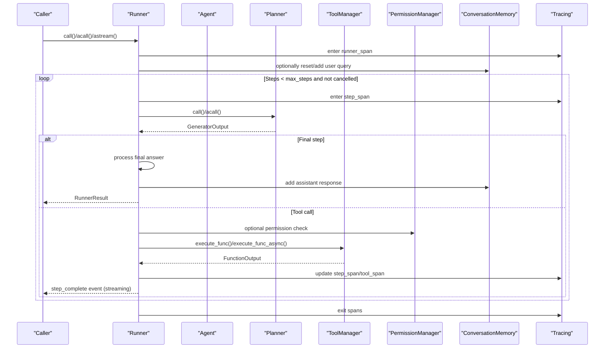
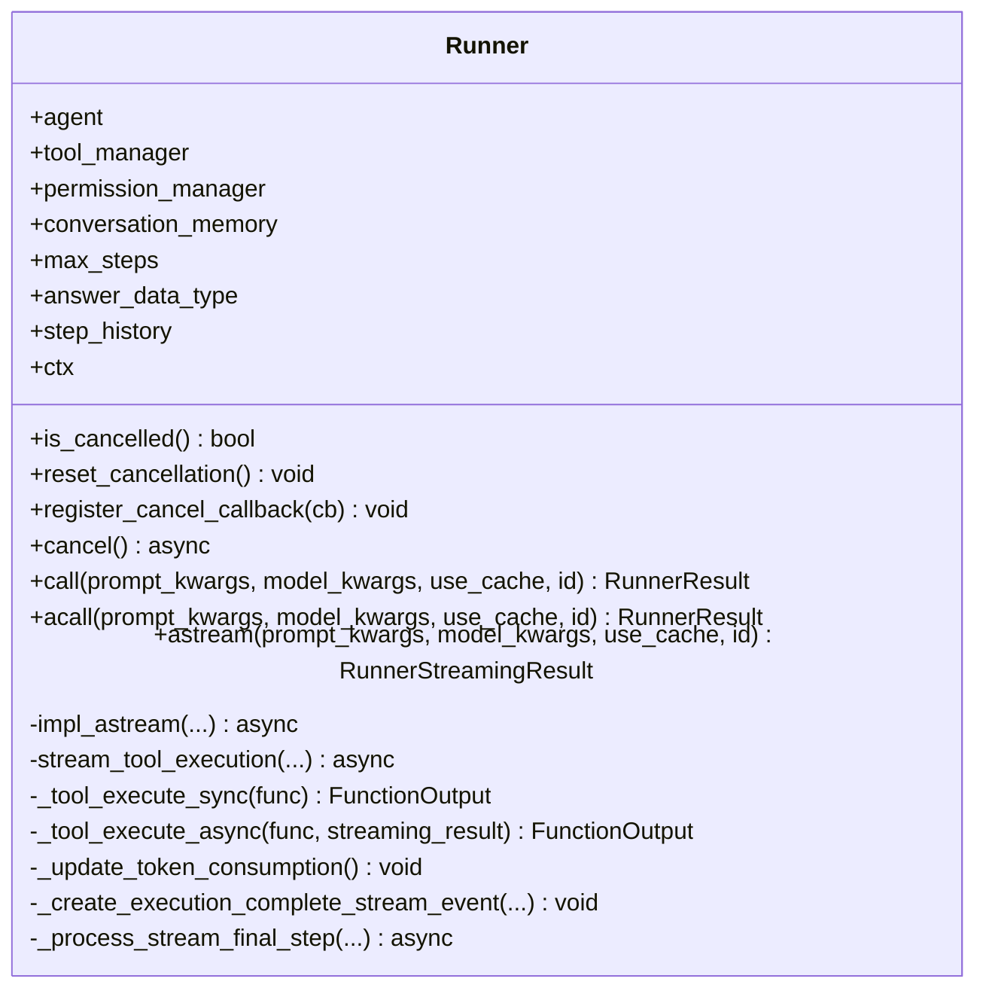
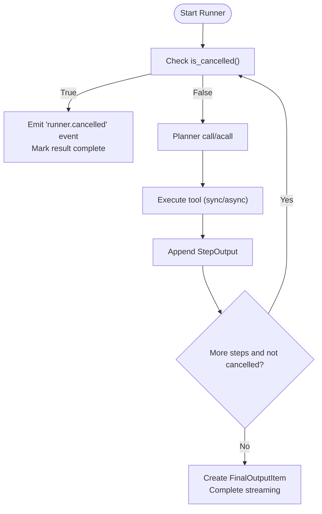
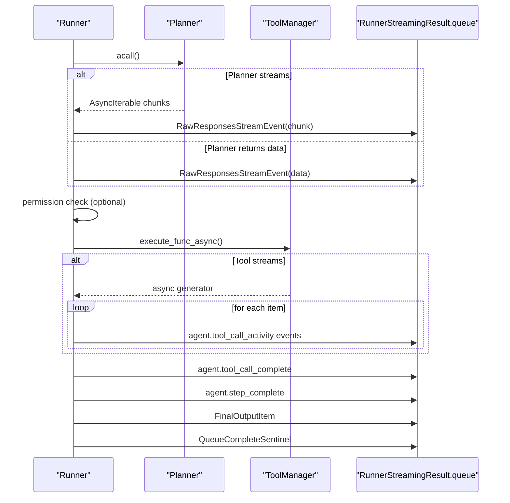
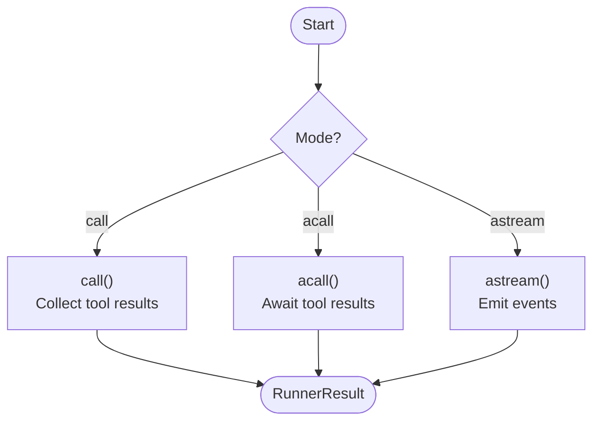
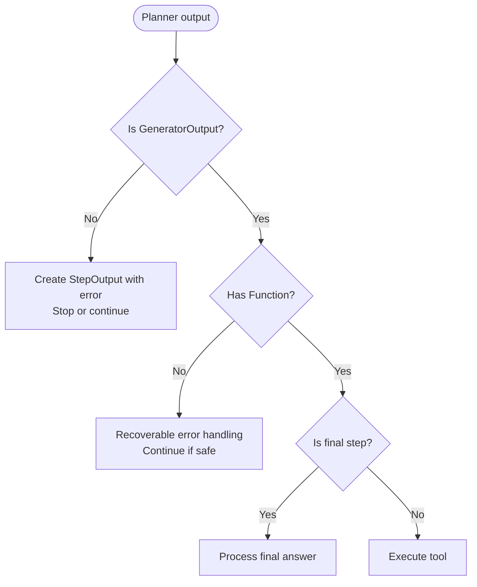
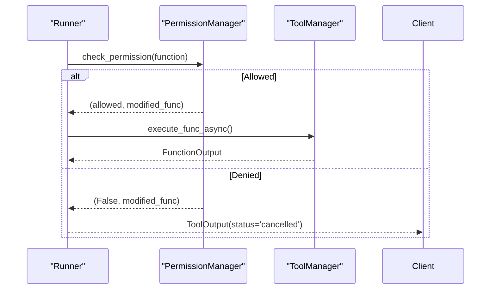
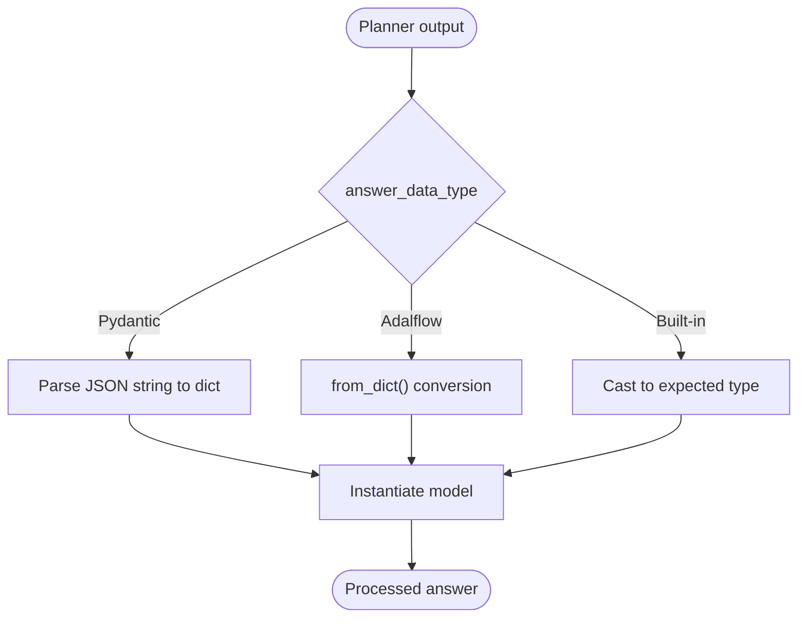
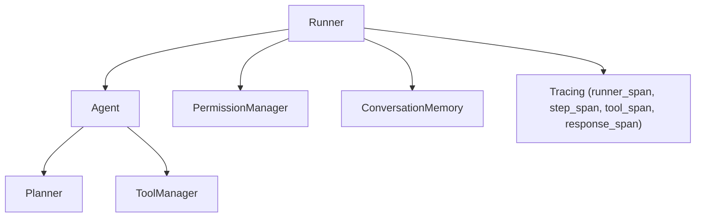

# Agent Runner and Execution Control

<cite>
**Referenced Files in This Document**
- [runner.py](file://adalflow/adalflow/components/agent/runner.py)
- [agent_runner.py](file://tutorials/v1_agent_runner/agent_runner.py)
- [runner_streaming.py](file://tutorials/v1_agent_runner/runner_streaming.py)
- [agents_runner.md](file://docs/source/new_tutorials/agents_runner.md)
- [agent-streaming.md](file://docs/design/agent-streaming.md)
</cite>

## Table of Contents
1. [Introduction](#introduction)
2. [Project Structure](#project-structure)
3. [Core Components](#core-components)
4. [Architecture Overview](#architecture-overview)
5. [Detailed Component Analysis](#detailed-component-analysis)
6. [Dependency Analysis](#dependency-analysis)
7. [Performance Considerations](#performance-considerations)
8. [Troubleshooting Guide](#troubleshooting-guide)
9. [Conclusion](#conclusion)
10. [Appendices](#appendices)

## Introduction
This document explains the Agent Runner component that orchestrates multi-step agent workflows, supporting both synchronous and asynchronous execution, streaming, and real-time event processing. It covers execution control, streaming patterns, event handling, cancellation, error handling, progress tracking, and scalability considerations. Concrete examples are drawn from the repository’s runner implementation and tutorials to help both beginners and advanced users build production-ready agent runners.

## Project Structure
The Agent Runner lives under the agent components and integrates with the Agent, ToolManager, PermissionManager, and tracing utilities. Tutorials demonstrate practical usage for synchronous and streaming execution.

```mermaid
graph TB
subgraph "Agent Components"
Agent["Agent"]
ToolManager["ToolManager"]
Planner["Planner (Generator)"]
end
subgraph "Runner"
Runner["Runner"]
PermMgr["PermissionManager"]
Mem["ConversationMemory"]
Trace["Tracing (runner_span, step_span, tool_span, response_span)"]
end
Agent --> Planner
Agent --> ToolManager
Runner --> Agent
Runner --> PermMgr
Runner --> Mem
Runner --> Trace
```

**Diagram sources**
- [runner.py](file://adalflow/adalflow/components/agent/runner.py#L107-L135)

**Section sources**
- [runner.py](file://adalflow/adalflow/components/agent/runner.py#L107-L135)

## Core Components
- Runner: Multi-step orchestration with planning, tool execution, and optional streaming. Supports cancellation, permission checks, conversation memory, and tracing.
- Agent: Provides a planner and tool manager; Runner delegates planning and tool execution to it.
- PermissionManager: Optional approval gate for tool calls.
- ConversationMemory: Optional memory integration for user-assistant context.
- Tracing: Spans for runner, step, tool, and response lifecycle.

Key responsibilities:
- Synchronous execution via call()
- Asynchronous execution via acall() and astream()
- Streaming event emission for raw LLM chunks, tool activities, step completions, and final outputs
- Cancellation signaling and graceful shutdown
- Error categorization (recoverable vs unrecoverable) and propagation
- Token consumption tracking and step history maintenance

**Section sources**
- [runner.py](file://adalflow/adalflow/components/agent/runner.py#L136-L193)
- [runner.py](file://adalflow/adalflow/components/agent/runner.py#L529-L826)
- [runner.py](file://adalflow/adalflow/components/agent/runner.py#L877-L1202)
- [runner.py](file://adalflow/adalflow/components/agent/runner.py#L1205-L1664)

## Architecture Overview
The Runner coordinates a loop of planning and tool execution, emitting events and updating state. It supports:
- Synchronous mode: call()
- Asynchronous mode: acall()
- Streaming mode: astream() with event queue and cancellation-aware processing



**Diagram sources**
- [runner.py](file://adalflow/adalflow/components/agent/runner.py#L529-L826)
- [runner.py](file://adalflow/adalflow/components/agent/runner.py#L877-L1202)
- [runner.py](file://adalflow/adalflow/components/agent/runner.py#L1242-L1664)

## Detailed Component Analysis

### Runner Class and Execution Modes
- Initialization: binds Agent, ToolManager, optional PermissionManager and ConversationMemory; sets max_steps and answer_data_type; initializes cancellation and token tracking.
- Synchronous call(): iterates steps, calls planner, executes tools, collects step history, processes final answer, and returns RunnerResult.
- Asynchronous acall(): mirrors call() but uses async planner and tool execution, with cancellation checks.
- Streaming astream(): starts a task, emits events (raw LLM chunks, tool activity, step completion), and completes with a final output item.



**Diagram sources**
- [runner.py](file://adalflow/adalflow/components/agent/runner.py#L107-L193)
- [runner.py](file://adalflow/adalflow/components/agent/runner.py#L529-L826)
- [runner.py](file://adalflow/adalflow/components/agent/runner.py#L877-L1202)
- [runner.py](file://adalflow/adalflow/components/agent/runner.py#L1205-L1664)

**Section sources**
- [runner.py](file://adalflow/adalflow/components/agent/runner.py#L136-L193)
- [runner.py](file://adalflow/adalflow/components/agent/runner.py#L529-L826)
- [runner.py](file://adalflow/adalflow/components/agent/runner.py#L877-L1202)
- [runner.py](file://adalflow/adalflow/components/agent/runner.py#L1205-L1664)

### Execution Control and Cancellation
- Cancellation flag and callbacks: is_cancelled(), reset_cancellation(), register_cancel_callback(), cancel().
- Streaming cancellation: raises CancelledError, emits a “runner.cancelled” event, marks result complete, and adds a memory entry.
- Task management: tracks current task to cancel previous or ongoing streaming tasks.



**Diagram sources**
- [runner.py](file://adalflow/adalflow/components/agent/runner.py#L231-L316)
- [runner.py](file://adalflow/adalflow/components/agent/runner.py#L1561-L1598)

**Section sources**
- [runner.py](file://adalflow/adalflow/components/agent/runner.py#L231-L316)
- [runner.py](file://adalflow/adalflow/components/agent/runner.py#L1561-L1598)

### Streaming Execution Patterns and Event Processing
- Raw responses: RawResponsesStreamEvent for LLM chunks.
- Tool events: agent.tool_call_start, agent.tool_call_activity, agent.tool_call_complete.
- Step events: agent.step_complete with StepRunItem.
- Final output: FinalOutputItem with RunnerResult.
- Permission events: agent.tool_permission_request when approval is required.
- Completion: QueueCompleteSentinel signals end-of-stream.



**Diagram sources**
- [runner.py](file://adalflow/adalflow/components/agent/runner.py#L1242-L1664)
- [runner.py](file://adalflow/adalflow/components/agent/runner.py#L1718-L1827)

**Section sources**
- [runner.py](file://adalflow/adalflow/components/agent/runner.py#L1242-L1664)
- [runner.py](file://adalflow/adalflow/components/agent/runner.py#L1718-L1827)

### Progress Tracking and State Management
- Step history: List[StepOutput] captures each iteration’s action, function, and observation.
- Token consumption: Tracks total and per-step tokens via planner’s estimated_token_count.
- Conversation memory: Adds user queries and assistant responses to maintain context across runs.

```mermaid
flowchart TD
Init["Init Runner"] --> Hist["step_history=[]"]
Init --> Tokens["token_consumption={}"]
Init --> Mem["conversation_memory=None"]
loop Steps
Plan["Planner call"] --> Exec["Tool execution"]
Exec --> Obs["Extract observation"]
Obs --> Append["Append StepOutput to step_history"]
Append --> UpdateTokens["Update token counters"]
end
Append --> Finalize["Finalize with answer or error"]
```

**Diagram sources**
- [runner.py](file://adalflow/adalflow/components/agent/runner.py#L176-L200)
- [runner.py](file://adalflow/adalflow/components/agent/runner.py#L585-L790)
- [runner.py](file://adalflow/adalflow/components/agent/runner.py#L941-L1166)

**Section sources**
- [runner.py](file://adalflow/adalflow/components/agent/runner.py#L176-L200)
- [runner.py](file://adalflow/adalflow/components/agent/runner.py#L585-L790)
- [runner.py](file://adalflow/adalflow/components/agent/runner.py#L941-L1166)

### Synchronous vs Asynchronous Execution
- Synchronous call(): suitable for simple, blocking workflows; internally handles generators and async generators by collecting results.
- Asynchronous acall(): ideal for concurrent I/O; preserves streaming semantics for tool execution and planner output.
- Streaming astream(): exposes a RunnerStreamingResult with stream_events() for real-time consumption.



**Diagram sources**
- [runner.py](file://adalflow/adalflow/components/agent/runner.py#L529-L826)
- [runner.py](file://adalflow/adalflow/components/agent/runner.py#L877-L1202)
- [runner.py](file://adalflow/adalflow/components/agent/runner.py#L1205-L1240)

**Section sources**
- [runner.py](file://adalflow/adalflow/components/agent/runner.py#L529-L826)
- [runner.py](file://adalflow/adalflow/components/agent/runner.py#L877-L1202)
- [runner.py](file://adalflow/adalflow/components/agent/runner.py#L1205-L1240)

### Error Handling Strategies
- Recoverable vs unrecoverable: _is_unrecoverable_error() detects network and HTTP-level failures; unrecoverable errors halt execution.
- Step-level errors: captured as StepOutput with observation; streaming emits error-wrapped raw events and continues to next step when possible.
- Final error propagation: RunnerResult.error stores the last error encountered.



**Diagram sources**
- [runner.py](file://adalflow/adalflow/components/agent/runner.py#L613-L656)
- [runner.py](file://adalflow/adalflow/components/agent/runner.py#L1416-L1436)

**Section sources**
- [runner.py](file://adalflow/adalflow/components/agent/runner.py#L68-L96)
- [runner.py](file://adalflow/adalflow/components/agent/runner.py#L613-L656)
- [runner.py](file://adalflow/adalflow/components/agent/runner.py#L1416-L1436)

### Permission Management and Human-in-the-Loop
- PermissionManager integration: Runner registers tools and checks permissions before tool execution; emits agent.tool_permission_request when approval is required.
- Denied permissions: returns a FunctionOutput with status “cancelled” and observation.



**Diagram sources**
- [runner.py](file://adalflow/adalflow/components/agent/runner.py#L839-L863)
- [runner.py](file://adalflow/adalflow/components/agent/runner.py#L1678-L1699)

**Section sources**
- [runner.py](file://adalflow/adalflow/components/agent/runner.py#L839-L863)
- [runner.py](file://adalflow/adalflow/components/agent/runner.py#L1678-L1699)

### Output Processing and Data Types
- answer_data_type supports built-in types, Pydantic dataclasses, and Adalflow dataclasses; RunnerResult.answer is processed accordingly.
- JSON parsing and validation ensure robust conversion from planner outputs.



**Diagram sources**
- [runner.py](file://adalflow/adalflow/components/agent/runner.py#L430-L505)

**Section sources**
- [runner.py](file://adalflow/adalflow/components/agent/runner.py#L430-L505)

### Concrete Examples from the Codebase
- Synchronous execution: See tutorial usage of Runner.call() with an Agent and tools.
- Asynchronous execution: See tutorial usage of Runner.acall() with async tools.
- Streaming execution: See tutorial usage of Runner.astream() and iterating stream_events().

**Section sources**
- [agent_runner.py](file://tutorials/v1_agent_runner/agent_runner.py#L143-L182)
- [agent_runner.py](file://tutorials/v1_agent_runner/agent_runner.py#L312-L349)
- [runner_streaming.py](file://tutorials/v1_agent_runner/runner_streaming.py#L252-L336)
- [runner_streaming.py](file://tutorials/v1_agent_runner/runner_streaming.py#L339-L436)

## Dependency Analysis
Runner depends on Agent, ToolManager, PermissionManager, ConversationMemory, and tracing utilities. The coupling is intentional: Runner orchestrates while delegating domain-specific logic to collaborators.



**Diagram sources**
- [runner.py](file://adalflow/adalflow/components/agent/runner.py#L156-L163)
- [runner.py](file://adalflow/adalflow/components/agent/runner.py#L202-L227)

**Section sources**
- [runner.py](file://adalflow/adalflow/components/agent/runner.py#L156-L163)
- [runner.py](file://adalflow/adalflow/components/agent/runner.py#L202-L227)

## Performance Considerations
- Token accounting: Monitor prompt tokens per step to estimate cost and optimize prompts.
- Streaming I/O: Prefer astream() for long-running workflows to reduce latency and improve responsiveness.
- Concurrency: Use acall() for overlapping tool and planner workloads.
- Memory: Limit max_steps and avoid retaining large intermediate artifacts; leverage ConversationMemory judiciously.
- Cancellation: Use cancel() promptly to free resources when clients disconnect or abort.

[No sources needed since this section provides general guidance]

## Troubleshooting Guide
Common issues and remedies:
- Unrecoverable errors: Context too long, rate limits, model not found. These halt execution; adjust prompts or retry policies.
- Recoverable errors: JSON parsing, formatting issues. Runner continues to next step when safe.
- Cancellation: Verify is_cancelled() and handle CancelledError in consumers; ensure cancel() is called to emit “runner.cancelled”.
- Permission denials: Review PermissionManager configuration and tool approvals.
- Streaming stalls: Confirm stream_events() is actively consumed and that the queue is not blocked.

**Section sources**
- [runner.py](file://adalflow/adalflow/components/agent/runner.py#L68-L96)
- [runner.py](file://adalflow/adalflow/components/agent/runner.py#L1561-L1598)
- [runner.py](file://adalflow/adalflow/components/agent/runner.py#L839-L863)

## Conclusion
The Runner provides a robust, extensible foundation for agent execution with strong support for synchronous, asynchronous, and streaming workflows. Its event-driven architecture, cancellation model, permission gating, and tracing enable production-grade observability and control. By combining these capabilities with thoughtful configuration of max_steps, output types, and memory, teams can build scalable agent systems that meet diverse performance and reliability needs.

[No sources needed since this section summarizes without analyzing specific files]

## Appendices

### API and Event Types Overview
- RunnerResult: Final answer, step_history, error, and optional ctx.
- RunnerStreamingResult: Queue-backed streaming result with stream_events(), answer, step_history, and completion sentinel.
- StepOutput: Captures action, function, and observation per step.
- Stream events: RawResponsesStreamEvent, RunItemStreamEvent (including FinalOutputItem, StepRunItem, ToolCallRunItem, ToolOutputRunItem).

**Section sources**
- [agents_runner.md](file://docs/source/new_tutorials/agents_runner.md#L103-L113)
- [runner.py](file://adalflow/adalflow/components/agent/runner.py#L331-L353)
- [runner.py](file://adalflow/adalflow/components/agent/runner.py#L1205-L1240)

### Streaming Design Notes
- The streaming architecture aligns with standardized event formats and supports both Responses API and Chat Completions bridging, ensuring consistent event lifecycles across providers.

**Section sources**
- [agent-streaming.md](file://docs/design/agent-streaming.md#L1-L375)