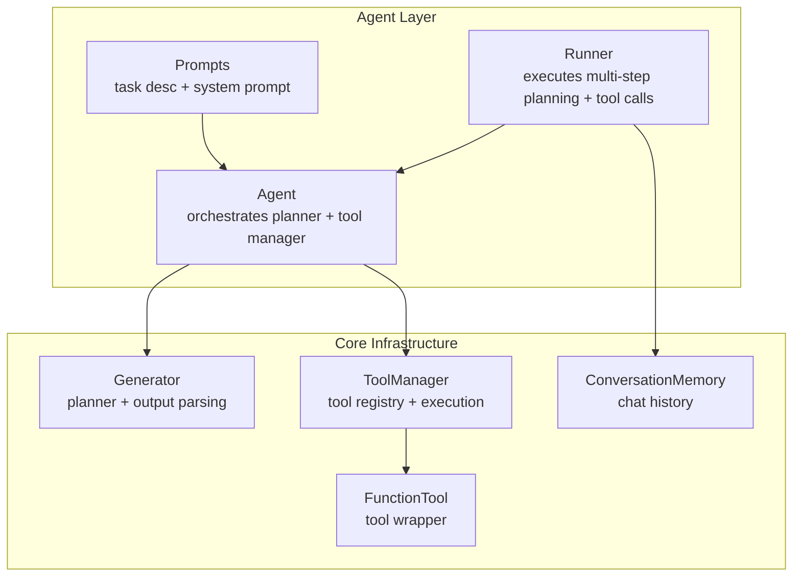
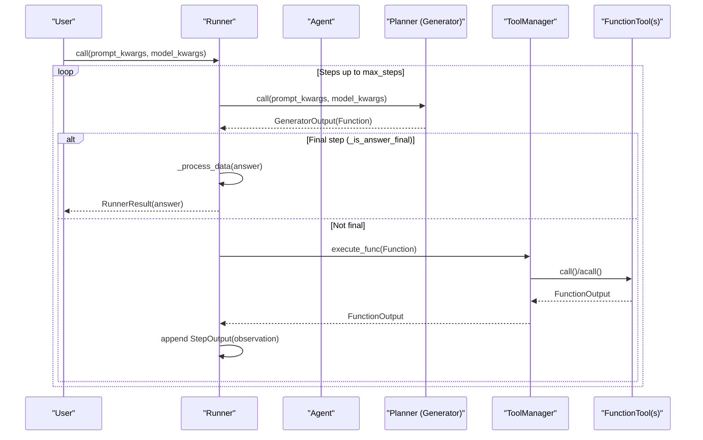
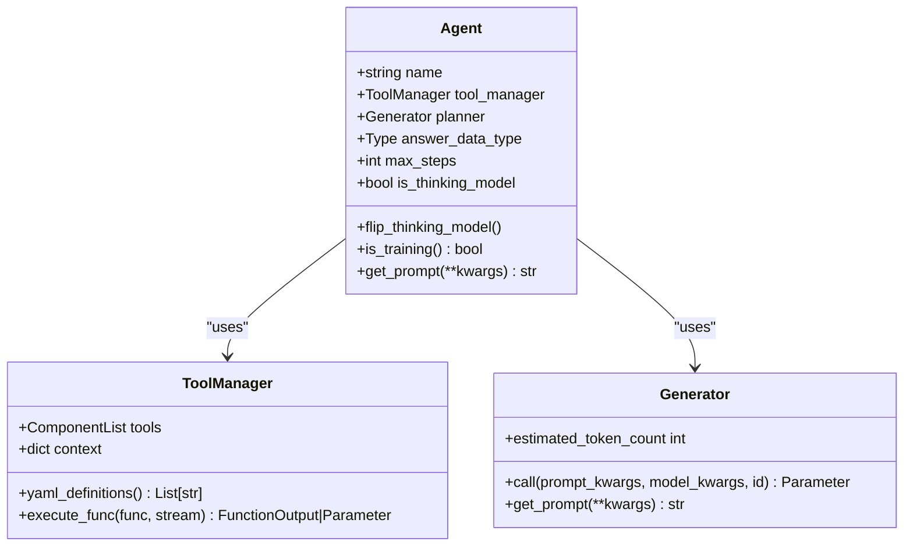
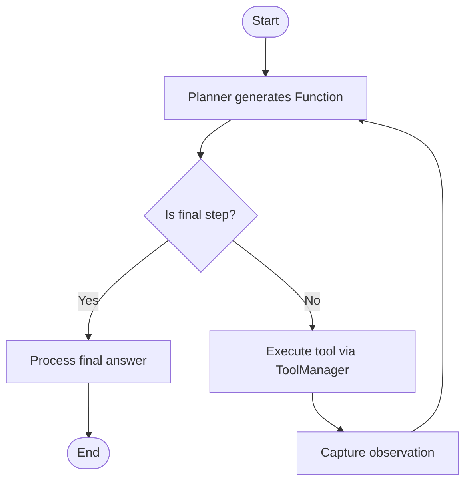
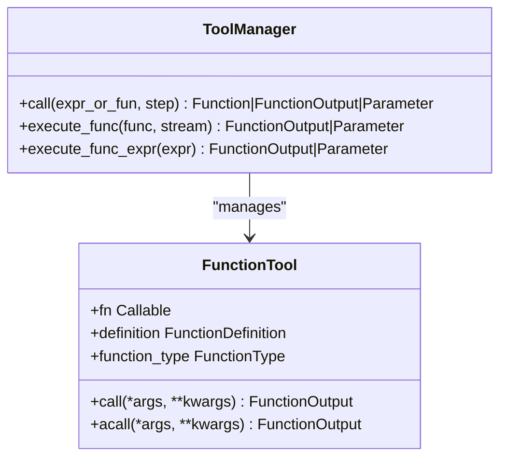
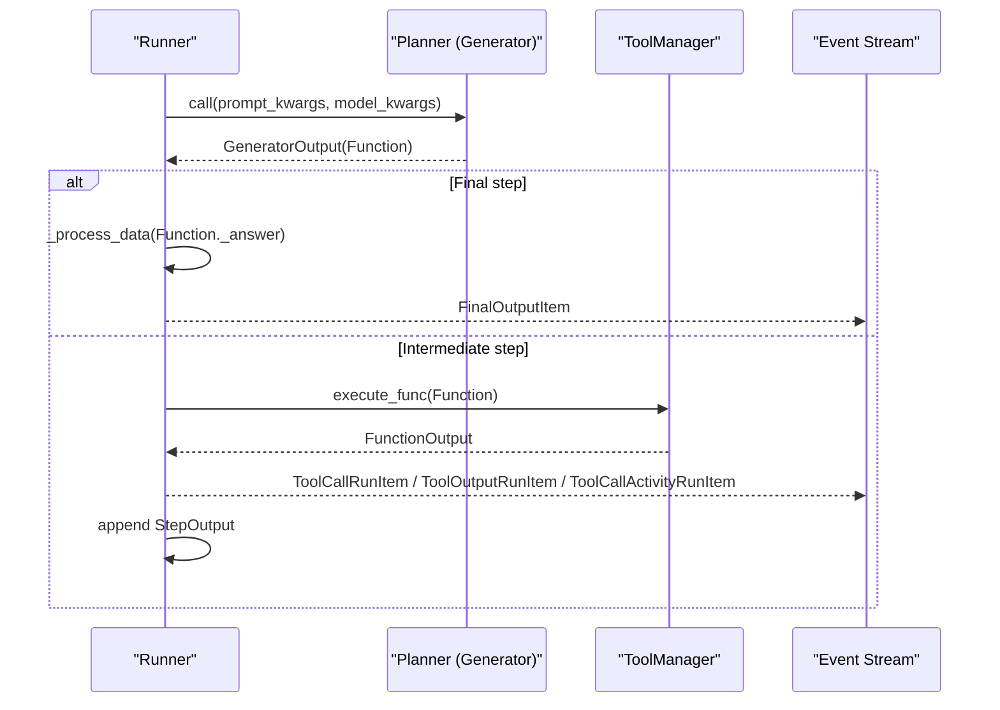
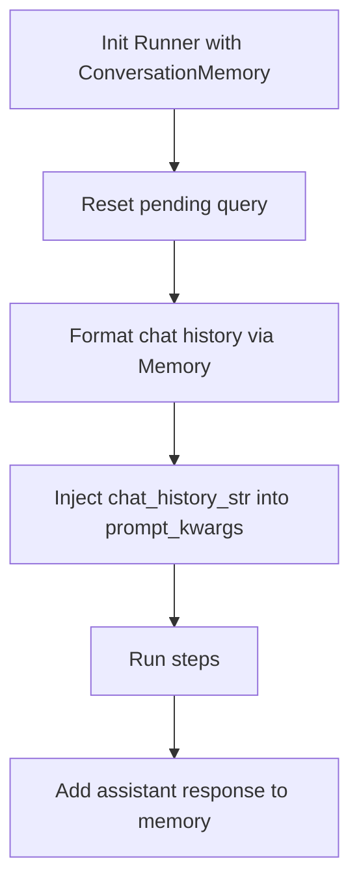
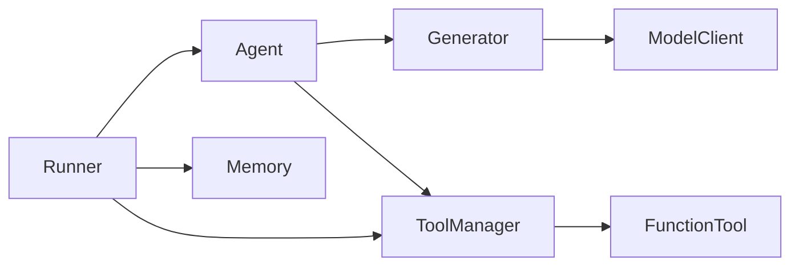

# Agent System

<cite>
**Referenced Files in This Document**
- [agent.py](file://adalflow/adalflow/components/agent/agent.py)
- [react.py](file://adalflow/adalflow/components/agent/react.py)
- [runner.py](file://adalflow/adalflow/components/agent/runner.py)
- [prompts.py](file://adalflow/adalflow/components/agent/prompts.py)
- [tool_manager.py](file://adalflow/adalflow/core/tool_manager.py)
- [func_tool.py](file://adalflow/adalflow/core/func_tool.py)
- [generator.py](file://adalflow/adalflow/core/generator.py)
- [memory.py](file://adalflow/adalflow/components/memory/memory.py)
- [tutorial_agent_basic.py](file://tutorials/agent/tutorial_agent_basic.py)
- [agent_demo.py](file://tutorials/agent/agent_demo.py)
</cite>

## Table of Contents
1. [Introduction](#introduction)
2. [Project Structure](#project-structure)
3. [Core Components](#core-components)
4. [Architecture Overview](#architecture-overview)
5. [Detailed Component Analysis](#detailed-component-analysis)
6. [Dependency Analysis](#dependency-analysis)
7. [Performance Considerations](#performance-considerations)
8. [Troubleshooting Guide](#troubleshooting-guide)
9. [Conclusion](#conclusion)
10. [Appendices](#appendices)

## Introduction
This document explains AdalFlow’s Agent System with a focus on its ReAct-style agent architecture and orchestration capabilities. It covers:
- The Agent component that composes a planner (Generator) and a tool manager (ToolManager)
- ReAct reasoning patterns and multi-step planning
- Tool integration mechanisms and permission-aware execution
- The Runner component for agent execution, including synchronous, asynchronous, and streaming modes
- Event processing, memory integration, and state management
- Performance optimization, debugging, monitoring, and troubleshooting strategies

The goal is to make the Agent System approachable for beginners while providing sufficient technical depth for advanced users building complex agent applications.

## Project Structure
The Agent System lives primarily under the agent components and integrates with core infrastructure:
- Agent orchestration: agent.py, react.py, runner.py, prompts.py
- Tooling: tool_manager.py, func_tool.py
- Planning and generation: generator.py
- Memory: memory.py
- Tutorials demonstrating usage: tutorial_agent_basic.py, agent_demo.py

**Diagram sources**
- [agent.py](file://adalflow/adalflow/components/agent/agent.py#L216-L387)
- [runner.py](file://adalflow/adalflow/components/agent/runner.py#L107-L190)
- [prompts.py](file://adalflow/adalflow/components/agent/prompts.py#L9-L121)
- [tool_manager.py](file://adalflow/adalflow/core/tool_manager.py#L134-L210)
- [func_tool.py](file://adalflow/adalflow/core/func_tool.py#L77-L137)
- [generator.py](file://adalflow/adalflow/core/generator.py#L82-L120)
- [memory.py](file://adalflow/adalflow/components/memory/memory.py#L52-L99)

**Section sources**
- [agent.py](file://adalflow/adalflow/components/agent/agent.py#L1-L387)
- [runner.py](file://adalflow/adalflow/components/agent/runner.py#L1-L1828)
- [prompts.py](file://adalflow/adalflow/components/agent/prompts.py#L1-L121)
- [tool_manager.py](file://adalflow/adalflow/core/tool_manager.py#L1-L626)
- [func_tool.py](file://adalflow/adalflow/core/func_tool.py#L1-L781)
- [generator.py](file://adalflow/adalflow/core/generator.py#L1-L800)
- [memory.py](file://adalflow/adalflow/components/memory/memory.py#L1-L226)

## Core Components
- Agent: Orchestrates a Generator-based planner and a ToolManager. It builds default planner and tool manager, supports toggling thinking-model mode, and exposes prompt retrieval.
- Runner: Executes Agent workflows across sync, async, and streaming modes. It tracks step history, token consumption, and integrates with permission and memory systems.
- ToolManager: Central registry and executor for tools. Supports sync/async/sync-generator/async-generator functions, parsing expressions, and streaming tool outputs.
- FunctionTool: Wraps functions into standardized tools with metadata, execution modes, and optional approval gating.
- Generator: Orchestrates prompting, model client calls, output processing, caching, and tracing. Powers the Agent’s planner.
- ConversationMemory: Provides conversation history formatting and persistence hooks for chat context.

Key responsibilities:
- Agent: Planner composition, tool integration, and answer type handling
- Runner: Iterative ReAct loop, tool execution, event emission, cancellation, and tracing
- ToolManager: Tool discovery, execution, and streaming support
- FunctionTool: Standardized tool interface and metadata
- Generator: Prompt rendering, model invocation, output parsing, caching
- Memory: Conversation history injection into prompts

**Section sources**
- [agent.py](file://adalflow/adalflow/components/agent/agent.py#L216-L387)
- [runner.py](file://adalflow/adalflow/components/agent/runner.py#L107-L800)
- [tool_manager.py](file://adalflow/adalflow/core/tool_manager.py#L134-L575)
- [func_tool.py](file://adalflow/adalflow/core/func_tool.py#L77-L494)
- [generator.py](file://adalflow/adalflow/core/generator.py#L82-L212)
- [memory.py](file://adalflow/adalflow/components/memory/memory.py#L52-L226)

## Architecture Overview
The Agent System follows a ReAct-style architecture:
- The Agent composes a Generator-based planner and a ToolManager.
- The Runner drives multi-step planning and tool execution, feeding observations back into the planner.
- Tools can be synchronous, asynchronous, or generators; Runner handles all variants.
- Streaming is supported for both planner and tool outputs.

**Diagram sources**
- [runner.py](file://adalflow/adalflow/components/agent/runner.py#L529-L800)
- [generator.py](file://adalflow/adalflow/core/generator.py#L621-L774)
- [tool_manager.py](file://adalflow/adalflow/core/tool_manager.py#L310-L427)
- [func_tool.py](file://adalflow/adalflow/core/func_tool.py#L321-L494)

## Detailed Component Analysis

### Agent Component
The Agent encapsulates:
- Planner: A Generator configured with a ReAct-style system prompt and output parser
- ToolManager: Registry of tools and context variables
- Default helpers: optional LLM fallback tool and configurable max steps
- Thinking model toggle: switches output schema to omit CoT fields when enabled

**Diagram sources**
- [agent.py](file://adalflow/adalflow/components/agent/agent.py#L216-L387)
- [tool_manager.py](file://adalflow/adalflow/core/tool_manager.py#L134-L210)
- [generator.py](file://adalflow/adalflow/core/generator.py#L82-L120)

Key behaviors:
- Default planner creation includes task description, tool definitions, output schema, and context variables
- Default tool manager augments tools with an LLM fallback when requested
- Thinking model mode adjusts the output schema to align with reasoning-only models

**Section sources**
- [agent.py](file://adalflow/adalflow/components/agent/agent.py#L59-L214)
- [prompts.py](file://adalflow/adalflow/components/agent/prompts.py#L9-L121)

### ReAct Reasoning Patterns
The Agent uses a ReAct-like loop:
- Planner generates a Function action (with thought or reasoning) at each step
- ToolManager executes the action and returns an observation
- Runner aggregates observations and continues until a final “finish” action is detected

**Diagram sources**
- [runner.py](file://adalflow/adalflow/components/agent/runner.py#L589-L790)
- [tool_manager.py](file://adalflow/adalflow/core/tool_manager.py#L310-L427)

Notes:
- The legacy ReActAgent component remains for backward compatibility and is marked as deprecated in favor of Agent + Runner
- The Runner centralizes the ReAct loop and integrates with memory, permissions, and tracing

**Section sources**
- [react.py](file://adalflow/adalflow/components/agent/react.py#L182-L768)
- [runner.py](file://adalflow/adalflow/components/agent/runner.py#L589-L790)

### Tool Integration Mechanisms
Tools can be:
- Plain functions or methods
- FunctionTool-wrapped callables
- Async functions or generators
- Tools requiring permission approval

**Diagram sources**
- [func_tool.py](file://adalflow/adalflow/core/func_tool.py#L77-L137)
- [tool_manager.py](file://adalflow/adalflow/core/tool_manager.py#L234-L427)

Runner integrates with ToolManager:
- Parses Function expressions
- Executes tools synchronously or asynchronously
- Handles generator outputs and streaming tool events
- Emits tool call/activity/final output events for observability

**Section sources**
- [tool_manager.py](file://adalflow/adalflow/core/tool_manager.py#L234-L575)
- [func_tool.py](file://adalflow/adalflow/core/func_tool.py#L291-L494)
- [runner.py](file://adalflow/adalflow/components/agent/runner.py#L688-L760)

### Runner Component: Execution, Streaming, and Events
Runner orchestrates:
- Synchronous execution: call()
- Asynchronous execution: acall()
- Streaming execution: astream() with event streams
- Cancellation and token tracking
- Permission gating and conversation memory integration

**Diagram sources**
- [runner.py](file://adalflow/adalflow/components/agent/runner.py#L529-L800)
- [generator.py](file://adalflow/adalflow/core/generator.py#L621-L774)
- [tool_manager.py](file://adalflow/adalflow/core/tool_manager.py#L310-L427)

Runner features:
- Token consumption tracking via the planner’s estimated token count
- Cancellation support with callbacks and sentinel events
- Conversation memory integration for chat history injection
- Permission manager registration for tools requiring approvals

**Section sources**
- [runner.py](file://adalflow/adalflow/components/agent/runner.py#L136-L395)
- [memory.py](file://adalflow/adalflow/components/memory/memory.py#L52-L226)

### Memory Integration
Runner optionally integrates ConversationMemory:
- Injects formatted chat history into prompt kwargs
- Adds user queries and assistant responses to memory
- Supports metadata filtering for selective inclusion

**Diagram sources**
- [runner.py](file://adalflow/adalflow/components/agent/runner.py#L564-L582)
- [memory.py](file://adalflow/adalflow/components/memory/memory.py#L77-L99)

**Section sources**
- [runner.py](file://adalflow/adalflow/components/agent/runner.py#L564-L582)
- [memory.py](file://adalflow/adalflow/components/memory/memory.py#L52-L226)

### Concrete Examples from the Codebase
- Basic agent creation and execution with tools
  - See [tutorial_agent_basic.py](file://tutorials/agent/tutorial_agent_basic.py#L101-L128)
- Multi-tool agent with diverse tool types
  - See [tutorial_agent_basic.py](file://tutorials/agent/tutorial_agent_basic.py#L130-L155)
- Callable tools without explicit FunctionTool wrappers
  - See [tutorial_agent_basic.py](file://tutorials/agent/tutorial_agent_basic.py#L157-L183)
- Structured output using Pydantic models
  - See [tutorial_agent_basic.py](file://tutorials/agent/tutorial_agent_basic.py#L185-L209)
- Custom role description and reasoning
  - See [tutorial_agent_basic.py](file://tutorials/agent/tutorial_agent_basic.py#L211-L237)
- Runner configuration overrides and error handling
  - See [tutorial_agent_basic.py](file://tutorials/agent/tutorial_agent_basic.py#L239-L264)
- Streaming and async execution demonstrations
  - See [agent_demo.py](file://tutorials/agent/agent_demo.py#L85-L165)

These tutorials demonstrate:
- Agent instantiation with tools and model clients
- Runner execution modes (call, acall, astream)
- Tool definitions (sync, async, generator)
- Streaming events and final outputs
- Structured answer processing

**Section sources**
- [tutorial_agent_basic.py](file://tutorials/agent/tutorial_agent_basic.py#L101-L264)
- [agent_demo.py](file://tutorials/agent/agent_demo.py#L85-L165)

## Dependency Analysis
High-level dependencies:
- Agent depends on Generator (planner) and ToolManager (tools)
- Runner depends on Agent, ToolManager, and optionally PermissionManager and ConversationMemory
- ToolManager depends on FunctionTool and supports multiple function types
- Generator depends on ModelClient, Tokenizer, and output processors

**Diagram sources**
- [agent.py](file://adalflow/adalflow/components/agent/agent.py#L216-L387)
- [runner.py](file://adalflow/adalflow/components/agent/runner.py#L107-L190)
- [tool_manager.py](file://adalflow/adalflow/core/tool_manager.py#L134-L210)
- [func_tool.py](file://adalflow/adalflow/core/func_tool.py#L77-L137)
- [generator.py](file://adalflow/adalflow/core/generator.py#L82-L120)

**Section sources**
- [agent.py](file://adalflow/adalflow/components/agent/agent.py#L216-L387)
- [runner.py](file://adalflow/adalflow/components/agent/runner.py#L107-L190)
- [tool_manager.py](file://adalflow/adalflow/core/tool_manager.py#L134-L210)
- [func_tool.py](file://adalflow/adalflow/core/func_tool.py#L77-L137)
- [generator.py](file://adalflow/adalflow/core/generator.py#L82-L120)

## Performance Considerations
- Caching: Generator supports caching to avoid repeated model calls; Runner respects use_cache flags
- Token tracking: Runner updates token consumption using the planner’s estimated token count
- Streaming: Prefer streaming for long-running tools and to reduce latency; Runner handles generator outputs and activity events
- Async execution: Use acall/astream for concurrent tool execution and to avoid blocking
- Output processors: Keep output processors lightweight; avoid heavy parsing in streaming mode
- Max steps: Tune max_steps to balance accuracy and cost/time

[No sources needed since this section provides general guidance]

## Troubleshooting Guide
Common issues and strategies:
- Unrecoverable errors: Runner treats certain HTTP error strings and codes as unrecoverable and stops execution
- Recoverable errors: For JSON/parsing/formatting issues, Runner continues to the next step
- Permission gating: Register tools with PermissionManager to enforce approvals
- Cancellation: Use Runner.cancel() to stop execution; Runner emits a sentinel event and cancels the current task
- Token overruns: Monitor token consumption and adjust prompts or max_tokens
- Debugging: Enable debug prints in legacy ReActAgent for step-by-step inspection; use tracing and MLflow integration

Concrete references:
- Unrecoverable error detection and handling
  - [runner.py](file://adalflow/adalflow/components/agent/runner.py#L68-L96)
- Error propagation and continuation
  - [runner.py](file://adalflow/adalflow/components/agent/runner.py#L634-L657)
- Cancellation and task management
  - [runner.py](file://adalflow/adalflow/components/agent/runner.py#L272-L316)
- Permission manager integration
  - [runner.py](file://adalflow/adalflow/components/agent/runner.py#L202-L228)
- Token tracking
  - [runner.py](file://adalflow/adalflow/components/agent/runner.py#L250-L266)
- Legacy debugging aids
  - [react.py](file://adalflow/adalflow/components/agent/react.py#L539-L578)

**Section sources**
- [runner.py](file://adalflow/adalflow/components/agent/runner.py#L68-L96)
- [runner.py](file://adalflow/adalflow/components/agent/runner.py#L272-L316)
- [runner.py](file://adalflow/adalflow/components/agent/runner.py#L202-L228)
- [runner.py](file://adalflow/adalflow/components/agent/runner.py#L250-L266)
- [react.py](file://adalflow/adalflow/components/agent/react.py#L539-L578)

## Conclusion
AdalFlow’s Agent System provides a robust, extensible ReAct-style framework:
- Agent composes a flexible planner and tool manager
- Runner executes multi-step plans with strong support for sync, async, and streaming
- ToolManager and FunctionTool unify heterogeneous tool types
- Memory and permission systems integrate cleanly for production-grade agents
- Comprehensive tracing and error handling enable monitoring and debugging

This architecture scales from simple tool-augmented assistants to complex, multi-step reasoning agents with structured outputs and real-time streaming.

[No sources needed since this section summarizes without analyzing specific files]

## Appendices

### Appendix A: Agent Creation and Execution Workflow
- Create tools (sync/async/generator) and wrap with FunctionTool when needed
- Instantiate Agent with tools, model client, and answer type
- Use Runner.call(), Runner.acall(), or Runner.astream() to execute
- Inspect RunnerResult.step_history and RunnerResult.answer

References:
- [tutorial_agent_basic.py](file://tutorials/agent/tutorial_agent_basic.py#L101-L264)
- [agent_demo.py](file://tutorials/agent/agent_demo.py#L85-L165)

**Section sources**
- [tutorial_agent_basic.py](file://tutorials/agent/tutorial_agent_basic.py#L101-L264)
- [agent_demo.py](file://tutorials/agent/agent_demo.py#L85-L165)