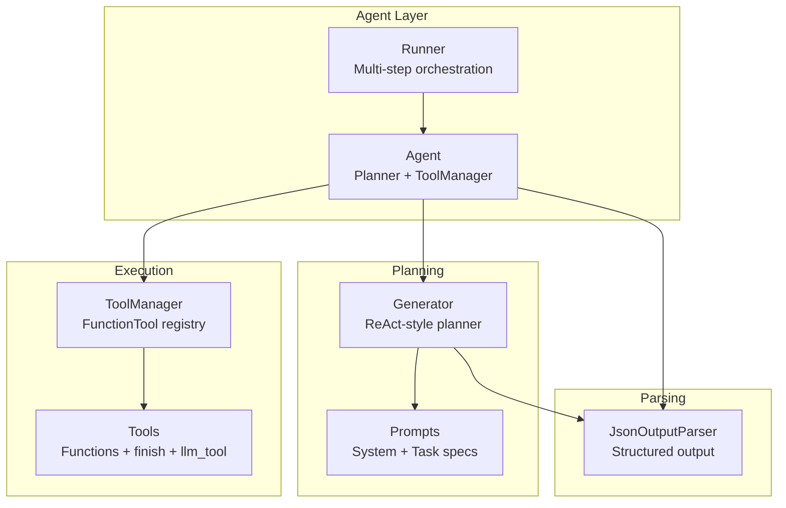
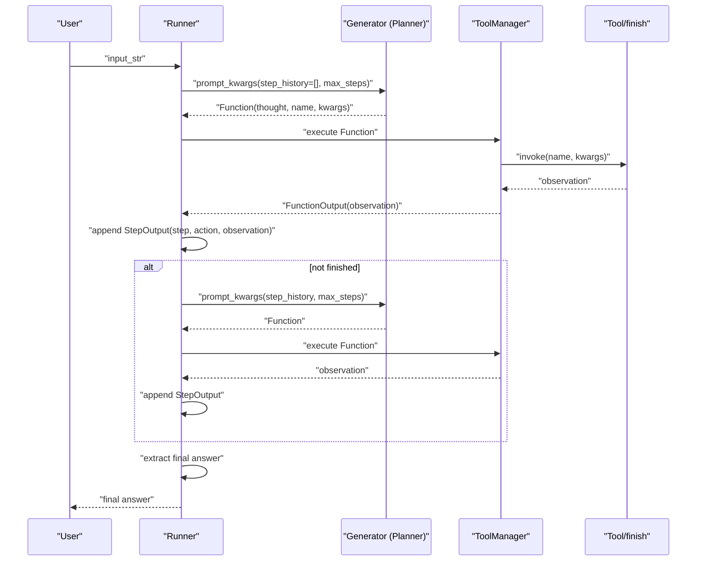
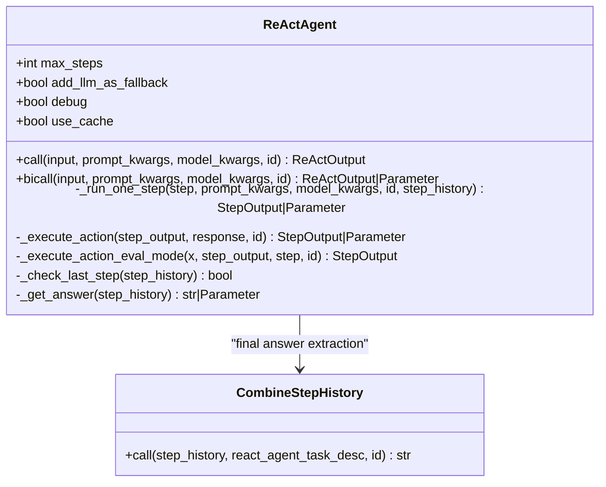
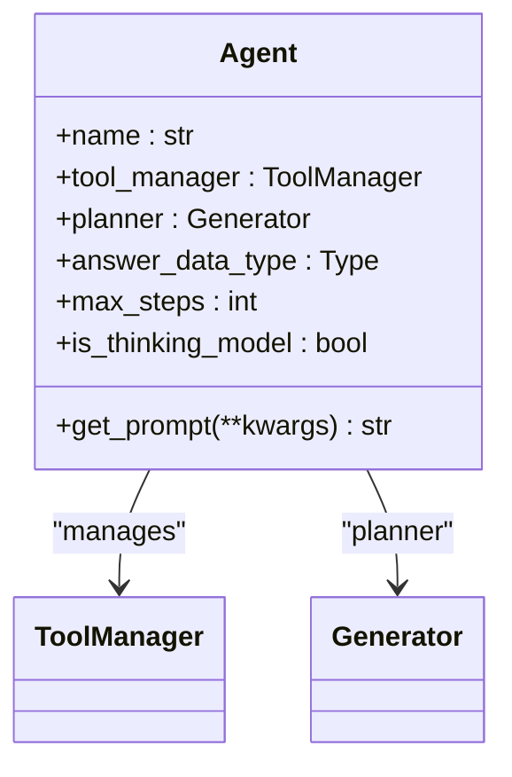
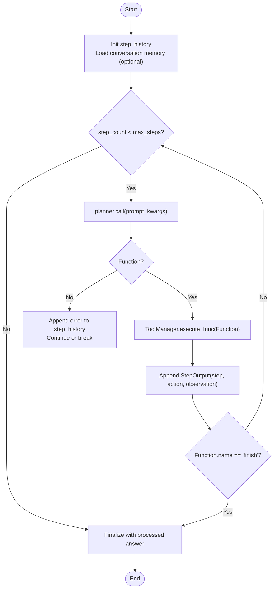
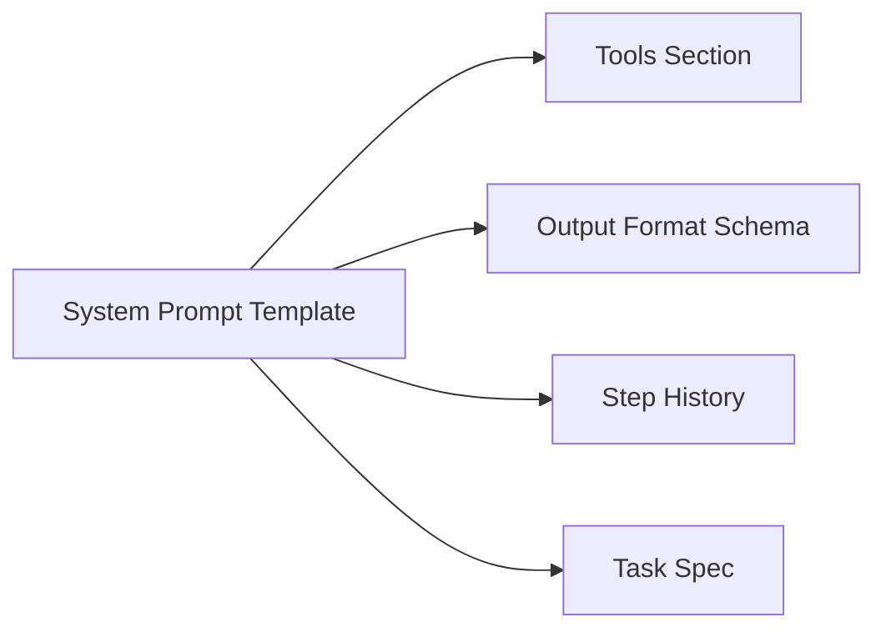
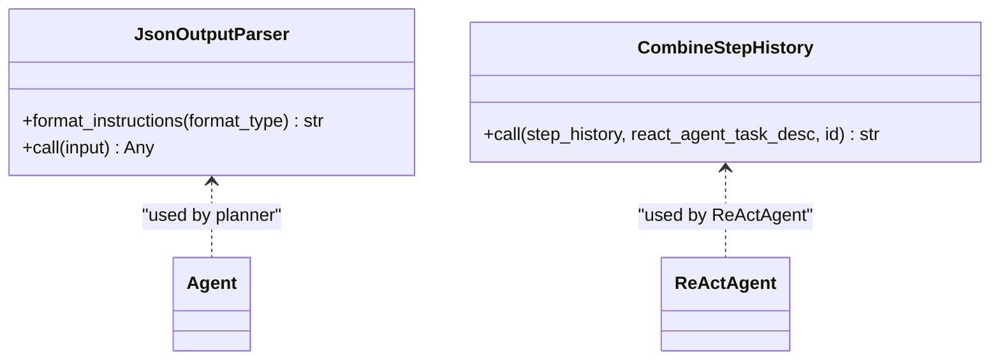
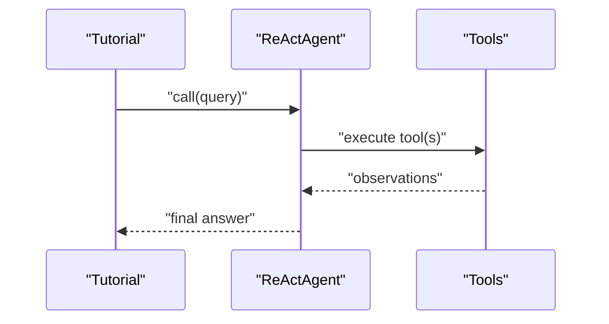
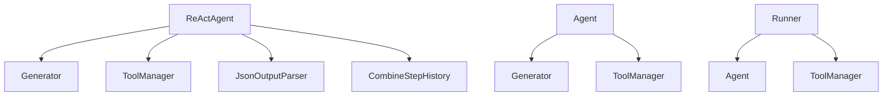

# ReAct Reasoning and Planning

<cite>
**Referenced Files in This Document**
- [react.py](file://adalflow/adalflow/components/agent/react.py)
- [agent.py](file://adalflow/adalflow/components/agent/agent.py)
- [runner.py](file://adalflow/adalflow/components/agent/runner.py)
- [prompts.py](file://adalflow/adalflow/components/agent/prompts.py)
- [outputs.py](file://adalflow/adalflow/components/output_parsers/outputs.py)
- [types.py](file://adalflow/adalflow/core/types.py)
- [react_note.py](file://tutorials/react_note.py)
- [react_agent_hotpot_qa.ipynb](file://use_cases/agent/react_agent_hotpot_qa.ipynb)
</cite>

## Table of Contents
1. [Introduction](#introduction)
2. [Project Structure](#project-structure)
3. [Core Components](#core-components)
4. [Architecture Overview](#architecture-overview)
5. [Detailed Component Analysis](#detailed-component-analysis)
6. [Dependency Analysis](#dependency-analysis)
7. [Performance Considerations](#performance-considerations)
8. [Troubleshooting Guide](#troubleshooting-guide)
9. [Conclusion](#conclusion)
10. [Appendices](#appendices)

## Introduction
This document explains AdalFlow’s implementation of the ReAct (Reasoning and Acting) paradigm. It covers the ReAct algorithm as implemented in the ReActAgent and Agent+Runner components, detailing the step-by-step planning process, the thought-action cycle, intermediate reasoning steps, and final answer extraction. It also documents prompt engineering for ReAct patterns, output parsing strategies, state tracking, and practical execution flows. Guidance is provided for model selection, chain-of-thought integration, and performance optimization, along with debugging strategies for reasoning failures and ambiguity.

## Project Structure
AdalFlow organizes ReAct reasoning under the agent subsystem with clear separation of concerns:
- ReActAgent: legacy ReAct implementation with a generator-based planner and tool manager
- Agent: modern ReAct-style planner with a configurable Generator and ToolManager
- Runner: orchestrator for multi-step planning and tool execution with streaming and tracing
- Prompts: reusable system prompts and task descriptions for agents
- Output Parsers: structured output parsing for function calls and final answers
- Types: shared data models and enums used across components

**Diagram sources**
- [agent.py](file://adalflow/adalflow/components/agent/agent.py#L216-L387)
- [runner.py](file://adalflow/adalflow/components/agent/runner.py#L107-L800)
- [prompts.py](file://adalflow/adalflow/components/agent/prompts.py#L1-L121)
- [outputs.py](file://adalflow/adalflow/components/output_parsers/outputs.py#L288-L379)

**Section sources**
- [agent.py](file://adalflow/adalflow/components/agent/agent.py#L1-L387)
- [runner.py](file://adalflow/adalflow/components/agent/runner.py#L1-L800)
- [prompts.py](file://adalflow/adalflow/components/agent/prompts.py#L1-L121)
- [outputs.py](file://adalflow/adalflow/components/output_parsers/outputs.py#L1-L545)

## Core Components
- ReActAgent: Implements a ReAct-style planner using a Generator with a JSON output schema. It tracks step history, executes tool calls, and extracts the final answer. It supports a thinking-model mode and optional examples for output format.
- Agent: Modern ReAct-style planner with a configurable Generator and ToolManager. It exposes a fluent API for tool integration, caching, and answer type handling.
- Runner: Orchestrates multi-step ReAct loops, manages tool execution, step history, and final answer processing. It supports streaming, tracing, and token accounting.
- Prompts: Provides system prompts and task descriptions for ReAct-style agents, including tool definitions, output format instructions, and examples.
- Output Parsers: JSON/YAML/Boolean/List parsers for structured output and final answer extraction.

**Section sources**
- [react.py](file://adalflow/adalflow/components/agent/react.py#L182-L768)
- [agent.py](file://adalflow/adalflow/components/agent/agent.py#L216-L387)
- [runner.py](file://adalflow/adalflow/components/agent/runner.py#L107-L800)
- [prompts.py](file://adalflow/adalflow/components/agent/prompts.py#L1-L121)
- [outputs.py](file://adalflow/adalflow/components/output_parsers/outputs.py#L288-L379)

## Architecture Overview
The ReAct architecture centers on iterative planning and acting:
- The planner (Generator) produces a structured function call (Function) per step, including thought, action name, and kwargs.
- The Runner or Agent executes the function via ToolManager, capturing observations.
- The step history is fed back into the planner prompt for the next iteration.
- The process ends when the planner emits a “finish” action with the final answer.

**Diagram sources**
- [runner.py](file://adalflow/adalflow/components/agent/runner.py#L529-L800)
- [agent.py](file://adalflow/adalflow/components/agent/agent.py#L216-L387)
- [outputs.py](file://adalflow/adalflow/components/output_parsers/outputs.py#L288-L379)

## Detailed Component Analysis

### ReActAgent: Legacy Planner
- Purpose: A ReAct-style agent using a Generator to plan steps and a ToolManager to execute actions.
- Key behaviors:
  - Builds a system prompt with tools, output format, examples, and step history.
  - Uses a JSON output schema to parse Function expressions (thought, name, kwargs).
  - Executes actions via ToolManager and appends observations to step history.
  - Extracts the final answer from the last step’s observation or a dedicated combine-step-history component.
  - Supports a thinking-model mode to skip explicit “thought” field.
  - Includes a fallback LLM tool and a “finish” tool to conclude the task.

**Diagram sources**
- [react.py](file://adalflow/adalflow/components/agent/react.py#L182-L768)

**Section sources**
- [react.py](file://adalflow/adalflow/components/agent/react.py#L182-L768)

### Agent: Modern Planner
- Purpose: A higher-level component combining a planner (Generator) and a tool manager (ToolManager).
- Key behaviors:
  - Creates default ToolManager and Generator with ReAct-style prompts and JSON output schema.
  - Supports thinking-model mode to include or exclude a “thought” field.
  - Exposes answer_data_type for final answer processing and caching controls.
  - Provides get_prompt for inspection and debugging.

**Diagram sources**
- [agent.py](file://adalflow/adalflow/components/agent/agent.py#L216-L387)

**Section sources**
- [agent.py](file://adalflow/adalflow/components/agent/agent.py#L216-L387)

### Runner: Multi-step Orchestration
- Purpose: Executes Agent-based ReAct loops with robust error handling, streaming, tracing, and token accounting.
- Key behaviors:
  - Iterates up to max_steps, calling the planner, executing functions, and appending observations.
  - Processes final answer using answer_data_type (Pydantic/BaseModel/DataClass or built-in types).
  - Tracks token consumption and supports cancellation.
  - Emits streaming events and integrates with tracing spans.

**Diagram sources**
- [runner.py](file://adalflow/adalflow/components/agent/runner.py#L529-L800)

**Section sources**
- [runner.py](file://adalflow/adalflow/components/agent/runner.py#L107-L800)

### Prompt Engineering for ReAct
- System prompt composition:
  - Task specification instructing the agent to use a divide-and-conquer strategy.
  - Tool definitions and instructions.
  - Output format schema and examples for structured JSON.
  - Step history injection to maintain context across iterations.
- Templates:
  - DEFAULT_REACT_AGENT_SYSTEM_PROMPT and DEFAULT_ADALFLOW_AGENT_SYSTEM_PROMPT define the prompt structure.
  - adalflow_agent_task_desc provides the task specification and constraints.

**Diagram sources**
- [prompts.py](file://adalflow/adalflow/components/agent/prompts.py#L1-L121)
- [agent.py](file://adalflow/adalflow/components/agent/agent.py#L123-L214)

**Section sources**
- [prompts.py](file://adalflow/adalflow/components/agent/prompts.py#L1-L121)
- [agent.py](file://adalflow/adalflow/components/agent/agent.py#L123-L214)

### Output Parsing Strategies
- JSON schema-driven parsing:
  - JsonOutputParser generates format instructions from a data class schema and parses JSON into structured objects.
  - It supports include/exclude fields and returning data classes or dicts.
- Final answer extraction:
  - For ReActAgent, CombineStepHistory extracts the final answer from the last step’s observation.
  - For Runner, the final answer is processed according to answer_data_type (Pydantic/BaseModel/DataClass or built-in types).

**Diagram sources**
- [outputs.py](file://adalflow/adalflow/components/output_parsers/outputs.py#L288-L379)
- [react.py](file://adalflow/adalflow/components/agent/react.py#L152-L166)

**Section sources**
- [outputs.py](file://adalflow/adalflow/components/output_parsers/outputs.py#L288-L379)
- [react.py](file://adalflow/adalflow/components/agent/react.py#L152-L166)

### State Tracking Throughout the Reasoning Process
- StepOutput captures:
  - step: iteration index
  - action: the planned Function (thought/name/kwargs)
  - observation: the tool execution result or error
- Runner maintains step_history as a list of StepOutput entries.
- Conversation memory can be injected into prompt_kwargs for chat history context.

**Section sources**
- [runner.py](file://adalflow/adalflow/components/agent/runner.py#L529-L800)
- [types.py](file://adalflow/adalflow/core/types.py#L1-L200)

### Practical Execution Flows and Examples
- Tutorial example:
  - Demonstrates defining tools (multiply/add/divide), initializing ReActAgent, and comparing against a plain Generator baseline.
- HotpotQA use case:
  - Shows a ReAct agent with a Wikipedia search tool, examples, and step-by-step reasoning leading to a final answer.

**Diagram sources**
- [react_note.py](file://tutorials/react_note.py#L1-L162)
- [react_agent_hotpot_qa.ipynb](file://use_cases/agent/react_agent_hotpot_qa.ipynb#L1-L800)

**Section sources**
- [react_note.py](file://tutorials/react_note.py#L1-L162)
- [react_agent_hotpot_qa.ipynb](file://use_cases/agent/react_agent_hotpot_qa.ipynb#L1-L800)

## Dependency Analysis
- Coupling:
  - ReActAgent depends on Generator, ToolManager, JsonOutputParser, and CombineStepHistory.
  - Agent depends on ToolManager and Generator factories.
  - Runner depends on Agent, ToolManager, and tracing utilities.
- Cohesion:
  - Each component encapsulates a single responsibility: planning, execution, orchestration, or parsing.
- External dependencies:
  - Model clients (OpenAI, Anthropic, etc.) via ModelClientType.
  - Tool definitions via FunctionTool and ToolManager.

**Diagram sources**
- [react.py](file://adalflow/adalflow/components/agent/react.py#L182-L768)
- [agent.py](file://adalflow/adalflow/components/agent/agent.py#L216-L387)
- [runner.py](file://adalflow/adalflow/components/agent/runner.py#L107-L800)

**Section sources**
- [react.py](file://adalflow/adalflow/components/agent/react.py#L182-L768)
- [agent.py](file://adalflow/adalflow/components/agent/agent.py#L216-L387)
- [runner.py](file://adalflow/adalflow/components/agent/runner.py#L107-L800)

## Performance Considerations
- Model selection:
  - Use a reasoning-capable model for the planner (ModelType.LLM_REASONING) when available.
  - Adjust temperature and max_tokens for deterministic and concise outputs.
- Caching:
  - Enable use_cache in Generator to reduce repeated planning calls.
- Token accounting:
  - Runner tracks estimated token consumption per step to monitor cost and budget.
- Streaming:
  - Runner supports streaming execution for interactive and real-time feedback.
- Thinking model:
  - Toggle is_thinking_model to disable explicit “thought” field and reduce token usage when reasoning is embedded.

[No sources needed since this section provides general guidance]

## Troubleshooting Guide
- Debugging reasoning failures:
  - Enable debug mode in ReActAgent or Runner to print prompts and step outputs.
  - Inspect step_history for malformed Function calls or tool execution errors.
- Handling ambiguous situations:
  - Add examples to the planner prompt to guide output formatting.
  - Use a fallback LLM tool when the query is simple or tools fail.
- Improving planning accuracy:
  - Tighten the task specification and output schema.
  - Increase max_steps cautiously to allow deeper reasoning.
  - Use conversation memory to provide contextual grounding.

**Section sources**
- [react.py](file://adalflow/adalflow/components/agent/react.py#L182-L768)
- [runner.py](file://adalflow/adalflow/components/agent/runner.py#L107-L800)

## Conclusion
AdalFlow’s ReAct implementation offers both a legacy ReActAgent and a modern Agent+Runner architecture. The Agent+Runner path emphasizes modularity, structured output parsing, robust orchestration, and extensibility. By leveraging prompt engineering, output parsers, and state tracking, developers can build reliable ReAct systems that balance accuracy, performance, and interpretability.

[No sources needed since this section summarizes without analyzing specific files]

## Appendices

### Chain-of-Thought Integration
- Thinking model mode:
  - When is_thinking_model is enabled, the planner omits the explicit “thought” field and relies on the model’s internal reasoning.
  - Runner respects the thinking field when present and processes final answers accordingly.

**Section sources**
- [agent.py](file://adalflow/adalflow/components/agent/agent.py#L353-L372)
- [runner.py](file://adalflow/adalflow/components/agent/runner.py#L659-L666)

### Final Answer Extraction Mechanisms
- ReActAgent:
  - Uses CombineStepHistory to extract the final answer from the last step’s observation.
- Runner:
  - Processes the final answer using answer_data_type, supporting Pydantic/BaseModel/DataClass or built-in types.

**Section sources**
- [react.py](file://adalflow/adalflow/components/agent/react.py#L152-L166)
- [runner.py](file://adalflow/adalflow/components/agent/runner.py#L430-L505)