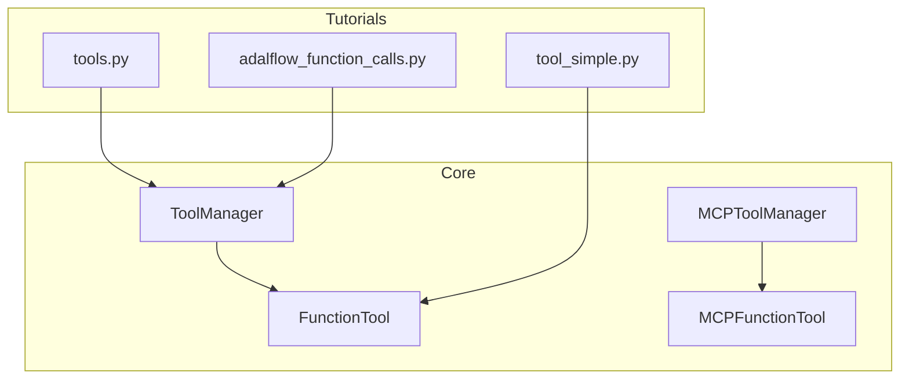
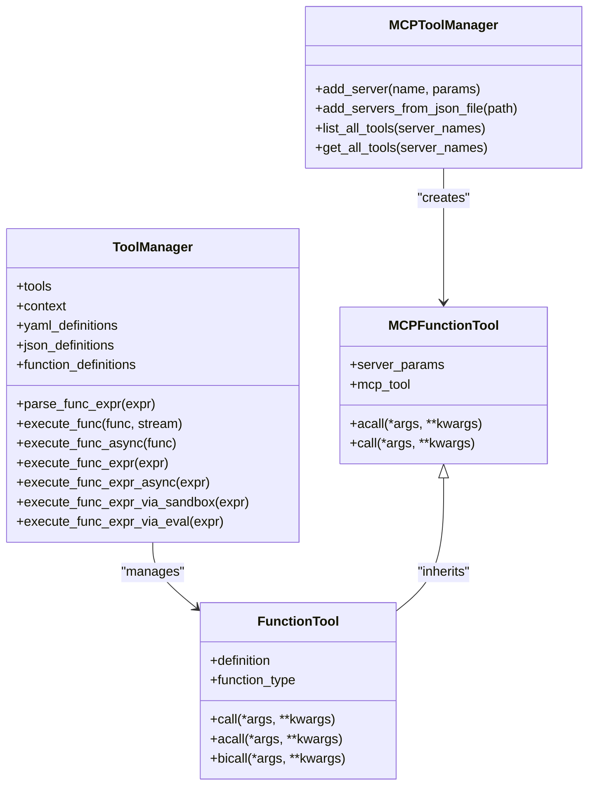
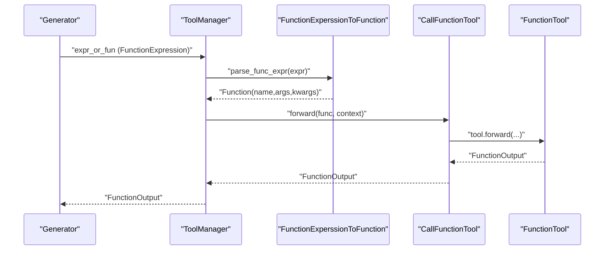
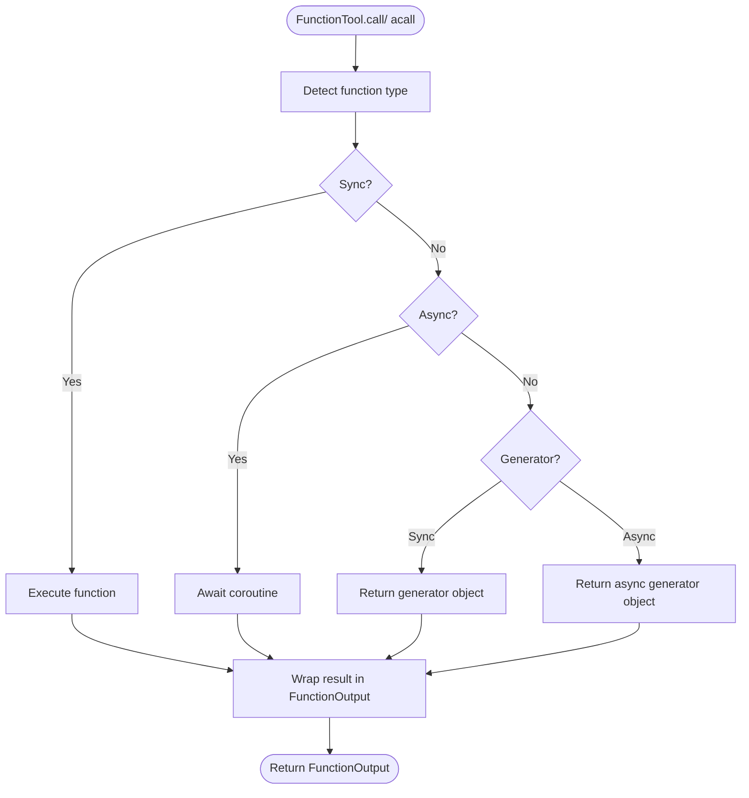
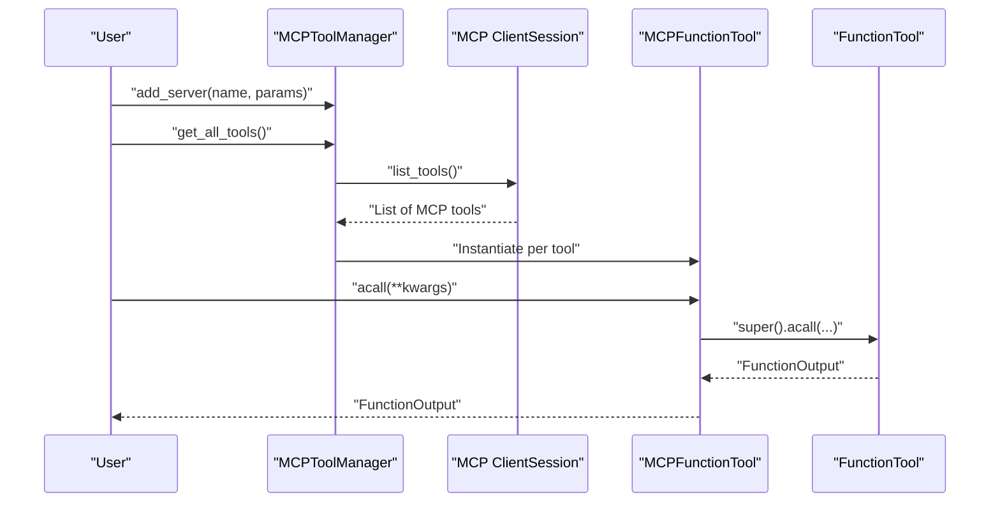
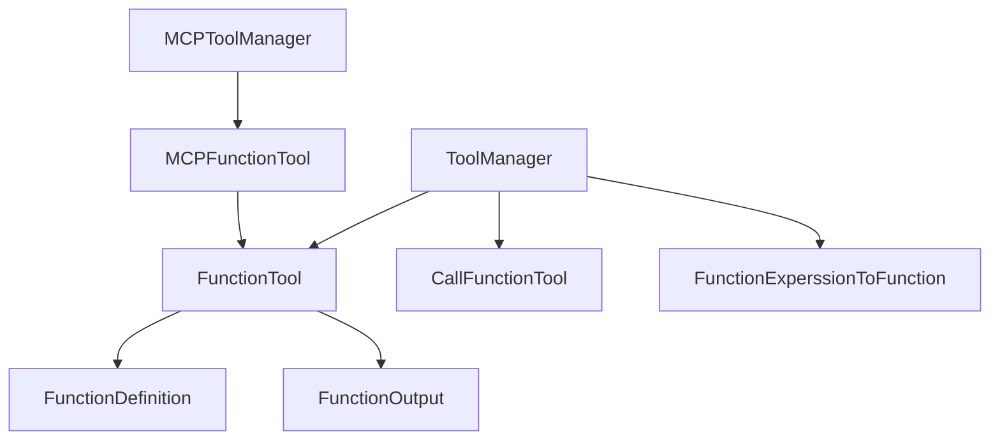

# Tool Integration and Function Calling

<cite>
**Referenced Files in This Document**
- [tool_manager.py](file://adalflow/adalflow/core/tool_manager.py)
- [func_tool.py](file://adalflow/adalflow/core/func_tool.py)
- [mcp_tool.py](file://adalflow/adalflow/core/mcp_tool.py)
- [tools.py](file://tutorials/tools.py)
- [tool_simple.py](file://tutorials/tool_simple.py)
- [adalflow_function_calls.py](file://tutorials/adalflow_function_calls.py)
</cite>

## Table of Contents
1. [Introduction](#introduction)
2. [Project Structure](#project-structure)
3. [Core Components](#core-components)
4. [Architecture Overview](#architecture-overview)
5. [Detailed Component Analysis](#detailed-component-analysis)
6. [Dependency Analysis](#dependency-analysis)
7. [Performance Considerations](#performance-considerations)
8. [Troubleshooting Guide](#troubleshooting-guide)
9. [Conclusion](#conclusion)
10. [Appendices](#appendices)

## Introduction
This document explains AdalFlow’s comprehensive tool management system and function calling capabilities. It focuses on:
- The ToolManager class for registering, parsing, and executing tools
- The FunctionTool wrapper that standardizes function interfaces and metadata
- Tool registration mechanisms and context variable injection
- Tool definition patterns, parameter validation, and asynchronous tool support
- LLM-as-a-tool functionality, tool fallback mechanisms, and tool composition patterns
- Debugging, performance optimization, and security considerations
- Advanced topics such as permissions, context management, and tool chaining

The goal is to help both beginners and advanced users implement custom tools and complex tool workflows effectively.

## Project Structure
The tool integration lives primarily under the core module with supporting tutorials and examples:
- Core tooling: ToolManager, FunctionTool, MCPFunctionTool, and MCPToolManager
- Tutorials demonstrate practical usage patterns for synchronous/asynchronous functions, generators, class methods, and tool composition

**Diagram sources**
- [tool_manager.py](file://adalflow/adalflow/core/tool_manager.py#L134-L626)
- [func_tool.py](file://adalflow/adalflow/core/func_tool.py#L77-L781)
- [mcp_tool.py](file://adalflow/adalflow/core/mcp_tool.py#L234-L578)
- [tools.py](file://tutorials/tools.py#L1-L366)
- [tool_simple.py](file://tutorials/tool_simple.py#L1-L326)
- [adalflow_function_calls.py](file://tutorials/adalflow_function_calls.py#L1-L270)

**Section sources**
- [tool_manager.py](file://adalflow/adalflow/core/tool_manager.py#L1-L626)
- [func_tool.py](file://adalflow/adalflow/core/func_tool.py#L1-L781)
- [mcp_tool.py](file://adalflow/adalflow/core/mcp_tool.py#L1-L578)
- [tools.py](file://tutorials/tools.py#L1-L366)
- [tool_simple.py](file://tutorials/tool_simple.py#L1-L326)
- [adalflow_function_calls.py](file://tutorials/adalflow_function_calls.py#L1-L270)

## Core Components
- ToolManager: Central orchestrator for tool registration, context building, parsing function expressions, and executing functions (sync/async). It supports sandboxed and eval-based execution modes for expressions and exposes YAML/JSON/function definitions for tool catalogs.
- FunctionTool: A universal wrapper for functions and callable objects, detecting function types (sync, async, sync generator, async generator), generating FunctionDefinition metadata, and providing call/acall/bicall interfaces.
- MCPFunctionTool and MCPToolManager: Specialized wrappers for Modular Command Protocol (MCP) tools, enabling dynamic discovery and invocation of external tools via MCP servers.

Key responsibilities:
- Tool registration: ToolManager accepts a list of tools and builds a context map keyed by function name
- Parsing: Converts FunctionExpression strings into Function objects using a sandboxed parser
- Execution: Executes functions synchronously or asynchronously, returning FunctionOutput consistently
- LLM-as-a-tool: FunctionTool can wrap a Generator or other trainable components to act as tools
- Context injection: additional_context passed to ToolManager merges into the execution context

**Section sources**
- [tool_manager.py](file://adalflow/adalflow/core/tool_manager.py#L134-L626)
- [func_tool.py](file://adalflow/adalflow/core/func_tool.py#L77-L781)
- [mcp_tool.py](file://adalflow/adalflow/core/mcp_tool.py#L234-L578)

## Architecture Overview
The system integrates LLM generation, function parsing, and tool execution into a cohesive pipeline. The following diagram maps the main classes and their relationships:

**Diagram sources**
- [tool_manager.py](file://adalflow/adalflow/core/tool_manager.py#L134-L626)
- [func_tool.py](file://adalflow/adalflow/core/func_tool.py#L77-L781)
- [mcp_tool.py](file://adalflow/adalflow/core/mcp_tool.py#L234-L578)

## Detailed Component Analysis

### ToolManager
ToolManager centralizes tool lifecycle:
- Registration: Accepts a list of tools (FunctionTool, callable, or async callables). Non-FunctionTool entries are wrapped automatically.
- Context: Builds a context map from tool definitions and merges additional_context for expression parsing.
- Parsing: Converts FunctionExpression to Function using a parser that resolves names against the context.
- Execution: Supports sync execution with optional streaming, async execution, and expression-based execution via sandbox or eval.
- Definitions: Exposes YAML/JSON/function definitions for tool catalogs.

**Diagram sources**
- [tool_manager.py](file://adalflow/adalflow/core/tool_manager.py#L62-L130)
- [tool_manager.py](file://adalflow/adalflow/core/tool_manager.py#L211-L275)
- [tool_manager.py](file://adalflow/adalflow/core/tool_manager.py#L310-L351)

Key APIs and behaviors:
- parse_func_expr: Parses FunctionExpression into Function with context-aware resolution
- execute_func: Executes Function synchronously with optional streaming
- execute_func_async: Executes Function asynchronously
- execute_func_expr_via_sandbox and execute_func_expr_via_eval: Execute expressions directly
- context_variables: Exposes additional_context for debugging and inspection

**Section sources**
- [tool_manager.py](file://adalflow/adalflow/core/tool_manager.py#L134-L626)

### FunctionTool
FunctionTool standardizes function execution:
- Function type detection: Supports sync, async, sync generator, and async generator
- Definition generation: Uses introspection to build FunctionDefinition with function name, description, and parameter schema
- Execution: Provides call (sync), acall (async), and bicall (training-specific) with consistent FunctionOutput wrapping
- Async handling: Detects event loop presence and runs coroutines accordingly

**Diagram sources**
- [func_tool.py](file://adalflow/adalflow/core/func_tool.py#L174-L234)
- [func_tool.py](file://adalflow/adalflow/core/func_tool.py#L295-L494)

**Section sources**
- [func_tool.py](file://adalflow/adalflow/core/func_tool.py#L77-L781)

### MCPFunctionTool and MCPToolManager
MCPFunctionTool wraps MCP tools as FunctionTool instances:
- Dynamic discovery: MCPToolManager lists tools from one or more MCP servers
- Asynchronous execution: MCPFunctionTool supports acall and call (via asyncio.run)
- Definition generation: Builds FunctionDefinition from MCP tool schema and description

**Diagram sources**
- [mcp_tool.py](file://adalflow/adalflow/core/mcp_tool.py#L386-L578)
- [mcp_tool.py](file://adalflow/adalflow/core/mcp_tool.py#L234-L384)

**Section sources**
- [mcp_tool.py](file://adalflow/adalflow/core/mcp_tool.py#L1-L578)

### Tool Definition Patterns and Parameter Validation
- FunctionTool introspects function signatures and docstrings to create FunctionDefinition, ensuring consistent metadata for LLMs
- ToolManager builds a context map keyed by function name; duplicate keys produce warnings rather than exceptions
- Parameter validation occurs implicitly via introspection and explicit checks in execution paths

Practical examples:
- Tutorial demonstrates function definitions, context injection, and multi-function calls
- ToolSimple shows various function types and error handling patterns

**Section sources**
- [func_tool.py](file://adalflow/adalflow/core/func_tool.py#L261-L289)
- [tool_manager.py](file://adalflow/adalflow/core/tool_manager.py#L180-L191)
- [tools.py](file://tutorials/tools.py#L1-L366)
- [tool_simple.py](file://tutorials/tool_simple.py#L1-L326)

### Asynchronous Tool Support and Streaming
- ToolManager.execute_func supports a stream flag to pass streaming intent to tools
- FunctionTool.acall handles all function types and returns FunctionOutput consistently
- MCPFunctionTool is designed for async execution and provides a convenience call wrapper

**Section sources**
- [tool_manager.py](file://adalflow/adalflow/core/tool_manager.py#L337-L344)
- [func_tool.py](file://adalflow/adalflow/core/func_tool.py#L430-L494)
- [mcp_tool.py](file://adalflow/adalflow/core/mcp_tool.py#L309-L384)

### Context Variable Injection
- ToolManager accepts additional_context to augment the execution context for expression parsing
- Tutorials show passing local variables, NumPy arrays, and custom types into the context

**Section sources**
- [tool_manager.py](file://adalflow/adalflow/core/tool_manager.py#L144-L165)
- [tools.py](file://tutorials/tools.py#L185-L220)

### LLM-as-a-Tool and Tool Composition
- FunctionTool can wrap a Generator or other trainable components to act as tools
- ToolManager supports composition by combining multiple tools and executing them in sequence or parallel
- Tutorials demonstrate multi-function calls and async orchestration

**Section sources**
- [tool_manager.py](file://adalflow/adalflow/core/tool_manager.py#L577-L626)
- [tools.py](file://tutorials/tools.py#L281-L345)
- [adalflow_function_calls.py](file://tutorials/adalflow_function_calls.py#L142-L256)

### Tool Fallback Mechanisms
- MCPToolManager supports adding multiple servers and caching discovered tools
- ToolManager can fall back to sandbox or eval execution modes for expressions when direct parsing fails

**Section sources**
- [mcp_tool.py](file://adalflow/adalflow/core/mcp_tool.py#L418-L491)
- [tool_manager.py](file://adalflow/adalflow/core/tool_manager.py#L518-L524)

## Dependency Analysis
The following diagram shows key dependencies among core components:

**Diagram sources**
- [tool_manager.py](file://adalflow/adalflow/core/tool_manager.py#L62-L130)
- [tool_manager.py](file://adalflow/adalflow/core/tool_manager.py#L134-L626)
- [func_tool.py](file://adalflow/adalflow/core/func_tool.py#L77-L781)
- [mcp_tool.py](file://adalflow/adalflow/core/mcp_tool.py#L234-L578)

**Section sources**
- [tool_manager.py](file://adalflow/adalflow/core/tool_manager.py#L1-L626)
- [func_tool.py](file://adalflow/adalflow/core/func_tool.py#L1-L781)
- [mcp_tool.py](file://adalflow/adalflow/core/mcp_tool.py#L1-L578)

## Performance Considerations
- Prefer async execution paths for I/O-bound tools to avoid blocking threads
- Use streaming where supported to reduce latency and improve responsiveness
- Minimize repeated discovery of MCP tools by leveraging caching in MCPToolManager
- Batch or parallelize independent tool calls using async orchestration patterns shown in tutorials

[No sources needed since this section provides general guidance]

## Troubleshooting Guide
Common issues and resolutions:
- Duplicate tool names: ToolManager warns on duplicate keys in context map; resolve by renaming or scoping
- Incorrect function type: Ensure async functions are invoked via acall; sync functions via call
- Expression parsing errors: Verify additional_context includes all referenced variables; consider sandbox or eval fallbacks
- Async event loop conflicts: Use FunctionTool.acall or MCPFunctionTool.call wrapper to avoid nested loop issues

**Section sources**
- [tool_manager.py](file://adalflow/adalflow/core/tool_manager.py#L186-L191)
- [func_tool.py](file://adalflow/adalflow/core/func_tool.py#L430-L494)
- [tools.py](file://tutorials/tools.py#L222-L245)

## Conclusion
AdalFlow’s tool integration provides a robust, extensible framework for function calling:
- ToolManager offers a unified interface for registration, parsing, and execution
- FunctionTool standardizes function metadata and execution semantics across diverse function types
- MCPFunctionTool and MCPToolManager enable dynamic integration with external MCP servers
- Practical tutorials demonstrate real-world patterns for synchronous and asynchronous workflows, context injection, and tool composition

[No sources needed since this section summarizes without analyzing specific files]

## Appendices

### A. Tool Creation and Registration Examples
- Basic FunctionTool usage and output fields
- Synchronous and asynchronous functions
- Generators and class methods
- Complex types and ToolOutput
- Error handling patterns
- Integration with trainable components

**Section sources**
- [tool_simple.py](file://tutorials/tool_simple.py#L24-L296)

### B. Function Call Workflows
- Single-function calls via Function
- Function expressions via sandbox or eval
- Multi-function calls and async orchestration
- Context injection and variable access

**Section sources**
- [tools.py](file://tutorials/tools.py#L139-L345)
- [adalflow_function_calls.py](file://tutorials/adalflow_function_calls.py#L142-L256)

### C. Security Considerations
- Prefer sandboxed execution for untrusted expressions
- Limit additional_context to trusted values
- Validate and sanitize inputs before tool execution
- Use MCP servers with appropriate access controls

**Section sources**
- [tool_manager.py](file://adalflow/adalflow/core/tool_manager.py#L535-L571)