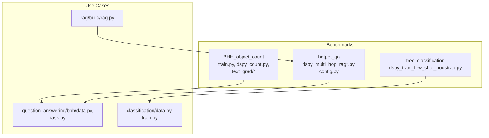
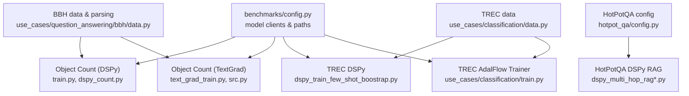
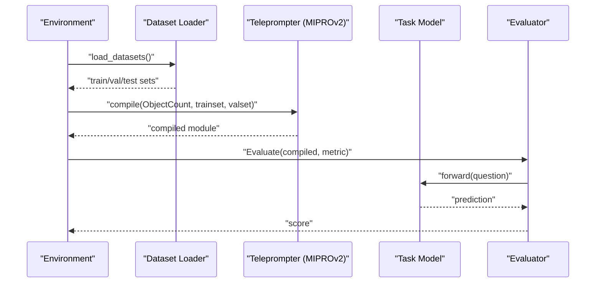
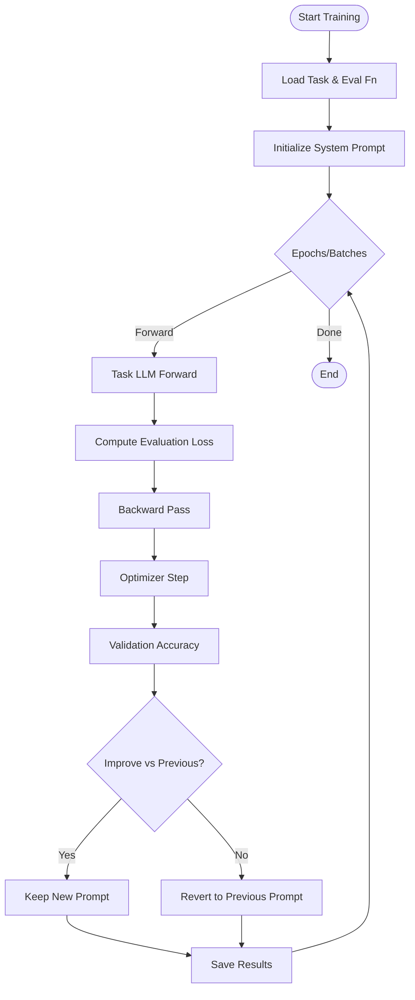
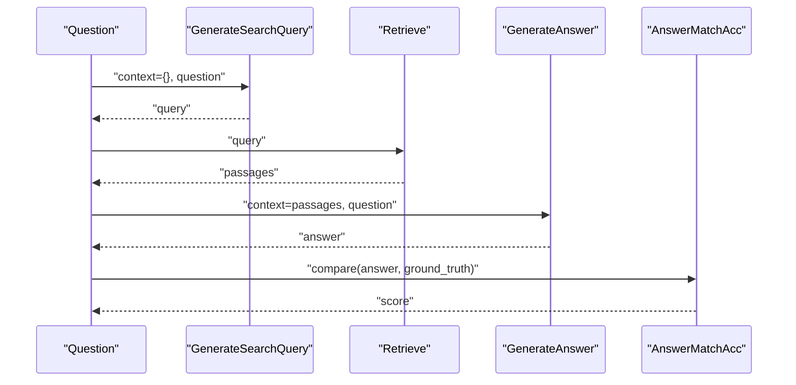
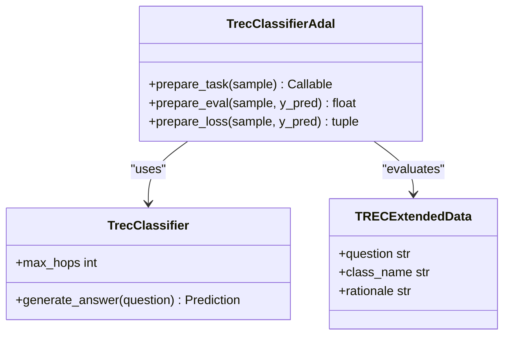
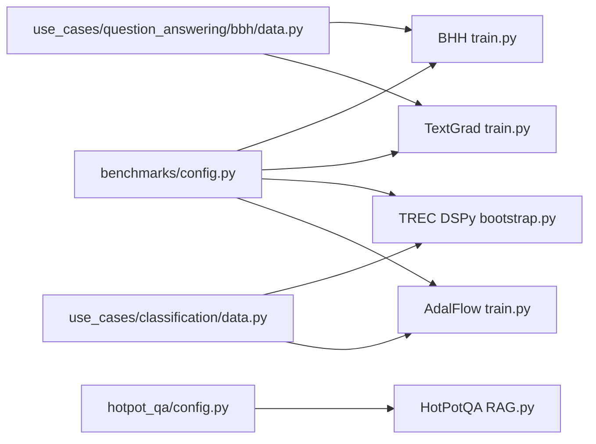

# Benchmark Implementations

<cite>
**Referenced Files in This Document**
- [benchmarks/README.md](file://benchmarks/README.md)
- [benchmarks/__init__.py](file://benchmarks/__init__.py)
- [benchmarks/config.py](file://benchmarks/config.py)
- [benchmarks/BHH_object_count/train.py](file://benchmarks/BHH_object_count/train.py)
- [benchmarks/BHH_object_count/dspy_count.py](file://benchmarks/BHH_object_count/dspy_count.py)
- [benchmarks/BHH_object_count/text_grad/src.py](file://benchmarks/BHH_object_count/text_grad/src.py)
- [benchmarks/BHH_object_count/text_grad/text_grad_train.py](file://benchmarks/BHH_object_count/text_grad/text_grad_train.py)
- [benchmarks/hotpot_qa/config.py](file://benchmarks/hotpot_qa/config.py)
- [benchmarks/hotpot_qa/dspy_multi_hop_rag.py](file://benchmarks/hotpot_qa/dspy_multi_hop_rag.py)
- [benchmarks/hotpot_qa/dspy_multi_hop_rag_cycle.py](file://benchmarks/hotpot_qa/dspy_multi_hop_rag_cycle.py)
- [benchmarks/trec_classification/dspy_train_few_shot_boostrap.py](file://benchmarks/trec_classification/dspy_train_few_shot_boostrap.py)
- [use_cases/question_answering/bbh/data.py](file://use_cases/question_answering/bbh/data.py)
- [use_cases/question_answering/bbh/object_count/task.py](file://use_cases/question_answering/bbh/object_count/task.py)
- [use_cases/classification/data.py](file://use_cases/classification/data.py)
- [use_cases/classification/train.py](file://use_cases/classification/train.py)
- [use_cases/rag/build/rag.py](file://use_cases/rag/build/rag.py)
</cite>

## Table of Contents
1. [Introduction](#introduction)
2. [Project Structure](#project-structure)
3. [Core Components](#core-components)
4. [Architecture Overview](#architecture-overview)
5. [Detailed Component Analysis](#detailed-component-analysis)
6. [Dependency Analysis](#dependency-analysis)
7. [Performance Considerations](#performance-considerations)
8. [Troubleshooting Guide](#troubleshooting-guide)
9. [Conclusion](#conclusion)
10. [Appendices](#appendices)

## Introduction
This document describes the benchmark implementations in AdalFlow across three categories:
- Object Counting benchmarks for text gradient optimization
- HotPotQA benchmarks for multi-hop reasoning and retrieval-augmented generation (RAG) optimization
- TREC Classification benchmarks for few-shot learning

It explains benchmark execution workflows, configuration parameters, comparative analysis against baseline methods (DSPy), and provides examples of setup, training, and evaluation. It also covers customization options, data preparation requirements, and result interpretation guidelines.

## Project Structure
The benchmarks are organized by domain and methodology:
- Object Counting: DSPy bootstrapped few-shot and TextGrad text-gradient optimization
- HotPotQA: DSPy multi-hop RAG variants and dataset loading
- TREC Classification: DSPy few-shot bootstrap and structured output training with AdalFlow

**Diagram sources**
- [benchmarks/BHH_object_count/train.py](file://benchmarks/BHH_object_count/train.py#L1-L158)
- [benchmarks/BHH_object_count/dspy_count.py](file://benchmarks/BHH_object_count/dspy_count.py#L1-L59)
- [benchmarks/BHH_object_count/text_grad/text_grad_train.py](file://benchmarks/BHH_object_count/text_grad/text_grad_train.py#L1-L180)
- [benchmarks/hotpot_qa/dspy_multi_hop_rag.py](file://benchmarks/hotpot_qa/dspy_multi_hop_rag.py#L1-L292)
- [benchmarks/hotpot_qa/dspy_multi_hop_rag_cycle.py](file://benchmarks/hotpot_qa/dspy_multi_hop_rag_cycle.py#L1-L293)
- [benchmarks/trec_classification/dspy_train_few_shot_boostrap.py](file://benchmarks/trec_classification/dspy_train_few_shot_boostrap.py#L1-L214)
- [use_cases/question_answering/bbh/data.py](file://use_cases/question_answering/bbh/data.py#L1-L121)
- [use_cases/question_answering/bbh/object_count/task.py](file://use_cases/question_answering/bbh/object_count/task.py#L1-L103)
- [use_cases/classification/data.py](file://use_cases/classification/data.py#L1-L36)
- [use_cases/classification/train.py](file://use_cases/classification/train.py#L1-L197)
- [use_cases/rag/build/rag.py](file://use_cases/rag/build/rag.py#L1-L252)

**Section sources**
- [benchmarks/README.md](file://benchmarks/README.md#L1-L4)
- [benchmarks/__init__.py](file://benchmarks/__init__.py#L1-L2)

## Core Components
- Object Counting (BBH)
  - DSPy baseline with bootstrapped few-shot and MIPROv2 optimization
  - TextGrad text-gradient optimization with validation-rejection
  - Data loading from Big Bench Hard and answer parsing
- HotPotQA
  - DSPy multi-hop RAG with ColBERTv2 retrieval and Chain-of-Thought
  - Zero-shot and few-shot variants
  - Dataset loader with configurable sizes
- TREC Classification
  - DSPy few-shot bootstrap with COPRO/MIPROv2
  - Structured output training with AdalFlow Trainer and Eval-to-TextLoss

Key configuration and model clients are centralized for reproducibility.

**Section sources**
- [benchmarks/BHH_object_count/train.py](file://benchmarks/BHH_object_count/train.py#L1-L158)
- [benchmarks/BHH_object_count/dspy_count.py](file://benchmarks/BHH_object_count/dspy_count.py#L1-L59)
- [benchmarks/BHH_object_count/text_grad/text_grad_train.py](file://benchmarks/BHH_object_count/text_grad/text_grad_train.py#L1-L180)
- [benchmarks/hotpot_qa/dspy_multi_hop_rag.py](file://benchmarks/hotpot_qa/dspy_multi_hop_rag.py#L1-L292)
- [benchmarks/hotpot_qa/dspy_multi_hop_rag_cycle.py](file://benchmarks/hotpot_qa/dspy_multi_hop_rag_cycle.py#L1-L293)
- [benchmarks/trec_classification/dspy_train_few_shot_boostrap.py](file://benchmarks/trec_classification/dspy_train_few_shot_boostrap.py#L1-L214)
- [use_cases/question_answering/bbh/data.py](file://use_cases/question_answering/bbh/data.py#L94-L106)
- [use_cases/classification/train.py](file://use_cases/classification/train.py#L78-L139)

## Architecture Overview
The benchmark architecture integrates dataset preparation, model configuration, training loops, and evaluation. DSPy-based benchmarks rely on teleprompters (BootstrapFewShot, MIPROv2, COPRO) and evaluation helpers. TextGrad benchmarks use a custom training loop with textual gradient descent and validation-rejection. AdalFlow-based classification uses a Trainer with Eval-to-TextLoss.

**Diagram sources**
- [benchmarks/config.py](file://benchmarks/config.py#L1-L46)
- [benchmarks/BHH_object_count/train.py](file://benchmarks/BHH_object_count/train.py#L1-L158)
- [benchmarks/BHH_object_count/dspy_count.py](file://benchmarks/BHH_object_count/dspy_count.py#L1-L59)
- [benchmarks/BHH_object_count/text_grad/text_grad_train.py](file://benchmarks/BHH_object_count/text_grad/text_grad_train.py#L1-L180)
- [benchmarks/BHH_object_count/text_grad/src.py](file://benchmarks/BHH_object_count/text_grad/src.py#L1-L79)
- [benchmarks/hotpot_qa/config.py](file://benchmarks/hotpot_qa/config.py#L1-L14)
- [benchmarks/hotpot_qa/dspy_multi_hop_rag.py](file://benchmarks/hotpot_qa/dspy_multi_hop_rag.py#L1-L292)
- [benchmarks/hotpot_qa/dspy_multi_hop_rag_cycle.py](file://benchmarks/hotpot_qa/dspy_multi_hop_rag_cycle.py#L1-L293)
- [benchmarks/trec_classification/dspy_train_few_shot_boostrap.py](file://benchmarks/trec_classification/dspy_train_few_shot_boostrap.py#L1-L214)
- [use_cases/question_answering/bbh/data.py](file://use_cases/question_answering/bbh/data.py#L94-L106)
- [use_cases/classification/data.py](file://use_cases/classification/data.py#L30-L36)
- [use_cases/classification/train.py](file://use_cases/classification/train.py#L78-L139)

## Detailed Component Analysis

### Object Counting Benchmarks
- DSPy Baseline
  - Signature defines a Chain-of-Thought prompt for numerical reasoning
  - Bootstrapped few-shot and MIPROv2 teleprompters compile optimized prompts
  - Evaluation uses exact-match accuracy on BBH object counting
- TextGrad Optimization
  - Loads BBH object counting task and evaluation function
  - Iterative textual gradient descent updates the system prompt
  - Validation-rejection policy retains improved prompts based on validation performance
- Data Preparation
  - Loads train/val/test splits from Big Bench Hard
  - Parses integer answers from raw model outputs

**Diagram sources**
- [benchmarks/BHH_object_count/train.py](file://benchmarks/BHH_object_count/train.py#L22-L77)
- [benchmarks/BHH_object_count/dspy_count.py](file://benchmarks/BHH_object_count/dspy_count.py#L35-L49)

**Diagram sources**
- [benchmarks/BHH_object_count/text_grad/text_grad_train.py](file://benchmarks/BHH_object_count/text_grad/text_grad_train.py#L28-L140)
- [benchmarks/BHH_object_count/text_grad/src.py](file://benchmarks/BHH_object_count/text_grad/src.py#L66-L79)

Key configuration parameters:
- Model clients and kwargs for OpenAI/Groq
- Save paths for DSPy and TextGrad models
- Teleprompter hyperparameters (candidates, batches, seeds)

**Section sources**
- [benchmarks/BHH_object_count/train.py](file://benchmarks/BHH_object_count/train.py#L40-L133)
- [benchmarks/BHH_object_count/dspy_count.py](file://benchmarks/BHH_object_count/dspy_count.py#L24-L49)
- [benchmarks/BHH_object_count/text_grad/text_grad_train.py](file://benchmarks/BHH_object_count/text_grad/text_grad_train.py#L28-L140)
- [benchmarks/BHH_object_count/text_grad/src.py](file://benchmarks/BHH_object_count/text_grad/src.py#L16-L79)
- [use_cases/question_answering/bbh/data.py](file://use_cases/question_answering/bbh/data.py#L94-L106)
- [benchmarks/config.py](file://benchmarks/config.py#L13-L46)

### HotPotQA Benchmarks (Multi-Hop Reasoning and RAG)
- DSPy Multi-Hop RAG
  - Two signatures: search query and answer generation
  - Retrieval via ColBERTv2 with deduplication
  - Chain-of-Thought prompting for both query and answer
  - MIPROv2 optimization with validation metrics
- Variants
  - Standard multi-hop and cycle variants differ in query generation module composition
- Dataset Loading
  - Configurable train/val/test sizes from HotPotQA dataset

**Diagram sources**
- [benchmarks/hotpot_qa/dspy_multi_hop_rag.py](file://benchmarks/hotpot_qa/dspy_multi_hop_rag.py#L76-L102)
- [benchmarks/hotpot_qa/dspy_multi_hop_rag_cycle.py](file://benchmarks/hotpot_qa/dspy_multi_hop_rag_cycle.py#L76-L100)

Key configuration parameters:
- Retrieval model URL and k-passage retrieval
- Teleprompter metric and candidate settings
- Evaluation via AnswerMatchAcc

**Section sources**
- [benchmarks/hotpot_qa/dspy_multi_hop_rag.py](file://benchmarks/hotpot_qa/dspy_multi_hop_rag.py#L113-L196)
- [benchmarks/hotpot_qa/dspy_multi_hop_rag_cycle.py](file://benchmarks/hotpot_qa/dspy_multi_hop_rag_cycle.py#L112-L195)
- [benchmarks/hotpot_qa/config.py](file://benchmarks/hotpot_qa/config.py#L7-L13)

### TREC Classification Benchmarks (Few-Shot Learning)
- DSPy Few-Shot Bootstrap
  - COPRO/MIPROv2 teleprompters optimize prompts for classification
  - Exact-match evaluation with AnswerMatchAcc wrapper
- AdalFlow Structured Output Training
  - Eval-to-TextLoss converts evaluation scores into textual gradients
  - Trainer supports constrained strategies, sampling, and backward passes
  - Dataclass extends with rationale for structured outputs

**Diagram sources**
- [benchmarks/trec_classification/dspy_train_few_shot_boostrap.py](file://benchmarks/trec_classification/dspy_train_few_shot_boostrap.py#L35-L46)
- [use_cases/classification/data.py](file://use_cases/classification/data.py#L15-L28)
- [use_cases/classification/train.py](file://use_cases/classification/train.py#L17-L76)

Key configuration parameters:
- Model clients and kwargs for GPT-3.5-turbo and GPT-4o
- Trainer settings: batch size, shots, max steps, workers, strategy
- Evaluation and loss function wrappers

**Section sources**
- [benchmarks/trec_classification/dspy_train_few_shot_boostrap.py](file://benchmarks/trec_classification/dspy_train_few_shot_boostrap.py#L73-L156)
- [use_cases/classification/data.py](file://use_cases/classification/data.py#L30-L36)
- [use_cases/classification/train.py](file://use_cases/classification/train.py#L78-L139)

## Dependency Analysis
- Centralized model configuration and save paths
- Dataset loaders for BBH and TREC
- Evaluation utilities for exact match and retrieval recall
- RAG building blocks for HotPotQA retrieval

**Diagram sources**
- [benchmarks/config.py](file://benchmarks/config.py#L1-L46)
- [benchmarks/BHH_object_count/train.py](file://benchmarks/BHH_object_count/train.py#L1-L158)
- [benchmarks/BHH_object_count/text_grad/text_grad_train.py](file://benchmarks/BHH_object_count/text_grad/text_grad_train.py#L1-L180)
- [benchmarks/trec_classification/dspy_train_few_shot_boostrap.py](file://benchmarks/trec_classification/dspy_train_few_shot_boostrap.py#L1-L214)
- [use_cases/question_answering/bbh/data.py](file://use_cases/question_answering/bbh/data.py#L94-L106)
- [use_cases/classification/data.py](file://use_cases/classification/data.py#L30-L36)
- [benchmarks/hotpot_qa/config.py](file://benchmarks/hotpot_qa/config.py#L7-L13)

**Section sources**
- [benchmarks/config.py](file://benchmarks/config.py#L1-L46)
- [use_cases/question_answering/bbh/data.py](file://use_cases/question_answering/bbh/data.py#L94-L106)
- [use_cases/classification/data.py](file://use_cases/classification/data.py#L30-L36)

## Performance Considerations
- Training time and accuracy statistics are computed across runs for robustness
- Validation-rejection in TextGrad prevents degradation and stabilizes prompt optimization
- Teleprompter hyperparameters (candidates, batches, seeds) significantly impact convergence and quality
- Retrieval effectiveness and prompt engineering jointly influence HotPotQA performance
- Batch size and sampling strategies affect TREC classification gains

[No sources needed since this section provides general guidance]

## Troubleshooting Guide
Common issues and remedies:
- Rate limits during inference
  - Object Counting tasks raise explicit errors on rate-limit responses
  - Mitigation: retry logic or reduced concurrency
- Evaluation failures and parsing errors
  - TextGrad gracefully falls back to alternative evaluation APIs and parsing
  - Ensure evaluation functions support both dictionary and list inputs
- Missing save paths
  - Ensure directories exist before saving compiled models or results
- Retrieval server connectivity
  - Verify ColBERTv2 endpoint availability for HotPotQA

**Section sources**
- [use_cases/question_answering/bbh/object_count/task.py](file://use_cases/question_answering/bbh/object_count/task.py#L63-L70)
- [benchmarks/BHH_object_count/text_grad/text_grad_train.py](file://benchmarks/BHH_object_count/text_grad/text_grad_train.py#L94-L102)
- [benchmarks/BHH_object_count/text_grad/src.py](file://benchmarks/BHH_object_count/text_grad/src.py#L35-L39)

## Conclusion
These benchmarks demonstrate:
- Text gradient optimization improves object counting accuracy with validation-rejection
- DSPy’s MIPROv2 yields competitive baselines for few-shot and zero-shot tasks
- HotPotQA multi-hop RAG benefits from retrieval and prompt optimization
- TREC classification showcases few-shot bootstrap and structured-output training

They provide reproducible workflows, standardized evaluation metrics, and extensible configurations for further customization and research.

[No sources needed since this section summarizes without analyzing specific files]

## Appendices

### Benchmark Execution Workflows
- Object Counting (DSPy)
  - Load BBH dataset → Package as DSPy Examples → Compile with MIPROv2 → Evaluate on val/test
- Object Counting (TextGrad)
  - Load BBH task → Initialize system prompt → Train with textual gradient descent → Validation-rejection → Save results
- HotPotQA (DSPy)
  - Load HotPotQA → Configure ColBERTv2 → Build RAG modules → Compile with MIPROv2 → Evaluate answer exact match
- TREC Classification (DSPy)
  - Load TREC → Convert to DSPy Examples → Compile with COPRO/MIPROv2 → Evaluate exact match
- TREC Classification (AdalFlow)
  - Load TREC extended data → Prepare structured outputs → Train with Trainer + Eval-to-TextLoss → Evaluate

**Section sources**
- [benchmarks/BHH_object_count/train.py](file://benchmarks/BHH_object_count/train.py#L91-L133)
- [benchmarks/BHH_object_count/text_grad/text_grad_train.py](file://benchmarks/BHH_object_count/text_grad/text_grad_train.py#L143-L180)
- [benchmarks/hotpot_qa/dspy_multi_hop_rag.py](file://benchmarks/hotpot_qa/dspy_multi_hop_rag.py#L199-L248)
- [benchmarks/trec_classification/dspy_train_few_shot_boostrap.py](file://benchmarks/trec_classification/dspy_train_few_shot_boostrap.py#L158-L214)
- [use_cases/classification/train.py](file://use_cases/classification/train.py#L142-L197)

### Configuration Parameters Reference
- Model Clients and Kwargs
  - OpenAI/Groq clients configured with model names and generation parameters
- Save Paths
  - DSPy, TextGrad, and AdalFlow model checkpoints and logs
- Teleprompter Settings
  - Metric selection, prompt/task models, candidate counts, temperature, batches, seeds
- Evaluation Metrics
  - Exact match for classification and QA tasks
  - Retrieval recall for HotPotQA (via evaluation utilities)

**Section sources**
- [benchmarks/config.py](file://benchmarks/config.py#L13-L46)
- [benchmarks/BHH_object_count/train.py](file://benchmarks/BHH_object_count/train.py#L59-L77)
- [benchmarks/trec_classification/dspy_train_few_shot_boostrap.py](file://benchmarks/trec_classification/dspy_train_few_shot_boostrap.py#L123-L141)
- [use_cases/classification/train.py](file://use_cases/classification/train.py#L110-L126)

### Comparative Analysis with DSPy Baselines
- Object Counting
  - DSPy MIPROv2 vs TextGrad: Both improve over zero-shot baselines; TextGrad adds validation-rejection for stability
- HotPotQA
  - DSPy multi-hop vs cycle variants: Differences in query generation module composition; validation metrics guide selection
- TREC Classification
  - DSPy COPRO/MIPROv2 vs AdalFlow Trainer: Structured outputs and Eval-to-TextLoss enable fine-grained optimization

**Section sources**
- [benchmarks/BHH_object_count/train.py](file://benchmarks/BHH_object_count/train.py#L122-L133)
- [benchmarks/BHH_object_count/text_grad/text_grad_train.py](file://benchmarks/BHH_object_count/text_grad/text_grad_train.py#L157-L179)
- [benchmarks/hotpot_qa/dspy_multi_hop_rag.py](file://benchmarks/hotpot_qa/dspy_multi_hop_rag.py#L242-L247)
- [benchmarks/trec_classification/dspy_train_few_shot_boostrap.py](file://benchmarks/trec_classification/dspy_train_few_shot_boostrap.py#L198-L214)

### Data Preparation Requirements
- Object Counting
  - BBH dataset split loading; answer extraction/parsing utilities
- HotPotQA
  - Dataset loader with configurable sizes; retrieval model setup
- TREC Classification
  - TREC dataset loader; optional rationale field for structured outputs

**Section sources**
- [use_cases/question_answering/bbh/data.py](file://use_cases/question_answering/bbh/data.py#L94-L106)
- [benchmarks/hotpot_qa/config.py](file://benchmarks/hotpot_qa/config.py#L7-L13)
- [use_cases/classification/data.py](file://use_cases/classification/data.py#L30-L36)

### Result Interpretation Guidelines
- Accuracy and Standard Deviation
  - Reported means and std across multiple runs for robust estimates
- Training Time
  - Total elapsed time for compilation and evaluation
- Validation-Rejection
  - Tracks whether prompt updates were accepted or reverted based on validation performance

**Section sources**
- [benchmarks/BHH_object_count/train.py](file://benchmarks/BHH_object_count/train.py#L122-L133)
- [benchmarks/BHH_object_count/text_grad/text_grad_train.py](file://benchmarks/BHH_object_count/text_grad/text_grad_train.py#L167-L179)
- [benchmarks/hotpot_qa/dspy_multi_hop_rag.py](file://benchmarks/hotpot_qa/dspy_multi_hop_rag.py#L242-L247)
- [benchmarks/trec_classification/dspy_train_few_shot_boostrap.py](file://benchmarks/trec_classification/dspy_train_few_shot_boostrap.py#L204-L214)