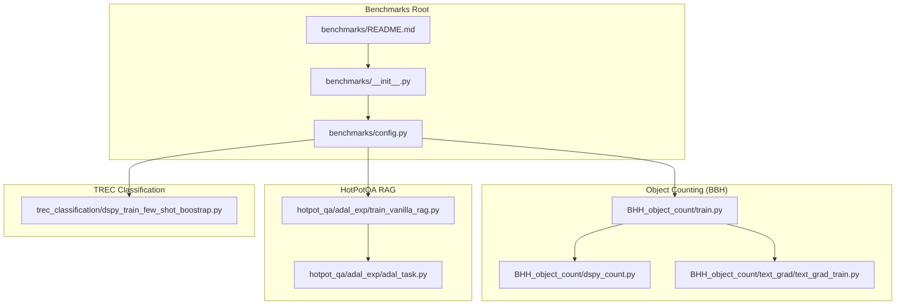
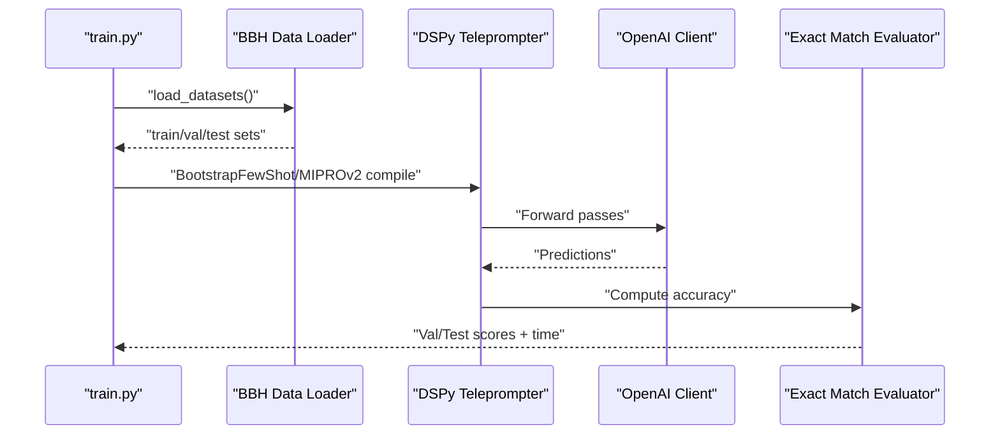
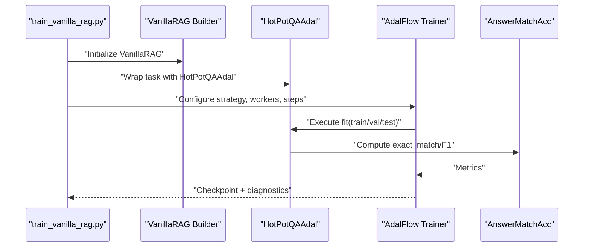
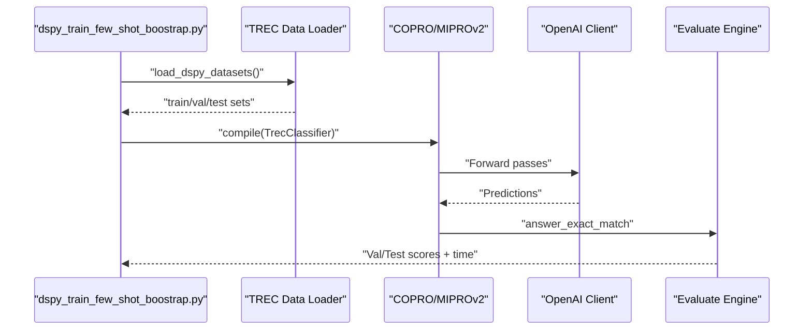
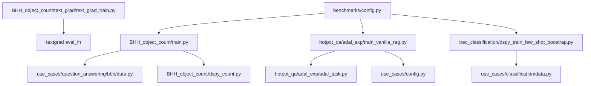

# Benchmarks and Performance

<cite>
**Referenced Files in This Document**
- [benchmarks/README.md](file://benchmarks/README.md)
- [benchmarks/__init__.py](file://benchmarks/__init__.py)
- [benchmarks/config.py](file://benchmarks/config.py)
- [benchmarks/BHH_object_count/train.py](file://benchmarks/BHH_object_count/train.py)
- [benchmarks/BHH_object_count/dspy_count.py](file://benchmarks/BHH_object_count/dspy_count.py)
- [benchmarks/BHH_object_count/text_grad/text_grad_train.py](file://benchmarks/BHH_object_count/text_grad/text_grad_train.py)
- [benchmarks/hotpot_qa/adal_exp/adal_task.py](file://benchmarks/hotpot_qa/adal_exp/adal_task.py)
- [benchmarks/hotpot_qa/adal_exp/train_vanilla_rag.py](file://benchmarks/hotpot_qa/adal_exp/train_vanilla_rag.py)
- [benchmarks/trec_classification/dspy_train_few_shot_boostrap.py](file://benchmarks/trec_classification/dspy_train_few_shot_boostrap.py)
- [use_cases/question_answering/bbh/data.py](file://use_cases/question_answering/bbh/data.py)
- [use_cases/classification/data.py](file://use_cases/classification/data.py)
- [use_cases/config.py](file://use_cases/config.py)
- [adalflow/utils/logger.py](file://adalflow/utils/logger.py)
- [adalflow/tracing/generator_call_logger.py](file://adalflow/tracing/generator_call_logger.py)
- [adalflow/tracing/generator_state_logger.py](file://adalflow/tracing/generator_state_logger.py)
- [adalflow/tracing/mlflow_integration.py](file://adalflow/tracing/mlflow_integration.py)
- [adalflow/optim/gradient.py](file://adalflow/optim/gradient.py)
- [adalflow/optim/loss_component.py](file://adalflow/optim/loss_component.py)
- [adalflow/optim/parameter.py](file://adalflow/optim/parameter.py)
- [adalflow/optim/trainer/trainer.py](file://adalflow/optim/trainer/trainer.py)
- [adalflow/optim/trainer/adal.py](file://adalflow/optim/trainer/adal.py)
- [adalflow/eval/base.py](file://adalflow/eval/base.py)
- [adalflow/eval/functional.py](file://adalflow/eval/functional.py)
- [adalflow/eval/answer_match_acc.py](file://adalflow/eval/answer_match_acc.py)
</cite>

## Table of Contents
1. [Introduction](#introduction)
2. [Project Structure](#project-structure)
3. [Core Components](#core-components)
4. [Architecture Overview](#architecture-overview)
5. [Detailed Component Analysis](#detailed-component-analysis)
6. [Dependency Analysis](#dependency-analysis)
7. [Performance Considerations](#performance-considerations)
8. [Troubleshooting Guide](#troubleshooting-guide)
9. [Conclusion](#conclusion)
10. [Appendices](#appendices)

## Introduction
This section documents AdalFlow’s benchmarking and performance evaluation capabilities. It explains how benchmarks are structured, how performance is measured across tasks such as object counting, HotPotQA, and TREC classification, and how optimization workflows are executed. It also covers profiling, bottleneck identification, scaling considerations, interpreting benchmark results, detecting performance regressions, and optimization best practices. The content is designed to be accessible to beginners while providing sufficient technical depth for experienced developers optimizing LLM applications.

## Project Structure
The benchmarks are organized by task domain and include training scripts, evaluation routines, and configuration for model clients. Each benchmark focuses on a specific problem setting and leverages either DSPy, TextGrad, or AdalFlow’s Trainer to compile and optimize prompts and system prompts.



**Diagram sources**
- [benchmarks/README.md](file://benchmarks/README.md#L1-L4)
- [benchmarks/__init__.py](file://benchmarks/__init__.py#L1-L2)
- [benchmarks/config.py](file://benchmarks/config.py#L1-L46)
- [benchmarks/BHH_object_count/train.py](file://benchmarks/BHH_object_count/train.py#L1-L158)
- [benchmarks/BHH_object_count/dspy_count.py](file://benchmarks/BHH_object_count/dspy_count.py#L1-L59)
- [benchmarks/BHH_object_count/text_grad/text_grad_train.py](file://benchmarks/BHH_object_count/text_grad/text_grad_train.py#L1-L180)
- [benchmarks/hotpot_qa/adal_exp/adal_task.py](file://benchmarks/hotpot_qa/adal_exp/adal_task.py#L1-L73)
- [benchmarks/hotpot_qa/adal_exp/train_vanilla_rag.py](file://benchmarks/hotpot_qa/adal_exp/train_vanilla_rag.py#L1-L184)
- [benchmarks/trec_classification/dspy_train_few_shot_boostrap.py](file://benchmarks/trec_classification/dspy_train_few_shot_boostrap.py#L1-L214)

**Section sources**
- [benchmarks/README.md](file://benchmarks/README.md#L1-L4)
- [benchmarks/__init__.py](file://benchmarks/__init__.py#L1-L2)
- [benchmarks/config.py](file://benchmarks/config.py#L1-L46)

## Core Components
- Benchmark orchestration and configuration:
  - Centralized model client configurations and save paths for trained models.
  - Example model profiles for Groq and OpenAI clients.
- Task-specific benchmark runners:
  - Object counting with DSPy and TextGrad.
  - HotPotQA vanilla RAG training with AdalFlow Trainer.
  - TREC classification with DSPy teleprompters.
- Evaluation and metrics:
  - Exact match and F1-based evaluators integrated into task wrappers.
- Tracing and logging:
  - Generator call/state logging and MLflow integration for performance insights.

Key responsibilities:
- Provide reproducible training loops with timing and accuracy reporting.
- Support multiple optimization strategies (few-shot bootstrapping, MIPROv2, textual gradient descent).
- Enable comparison across model providers and prompt engineering strategies.

**Section sources**
- [benchmarks/config.py](file://benchmarks/config.py#L1-L46)
- [benchmarks/BHH_object_count/train.py](file://benchmarks/BHH_object_count/train.py#L91-L134)
- [benchmarks/BHH_object_count/text_grad/text_grad_train.py](file://benchmarks/BHH_object_count/text_grad/text_grad_train.py#L28-L140)
- [benchmarks/hotpot_qa/adal_exp/train_vanilla_rag.py](file://benchmarks/hotpot_qa/adal_exp/train_vanilla_rag.py#L44-L109)
- [benchmarks/trec_classification/dspy_train_few_shot_boostrap.py](file://benchmarks/trec_classification/dspy_train_few_shot_boostrap.py#L95-L141)
- [use_cases/question_answering/bbh/data.py](file://use_cases/question_answering/bbh/data.py)
- [use_cases/classification/data.py](file://use_cases/classification/data.py)
- [use_cases/config.py](file://use_cases/config.py)

## Architecture Overview
The benchmarking architecture integrates dataset loading, task definition, optimization, and evaluation. It supports:
- Prompt compilation via DSPy teleprompters (BootstrapFewShot, MIPROv2, COPRO).
- Textual gradient descent for system prompt optimization.
- AdalFlow Trainer for end-to-end optimization with configurable strategies and workers.
- Evaluation with accuracy and timing metrics across validation and test sets.

```mermaid
sequenceDiagram
participant User as "User Script"
participant DS as "Dataset Loader"
participant Task as "Task Module"
participant Opt as "Optimizer"
participant Eval as "Evaluator"
User->>DS : "Load train/val/test sets"
DS-->>User : "Datasets"
User->>Task : "Define task module"
User->>Opt : "Compile/fit with strategy"
Opt->>Task : "Execute forward passes"
Task-->>Opt : "Predictions"
Opt->>Eval : "Compute metrics"
Eval-->>User : "Accuracy, timing stats"
```

**Diagram sources**
- [benchmarks/BHH_object_count/train.py](file://benchmarks/BHH_object_count/train.py#L22-L88)
- [benchmarks/BHH_object_count/text_grad/text_grad_train.py](file://benchmarks/BHH_object_count/text_grad/text_grad_train.py#L32-L140)
- [benchmarks/hotpot_qa/adal_exp/train_vanilla_rag.py](file://benchmarks/hotpot_qa/adal_exp/train_vanilla_rag.py#L64-L109)
- [benchmarks/trec_classification/dspy_train_few_shot_boostrap.py](file://benchmarks/trec_classification/dspy_train_few_shot_boostrap.py#L95-L155)

## Detailed Component Analysis

### Object Counting Benchmark (Big-Bench Hard)
This benchmark evaluates LLM reasoning on object counting using:
- DSPy signature with Chain-of-Thought prompting and few-shot bootstrapping.
- TextGrad textual gradient descent on the system prompt.
- Reproducible training with timing and accuracy statistics.

Key execution flow:
- Load BBH datasets and convert to DSPy Example objects.
- Train with MIPROv2 and evaluate on validation/test sets.
- For TextGrad, initialize a trainable system prompt variable and optimize via textual gradients.



**Diagram sources**
- [benchmarks/BHH_object_count/train.py](file://benchmarks/BHH_object_count/train.py#L22-L88)
- [benchmarks/BHH_object_count/dspy_count.py](file://benchmarks/BHH_object_count/dspy_count.py#L24-L48)

Performance measurement highlights:
- Timing per run and aggregated statistics (mean/std) for validation/test accuracy and training time.
- Dataset conversion to DSPy Example objects with explicit input specification.

Optimization strategies:
- DSPy: BootstrapFewShot and MIPROv2 for few-shot prompt tuning.
- TextGrad: Textual gradient descent on a system prompt variable with gradient accumulation and optimizer steps.

Concrete execution examples:
- Object counting training loop and evaluation routine.
- TextGrad training with backward and step timing logs.

**Section sources**
- [benchmarks/BHH_object_count/train.py](file://benchmarks/BHH_object_count/train.py#L22-L134)
- [benchmarks/BHH_object_count/dspy_count.py](file://benchmarks/BHH_object_count/dspy_count.py#L24-L48)
- [benchmarks/BHH_object_count/text_grad/text_grad_train.py](file://benchmarks/BHH_object_count/text_grad/text_grad_train.py#L28-L140)
- [use_cases/question_answering/bbh/data.py](file://use_cases/question_answering/bbh/data.py)

### HotPotQA Vanilla RAG Benchmark
This benchmark trains a vanilla RAG pipeline for multi-hop QA using AdalFlow Trainer:
- Defines a HotPotQAAdal wrapper that prepares task execution, evaluation, and loss computation.
- Configures model clients for task, backward engine, and text optimizer.
- Supports diagnostic runs and full training with configurable strategies and worker counts.



**Diagram sources**
- [benchmarks/hotpot_qa/adal_exp/train_vanilla_rag.py](file://benchmarks/hotpot_qa/adal_exp/train_vanilla_rag.py#L44-L109)
- [benchmarks/hotpot_qa/adal_exp/adal_task.py](file://benchmarks/hotpot_qa/adal_exp/adal_task.py#L8-L72)

Performance measurement highlights:
- Uses AnswerMatchAcc for exact match and F1-based loss evaluation.
- Configurable training batch size, bootstrap shots, and optimization order.
- Backward pass setup options for textual gradients.

Scaling considerations:
- Worker count and batch size impact throughput and memory usage.
- Strategy selection affects convergence speed and quality.

**Section sources**
- [benchmarks/hotpot_qa/adal_exp/train_vanilla_rag.py](file://benchmarks/hotpot_qa/adal_exp/train_vanilla_rag.py#L44-L109)
- [benchmarks/hotpot_qa/adal_exp/adal_task.py](file://benchmarks/hotpot_qa/adal_exp/adal_task.py#L8-L72)
- [use_cases/config.py](file://use_cases/config.py)

### TREC Classification Benchmark
This benchmark classifies TREC queries using DSPy signatures and teleprompters:
- Defines a classification signature with Chain-of-Thought prompting.
- Loads datasets and converts to DSPy Examples.
- Compares baseline accuracy and applies MIPROv2 to improve performance.



**Diagram sources**
- [benchmarks/trec_classification/dspy_train_few_shot_boostrap.py](file://benchmarks/trec_classification/dspy_train_few_shot_boostrap.py#L59-L155)

Performance measurement highlights:
- Pre-evaluation to establish baseline accuracy.
- Post-training evaluation with timing and aggregated statistics.

**Section sources**
- [benchmarks/trec_classification/dspy_train_few_shot_boostrap.py](file://benchmarks/trec_classification/dspy_train_few_shot_boostrap.py#L59-L214)
- [use_cases/classification/data.py](file://use_cases/classification/data.py)

## Dependency Analysis
The benchmarks depend on:
- Dataset loaders for each task domain.
- Model client configurations for inference and optimization.
- Evaluation utilities for accuracy computation.
- Trainer components for end-to-end optimization.



**Diagram sources**
- [benchmarks/BHH_object_count/train.py](file://benchmarks/BHH_object_count/train.py#L22-L37)
- [benchmarks/BHH_object_count/dspy_count.py](file://benchmarks/BHH_object_count/dspy_count.py#L24-L48)
- [benchmarks/BHH_object_count/text_grad/text_grad_train.py](file://benchmarks/BHH_object_count/text_grad/text_grad_train.py#L32-L59)
- [benchmarks/hotpot_qa/adal_exp/train_vanilla_rag.py](file://benchmarks/hotpot_qa/adal_exp/train_vanilla_rag.py#L64-L73)
- [benchmarks/hotpot_qa/adal_exp/adal_task.py](file://benchmarks/hotpot_qa/adal_exp/adal_task.py#L17-L32)
- [benchmarks/trec_classification/dspy_train_few_shot_boostrap.py](file://benchmarks/trec_classification/dspy_train_few_shot_boostrap.py#L60-L70)
- [use_cases/question_answering/bbh/data.py](file://use_cases/question_answering/bbh/data.py)
- [use_cases/classification/data.py](file://use_cases/classification/data.py)
- [use_cases/config.py](file://use_cases/config.py)
- [benchmarks/config.py](file://benchmarks/config.py#L1-L46)

**Section sources**
- [benchmarks/config.py](file://benchmarks/config.py#L1-L46)
- [use_cases/question_answering/bbh/data.py](file://use_cases/question_answering/bbh/data.py)
- [use_cases/classification/data.py](file://use_cases/classification/data.py)
- [use_cases/config.py](file://use_cases/config.py)

## Performance Considerations
- Measurement methodology:
  - Aggregate metrics across multiple runs to compute means and standard deviations for accuracy and training time.
  - Use timing around training loops and evaluation steps to capture wall-clock durations.
- Bottlenecks:
  - LLM inference latency dominates training time; batching and parallelism can help.
  - Gradient computation and textual optimization steps can be expensive; monitor backward and step timings.
- Scaling:
  - Adjust batch sizes, worker counts, and proposal limits to balance throughput and stability.
  - Use smaller or distilled models for rapid iteration; switch to stronger models for final evaluation.
- Regression detection:
  - Track accuracy and timing trends over runs; flag significant drops in accuracy or spikes in training time.
- Best practices:
  - Keep dataset splits consistent across runs.
  - Use deterministic seeds for reproducibility.
  - Log and store checkpoints and metrics for post-hoc analysis.

[No sources needed since this section provides general guidance]

## Troubleshooting Guide
Common issues and remedies:
- Missing environment variables for model APIs:
  - Ensure credentials are configured before running benchmarks.
- Long training times:
  - Reduce max steps, batch size, or worker count; enable/disable backward passes selectively.
- Evaluation inconsistencies:
  - Verify dataset loaders and example conversions; confirm evaluation function alignment with task outputs.
- Logging and tracing:
  - Use generator call/state loggers and MLflow integration to inspect runtime behavior and performance.

**Section sources**
- [adalflow/utils/logger.py](file://adalflow/utils/logger.py)
- [adalflow/tracing/generator_call_logger.py](file://adalflow/tracing/generator_call_logger.py)
- [adalflow/tracing/generator_state_logger.py](file://adalflow/tracing/generator_state_logger.py)
- [adalflow/tracing/mlflow_integration.py](file://adalflow/tracing/mlflow_integration.py)

## Conclusion
AdalFlow’s benchmarks provide a robust framework for evaluating and optimizing LLM applications across diverse tasks. By combining DSPy teleprompters, TextGrad textual optimization, and AdalFlow Trainer, practitioners can measure performance rigorously, identify bottlenecks, scale effectively, and maintain reliable baselines. The included scripts demonstrate end-to-end workflows for object counting, HotPotQA RAG, and TREC classification, enabling both beginners and advanced users to reproduce results and iterate toward better solutions.

[No sources needed since this section summarizes without analyzing specific files]

## Appendices

### Appendix A: Benchmark Execution Examples
- Object counting with DSPy and TextGrad:
  - See training and evaluation routines for accuracy and timing aggregation.
- HotPotQA vanilla RAG:
  - See trainer configuration, strategy selection, and diagnostic runs.
- TREC classification:
  - See baseline evaluation and post-training accuracy assessment.

**Section sources**
- [benchmarks/BHH_object_count/train.py](file://benchmarks/BHH_object_count/train.py#L91-L134)
- [benchmarks/BHH_object_count/text_grad/text_grad_train.py](file://benchmarks/BHH_object_count/text_grad/text_grad_train.py#L143-L180)
- [benchmarks/hotpot_qa/adal_exp/train_vanilla_rag.py](file://benchmarks/hotpot_qa/adal_exp/train_vanilla_rag.py#L112-L184)
- [benchmarks/trec_classification/dspy_train_few_shot_boostrap.py](file://benchmarks/trec_classification/dspy_train_few_shot_boostrap.py#L158-L214)

### Appendix B: Evaluation Utilities
- Exact match and F1-based evaluators support task-specific scoring.
- Functional evaluation helpers enable flexible metric composition.

**Section sources**
- [adalflow/eval/answer_match_acc.py](file://adalflow/eval/answer_match_acc.py)
- [adalflow/eval/functional.py](file://adalflow/eval/functional.py)
- [adalflow/eval/base.py](file://adalflow/eval/base.py)

### Appendix C: Optimization Components
- Gradient computation and parameter management for textual optimization.
- Trainer components for constrained and sequential optimization strategies.

**Section sources**
- [adalflow/optim/gradient.py](file://adalflow/optim/gradient.py)
- [adalflow/optim/loss_component.py](file://adalflow/optim/loss_component.py)
- [adalflow/optim/parameter.py](file://adalflow/optim/parameter.py)
- [adalflow/optim/trainer/trainer.py](file://adalflow/optim/trainer/trainer.py)
- [adalflow/optim/trainer/adal.py](file://adalflow/optim/trainer/adal.py)