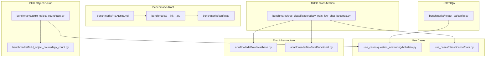
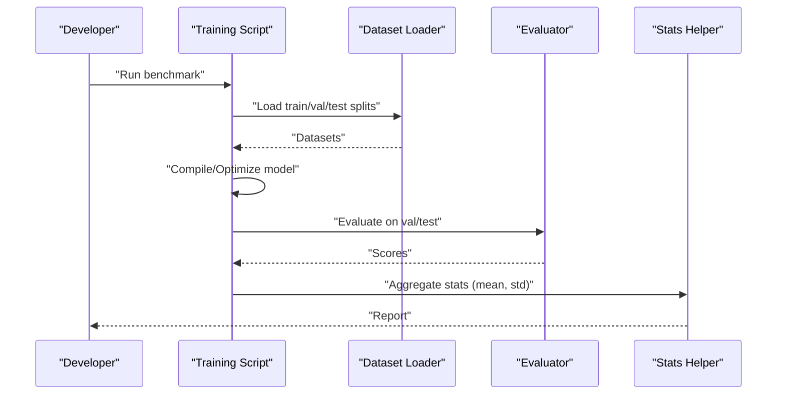
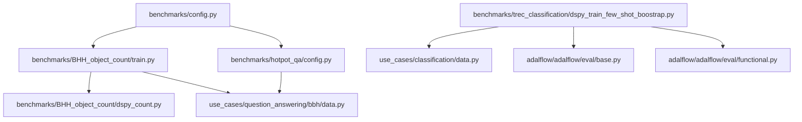
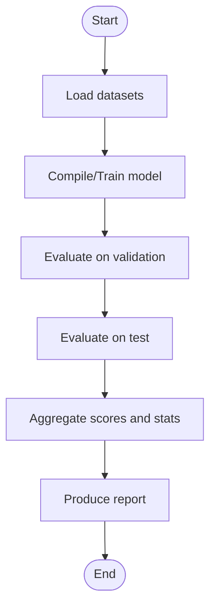
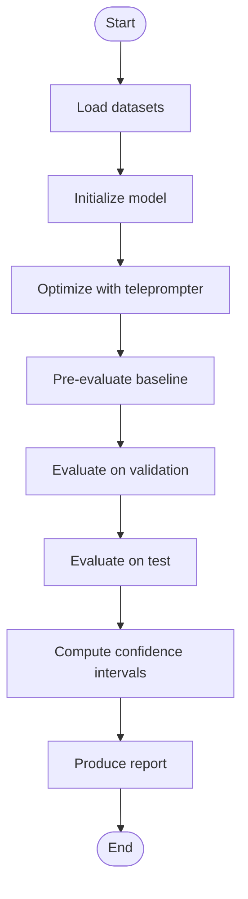

# Custom Benchmarking and Extension

<cite>
**Referenced Files in This Document**
- [benchmarks/README.md](file://benchmarks/README.md)
- [benchmarks/__init__.py](file://benchmarks/__init__.py)
- [benchmarks/config.py](file://benchmarks/config.py)
- [benchmarks/BHH_object_count/train.py](file://benchmarks/BHH_object_count/train.py)
- [benchmarks/BHH_object_count/dspy_count.py](file://benchmarks/BHH_object_count/dspy_count.py)
- [benchmarks/hotpot_qa/config.py](file://benchmarks/hotpot_qa/config.py)
- [benchmarks/trec_classification/dspy_train_few_shot_boostrap.py](file://benchmarks/trec_classification/dspy_train_few_shot_boostrap.py)
- [use_cases/question_answering/bbh/data.py](file://use_cases/question_answering/bbh/data.py)
- [use_cases/classification/data.py](file://use_cases/classification/data.py)
- [adalflow/adalflow/eval/base.py](file://adalflow/adalflow/eval/base.py)
- [adalflow/adalflow/eval/functional.py](file://adalflow/adalflow/eval/functional.py)
</cite>

## Table of Contents
1. [Introduction](#introduction)
2. [Project Structure](#project-structure)
3. [Core Components](#core-components)
4. [Architecture Overview](#architecture-overview)
5. [Detailed Component Analysis](#detailed-component-analysis)
6. [Dependency Analysis](#dependency-analysis)
7. [Performance Considerations](#performance-considerations)
8. [Troubleshooting Guide](#troubleshooting-guide)
9. [Conclusion](#conclusion)
10. [Appendices](#appendices)

## Introduction
This document explains how to extend AdalFlow’s benchmarking framework with custom benchmarks and evaluation scenarios. It covers the benchmark configuration system, data loading mechanisms, and evaluation pipeline customization. You will learn how to create new benchmark implementations, integrate custom datasets, define specialized evaluation metrics, execute benchmarks, aggregate results, and produce reports. It also addresses reproducibility, version control considerations, and collaborative benchmark sharing, with templates and examples for common benchmark types such as custom optimization scenarios, domain-specific evaluations, and comparative analysis frameworks.

## Project Structure
The benchmarking system is organized around reusable benchmark packages, each containing training scripts, configuration, and optional experiment submodules. Benchmarks leverage external libraries (for example, DSPy) and AdalFlow’s evaluation infrastructure.

**Diagram sources**
- [benchmarks/README.md](file://benchmarks/README.md#L1-L4)
- [benchmarks/__init__.py](file://benchmarks/__init__.py#L1-L2)
- [benchmarks/config.py](file://benchmarks/config.py#L1-L46)
- [benchmarks/BHH_object_count/train.py](file://benchmarks/BHH_object_count/train.py#L1-L158)
- [benchmarks/BHH_object_count/dspy_count.py](file://benchmarks/BHH_object_count/dspy_count.py#L1-L59)
- [benchmarks/hotpot_qa/config.py](file://benchmarks/hotpot_qa/config.py#L1-L14)
- [benchmarks/trec_classification/dspy_train_few_shot_boostrap.py](file://benchmarks/trec_classification/dspy_train_few_shot_boostrap.py#L1-L214)
- [use_cases/question_answering/bbh/data.py](file://use_cases/question_answering/bbh/data.py#L1-L121)
- [use_cases/classification/data.py](file://use_cases/classification/data.py#L1-L36)
- [adalflow/adalflow/eval/base.py](file://adalflow/adalflow/eval/base.py#L1-L32)
- [adalflow/adalflow/eval/functional.py](file://adalflow/adalflow/eval/functional.py#L1-L96)

**Section sources**
- [benchmarks/README.md](file://benchmarks/README.md#L1-L4)
- [benchmarks/__init__.py](file://benchmarks/__init__.py#L1-L2)
- [benchmarks/config.py](file://benchmarks/config.py#L1-L46)

## Core Components
- Benchmark configuration and model clients: centralized in a configuration module that defines model client instances and save paths for trained artifacts.
- Data loading: dataset loaders for benchmark tasks, returning train/validation/test splits suitable for downstream training and evaluation.
- Evaluation infrastructure: an abstract evaluator base class and helper functions for computing confidence intervals and string similarity metrics.
- Benchmark execution: training scripts that orchestrate dataset preparation, model compilation/optimize, validation/testing, and result aggregation.

Key responsibilities:
- benchmarks/config.py: model client definitions, save paths, and a factory-like loader for model configurations.
- use_cases/*/data.py: dataset loaders and optional extended dataclasses for structured inputs/outputs.
- adalflow/adalflow/eval/base.py: abstract evaluator interface and standardized result container.
- adalflow/adalflow/eval/functional.py: statistical helpers for confidence intervals and string operations.

**Section sources**
- [benchmarks/config.py](file://benchmarks/config.py#L1-L46)
- [use_cases/question_answering/bbh/data.py](file://use_cases/question_answering/bbh/data.py#L94-L106)
- [use_cases/classification/data.py](file://use_cases/classification/data.py#L30-L36)
- [adalflow/adalflow/eval/base.py](file://adalflow/adalflow/eval/base.py#L8-L32)
- [adalflow/adalflow/eval/functional.py](file://adalflow/adalflow/eval/functional.py#L5-L49)

## Architecture Overview
The benchmarking architecture integrates external optimization libraries (DSPy) with AdalFlow’s evaluation and data utilities. Each benchmark package encapsulates:
- A training script that loads datasets, compiles/optimizes a model, evaluates on validation/test sets, and aggregates statistics.
- A configuration module that centralizes model client definitions and save paths.
- Optional dataset loaders that adapt external datasets to the benchmark’s needs.

**Diagram sources**
- [benchmarks/BHH_object_count/train.py](file://benchmarks/BHH_object_count/train.py#L91-L134)
- [benchmarks/trec_classification/dspy_train_few_shot_boostrap.py](file://benchmarks/trec_classification/dspy_train_few_shot_boostrap.py#L144-L155)
- [use_cases/question_answering/bbh/data.py](file://use_cases/question_answering/bbh/data.py#L94-L106)
- [use_cases/classification/data.py](file://use_cases/classification/data.py#L30-L36)
- [adalflow/adalflow/eval/base.py](file://adalflow/adalflow/eval/base.py#L17-L32)
- [adalflow/adalflow/eval/functional.py](file://adalflow/adalflow/eval/functional.py#L5-L49)

## Detailed Component Analysis

### Benchmark Configuration System
- Centralized model client definitions and save paths enable consistent benchmark runs across tasks.
- The loader function instantiates model clients from configured classes and returns a ready-to-use configuration dictionary.

Implementation highlights:
- Model client entries define the runtime client class and keyword arguments for model invocation.
- Save paths are separated by task and optimization method (for example, DSPy vs text grad vs Adal-style).

Best practices:
- Keep model client definitions in a single place for easy switching and reproducibility.
- Use descriptive save paths to distinguish variants and seeds.

**Section sources**
- [benchmarks/config.py](file://benchmarks/config.py#L13-L45)

### Data Loading Mechanisms
- Dataset loaders return train/validation/test splits tailored for the benchmark task.
- For BigBench Hard tasks, loaders fetch subsets and optionally limit sample sizes.
- For TREC, loaders extend the base dataclass with additional fields (for example, rationale) to support richer evaluation.

Common patterns:
- Use dataset loaders to standardize input/output fields.
- Normalize labels and answers to ensure compatibility with evaluation metrics.

**Section sources**
- [use_cases/question_answering/bbh/data.py](file://use_cases/question_answering/bbh/data.py#L94-L106)
- [use_cases/classification/data.py](file://use_cases/classification/data.py#L30-L36)

### Evaluation Pipeline Customization
- The evaluation pipeline supports pluggable metrics via an abstract evaluator interface.
- Helper functions provide confidence intervals and string similarity metrics for robust reporting.

Customization options:
- Implement a custom evaluator by subclassing the base evaluator and overriding compute and compute_single_item.
- Use confidence intervals to report uncertainty alongside point estimates.

**Section sources**
- [adalflow/adalflow/eval/base.py](file://adalflow/adalflow/eval/base.py#L17-L32)
- [adalflow/adalflow/eval/functional.py](file://adalflow/adalflow/eval/functional.py#L5-L49)

### Benchmark Execution Framework
- Training scripts orchestrate dataset loading, model compilation/optimization, evaluation, and result aggregation.
- They often iterate multiple runs to compute means and standard deviations for stability.

Execution flow:
- Load datasets.
- Compile or optimize the model with a chosen teleprompter.
- Evaluate on validation and test sets.
- Aggregate scores and record timing/performance.

**Section sources**
- [benchmarks/BHH_object_count/train.py](file://benchmarks/BHH_object_count/train.py#L91-L134)
- [benchmarks/trec_classification/dspy_train_few_shot_boostrap.py](file://benchmarks/trec_classification/dspy_train_few_shot_boostrap.py#L158-L214)

### Result Aggregation Methods and Reporting Formats
- Numerical aggregation commonly computes mean and standard deviation across runs.
- Confidence intervals can be derived from judgements to quantify uncertainty.
- Reporting formats include console logs and saved artifacts (for example, compiled models).

Recommendations:
- Report aggregated metrics with confidence intervals for robustness.
- Save artifacts with clear naming conventions to enable reproducible comparisons.

**Section sources**
- [benchmarks/BHH_object_count/train.py](file://benchmarks/BHH_object_count/train.py#L122-L133)
- [benchmarks/trec_classification/dspy_train_few_shot_boostrap.py](file://benchmarks/trec_classification/dspy_train_few_shot_boostrap.py#L204-L213)
- [adalflow/adalflow/eval/functional.py](file://adalflow/adalflow/eval/functional.py#L5-L49)

### Creating New Benchmark Implementations
Step-by-step guide:
1. Create a new benchmark folder under benchmarks/.
2. Define model clients and save paths in a config.py inside the new benchmark folder.
3. Implement a dataset loader that returns train/val/test splits and normalizes fields.
4. Implement a training script that:
   - Loads datasets.
   - Compiles/optimizes a model using an appropriate teleprompter.
   - Evaluates on validation/test sets.
   - Aggregates scores and records timing.
5. Integrate custom evaluation metrics by implementing a subclass of the base evaluator or using existing helpers.

Example references:
- Object counting benchmark with DSPy signature and training loop.
- TREC classification benchmark with custom metric and evaluation wrapper.

**Section sources**
- [benchmarks/config.py](file://benchmarks/config.py#L1-L46)
- [use_cases/question_answering/bbh/data.py](file://use_cases/question_answering/bbh/data.py#L94-L106)
- [benchmarks/BHH_object_count/train.py](file://benchmarks/BHH_object_count/train.py#L22-L48)
- [benchmarks/trec_classification/dspy_train_few_shot_boostrap.py](file://benchmarks/trec_classification/dspy_train_few_shot_boostrap.py#L73-L93)

### Integrating Custom Datasets
Steps:
1. Add dataset loading logic in a dedicated loader file under use_cases/<domain>/data.py.
2. Extend base dataclasses if needed to include additional fields for richer evaluation.
3. Ensure the loader returns standardized train/val/test splits.
4. Reference the loader in the benchmark’s training script.

Guidance:
- Keep normalization consistent across tasks.
- Use subset selection for quick iterations during development.

**Section sources**
- [use_cases/classification/data.py](file://use_cases/classification/data.py#L30-L36)
- [use_cases/question_answering/bbh/data.py](file://use_cases/question_answering/bbh/data.py#L94-L106)

### Defining Specialized Evaluation Metrics
Approaches:
- Implement a custom evaluator by subclassing the base evaluator and defining compute and compute_single_item.
- Use helper functions for confidence intervals and string similarity to enrich reports.
- For classification tasks, wrap answer matching logic similar to the TREC example.

**Section sources**
- [adalflow/adalflow/eval/base.py](file://adalflow/adalflow/eval/base.py#L17-L32)
- [adalflow/adalflow/eval/functional.py](file://adalflow/adalflow/eval/functional.py#L5-L49)
- [benchmarks/trec_classification/dspy_train_few_shot_boostrap.py](file://benchmarks/trec_classification/dspy_train_few_shot_boostrap.py#L48-L57)

### Templates and Examples
- Object counting optimization scenario:
  - Signature definition and parsing logic.
  - Training loop with bootstrapping and validation.
- Domain-specific evaluation (TREC classification):
  - Extended dataclass with rationale.
  - Custom metric and evaluation wrapper.
- Comparative analysis framework:
  - Multiple runs with aggregated statistics and confidence intervals.

**Section sources**
- [benchmarks/BHH_object_count/dspy_count.py](file://benchmarks/BHH_object_count/dspy_count.py#L24-L48)
- [benchmarks/BHH_object_count/train.py](file://benchmarks/BHH_object_count/train.py#L91-L134)
- [use_cases/classification/data.py](file://use_cases/classification/data.py#L15-L28)
- [benchmarks/trec_classification/dspy_train_few_shot_boostrap.py](file://benchmarks/trec_classification/dspy_train_few_shot_boostrap.py#L144-L155)

## Dependency Analysis
The benchmark ecosystem exhibits clear separation of concerns:
- Configuration module centralizes model clients and save paths.
- Dataset loaders provide standardized inputs for training scripts.
- Evaluation infrastructure offers a unified interface for metrics and statistics.
- Training scripts orchestrate the end-to-end pipeline.

**Diagram sources**
- [benchmarks/config.py](file://benchmarks/config.py#L1-L46)
- [benchmarks/BHH_object_count/train.py](file://benchmarks/BHH_object_count/train.py#L1-L158)
- [benchmarks/BHH_object_count/dspy_count.py](file://benchmarks/BHH_object_count/dspy_count.py#L1-L59)
- [benchmarks/hotpot_qa/config.py](file://benchmarks/hotpot_qa/config.py#L1-L14)
- [benchmarks/trec_classification/dspy_train_few_shot_boostrap.py](file://benchmarks/trec_classification/dspy_train_few_shot_boostrap.py#L1-L214)
- [use_cases/question_answering/bbh/data.py](file://use_cases/question_answering/bbh/data.py#L1-L121)
- [use_cases/classification/data.py](file://use_cases/classification/data.py#L1-L36)
- [adalflow/adalflow/eval/base.py](file://adalflow/adalflow/eval/base.py#L1-L32)
- [adalflow/adalflow/eval/functional.py](file://adalflow/adalflow/eval/functional.py#L1-L96)

**Section sources**
- [benchmarks/config.py](file://benchmarks/config.py#L1-L46)
- [benchmarks/BHH_object_count/train.py](file://benchmarks/BHH_object_count/train.py#L1-L158)
- [benchmarks/trec_classification/dspy_train_few_shot_boostrap.py](file://benchmarks/trec_classification/dspy_train_few_shot_boostrap.py#L1-L214)

## Performance Considerations
- Iterative runs: multiple runs improve reliability of estimates; track mean and standard deviation.
- Confidence intervals: use statistical helpers to quantify uncertainty in scores.
- Caching and resource limits: configure external libraries’ caching and concurrency settings to balance speed and resource usage.
- Artifact management: organize saved models and logs by task, method, and seed for reproducibility.

[No sources needed since this section provides general guidance]

## Troubleshooting Guide
Common issues and remedies:
- Metric mismatch: ensure the metric function signature matches the evaluation interface and returns binary judgements for confidence intervals.
- Dataset shape errors: verify that inputs and outputs align with the model’s expected fields.
- Concurrency and timeouts: adjust thread counts and timeouts in evaluation wrappers for large datasets.
- Reproducibility: fix seeds and save artifacts with explicit naming to enable exact re-runs.

**Section sources**
- [benchmarks/trec_classification/dspy_train_few_shot_boostrap.py](file://benchmarks/trec_classification/dspy_train_few_shot_boostrap.py#L144-L155)
- [adalflow/adalflow/eval/functional.py](file://adalflow/adalflow/eval/functional.py#L5-L49)

## Conclusion
AdalFlow’s benchmarking framework provides a modular, extensible foundation for building custom benchmarks. By centralizing configuration, standardizing data loading, and leveraging a flexible evaluation interface, contributors can rapidly prototype new tasks, integrate diverse datasets, and define specialized metrics. The included examples demonstrate end-to-end workflows for optimization scenarios, domain-specific evaluations, and comparative analyses, enabling reproducible and collaborative benchmarking.

[No sources needed since this section summarizes without analyzing specific files]

## Appendices

### Benchmark Execution Flow (Object Counting)

**Diagram sources**
- [benchmarks/BHH_object_count/train.py](file://benchmarks/BHH_object_count/train.py#L91-L134)

### Benchmark Execution Flow (TREC Classification)

**Diagram sources**
- [benchmarks/trec_classification/dspy_train_few_shot_boostrap.py](file://benchmarks/trec_classification/dspy_train_few_shot_boostrap.py#L158-L214)