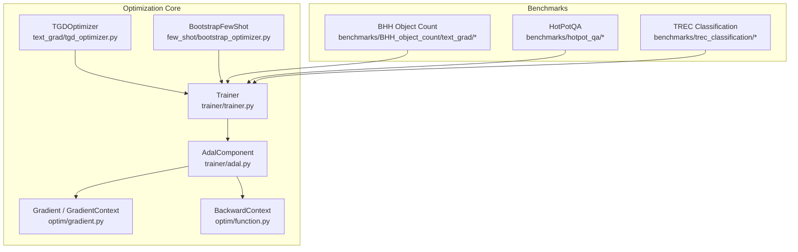
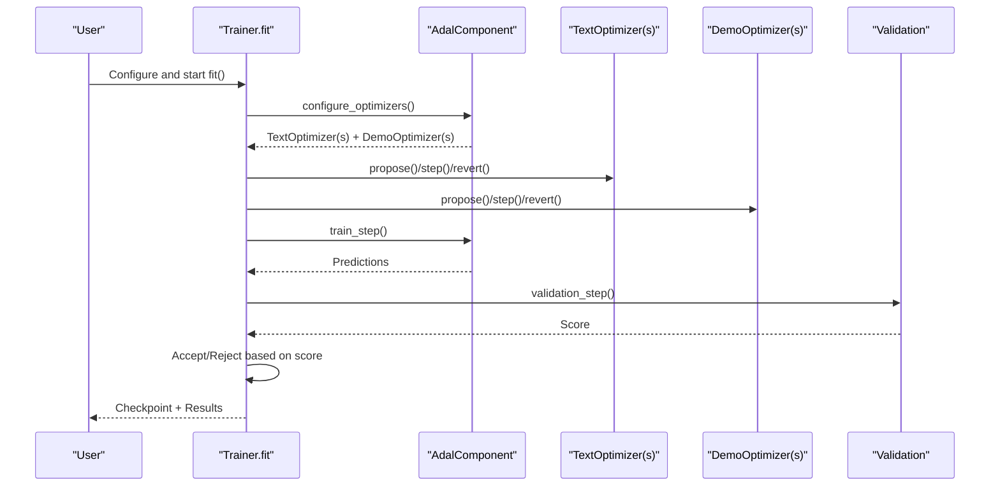
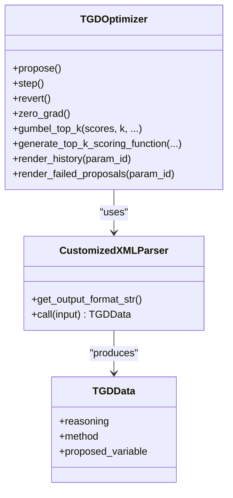
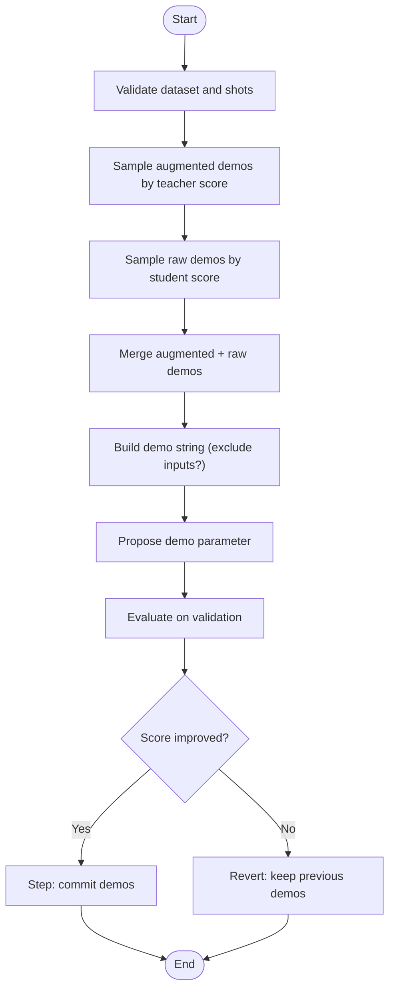
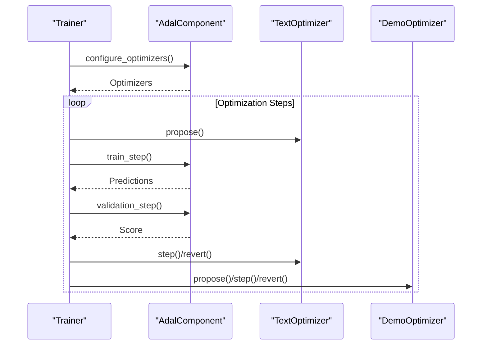
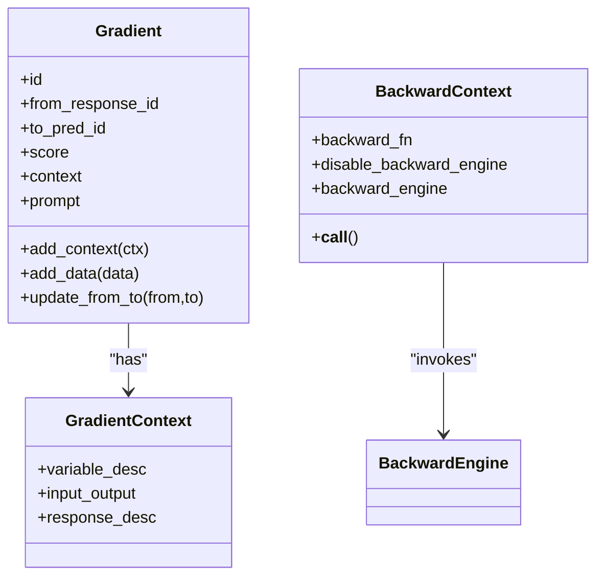
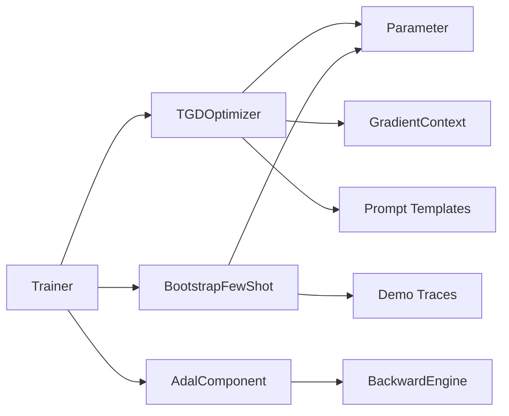
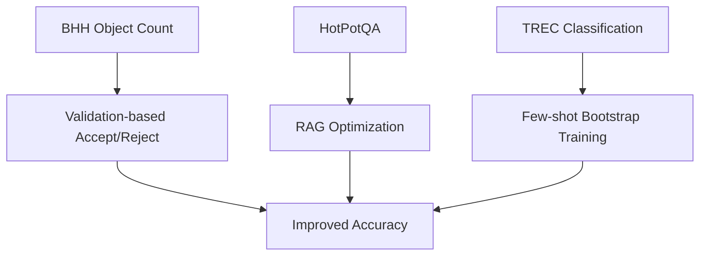

# Optimization Strategies and Techniques

<cite>
**Referenced Files in This Document**
- [optim/README.md](file://adalflow/adalflow/optim/README.md)
- [optim/__init__.py](file://adalflow/adalflow/optim/__init__.py)
- [_llm_optimizer.py](file://adalflow/adalflow/optim/_llm_optimizer.py)
- [function.py](file://adalflow/adalflow/optim/function.py)
- [gradient.py](file://adalflow/adalflow/optim/gradient.py)
- [tgd_optimizer.py](file://adalflow/adalflow/optim/text_grad/tgd_optimizer.py)
- [bootstrap_optimizer.py](file://adalflow/adalflow/optim/few_shot/bootstrap_optimizer.py)
- [trainer.py](file://adalflow/adalflow/optim/trainer/trainer.py)
- [adal.py](file://adalflow/adalflow/optim/trainer/adal.py)
- [src.py](file://benchmarks/BHH_object_count/text_grad/src.py)
- [config.py](file://benchmarks/BHH_object_count/text_grad/config.py)
- [config.py](file://benchmarks/hotpot_qa/config.py)
- [dspy_train_few_shot_boostrap.py](file://benchmarks/trec_classification/dspy_train_few_shot_boostrap.py)
</cite>

## Table of Contents
1. [Introduction](#introduction)
2. [Project Structure](#project-structure)
3. [Core Components](#core-components)
4. [Architecture Overview](#architecture-overview)
5. [Detailed Component Analysis](#detailed-component-analysis)
6. [Dependency Analysis](#dependency-analysis)
7. [Performance Considerations](#performance-considerations)
8. [Troubleshooting Guide](#troubleshooting-guide)
9. [Conclusion](#conclusion)
10. [Appendices](#appendices)

## Introduction
This document presents a comprehensive guide to optimization strategies and techniques validated through AdalFlow benchmarks. It focuses on:
- Text gradient descent optimization methods (including textual gradient descent with momentum)
- Few-shot learning approaches leveraging bootstrap optimization
- Iterative refinement strategies across benchmark scenarios
- Optimization hyperparameters, convergence criteria, and performance improvement quantification
- Practical optimization workflows, parameter tuning strategies, and technique comparisons
- Best practices, pitfalls, and selection guidelines for choosing optimization strategies based on task types and data scales

## Project Structure
The optimization subsystem centers around:
- Textual gradient descent optimizer and supporting components
- Few-shot bootstrap optimizer
- Trainer and AdalComponent orchestration
- Benchmark scripts demonstrating optimization workflows

**Diagram sources**
- [tgd_optimizer.py](file://adalflow/adalflow/optim/text_grad/tgd_optimizer.py#L357-L777)
- [bootstrap_optimizer.py](file://adalflow/adalflow/optim/few_shot/bootstrap_optimizer.py#L22-L308)
- [trainer.py](file://adalflow/adalflow/optim/trainer/trainer.py#L42-L699)
- [adal.py](file://adalflow/adalflow/optim/trainer/adal.py#L30-L800)
- [gradient.py](file://adalflow/adalflow/optim/gradient.py#L14-L133)
- [function.py](file://adalflow/adalflow/optim/function.py#L10-L60)
- [src.py](file://benchmarks/BHH_object_count/text_grad/src.py#L1-L79)
- [config.py](file://benchmarks/hotpot_qa/config.py#L1-L14)
- [dspy_train_few_shot_boostrap.py](file://benchmarks/trec_classification/dspy_train_few_shot_boostrap.py#L1-L214)

**Section sources**
- [optim/README.md](file://adalflow/adalflow/optim/README.md#L1-L122)
- [optim/__init__.py](file://adalflow/adalflow/optim/__init__.py#L1-L39)

## Core Components
- Textual Gradient Descent Optimizer (TGDOptimizer): Implements gradient-based prompt refinement with history, constraints, and Gumbel-top-K sampling for momentum-based selection.
- Few-Shot Bootstrap Optimizer: Performs weighted sampling of demonstrations, combining raw and augmented examples to optimize few-shot prompts.
- Trainer: Orchestrates optimization loops, validation, checkpointing, and mixed or sequential optimization orders.
- AdalComponent: Provides training, evaluation, and loss steps, and integrates backward engines and teacher generators.
- Gradient and BackwardContext: Represent gradient metadata and backward computation contexts for traceability and feedback propagation.

Key capabilities:
- Iterative refinement with validation-based acceptance/rejection
- Multi-parameter optimization with peer awareness
- Constrained optimization via system variables and peer constraints
- Gumbel-top-K exploration/exploitation for momentum-based prompt caching and selection

**Section sources**
- [tgd_optimizer.py](file://adalflow/adalflow/optim/text_grad/tgd_optimizer.py#L357-L777)
- [bootstrap_optimizer.py](file://adalflow/adalflow/optim/few_shot/bootstrap_optimizer.py#L22-L308)
- [trainer.py](file://adalflow/adalflow/optim/trainer/trainer.py#L42-L699)
- [adal.py](file://adalflow/adalflow/optim/trainer/adal.py#L30-L800)
- [gradient.py](file://adalflow/adalflow/optim/gradient.py#L14-L133)
- [function.py](file://adalflow/adalflow/optim/function.py#L10-L60)

## Architecture Overview
The optimization architecture couples task pipelines with gradient-based prompt tuning and few-shot optimization, guided by a trainer that manages validation-driven updates.

**Diagram sources**
- [trainer.py](file://adalflow/adalflow/optim/trainer/trainer.py#L418-L699)
- [adal.py](file://adalflow/adalflow/optim/trainer/adal.py#L336-L576)
- [tgd_optimizer.py](file://adalflow/adalflow/optim/text_grad/tgd_optimizer.py#L614-L713)
- [bootstrap_optimizer.py](file://adalflow/adalflow/optim/few_shot/bootstrap_optimizer.py#L233-L300)

## Detailed Component Analysis

### Textual Gradient Descent Optimizer (TGDOptimizer)
- Purpose: Refines text-based parameters (prompts, examples) using gradient-like feedback from batches.
- Key features:
  - History tracking with top-K retention
  - Constraint-aware prompting
  - In-context examples injection
  - Gumbel-top-K sampling for momentum-based selection
  - Peer-aware system variables
  - XML-based structured output parsing

**Diagram sources**
- [tgd_optimizer.py](file://adalflow/adalflow/optim/text_grad/tgd_optimizer.py#L270-L340)
- [tgd_optimizer.py](file://adalflow/adalflow/optim/text_grad/tgd_optimizer.py#L357-L777)

Practical workflow:
- Prepare system and peer variables
- Build user prompt with constraints, history, and feedback
- Propose refined variable, evaluate on validation, and accept or revert

Hyperparameters and controls:
- max_past_history: retained history length
- max_failed_proposals: buffer of failed attempts
- steps_from_last_improvement: step counter for rapid updates
- constraints: hard-coded constraints applied to edits
- in_context_examples: demonstrations injected into prompts
- one_parameter_at_a_time: sequential targeting of parameters

Convergence criteria:
- Validation score improvement threshold
- Accept/reject based on validation performance

**Section sources**
- [tgd_optimizer.py](file://adalflow/adalflow/optim/text_grad/tgd_optimizer.py#L357-L777)

### Few-Shot Bootstrap Optimizer
- Purpose: Optimize demonstration sets by sampling from raw and augmented datasets with weighted priorities.
- Key features:
  - Weighted sampling based on teacher/student scores
  - Exclusion of input fields from bootstrap demos (optional)
  - Combined augmentation and raw shots
  - Structured demo string construction

**Diagram sources**
- [bootstrap_optimizer.py](file://adalflow/adalflow/optim/few_shot/bootstrap_optimizer.py#L114-L205)
- [bootstrap_optimizer.py](file://adalflow/adalflow/optim/few_shot/bootstrap_optimizer.py#L233-L300)

Hyperparameters and controls:
- raw_shots, bootstrap_shots: number of demos from each pool
- weighted: enable weighted sampling
- exclude_input_fields_from_bootstrap_demos: reduce token usage by excluding inputs
- Teacher/student scores: per-sample accuracy used for weighting

Convergence criteria:
- Validation score improvement over baseline

**Section sources**
- [bootstrap_optimizer.py](file://adalflow/adalflow/optim/few_shot/bootstrap_optimizer.py#L22-L308)

### Trainer and AdalComponent
- Trainer orchestrates optimization loops, manages datasets, and coordinates text and demo optimizers.
- AdalComponent defines task steps, evaluation, and backward engine integration.

**Diagram sources**
- [trainer.py](file://adalflow/adalflow/optim/trainer/trainer.py#L501-L699)
- [adal.py](file://adalflow/adalflow/optim/trainer/adal.py#L336-L576)

Key controls:
- optimization_order: sequential or mixed
- strategy: random or constrained
- max_steps, batch_val_score_threshold, correct_val_score_threshold
- num_workers, train_batch_size
- debug mode and checkpointing

**Section sources**
- [trainer.py](file://adalflow/adalflow/optim/trainer/trainer.py#L42-L799)
- [adal.py](file://adalflow/adalflow/optim/trainer/adal.py#L30-L800)

### Gradient and Backward Context
- Gradient captures directional feedback with identifiers and context.
- BackwardContext encapsulates backward computation hooks and engine integration.

**Diagram sources**
- [gradient.py](file://adalflow/adalflow/optim/gradient.py#L44-L133)
- [function.py](file://adalflow/adalflow/optim/function.py#L10-L60)

**Section sources**
- [gradient.py](file://adalflow/adalflow/optim/gradient.py#L14-L133)
- [function.py](file://adalflow/adalflow/optim/function.py#L10-L60)

## Dependency Analysis
- TGDOptimizer depends on:
  - Parameter tracing and gradient context
  - Prompt templates and peer/system variable rendering
  - Backward engine for feedback (via AdalComponent)
- BootstrapFewShot depends on:
  - Weighted sampling utilities
  - Demo parameter structures and trace histories
- Trainer composes:
  - Text and demo optimizers
  - AdalComponent for task execution and evaluation
  - Validation and checkpointing infrastructure

**Diagram sources**
- [tgd_optimizer.py](file://adalflow/adalflow/optim/text_grad/tgd_optimizer.py#L357-L777)
- [bootstrap_optimizer.py](file://adalflow/adalflow/optim/few_shot/bootstrap_optimizer.py#L22-L308)
- [trainer.py](file://adalflow/adalflow/optim/trainer/trainer.py#L501-L699)
- [adal.py](file://adalflow/adalflow/optim/trainer/adal.py#L670-L704)

**Section sources**
- [optim/__init__.py](file://adalflow/adalflow/optim/__init__.py#L1-L39)

## Performance Considerations
- Batch sizing and thresholds:
  - batch_val_score_threshold and correct_val_score_threshold influence early stopping and efficiency.
  - Larger batches improve gradient estimation stability but increase cost.
- Parallelism:
  - num_workers and DataLoader batching balance throughput and resource usage.
- Exploration vs exploitation:
  - Gumbel-top-K temperature and noise scale control stochasticity.
  - UCB bonuses can improve exploration when counts are available.
- Few-shot sampling:
  - Weighted sampling prioritizes informative demos; excluding inputs reduces token usage.
- Validation cadence:
  - Mixed vs sequential optimization affects convergence speed and stability.

[No sources needed since this section provides general guidance]

## Troubleshooting Guide
Common issues and remedies:
- Validation score degradation:
  - Use revert to recover previous parameters.
  - Reduce temperature or noise scale in Gumbel-top-K.
- Poor gradient quality:
  - Increase batch size to improve signal-to-noise.
  - Verify backward engine is configured and not disabled unintentionally.
- ID mismatches:
  - Ensure sample IDs propagate through predictions and validation.
- Dataset configuration:
  - Avoid tuple loaders; ensure loaders return dicts or dataclasses.

**Section sources**
- [trainer.py](file://adalflow/adalflow/optim/trainer/trainer.py#L466-L500)
- [trainer.py](file://adalflow/adalflow/optim/trainer/trainer.py#L688-L699)
- [tgd_optimizer.py](file://adalflow/adalflow/optim/text_grad/tgd_optimizer.py#L687-L698)
- [bootstrap_optimizer.py](file://adalflow/adalflow/optim/few_shot/bootstrap_optimizer.py#L281-L289)

## Conclusion
AdalFlow’s optimization stack combines textual gradient descent with few-shot bootstrap optimization, orchestrated by a robust Trainer and AdalComponent. Benchmarks demonstrate:
- Textual gradient descent with momentum (TSGD-M) improves convergence and stability
- Weighted bootstrap few-shot sampling enhances accuracy with reduced token usage
- Mixed sequential strategies balance prompt and demo optimization

Selection guidelines:
- For small datasets or constrained prompts: prioritize few-shot bootstrap with weighted sampling
- For complex prompts requiring iterative refinement: use TGDOptimizer with Gumbel-top-K
- For multi-hop reasoning or retrieval-augmented tasks: combine both strategies with mixed optimization order

[No sources needed since this section summarizes without analyzing specific files]

## Appendices

### Benchmark Scenarios and Workflows
- BHH Object Count:
  - Demonstrates validation-based acceptance/rejection and iterative refinement.
  - Uses evaluation helpers to compute accuracy across samples.

- HotPotQA:
  - Loads datasets and illustrates end-to-end RAG optimization setups.

- TREC Classification:
  - Compares AdalFlow and DSPy workflows; highlights few-shot bootstrap training and evaluation.

**Diagram sources**
- [src.py](file://benchmarks/BHH_object_count/text_grad/src.py#L66-L79)
- [config.py](file://benchmarks/hotpot_qa/config.py#L7-L13)
- [dspy_train_few_shot_boostrap.py](file://benchmarks/trec_classification/dspy_train_few_shot_boostrap.py#L95-L141)

**Section sources**
- [src.py](file://benchmarks/BHH_object_count/text_grad/src.py#L1-L79)
- [config.py](file://benchmarks/hotpot_qa/config.py#L1-L14)
- [dspy_train_few_shot_boostrap.py](file://benchmarks/trec_classification/dspy_train_few_shot_boostrap.py#L1-L214)

### Optimization Hyperparameters and Controls
- TGDOptimizer:
  - max_past_history, max_failed_proposals, steps_from_last_improvement, constraints, in_context_examples, one_parameter_at_a_time
- BootstrapFewShot:
  - raw_shots, bootstrap_shots, weighted, exclude_input_fields_from_bootstrap_demos
- Trainer:
  - optimization_order, strategy, max_steps, batch_val_score_threshold, correct_val_score_threshold, num_workers, train_batch_size, debug, save_traces

**Section sources**
- [tgd_optimizer.py](file://adalflow/adalflow/optim/text_grad/tgd_optimizer.py#L370-L424)
- [bootstrap_optimizer.py](file://adalflow/adalflow/optim/few_shot/bootstrap_optimizer.py#L41-L68)
- [trainer.py](file://adalflow/adalflow/optim/trainer/trainer.py#L112-L191)