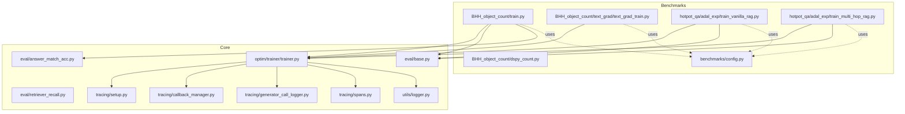
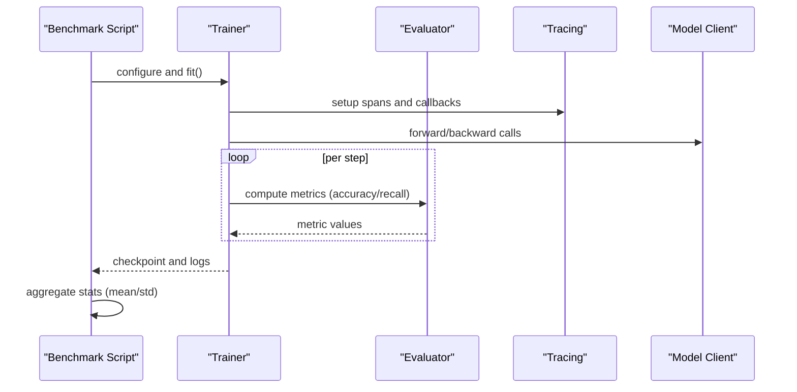
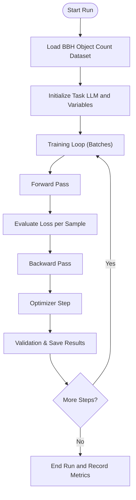
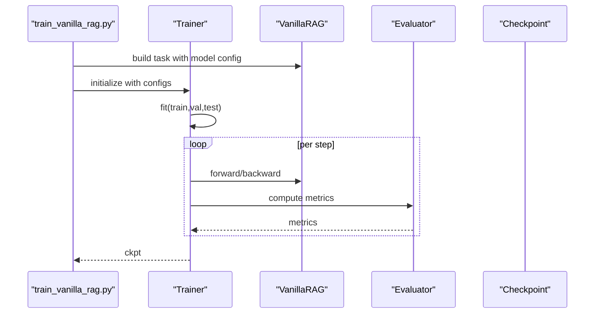
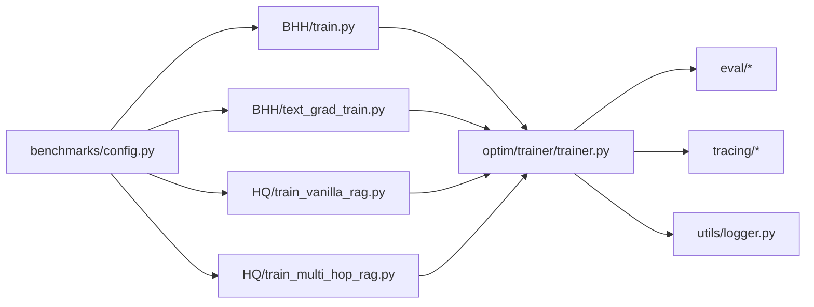

# Performance Measurement and Analysis

<cite>
**Referenced Files in This Document**
- [benchmarks/README.md](file://benchmarks/README.md)
- [benchmarks/config.py](file://benchmarks/config.py)
- [benchmarks/BHH_object_count/train.py](file://benchmarks/BHH_object_count/train.py)
- [benchmarks/BHH_object_count/text_grad/text_grad_train.py](file://benchmarks/BHH_object_count/text_grad/text_grad_train.py)
- [benchmarks/BHH_object_count/dspy_count.py](file://benchmarks/BHH_object_count/dspy_count.py)
- [benchmarks/hotpot_qa/adal_exp/train_vanilla_rag.py](file://benchmarks/hotpot_qa/adal_exp/train_vanilla_rag.py)
- [benchmarks/hotpot_qa/adal_exp/train_multi_hop_rag.py](file://benchmarks/hotpot_qa/adal_exp/train_multi_hop_rag.py)
- [use_cases/config.py](file://use_cases/config.py)
- [adalflow/tracing/setup.py](file://adalflow/tracing/setup.py)
- [adalflow/tracing/callback_manager.py](file://adalflow/tracing/callback_manager.py)
- [adalflow/tracing/generator_call_logger.py](file://adalflow/tracing/generator_call_logger.py)
- [adalflow/tracing/generator_state_logger.py](file://adalflow/tracing/generator_state_logger.py)
- [adalflow/tracing/mlflow_integration.py](file://adalflow/tracing/mlflow_integration.py)
- [adalflow/tracing/spans.py](file://adalflow/tracing/spans.py)
- [adalflow/tracing/util.py](file://adalflow/tracing/util.py)
- [adalflow/optim/trainer/trainer.py](file://adalflow/optim/trainer/trainer.py)
- [adalflow/optim/_llm_optimizer.py](file://adalflow/optim/_llm_optimizer.py)
- [adalflow/optim/gradient.py](file://adalflow/optim/gradient.py)
- [adalflow/optim/loss_component.py](file://adalflow/optim/loss_component.py)
- [adalflow/optim/parameter.py](file://adalflow/optim/parameter.py)
- [adalflow/optim/sampler.py](file://adalflow/optim/sampler.py)
- [adalflow/eval/base.py](file://adalflow/eval/base.py)
- [adalflow/eval/answer_match_acc.py](file://adalflow/eval/answer_match_acc.py)
- [adalflow/eval/retriever_recall.py](file://adalflow/eval/retriever_recall.py)
- [adalflow/eval/utils.py](file://adalflow/eval/utils.py)
- [adalflow/utils/logger.py](file://adalflow/utils/logger.py)
</cite>

## Table of Contents
1. [Introduction](#introduction)
2. [Project Structure](#project-structure)
3. [Core Components](#core-components)
4. [Architecture Overview](#architecture-overview)
5. [Detailed Component Analysis](#detailed-component-analysis)
6. [Dependency Analysis](#dependency-analysis)
7. [Performance Considerations](#performance-considerations)
8. [Troubleshooting Guide](#troubleshooting-guide)
9. [Conclusion](#conclusion)
10. [Appendices](#appendices)

## Introduction
This document describes performance measurement and analysis methodologies used in AdalFlow benchmarks. It explains the metrics and evaluation criteria across different benchmark scenarios, documents profiling techniques, bottleneck identification strategies, and comparative analysis frameworks. It also provides concrete examples of data collection, statistical analysis, visualization approaches, performance regression detection, optimization effectiveness measurement, and scaling analysis techniques. The goal is to enable reproducible, data-driven performance assessments across accuracy, latency, memory usage, and optimization convergence.

## Project Structure
The benchmarks directory contains scenario-specific training and evaluation scripts that collect performance metrics such as accuracy and training time. These scripts integrate with the core AdalFlow components for training, evaluation, and tracing.

**Diagram sources**
- [benchmarks/BHH_object_count/train.py](file://benchmarks/BHH_object_count/train.py#L1-L158)
- [benchmarks/BHH_object_count/text_grad/text_grad_train.py](file://benchmarks/BHH_object_count/text_grad/text_grad_train.py#L1-L180)
- [benchmarks/BHH_object_count/dspy_count.py](file://benchmarks/BHH_object_count/dspy_count.py#L1-L59)
- [benchmarks/hotpot_qa/adal_exp/train_vanilla_rag.py](file://benchmarks/hotpot_qa/adal_exp/train_vanilla_rag.py#L1-L184)
- [benchmarks/hotpot_qa/adal_exp/train_multi_hop_rag.py](file://benchmarks/hotpot_qa/adal_exp/train_multi_hop_rag.py#L1-L168)
- [benchmarks/config.py](file://benchmarks/config.py#L1-L46)
- [adalflow/optim/trainer/trainer.py](file://adalflow/optim/trainer/trainer.py)
- [adalflow/eval/base.py](file://adalflow/eval/base.py)
- [adalflow/eval/answer_match_acc.py](file://adalflow/eval/answer_match_acc.py)
- [adalflow/eval/retriever_recall.py](file://adalflow/eval/retriever_recall.py)
- [adalflow/tracing/setup.py](file://adalflow/tracing/setup.py)
- [adalflow/tracing/callback_manager.py](file://adalflow/tracing/callback_manager.py)
- [adalflow/tracing/generator_call_logger.py](file://adalflow/tracing/generator_call_logger.py)
- [adalflow/tracing/spans.py](file://adalflow/tracing/spans.py)
- [adalflow/utils/logger.py](file://adalflow/utils/logger.py)

**Section sources**
- [benchmarks/README.md](file://benchmarks/README.md#L1-L4)
- [benchmarks/config.py](file://benchmarks/config.py#L1-L46)

## Core Components
- Benchmark entry points collect accuracy and timing metrics for training and evaluation loops.
- Evaluation utilities provide standardized accuracy computation and recall metrics.
- Trainer integrates with tracing to capture runtime behavior and performance signals.
- Configuration centralizes model client and runtime parameters for consistent comparisons.

Key performance metrics observed in the benchmarks:
- Accuracy: Exact match for numeric reasoning tasks; recall for retrieval tasks.
- Latency: Per-run training durations and per-sample inference timings.
- Convergence: Validation/test scores recorded across optimization steps.
- Memory usage: Not directly measured in the referenced scripts; can be inferred via external profilers.

**Section sources**
- [benchmarks/BHH_object_count/train.py](file://benchmarks/BHH_object_count/train.py#L80-L134)
- [benchmarks/BHH_object_count/text_grad/text_grad_train.py](file://benchmarks/BHH_object_count/text_grad/text_grad_train.py#L143-L180)
- [benchmarks/hotpot_qa/adal_exp/train_vanilla_rag.py](file://benchmarks/hotpot_qa/adal_exp/train_vanilla_rag.py#L102-L109)
- [benchmarks/hotpot_qa/adal_exp/train_multi_hop_rag.py](file://benchmarks/hotpot_qa/adal_exp/train_multi_hop_rag.py#L97-L104)
- [adalflow/eval/answer_match_acc.py](file://adalflow/eval/answer_match_acc.py)
- [adalflow/eval/retriever_recall.py](file://adalflow/eval/retriever_recall.py)
- [adalflow/optim/trainer/trainer.py](file://adalflow/optim/trainer/trainer.py)
- [benchmarks/config.py](file://benchmarks/config.py#L1-L46)

## Architecture Overview
The benchmarking architecture combines scenario-specific training scripts with the core Trainer and evaluation utilities. Tracing components capture runtime spans and callbacks for deeper performance insights.

**Diagram sources**
- [benchmarks/BHH_object_count/train.py](file://benchmarks/BHH_object_count/train.py#L91-L134)
- [benchmarks/BHH_object_count/text_grad/text_grad_train.py](file://benchmarks/BHH_object_count/text_grad/text_grad_train.py#L143-L180)
- [benchmarks/hotpot_qa/adal_exp/train_vanilla_rag.py](file://benchmarks/hotpot_qa/adal_exp/train_vanilla_rag.py#L102-L109)
- [benchmarks/hotpot_qa/adal_exp/train_multi_hop_rag.py](file://benchmarks/hotpot_qa/adal_exp/train_multi_hop_rag.py#L97-L104)
- [adalflow/optim/trainer/trainer.py](file://adalflow/optim/trainer/trainer.py)
- [adalflow/eval/base.py](file://adalflow/eval/base.py)
- [adalflow/tracing/setup.py](file://adalflow/tracing/setup.py)
- [adalflow/tracing/spans.py](file://adalflow/tracing/spans.py)

## Detailed Component Analysis

### Numeric Reasoning Benchmark (BHH Object Count)
- Metrics: Validation/test accuracy; training time per run; backward/step timings printed during Textual Gradient training.
- Data collection: Runs multiple trials, computes means and standard deviations for accuracy and training time.
- Bottleneck identification: Logs show per-step backward and optimizer step durations; useful for pinpointing compute-intensive phases.

**Diagram sources**
- [benchmarks/BHH_object_count/text_grad/text_grad_train.py](file://benchmarks/BHH_object_count/text_grad/text_grad_train.py#L28-L140)

**Section sources**
- [benchmarks/BHH_object_count/text_grad/text_grad_train.py](file://benchmarks/BHH_object_count/text_grad/text_grad_train.py#L143-L180)
- [benchmarks/BHH_object_count/dspy_count.py](file://benchmarks/BHH_object_count/dspy_count.py#L1-L59)
- [benchmarks/BHH_object_count/train.py](file://benchmarks/BHH_object_count/train.py#L91-L134)

### RAG Benchmark (HotPotQA)
- Metrics: Accuracy computed via evaluator; checkpointing after training; optional diagnosis mode.
- Data collection: Uses Trainer.fit to orchestrate training, validation, and testing splits.
- Bottleneck identification: Configurable backward pass setup and optimization order; can disable backward to isolate performance impact.

**Diagram sources**
- [benchmarks/hotpot_qa/adal_exp/train_vanilla_rag.py](file://benchmarks/hotpot_qa/adal_exp/train_vanilla_rag.py#L44-L109)
- [benchmarks/hotpot_qa/adal_exp/train_multi_hop_rag.py](file://benchmarks/hotpot_qa/adal_exp/train_multi_hop_rag.py#L41-L104)

**Section sources**
- [benchmarks/hotpot_qa/adal_exp/train_vanilla_rag.py](file://benchmarks/hotpot_qa/adal_exp/train_vanilla_rag.py#L102-L109)
- [benchmarks/hotpot_qa/adal_exp/train_multi_hop_rag.py](file://benchmarks/hotpot_qa/adal_exp/train_multi_hop_rag.py#L97-L104)

### Evaluation Utilities
- Standardized accuracy computation for answer matching and recall metrics for retrieval tasks.
- Base evaluator interface supports consistent metric reporting across benchmarks.

**Section sources**
- [adalflow/eval/base.py](file://adalflow/eval/base.py)
- [adalflow/eval/answer_match_acc.py](file://adalflow/eval/answer_match_acc.py)
- [adalflow/eval/retriever_recall.py](file://adalflow/eval/retriever_recall.py)
- [adalflow/eval/utils.py](file://adalflow/eval/utils.py)

### Tracing and Profiling Integration
- Tracing setup, callback manager, generator call/state logging, and MLflow integration enable detailed performance monitoring and span-based profiling.
- Logging utilities support structured logs for downstream analysis.

**Section sources**
- [adalflow/tracing/setup.py](file://adalflow/tracing/setup.py)
- [adalflow/tracing/callback_manager.py](file://adalflow/tracing/callback_manager.py)
- [adalflow/tracing/generator_call_logger.py](file://adalflow/tracing/generator_call_logger.py)
- [adalflow/tracing/generator_state_logger.py](file://adalflow/tracing/generator_state_logger.py)
- [adalflow/tracing/mlflow_integration.py](file://adalflow/tracing/mlflow_integration.py)
- [adalflow/tracing/spans.py](file://adalflow/tracing/spans.py)
- [adalflow/tracing/util.py](file://adalflow/tracing/util.py)
- [adalflow/utils/logger.py](file://adalflow/utils/logger.py)

## Dependency Analysis
The benchmark scripts depend on configuration for model clients and runtime parameters, and they integrate with the Trainer and evaluation utilities. Tracing components are wired into the training pipeline to capture performance signals.

**Diagram sources**
- [benchmarks/config.py](file://benchmarks/config.py#L1-L46)
- [benchmarks/BHH_object_count/train.py](file://benchmarks/BHH_object_count/train.py#L1-L158)
- [benchmarks/BHH_object_count/text_grad/text_grad_train.py](file://benchmarks/BHH_object_count/text_grad/text_grad_train.py#L1-L180)
- [benchmarks/hotpot_qa/adal_exp/train_vanilla_rag.py](file://benchmarks/hotpot_qa/adal_exp/train_vanilla_rag.py#L1-L184)
- [benchmarks/hotpot_qa/adal_exp/train_multi_hop_rag.py](file://benchmarks/hotpot_qa/adal_exp/train_multi_hop_rag.py#L1-L168)
- [adalflow/optim/trainer/trainer.py](file://adalflow/optim/trainer/trainer.py)
- [adalflow/eval/base.py](file://adalflow/eval/base.py)
- [adalflow/tracing/setup.py](file://adalflow/tracing/setup.py)
- [adalflow/utils/logger.py](file://adalflow/utils/logger.py)

**Section sources**
- [benchmarks/config.py](file://benchmarks/config.py#L1-L46)
- [benchmarks/BHH_object_count/train.py](file://benchmarks/BHH_object_count/train.py#L1-L158)
- [benchmarks/BHH_object_count/text_grad/text_grad_train.py](file://benchmarks/BHH_object_count/text_grad/text_grad_train.py#L1-L180)
- [benchmarks/hotpot_qa/adal_exp/train_vanilla_rag.py](file://benchmarks/hotpot_qa/adal_exp/train_vanilla_rag.py#L1-L184)
- [benchmarks/hotpot_qa/adal_exp/train_multi_hop_rag.py](file://benchmarks/hotpot_qa/adal_exp/train_multi_hop_rag.py#L1-L168)

## Performance Considerations
- Accuracy metrics: Exact match for numeric reasoning; recall for retrieval tasks.
- Latency metrics: Per-run training durations; per-step backward and optimizer step timings in Textual Gradient training.
- Convergence: Track validation/test scores across optimization steps to assess learning stability.
- Memory usage: Not directly measured in the referenced scripts; consider integrating external profilers for memory footprint analysis.
- Statistical analysis: Compute means and standard deviations across runs; use confidence intervals for significance.
- Visualization: Plot accuracy curves, training time distributions, and convergence profiles.
- Regression detection: Establish baselines per scenario and monitor drift in accuracy and latency.
- Scaling analysis: Vary batch sizes, number of workers, and optimization steps to observe throughput and cost trade-offs.

[No sources needed since this section provides general guidance]

## Troubleshooting Guide
- Missing model credentials or misconfigured model clients can cause training failures. Verify environment setup and model configurations.
- Large batch sizes may lead to degraded performance due to LLM context limitations; adjust batch size and sampling strategies accordingly.
- Disabling backward passes helps isolate performance impact of textual gradients; use flags to compare constrained vs unconstrained strategies.
- Use tracing spans and logs to identify slow steps and hotspots in the training pipeline.

**Section sources**
- [benchmarks/hotpot_qa/adal_exp/train_vanilla_rag.py](file://benchmarks/hotpot_qa/adal_exp/train_vanilla_rag.py#L133-L134)
- [benchmarks/hotpot_qa/adal_exp/train_multi_hop_rag.py](file://benchmarks/hotpot_qa/adal_exp/train_multi_hop_rag.py#L132-L133)
- [adalflow/tracing/spans.py](file://adalflow/tracing/spans.py)
- [adalflow/utils/logger.py](file://adalflow/utils/logger.py)

## Conclusion
AdalFlow’s benchmark suite demonstrates practical methodologies for measuring accuracy, latency, and optimization convergence across diverse scenarios. By leveraging standardized evaluation utilities, the Trainer pipeline, and tracing instrumentation, teams can collect robust performance data, detect regressions, and drive data-informed optimizations. Extending these practices with memory profiling and advanced visualization will further strengthen the benchmarking framework.

[No sources needed since this section summarizes without analyzing specific files]

## Appendices

### Appendix A: Benchmark Scenarios and Metrics
- Numeric reasoning (BBH object counting): Validation/test accuracy; training time; per-step backward/step durations.
- Retrieval-Augmented Generation (HotPotQA): Accuracy via evaluator; checkpointing; optional diagnosis mode; configurable backward pass behavior.

**Section sources**
- [benchmarks/BHH_object_count/text_grad/text_grad_train.py](file://benchmarks/BHH_object_count/text_grad/text_grad_train.py#L143-L180)
- [benchmarks/BHH_object_count/train.py](file://benchmarks/BHH_object_count/train.py#L91-L134)
- [benchmarks/hotpot_qa/adal_exp/train_vanilla_rag.py](file://benchmarks/hotpot_qa/adal_exp/train_vanilla_rag.py#L102-L109)
- [benchmarks/hotpot_qa/adal_exp/train_multi_hop_rag.py](file://benchmarks/hotpot_qa/adal_exp/train_multi_hop_rag.py#L97-L104)

### Appendix B: Comparative Analysis Framework
- Cross-model comparison: Compare accuracy and latency across different model clients configured in the benchmark configuration.
- Cross-strategy comparison: Compare constrained vs unconstrained optimization strategies and their impact on convergence speed and final accuracy.
- Cross-scenario comparison: Normalize metrics across scenarios to enable fair apples-to-apples comparisons.

**Section sources**
- [benchmarks/config.py](file://benchmarks/config.py#L1-L46)
- [use_cases/config.py](file://use_cases/config.py)