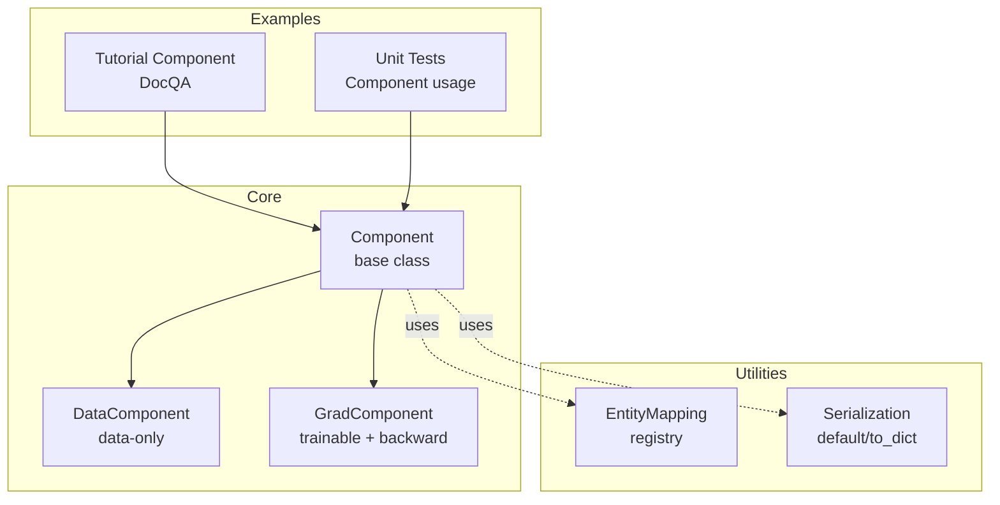
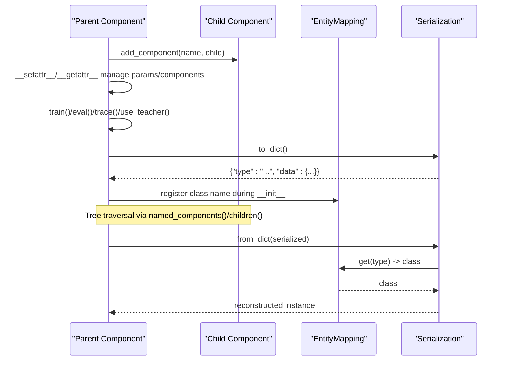
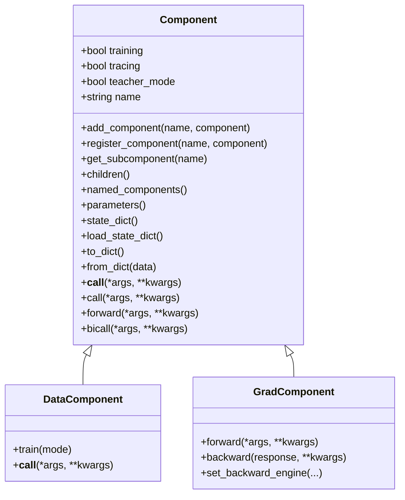
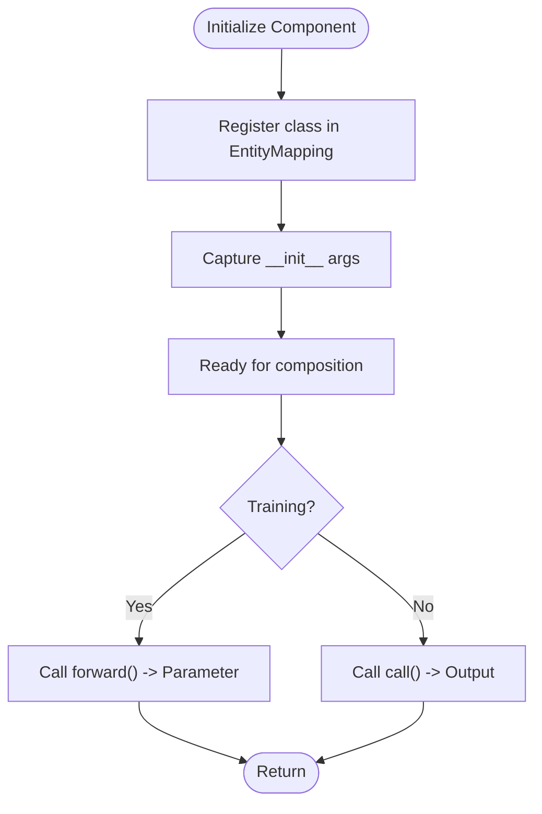
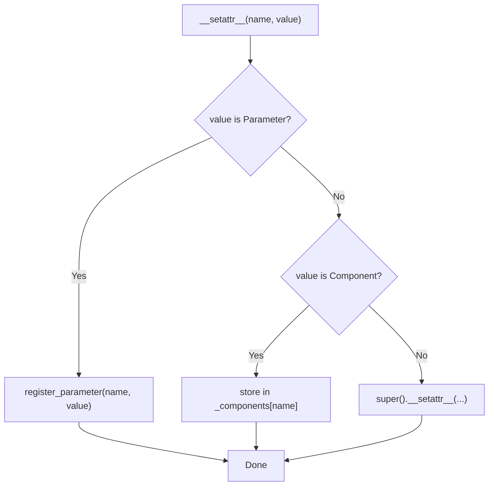
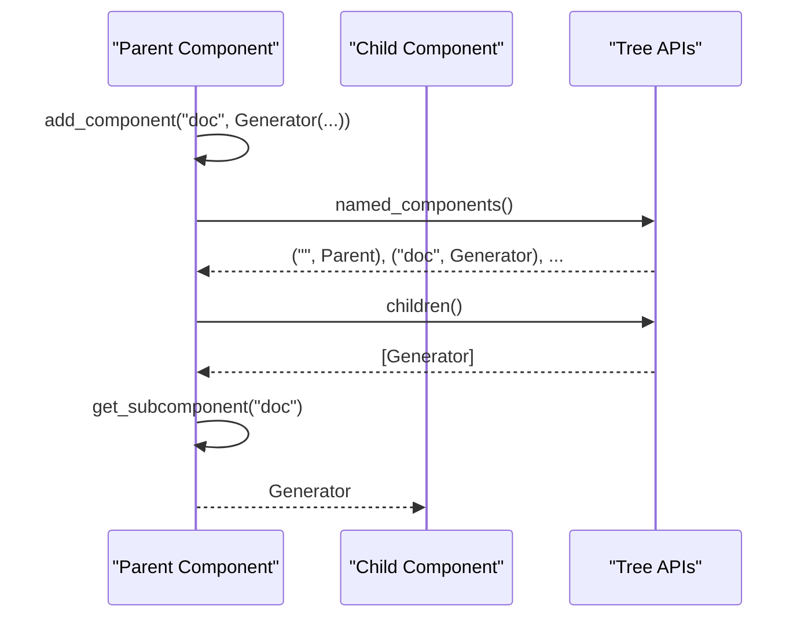
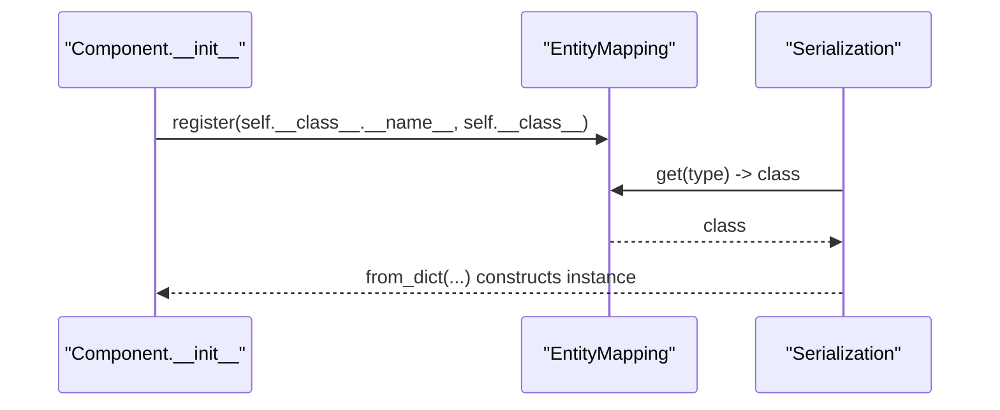
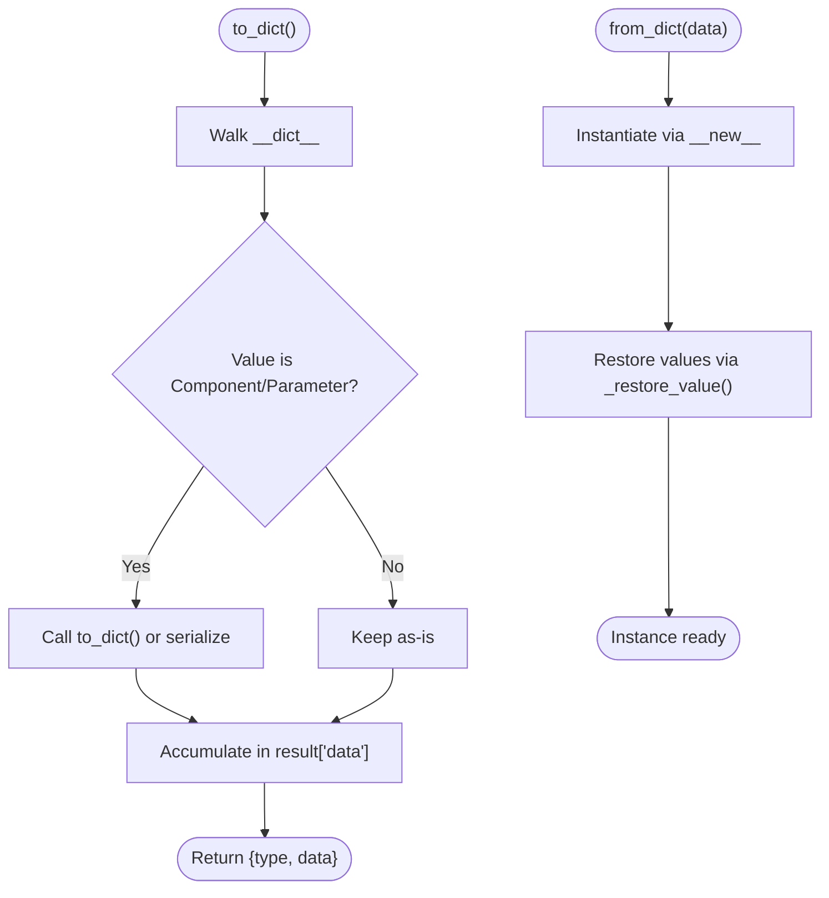
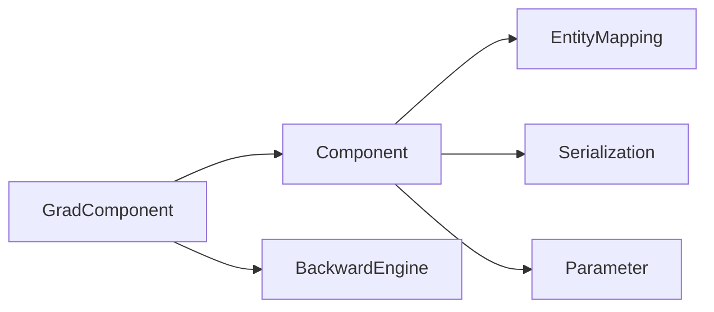

# Component Architecture

<cite>
**Referenced Files in This Document**
- [component.py](file://adalflow/adalflow/core/component.py)
- [registry.py](file://adalflow/adalflow/utils/registry.py)
- [serialization.py](file://adalflow/adalflow/utils/serialization.py)
- [grad_component.py](file://adalflow/adalflow/optim/grad_component.py)
- [component.py (tutorial)](file://tutorials/component.py)
- [test_component.py](file://adalflow/tests/test_component.py)
</cite>

## Table of Contents
1. [Introduction](#introduction)
2. [Project Structure](#project-structure)
3. [Core Components](#core-components)
4. [Architecture Overview](#architecture-overview)
5. [Detailed Component Analysis](#detailed-component-analysis)
6. [Dependency Analysis](#dependency-analysis)
7. [Performance Considerations](#performance-considerations)
8. [Troubleshooting Guide](#troubleshooting-guide)
9. [Conclusion](#conclusion)
10. [Appendices](#appendices)

## Introduction
This document explains AdalFlow’s Component Architecture with a focus on the Component base class, hierarchical composition, lifecycle, attribute and parameter management, registry-driven dynamic instantiation, and robust serialization/deserialization. It provides practical patterns for creating, composing, and managing components, along with best practices for maintainable and extensible pipelines.

## Project Structure
The Component Architecture centers around the core Component base class and supporting utilities:
- Core Component base class and derived types
- Registry for dynamic component instantiation
- Serialization utilities for state and type-aware restoration
- Gradient-enabled component variants for training and backpropagation

**Diagram sources**
- [component.py](file://adalflow/adalflow/core/component.py#L51-L1200)
- [registry.py](file://adalflow/adalflow/utils/registry.py#L4-L22)
- [serialization.py](file://adalflow/adalflow/utils/serialization.py#L30-L138)
- [grad_component.py](file://adalflow/adalflow/optim/grad_component.py#L40-L120)
- [component.py (tutorial)](file://tutorials/component.py#L7-L30)
- [test_component.py](file://adalflow/tests/test_component.py#L12-L41)

**Section sources**
- [component.py](file://adalflow/adalflow/core/component.py#L51-L1200)
- [registry.py](file://adalflow/adalflow/utils/registry.py#L4-L22)
- [serialization.py](file://adalflow/adalflow/utils/serialization.py#L30-L138)
- [grad_component.py](file://adalflow/adalflow/optim/grad_component.py#L40-L120)
- [component.py (tutorial)](file://tutorials/component.py#L7-L30)
- [test_component.py](file://adalflow/tests/test_component.py#L12-L41)

## Core Components
- Component: Base class for all pipeline building blocks. Supports nested composition, parameter registration, lifecycle toggles (training, tracing, teacher), and serialization/deserialization.
- DataComponent: Specialization for data-processing components that are not trainable and do not return parameters.
- GradComponent: Trainable variant with forward/backward interfaces and gradient propagation for automatic differentiation-style optimization.

Key capabilities:
- Hierarchical composition via add_component/register_component and traversal via named_components/children.
- Lifecycle management via train(), eval(), trace(), use_teacher().
- Attribute and parameter management via __setattr__/__getattr__/__delattr__ with validation.
- State serialization via to_dict/from_dict and state_dict/load_state_dict.
- Dynamic instantiation via registry-backed EntityMapping and configuration-driven construction.

**Section sources**
- [component.py](file://adalflow/adalflow/core/component.py#L51-L1200)
- [grad_component.py](file://adalflow/adalflow/optim/grad_component.py#L40-L120)

## Architecture Overview
The Component Architecture follows a tree-like composition model:
- Parent components hold child components and parameters.
- Calls traverse the tree, dispatching to call/forward depending on mode and presence of bicall.
- Serialization preserves type identity and reconstructs instances using the registry.

**Diagram sources**
- [component.py](file://adalflow/adalflow/core/component.py#L129-L144)
- [component.py](file://adalflow/adalflow/core/component.py#L230-L351)
- [component.py](file://adalflow/adalflow/core/component.py#L565-L680)
- [registry.py](file://adalflow/adalflow/utils/registry.py#L11-L21)
- [serialization.py](file://adalflow/adalflow/utils/serialization.py#L108-L125)

## Detailed Component Analysis

### Component Base Class Design
- Composition and traversal:
  - add_component/register_component enforce naming rules and type safety.
  - named_components recursively enumerates all components with dotted prefixes.
  - children/named_children provide iteration over immediate descendants.
- Lifecycle toggles:
  - train()/eval() toggle training mode; propagates to children.
  - trace() enables tracing; use_teacher() toggles demo accumulation modes.
- Attribute and parameter management:
  - __setattr__ distinguishes Parameter vs Component vs regular attributes.
  - __getattr__ resolves parameters and subcomponents.
  - __delattr__ removes entries from internal registries.
- Call dispatch:
  - __call__ prefers bicall if present; otherwise forwards to forward() (training) or call() (inference).
  - Enforces output type contracts per mode (Parameter vs non-Parameter).
- Serialization:
  - to_dict/_process_value recursively serializes nested components and parameters.
  - from_dict/_restore_value reconstructs instances using registry and fallbacks.
  - state_dict/load_state_dict manage parameter-only state with strictness controls.
- Initialization and introspection:
  - _get_init_args captures constructor arguments for reconstruction.
  - __repr__ prints a structured tree of components.

**Diagram sources**
- [component.py](file://adalflow/adalflow/core/component.py#L51-L1200)
- [grad_component.py](file://adalflow/adalflow/optim/grad_component.py#L40-L120)

**Section sources**
- [component.py](file://adalflow/adalflow/core/component.py#L51-L1200)

### Lifecycle and Initialization
- Initialization:
  - Registers the class in EntityMapping for dynamic instantiation.
  - Captures constructor arguments via _get_init_args for reconstruction.
- Lifecycle toggles:
  - train()/eval(): propagate to children; training mode affects call semantics.
  - trace(): enable tracing across the subtree.
  - use_teacher(): toggle demo collection mode.
- Call semantics:
  - __call__ validates outputs against mode contracts.
  - bicall centralizes both training and inference logic when provided.

**Diagram sources**
- [component.py](file://adalflow/adalflow/core/component.py#L129-L144)
- [component.py](file://adalflow/adalflow/core/component.py#L475-L551)

**Section sources**
- [component.py](file://adalflow/adalflow/core/component.py#L129-L144)
- [component.py](file://adalflow/adalflow/core/component.py#L475-L551)

### Attribute and Parameter Management
- __setattr__:
  - Detects Parameter assignment and registers via register_parameter.
  - Detects Component assignment and stores under _components.
  - Raises errors for invalid assignments before initialization.
- __getattr__:
  - Resolves parameters and subcomponents by name.
  - Raises AttributeError if not found.
- register_parameter:
  - Validates name and type; prevents duplicates and invalid names.

**Diagram sources**
- [component.py](file://adalflow/adalflow/core/component.py#L846-L884)
- [component.py](file://adalflow/adalflow/core/component.py#L359-L392)

**Section sources**
- [component.py](file://adalflow/adalflow/core/component.py#L846-L884)
- [component.py](file://adalflow/adalflow/core/component.py#L359-L392)

### Hierarchical Composition Patterns
- Parent-child composition:
  - Use add_component/register_component to attach children.
  - Access via get_subcomponent or __getattr__.
- Traversal:
  - named_components yields full dotted paths; children yields direct descendants.
- Practical example:
  - Tutorial demonstrates nesting a Generator inside a custom Component and round-tripping via to_dict/from_dict.

**Diagram sources**
- [component.py](file://adalflow/adalflow/core/component.py#L565-L680)
- [component.py (tutorial)](file://tutorials/component.py#L19-L30)

**Section sources**
- [component.py](file://adalflow/adalflow/core/component.py#L565-L680)
- [component.py (tutorial)](file://tutorials/component.py#L19-L30)

### Component Registry and Dynamic Instantiation
- EntityMapping:
  - register(name, entity_cls) stores class mappings.
  - get(name) retrieves registered classes.
  - get_all() returns the registry map.
- Component registration:
  - Component.__init__ registers the class under its name.
- Serialization hooks:
  - default() and _deserialize_object_hook() use EntityMapping to reconstruct instances by type.

**Diagram sources**
- [component.py](file://adalflow/adalflow/core/component.py#L142-L144)
- [registry.py](file://adalflow/adalflow/utils/registry.py#L11-L21)
- [serialization.py](file://adalflow/adalflow/utils/serialization.py#L117-L125)

**Section sources**
- [registry.py](file://adalflow/adalflow/utils/registry.py#L4-L22)
- [component.py](file://adalflow/adalflow/core/component.py#L142-L144)
- [serialization.py](file://adalflow/adalflow/utils/serialization.py#L117-L125)

### Serialization, Deserialization, and State Management
- to_dict/from_dict:
  - Recursively serializes nested components and parameters.
  - Uses default() for type-aware serialization and _restore_value for reconstruction.
- state_dict/load_state_dict:
  - Manages parameter-only state with strict key matching and metadata.
- Pickle helpers:
  - is_picklable, pickle_to_file, load_from_pickle for quick persistence.

**Diagram sources**
- [component.py](file://adalflow/adalflow/core/component.py#L230-L351)
- [serialization.py](file://adalflow/adalflow/utils/serialization.py#L30-L88)

**Section sources**
- [component.py](file://adalflow/adalflow/core/component.py#L230-L351)
- [serialization.py](file://adalflow/adalflow/utils/serialization.py#L30-L88)

### Practical Examples
- Creating a composed Component:
  - Tutorial builds a DocQA Component containing a Generator with a model client.
  - Demonstrates to_dict/from_dict roundtrip and printing the component tree.
- Unit tests:
  - Verify parameter registration and component enumeration.
  - Ensure missing super().__init__() raises an error to prevent misconfiguration.

**Section sources**
- [component.py (tutorial)](file://tutorials/component.py#L7-L30)
- [test_component.py](file://adalflow/tests/test_component.py#L12-L41)
- [test_component.py](file://adalflow/tests/test_component.py#L76-L98)

## Dependency Analysis
- Component depends on:
  - EntityMapping for registry-based reconstruction.
  - Serialization utilities for type-aware serialization.
  - Parameter types for training/inference contracts.
- GradComponent extends Component with:
  - Backward engine integration and gradient propagation.
  - Forward/backward contracts for training.

**Diagram sources**
- [component.py](file://adalflow/adalflow/core/component.py#L28-L31)
- [grad_component.py](file://adalflow/adalflow/optim/grad_component.py#L9-L26)

**Section sources**
- [component.py](file://adalflow/adalflow/core/component.py#L28-L31)
- [grad_component.py](file://adalflow/adalflow/optim/grad_component.py#L9-L26)

## Performance Considerations
- Prefer recursive=False in parameters()/named_parameters() when only immediate parameters are needed.
- Use state_dict/load_state_dict for lightweight parameter-only persistence.
- Avoid excessive nesting for hot-path calls; flatten where feasible.
- Leverage trace() selectively to reduce overhead in inference.

## Troubleshooting Guide
Common issues and resolutions:
- Missing super().__init__() in subclasses:
  - Symptom: AttributeError when assigning parameters or components.
  - Fix: Ensure Component.__init__() is called before setting attributes.
- Invalid parameter names:
  - Symptom: ValueError for names containing "." or empty strings.
  - Fix: Use valid dotted-safe names without special characters.
- Unexpected call outputs:
  - Symptom: ValueError about Parameter/non-Parameter contract.
  - Fix: Implement bicall consistently or separate forward/call per mode.
- Unserializable attributes:
  - Symptom: Pickling errors during to_dict.
  - Fix: Provide to_dict on custom objects or rely on default fallback.

**Section sources**
- [test_component.py](file://adalflow/tests/test_component.py#L44-L48)
- [component.py](file://adalflow/adalflow/core/component.py#L377-L391)
- [component.py](file://adalflow/adalflow/core/component.py#L521-L551)
- [component.py](file://adalflow/adalflow/core/component.py#L254-L291)

## Conclusion
AdalFlow’s Component Architecture provides a robust, extensible foundation for building LLM pipelines. The Component base class offers clear composition, lifecycle control, and serialization semantics. DataComponent and GradComponent specialize for data processing and training, respectively. The registry and serialization utilities enable dynamic instantiation and reliable persistence. Following the patterns and best practices outlined here ensures maintainable, testable, and scalable component designs.

## Appendices
- Best practices:
  - Always call super().__init__() in custom Component subclasses.
  - Use add_component/register_component for composition; avoid direct attribute assignment for components.
  - Implement bicall when both training and inference share logic; otherwise implement forward/call appropriately.
  - Keep parameter names valid and avoid duplicates.
  - Use to_dict/from_dict for full-state persistence; use state_dict/load_state_dict for parameter-only snapshots.
  - Register custom classes in the registry when dynamic instantiation is required.