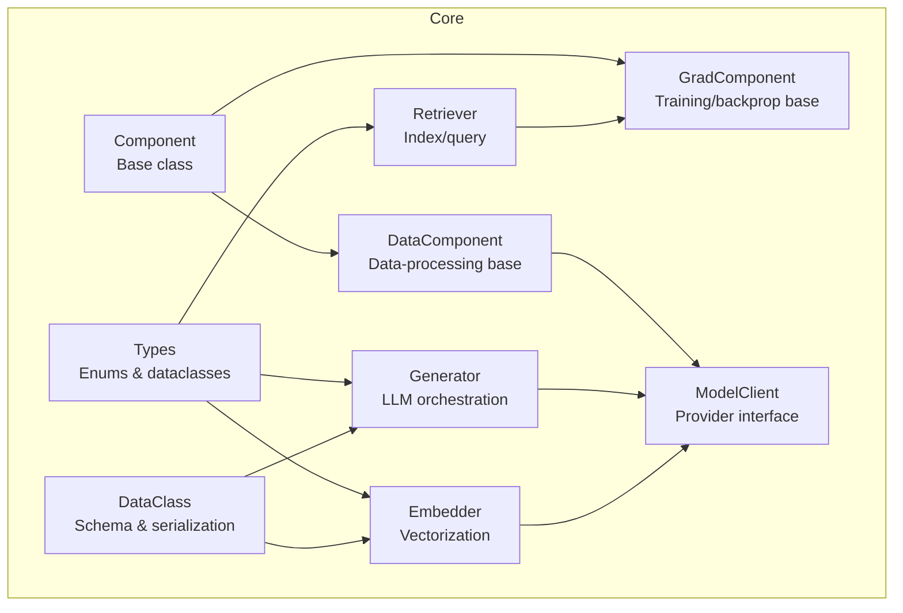
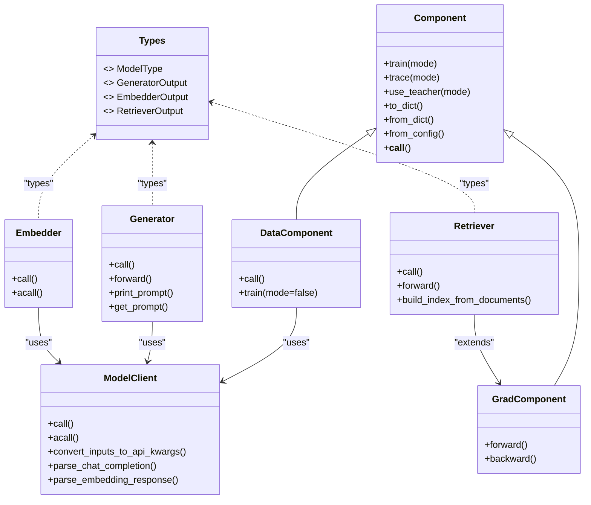
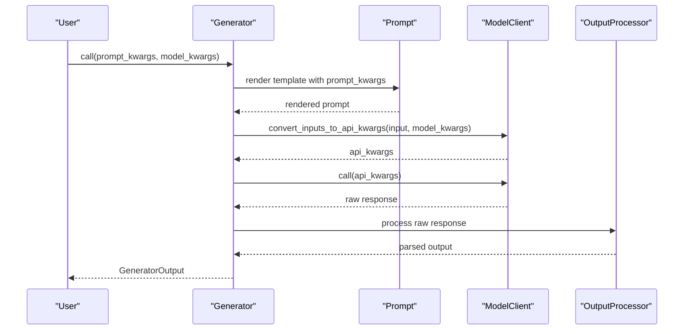
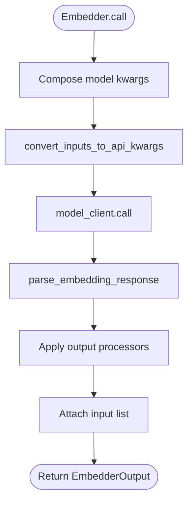
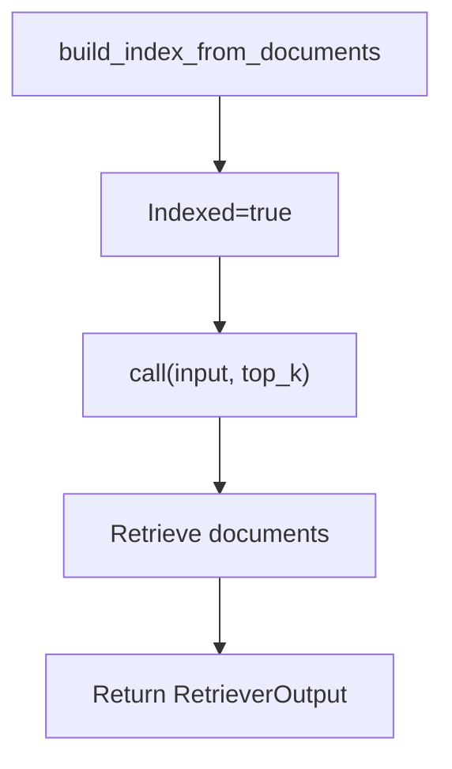
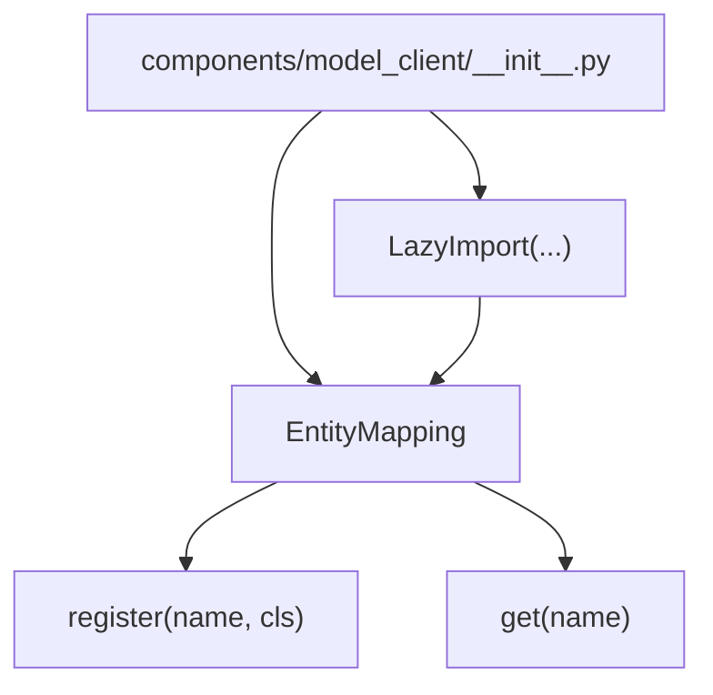

# Component Types and Categories

<cite>
**Referenced Files in This Document**
- [component.py](file://adalflow/adalflow/core/component.py)
- [generator.py](file://adalflow/adalflow/core/generator.py)
- [embedder.py](file://adalflow/adalflow/core/embedder.py)
- [retriever.py](file://adalflow/adalflow/core/retriever.py)
- [types.py](file://adalflow/adalflow/core/types.py)
- [base_data_class.py](file://adalflow/adalflow/core/base_data_class.py)
- [model_client.py](file://adalflow/adalflow/core/model_client.py)
- [registry.py](file://adalflow/adalflow/utils/registry.py)
- [__init__.py](file://adalflow/adalflow/components/model_client/__init__.py)
</cite>

## Table of Contents
1. [Introduction](#introduction)
2. [Project Structure](#project-structure)
3. [Core Components](#core-components)
4. [Architecture Overview](#architecture-overview)
5. [Detailed Component Analysis](#detailed-component-analysis)
6. [Dependency Analysis](#dependency-analysis)
7. [Performance Considerations](#performance-considerations)
8. [Troubleshooting Guide](#troubleshooting-guide)
9. [Conclusion](#conclusion)
10. [Appendices](#appendices)

## Introduction
This document explains the component type system and categories in AdalFlow. It covers how components are classified, how specialized types like Generator, Embedder, and Retriever are structured, and how type validation and behaviors are enforced. It also describes component type registration, dynamic type resolution, and configuration options. Practical examples illustrate use cases and integration patterns for each component type.

## Project Structure
AdalFlow organizes components around a shared base class that provides common capabilities (serialization, parameter management, training/tracing modes) while specialized components encapsulate domain-specific behaviors. The core component hierarchy and specialized components are defined in the core module, with supporting types and registries in dedicated files.

**Diagram sources**
- [component.py](file://adalflow/adalflow/core/component.py#L51-L120)
- [generator.py](file://adalflow/adalflow/core/generator.py#L82-L120)
- [embedder.py](file://adalflow/adalflow/core/embedder.py#L23-L65)
- [retriever.py](file://adalflow/adalflow/core/retriever.py#L22-L47)
- [types.py](file://adalflow/adalflow/core/types.py#L55-L135)
- [base_data_class.py](file://adalflow/adalflow/core/base_data_class.py#L97-L190)
- [model_client.py](file://adalflow/adalflow/core/model_client.py#L16-L47)

**Section sources**
- [component.py](file://adalflow/adalflow/core/component.py#L51-L120)
- [types.py](file://adalflow/adalflow/core/types.py#L55-L135)

## Core Components
AdalFlow defines a layered component system:
- Component: Base class providing serialization, parameter registration, training/tracing modes, and nested composition.
- DataComponent: Non-trainable data-processing components (e.g., parsers, splitters).
- GradComponent: Trainable components capable of backpropagation and gradient computation.
- ModelClient: Protocol for model providers (local or API-based), converting inputs to API calls and parsing outputs.

Key behaviors:
- Type validation: Components enforce correct types for inputs and outputs (e.g., Generator enforces Parameter in training mode).
- Mode switching: Components support training, tracing, and teacher modes with cascading behavior to children.
- Serialization: Components can serialize/deserialize state and nested components.

**Section sources**
- [component.py](file://adalflow/adalflow/core/component.py#L115-L180)
- [component.py](file://adalflow/adalflow/core/component.py#L475-L551)
- [component.py](file://adalflow/adalflow/core/component.py#L961-L980)
- [model_client.py](file://adalflow/adalflow/core/model_client.py#L16-L128)

## Architecture Overview
The component type system centers on a base class with specialized subclasses for common tasks. Generics and dataclasses standardize input/output contracts, while registries enable dynamic type resolution.

**Diagram sources**
- [component.py](file://adalflow/adalflow/core/component.py#L51-L120)
- [component.py](file://adalflow/adalflow/core/component.py#L961-L980)
- [generator.py](file://adalflow/adalflow/core/generator.py#L82-L120)
- [embedder.py](file://adalflow/adalflow/core/embedder.py#L23-L65)
- [retriever.py](file://adalflow/adalflow/core/retriever.py#L22-L47)
- [types.py](file://adalflow/adalflow/core/types.py#L55-L135)

## Detailed Component Analysis

### Component Type System and Categories
- Base types:
  - Component: Provides serialization, nested composition, and lifecycle modes.
  - DataComponent: Non-trainable data-processing components.
  - GradComponent: Trainable components with forward/backward hooks for gradients.
- Specialized categories:
  - Generator: LLM orchestration with prompt, model client, and output processors.
  - Embedder: Vectorization of text with optional batching.
  - Retriever: Index-building and querying with gradient-aware forward pass.

Type validation and behaviors:
- Generator enforces output type in training vs. inference modes.
- Embedder validates model client and model kwargs types.
- Retriever’s forward sets parameter types and tracks inputs for tracing.

**Section sources**
- [component.py](file://adalflow/adalflow/core/component.py#L115-L180)
- [component.py](file://adalflow/adalflow/core/component.py#L475-L551)
- [generator.py](file://adalflow/adalflow/core/generator.py#L148-L183)
- [embedder.py](file://adalflow/adalflow/core/embedder.py#L53-L64)
- [retriever.py](file://adalflow/adalflow/core/retriever.py#L98-L142)

### Generator: LLM Orchestration
Generator orchestrates prompt rendering, model client calls, and output processing. It supports:
- Prompt templates and prompt kwargs.
- Model client selection and model kwargs.
- Output processors for post-processing.
- Caching and streaming support.
- Training mode with gradient computation via GradComponent.

Key interfaces and behaviors:
- call/forward: Unified entry points with bicall fallback.
- Output processing: Synchronous and asynchronous pipelines.
- Token estimation and truncation based on max_tokens.
- Demo tracing and teacher mode for few-shot learning.

**Diagram sources**
- [generator.py](file://adalflow/adalflow/core/generator.py#L463-L494)
- [generator.py](file://adalflow/adalflow/core/generator.py#L519-L543)
- [generator.py](file://adalflow/adalflow/core/generator.py#L357-L379)
- [model_client.py](file://adalflow/adalflow/core/model_client.py#L73-L91)

Practical examples:
- Basic LLM generation with a model client and prompt template.
- Structured output parsing via output processors.
- Streaming responses with async processing.

Integration patterns:
- Compose model kwargs dynamically.
- Use cache path configuration for persistent caching.
- Enable/disable cache per call.

**Section sources**
- [generator.py](file://adalflow/adalflow/core/generator.py#L120-L210)
- [generator.py](file://adalflow/adalflow/core/generator.py#L306-L326)
- [generator.py](file://adalflow/adalflow/core/generator.py#L463-L494)
- [generator.py](file://adalflow/adalflow/core/generator.py#L519-L543)

### Embedder: Vectorization
Embedder converts text to embeddings using a model client and optional output processors. It supports:
- Single or batch input processing.
- Model kwargs composition.
- Async and sync call variants.
- Input normalization and error handling.

**Diagram sources**
- [embedder.py](file://adalflow/adalflow/core/embedder.py#L96-L108)
- [embedder.py](file://adalflow/adalflow/core/embedder.py#L133-L160)
- [embedder.py](file://adalflow/adalflow/core/embedder.py#L162-L188)

Practical examples:
- Embedding a single string or a list of texts.
- Using output processors to normalize or reshape embeddings.
- Batch embedding with configurable batch size.

Integration patterns:
- Configure model kwargs (e.g., model name, dimensions).
- Use async acall for non-blocking operations.

**Section sources**
- [embedder.py](file://adalflow/adalflow/core/embedder.py#L44-L91)
- [embedder.py](file://adalflow/adalflow/core/embedder.py#L195-L236)

### Retriever: Indexing and Querying
Retriever manages an index and retrieves relevant documents for a query. It supports:
- Building an index from documents with optional mapping.
- Retrieving documents for single or multiple queries.
- Forward pass with parameter tracing and hyperparameter tracking.

**Diagram sources**
- [retriever.py](file://adalflow/adalflow/core/retriever.py#L53-L62)
- [retriever.py](file://adalflow/adalflow/core/retriever.py#L80-L96)
- [retriever.py](file://adalflow/adalflow/core/retriever.py#L98-L142)

Practical examples:
- Building an index from a corpus and retrieving top-k results.
- Tracking retrieval parameters (e.g., top_k) as parameters for gradient-aware training.

Integration patterns:
- Implement reset_index and save/load persistence methods in subclasses.
- Use generic types to constrain document/query types.

**Section sources**
- [retriever.py](file://adalflow/adalflow/core/retriever.py#L46-L96)
- [retriever.py](file://adalflow/adalflow/core/retriever.py#L98-L142)

### Types and Data Contracts
Standardized types define component interfaces and outputs:
- ModelType: Enumerates supported model families (e.g., LLM, EMBEDDER, RERANKER).
- GeneratorOutput: Encapsulates raw and parsed outputs, usage, and metadata.
- EmbedderOutput: List of embeddings with usage and optional error.
- RetrieverOutput: Retrieved documents, scores, and indices.

These types ensure consistent input/output contracts across components and enable interoperability with dataclass-based schemas.

**Section sources**
- [types.py](file://adalflow/adalflow/core/types.py#L55-L135)
- [types.py](file://adalflow/adalflow/core/types.py#L163-L214)
- [types.py](file://adalflow/adalflow/core/types.py#L291-L316)
- [types.py](file://adalflow/adalflow/core/types.py#L486-L541)

### DataClass and Schema Support
DataClass provides standardized serialization and schema generation for structured outputs:
- Schema/signature/example generation for LLM prompts.
- Ordered field handling and exclusion/include controls.
- Conversion to/from JSON/YAML and Pydantic compatibility.

This enables consistent structured output formatting across Generator and other components.

**Section sources**
- [base_data_class.py](file://adalflow/adalflow/core/base_data_class.py#L97-L190)
- [base_data_class.py](file://adalflow/adalflow/core/base_data_class.py#L251-L362)
- [base_data_class.py](file://adalflow/adalflow/core/base_data_class.py#L448-L560)

### ModelClient Protocol
ModelClient abstracts provider-specific APIs:
- Initialization of sync/async clients.
- Input conversion to provider-specific kwargs.
- Parsing of chat completions and embeddings.
- Usage tracking and model listing.

Providers are lazily imported and registered for dynamic resolution.

**Section sources**
- [model_client.py](file://adalflow/adalflow/core/model_client.py#L16-L128)
- [__init__.py](file://adalflow/adalflow/components/model_client/__init__.py#L108-L131)

## Dependency Analysis
Component type registration and dynamic resolution rely on a central registry that maps names to classes. This enables configuration-driven instantiation and runtime discovery of components.

**Diagram sources**
- [registry.py](file://adalflow/adalflow/utils/registry.py#L4-L22)
- [__init__.py](file://adalflow/adalflow/components/model_client/__init__.py#L108-L131)

**Section sources**
- [registry.py](file://adalflow/adalflow/utils/registry.py#L4-L22)
- [__init__.py](file://adalflow/adalflow/components/model_client/__init__.py#L108-L131)

## Performance Considerations
- Caching: Generator supports caching of API calls to reduce latency and cost. Disable caching for streaming responses.
- Token estimation: Generator estimates prompt tokens to enforce max_tokens constraints.
- Batching: Embedder supports batching large input sets to improve throughput.
- Async I/O: Embedder and Generator support async calls for non-blocking operations.

[No sources needed since this section provides general guidance]

## Troubleshooting Guide
Common issues and resolutions:
- Type mismatches in training mode: Ensure Generator outputs a Parameter during training and raw data during inference.
- Invalid model client types: Verify model client is an instance of ModelClient.
- Missing required fields in dataclasses: Use required_field to mark mandatory fields.
- Serialization errors: Use to_dict/from_dict methods and ensure nested components are serializable.

**Section sources**
- [component.py](file://adalflow/adalflow/core/component.py#L521-L550)
- [generator.py](file://adalflow/adalflow/core/generator.py#L148-L152)
- [base_data_class.py](file://adalflow/adalflow/core/base_data_class.py#L763-L775)

## Conclusion
AdalFlow’s component type system provides a robust foundation for building LLM pipelines. The base Component class offers shared capabilities, while specialized components (Generator, Embedder, Retriever) encapsulate domain-specific logic with strong type contracts. Registries and protocols enable dynamic resolution and provider abstraction, while dataclasses standardize structured outputs. Following the guidelines in this document ensures correct type validation, configuration, and integration across use cases.

[No sources needed since this section summarizes without analyzing specific files]

## Appendices

### Choosing the Right Component Type
- Use Generator for LLM predictions with prompts, model clients, and output processors.
- Use Embedder for vectorizing text with provider-specific embedding models.
- Use Retriever for indexing and querying documents with gradient-aware training.
- Use DataComponent for non-trainable data processing tasks (e.g., parsing, splitting).
- Use ModelClient to integrate new providers or local models.

[No sources needed since this section provides general guidance]