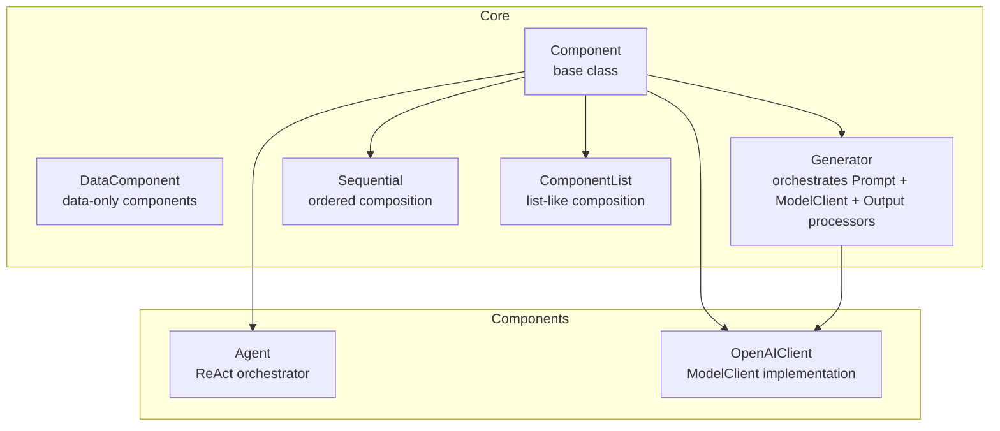
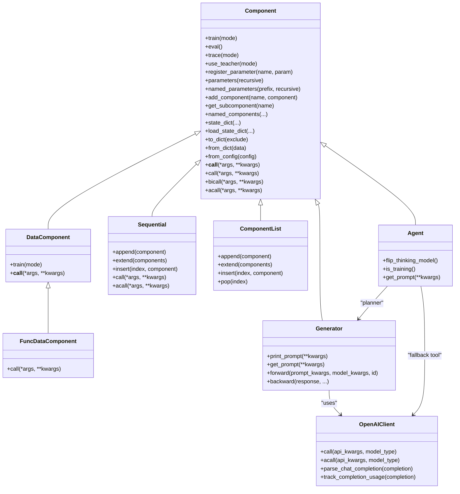
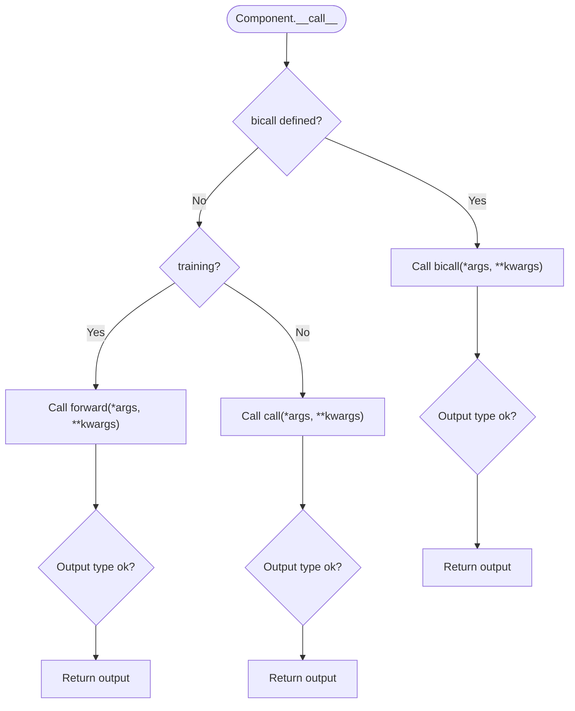
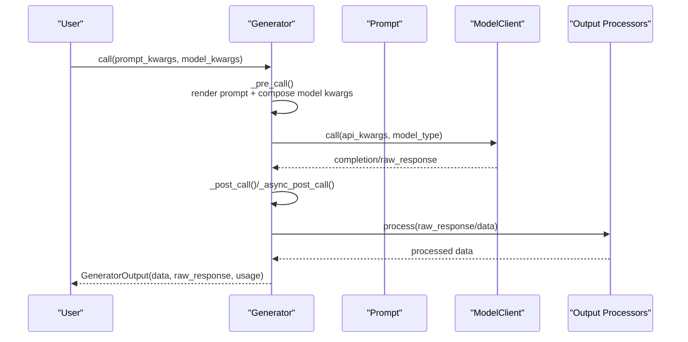
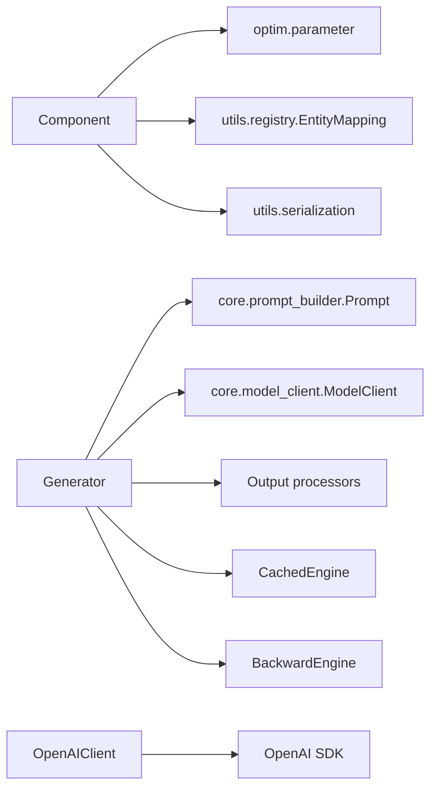

# Components System

<cite>
**Referenced Files in This Document**
- [component.py](file://adalflow/adalflow/core/component.py)
- [container.py](file://adalflow/adalflow/core/container.py)
- [__init__.py](file://adalflow/adalflow/core/__init__.py)
- [generator.py](file://adalflow/adalflow/core/generator.py)
- [openai_client.py](file://adalflow/adalflow/components/model_client/openai_client.py)
- [agent.py](file://adalflow/adalflow/components/agent/agent.py)
- [component.py (tutorial)](file://tutorials/component.py)
- [test_component.py](file://adalflow/tests/test_component.py)
</cite>

## Table of Contents
1. [Introduction](#introduction)
2. [Project Structure](#project-structure)
3. [Core Components](#core-components)
4. [Architecture Overview](#architecture-overview)
5. [Detailed Component Analysis](#detailed-component-analysis)
6. [Dependency Analysis](#dependency-analysis)
7. [Performance Considerations](#performance-considerations)
8. [Troubleshooting Guide](#troubleshooting-guide)
9. [Conclusion](#conclusion)
10. [Appendices](#appendices)

## Introduction
This document explains AdalFlow’s component-based architecture and composition patterns. It focuses on the Component base class, hierarchical composition, parameter tracking, state management, instantiation and configuration, integration with the broader framework, lifecycle and memory management, performance considerations, and guidelines for designing and extending custom components. Practical examples demonstrate component creation, composition, and parameter optimization, and the document concludes with troubleshooting and best practices.

## Project Structure
AdalFlow organizes its core component abstractions under the core module, while higher-level components (Generators, Agents, Model Clients) live in dedicated subpackages. Containers enable sequential and list-like composition of components.

**Diagram sources**
- [component.py](file://adalflow/adalflow/core/component.py#L51-L1200)
- [container.py](file://adalflow/adalflow/core/container.py#L62-L537)
- [generator.py](file://adalflow/adalflow/core/generator.py#L82-L210)
- [openai_client.py](file://adalflow/adalflow/components/model_client/openai_client.py#L411-L1256)
- [agent.py](file://adalflow/adalflow/components/agent/agent.py#L216-L387)

**Section sources**
- [component.py](file://adalflow/adalflow/core/component.py#L51-L1200)
- [container.py](file://adalflow/adalflow/core/container.py#L62-L537)
- [__init__.py](file://adalflow/adalflow/core/__init__.py#L1-L134)

## Core Components
- Component: Base class for all pipeline building blocks. Supports hierarchical composition, parameter registration, training/evaluation modes, tracing, serialization/deserialization, and recursive traversal of subcomponents and parameters.
- DataComponent: Specialization for data-processing components (e.g., Prompt, Parser, TextSplitter) that are not trainable and process parameters as input without returning parameters.
- FuncDataComponent and func_to_data_component: Utilities to wrap functions as DataComponent instances for quick composition.
- Container components:
  - Sequential: Ordered composition where outputs of one component become the input of the next.
  - ComponentList: List-like storage of components with indexing and iteration.

Key capabilities:
- Hierarchical composition via add_component/register_component and named_components traversal.
- Parameter tracking via register_parameter and parameters/named_parameters iterators.
- State management via to_dict/from_dict and state_dict/load_state_dict.
- Mode toggles: train/eval, trace/use_teacher.
- Attribute resolution: __getattr__/__setattr__ routes parameters and subcomponents transparently.

**Section sources**
- [component.py](file://adalflow/adalflow/core/component.py#L51-L1200)
- [container.py](file://adalflow/adalflow/core/container.py#L62-L537)

## Architecture Overview
The framework’s architecture centers around Component as the foundation. Generators orchestrate Prompt, ModelClient, and Output processors. Agents coordinate planning and tool execution. Containers provide flexible composition patterns. Serialization and registry enable configuration-driven instantiation and persistence.

**Diagram sources**
- [component.py](file://adalflow/adalflow/core/component.py#L51-L1200)
- [container.py](file://adalflow/adalflow/core/container.py#L62-L537)
- [generator.py](file://adalflow/adalflow/core/generator.py#L82-L800)
- [openai_client.py](file://adalflow/adalflow/components/model_client/openai_client.py#L411-L1256)
- [agent.py](file://adalflow/adalflow/components/agent/agent.py#L216-L387)

## Detailed Component Analysis

### Component Base Class
- Composition: Subcomponents are stored in an ordered dictionary and can be added via add_component/register_component. They are traversed recursively by named_components and children.
- Parameters: Parameters are tracked via register_parameter and exposed through parameters/named_parameters. __setattr__ routes assignment of Parameter and Component instances to the appropriate internal structures.
- Modes: train/eval toggle training flag recursively; trace/use_teacher toggle tracing and teacher mode flags recursively.
- Serialization: to_dict/from_dict persist the component type, attributes, subcomponents, and parameters. Special handling for unserializable objects via pickling and ordered dicts.
- Call dispatch: __call__ delegates to bicall if present, otherwise to forward (training) or call (inference). acall is async-friendly and can be overridden.

**Diagram sources**
- [component.py](file://adalflow/adalflow/core/component.py#L475-L551)

**Section sources**
- [component.py](file://adalflow/adalflow/core/component.py#L51-L1200)

### DataComponent and Function Wrapping
- DataComponent: Disables training and simplifies call semantics for data-processing units.
- FuncDataComponent: Wraps a callable into a component and registers it in the entity mapping for lookup.
- func_to_data_component: Dynamically creates a class name from the function name and returns an instance.

Practical usage: Wrap pure functions as components for quick integration into pipelines.

**Section sources**
- [component.py](file://adalflow/adalflow/core/component.py#L961-L1046)

### Container Components: Sequential and ComponentList
- Sequential: Chains outputs to inputs, supports slicing, indexing, addition, and async acall for streaming scenarios.
- ComponentList: List-like storage with insertion, popping, and concatenation; preserves indices as string keys.

Usage patterns:
- Build data pipelines with Sequential.
- Group heterogeneous components with ComponentList.

**Section sources**
- [container.py](file://adalflow/adalflow/core/container.py#L62-L537)

### Generator: Orchestrator and Trainer
- Responsibilities: Compose Prompt, ModelClient, and Output processors; manage caching; expose forward/backward for training; integrate tracing and demo collection.
- Parameter integration: Promotes prompt kwargs to Parameters, sets peer relations, and attaches gradient functions for backpropagation.
- Caching: Uses CachedEngine to cache non-streaming responses by serializing api_kwargs.
- Async/streaming: Supports async acall and async generator output processing for streaming responses.

**Diagram sources**
- [generator.py](file://adalflow/adalflow/core/generator.py#L463-L544)
- [openai_client.py](file://adalflow/adalflow/components/model_client/openai_client.py#L1008-L1118)

**Section sources**
- [generator.py](file://adalflow/adalflow/core/generator.py#L82-L800)
- [openai_client.py](file://adalflow/adalflow/components/model_client/openai_client.py#L411-L1256)

### Agent: ReAct Orchestrator
- Composes a ToolManager and a Generator-based planner.
- Provides helpers to create default tool manager and planner with configurable templates, roles, and caching.
- Supports toggling thinking model and rebuilding planner accordingly.

Integration patterns:
- Pass custom tools and context variables to ToolManager.
- Configure model_client, model_kwargs, and template for the planner.

**Section sources**
- [agent.py](file://adalflow/adalflow/components/agent/agent.py#L59-L387)

### Practical Examples

#### Creating and Composing Components
- Define a custom component by subclassing Component and implementing call.
- Compose a Generator with a ModelClient and prompt template.
- Serialize and reconstruct components via to_dict/from_dict.

References:
- [component.py (tutorial)](file://tutorials/component.py#L7-L77)

**Section sources**
- [component.py (tutorial)](file://tutorials/component.py#L7-L77)

#### Parameter Tracking and Optimization
- Register parameters via register_parameter or assign Parameter attributes.
- Traverse parameters with parameters/named_parameters.
- Use Generator.forward to create OutputParameter and attach gradient functions for optimization.

References:
- [test_component.py](file://adalflow/tests/test_component.py#L12-L98)
- [generator.py](file://adalflow/adalflow/core/generator.py#L621-L773)

**Section sources**
- [test_component.py](file://adalflow/tests/test_component.py#L12-L98)
- [generator.py](file://adalflow/adalflow/core/generator.py#L621-L773)

## Dependency Analysis
- Component depends on:
  - Optim parameter types for parameter registration and gradient contexts.
  - Registry for entity mapping and component reconstruction.
  - Serialization utilities for to_dict/from_dict.
- Generator depends on:
  - Prompt for templating.
  - ModelClient for API calls and response parsing.
  - Output processors for post-processing.
  - CachedEngine for caching.
  - BackwardEngine for gradient computation.
- ModelClient implementations (e.g., OpenAIClient) depend on external SDKs and parse responses into standardized output structures.

**Diagram sources**
- [component.py](file://adalflow/adalflow/core/component.py#L25-L31)
- [generator.py](file://adalflow/adalflow/core/generator.py#L19-L56)
- [openai_client.py](file://adalflow/adalflow/components/model_client/openai_client.py#L25-L64)

**Section sources**
- [component.py](file://adalflow/adalflow/core/component.py#L25-L31)
- [generator.py](file://adalflow/adalflow/core/generator.py#L19-L56)
- [openai_client.py](file://adalflow/adalflow/components/model_client/openai_client.py#L25-L64)

## Performance Considerations
- Caching: Generator caches non-streaming responses keyed by serialized api_kwargs to reduce latency and cost.
- Streaming: Async acall and async generator output processing minimize blocking and improve throughput for streaming scenarios.
- Serialization overhead: to_dict/from_dict and pickle fallbacks can be expensive; avoid frequent serialization in tight loops.
- Parameter deduplication: named_parameters supports remove_duplicate to avoid redundant traversal.
- Container composition: Sequential and ComponentList provide efficient iteration and indexing; prefer ComponentList for uniform collections.

[No sources needed since this section provides general guidance]

## Troubleshooting Guide
Common issues and resolutions:
- Missing super().__init__() in subclasses: Assigning subcomponents or parameters before initialization raises an AttributeError. Ensure Component.__init__() is called first.
- Incorrect output types in training/inference: __call__ validates that training mode expects Parameter outputs and inference mode expects non-Parameter outputs. Implement bicall or forward/call consistently.
- Unserializable objects: Components with non-serializable attributes fall back to pickle; ensure only necessary state is persisted.
- Parameter naming: Names cannot contain “.” or be empty; registering invalid names raises errors.
- Container indexing: Sequential and ComponentList maintain string indices; use proper slicing and insertion APIs.

**Section sources**
- [test_component.py](file://adalflow/tests/test_component.py#L12-L98)
- [component.py](file://adalflow/adalflow/core/component.py#L359-L551)

## Conclusion
AdalFlow’s Components System provides a robust, extensible foundation for building LLM pipelines. The Component base class enables hierarchical composition, parameter tracking, and state persistence. Containers offer flexible composition patterns. Generators orchestrate prompts, model clients, and output processors with training and caching support. Agents integrate planning and tool execution. Following the guidelines and best practices outlined here ensures reliable, maintainable, and performant component designs.

[No sources needed since this section summarizes without analyzing specific files]

## Appendices

### Component Lifecycle and Memory Management
- Initialization: Call super().__init__() to initialize internal structures for parameters and subcomponents.
- Composition: Use add_component/register_component to attach subcomponents; retrieve via get_subcomponent/named_components.
- State: Persist via to_dict/from_dict; load via from_dict/from_config; update parameters via load_state_dict.
- Cleanup: __delattr__ removes entries from internal dicts; avoid dangling references to deleted components.

**Section sources**
- [component.py](file://adalflow/adalflow/core/component.py#L565-L906)
- [container.py](file://adalflow/adalflow/core/container.py#L175-L537)

### Guidelines for Designing Custom Components
- Inherit from Component and implement call (or bicall) for inference; implement forward for training if needed.
- Register parameters with meaningful names; leverage peers for inter-parameter relationships.
- Keep subcomponents private attributes and expose via named_components for introspection.
- Provide from_config for declarative construction from configuration dictionaries.
- Implement to_dict/exclude for controlled serialization; avoid storing large or non-serializable state.

**Section sources**
- [component.py](file://adalflow/adalflow/core/component.py#L294-L351)
- [generator.py](file://adalflow/adalflow/core/generator.py#L306-L326)