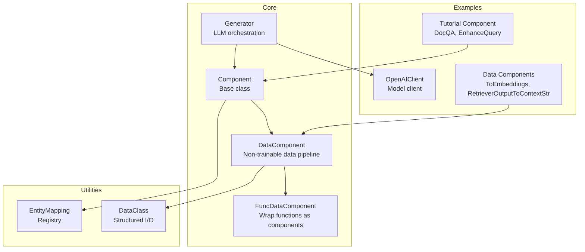
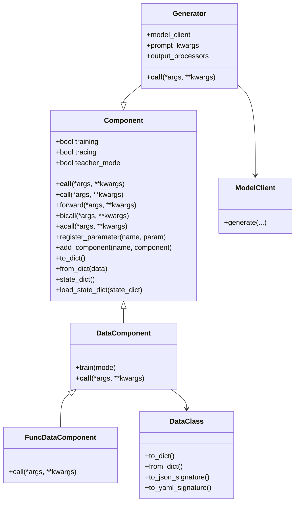
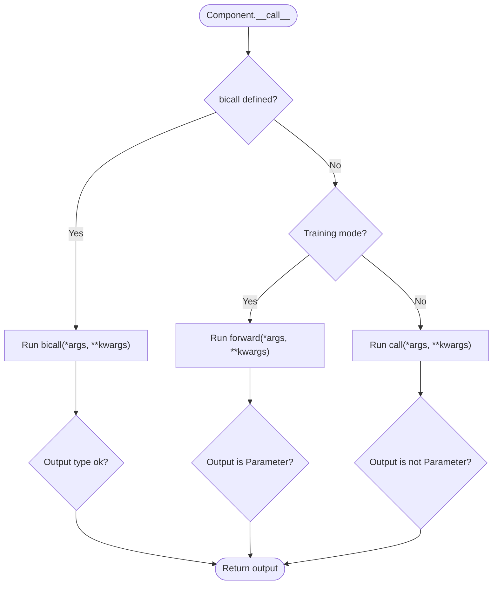
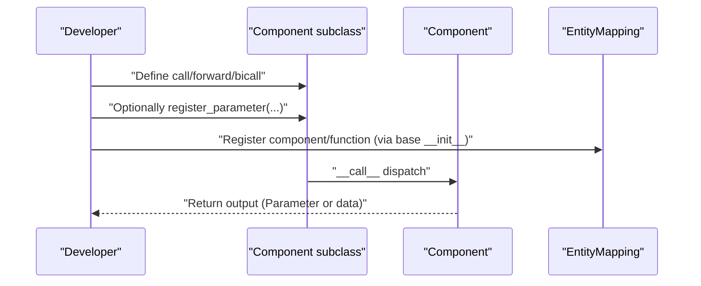
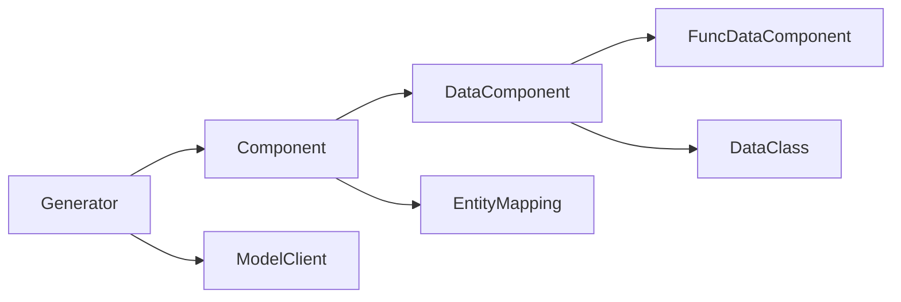

# Custom Component Development

<cite>
**Referenced Files in This Document**
- [component.py](file://adalflow/adalflow/core/component.py)
- [base_data_class.py](file://adalflow/adalflow/core/base_data_class.py)
- [registry.py](file://adalflow/adalflow/utils/registry.py)
- [generator.py](file://adalflow/adalflow/core/generator.py)
- [openai_client.py](file://adalflow/adalflow/components/model_client/openai_client.py)
- [data_components.py](file://adalflow/adalflow/components/data_process/data_components.py)
- [component.py (tutorial)](file://tutorials/component.py)
- [test_component.py](file://adalflow/tests/test_component.py)
</cite>

## Table of Contents
1. [Introduction](#introduction)
2. [Project Structure](#project-structure)
3. [Core Components](#core-components)
4. [Architecture Overview](#architecture-overview)
5. [Detailed Component Analysis](#detailed-component-analysis)
6. [Dependency Analysis](#dependency-analysis)
7. [Performance Considerations](#performance-considerations)
8. [Troubleshooting Guide](#troubleshooting-guide)
9. [Conclusion](#conclusion)
10. [Appendices](#appendices)

## Introduction
This guide explains how to develop custom components in AdalFlow. It covers the component development workflow, subclassing patterns, lifecycle hooks, required and optional methods, parameter handling, composition, testing, debugging, performance optimization, and best practices. It also provides templates and reusable patterns for common component types.

## Project Structure
AdalFlow organizes component development around a core base class that supports hierarchical composition, parameter registration, serialization, and training/tracing modes. Supporting utilities include a registry for dynamic resolution, a data class abstraction for structured I/O, and example components for generators and data transformations.

**Diagram sources**
- [component.py](file://adalflow/adalflow/core/component.py#L51-L120)
- [generator.py](file://adalflow/adalflow/core/generator.py#L82-L200)
- [openai_client.py](file://adalflow/adalflow/components/model_client/openai_client.py#L1-L120)
- [data_components.py](file://adalflow/adalflow/components/data_process/data_components.py#L74-L132)
- [base_data_class.py](file://adalflow/adalflow/core/base_data_class.py#L97-L190)
- [registry.py](file://adalflow/adalflow/utils/registry.py#L4-L22)
- [component.py (tutorial)](file://tutorials/component.py#L7-L30)

**Section sources**
- [component.py](file://adalflow/adalflow/core/component.py#L51-L120)
- [generator.py](file://adalflow/adalflow/core/generator.py#L82-L200)
- [openai_client.py](file://adalflow/adalflow/components/model_client/openai_client.py#L1-L120)
- [data_components.py](file://adalflow/adalflow/components/data_process/data_components.py#L74-L132)
- [base_data_class.py](file://adalflow/adalflow/core/base_data_class.py#L97-L190)
- [registry.py](file://adalflow/adalflow/utils/registry.py#L4-L22)
- [component.py (tutorial)](file://tutorials/component.py#L7-L30)

## Core Components
- Component: Base class for all pipeline components. Provides training/tracing modes, parameter registration, component composition, serialization (to/from dict), and lifecycle hooks (__call__, call, forward, bicall, acall).
- DataComponent: Specialization for non-trainable data processing (e.g., prompts, parsers, splitters).
- FuncDataComponent: Wraps a callable into a DataComponent for quick functional composition.
- Generator: Orchestrates Prompt, ModelClient, and output processors for LLM generation with caching and tracing support.
- DataClass: Structured I/O abstraction enabling schema/signature/example generation and robust serialization.

Key capabilities:
- Hierarchical composition via add_component/register_component and traversal via named_components/children.
- Parameter-aware call semantics: training vs inference outputs differ in type.
- Serialization with fallbacks for non-serializable objects.
- Registry-driven resolution for components/functions.

**Section sources**
- [component.py](file://adalflow/adalflow/core/component.py#L51-L120)
- [component.py](file://adalflow/adalflow/core/component.py#L475-L564)
- [component.py](file://adalflow/adalflow/core/component.py#L961-L1046)
- [generator.py](file://adalflow/adalflow/core/generator.py#L82-L200)
- [base_data_class.py](file://adalflow/adalflow/core/base_data_class.py#L97-L190)

## Architecture Overview
The component system centers on Component with specialized subclasses. Generators orchestrate model clients and output processors. DataComponents encapsulate pure data transformations. The registry enables dynamic resolution of components and functions.

**Diagram sources**
- [component.py](file://adalflow/adalflow/core/component.py#L51-L120)
- [component.py](file://adalflow/adalflow/core/component.py#L961-L1046)
- [generator.py](file://adalflow/adalflow/core/generator.py#L82-L200)
- [openai_client.py](file://adalflow/adalflow/components/model_client/openai_client.py#L1-L120)
- [base_data_class.py](file://adalflow/adalflow/core/base_data_class.py#L97-L190)

## Detailed Component Analysis

### Component Lifecycle and Hooks
- Modes:
  - train(mode): toggles training mode; in training, outputs must be Parameter instances.
  - trace(mode): enables tracing for evaluation and backpropagation signals.
  - use_teacher(mode): switches between student and teacher traces.
- Call dispatch:
  - __call__ prioritizes bicall if present; otherwise delegates to forward (training) or call (inference).
  - call and forward must be implemented by subclasses (or bicall).
  - acall is async-friendly and can be extended for I/O-bound tasks.
- Parameters:
  - register_parameter(name, param) registers trainable/non-trainable parameters.
  - parameters()/named_parameters() traverse recursively.
- Composition:
  - add_component(name, component) nests subcomponents.
  - named_components()/children() iterate over the hierarchy.
- Serialization:
  - to_dict/from_dict persist component state and nested components.
  - state_dict/load_state_dict manage parameter-only state.

**Diagram sources**
- [component.py](file://adalflow/adalflow/core/component.py#L511-L564)
- [component.py](file://adalflow/adalflow/core/component.py#L475-L509)

**Section sources**
- [component.py](file://adalflow/adalflow/core/component.py#L145-L176)
- [component.py](file://adalflow/adalflow/core/component.py#L475-L564)
- [component.py](file://adalflow/adalflow/core/component.py#L359-L474)

### Subclassing Patterns
- Minimal inference-only component:
  - Subclass Component.
  - Override call to accept typed inputs and return typed outputs.
  - Optionally override __repr__/_extra_repr for pretty printing.
- Trainable component:
  - Subclass Component.
  - Override forward for training (return Parameter).
  - Optionally override call for inference.
  - Register parameters with register_parameter.
- Data processing component:
  - Subclass DataComponent for non-trainable transformations.
  - Implement __call__ to transform inputs to outputs.
- Functional wrapper:
  - Use FuncDataComponent or func_to_data_component to wrap lambdas/functions.

**Diagram sources**
- [component.py](file://adalflow/adalflow/core/component.py#L129-L144)
- [component.py](file://adalflow/adalflow/core/component.py#L511-L564)
- [registry.py](file://adalflow/adalflow/utils/registry.py#L11-L17)

**Section sources**
- [component.py](file://adalflow/adalflow/core/component.py#L961-L1046)
- [component.py (tutorial)](file://tutorials/component.py#L7-L30)

### Required Methods and Optional Overrides
- Required:
  - call for inference-only components.
  - forward for training-only components.
  - Or implement bicall to unify both.
- Optional:
  - acall for async I/O.
  - __repr__/_extra_repr for readable prints.
  - to_dict/from_dict/state_dict/load_state_dict for persistence.

Validation behavior:
- In training mode, outputs must be Parameter.
- In inference mode, outputs must not be Parameter.

**Section sources**
- [component.py](file://adalflow/adalflow/core/component.py#L475-L564)

### Step-by-Step: Creating a Custom Component
- Choose a base:
  - Component for general-purpose components.
  - DataComponent for data transformations.
  - Generator for LLM orchestration.
- Implement call/forward/bicall according to mode.
- Register parameters if applicable.
- Compose subcomponents via add_component.
- Add pretty-printing via _extra_repr/__repr__.
- Persist state via to_dict/from_dict.

Example references:
- Tutorial component classes: EnhanceQuery and DocQA demonstrate minimal call-based components and composition with a Generator.
- Data components: ToEmbeddings and RetrieverOutputToContextStr show DataComponent usage for transformations.

**Section sources**
- [component.py (tutorial)](file://tutorials/component.py#L7-L30)
- [data_components.py](file://adalflow/adalflow/components/data_process/data_components.py#L74-L132)

### Integrating with the Component System
- Registration:
  - Component.__init__ registers the class by name in EntityMapping.
  - Functions can be registered via func_to_data_component.
- Configuration:
  - from_config resolves nested components from config dicts using new_component.
- Composition:
  - Use add_component/register_component to nest components.
  - Traverse with named_components/children for introspection and testing.

**Section sources**
- [component.py](file://adalflow/adalflow/core/component.py#L129-L144)
- [component.py](file://adalflow/adalflow/core/component.py#L307-L316)
- [registry.py](file://adalflow/adalflow/utils/registry.py#L11-L17)

### Component Testing Strategies
- Unit tests:
  - Verify parameter registration and traversal (named_parameters/parameters).
  - Verify component composition (register_component/get_subcomponent/named_components).
  - Validate mode transitions (train/eval, trace/use_teacher).
- Behavior tests:
  - Ensure __call__ dispatches to call/forward/bicall appropriately.
  - Assert output types match mode expectations (Parameter vs data).
- Tutorial-style tests:
  - Round-trip serialization with to_dict/from_dict.
  - Equality assertions on serialized states.

References:
- Tests for component composition and parameter traversal.
- Tutorial demonstrating serialization round-trips.

**Section sources**
- [test_component.py](file://adalflow/tests/test_component.py#L43-L98)
- [component.py (tutorial)](file://tutorials/component.py#L36-L48)

### Debugging Techniques
- Logging:
  - Component logs during restoration and serialization failures.
- Inspect state:
  - Use to_dict and state_dict to dump component internals.
  - Use named_components/children to verify composition.
- Mode diagnostics:
  - Toggle train/eval and trace/use_teacher to observe behavior differences.
- Registry checks:
  - Confirm registrations via EntityMapping.get_all.

**Section sources**
- [component.py](file://adalflow/adalflow/core/component.py#L332-L346)
- [registry.py](file://adalflow/adalflow/utils/registry.py#L19-L22)

### Performance Optimization
- Caching:
  - Generator integrates CachedEngine for repeated calls.
- Batch processing:
  - Data components like ToEmbeddings use BatchEmbedder to reduce overhead.
- Streaming:
  - Model clients support streaming; avoid post-processing until completion when using streaming.
- Serialization:
  - Prefer state_dict for parameter-only snapshots; use to_dict for full state when needed.

**Section sources**
- [generator.py](file://adalflow/adalflow/core/generator.py#L111-L194)
- [data_components.py](file://adalflow/adalflow/components/data_process/data_components.py#L74-L106)
- [openai_client.py](file://adalflow/adalflow/components/model_client/openai_client.py#L1-L120)

### Component Composition Patterns
- Hierarchical nesting:
  - Compose components inside __init__ and register via add_component.
- Chaining:
  - Combine multiple DataComponents using sequential composition patterns (see tutorials).
- Parameter propagation:
  - Parameters attached to subcomponents participate in gradient computation when using GradComponent-based components.

**Section sources**
- [component.py (tutorial)](file://tutorials/component.py#L19-L30)
- [generator.py](file://adalflow/adalflow/core/generator.py#L82-L200)

### Error Handling
- Type validation:
  - __call__ enforces output types per mode.
  - register_parameter validates Parameter assignment.
- Restoration:
  - from_dict/_restore_value falls back gracefully for unknown classes or unpickleable objects.
- Missing super().__init__:
  - Attribute errors when assigning parameters/components before initialization.

**Section sources**
- [component.py](file://adalflow/adalflow/core/component.py#L511-L564)
- [component.py](file://adalflow/adalflow/core/component.py#L359-L474)
- [test_component.py](file://adalflow/tests/test_component.py#L44-L48)

### Best Practices
- Always call super().__init__() in custom components.
- Use DataComponent for pure transformations; use Component for trainable logic.
- Keep call signatures explicit and documented.
- Prefer structured I/O via DataClass for prompts and outputs.
- Use register_parameter for trainable knobs; avoid mutating state outside parameters.
- Provide meaningful __repr__/_extra_repr for readability and debugging.

**Section sources**
- [component.py](file://adalflow/adalflow/core/component.py#L846-L898)
- [base_data_class.py](file://adalflow/adalflow/core/base_data_class.py#L97-L190)

### Templates and Boilerplate
- Minimal inference-only component:
  - Subclass Component, implement call, optionally override __repr__.
- Trainable component:
  - Implement forward (return Parameter), optionally call; register parameters.
- Data transformation:
  - Subclass DataComponent, implement __call__; optionally override _extra_repr.
- Functional wrapper:
  - Use func_to_data_component to wrap a function.

References:
- Tutorial components EnhanceQuery and DocQA.
- Data components ToEmbeddings and RetrieverOutputToContextStr.

**Section sources**
- [component.py (tutorial)](file://tutorials/component.py#L7-L30)
- [data_components.py](file://adalflow/adalflow/components/data_process/data_components.py#L74-L132)
- [component.py](file://adalflow/adalflow/core/component.py#L1009-L1046)

## Dependency Analysis
Component relationships emphasize composition and specialization. Generators depend on ModelClients and DataComponents. DataComponents rely on DataClass for structured I/O. The registry centralizes resolution.

**Diagram sources**
- [component.py](file://adalflow/adalflow/core/component.py#L51-L120)
- [generator.py](file://adalflow/adalflow/core/generator.py#L82-L200)
- [openai_client.py](file://adalflow/adalflow/components/model_client/openai_client.py#L1-L120)
- [data_components.py](file://adalflow/adalflow/components/data_process/data_components.py#L74-L132)
- [base_data_class.py](file://adalflow/adalflow/core/base_data_class.py#L97-L190)
- [registry.py](file://adalflow/adalflow/utils/registry.py#L4-L22)

**Section sources**
- [component.py](file://adalflow/adalflow/core/component.py#L51-L120)
- [generator.py](file://adalflow/adalflow/core/generator.py#L82-L200)
- [openai_client.py](file://adalflow/adalflow/components/model_client/openai_client.py#L1-L120)
- [data_components.py](file://adalflow/adalflow/components/data_process/data_components.py#L74-L132)
- [base_data_class.py](file://adalflow/adalflow/core/base_data_class.py#L97-L190)
- [registry.py](file://adalflow/adalflow/utils/registry.py#L4-L22)

## Performance Considerations
- Prefer batched operations for embeddings and retrievals.
- Enable caching for repeated LLM calls.
- Avoid heavy computations in __call__; delegate to DataComponents.
- Use streaming only when post-processing can handle incremental data.

[No sources needed since this section provides general guidance]

## Troubleshooting Guide
Common issues and resolutions:
- Missing super().__init__ leads to attribute errors when setting parameters/components.
- Incorrect output types in training/inference cause validation errors in __call__.
- Unknown classes during restoration fall back to defaults; check EntityMapping registrations.
- Serialization failures: inspect to_dict/_process_value and fallback mechanisms.

**Section sources**
- [test_component.py](file://adalflow/tests/test_component.py#L44-L48)
- [component.py](file://adalflow/adalflow/core/component.py#L511-L564)
- [component.py](file://adalflow/adalflow/core/component.py#L332-L346)

## Conclusion
AdalFlow’s component system provides a flexible, serializable, and composable foundation for building LLM pipelines. By following the subclassing patterns, lifecycle hooks, and best practices outlined here, developers can create robust, testable, and reusable components that integrate seamlessly with Generators, ModelClients, and DataComponents.

[No sources needed since this section summarizes without analyzing specific files]

## Appendices

### Appendix A: Quick Reference Checklist
- Call __init__ and call super().__init__() first.
- Implement call/forward/bicall consistently with mode.
- Register parameters with register_parameter.
- Compose subcomponents via add_component.
- Provide __repr__/_extra_repr for clarity.
- Persist state via to_dict/from_dict/state_dict/load_state_dict.
- Test composition, parameters, and mode transitions.

**Section sources**
- [component.py](file://adalflow/adalflow/core/component.py#L511-L564)
- [component.py](file://adalflow/adalflow/core/component.py#L359-L474)
- [test_component.py](file://adalflow/tests/test_component.py#L43-L98)