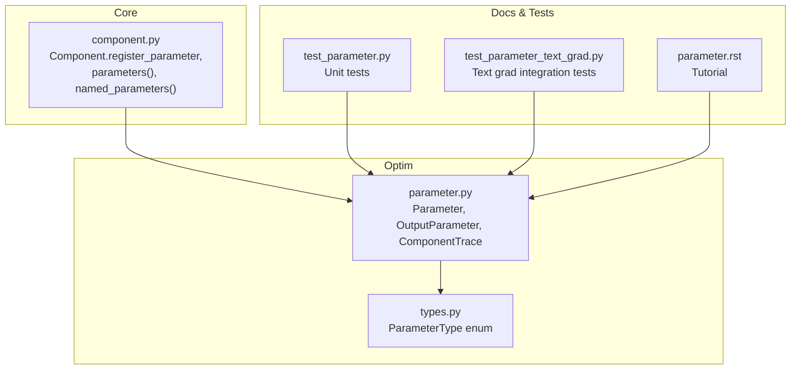
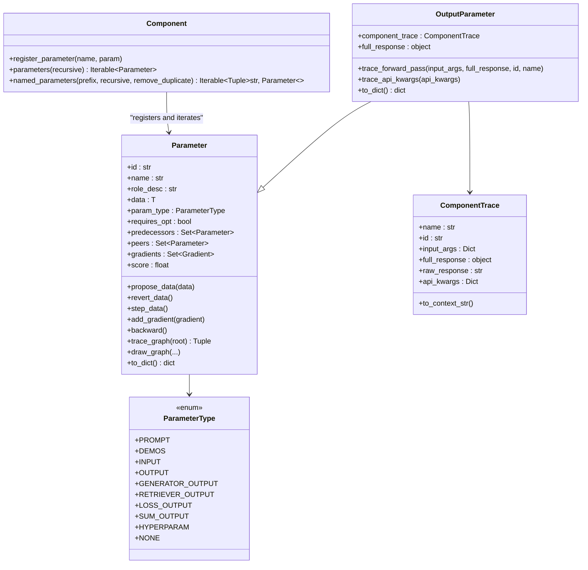
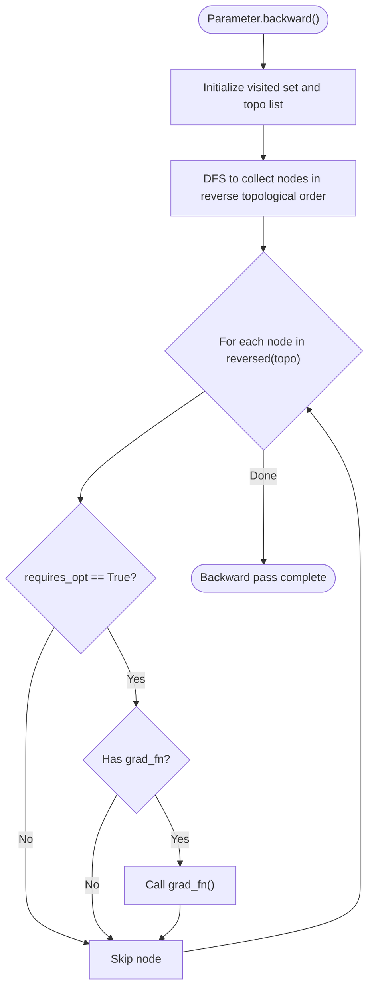
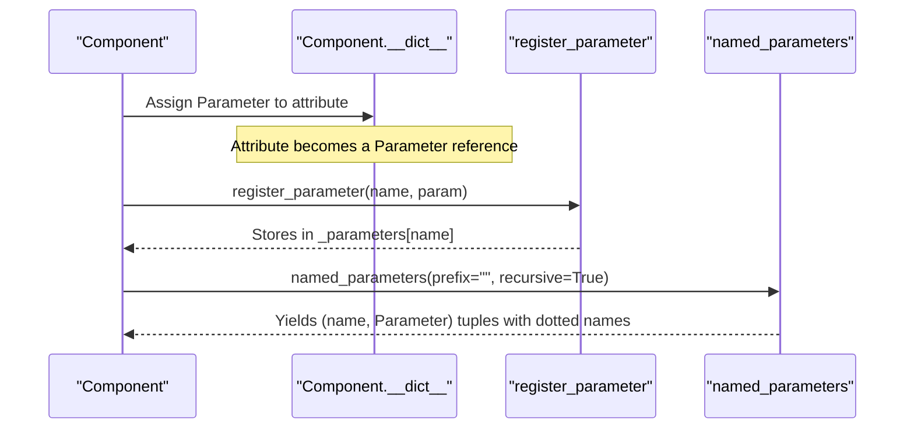
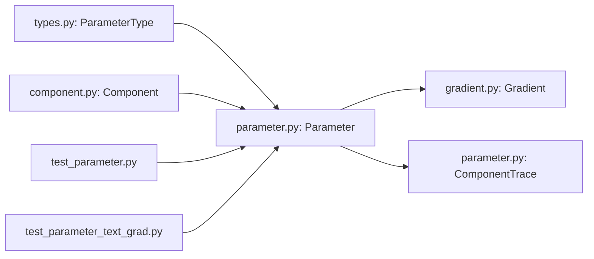

# Parameter Management

<cite>
**Referenced Files in This Document**
- [parameter.py](file://adalflow/adalflow/optim/parameter.py)
- [types.py](file://adalflow/adalflow/optim/types.py)
- [component.py](file://adalflow/adalflow/core/component.py)
- [test_parameter.py](file://adalflow/tests/test_parameter.py)
- [parameter.rst](file://docs/source/tutorials/parameter.rst)
- [test_parameter_text_grad.py](file://adalflow/tests/test_parameter_text_grad.py)
</cite>

## Table of Contents
1. [Introduction](#introduction)
2. [Project Structure](#project-structure)
3. [Core Components](#core-components)
4. [Architecture Overview](#architecture-overview)
5. [Detailed Component Analysis](#detailed-component-analysis)
6. [Dependency Analysis](#dependency-analysis)
7. [Performance Considerations](#performance-considerations)
8. [Troubleshooting Guide](#troubleshooting-guide)
9. [Conclusion](#conclusion)
10. [Appendices](#appendices)

## Introduction
This document explains AdalFlow’s Parameter Management system with a focus on how parameters are modeled, registered, discovered via the component hierarchy, and optimized. It covers parameter types, naming and addressing conventions, iteration patterns, gradient computation linkage, serialization, state management, validation, duplicate detection, lifecycle, and practical workflows. It also provides troubleshooting guidance and optimization best practices grounded in the repository’s implementation.

## Project Structure
Parameter management spans three primary areas:
- Parameter modeling and optimization orchestration
- Parameter types and categorization
- Component integration for registration and discovery

**Diagram sources**
- [parameter.py](file://adalflow/adalflow/optim/parameter.py#L119-L1712)
- [types.py](file://adalflow/adalflow/optim/types.py#L13-L67)
- [component.py](file://adalflow/adalflow/core/component.py#L359-L474)
- [parameter.rst](file://docs/source/tutorials/parameter.rst#L1-L94)
- [test_parameter.py](file://adalflow/tests/test_parameter.py#L1-L90)
- [test_parameter_text_grad.py](file://adalflow/tests/test_parameter_text_grad.py#L1-L75)

**Section sources**
- [parameter.py](file://adalflow/adalflow/optim/parameter.py#L119-L1712)
- [types.py](file://adalflow/adalflow/optim/types.py#L13-L67)
- [component.py](file://adalflow/adalflow/core/component.py#L359-L474)
- [parameter.rst](file://docs/source/tutorials/parameter.rst#L1-L94)
- [test_parameter.py](file://adalflow/tests/test_parameter.py#L1-L90)
- [test_parameter_text_grad.py](file://adalflow/tests/test_parameter_text_grad.py#L1-L75)

## Core Components
- Parameter: A generic container for optimization data with typed roles, gradient tracking, predecessor/successor relationships, and serialization hooks. It supports in-place updates, gradient aggregation, and graph traversal for backward propagation.
- OutputParameter: A specialized Parameter for component outputs, adding component trace metadata and structured forward pass recording.
- ParameterType: An enum defining trainable and non-trainable categories (e.g., PROMPT, DEMOS, INPUT, OUTPUT, GENERATOR_OUTPUT, RETRIEVER_OUTPUT, LOSS_OUTPUT, SUM_OUTPUT, HYPERPARAM, NONE).
- Component: Provides parameter registration and discovery via hierarchical attribute assignment and iteration APIs.

Key capabilities:
- Automatic parameter registration when a Parameter is assigned as a component attribute.
- Hierarchical parameter iteration using dotted names for nested components.
- Gradient accumulation and backpropagation across predecessors.
- Serialization and restoration of parameter state and traces.

**Section sources**
- [parameter.py](file://adalflow/adalflow/optim/parameter.py#L119-L750)
- [parameter.py](file://adalflow/adalflow/optim/parameter.py#L1585-L1684)
- [types.py](file://adalflow/adalflow/optim/types.py#L13-L67)
- [component.py](file://adalflow/adalflow/core/component.py#L359-L474)

## Architecture Overview
The Parameter system integrates with the component hierarchy to enable:
- Parameter creation and assignment within components
- Automatic inclusion in component parameter sets
- Iteration across parameters with hierarchical names
- Backward propagation leveraging predecessor edges
- Visualization and tracing of computation graphs

**Diagram sources**
- [parameter.py](file://adalflow/adalflow/optim/parameter.py#L119-L1712)
- [types.py](file://adalflow/adalflow/optim/types.py#L13-L67)
- [component.py](file://adalflow/adalflow/core/component.py#L359-L474)

## Detailed Component Analysis

### Parameter Class Design
- Purpose: Encapsulate optimization-relevant data with metadata, gradient tracking, and lifecycle controls.
- Core fields:
  - Identity: id, name, role_desc
  - Data: data (generic), data_id (dataset item), data_type
  - Type and optimization: param_type (ParameterType), requires_opt, default_trainable inferred from enum
  - Graph relations: predecessors (Set[Parameter]), peers (Set[Parameter])
  - Gradients: gradients (Set[Gradient])
  - Evaluation: eval_input, score, ground truth gt
  - Traces: _traces, _student_traces, tgd_optimizer_trace
  - Successor mapping: successor_map_fn
  - Prompt integration: data_in_prompt callable
- Methods:
  - Gradient management: add_gradient, reset_gradients, get_gradients_str, get_gradient_and_context_text, get_gradients_component_schema, sort_gradients
  - Lifecycle: propose_data, revert_data, step_data
  - Accessors: get_prompt_data, map_to_successor, add_successor_map_fn
  - Graph and visualization: trace_graph, draw_graph, draw_output_subgraph, draw_component_subgraph
  - Serialization: to_dict, from_dict
  - Backward propagation: backward (topological traversal and grad_fn invocation)

**Diagram sources**
- [parameter.py](file://adalflow/adalflow/optim/parameter.py#L711-L750)

**Section sources**
- [parameter.py](file://adalflow/adalflow/optim/parameter.py#L119-L750)
- [parameter.py](file://adalflow/adalflow/optim/parameter.py#L1456-L1496)

### OutputParameter
- Extends Parameter to capture component-level trace metadata.
- Adds component_trace (ComponentTrace) and full_response storage.
- Provides trace_forward_pass and trace_api_kwargs helpers to populate trace context.

**Section sources**
- [parameter.py](file://adalflow/adalflow/optim/parameter.py#L1585-L1684)

### Parameter Types (ParameterType)
- Defines trainable and non-trainable categories:
  - Trainable: PROMPT, DEMOS, OUTPUT, GENERATOR_OUTPUT, RETRIEVER_OUTPUT, LOSS_OUTPUT, SUM_OUTPUT
  - Non-trainable: INPUT, HYPERPARAM, NONE
- Includes description and default_trainable flag for each variant.

**Section sources**
- [types.py](file://adalflow/adalflow/optim/types.py#L13-L67)

### Component Parameter Registration and Discovery
- Registration:
  - register_parameter(name, param) stores a Parameter under a component attribute name.
  - Enforces constraints: name cannot contain ".", cannot be empty, and param must be Parameter or None.
- Iteration:
  - parameters(recursive) yields Parameters from this component and optionally subcomponents.
  - named_parameters(prefix, recursive, remove_duplicate) yields (name, Parameter) tuples with hierarchical dotted names.
- Integration with training/inference:
  - __call__ validates that training mode expects Parameter output and inference mode rejects Parameter output.

**Diagram sources**
- [component.py](file://adalflow/adalflow/core/component.py#L359-L474)

**Section sources**
- [component.py](file://adalflow/adalflow/core/component.py#L359-L474)

### Parameter Naming Conventions and Hierarchical Addressing
- Names are derived from role_desc or auto-generated if absent.
- Dotted names are formed by combining parent prefix with child attribute names.
- Duplicate removal ensures unique parameters are yielded during iteration.

**Section sources**
- [parameter.py](file://adalflow/adalflow/optim/parameter.py#L179-L254)
- [component.py](file://adalflow/adalflow/core/component.py#L448-L474)

### Parameter Iteration Patterns
- parameters(): returns plain Parameter iterators.
- named_parameters(): returns (name, Parameter) pairs for hierarchical addressing.
- Recursive traversal includes subcomponents; remove_duplicate avoids repeated references.

**Section sources**
- [component.py](file://adalflow/adalflow/core/component.py#L393-L474)

### Practical Examples

- Parameter registration and access:
  - Create a Parameter with role_desc and param_type.
  - Assign it as a component attribute; it is automatically registered.
  - Iterate with named_parameters to access hierarchical names and values.

- Parameter access patterns:
  - Use get_prompt_data to format data for prompts.
  - Use map_to_successor to adapt data for downstream components.

- Parameter optimization workflows:
  - Propose new data with propose_data, then step_data to commit or revert_data to undo.
  - Aggregate gradients with add_gradient and trigger backward to propagate feedback.

- Relationship to gradient computation:
  - Gradients are added with context and scores; get_gradient_and_context_text aggregates feedback.
  - backward traverses predecessors in topological order and invokes grad_fn.

- Serialization and state management:
  - to_dict captures parameter state, predecessors, gradients, traces, and demos.
  - from_dict reconstructs parameters and nested structures.

- Parameter validation and duplicate detection:
  - register_parameter enforces name rules and type checks.
  - named_parameters removes duplicates via a memo set.

- Parameter lifecycle management:
  - In-place update_value with type checking.
  - Graph traversal via trace_graph for resets and visualization.

**Section sources**
- [parameter.py](file://adalflow/adalflow/optim/parameter.py#L286-L393)
- [parameter.py](file://adalflow/adalflow/optim/parameter.py#L610-L645)
- [parameter.py](file://adalflow/adalflow/optim/parameter.py#L1456-L1496)
- [component.py](file://adalflow/adalflow/core/component.py#L359-L474)
- [test_parameter.py](file://adalflow/tests/test_parameter.py#L1-L90)
- [test_parameter_text_grad.py](file://adalflow/tests/test_parameter_text_grad.py#L1-L75)

## Dependency Analysis
- Parameter depends on:
  - ParameterType for categorization and trainable flags
  - Gradient for gradient accumulation and backpropagation
  - ComponentTrace for output tracing
- Component depends on Parameter for registration and iteration
- Tests validate initialization, update semantics, prompt formatting, and integration with text grad optimizer

**Diagram sources**
- [types.py](file://adalflow/adalflow/optim/types.py#L13-L67)
- [parameter.py](file://adalflow/adalflow/optim/parameter.py#L119-L1712)
- [component.py](file://adalflow/adalflow/core/component.py#L359-L474)
- [test_parameter.py](file://adalflow/tests/test_parameter.py#L1-L90)
- [test_parameter_text_grad.py](file://adalflow/tests/test_parameter_text_grad.py#L1-L75)

**Section sources**
- [types.py](file://adalflow/adalflow/optim/types.py#L13-L67)
- [parameter.py](file://adalflow/adalflow/optim/parameter.py#L119-L1712)
- [component.py](file://adalflow/adalflow/core/component.py#L359-L474)
- [test_parameter.py](file://adalflow/tests/test_parameter.py#L1-L90)
- [test_parameter_text_grad.py](file://adalflow/tests/test_parameter_text_grad.py#L1-L75)

## Performance Considerations
- Prefer lightweight data_in_prompt and get_short_value to reduce token usage during optimization.
- Limit gradient accumulation scope to necessary nodes to reduce backprop overhead.
- Use remove_duplicate in named_parameters to avoid redundant parameter references.
- Keep predecessors minimal to reduce backward traversal cost.

## Troubleshooting Guide
Common issues and resolutions:
- Parameter type mismatch on update_value:
  - Symptom: TypeError when updating parameter data with wrong type.
  - Resolution: Ensure new data matches the initial data type or allow reassignment to None.

- Invalid parameter name in register_parameter:
  - Symptom: ValueError for names containing "." or empty string.
  - Resolution: Use valid Python identifiers without "." and non-empty names.

- Attempting to propose/revert without prior proposal:
  - Symptom: ValueError when calling revert_data or step_data without propose_data.
  - Resolution: Always call propose_data before revert_data or step_data.

- Missing grad_fn during backward:
  - Symptom: No gradients propagated despite requires_opt=True.
  - Resolution: Ensure grad_fn is set on parameters intended for backpropagation.

- Duplicate parameter iteration:
  - Symptom: Repeated parameters in iteration.
  - Resolution: Use named_parameters with remove_duplicate enabled.

- Serialization errors:
  - Symptom: Pickling or to_dict failures.
  - Resolution: Ensure nested objects implement to_dict/from_dict or are serializable.

**Section sources**
- [parameter.py](file://adalflow/adalflow/optim/parameter.py#L649-L662)
- [component.py](file://adalflow/adalflow/core/component.py#L377-L392)
- [parameter.py](file://adalflow/adalflow/optim/parameter.py#L621-L645)
- [parameter.py](file://adalflow/adalflow/optim/parameter.py#L746-L748)
- [component.py](file://adalflow/adalflow/core/component.py#L440-L447)
- [parameter.py](file://adalflow/adalflow/optim/parameter.py#L1456-L1496)

## Conclusion
AdalFlow’s Parameter Management system provides a robust, extensible framework for modeling optimization data, registering parameters automatically via the component hierarchy, and orchestrating gradient-based backpropagation. With clear type definitions, hierarchical naming, iteration patterns, and comprehensive serialization hooks, it supports both research experimentation and production optimization workflows. Following the validation, lifecycle, and best practices outlined here will help ensure reliable and efficient parameter-driven pipelines.

## Appendices

### Parameter and Gradient Relationship
- Parameters accumulate Gradient objects with contextual metadata and scores.
- get_gradient_and_context_text aggregates gradients by data_id and component, enabling targeted feedback.
- backward triggers grad_fn on trainable nodes in topological order.

**Section sources**
- [parameter.py](file://adalflow/adalflow/optim/parameter.py#L321-L487)
- [parameter.py](file://adalflow/adalflow/optim/parameter.py#L711-L750)

### Parameter Serialization Reference
- to_dict captures identity, role, data, type, optimization flags, predecessors, gradients, traces, and demos.
- from_dict reconstructs parameters and nested structures preserving relationships.

**Section sources**
- [parameter.py](file://adalflow/adalflow/optim/parameter.py#L1456-L1496)