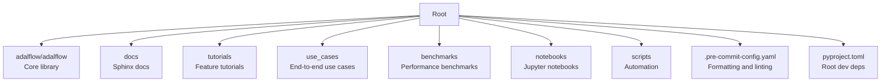
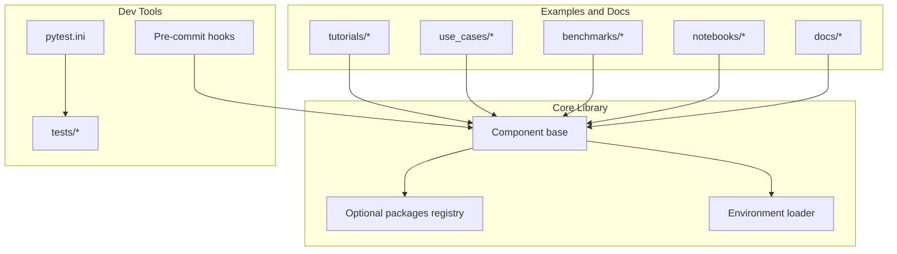
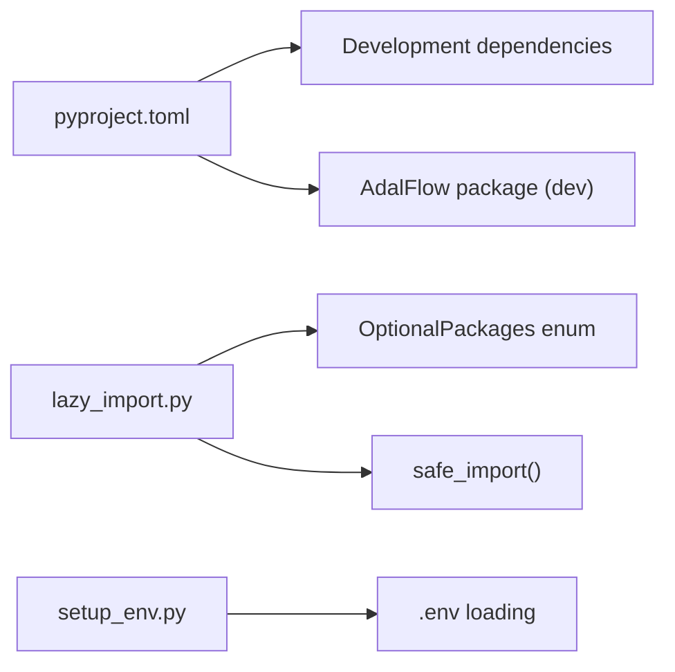

# Contributing and Development

<cite>
**Referenced Files in This Document**
- [README.md](file://README.md)
- [pyproject.toml](file://pyproject.toml)
- [.pre-commit-config.yaml](file://.pre-commit-config.yaml)
- [docs/source/contributor/contribute_to_code.rst](file://docs/source/contributor/contribute_to_code.rst)
- [docs/source/contributor/contribution.rst](file://docs/source/contributor/contribution.rst)
- [docs/README.md](file://docs/README.md)
- [adalflow/tests/README.md](file://adalflow/tests/README.md)
- [adalflow/pytest.ini](file://adalflow/pytest.ini)
- [adalflow/adalflow/__init__.py](file://adalflow/adalflow/__init__.py)
- [adalflow/adalflow/core/component.py](file://adalflow/adalflow/core/component.py)
- [adalflow/adalflow/utils/lazy_import.py](file://adalflow/adalflow/utils/lazy_import.py)
- [adalflow/adalflow/utils/setup_env.py](file://adalflow/adalflow/utils/setup_env.py)
- [scripts/release.md](file://scripts/release.md)
</cite>

## Table of Contents
1. [Introduction](#introduction)
2. [Project Structure](#project-structure)
3. [Core Components](#core-components)
4. [Architecture Overview](#architecture-overview)
5. [Detailed Component Analysis](#detailed-component-analysis)
6. [Dependency Analysis](#dependency-analysis)
7. [Performance Considerations](#performance-considerations)
8. [Troubleshooting Guide](#troubleshooting-guide)
9. [Conclusion](#conclusion)
10. [Appendices](#appendices)

## Introduction
This document explains how to contribute to AdalFlow and set up a development environment. It covers the development workflow, code standards, testing requirements, contribution guidelines, project structure, coding conventions, and review processes. It also connects contributions to project maintenance, including dependency management and continuous integration. The content is grounded in the repository’s actual files and aims to be accessible to newcomers while providing sufficient technical depth for experienced developers.

## Project Structure
AdalFlow is organized into several top-level areas:
- adalflow/adalflow: The core library source code, including components, core abstractions, optimizers, tracing, utilities, and tests.
- docs: Sphinx-based documentation with reStructuredText sources and build configuration.
- tutorials, use_cases, benchmarks: Example code and runnable notebooks demonstrating usage, real-world scenarios, and performance baselines.
- notebooks: Jupyter notebooks supporting tutorials, use cases, and benchmarks.
- scripts: Automation helpers for releases and packaging.
- Root configuration files: Poetry configuration, pre-commit hooks, environment setup, and CI/CD references.

**Section sources**
- [README.md](file://README.md#L350-L392)
- [docs/source/contributor/contribution.rst](file://docs/source/contributor/contribution.rst#L29-L67)

## Core Components
This section highlights the foundational elements that drive development and contributions.

- Library entry and exports
  - The package exposes core classes and utilities via the main package initializer, enabling consistent imports across the ecosystem.
  - See [adalflow/adalflow/__init__.py](file://adalflow/adalflow/__init__.py#L1-L154) for the public API surface.

- Component base class
  - The Component base class defines the core contract for building modular, serializable, and trainable pipelines. It supports training, tracing, and nested composition of subcomponents.
  - See [adalflow/adalflow/core/component.py](file://adalflow/adalflow/core/component.py#L51-L113) for the class definition and design rationale.

- Optional dependencies and lazy imports
  - Optional integrations (e.g., model SDKs, databases, ML libraries) are handled via a centralized lazy-import mechanism to keep startup lightweight and avoid hard dependencies.
  - See [adalflow/adalflow/utils/lazy_import.py](file://adalflow/adalflow/utils/lazy_import.py#L13-L112) for the enum of optional packages and [adalflow/adalflow/utils/lazy_import.py](file://adalflow/adalflow/utils/lazy_import.py#L174-L227) for the safe import utility.

- Environment setup
  - A helper loads environment variables from a .env file to simplify local development and testing.
  - See [adalflow/adalflow/utils/setup_env.py](file://adalflow/adalflow/utils/setup_env.py#L8-L19).

**Section sources**
- [adalflow/adalflow/__init__.py](file://adalflow/adalflow/__init__.py#L1-L154)
- [adalflow/adalflow/core/component.py](file://adalflow/adalflow/core/component.py#L51-L113)
- [adalflow/adalflow/utils/lazy_import.py](file://adalflow/adalflow/utils/lazy_import.py#L13-L112)
- [adalflow/adalflow/utils/lazy_import.py](file://adalflow/adalflow/utils/lazy_import.py#L174-L227)
- [adalflow/adalflow/utils/setup_env.py](file://adalflow/adalflow/utils/setup_env.py#L8-L19)

## Architecture Overview
The development architecture centers around a modular component system, optional integrations, and a clear separation between core logic and examples.

**Diagram sources**
- [adalflow/adalflow/core/component.py](file://adalflow/adalflow/core/component.py#L51-L113)
- [adalflow/adalflow/utils/lazy_import.py](file://adalflow/adalflow/utils/lazy_import.py#L13-L112)
- [adalflow/adalflow/utils/setup_env.py](file://adalflow/adalflow/utils/setup_env.py#L8-L19)
- [.pre-commit-config.yaml](file://.pre-commit-config.yaml#L1-L40)
- [adalflow/pytest.ini](file://adalflow/pytest.ini#L1-L7)

## Detailed Component Analysis

### Development Environment Setup
- Poetry-based dependency management
  - The root pyproject.toml coordinates dependencies for tutorials, use_cases, and benchmarks, while the library’s pyproject.toml manages the core package.
  - See [pyproject.toml](file://pyproject.toml#L1-L87).

- Contributor setup guide
  - The contributor guide outlines cloning, installing, activating shells, and running tests for both the core library and root examples.
  - See [docs/source/contributor/contribute_to_code.rst](file://docs/source/contributor/contribute_to_code.rst#L19-L68).

- Environment variables
  - Copy .env.example to .env and add provider keys for model clients and tools used in examples.
  - See [docs/source/contributor/contribute_to_code.rst](file://docs/source/contributor/contribute_to_code.rst#L54-L67).

**Section sources**
- [pyproject.toml](file://pyproject.toml#L1-L87)
- [docs/source/contributor/contribute_to_code.rst](file://docs/source/contributor/contribute_to_code.rst#L19-L68)
- [docs/source/contributor/contribute_to_code.rst](file://docs/source/contributor/contribute_to_code.rst#L54-L67)

### Coding Standards and Formatting
- Pre-commit hooks
  - Enforce formatting and linting via black and ruff, plus pre-commit hooks for whitespace, end-of-file, large files, debug statements, and private keys.
  - See [.pre-commit-config.yaml](file://.pre-commit-config.yaml#L1-L40).

- Linting and formatting configuration
  - Black and ruff settings are defined in the root pyproject.toml.
  - See [pyproject.toml](file://pyproject.toml#L75-L87).

- Style guide reference
  - Contributors are encouraged to follow the Google Python Style Guide.
  - See [docs/source/contributor/contribute_to_code.rst](file://docs/source/contributor/contribute_to_code.rst#L82-L86).

**Section sources**
- [.pre-commit-config.yaml](file://.pre-commit-config.yaml#L1-L40)
- [pyproject.toml](file://pyproject.toml#L75-L87)
- [docs/source/contributor/contribute_to_code.rst](file://docs/source/contributor/contribute_to_code.rst#L82-L86)

### Testing Requirements and Strategies
- Test runner configuration
  - pytest.ini defines discovery patterns for test files and classes.
  - See [adalflow/pytest.ini](file://adalflow/pytest.ini#L1-L7).

- Running tests
  - The tests README documents installation, running all tests, and targeted runs with verbose output and variable inspection.
  - See [adalflow/tests/README.md](file://adalflow/tests/README.md#L1-L34).

- Mocking API keys
  - Tests avoid real API keys by mocking; CI uses secrets to pass keys.
  - See [adalflow/tests/README.md](file://adalflow/tests/README.md#L30-L34).

- Test file naming convention
  - Tests should follow test_<module>.py naming.
  - See [docs/source/contributor/contribute_to_code.rst](file://docs/source/contributor/contribute_to_code.rst#L119).

**Section sources**
- [adalflow/pytest.ini](file://adalflow/pytest.ini#L1-L7)
- [adalflow/tests/README.md](file://adalflow/tests/README.md#L1-L34)
- [docs/source/contributor/contribute_to_code.rst](file://docs/source/contributor/contribute_to_code.rst#L119)

### Documentation Contributions
- Documentation stack
  - Sphinx with reStructuredText; autodoc generates API docs from source code docstrings.
  - See [docs/README.md](file://docs/README.md#L32-L43).

- Building and validating docs
  - Steps to build HTML, view locally, and test with nit-picky mode.
  - See [docs/README.md](file://docs/README.md#L193-L282).

- Adding new modules to docs
  - Use sphinx-apidoc to generate RST stubs and update index.rst.
  - See [docs/README.md](file://docs/README.md#L143-L191).

**Section sources**
- [docs/README.md](file://docs/README.md#L32-L43)
- [docs/README.md](file://docs/README.md#L193-L282)
- [docs/README.md](file://docs/README.md#L143-L191)

### Contribution Workflow and Review Process
- Issue and label system
  - Labels categorize issues by type, progress, and priority; templates streamline creation.
  - See [docs/source/contributor/contribution.rst](file://docs/source/contributor/contribution.rst#L70-L146).

- Step-by-step contribution
  - Track, learn context, propose solutions, implement, test, document, and iterate via PRs.
  - See [docs/source/contributor/contribution.rst](file://docs/source/contributor/contribution.rst#L211-L237).

- Pull request process
  - Fork, sync with upstream, branch naming, pre-commit setup, commit, create PR, fill template, iterate, merge.
  - See [docs/source/contributor/contribution.rst](file://docs/source/contributor/contribution.rst#L321-L451).

- Review guidelines
  - Follow PyTorch Lightning’s review guidelines.
  - See [docs/source/contributor/contribution.rst](file://docs/source/contributor/contribution.rst#L454-L457).

**Section sources**
- [docs/source/contributor/contribution.rst](file://docs/source/contributor/contribution.rst#L70-L146)
- [docs/source/contributor/contribution.rst](file://docs/source/contributor/contribution.rst#L211-L237)
- [docs/source/contributor/contribution.rst](file://docs/source/contributor/contribution.rst#L321-L451)
- [docs/source/contributor/contribution.rst](file://docs/source/contributor/contribution.rst#L454-L457)

### Integration Examples: Model Clients and Retrievers
- Adding a new model client
  - Steps include implementing the client class, adding optional dependency, lazy import registration, exposing in package initializer, writing tests, updating docs, and example configurations.
  - See [docs/source/contributor/contribution.rst](file://docs/source/contributor/contribution.rst#L242-L280).

- Adding a new retriever
  - Similar process to model clients; ensure documentation examples accompany the implementation.
  - See [docs/source/contributor/contribution.rst](file://docs/source/contributor/contribution.rst#L282-L289).

**Section sources**
- [docs/source/contributor/contribution.rst](file://docs/source/contributor/contribution.rst#L242-L280)
- [docs/source/contributor/contribution.rst](file://docs/source/contributor/contribution.rst#L282-L289)

### Development Patterns and Best Practices
- Component composition and state
  - Use Component subclasses to compose generators, embedders, retrievers, and agents; rely on training, tracing, and teacher modes for optimization workflows.
  - See [adalflow/adalflow/core/component.py](file://adalflow/adalflow/core/component.py#L164-L176) and [adalflow/adalflow/core/component.py](file://adalflow/adalflow/core/component.py#L475-L551).

- Optional integrations
  - Centralize optional dependencies via the lazy import registry to avoid hard requirements and enable graceful failure messaging.
  - See [adalflow/adalflow/utils/lazy_import.py](file://adalflow/adalflow/utils/lazy_import.py#L13-L112) and [adalflow/adalflow/utils/lazy_import.py](file://adalflow/adalflow/utils/lazy_import.py#L174-L227).

- Public API exposure
  - Keep the package initializer aligned with the intended public surface; ensure imports are consistent across modules.
  - See [adalflow/adalflow/__init__.py](file://adalflow/adalflow/__init__.py#L60-L71) and [adalflow/adalflow/__init__.py](file://adalflow/adalflow/__init__.py#L138-L153).

**Section sources**
- [adalflow/adalflow/core/component.py](file://adalflow/adalflow/core/component.py#L164-L176)
- [adalflow/adalflow/core/component.py](file://adalflow/adalflow/core/component.py#L475-L551)
- [adalflow/adalflow/utils/lazy_import.py](file://adalflow/adalflow/utils/lazy_import.py#L13-L112)
- [adalflow/adalflow/utils/lazy_import.py](file://adalflow/adalflow/utils/lazy_import.py#L174-L227)
- [adalflow/adalflow/__init__.py](file://adalflow/adalflow/__init__.py#L60-L71)
- [adalflow/adalflow/__init__.py](file://adalflow/adalflow/__init__.py#L138-L153)

## Dependency Analysis
- Poetry configuration
  - Root pyproject.toml installs development dependencies for tutorials, use_cases, and benchmarks and includes the adalflow package in development mode.
  - See [pyproject.toml](file://pyproject.toml#L9-L67).

- Optional packages and lazy imports
  - OptionalPackages enum enumerates SDKs and libraries; safe_import centralizes error messages and import behavior.
  - See [adalflow/adalflow/utils/lazy_import.py](file://adalflow/adalflow/utils/lazy_import.py#L13-L112) and [adalflow/adalflow/utils/lazy_import.py](file://adalflow/adalflow/utils/lazy_import.py#L174-L227).

- Environment variables
  - setup_env loads .env for local development convenience.
  - See [adalflow/adalflow/utils/setup_env.py](file://adalflow/adalflow/utils/setup_env.py#L8-L19).

**Diagram sources**
- [pyproject.toml](file://pyproject.toml#L9-L67)
- [adalflow/adalflow/utils/lazy_import.py](file://adalflow/adalflow/utils/lazy_import.py#L13-L112)
- [adalflow/adalflow/utils/lazy_import.py](file://adalflow/adalflow/utils/lazy_import.py#L174-L227)
- [adalflow/adalflow/utils/setup_env.py](file://adalflow/adalflow/utils/setup_env.py#L8-L19)

**Section sources**
- [pyproject.toml](file://pyproject.toml#L9-L67)
- [adalflow/adalflow/utils/lazy_import.py](file://adalflow/adalflow/utils/lazy_import.py#L13-L112)
- [adalflow/adalflow/utils/lazy_import.py](file://adalflow/adalflow/utils/lazy_import.py#L174-L227)
- [adalflow/adalflow/utils/setup_env.py](file://adalflow/adalflow/utils/setup_env.py#L8-L19)

## Performance Considerations
- Lazy imports reduce cold-start overhead by deferring optional dependency imports until needed.
- Prefer batching and vectorized operations when extending embedders or retrievers.
- Keep tests focused and fast; use targeted test runs during development to accelerate feedback loops.
- Avoid unnecessary serialization/deserialization costs in hot paths; leverage Component’s state_dict and to/from_dict for persistence rather than frequent deep copies.

[No sources needed since this section provides general guidance]

## Troubleshooting Guide
- Poetry environment issues
  - Ensure you are in the correct directory and shell; activate the environment before running tests or examples.
  - See [docs/source/contributor/contribute_to_code.rst](file://docs/source/contributor/contribute_to_code.rst#L24-L34).

- Missing optional dependencies
  - If a module is not installed, lazy import will raise an ImportError with an installation hint; install the appropriate package per the error message.
  - See [adalflow/adalflow/utils/lazy_import.py](file://adalflow/adalflow/utils/lazy_import.py#L158-L160).

- Environment variables not loaded
  - Confirm .env exists and setup_env is invoked; check for exceptions raised during load.
  - See [adalflow/adalflow/utils/setup_env.py](file://adalflow/adalflow/utils/setup_env.py#L11-L18).

- Pre-commit hook failures
  - Run black and ruff fixes locally; ensure hooks are installed in the Poetry-managed environment.
  - See [.pre-commit-config.yaml](file://.pre-commit-config.yaml#L12-L26) and [docs/source/contributor/contribution.rst](file://docs/source/contributor/contribution.rst#L385-L414).

**Section sources**
- [docs/source/contributor/contribute_to_code.rst](file://docs/source/contributor/contribute_to_code.rst#L24-L34)
- [adalflow/adalflow/utils/lazy_import.py](file://adalflow/adalflow/utils/lazy_import.py#L158-L160)
- [adalflow/adalflow/utils/setup_env.py](file://adalflow/adalflow/utils/setup_env.py#L11-L18)
- [.pre-commit-config.yaml](file://.pre-commit-config.yaml#L12-L26)
- [docs/source/contributor/contribution.rst](file://docs/source/contributor/contribution.rst#L385-L414)

## Conclusion
Contributing to AdalFlow revolves around a clear development workflow, strong formatting and linting standards, robust testing, and thoughtful documentation. Optional integrations are managed centrally to keep the core lean, while the Component-based architecture enables modular experimentation. By following the documented processes—setting up environments, running tests, adhering to style guides, and engaging with the PR and review process—you can confidently add features, fix issues, and improve the library.

[No sources needed since this section summarizes without analyzing specific files]

## Appendices

### Continuous Integration and Releases
- Automated release workflow
  - Push a version tag to trigger automated release actions: version updates, changelog entries, package builds, GitHub release, and PyPI publishing.
  - See [scripts/release.md](file://scripts/release.md#L9-L33).

- Manual release options
  - Use bump_version.py for local version bumps and manual publishing; ensure pre-release checklist items are satisfied.
  - See [scripts/release.md](file://scripts/release.md#L34-L100) and [scripts/release.md](file://scripts/release.md#L165-L186).

- CI secrets and verification
  - Configure PYPI_API_TOKEN and verify post-release package availability.
  - See [scripts/release.md](file://scripts/release.md#L209-L214) and [scripts/release.md](file://scripts/release.md#L139-L142).

**Section sources**
- [scripts/release.md](file://scripts/release.md#L9-L33)
- [scripts/release.md](file://scripts/release.md#L34-L100)
- [scripts/release.md](file://scripts/release.md#L165-L186)
- [scripts/release.md](file://scripts/release.md#L209-L214)
- [scripts/release.md](file://scripts/release.md#L139-L142)