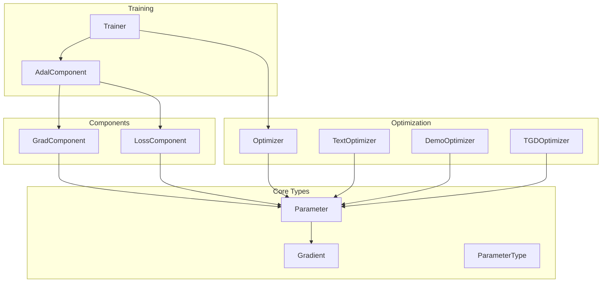
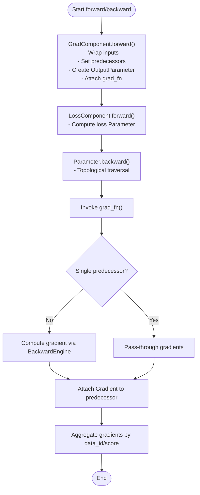
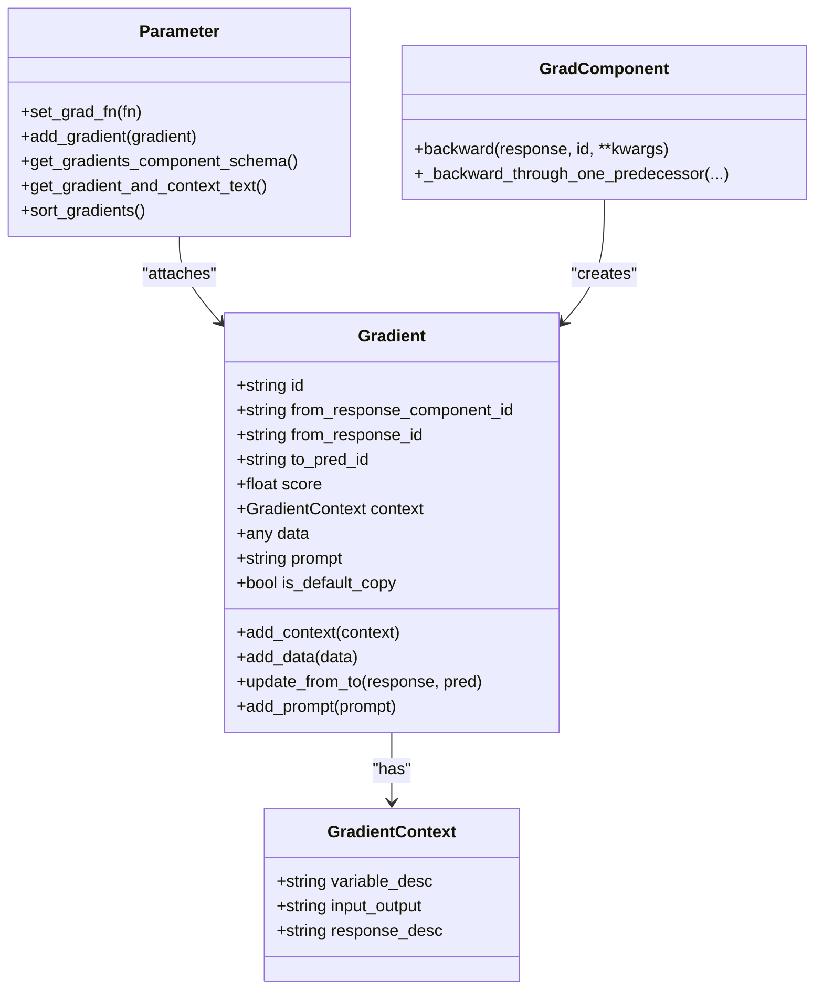
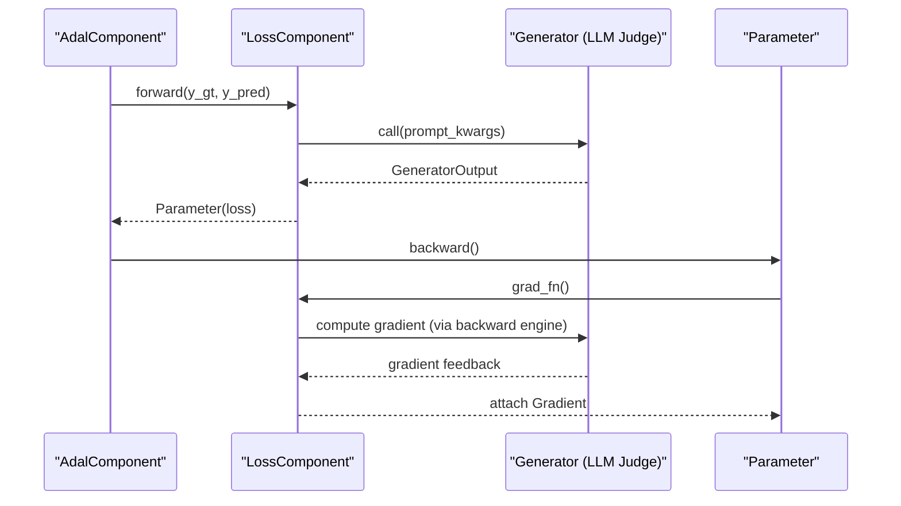
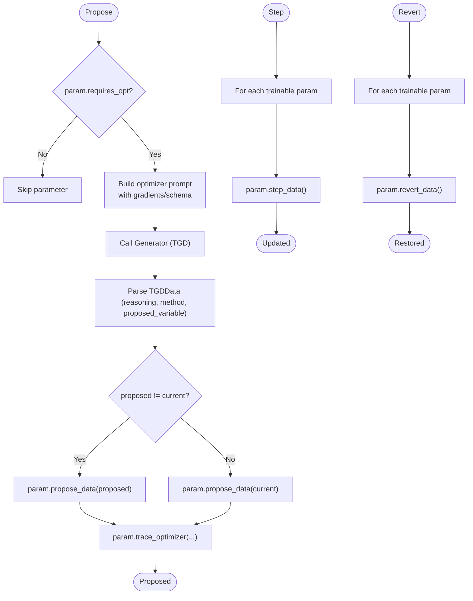
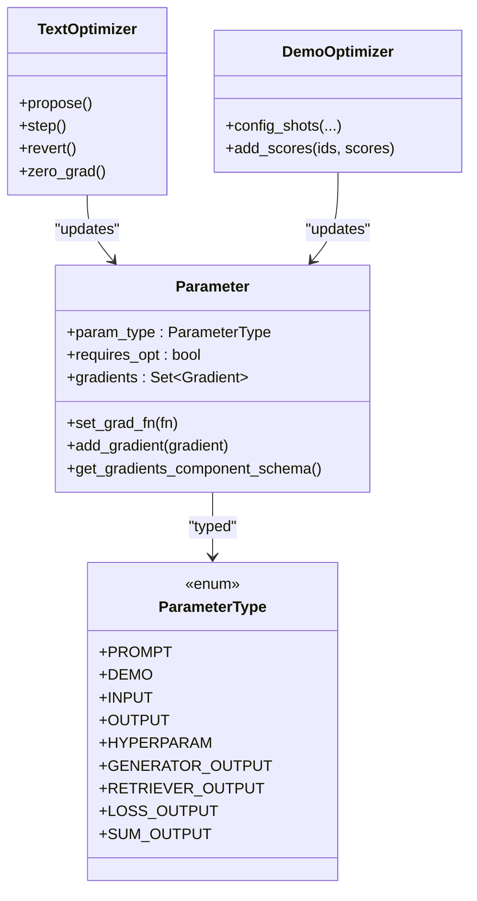
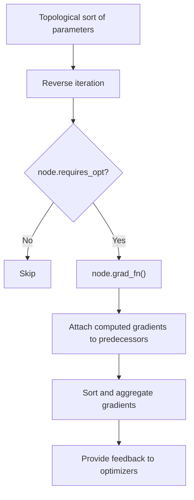
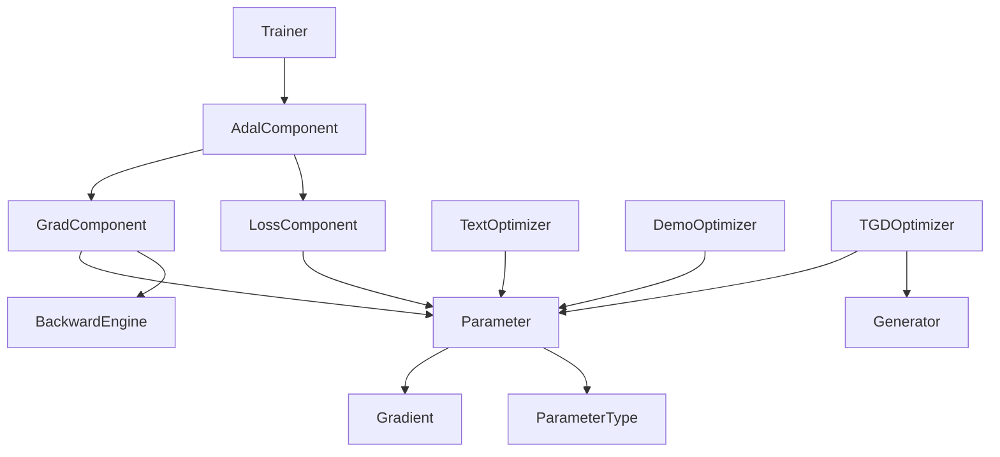

# Auto-Differentiation Framework

<cite>
**Referenced Files in This Document**
- [grad_component.py](file://adalflow/adalflow/optim/grad_component.py)
- [gradient.py](file://adalflow/adalflow/optim/gradient.py)
- [loss_component.py](file://adalflow/adalflow/optim/loss_component.py)
- [optimizer.py](file://adalflow/adalflow/optim/optimizer.py)
- [parameter.py](file://adalflow/adalflow/optim/parameter.py)
- [types.py](file://adalflow/adalflow/optim/types.py)
- [trainer.py](file://adalflow/adalflow/optim/trainer/trainer.py)
- [adal.py](file://adalflow/adalflow/optim/trainer/adal.py)
- [tgd_optimizer.py](file://adalflow/adalflow/optim/text_grad/tgd_optimizer.py)
- [llm_text_loss.py](file://adalflow/adalflow/optim/text_grad/llm_text_loss.py)
</cite>

## Table of Contents
1. [Introduction](#introduction)
2. [Project Structure](#project-structure)
3. [Core Components](#core-components)
4. [Architecture Overview](#architecture-overview)
5. [Detailed Component Analysis](#detailed-component-analysis)
6. [Dependency Analysis](#dependency-analysis)
7. [Performance Considerations](#performance-considerations)
8. [Troubleshooting Guide](#troubleshooting-guide)
9. [Conclusion](#conclusion)

## Introduction
This document explains AdalFlow’s Auto-Differentiation Framework, focusing on automatic optimization and gradient computation. It covers how gradients are constructed and backpropagated through a computation graph composed of parameters and components, how loss components integrate with the graph, and how parameter updates are orchestrated by optimizers. The framework leverages textual gradients generated by an LLM-based backward engine to compute feedback for prompt and demonstration parameters, enabling end-to-end optimization of complex task pipelines.

## Project Structure
The Auto-Differentiation Framework centers around:
- Parameter: The core data container that carries values, gradients, predecessors, and component traces.
- GradComponent: A trainable component that participates in forward/backward passes and attaches gradients to parameters.
- LossComponent: A specialized component that computes textual loss and triggers gradient computation via a backward engine.
- Gradient: A structured container for gradient feedback, including context and prompts.
- Optimizer: Base classes for textual and demonstration optimizers that propose, step, and revert parameter updates.
- Trainer and AdalComponent: Orchestrate training loops, evaluation, and integration of components and optimizers.
- TextGrad Optimizer (TGD): Implements textual gradient descent to propose improved prompt values based on aggregated feedback.



**Diagram sources**
- [parameter.py](file://adalflow/adalflow/optim/parameter.py#L119-L1712)
- [gradient.py](file://adalflow/adalflow/optim/gradient.py#L14-L133)
- [grad_component.py](file://adalflow/adalflow/optim/grad_component.py#L40-L628)
- [loss_component.py](file://adalflow/adalflow/optim/loss_component.py#L14-L57)
- [optimizer.py](file://adalflow/adalflow/optim/optimizer.py#L12-L92)
- [tgd_optimizer.py](file://adalflow/adalflow/optim/text_grad/tgd_optimizer.py#L357-L800)
- [trainer.py](file://adalflow/adalflow/optim/trainer/trainer.py#L42-L3208)
- [adal.py](file://adalflow/adalflow/optim/trainer/adal.py#L30-L873)

**Section sources**
- [parameter.py](file://adalflow/adalflow/optim/parameter.py#L119-L1712)
- [grad_component.py](file://adalflow/adalflow/optim/grad_component.py#L40-L628)
- [loss_component.py](file://adalflow/adalflow/optim/loss_component.py#L14-L57)
- [optimizer.py](file://adalflow/adalflow/optim/optimizer.py#L12-L92)
- [trainer.py](file://adalflow/adalflow/optim/trainer/trainer.py#L42-L3208)
- [adal.py](file://adalflow/adalflow/optim/trainer/adal.py#L30-L873)
- [tgd_optimizer.py](file://adalflow/adalflow/optim/text_grad/tgd_optimizer.py#L357-L800)

## Core Components
- Parameter: Tracks data, predecessors, gradients, and component traces; supports gradient aggregation, sorting, and backpropagation traversal.
- Gradient: Encapsulates gradient feedback, context, and prompt used to generate the gradient.
- GradComponent: Wraps forward/backward logic, sets up gradient functions, and delegates gradient computation to a backward engine when needed.
- LossComponent: Computes textual loss and integrates with the backward engine to produce gradients for predecessors.
- Optimizer: Base classes for textual and demonstration optimizers; TGDOptimizer proposes improved prompt values using aggregated feedback.
- Trainer and AdalComponent: Configure optimizers, backward engines, and orchestrate training/validation loops.

**Section sources**
- [parameter.py](file://adalflow/adalflow/optim/parameter.py#L119-L1712)
- [gradient.py](file://adalflow/adalflow/optim/gradient.py#L14-L133)
- [grad_component.py](file://adalflow/adalflow/optim/grad_component.py#L40-L628)
- [loss_component.py](file://adalflow/adalflow/optim/loss_component.py#L14-L57)
- [optimizer.py](file://adalflow/adalflow/optim/optimizer.py#L12-L92)
- [tgd_optimizer.py](file://adalflow/adalflow/optim/text_grad/tgd_optimizer.py#L357-L800)
- [trainer.py](file://adalflow/adalflow/optim/trainer/trainer.py#L42-L3208)
- [adal.py](file://adalflow/adalflow/optim/trainer/adal.py#L30-L873)

## Architecture Overview
The system builds a computation graph of Parameters connected by predecessors. During training:
- GradComponent.forward constructs OutputParameter nodes and attaches a grad_fn to enable backpropagation.
- LossComponent computes a loss parameter and triggers backward propagation.
- GradComponent.backward computes gradients via a backward engine when multiple predecessors exist or uses pass-through logic for single predecessor.
- TGDOptimizer aggregates gradients and proposes improved prompt values; other optimizers handle demonstrations.

```mermaid
sequenceDiagram
participant Train as "Trainer"
participant Task as "AdalComponent"
participant Comp as "GradComponent/LossComponent"
participant Param as "Parameter"
participant BE as "BackwardEngine"
participant Opt as "TextOptimizer"
Train->>Task : configure_optimizers()
Task->>BE : configure_backward_engine()
Train->>Task : train_step(batch)
Task->>Comp : forward()
Comp->>Param : create OutputParameter<br/>attach grad_fn
Train->>Task : loss_step(batch, y_preds)
Task->>Comp : forward(loss)
Comp->>Param : create loss Parameter
Train->>Param : backward()
Param->>Comp : grad_fn()
Comp->>BE : compute gradient (when needed)
BE-->>Comp : gradient feedback
Comp-->>Param : attach Gradient
Train->>Opt : propose()
Opt->>Param : propose_data()
Train->>Opt : step()
Opt->>Param : step_data()
```

**Diagram sources**
- [trainer.py](file://adalflow/adalflow/optim/trainer/trainer.py#L418-L698)
- [adal.py](file://adalflow/adalflow/optim/trainer/adal.py#L175-L704)
- [grad_component.py](file://adalflow/adalflow/optim/grad_component.py#L123-L480)
- [parameter.py](file://adalflow/adalflow/optim/parameter.py#L711-L749)
- [tgd_optimizer.py](file://adalflow/adalflow/optim/text_grad/tgd_optimizer.py#L614-L712)

## Detailed Component Analysis

### Computational Graph Construction and Backpropagation
- Forward pass: GradComponent.forward wraps inputs into Parameter objects, sets predecessors, traces the forward pass, and attaches a BackwardContext to the output.
- Backward pass: Parameter.backward performs topological traversal and invokes each node’s grad_fn. For nodes with requires_opt=True, gradients are computed and propagated to predecessors.
- Gradient aggregation: Parameter.get_gradients_component_schema and get_gradient_and_context_text combine feedback grouped by data_id and average score to inform optimizers.



**Diagram sources**
- [grad_component.py](file://adalflow/adalflow/optim/grad_component.py#L123-L480)
- [parameter.py](file://adalflow/adalflow/optim/parameter.py#L711-L749)
- [parameter.py](file://adalflow/adalflow/optim/parameter.py#L321-L487)

**Section sources**
- [grad_component.py](file://adalflow/adalflow/optim/grad_component.py#L123-L480)
- [parameter.py](file://adalflow/adalflow/optim/parameter.py#L711-L749)
- [parameter.py](file://adalflow/adalflow/optim/parameter.py#L321-L487)

### Gradient Computation Mechanisms
- Gradient data: Gradient stores feedback text, context, prompt, and identifiers linking from response to predecessor.
- Backward engine integration: When multiple predecessors exist, GradComponent._backward_through_one_predecessor constructs conversation and objective prompts and queries the backward engine to compute a gradient value.
- Gradient attachment: Gradient objects are added to the predecessor parameter and sorted for deterministic aggregation.



**Diagram sources**
- [gradient.py](file://adalflow/adalflow/optim/gradient.py#L14-L133)
- [parameter.py](file://adalflow/adalflow/optim/parameter.py#L286-L506)
- [grad_component.py](file://adalflow/adalflow/optim/grad_component.py#L276-L421)

**Section sources**
- [gradient.py](file://adalflow/adalflow/optim/gradient.py#L14-L133)
- [parameter.py](file://adalflow/adalflow/optim/parameter.py#L286-L506)
- [grad_component.py](file://adalflow/adalflow/optim/grad_component.py#L276-L421)

### Loss Component Integration
- LossComponent defines the interface for computing textual loss and integrating with a backward engine.
- LLMAsTextLoss demonstrates using a generator as an LLM judge to compute loss; the resulting Parameter can be backpropagated to feed gradients.



**Diagram sources**
- [loss_component.py](file://adalflow/adalflow/optim/loss_component.py#L14-L57)
- [llm_text_loss.py](file://adalflow/adalflow/optim/text_grad/llm_text_loss.py#L29-L75)
- [grad_component.py](file://adalflow/adalflow/optim/grad_component.py#L422-L480)

**Section sources**
- [loss_component.py](file://adalflow/adalflow/optim/loss_component.py#L14-L57)
- [llm_text_loss.py](file://adalflow/adalflow/optim/text_grad/llm_text_loss.py#L29-L75)
- [grad_component.py](file://adalflow/adalflow/optim/grad_component.py#L422-L480)

### Parameter Update Workflows
- Propose: TGDOptimizer.propose generates improved values for trainable parameters using aggregated gradient feedback and stores previous values.
- Step: TGDOptimizer.step finalizes updates by discarding previous values.
- Revert: TGDOptimizer.revert restores previous values when evaluation does not improve.



**Diagram sources**
- [tgd_optimizer.py](file://adalflow/adalflow/optim/text_grad/tgd_optimizer.py#L614-L712)
- [parameter.py](file://adalflow/adalflow/optim/parameter.py#L610-L645)

**Section sources**
- [tgd_optimizer.py](file://adalflow/adalflow/optim/text_grad/tgd_optimizer.py#L614-L712)
- [parameter.py](file://adalflow/adalflow/optim/parameter.py#L610-L645)

### Relationship Between Gradients, Parameters, and Optimization Algorithms
- Gradients are attached to parameters and grouped by data_id and average score to highlight low-performing examples.
- Optimizers (TextOptimizer, DemoOptimizer) operate on parameters with requires_opt=True, using gradient feedback to propose updates.
- ParameterType enumerates trainable and non-trainable parameter categories to guide optimization scope.



**Diagram sources**
- [types.py](file://adalflow/adalflow/optim/types.py#L13-L67)
- [parameter.py](file://adalflow/adalflow/optim/parameter.py#L119-L254)
- [optimizer.py](file://adalflow/adalflow/optim/optimizer.py#L12-L92)

**Section sources**
- [types.py](file://adalflow/adalflow/optim/types.py#L13-L67)
- [parameter.py](file://adalflow/adalflow/optim/parameter.py#L119-L254)
- [optimizer.py](file://adalflow/adalflow/optim/optimizer.py#L12-L92)

### Mathematical Foundations and Backpropagation Patterns
- Backpropagation follows a topological order of parameters, invoking grad_fn for each node with requires_opt=True.
- Gradients are aggregated by data_id and score to emphasize low-performing samples, aligning with constrained optimization strategies.
- The backward engine acts as a differentiable operator, generating textual gradients that approximate continuous derivatives for text parameters.



**Diagram sources**
- [parameter.py](file://adalflow/adalflow/optim/parameter.py#L711-L749)
- [parameter.py](file://adalflow/adalflow/optim/parameter.py#L492-L506)

**Section sources**
- [parameter.py](file://adalflow/adalflow/optim/parameter.py#L711-L749)
- [parameter.py](file://adalflow/adalflow/optim/parameter.py#L492-L506)

### Concrete Examples from the Codebase
- Decorator-based component wrapping: See the fun_to_grad_component decorator usage and its generated component class instantiation.
- Training loop orchestration: Trainer.fit configures optimizers and backward engines, runs text and demo optimization in sequential or mixed modes, and evaluates periodically.
- Loss computation with LLM judge: LLMAsTextLoss wraps a generator to compute textual loss as a Parameter for backpropagation.

**Section sources**
- [grad_component.py](file://adalflow/adalflow/optim/grad_component.py#L526-L578)
- [trainer.py](file://adalflow/adalflow/optim/trainer/trainer.py#L418-L698)
- [llm_text_loss.py](file://adalflow/adalflow/optim/text_grad/llm_text_loss.py#L29-L75)

## Dependency Analysis
Key dependencies and relationships:
- Parameter depends on Gradient and ParameterType for gradient storage and categorization.
- GradComponent depends on BackwardEngine to compute textual gradients and on Parameter for predecessor tracking.
- Trainer orchestrates AdalComponent, which configures optimizers and backward engines.
- TGDOptimizer depends on Generator for proposing improved parameters and uses Parameter gradient aggregation.



**Diagram sources**
- [parameter.py](file://adalflow/adalflow/optim/parameter.py#L119-L1712)
- [gradient.py](file://adalflow/adalflow/optim/gradient.py#L14-L133)
- [grad_component.py](file://adalflow/adalflow/optim/grad_component.py#L40-L628)
- [loss_component.py](file://adalflow/adalflow/optim/loss_component.py#L14-L57)
- [trainer.py](file://adalflow/adalflow/optim/trainer/trainer.py#L42-L3208)
- [adal.py](file://adalflow/adalflow/optim/trainer/adal.py#L30-L873)
- [tgd_optimizer.py](file://adalflow/adalflow/optim/text_grad/tgd_optimizer.py#L357-L800)

**Section sources**
- [parameter.py](file://adalflow/adalflow/optim/parameter.py#L119-L1712)
- [grad_component.py](file://adalflow/adalflow/optim/grad_component.py#L40-L628)
- [loss_component.py](file://adalflow/adalflow/optim/loss_component.py#L14-L57)
- [trainer.py](file://adalflow/adalflow/optim/trainer/trainer.py#L42-L3208)
- [adal.py](file://adalflow/adalflow/optim/trainer/adal.py#L30-L873)
- [tgd_optimizer.py](file://adalflow/adalflow/optim/text_grad/tgd_optimizer.py#L357-L800)

## Performance Considerations
- Gradient aggregation: Sorting and grouping by data_id/score adds overhead; consider batching and limiting the number of gradients retained.
- Backward engine calls: Each predecessor may trigger a backward engine call; use disable_backward_engine to skip gradient generation when only context is needed.
- Token usage: Shortening parameter values with get_short_value reduces prompt sizes during optimization.
- Parallelism: Trainer and AdalComponent use ThreadPoolExecutor for evaluation and prediction to improve throughput.

[No sources needed since this section provides general guidance]

## Troubleshooting Guide
- Missing backward engine: GradComponent raises an error if backward_engine is required but not configured.
- Non-parameter outputs: GradComponent.forward enforces that call() should not return a Parameter in training mode.
- Gradient accumulation: Use Parameter.reset_gradients and TGDOptimizer.zero_grad to clear stale gradients before proposing.
- Debugging traces: Use Trainer.configure_callbacks and AdalComponent.configure_callbacks to save logs and visualize computation graphs.

**Section sources**
- [grad_component.py](file://adalflow/adalflow/optim/grad_component.py#L305-L312)
- [grad_component.py](file://adalflow/adalflow/optim/grad_component.py#L203-L208)
- [parameter.py](file://adalflow/adalflow/optim/parameter.py#L300-L301)
- [tgd_optimizer.py](file://adalflow/adalflow/optim/text_grad/tgd_optimizer.py#L598-L605)
- [trainer.py](file://adalflow/adalflow/optim/trainer/trainer.py#L705-L716)
- [adal.py](file://adalflow/adalflow/optim/trainer/adal.py#L705-L716)

## Conclusion
AdalFlow’s Auto-Differentiation Framework enables automatic optimization of text-based parameters by constructing a computation graph of Parameters, computing textual gradients via a backward engine, and orchestrating updates through optimizers. The system supports complex training workflows, integrates loss computation, and provides robust debugging and visualization capabilities. By leveraging gradient aggregation and constrained optimization strategies, it achieves practical improvements in prompt and demonstration quality for end-to-end task pipelines.