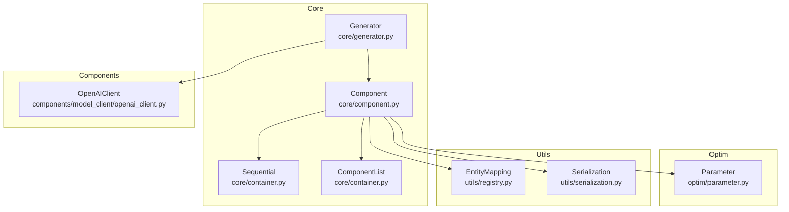
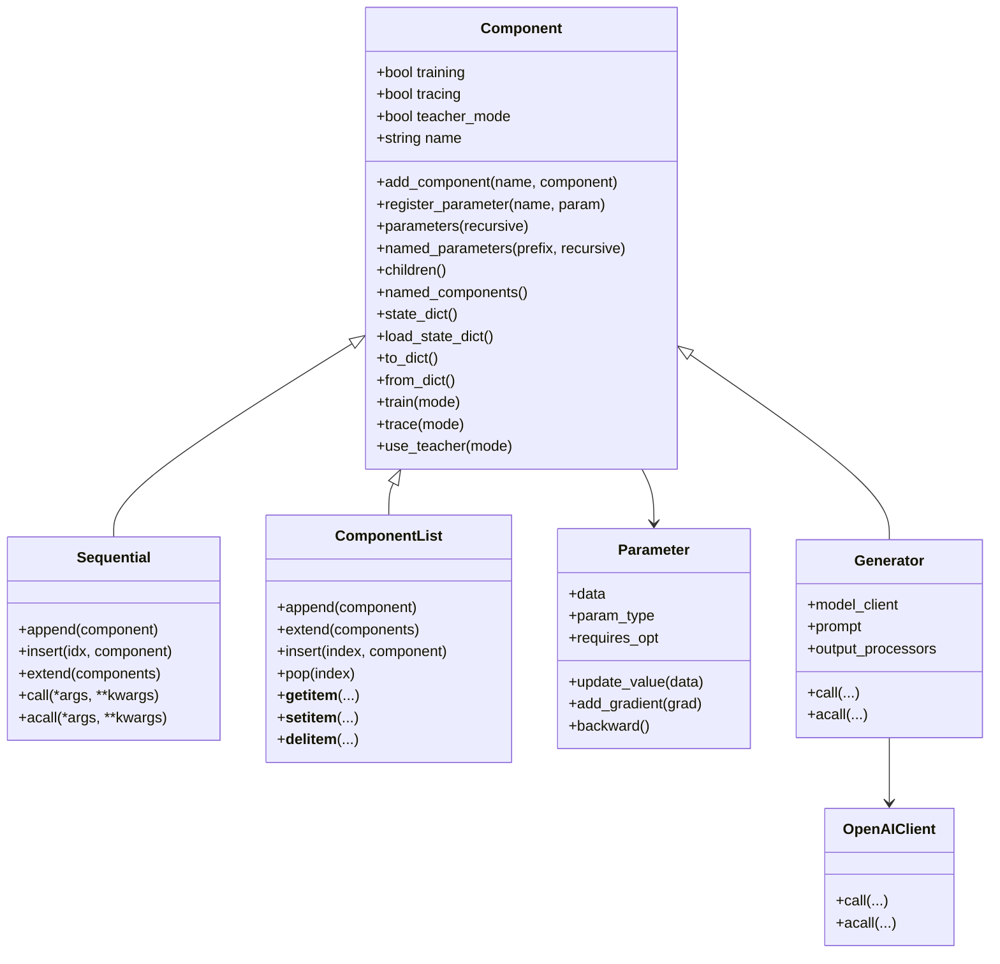
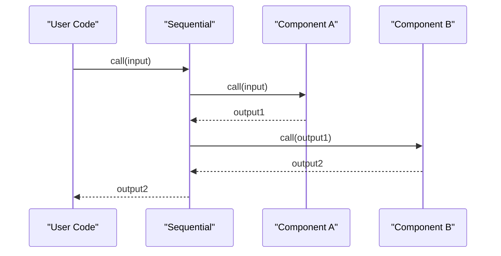
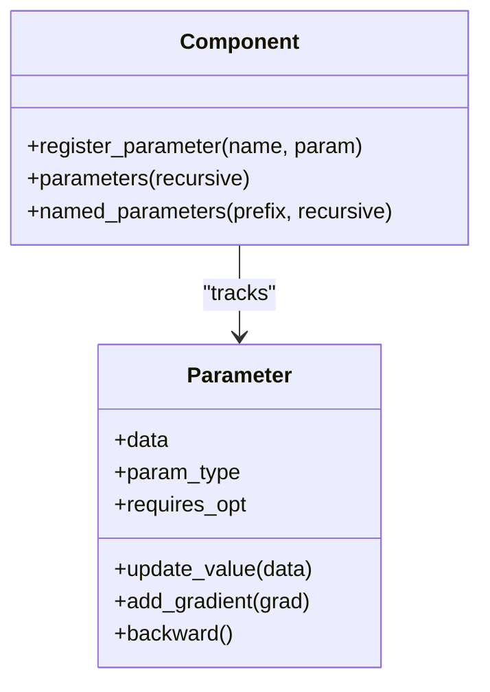
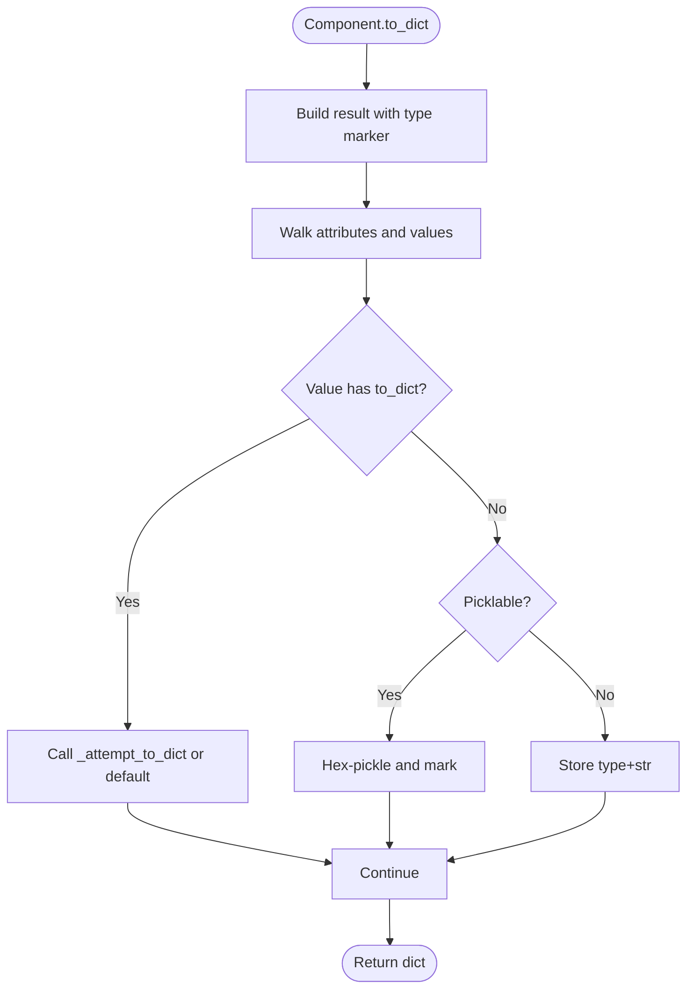
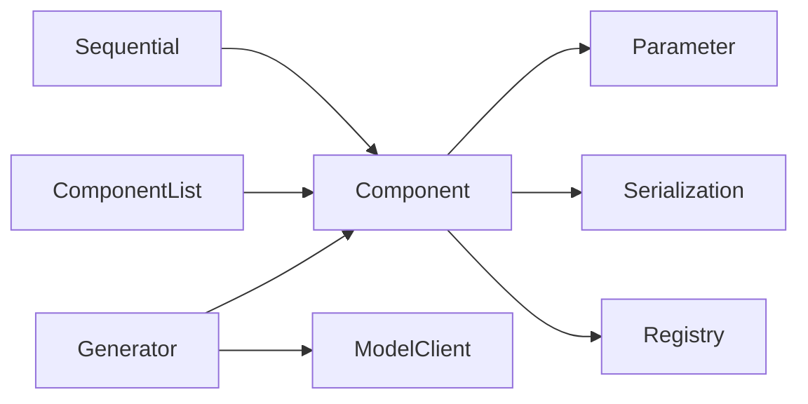

# Component Architecture

<cite>
**Referenced Files in This Document**
- [component.py](file://adalflow/adalflow/core/component.py)
- [container.py](file://adalflow/adalflow/core/container.py)
- [parameter.py](file://adalflow/adalflow/optim/parameter.py)
- [registry.py](file://adalflow/adalflow/utils/registry.py)
- [serialization.py](file://adalflow/adalflow/utils/serialization.py)
- [__init__.py](file://adalflow/adalflow/core/__init__.py)
- [component.rst](file://docs/source/tutorials/component.rst)
- [component.py](file://tutorials/component.py)
- [generator.py](file://adalflow/adalflow/core/generator.py)
- [openai_client.py](file://adalflow/adalflow/components/model_client/openai_client.py)
</cite>

## Table of Contents
1. [Introduction](#introduction)
2. [Project Structure](#project-structure)
3. [Core Components](#core-components)
4. [Architecture Overview](#architecture-overview)
5. [Detailed Component Analysis](#detailed-component-analysis)
6. [Dependency Analysis](#dependency-analysis)
7. [Performance Considerations](#performance-considerations)
8. [Troubleshooting Guide](#troubleshooting-guide)
9. [Conclusion](#conclusion)

## Introduction
This document explains AdalFlow’s hierarchical component system with a focus on the Component base class design, similar to PyTorch’s nn.Module. It covers hierarchical composition, parameter and state tracking, recursive operations, lifecycle management, and serialization/deserialization. The goal is to make the framework’s component architecture accessible to newcomers while providing deep technical insights for advanced users.

## Project Structure
At the heart of AdalFlow’s architecture is the Component base class, which enables:
- Hierarchical composition of subcomponents
- Automatic parameter registration and discovery
- Unified call interfaces for training and inference
- Recursive traversal and state management
- Serialization and deserialization for persistence and configuration

Key modules involved:
- Core Component and containers: core/component.py, core/container.py
- Parameter system: optim/parameter.py
- Utilities for serialization and registry: utils/serialization.py, utils/registry.py
- Public exports and registry population: core/__init__.py
- Tutorials and examples: docs/source/tutorials/component.rst, tutorials/component.py
- Concrete components: core/generator.py, components/model_client/openai_client.py

**Diagram sources**
- [component.py](file://adalflow/adalflow/core/component.py#L51-L1200)
- [container.py](file://adalflow/adalflow/core/container.py#L62-L537)
- [parameter.py](file://adalflow/adalflow/optim/parameter.py#L119-L800)
- [registry.py](file://adalflow/adalflow/utils/registry.py#L4-L22)
- [serialization.py](file://adalflow/adalflow/utils/serialization.py#L30-L138)
- [generator.py](file://adalflow/adalflow/core/generator.py#L82-L200)
- [openai_client.py](file://adalflow/adalflow/components/model_client/openai_client.py#L1-L200)

**Section sources**
- [component.py](file://adalflow/adalflow/core/component.py#L1-L1200)
- [container.py](file://adalflow/adalflow/core/container.py#L1-L537)
- [parameter.py](file://adalflow/adalflow/optim/parameter.py#L1-L800)
- [registry.py](file://adalflow/adalflow/utils/registry.py#L1-L22)
- [serialization.py](file://adalflow/adalflow/utils/serialization.py#L1-L138)
- [__init__.py](file://adalflow/adalflow/core/__init__.py#L1-L134)
- [component.rst](file://docs/source/tutorials/component.rst#L1-L329)
- [component.py](file://tutorials/component.py#L1-L77)
- [generator.py](file://adalflow/adalflow/core/generator.py#L1-L200)
- [openai_client.py](file://adalflow/adalflow/components/model_client/openai_client.py#L1-L200)

## Core Components
- Component: Base class for all pipeline components. Provides:
  - Hierarchical composition via add_component/register_component
  - Parameter registration via register_parameter
  - Unified call interfaces: __call__, call, forward, bicall, acall
  - Recursive traversal: children, named_children, components, named_components
  - State management: state_dict, load_state_dict
  - Serialization: to_dict, from_dict, is_picklable, pickle_to_file, load_from_pickle
  - Lifecycle toggles: train, eval, trace, use_teacher
- Container components:
  - Sequential: chains components sequentially with shared call semantics
  - ComponentList: holds subcomponents in an ordered list with indexing and iteration
- Parameter: A generic data container used for optimization and tracing, integrated with Component parameters

Key implementation highlights:
- Component maintains internal OrderedDicts for _components and _parameters
- Recursive operations traverse the component tree and apply operations to all descendants
- Serialization integrates with a custom JSON serializer and registry for class restoration

**Section sources**
- [component.py](file://adalflow/adalflow/core/component.py#L51-L1200)
- [container.py](file://adalflow/adalflow/core/container.py#L62-L537)
- [parameter.py](file://adalflow/adalflow/optim/parameter.py#L119-L800)

## Architecture Overview
The Component architecture follows a hierarchical tree model:
- Parent-child relationships are established by adding subcomponents
- Parameters are tracked per component and discovered recursively
- Calls propagate through the tree, with training/inference modes controlling behavior
- State and configuration are persisted and restored via serialization utilities

**Diagram sources**
- [component.py](file://adalflow/adalflow/core/component.py#L51-L1200)
- [container.py](file://adalflow/adalflow/core/container.py#L62-L537)
- [parameter.py](file://adalflow/adalflow/optim/parameter.py#L119-L800)
- [generator.py](file://adalflow/adalflow/core/generator.py#L82-L200)
- [openai_client.py](file://adalflow/adalflow/components/model_client/openai_client.py#L1-L200)

## Detailed Component Analysis

### Component Base Class Design
- Hierarchical composition:
  - Subcomponents are stored in an internal ordered mapping and exposed via children/named_children
  - Components can be added via add_component/register_component with validation
- Parameter tracking:
  - Parameters are registered via register_parameter and discovered via parameters/named_parameters
  - Recursive traversal ensures parameters from all descendants are included
- Unified call interfaces:
  - __call__ dispatches to bicall if present, otherwise to forward (training) or call (inference)
  - acall provides async capability
- Lifecycle management:
  - train/eval toggle training mode; propagates to children
  - trace/use_teacher toggle tracing and teacher modes; propagate to children
- State and serialization:
  - state_dict/load_state_dict for parameter-only state
  - to_dict/from_dict for full component state including subcomponents and attributes
  - is_picklable/pickle_to_file/load_from_pickle for quick persistence

Concrete examples from the codebase:
- Tutorial usage demonstrates subclassing Component, registering parameters, and serializing/restoring via to_dict/from_dict
- Generator extends Component and GradComponent to orchestrate Prompt, ModelClient, and output processors

**Section sources**
- [component.py](file://adalflow/adalflow/core/component.py#L51-L1200)
- [component.rst](file://docs/source/tutorials/component.rst#L110-L329)
- [component.py](file://tutorials/component.py#L1-L77)
- [generator.py](file://adalflow/adalflow/core/generator.py#L82-L200)

### Container Components: Sequential and ComponentList
- Sequential:
  - Stores components in order and chains outputs to inputs
  - Supports indexing, slicing, addition, iteration, and both call and acall
- ComponentList:
  - Ordered list of components with indexing and mutation operations
  - Preserves registration and visibility across all Component methods

**Diagram sources**
- [container.py](file://adalflow/adalflow/core/container.py#L288-L334)

**Section sources**
- [container.py](file://adalflow/adalflow/core/container.py#L62-L537)

### Parameter System and Integration
- Parameter is a generic container with:
  - Type enforcement and in-place updates
  - Gradient tracking and backward propagation
  - Tracing and scoring for optimization
- Component integrates Parameter via register_parameter and exposes them via parameters/named_parameters
- Serialization utilities support Parameter serialization and restoration

**Diagram sources**
- [parameter.py](file://adalflow/adalflow/optim/parameter.py#L119-L800)
- [component.py](file://adalflow/adalflow/core/component.py#L359-L474)

**Section sources**
- [parameter.py](file://adalflow/adalflow/optim/parameter.py#L119-L800)
- [component.py](file://adalflow/adalflow/core/component.py#L359-L474)

### Serialization and Configuration
- Component.to_dict/from_dict:
  - Serializes the component type, attributes, subcomponents, and parameters
  - Uses a custom serializer for complex types and falls back to string representation
- Registry-driven restoration:
  - EntityMapping registers and resolves component classes by name
- Utility serialization:
  - serialization.default handles class and instance serialization with type markers
- Configuration from dict:
  - Component.from_config constructs components from configuration dictionaries, resolving component references

**Diagram sources**
- [component.py](file://adalflow/adalflow/core/component.py#L230-L352)
- [serialization.py](file://adalflow/adalflow/utils/serialization.py#L30-L138)
- [registry.py](file://adalflow/adalflow/utils/registry.py#L4-L22)

**Section sources**
- [component.py](file://adalflow/adalflow/core/component.py#L230-L352)
- [serialization.py](file://adalflow/adalflow/utils/serialization.py#L30-L138)
- [registry.py](file://adalflow/adalflow/utils/registry.py#L4-L22)

### Concrete Examples from the Codebase
- Tutorial example:
  - Demonstrates subclassing Component, adding a Generator subcomponent, and serializing/restoring the pipeline
- Generator:
  - Orchestrates Prompt, ModelClient, and output processors; inherits Component behavior for composition and parameterization
- OpenAI Client:
  - Implements API calls and integrates with Generator as a model client

**Section sources**
- [component.rst](file://docs/source/tutorials/component.rst#L110-L329)
- [component.py](file://tutorials/component.py#L1-L77)
- [generator.py](file://adalflow/adalflow/core/generator.py#L82-L200)
- [openai_client.py](file://adalflow/adalflow/components/model_client/openai_client.py#L1-L200)

## Dependency Analysis
- Component depends on:
  - Optim.Parameter for parameter tracking
  - Utils.serialization for serialization hooks
  - Utils.registry for class registration and restoration
- Containers (Sequential, ComponentList) depend on Component for composition semantics
- Generator composes Prompt, ModelClient, and output processors while inheriting Component behavior
- Registry populates the global mapping for component resolution

**Diagram sources**
- [component.py](file://adalflow/adalflow/core/component.py#L51-L1200)
- [container.py](file://adalflow/adalflow/core/container.py#L62-L537)
- [parameter.py](file://adalflow/adalflow/optim/parameter.py#L119-L800)
- [serialization.py](file://adalflow/adalflow/utils/serialization.py#L30-L138)
- [registry.py](file://adalflow/adalflow/utils/registry.py#L4-L22)
- [generator.py](file://adalflow/adalflow/core/generator.py#L82-L200)
- [openai_client.py](file://adalflow/adalflow/components/model_client/openai_client.py#L1-L200)

**Section sources**
- [__init__.py](file://adalflow/adalflow/core/__init__.py#L67-L134)
- [component.py](file://adalflow/adalflow/core/component.py#L51-L1200)
- [container.py](file://adalflow/adalflow/core/container.py#L62-L537)
- [parameter.py](file://adalflow/adalflow/optim/parameter.py#L119-L800)
- [serialization.py](file://adalflow/adalflow/utils/serialization.py#L30-L138)
- [registry.py](file://adalflow/adalflow/utils/registry.py#L4-L22)
- [generator.py](file://adalflow/adalflow/core/generator.py#L82-L200)
- [openai_client.py](file://adalflow/adalflow/components/model_client/openai_client.py#L1-L200)

## Performance Considerations
- Recursive traversal:
  - parameters, named_parameters, components, and named_components traverse the entire subtree; use with care in large pipelines
- Serialization overhead:
  - to_dict performs recursive serialization; consider selective serialization or caching for large component graphs
- Parameter updates:
  - load_state_dict updates parameters in-place; ensure type compatibility to avoid runtime errors
- Async execution:
  - acall in containers and components can improve throughput for I/O-bound operations

[No sources needed since this section provides general guidance]

## Troubleshooting Guide
Common issues and resolutions:
- Missing bicall or mismatched output types:
  - __call__ validates outputs based on training/inference mode; ensure bicall or forward/call returns the expected types
- Parameter registration errors:
  - register_parameter enforces naming rules and type checks; ensure proper initialization and avoid reserved names
- Serialization failures:
  - Use is_picklable to test picklability; fallback to to_dict/from_dict for robustness
- Registry/class restoration:
  - Ensure classes are registered via EntityMapping; from_dict relies on registry lookups

**Section sources**
- [component.py](file://adalflow/adalflow/core/component.py#L511-L551)
- [component.py](file://adalflow/adalflow/core/component.py#L359-L392)
- [component.py](file://adalflow/adalflow/core/component.py#L192-L229)
- [serialization.py](file://adalflow/adalflow/utils/serialization.py#L108-L126)

## Conclusion
AdalFlow’s Component architecture provides a powerful, hierarchical foundation for building LLM pipelines. By mirroring concepts from PyTorch’s nn.Module—such as composition, parameter tracking, and recursive operations—while extending them to arbitrary data types and optimization workflows, it enables flexible, maintainable, and serializable systems. The provided containers, parameter system, and serialization utilities offer practical tools for real-world development and experimentation.