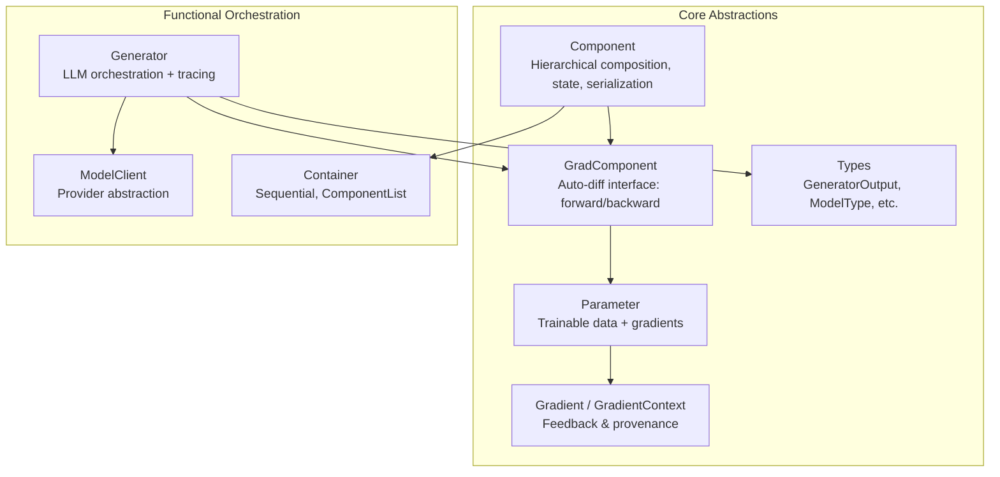
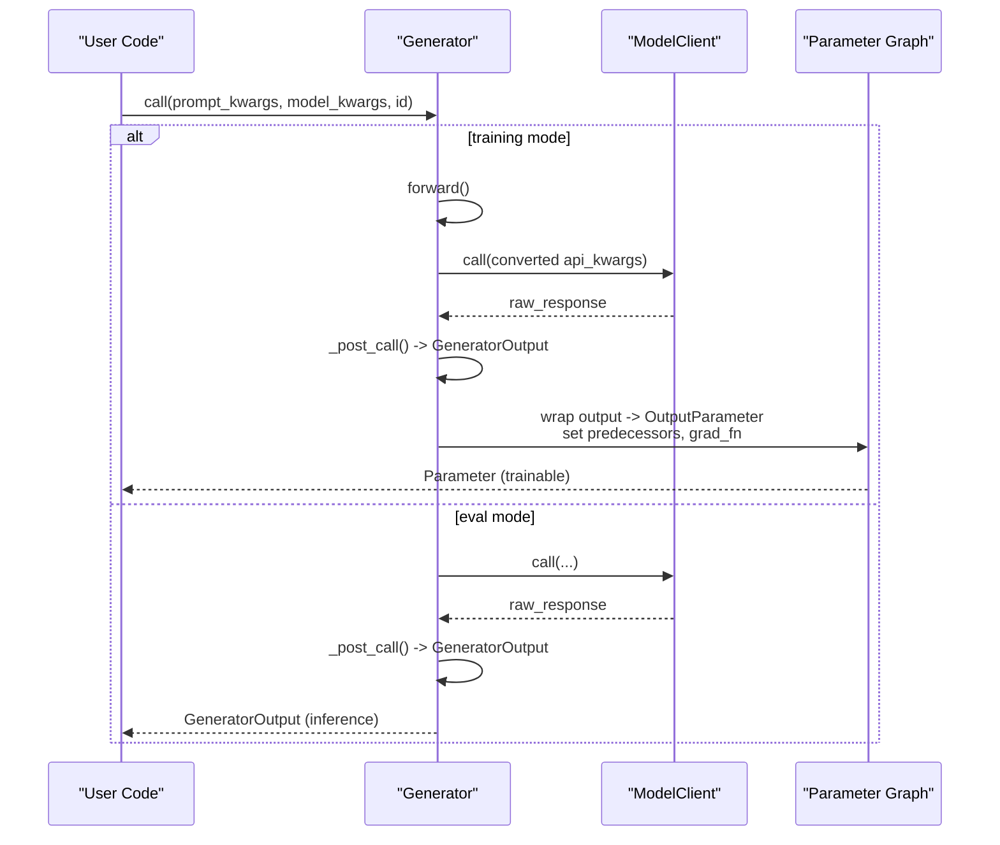
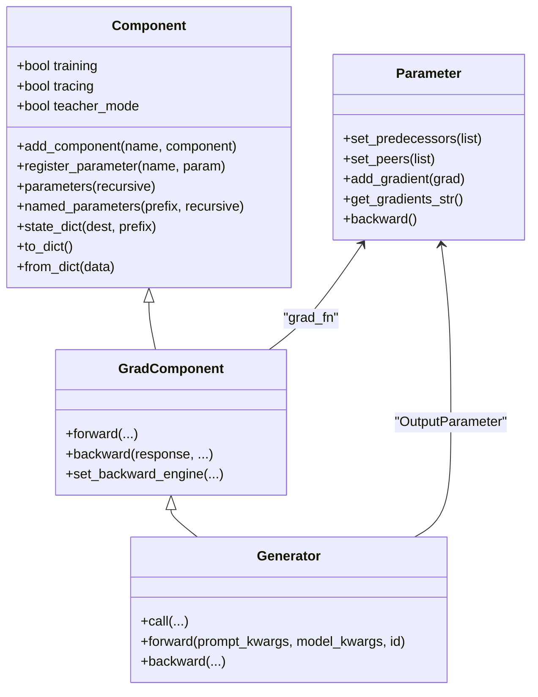
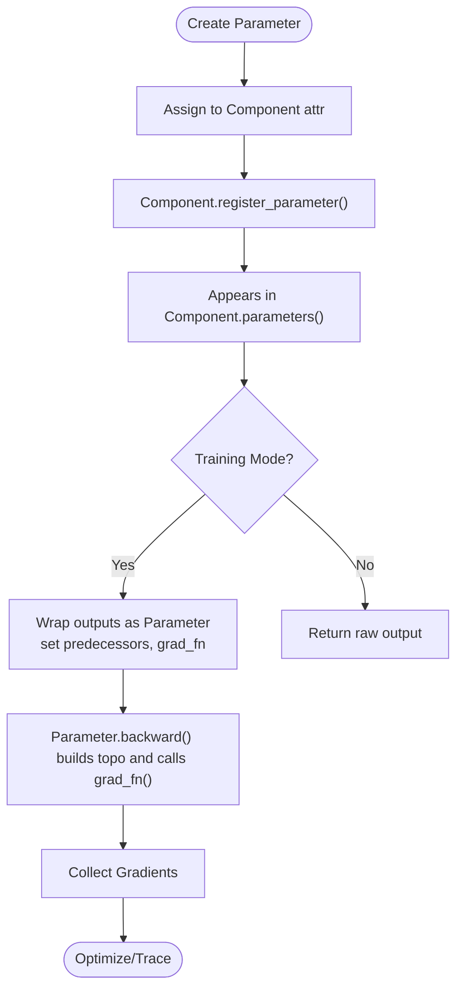
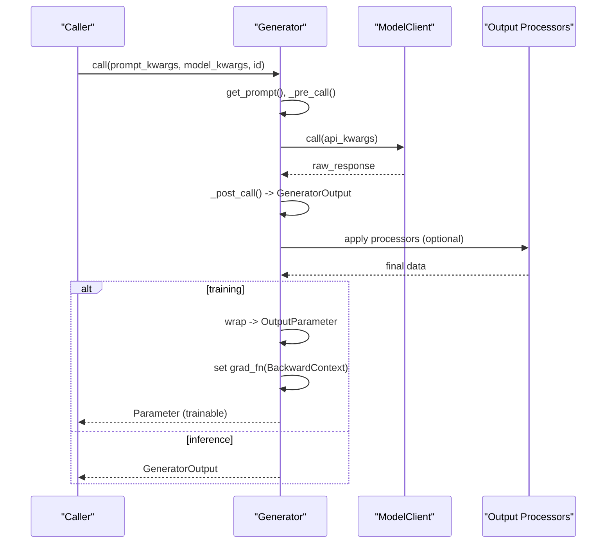
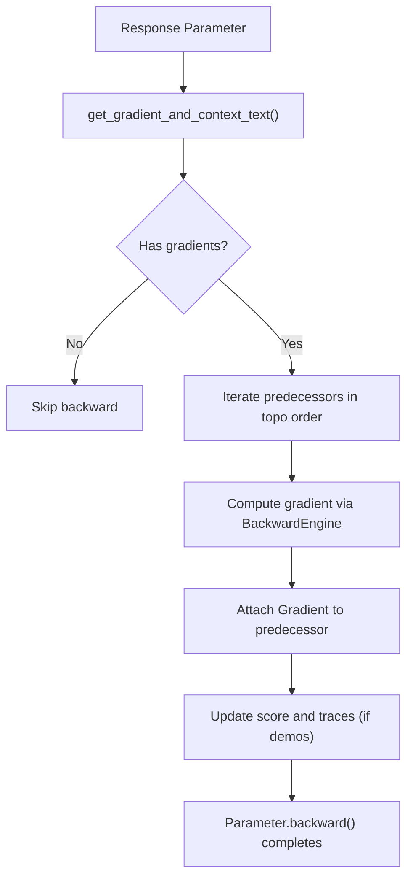
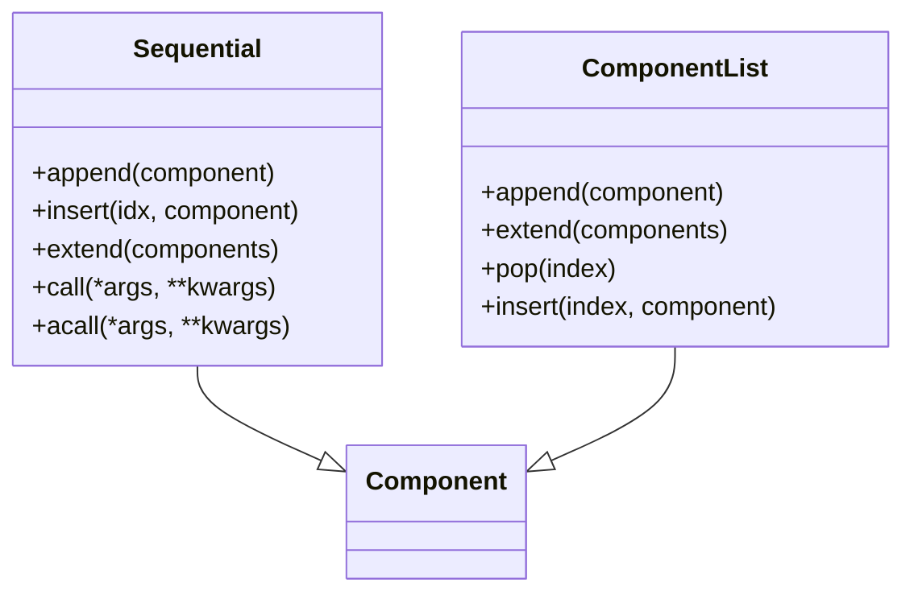
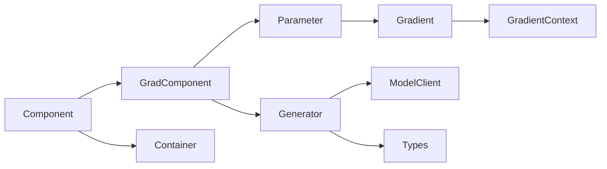

# Core Concepts

<cite>
**Referenced Files in This Document**
- [component.py](file://adalflow/adalflow/core/component.py)
- [generator.py](file://adalflow/adalflow/core/generator.py)
- [parameter.py](file://adalflow/adalflow/optim/parameter.py)
- [grad_component.py](file://adalflow/adalflow/optim/grad_component.py)
- [gradient.py](file://adalflow/adalflow/optim/gradient.py)
- [types.py](file://adalflow/adalflow/core/types.py)
- [model_client.py](file://adalflow/adalflow/core/model_client.py)
- [container.py](file://adalflow/adalflow/core/container.py)
- [base_data_class.py](file://adalflow/adalflow/core/base_data_class.py)
</cite>

## Table of Contents
1. [Introduction](#introduction)
2. [Project Structure](#project-structure)
3. [Core Components](#core-components)
4. [Architecture Overview](#architecture-overview)
5. [Detailed Component Analysis](#detailed-component-analysis)
6. [Dependency Analysis](#dependency-analysis)
7. [Performance Considerations](#performance-considerations)
8. [Troubleshooting Guide](#troubleshooting-guide)
9. [Conclusion](#conclusion)

## Introduction
This document explains AdalFlow’s core architecture and design principles with a focus on the Component-based paradigm. It covers:
- Component-based architecture inspired by PyTorch’s nn.Module, emphasizing hierarchical composition, state management, and parameter tracking
- The Parameter system for trainable components
- Generator orchestration for LLM interactions
- The auto-differentiative framework that traces computation graphs and backpropagates feedback
- Practical examples from the codebase showing Component inheritance, parameter definition, and generator usage
- Clarifications of common misconceptions and practical mental models

## Project Structure
At the heart of AdalFlow are two foundational layers:
- Core abstractions: Component, GradComponent, Parameter, and supporting types
- Functional orchestration: Generator, ModelClient, and containers (Sequential, ComponentList)

**Diagram sources**
- [component.py](file://adalflow/adalflow/core/component.py#L51-L800)
- [grad_component.py](file://adalflow/adalflow/optim/grad_component.py#L40-L628)
- [parameter.py](file://adalflow/adalflow/optim/parameter.py#L119-L800)
- [gradient.py](file://adalflow/adalflow/optim/gradient.py#L14-L133)
- [generator.py](file://adalflow/adalflow/core/generator.py#L82-L800)
- [model_client.py](file://adalflow/adalflow/core/model_client.py#L16-L128)
- [container.py](file://adalflow/adalflow/core/container.py#L62-L537)
- [types.py](file://adalflow/adalflow/core/types.py#L55-L800)

**Section sources**
- [component.py](file://adalflow/adalflow/core/component.py#L51-L800)
- [container.py](file://adalflow/adalflow/core/container.py#L62-L537)

## Core Components
- Component: Base class for all pipeline elements. Supports hierarchical composition, parameter registration, state_dict/load_state_dict, serialization/deserialization, and training/evaluation modes.
- GradComponent: Extends Component with auto-differentiation hooks. Provides forward (returns a Parameter), backward (propagates feedback), and backward-engine integration.
- Parameter: A typed, serializable container for data that participates in optimization. Tracks predecessors, peers, gradients, and trace metadata.
- Gradient and GradientContext: Structured feedback carrying provenance, score, and context for backpropagation.
- Generator: A user-facing orchestration component integrating Prompt, ModelClient, and Output processors. It is a GradComponent capable of training-time backpropagation.
- ModelClient: Protocol for model providers (local or API), converting standardized inputs to provider-specific API calls.
- Containers: Sequential and ComponentList mirror PyTorch’s patterns for composing components.

Key capabilities:
- Hierarchical composition: Components can contain other Components; traversal and iteration are supported.
- Parameter tracking: Parameters are registered automatically when assigned as attributes; they appear in parameters()/named_parameters().
- Serialization: to_dict/from_dict and state_dict/load_state_dict enable persistence and reproducibility.
- Training modes: train()/eval(), trace(), use_teacher() control behavior across forward/backward.

**Section sources**
- [component.py](file://adalflow/adalflow/core/component.py#L51-L800)
- [grad_component.py](file://adalflow/adalflow/optim/grad_component.py#L40-L628)
- [parameter.py](file://adalflow/adalflow/optim/parameter.py#L119-L800)
- [gradient.py](file://adalflow/adalflow/optim/gradient.py#L14-L133)
- [generator.py](file://adalflow/adalflow/core/generator.py#L82-L800)
- [model_client.py](file://adalflow/adalflow/core/model_client.py#L16-L128)
- [container.py](file://adalflow/adalflow/core/container.py#L62-L537)

## Architecture Overview
AdalFlow’s architecture centers on a Component hierarchy with explicit training and tracing modes. Generators orchestrate LLM calls, while GradComponent and Parameter enable an auto-differentiative flow. ModelClient abstracts provider specifics.

**Diagram sources**
- [generator.py](file://adalflow/adalflow/core/generator.py#L621-L773)
- [grad_component.py](file://adalflow/adalflow/optim/grad_component.py#L123-L238)
- [parameter.py](file://adalflow/adalflow/optim/parameter.py#L119-L254)
- [model_client.py](file://adalflow/adalflow/core/model_client.py#L58-L97)

## Detailed Component Analysis

### Component-based Architecture (PyTorch-like)
- Hierarchical composition: Components maintain an ordered dictionary of subcomponents and parameters. Children and parameters are traversed recursively for operations like serialization and training.
- State management: Component exposes state_dict/load_state_dict and to_dict/from_dict for serialization. It also supports pickling helpers and registry-based restoration.
- Modes: train(), eval(), trace(), use_teacher() propagate to children, enabling fine-grained control over behavior.

**Diagram sources**
- [component.py](file://adalflow/adalflow/core/component.py#L51-L800)
- [grad_component.py](file://adalflow/adalflow/optim/grad_component.py#L40-L628)
- [parameter.py](file://adalflow/adalflow/optim/parameter.py#L119-L800)
- [generator.py](file://adalflow/adalflow/core/generator.py#L82-L800)

**Section sources**
- [component.py](file://adalflow/adalflow/core/component.py#L51-L800)
- [container.py](file://adalflow/adalflow/core/container.py#L62-L537)

### Parameter System and Trainable Components
- Parameter enforces a specific data type and supports in-place updates. When assigned as attributes to a Component, it is automatically registered and discoverable via parameters()/named_parameters().
- Parameters track predecessors (parents in the computation graph), peers (siblings), and gradients. They can store scores and trace metadata for demos and evaluations.
- OutputParameter is a specialized Parameter used by GradComponent/Generator outputs to carry forward/backward context.

**Diagram sources**
- [parameter.py](file://adalflow/adalflow/optim/parameter.py#L119-L254)
- [grad_component.py](file://adalflow/adalflow/optim/grad_component.py#L123-L238)
- [component.py](file://adalflow/adalflow/core/component.py#L359-L473)

**Section sources**
- [parameter.py](file://adalflow/adalflow/optim/parameter.py#L119-L800)
- [component.py](file://adalflow/adalflow/core/component.py#L359-L473)

### Generator Orchestration for LLM Interactions
- Generator composes Prompt, ModelClient, and Output processors. It supports both sync and async calls, caching, and streaming.
- In training mode, Generator.forward returns an OutputParameter that:
  - Wraps the raw response
  - Sets predecessors (input Parameters)
  - Attaches a grad_fn pointing to BackwardContext
  - Optionally traces demos and API kwargs for downstream backpropagation
- It integrates a BackwardEngine to compute gradients via LLM feedback when needed.

**Diagram sources**
- [generator.py](file://adalflow/adalflow/core/generator.py#L463-L544)
- [generator.py](file://adalflow/adalflow/core/generator.py#L621-L773)
- [types.py](file://adalflow/adalflow/core/types.py#L486-L674)

**Section sources**
- [generator.py](file://adalflow/adalflow/core/generator.py#L82-L800)
- [types.py](file://adalflow/adalflow/core/types.py#L486-L674)

### Auto-Differentiative Framework
- GradComponent defines forward() to wrap outputs as Parameters and backward() to propagate feedback.
- Gradient and GradientContext capture the “why” and “how” of feedback, including conversation context and scores.
- Parameter.backward() performs topological backpropagation, invoking each node’s grad_fn to accumulate gradients.

**Diagram sources**
- [grad_component.py](file://adalflow/adalflow/optim/grad_component.py#L422-L480)
- [gradient.py](file://adalflow/adalflow/optim/gradient.py#L44-L133)
- [parameter.py](file://adalflow/adalflow/optim/parameter.py#L711-L750)

**Section sources**
- [grad_component.py](file://adalflow/adalflow/optim/grad_component.py#L40-L628)
- [gradient.py](file://adalflow/adalflow/optim/gradient.py#L14-L133)
- [parameter.py](file://adalflow/adalflow/optim/parameter.py#L711-L750)

### Containers: Sequential and ComponentList
- Sequential chains components and forwards training/serialization flags to children.
- ComponentList behaves like a Python list but registers subcomponents for traversal and parameter discovery.

**Diagram sources**
- [container.py](file://adalflow/adalflow/core/container.py#L62-L537)

**Section sources**
- [container.py](file://adalflow/adalflow/core/container.py#L62-L537)

### Concrete Examples from the Codebase
- Component inheritance and parameter definition:
  - Component.register_parameter(name, param) ensures parameters are tracked and exposed via parameters()/named_parameters().
  - Example path: [component.py](file://adalflow/adalflow/core/component.py#L359-L473)
- Generator usage and training mode:
  - Generator.forward wraps outputs as OutputParameter and sets grad_fn for backpropagation.
  - Example path: [generator.py](file://adalflow/adalflow/core/generator.py#L621-L773)
- Parameter creation and gradient accumulation:
  - Parameter.add_gradient(Gradient(...)) and Parameter.backward() drive the autograd flow.
  - Example path: [parameter.py](file://adalflow/adalflow/optim/parameter.py#L286-L306), [parameter.py](file://adalflow/adalflow/optim/parameter.py#L711-L750)
- Container composition:
  - Sequential and ComponentList demonstrate hierarchical composition and propagation of modes.
  - Example path: [container.py](file://adalflow/adalflow/core/container.py#L62-L537)

**Section sources**
- [component.py](file://adalflow/adalflow/core/component.py#L359-L473)
- [generator.py](file://adalflow/adalflow/core/generator.py#L621-L773)
- [parameter.py](file://adalflow/adalflow/optim/parameter.py#L286-L306)
- [parameter.py](file://adalflow/adalflow/optim/parameter.py#L711-L750)
- [container.py](file://adalflow/adalflow/core/container.py#L62-L537)

## Dependency Analysis
- Component is the foundation for GradComponent and Generator.
- Parameter is central to both forward and backward flows, linking predecessors and gradients.
- Gradient and GradientContext provide structured feedback provenance.
- Types define standardized outputs (GeneratorOutput) and model categories (ModelType).
- ModelClient abstracts provider specifics, enabling interchangeable clients.

**Diagram sources**
- [component.py](file://adalflow/adalflow/core/component.py#L51-L800)
- [grad_component.py](file://adalflow/adalflow/optim/grad_component.py#L40-L628)
- [parameter.py](file://adalflow/adalflow/optim/parameter.py#L119-L800)
- [gradient.py](file://adalflow/adalflow/optim/gradient.py#L14-L133)
- [generator.py](file://adalflow/adalflow/core/generator.py#L82-L800)
- [types.py](file://adalflow/adalflow/core/types.py#L55-L800)
- [model_client.py](file://adalflow/adalflow/core/model_client.py#L16-L128)
- [container.py](file://adalflow/adalflow/core/container.py#L62-L537)

**Section sources**
- [component.py](file://adalflow/adalflow/core/component.py#L51-L800)
- [grad_component.py](file://adalflow/adalflow/optim/grad_component.py#L40-L628)
- [parameter.py](file://adalflow/adalflow/optim/parameter.py#L119-L800)
- [gradient.py](file://adalflow/adalflow/optim/gradient.py#L14-L133)
- [generator.py](file://adalflow/adalflow/core/generator.py#L82-L800)
- [types.py](file://adalflow/adalflow/core/types.py#L55-L800)
- [model_client.py](file://adalflow/adalflow/core/model_client.py#L16-L128)
- [container.py](file://adalflow/adalflow/core/container.py#L62-L537)

## Performance Considerations
- Caching: Generator caches non-streaming model responses to reduce latency and cost.
- Streaming: Generator supports async streaming; output processors are applied after finalization to avoid blocking.
- Token estimation: Generator estimates prompt tokens to guard against truncation and excessive costs.
- Serialization: to_dict/from_dict and state_dict/load_state_dict enable lightweight persistence and reproducibility.

[No sources needed since this section provides general guidance]

## Troubleshooting Guide
Common issues and resolutions:
- Missing backward engine: GradComponent.backward requires a backward engine; ensure set_backward_engine is configured.
- Parameter misuse: In training mode, outputs must be Parameters; in inference mode, they must not be Parameters.
- Demo tracing: Demos require an ID and a demo Parameter in prompt_kwargs; otherwise tracing is skipped.
- Serialization errors: If components fail to pickle, verify custom attributes are serializable or rely on to_dict/from_dict.

**Section sources**
- [grad_component.py](file://adalflow/adalflow/optim/grad_component.py#L92-L115)
- [generator.py](file://adalflow/adalflow/core/generator.py#L612-L620)
- [generator.py](file://adalflow/adalflow/core/generator.py#L732-L750)
- [component.py](file://adalflow/adalflow/core/component.py#L219-L229)

## Conclusion
AdalFlow’s architecture blends a Component-based design with a robust auto-differentiative framework. Components compose hierarchically, Parameters track trainable data and gradients, and Generators orchestrate LLM interactions with training-aware backpropagation. Together, these abstractions enable flexible, reproducible, and optimized pipelines for LLM-centric tasks.