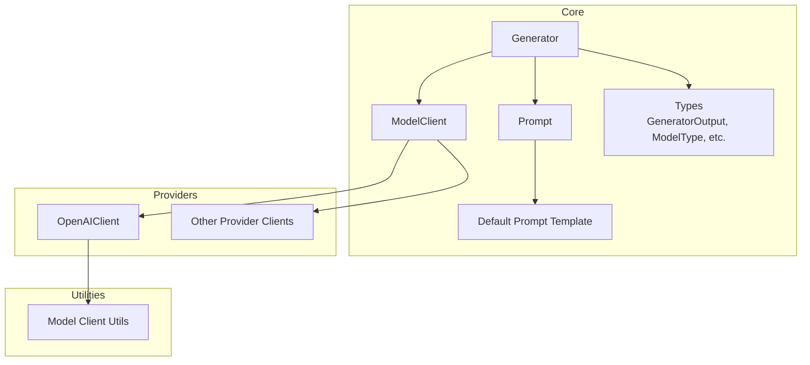
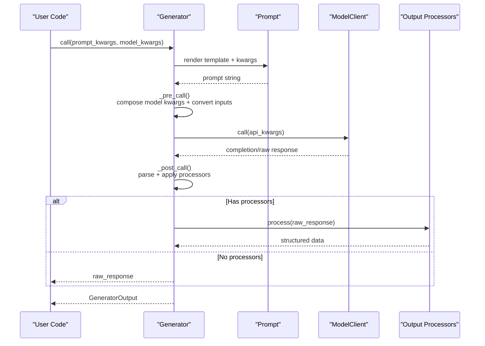
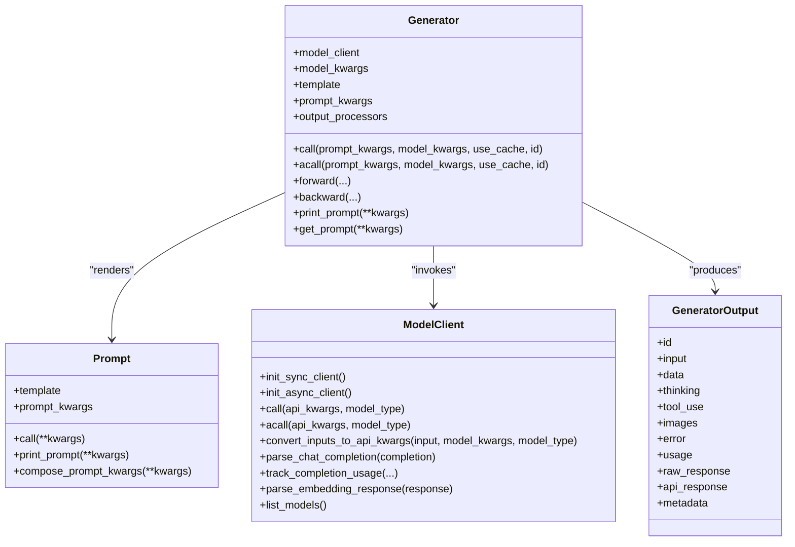
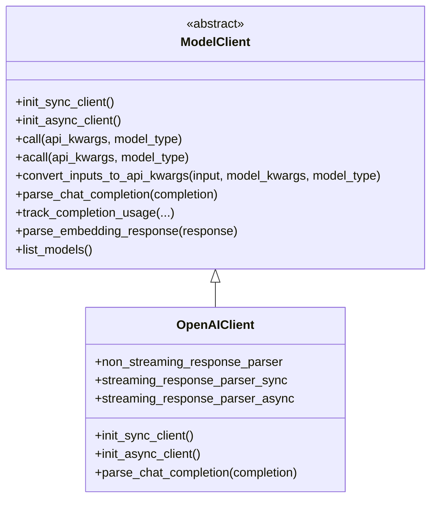
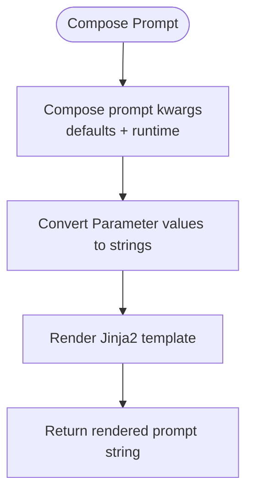
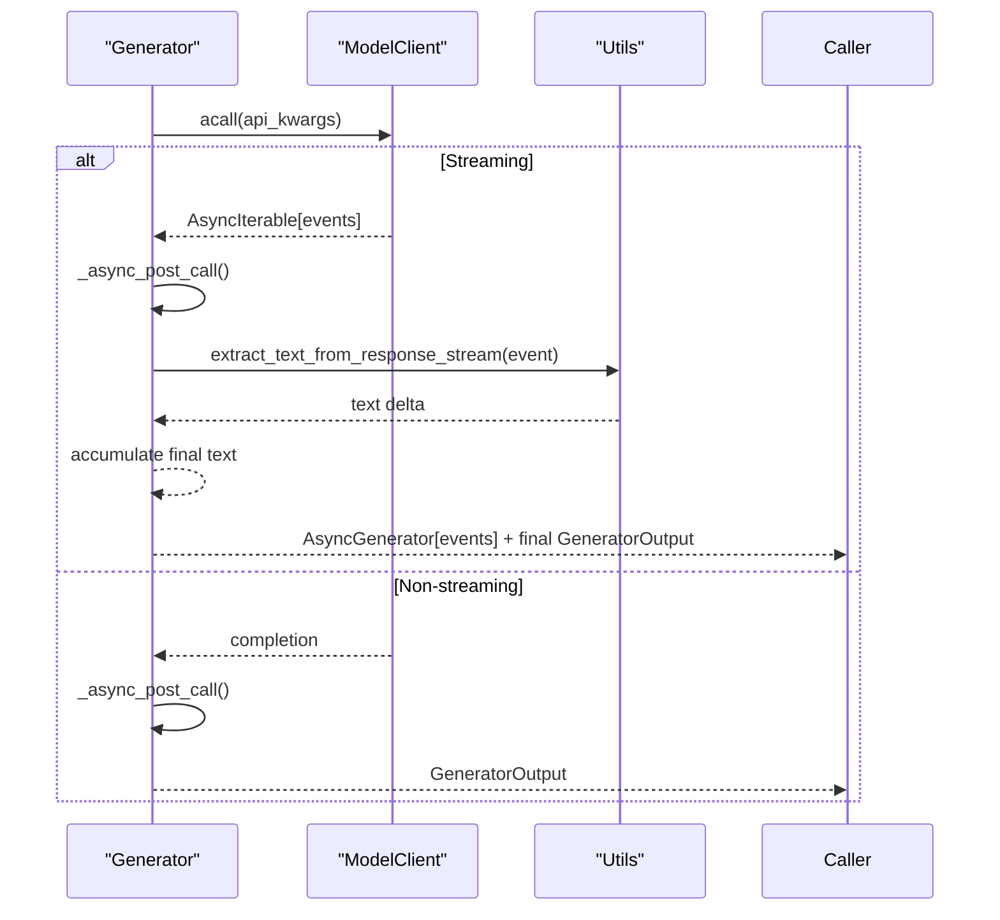
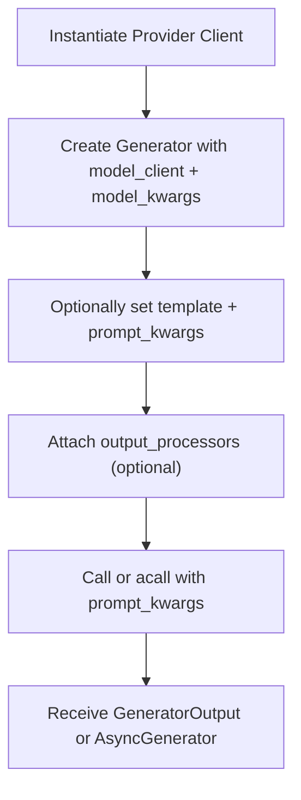
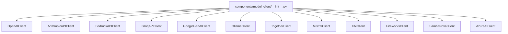

# Generator Orchestration

<cite>
**Referenced Files in This Document**
- [generator.py](file://adalflow/adalflow/core/generator.py)
- [model_client.py](file://adalflow/adalflow/core/model_client.py)
- [prompt_builder.py](file://adalflow/adalflow/core/prompt_builder.py)
- [types.py](file://adalflow/adalflow/core/types.py)
- [default_prompt_template.py](file://adalflow/adalflow/core/default_prompt_template.py)
- [openai_client.py](file://adalflow/adalflow/components/model_client/openai_client.py)
- [utils.py](file://adalflow/adalflow/components/model_client/utils.py)
- [__init__.py](file://adalflow/adalflow/components/model_client/__init__.py)
- [generator_note.py](file://tutorials/generator_note.py)
- [generator_all_providers.py](file://tutorials/generator_all_providers.py)
- [runner_streaming.py](file://tutorials/v1_agent_runner/runner_streaming.py)
</cite>

## Table of Contents
1. [Introduction](#introduction)
2. [Project Structure](#project-structure)
3. [Core Components](#core-components)
4. [Architecture Overview](#architecture-overview)
5. [Detailed Component Analysis](#detailed-component-analysis)
6. [Dependency Analysis](#dependency-analysis)
7. [Performance Considerations](#performance-considerations)
8. [Troubleshooting Guide](#troubleshooting-guide)
9. [Conclusion](#conclusion)
10. [Appendices](#appendices)

## Introduction
This document explains AdalFlow’s unified LLM interaction framework centered on the Generator orchestration component. It covers how the Generator composes a Prompt, delegates to a ModelClient, applies output processors, and handles both synchronous and asynchronous responses—including streaming. It also documents the provider abstraction, unified interface across model clients, prompt processing, response handling, and performance and error-handling strategies. Concrete examples are drawn from the codebase to illustrate instantiation, configuration, and usage patterns across providers.

## Project Structure
At the heart of the unified LLM interaction framework are three primary building blocks:
- Generator: The user-facing orchestration component that wires together Prompt, ModelClient, and Output Processors.
- ModelClient: The abstract protocol and base class for all model providers (local and cloud APIs).
- Prompt: A Jinja2-powered prompt builder that renders templates with variables and nested rendering.

These components integrate with shared data types and default templates to provide a consistent interface across providers.

**Diagram sources**
- [generator.py](file://adalflow/adalflow/core/generator.py#L82-L210)
- [model_client.py](file://adalflow/adalflow/core/model_client.py#L16-L128)
- [prompt_builder.py](file://adalflow/adalflow/core/prompt_builder.py#L20-L220)
- [types.py](file://adalflow/adalflow/core/types.py#L55-L135)
- [default_prompt_template.py](file://adalflow/adalflow/core/default_prompt_template.py#L34-L98)
- [openai_client.py](file://adalflow/adalflow/components/model_client/openai_client.py#L411-L777)
- [utils.py](file://adalflow/adalflow/components/model_client/utils.py#L1-L278)

**Section sources**
- [generator.py](file://adalflow/adalflow/core/generator.py#L82-L210)
- [model_client.py](file://adalflow/adalflow/core/model_client.py#L16-L128)
- [prompt_builder.py](file://adalflow/adalflow/core/prompt_builder.py#L20-L220)
- [types.py](file://adalflow/adalflow/core/types.py#L55-L135)
- [default_prompt_template.py](file://adalflow/adalflow/core/default_prompt_template.py#L34-L98)

## Core Components
- Generator: Orchestrates prompt rendering, model client invocation, response parsing, output processing, caching, callbacks, tracing, and optional backward pass for text gradients. It supports both sync and async modes and integrates with a cache engine.
- ModelClient: Defines the provider-agnostic interface for initialization, input conversion, API calls, response parsing, and usage tracking. Concrete providers implement this interface.
- Prompt: Renders Jinja2 templates with variables, supports nested rendering, and composes runtime kwargs with defaults.
- Types: Provides standardized data classes for GeneratorOutput, ModelType, CompletionUsage, and streaming event types.
- Default Prompt Template: Supplies a reusable system prompt with placeholders for task description, examples, tools, context, steps, and input.

**Section sources**
- [generator.py](file://adalflow/adalflow/core/generator.py#L82-L210)
- [model_client.py](file://adalflow/adalflow/core/model_client.py#L16-L128)
- [prompt_builder.py](file://adalflow/adalflow/core/prompt_builder.py#L20-L220)
- [types.py](file://adalflow/adalflow/core/types.py#L486-L675)
- [default_prompt_template.py](file://adalflow/adalflow/core/default_prompt_template.py#L34-L98)

## Architecture Overview
The Generator follows a layered orchestration pattern:
- Prompt Layer: Compose and render the prompt from template and kwargs.
- Model Client Layer: Convert inputs to provider-specific API kwargs, call the provider, and parse responses.
- Output Processing Layer: Apply optional output processors to transform raw model output into structured data.
- Streaming and Caching: Handle streaming responses and cache non-streaming completions for performance.
- Observability and Control: Integrate callbacks, tracing, and optional backward pass for text gradients.

**Diagram sources**
- [generator.py](file://adalflow/adalflow/core/generator.py#L463-L494)
- [generator.py](file://adalflow/adalflow/core/generator.py#L496-L543)
- [generator.py](file://adalflow/adalflow/core/generator.py#L550-L582)
- [generator.py](file://adalflow/adalflow/core/generator.py#L357-L379)
- [prompt_builder.py](file://adalflow/adalflow/core/prompt_builder.py#L181-L194)

**Section sources**
- [generator.py](file://adalflow/adalflow/core/generator.py#L463-L494)
- [generator.py](file://adalflow/adalflow/core/generator.py#L496-L543)
- [generator.py](file://adalflow/adalflow/core/generator.py#L550-L582)
- [generator.py](file://adalflow/adalflow/core/generator.py#L357-L379)
- [prompt_builder.py](file://adalflow/adalflow/core/prompt_builder.py#L181-L194)

## Detailed Component Analysis

### Generator Class Design
The Generator is a composite orchestration component that:
- Validates and stores a ModelClient instance.
- Manages prompt templates and prompt kwargs, including trainable parameters.
- Composes model kwargs and converts inputs to API-specific kwargs via the ModelClient.
- Calls the ModelClient synchronously or asynchronously, parses responses, and applies output processors.
- Supports caching for non-streaming responses, callbacks, tracing, and optional backward pass for text gradients.
- Exposes sync call and async acall methods, and integrates with training mode via forward.

Key orchestration methods:
- _pre_call: Renders prompt, composes model kwargs, converts inputs to API kwargs, and estimates tokens.
- _model_client_call and _async_model_client_call: Invoke the ModelClient with caching and error handling.
- _post_call and _async_post_call: Parse raw responses, optionally stream, and apply output processors.
- call and acall: Public entry points for synchronous and asynchronous generation.
- forward/backward: Training mode integration for text gradients and demo tracing.

**Diagram sources**
- [generator.py](file://adalflow/adalflow/core/generator.py#L82-L210)
- [generator.py](file://adalflow/adalflow/core/generator.py#L1222-L1396)
- [model_client.py](file://adalflow/adalflow/core/model_client.py#L16-L128)
- [prompt_builder.py](file://adalflow/adalflow/core/prompt_builder.py#L20-L220)
- [types.py](file://adalflow/adalflow/core/types.py#L486-L541)

**Section sources**
- [generator.py](file://adalflow/adalflow/core/generator.py#L82-L210)
- [generator.py](file://adalflow/adalflow/core/generator.py#L1222-L1396)
- [model_client.py](file://adalflow/adalflow/core/model_client.py#L16-L128)
- [prompt_builder.py](file://adalflow/adalflow/core/prompt_builder.py#L20-L220)
- [types.py](file://adalflow/adalflow/core/types.py#L486-L541)

### LLM Provider Abstraction and Unified Interface
ModelClient defines a unified interface for all providers:
- Initialization: Both sync and async clients are supported.
- Invocation: call and acall accept provider-agnostic api_kwargs and model_type.
- Input conversion: convert_inputs_to_api_kwargs adapts standard inputs and model kwargs to provider-specific formats.
- Parsing: parse_chat_completion standardizes raw provider responses into GeneratorOutput.
- Usage tracking: track_completion_usage standardizes token usage reporting.
- Embedding parsing: parse_embedding_response standardizes embedding responses.
- Listing models: list_models exposes provider capabilities.

Concrete providers implement this interface. For example, OpenAIClient:
- Initializes OpenAI and AsyncOpenAI clients.
- Uses the Response API for both streaming and non-streaming.
- Parses complex outputs (text, images, tool calls, reasoning) into a unified structure.
- Provides streaming helpers and image processing utilities.

**Diagram sources**
- [model_client.py](file://adalflow/adalflow/core/model_client.py#L16-L128)
- [openai_client.py](file://adalflow/adalflow/components/model_client/openai_client.py#L411-L777)

**Section sources**
- [model_client.py](file://adalflow/adalflow/core/model_client.py#L16-L128)
- [openai_client.py](file://adalflow/adalflow/components/model_client/openai_client.py#L411-L777)
- [utils.py](file://adalflow/adalflow/components/model_client/utils.py#L1-L278)

### Unified Prompt Processing
Prompt uses Jinja2 to render templates with variables. It:
- Stores a template and preset prompt kwargs.
- Composes runtime kwargs with defaults.
- Converts Parameter objects to strings and supports nested rendering of Prompt and Template objects.
- Prints or returns the rendered prompt string.

**Diagram sources**
- [prompt_builder.py](file://adalflow/adalflow/core/prompt_builder.py#L104-L114)
- [prompt_builder.py](file://adalflow/adalflow/core/prompt_builder.py#L230-L258)
- [prompt_builder.py](file://adalflow/adalflow/core/prompt_builder.py#L181-L194)

**Section sources**
- [prompt_builder.py](file://adalflow/adalflow/core/prompt_builder.py#L104-L114)
- [prompt_builder.py](file://adalflow/adalflow/core/prompt_builder.py#L230-L258)
- [prompt_builder.py](file://adalflow/adalflow/core/prompt_builder.py#L181-L194)

### Response Handling and Streaming Support
Generator supports both synchronous and asynchronous responses:
- Synchronous: call returns a GeneratorOutput with data populated by output processors.
- Asynchronous: acall returns either a GeneratorOutput or an async generator of events. When streaming, the raw_response is an async iterable; Generator wraps it to yield events and then produce a final GeneratorOutput with processed data.

OpenAIClient demonstrates streaming via the Response API:
- Non-streaming: parse_chat_completion returns a GeneratorOutput with unified fields.
- Streaming: streaming_response_parser yields events; utils.extract_text_from_response_stream helps extract deltas.

**Diagram sources**
- [generator.py](file://adalflow/adalflow/core/generator.py#L420-L461)
- [generator.py](file://adalflow/adalflow/core/generator.py#L1306-L1396)
- [openai_client.py](file://adalflow/adalflow/components/model_client/openai_client.py#L383-L407)
- [utils.py](file://adalflow/adalflow/components/model_client/utils.py#L197-L255)

**Section sources**
- [generator.py](file://adalflow/adalflow/core/generator.py#L420-L461)
- [generator.py](file://adalflow/adalflow/core/generator.py#L1306-L1396)
- [openai_client.py](file://adalflow/adalflow/components/model_client/openai_client.py#L383-L407)
- [utils.py](file://adalflow/adalflow/components/model_client/utils.py#L197-L255)

### Usage Patterns and Examples
Examples from the codebase demonstrate:
- Minimal Generator instantiation with a provider client and model kwargs.
- Using a custom template and output processors (e.g., JSON parser).
- Switching providers via a factory-like enum-style accessor.
- Creating Generators from configuration dictionaries.
- End-to-end usage across multiple providers.

**Diagram sources**
- [generator_note.py](file://tutorials/generator_note.py#L72-L87)
- [generator_note.py](file://tutorials/generator_note.py#L89-L116)
- [generator_note.py](file://tutorials/generator_note.py#L143-L158)
- [generator_note.py](file://tutorials/generator_note.py#L160-L214)
- [generator_all_providers.py](file://tutorials/generator_all_providers.py#L6-L48)

**Section sources**
- [generator_note.py](file://tutorials/generator_note.py#L72-L87)
- [generator_note.py](file://tutorials/generator_note.py#L89-L116)
- [generator_note.py](file://tutorials/generator_note.py#L143-L158)
- [generator_note.py](file://tutorials/generator_note.py#L160-L214)
- [generator_all_providers.py](file://tutorials/generator_all_providers.py#L6-L48)

### Relationship Between Generators, Model Clients, Prompt Templates, and Response Processing
- Generators depend on Prompt for templating and on ModelClient for provider-specific API interactions.
- Output processors transform raw model output into structured data for downstream components.
- Default prompt templates provide a consistent structure across tasks and providers.

**Section sources**
- [generator.py](file://adalflow/adalflow/core/generator.py#L357-L379)
- [prompt_builder.py](file://adalflow/adalflow/core/prompt_builder.py#L20-L220)
- [default_prompt_template.py](file://adalflow/adalflow/core/default_prompt_template.py#L34-L98)
- [types.py](file://adalflow/adalflow/core/types.py#L486-L541)

## Dependency Analysis
Provider availability and lazy imports enable optional SDKs per provider. The ModelClient interface ensures consistent behavior regardless of provider.

**Diagram sources**
- [__init__.py](file://adalflow/adalflow/components/model_client/__init__.py#L11-L131)

**Section sources**
- [__init__.py](file://adalflow/adalflow/components/model_client/__init__.py#L11-L131)

## Performance Considerations
- Caching: Generator caches non-streaming responses keyed by serialized api_kwargs to reduce latency and cost.
- Token estimation: The prompt token count is estimated and exposed for monitoring.
- Streaming: Prefer streaming for long responses to reduce latency and memory footprint.
- Output processors: Avoid streaming with output processors that require the entire response; they run after completion.
- Provider selection: Choose providers aligned with latency, cost, and capability profiles.

[No sources needed since this section provides general guidance]

## Troubleshooting Guide
Common issues and remedies:
- Provider API key errors: Ensure environment variables are configured for the chosen provider client.
- Streaming consumption: Async generators can only be iterated once; consume events promptly or rely on final output.
- Output parsing errors: Wrap output processors in try/except or use robust parsers; Generator captures errors in the output.
- Rate limits and retries: Providers may surface rate limit errors; configure retries or backoff at the provider level.
- Token limits: If prompts exceed max_tokens, Generator truncates prompt strings and warns.

**Section sources**
- [generator.py](file://adalflow/adalflow/core/generator.py#L496-L543)
- [generator.py](file://adalflow/adalflow/core/generator.py#L520-L543)
- [runner_streaming.py](file://tutorials/v1_agent_runner/runner_streaming.py#L205-L250)

## Conclusion
AdalFlow’s Generator provides a unified, extensible framework for LLM interactions. By abstracting providers behind ModelClient, composing prompts with Prompt, and standardizing outputs via GeneratorOutput, it enables consistent behavior across diverse providers. The framework supports synchronous and asynchronous workflows, streaming, caching, observability, and optional text-gradient-based optimization, making it suitable for both simple prompts and complex, multi-step applications.

## Appendices

### A. Example Workflows
- Minimal Generator: Instantiate a provider client and call the Generator with prompt kwargs.
- Structured output: Attach an output processor (e.g., JSON parser) to enforce structured responses.
- Multi-provider usage: Instantiate Generators with different provider clients and compare outputs.

**Section sources**
- [generator_note.py](file://tutorials/generator_note.py#L72-L87)
- [generator_note.py](file://tutorials/generator_note.py#L89-L116)
- [generator_all_providers.py](file://tutorials/generator_all_providers.py#L6-L48)

### B. Streaming End-to-End
- Direct streaming with Generator: Enable stream in model_kwargs and iterate over acall results.
- Runner streaming: Demonstrates multi-step streaming with structured outputs and event handling.

**Section sources**
- [runner_streaming.py](file://tutorials/v1_agent_runner/runner_streaming.py#L205-L250)
- [runner_streaming.py](file://tutorials/v1_agent_runner/runner_streaming.py#L252-L336)
- [runner_streaming.py](file://tutorials/v1_agent_runner/runner_streaming.py#L339-L436)