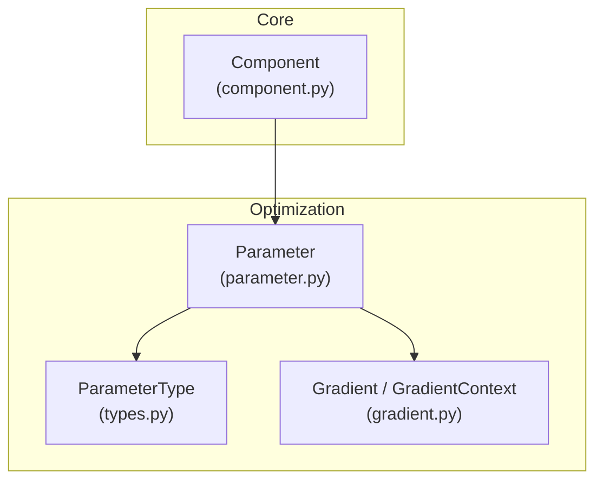
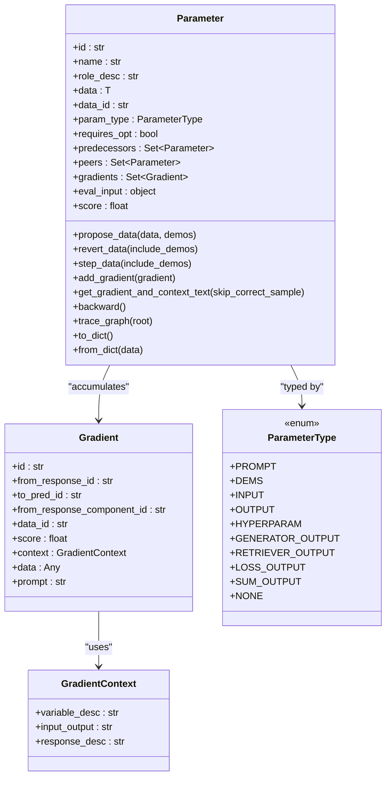
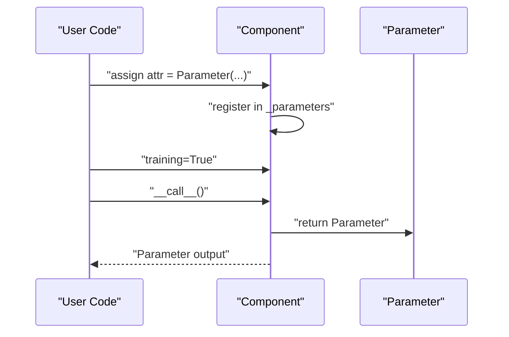
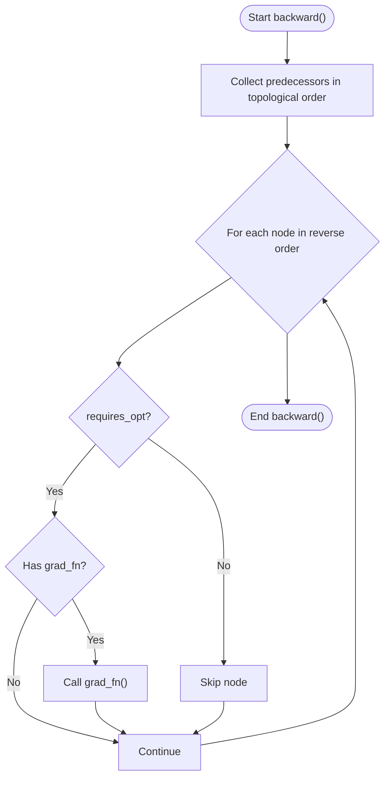
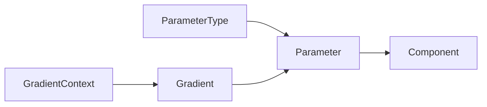

# Parameter System

<cite>
**Referenced Files in This Document**
- [parameter.py](file://adalflow/adalflow/optim/parameter.py)
- [types.py](file://adalflow/adalflow/optim/types.py)
- [gradient.py](file://adalflow/adalflow/optim/gradient.py)
- [component.py](file://adalflow/adalflow/core/component.py)
- [__init__.py](file://adalflow/adalflow/optim/__init__.py)
- [test_parameter.py](file://adalflow/tests/test_parameter.py)
- [test_parameter_text_grad.py](file://adalflow/tests/test_parameter_text_grad.py)
</cite>

## Table of Contents
1. [Introduction](#introduction)
2. [Project Structure](#project-structure)
3. [Core Components](#core-components)
4. [Architecture Overview](#architecture-overview)
5. [Detailed Component Analysis](#detailed-component-analysis)
6. [Dependency Analysis](#dependency-analysis)
7. [Performance Considerations](#performance-considerations)
8. [Troubleshooting Guide](#troubleshooting-guide)
9. [Conclusion](#conclusion)

## Introduction
This document explains AdalFlow’s trainable component framework centered around the Parameter class. It covers how parameters are defined, registered automatically within components, tracked across computation graphs, and integrated with gradient computation and optimization workflows. It also documents parameter types, naming conventions, hierarchical management, serialization, and practical usage patterns drawn from the codebase.

## Project Structure
The Parameter system lives under the optimization subsystem and integrates with the core component framework:
- Parameter and related types are defined in the optimization module.
- Gradients and contexts are modeled separately for feedback and scoring.
- Components expose parameter enumeration and validation for training/inference modes.



**Diagram sources**
- [parameter.py](file://adalflow/adalflow/optim/parameter.py#L119-L1712)
- [types.py](file://adalflow/adalflow/optim/types.py#L12-L67)
- [gradient.py](file://adalflow/adalflow/optim/gradient.py#L14-L133)
- [component.py](file://adalflow/adalflow/core/component.py#L400-L599)

**Section sources**
- [parameter.py](file://adalflow/adalflow/optim/parameter.py#L1-L120)
- [types.py](file://adalflow/adalflow/optim/types.py#L1-L67)
- [gradient.py](file://adalflow/adalflow/optim/gradient.py#L1-L133)
- [component.py](file://adalflow/adalflow/core/component.py#L400-L599)

## Core Components
- Parameter: A generic container for trainable and traceable data used across optimization, prompting, and few-shot examples. It supports gradient accumulation, predecessor/successor relationships, and serialization.
- ParameterType: An enum defining categories of parameters (trainable and non-trainable) and their roles in the system.
- Gradient and GradientContext: Data structures capturing feedback, context, and scores for backpropagation-like updates.
- Component: Provides parameter enumeration and validation for training/inference modes, enabling automatic parameter registration when parameters are assigned as component attributes.

Key responsibilities:
- Parameter defines lifecycle hooks for proposing updates, reverting, stepping, and backward propagation.
- ParameterType constrains allowed parameter categories and default trainability.
- GradientContext and Gradient carry feedback and scoring for optimization.
- Component exposes parameters via named_parameters and validates outputs in training mode.

**Section sources**
- [parameter.py](file://adalflow/adalflow/optim/parameter.py#L119-L750)
- [types.py](file://adalflow/adalflow/optim/types.py#L12-L67)
- [gradient.py](file://adalflow/adalflow/optim/gradient.py#L14-L133)
- [component.py](file://adalflow/adalflow/core/component.py#L400-L599)

## Architecture Overview
The Parameter system participates in a computation graph where components produce parameters, gradients are accumulated, and optimization updates are applied.

```mermaid
sequenceDiagram
participant Comp as "Component"
participant Param as "Parameter"
participant Grad as "Gradient"
participant Opt as "Optimizer"
Comp->>Param : "Assign Parameter as attribute"
Param->>Comp : "Registered in component._parameters"
Comp->>Param : "forward() returns Parameter in training"
Param->>Grad : "accumulate feedback as Gradient"
Opt->>Param : "propose_data()/step_data()"
Param->>Comp : "predecessors/successors updated"
Param->>Param : "backward() traverses predecessors"
```

**Diagram sources**
- [component.py](file://adalflow/adalflow/core/component.py#L511-L551)
- [parameter.py](file://adalflow/adalflow/optim/parameter.py#L119-L750)
- [gradient.py](file://adalflow/adalflow/optim/gradient.py#L44-L133)

## Detailed Component Analysis

### Parameter Class Design
The Parameter class encapsulates:
- Identity and metadata: id, name, role_desc, param_type, data_id.
- Data and type safety: typed storage with in-place update validation.
- Optimization lifecycle: propose/revert/step for data updates.
- Gradients: collection, sorting, aggregation, and context assembly.
- Traces: storing forward/backward traces and evaluation inputs.
- Serialization: to/from dict for persistence and graph export.
- Graph utilities: predecessor/successor relationships, topological traversal, and visualization.

Notable methods and capabilities:
- Initialization with id/name/role_desc/data/param_type/requires_opt and optional callbacks for prompt inclusion.
- Gradient management: add_gradient, reset_gradients, get_gradients_str, get_gradient_and_context_text, sort_gradients.
- Proposals: propose_data, revert_data, step_data with optional demos rollback.
- Tracing: add_dataclass_to_trace, add_score_to_trace, set_score, trace_optimizer.
- Graph operations: trace_graph, backward, and extensive graph visualization helpers.
- Serialization: to_dict/from_dict for persistence and debugging.



**Diagram sources**
- [parameter.py](file://adalflow/adalflow/optim/parameter.py#L119-L750)
- [gradient.py](file://adalflow/adalflow/optim/gradient.py#L44-L133)
- [types.py](file://adalflow/adalflow/optim/types.py#L12-L67)

**Section sources**
- [parameter.py](file://adalflow/adalflow/optim/parameter.py#L119-L750)
- [gradient.py](file://adalflow/adalflow/optim/gradient.py#L44-L133)
- [types.py](file://adalflow/adalflow/optim/types.py#L12-L67)

### Parameter Registration Mechanisms
Parameters are automatically registered when assigned as attributes to a Component. The component maintains an internal mapping of parameters keyed by attribute names. During training, the component enforces that outputs are Parameter instances, ensuring the system operates on trainable parameters.

Highlights:
- Automatic registration occurs when a Parameter is assigned to a component attribute.
- Component.named_parameters recursively enumerates parameters with dotted names for hierarchical organization.
- Component.forward and Component.__call__ validate outputs in training mode.



**Diagram sources**
- [component.py](file://adalflow/adalflow/core/component.py#L400-L599)

**Section sources**
- [component.py](file://adalflow/adalflow/core/component.py#L400-L599)

### Automatic Differentiation Support
AdalFlow implements a lightweight autograd-style mechanism:
- Gradients are represented as Gradient objects with context and scores.
- Parameters accumulate gradients and can sort/aggregate them for downstream use.
- The backward traversal builds a topological order over predecessors and invokes a grad_fn if present.
- OutputParameter extends Parameter to capture component traces and full responses.



**Diagram sources**
- [parameter.py](file://adalflow/adalflow/optim/parameter.py#L711-L750)

**Section sources**
- [parameter.py](file://adalflow/adalflow/optim/parameter.py#L286-L507)
- [gradient.py](file://adalflow/adalflow/optim/gradient.py#L44-L133)

### Parameter Tracking, Gradient Computation, and Optimization Integration
- Gradient accumulation: Parameters collect Gradient objects with unique identifiers and context.
- Aggregation: get_gradient_and_context_text groups gradients by data_id and component, sorts by average score, and renders a structured prompt.
- Optimization lifecycle: propose_data stores previous values; step_data finalizes updates; revert_data restores previous state.
- Integration with optimizers: Parameters can be passed to optimizers (e.g., TGDOptimizer) to generate prompts and update proposals.

```mermaid
sequenceDiagram
participant Gen as "Generator/Component"
participant Param as "Parameter"
participant Grad as "Gradient"
participant Opt as "Optimizer/TGDOptimizer"
Gen->>Param : "produce output Parameter"
Gen->>Grad : "create Gradient with context/score"
Param->>Param : "add_gradient(Grad)"
Opt->>Param : "propose_data(new_data)"
Param->>Param : "step_data()"
Opt->>Param : "revert_data() if needed"
```

**Diagram sources**
- [parameter.py](file://adalflow/adalflow/optim/parameter.py#L610-L645)
- [gradient.py](file://adalflow/adalflow/optim/gradient.py#L74-L118)

**Section sources**
- [parameter.py](file://adalflow/adalflow/optim/parameter.py#L610-L645)
- [gradient.py](file://adalflow/adalflow/optim/gradient.py#L74-L118)

### Parameter Naming Conventions and Hierarchical Management
- Name generation: If no explicit name is provided, a derived human-readable name is created from role_desc or a unique identifier.
- Hierarchical naming: Components enumerate parameters with dotted prefixes reflecting nested composition.
- Parameter types: ParameterType distinguishes trainable categories (PROMPT, DEMOS, OUTPUT variants) and non-trainable categories (INPUT, HYPERPARAM).

Practical implications:
- Use role_desc to improve readability and traceability.
- Leverage Component.named_parameters for deterministic, hierarchical discovery of parameters.

**Section sources**
- [parameter.py](file://adalflow/adalflow/optim/parameter.py#L196-L210)
- [component.py](file://adalflow/adalflow/core/component.py#L448-L473)
- [types.py](file://adalflow/adalflow/optim/types.py#L12-L67)

### Serialization, State Persistence, and Graph Export
- Serialization: Parameter.to_dict and Parameter.from_dict enable saving/loading parameter state, including predecessors, gradients, traces, and demos.
- Graph export: Utilities generate static and interactive graphs of the parameter computation graph, including gradient and trace details.
- Interactive visualization: Generates HTML pages per node and a network graph with clickable nodes.

Usage patterns:
- Persist parameter state after training steps.
- Export interactive graphs for debugging and auditing.

**Section sources**
- [parameter.py](file://adalflow/adalflow/optim/parameter.py#L1456-L1496)
- [parameter.py](file://adalflow/adalflow/optim/parameter.py#L828-L1011)
- [parameter.py](file://adalflow/adalflow/optim/parameter.py#L1044-L1180)

### Concrete Examples from the Codebase
- Parameter creation and prompt integration: Tests demonstrate constructing Parameter with role_desc and a data_in_prompt callable to format data for prompts.
- Gradient context and prompt assembly: Tests show assembling gradient and context text and verifying optimizer prompts include constraints and examples.
- Component parameter enumeration: Component methods named_parameters and parameters are used across trainers and tasks to iterate over trainable parameters.

References:
- Parameter initialization and prompt formatting: [test_parameter.py](file://adalflow/tests/test_parameter.py#L49-L60)
- Gradient context and optimizer prompt construction: [test_parameter_text_grad.py](file://adalflow/tests/test_parameter_text_grad.py#L39-L71)
- Component parameter enumeration: [component.py](file://adalflow/adalflow/core/component.py#L400-L473)

**Section sources**
- [test_parameter.py](file://adalflow/tests/test_parameter.py#L1-L90)
- [test_parameter_text_grad.py](file://adalflow/tests/test_parameter_text_grad.py#L1-L75)
- [component.py](file://adalflow/adalflow/core/component.py#L400-L599)

## Dependency Analysis
The Parameter system depends on:
- ParameterType for categorization and default trainability.
- Gradient and GradientContext for feedback and scoring.
- Component for registration and parameter enumeration/validation.



**Diagram sources**
- [types.py](file://adalflow/adalflow/optim/types.py#L12-L67)
- [parameter.py](file://adalflow/adalflow/optim/parameter.py#L119-L750)
- [gradient.py](file://adalflow/adalflow/optim/gradient.py#L14-L133)
- [component.py](file://adalflow/adalflow/core/component.py#L400-L599)

**Section sources**
- [__init__.py](file://adalflow/adalflow/optim/__init__.py#L1-L39)
- [types.py](file://adalflow/adalflow/optim/types.py#L12-L67)
- [parameter.py](file://adalflow/adalflow/optim/parameter.py#L119-L750)
- [gradient.py](file://adalflow/adalflow/optim/gradient.py#L14-L133)
- [component.py](file://adalflow/adalflow/core/component.py#L400-L599)

## Performance Considerations
- Prefer lightweight data_in_prompt functions to minimize token usage in prompts.
- Limit gradient accumulation to necessary scopes to reduce overhead.
- Use Component.named_parameters with recursive=False when only direct parameters are needed.
- Serialize and visualize graphs sparingly in production to avoid I/O overhead.

## Troubleshooting Guide
Common issues and resolutions:
- Parameter type mismatch: update_value enforces type compatibility; ensure new data matches the initial data type.
- Missing component_trace: Gradient requires a valid from_response_component_id; ensure component_trace is set before adding gradients.
- Unexpected output types in training: Component.__call__ validates that training mode returns Parameter; adjust forward to return Parameter.

**Section sources**
- [parameter.py](file://adalflow/adalflow/optim/parameter.py#L649-L662)
- [gradient.py](file://adalflow/adalflow/optim/gradient.py#L74-L99)
- [component.py](file://adalflow/adalflow/core/component.py#L511-L551)

## Conclusion
AdalFlow’s Parameter system provides a robust, extensible foundation for trainable components. It integrates seamlessly with components for automatic registration, supports gradient accumulation and backpropagation-like traversal, and offers rich serialization and visualization capabilities. By leveraging ParameterType, Gradient, and Component APIs, developers can build optimization workflows that are both beginner-friendly and powerful for advanced use cases.