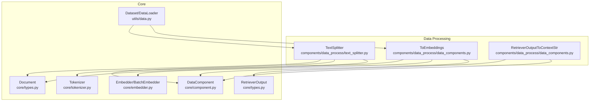
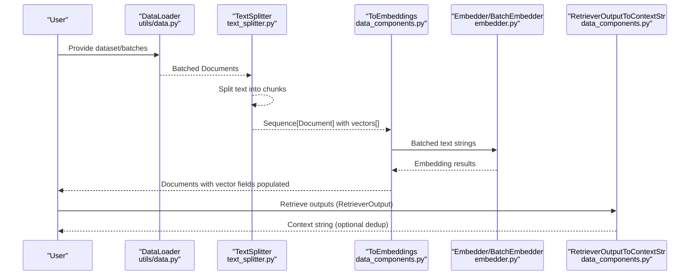
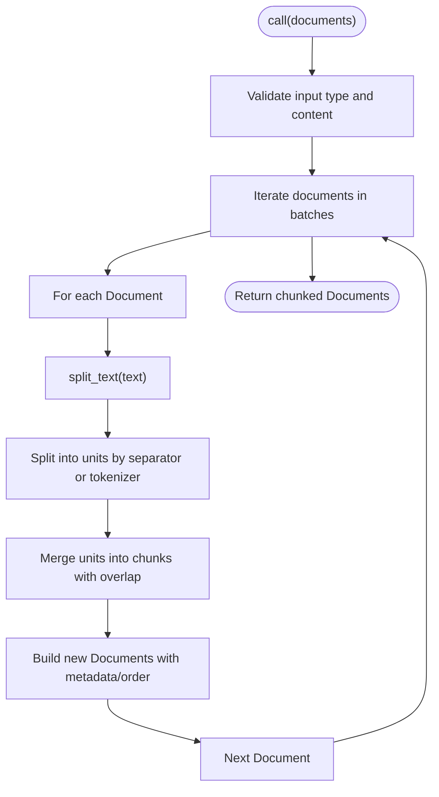
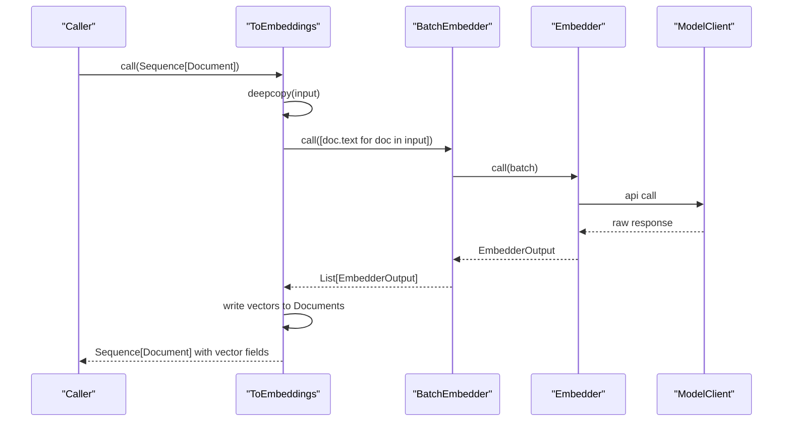
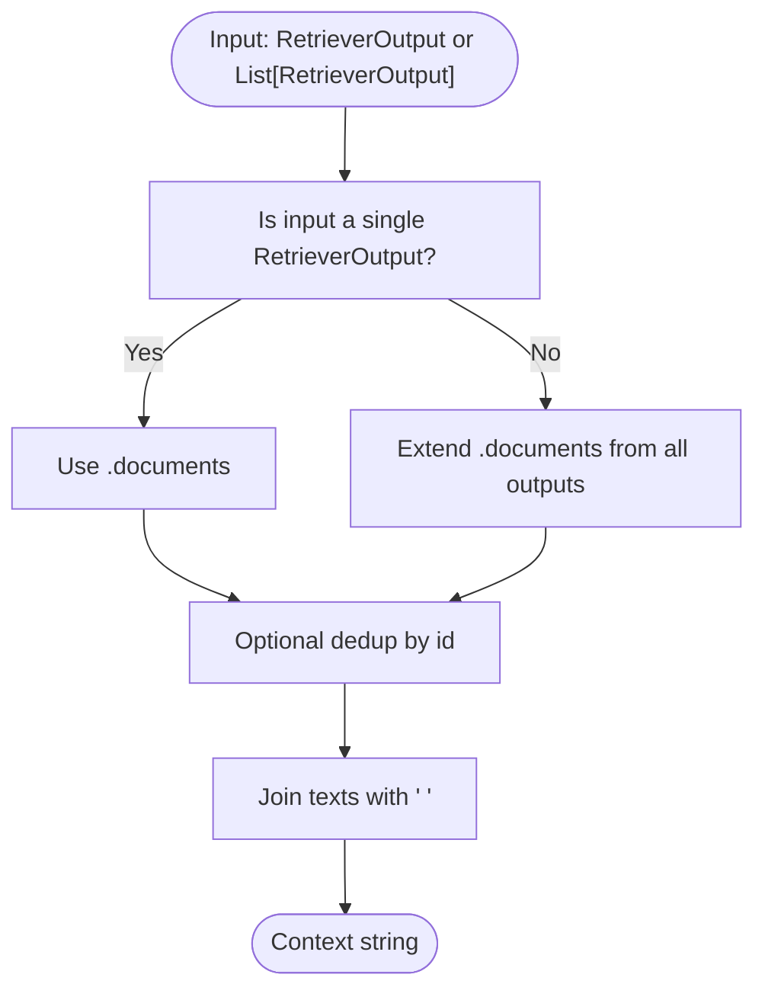
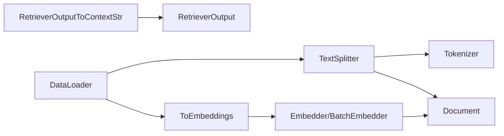

# Data Processing Pipeline

<cite>
**Referenced Files in This Document**
- [text_splitter.py](file://adalflow/adalflow/components/data_process/text_splitter.py)
- [data_components.py](file://adalflow/adalflow/components/data_process/data_components.py)
- [component.py](file://adalflow/adalflow/core/component.py)
- [types.py](file://adalflow/adalflow/core/types.py)
- [embedder.py](file://adalflow/adalflow/core/embedder.py)
- [tokenizer.py](file://adalflow/adalflow/core/tokenizer.py)
- [data.py](file://adalflow/adalflow/utils/data.py)
- [test_text_splitter.py](file://adalflow/tests/test_text_splitter.py)
- [test_data.py](file://adalflow/tests/test_data.py)
- [adalflow_text_splitter.py](file://tutorials/adalflow_text_splitter.py)
</cite>

## Table of Contents
1. [Introduction](#introduction)
2. [Project Structure](#project-structure)
3. [Core Components](#core-components)
4. [Architecture Overview](#architecture-overview)
5. [Detailed Component Analysis](#detailed-component-analysis)
6. [Dependency Analysis](#dependency-analysis)
7. [Performance Considerations](#performance-considerations)
8. [Troubleshooting Guide](#troubleshooting-guide)
9. [Conclusion](#conclusion)
10. [Appendices](#appendices)

## Introduction
This document explains AdalFlow’s Data Processing Pipeline with a focus on text processing and data manipulation. It covers text splitting strategies, data transformation utilities, pipeline composition patterns, and the integration between upstream processors (splitters, embedders) and downstream components (retrievers, generators). Practical examples demonstrate data loading, chunking workflows, and validation mechanisms. Guidance is provided for performance optimization, memory management, scalability, and extending the pipeline with custom processors.

## Project Structure
The data processing pipeline centers around:
- Text splitting and chunking: [TextSplitter](file://adalflow/adalflow/components/data_process/text_splitter.py#L47-L357)
- Data transformations: [ToEmbeddings](file://adalflow/adalflow/components/data_process/data_components.py#L74-L105) and [RetrieverOutputToContextStr](file://adalflow/adalflow/components/data_process/data_components.py#L112-L127)
- Core component abstractions: [Component/DataComponent](file://adalflow/adalflow/core/component.py#L51-L120)
- Data models and types: [Document](file://adalflow/adalflow/core/types.py#L1-L200), [RetrieverOutput](file://adalflow/adalflow/core/types.py#L291-L316)
- Embedding orchestration: [Embedder/BatchEmbedder](file://adalflow/adalflow/core/embedder.py#L23-L236)
- Tokenization: [Tokenizer](file://adalflow/adalflow/core/tokenizer.py#L11-L57)
- Data loaders and batching utilities: [Dataset/DataLoader](file://adalflow/adalflow/utils/data.py#L13-L136)

**Diagram sources**
- [text_splitter.py](file://adalflow/adalflow/components/data_process/text_splitter.py#L47-L357)
- [data_components.py](file://adalflow/adalflow/components/data_process/data_components.py#L74-L127)
- [component.py](file://adalflow/adalflow/core/component.py#L51-L120)
- [types.py](file://adalflow/adalflow/core/types.py#L1-L350)
- [embedder.py](file://adalflow/adalflow/core/embedder.py#L23-L236)
- [tokenizer.py](file://adalflow/adalflow/core/tokenizer.py#L11-L57)
- [data.py](file://adalflow/adalflow/utils/data.py#L13-L136)

**Section sources**
- [text_splitter.py](file://adalflow/adalflow/components/data_process/text_splitter.py#L1-L357)
- [data_components.py](file://adalflow/adalflow/components/data_process/data_components.py#L1-L132)
- [component.py](file://adalflow/adalflow/core/component.py#L1-L200)
- [types.py](file://adalflow/adalflow/core/types.py#L1-L350)
- [embedder.py](file://adalflow/adalflow/core/embedder.py#L1-L236)
- [tokenizer.py](file://adalflow/adalflow/core/tokenizer.py#L1-L57)
- [data.py](file://adalflow/adalflow/utils/data.py#L1-L143)

## Core Components
- TextSplitter: Splits raw text into overlapping chunks using configurable criteria (word, sentence, page, passage, token) and produces Document objects with metadata and ordering.
- ToEmbeddings: Applies batched embedding computation to a sequence of Documents and writes vectors back to each Document.
- RetrieverOutputToContextStr: Converts retrieval results into a flattened context string, with optional deduplication.
- DataComponent: Base class enabling batch processing, serialization, and component composition.
- Document/RetrieverOutput: Typed data carriers for chunks and retrieval results.
- Embedder/BatchEmbedder: Orchestrates model client calls and post-processing for embeddings.
- Tokenizer: Provides tokenization and decoding aligned with model tokenization.

Key responsibilities:
- Text chunking and normalization
- Batched embedding computation
- Retrieval-to-context conversion
- Pipeline composition and validation

**Section sources**
- [text_splitter.py](file://adalflow/adalflow/components/data_process/text_splitter.py#L47-L357)
- [data_components.py](file://adalflow/adalflow/components/data_process/data_components.py#L74-L127)
- [component.py](file://adalflow/adalflow/core/component.py#L51-L120)
- [types.py](file://adalflow/adalflow/core/types.py#L291-L316)
- [embedder.py](file://adalflow/adalflow/core/embedder.py#L23-L236)
- [tokenizer.py](file://adalflow/adalflow/core/tokenizer.py#L11-L57)

## Architecture Overview
The pipeline follows a staged flow:
1. Data ingestion and preparation
2. Text splitting into chunks
3. Optional deduplication and context assembly
4. Embedding computation
5. Retrieval and downstream generation

**Diagram sources**
- [data.py](file://adalflow/adalflow/utils/data.py#L72-L136)
- [text_splitter.py](file://adalflow/adalflow/components/data_process/text_splitter.py#L238-L301)
- [data_components.py](file://adalflow/adalflow/components/data_process/data_components.py#L74-L127)
- [embedder.py](file://adalflow/adalflow/core/embedder.py#L195-L236)
- [types.py](file://adalflow/adalflow/core/types.py#L291-L316)

## Detailed Component Analysis

### TextSplitter
TextSplitter performs configurable chunking:
- Splitting modes: word, sentence, page, passage, token
- Sliding-window merging with overlap
- Token-aware splitting via Tokenizer
- Batched processing with progress tracking

Processing logic highlights:
- Input validation for chunk_size and chunk_overlap
- Unit splitting by separator or tokenizer
- Windowed merging with overlap handling
- Output normalization and logging

**Diagram sources**
- [text_splitter.py](file://adalflow/adalflow/components/data_process/text_splitter.py#L238-L301)
- [text_splitter.py](file://adalflow/adalflow/components/data_process/text_splitter.py#L214-L236)
- [text_splitter.py](file://adalflow/adalflow/components/data_process/text_splitter.py#L312-L352)
- [tokenizer.py](file://adalflow/adalflow/core/tokenizer.py#L41-L47)

**Section sources**
- [text_splitter.py](file://adalflow/adalflow/components/data_process/text_splitter.py#L47-L357)
- [tokenizer.py](file://adalflow/adalflow/core/tokenizer.py#L11-L57)
- [test_text_splitter.py](file://adalflow/tests/test_text_splitter.py#L1-L70)

### ToEmbeddings
Transforms a sequence of Documents into embeddings:
- Copies input to avoid mutation
- Converts Documents to text list
- Applies BatchEmbedder with configurable batch size
- Writes embedding vectors back to Documents

**Diagram sources**
- [data_components.py](file://adalflow/adalflow/components/data_process/data_components.py#L74-L105)
- [embedder.py](file://adalflow/adalflow/core/embedder.py#L195-L236)
- [embedder.py](file://adalflow/adalflow/core/embedder.py#L133-L160)

**Section sources**
- [data_components.py](file://adalflow/adalflow/components/data_process/data_components.py#L74-L105)
- [embedder.py](file://adalflow/adalflow/core/embedder.py#L23-L236)

### RetrieverOutputToContextStr
Aggregates retrieved chunks into a context string:
- Accepts single or multiple RetrieverOutput
- Optional deduplication by chunk id
- Concatenation with whitespace separator

**Diagram sources**
- [data_components.py](file://adalflow/adalflow/components/data_process/data_components.py#L32-L63)
- [types.py](file://adalflow/adalflow/core/types.py#L291-L316)

**Section sources**
- [data_components.py](file://adalflow/adalflow/components/data_process/data_components.py#L112-L127)
- [types.py](file://adalflow/adalflow/core/types.py#L291-L316)

### Data Loading and Pipelining
- Dataset/DataLoader support batch iteration and shuffling
- Compatible with external datasets (e.g., PyTorch Dataset) for integration
- Enables pipeline batching for memory efficiency

**Section sources**
- [data.py](file://adalflow/adalflow/utils/data.py#L13-L136)
- [test_data.py](file://adalflow/tests/test_data.py#L1-L91)

### Practical Examples
- Text splitting by words, tokens, and custom separators
- End-to-end chunking and embedding workflows
- Context construction from retrieval outputs

**Section sources**
- [adalflow_text_splitter.py](file://tutorials/adalflow_text_splitter.py#L1-L81)
- [test_text_splitter.py](file://adalflow/tests/test_text_splitter.py#L54-L66)

## Dependency Analysis
Component relationships and coupling:
- TextSplitter depends on Tokenizer for token-based splitting and on Document for output normalization.
- ToEmbeddings composes Embedder and BatchEmbedder, writing vectors into Documents.
- RetrieverOutputToContextStr consumes RetrieverOutput and produces a string.
- DataLoader integrates with TextSplitter and ToEmbeddings for batched processing.

**Diagram sources**
- [text_splitter.py](file://adalflow/adalflow/components/data_process/text_splitter.py#L47-L357)
- [data_components.py](file://adalflow/adalflow/components/data_process/data_components.py#L74-L127)
- [embedder.py](file://adalflow/adalflow/core/embedder.py#L23-L236)
- [types.py](file://adalflow/adalflow/core/types.py#L291-L316)
- [data.py](file://adalflow/adalflow/utils/data.py#L72-L136)

**Section sources**
- [text_splitter.py](file://adalflow/adalflow/components/data_process/text_splitter.py#L47-L357)
- [data_components.py](file://adalflow/adalflow/components/data_process/data_components.py#L74-L127)
- [embedder.py](file://adalflow/adalflow/core/embedder.py#L23-L236)
- [types.py](file://adalflow/adalflow/core/types.py#L291-L316)
- [data.py](file://adalflow/adalflow/utils/data.py#L72-L136)

## Performance Considerations
- Chunk sizing and overlap
  - Larger chunk_size reduces overhead but increases memory usage.
  - Non-zero chunk_overlap preserves continuity at boundaries.
- Token-aware splitting
  - Using token-based splitting aligns chunk sizes with model token budgets and improves cost control.
- Batching
  - Use DataLoader and BatchEmbedder to reduce per-call overhead and improve throughput.
- Memory management
  - ToEmbeddings copies inputs; avoid unnecessary duplication by preparing minimal Document sets.
  - Prefer streaming or chunked retrieval when constructing context strings.
- Scalability
  - Horizontal scaling of embedding compute via BatchEmbedder.
  - Vertical scaling by adjusting batch_size and chunk_size judiciously.

[No sources needed since this section provides general guidance]

## Troubleshooting Guide
Common issues and resolutions:
- Invalid split_by or chunk parameters
  - Ensure split_by is one of supported values and chunk_size > chunk_overlap >= 0.
- Empty or None text
  - Documents must have non-empty text; validation raises errors for None.
- Embedding output shape mismatches
  - Verify output_processors compatibility and embedding dimensions.
- Context duplication
  - Enable deduplication in RetrieverOutputToContextStr when using query expansion.

**Section sources**
- [text_splitter.py](file://adalflow/adalflow/components/data_process/text_splitter.py#L170-L209)
- [text_splitter.py](file://adalflow/adalflow/components/data_process/text_splitter.py#L279-L281)
- [data_components.py](file://adalflow/adalflow/components/data_process/data_components.py#L32-L63)

## Conclusion
AdalFlow’s Data Processing Pipeline offers a modular, extensible foundation for text chunking, embedding, and retrieval-to-context transformation. By composing TextSplitter, ToEmbeddings, and RetrieverOutputToContextStr within a DataComponent framework, teams can build scalable RAG workflows. Proper tuning of chunking strategies, batching, and memory management ensures robust performance across diverse environments.

[No sources needed since this section summarizes without analyzing specific files]

## Appendices

### Pipeline Composition Patterns
- Sequential composition: TextSplitter → ToEmbeddings → Retriever → Generator
- Conditional branching: Query expansion followed by deduplicated context assembly
- Parallelization: Batched embedding and retrieval across multiple queries

[No sources needed since this section provides general guidance]