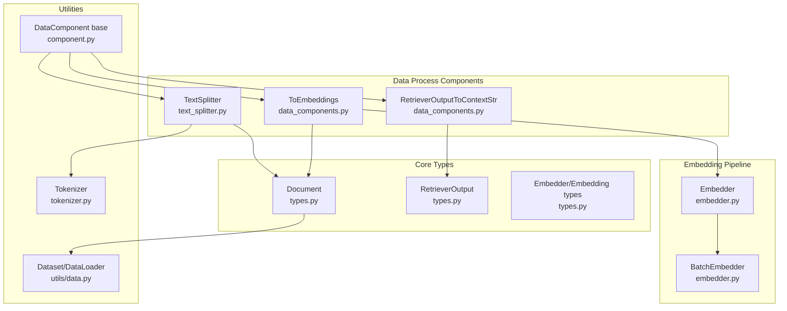
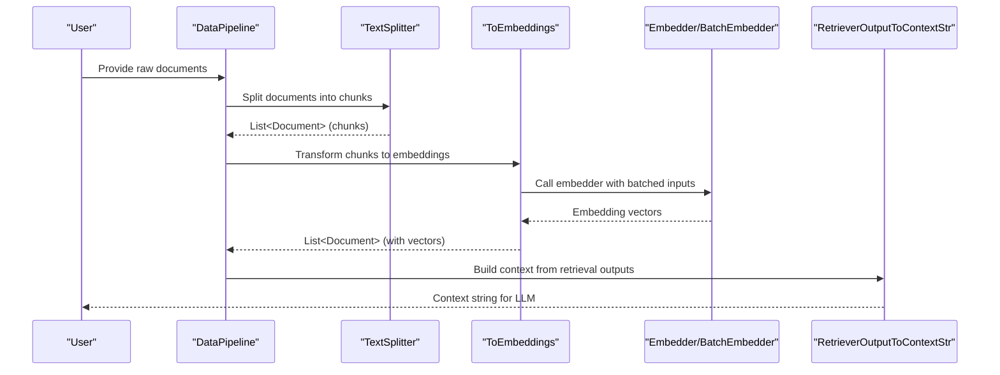
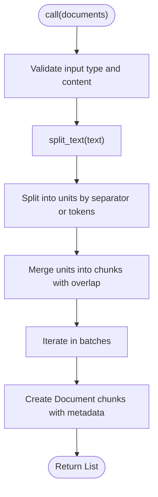
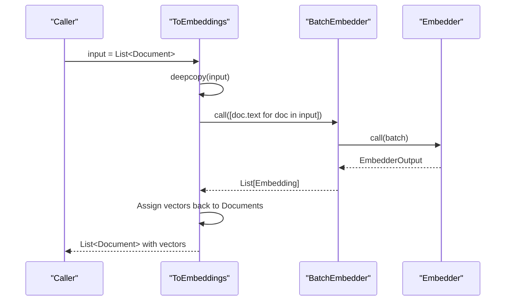
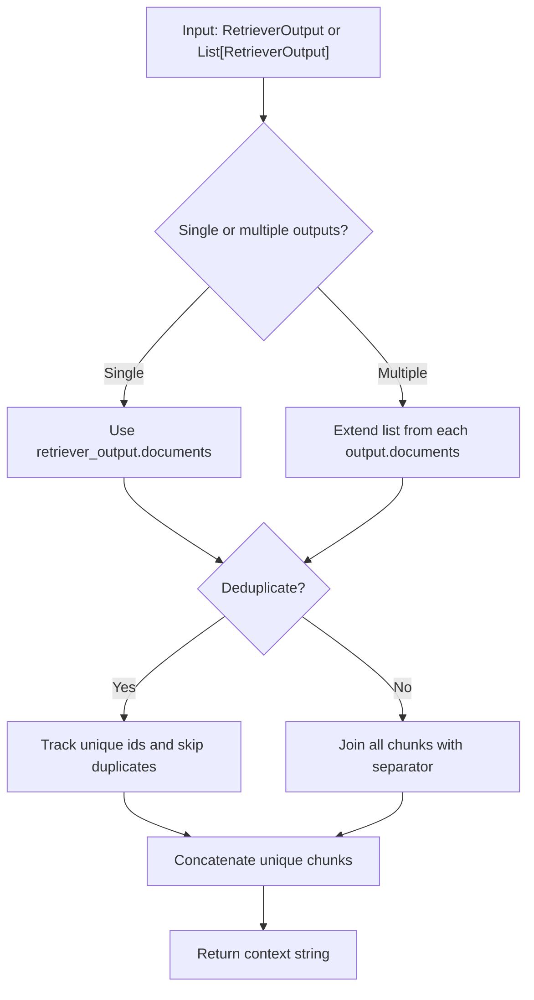
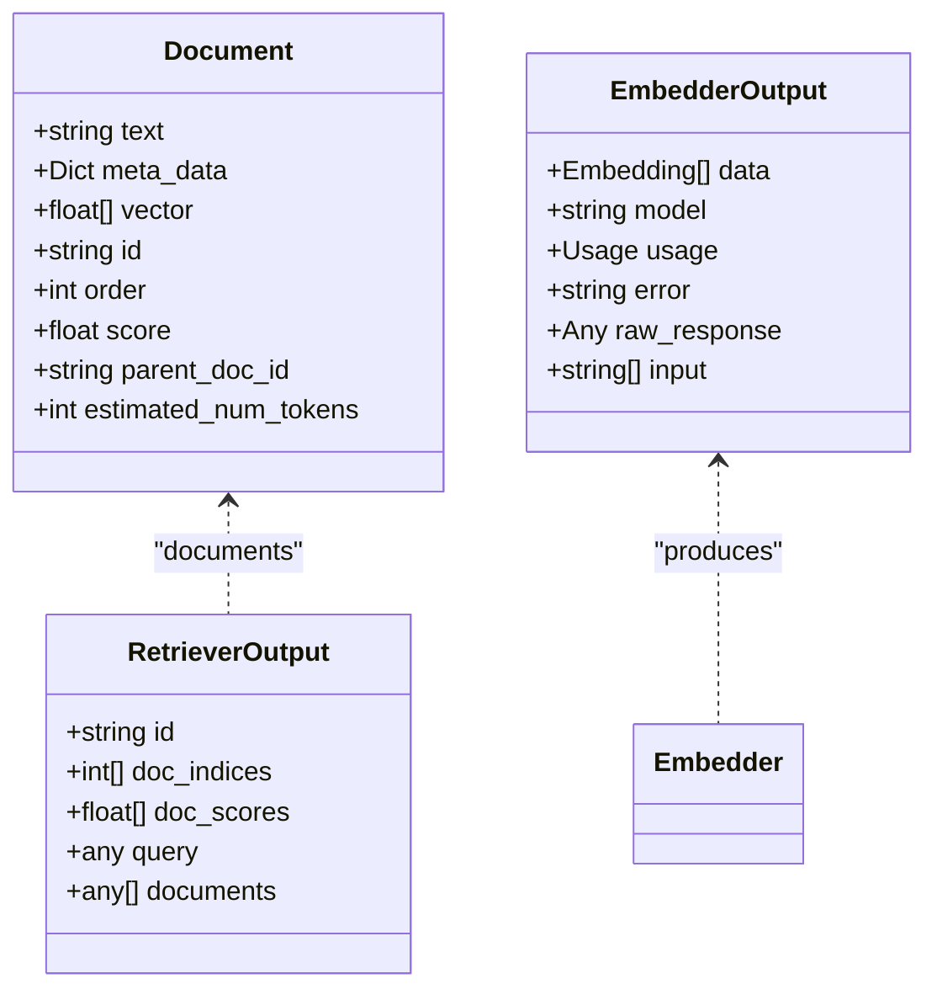
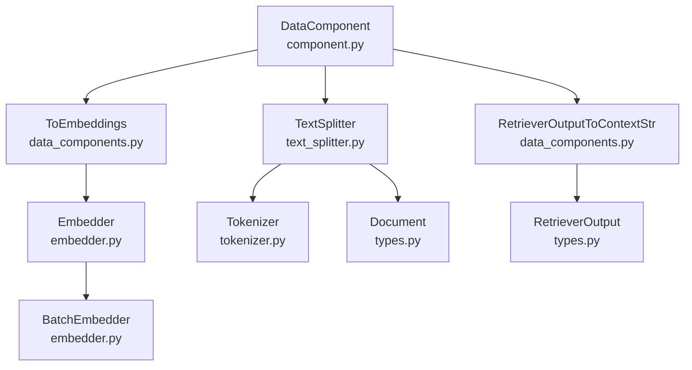

# Data Transformation and Processing

<cite>
**Referenced Files in This Document**
- [__init__.py](file://adalflow/adalflow/components/data_process/__init__.py)
- [data_components.py](file://adalflow/adalflow/components/data_process/data_components.py)
- [text_splitter.py](file://adalflow/adalflow/components/data_process/text_splitter.py)
- [component.py](file://adalflow/adalflow/core/component.py)
- [types.py](file://adalflow/adalflow/core/types.py)
- [embedder.py](file://adalflow/adalflow/core/embedder.py)
- [tokenizer.py](file://adalflow/adalflow/core/tokenizer.py)
- [base_data_class.py](file://adalflow/adalflow/core/base_data_class.py)
- [data.py](file://adalflow/adalflow/utils/data.py)
</cite>

## Table of Contents
1. [Introduction](#introduction)
2. [Project Structure](#project-structure)
3. [Core Components](#core-components)
4. [Architecture Overview](#architecture-overview)
5. [Detailed Component Analysis](#detailed-component-analysis)
6. [Dependency Analysis](#dependency-analysis)
7. [Performance Considerations](#performance-considerations)
8. [Troubleshooting Guide](#troubleshooting-guide)
9. [Conclusion](#conclusion)

## Introduction
This document explains the Data Transformation and Processing component in the AdalFlow codebase. It focuses on data conversion utilities, format transformations, and preprocessing techniques used to prepare text for embedding and retrieval. It documents component patterns, input/output handling, validation mechanisms, and how transformed data integrates into the broader pipeline. Practical examples include data cleaning, normalization, and format standardization, along with guidance on validation, error handling, and performance optimization for large-scale workflows.

## Project Structure
The data transformation capabilities are primarily located under the data_process components and leverage core types, embedders, and tokenization utilities.

**Diagram sources**
- [text_splitter.py](file://adalflow/adalflow/components/data_process/text_splitter.py#L47-L357)
- [data_components.py](file://adalflow/adalflow/components/data_process/data_components.py#L74-L132)
- [types.py](file://adalflow/adalflow/core/types.py#L883-L972)
- [embedder.py](file://adalflow/adalflow/core/embedder.py#L23-L236)
- [tokenizer.py](file://adalflow/adalflow/core/tokenizer.py#L11-L57)
- [component.py](file://adalflow/adalflow/core/component.py#L51-L120)
- [data.py](file://adalflow/adalflow/utils/data.py#L13-L143)

**Section sources**
- [__init__.py](file://adalflow/adalflow/components/data_process/__init__.py#L1-L12)
- [text_splitter.py](file://adalflow/adalflow/components/data_process/text_splitter.py#L1-L357)
- [data_components.py](file://adalflow/adalflow/components/data_process/data_components.py#L1-L132)
- [types.py](file://adalflow/adalflow/core/types.py#L883-L972)
- [embedder.py](file://adalflow/adalflow/core/embedder.py#L1-L236)
- [tokenizer.py](file://adalflow/adalflow/core/tokenizer.py#L1-L57)
- [component.py](file://adalflow/adalflow/core/component.py#L1-L120)
- [data.py](file://adalflow/adalflow/utils/data.py#L1-L143)

## Core Components
- TextSplitter: Splits documents into chunks using configurable criteria (word, sentence, page, passage, token) with sliding-window merging and overlap. It preserves formatting and supports tokenization-aware splitting.
- ToEmbeddings: Transforms a sequence of Documents into embeddings using an Embedder with optional batching.
- RetrieverOutputToContextStr: Converts retrieval outputs into a standardized context string, with optional deduplication for expanded queries.

These components are DataComponents, enabling consistent lifecycle, serialization, and integration into pipelines.

**Section sources**
- [text_splitter.py](file://adalflow/adalflow/components/data_process/text_splitter.py#L47-L357)
- [data_components.py](file://adalflow/adalflow/components/data_process/data_components.py#L74-L132)
- [component.py](file://adalflow/adalflow/core/component.py#L51-L120)

## Architecture Overview
The data transformation pipeline follows a staged flow:
- Preprocessing: TextSplitter segments raw text into chunks and assigns metadata (parent_doc_id, order).
- Embedding: ToEmbeddings converts chunked text into vectors via an Embedder/BatchEmbedder.
- Context assembly: RetrieverOutputToContextStr aggregates retrieved chunks into a context string for downstream LLMs.

**Diagram sources**
- [text_splitter.py](file://adalflow/adalflow/components/data_process/text_splitter.py#L238-L301)
- [data_components.py](file://adalflow/adalflow/components/data_process/data_components.py#L74-L105)
- [embedder.py](file://adalflow/adalflow/core/embedder.py#L195-L236)
- [data_components.py](file://adalflow/adalflow/components/data_process/data_components.py#L112-L127)

## Detailed Component Analysis

### TextSplitter
- Purpose: Chunk long documents into smaller pieces for embedding and retrieval.
- Inputs: List of Document objects.
- Outputs: List of Document objects representing chunks.
- Key behaviors:
  - Configurable split_by: word, sentence, page, passage, token.
  - Sliding window merging with chunk_size and chunk_overlap.
  - Token-aware splitting via Tokenizer for accurate token budgeting.
  - Batch processing with progress tracking.
  - Validation: Ensures inputs are Document list and text is not None.

**Diagram sources**
- [text_splitter.py](file://adalflow/adalflow/components/data_process/text_splitter.py#L238-L301)
- [text_splitter.py](file://adalflow/adalflow/components/data_process/text_splitter.py#L214-L236)
- [text_splitter.py](file://adalflow/adalflow/components/data_process/text_splitter.py#L303-L352)

**Section sources**
- [text_splitter.py](file://adalflow/adalflow/components/data_process/text_splitter.py#L47-L357)
- [tokenizer.py](file://adalflow/adalflow/core/tokenizer.py#L11-L57)

### ToEmbeddings
- Purpose: Convert Document sequences to vectors using an Embedder with batching.
- Inputs: Sequence of Document objects.
- Outputs: Sequence of Document objects with vector fields populated.
- Key behaviors:
  - Operates on a copy of input data to avoid mutation.
  - Uses BatchEmbedder to process in batches.
  - Handles wrapper and raw-list embedding formats.
  - Progress tracking during batch assignment.

**Diagram sources**
- [data_components.py](file://adalflow/adalflow/components/data_process/data_components.py#L74-L105)
- [embedder.py](file://adalflow/adalflow/core/embedder.py#L195-L236)

**Section sources**
- [data_components.py](file://adalflow/adalflow/components/data_process/data_components.py#L74-L105)
- [embedder.py](file://adalflow/adalflow/core/embedder.py#L195-L236)

### RetrieverOutputToContextStr
- Purpose: Aggregate retrieved chunks into a single context string for LLM prompting.
- Inputs: Single RetrieverOutput or list of RetrieverOutput.
- Outputs: str context.
- Key behaviors:
  - Collects documents from one or multiple queries.
  - Optional deduplication to avoid repeated content from query expansion.
  - Preserves ordering and concatenation with a separator.

**Diagram sources**
- [data_components.py](file://adalflow/adalflow/components/data_process/data_components.py#L32-L63)

**Section sources**
- [data_components.py](file://adalflow/adalflow/components/data_process/data_components.py#L112-L127)
- [types.py](file://adalflow/adalflow/core/types.py#L291-L316)

### Data Types and Validation
- Document: Standardized container for text, metadata, vector, and provenance (parent_doc_id, order, score).
- RetrieverOutput: Encapsulates query results with indices, scores, and retrieved documents.
- Validation:
  - TextSplitter validates input types and absence of None text.
  - ToEmbeddings relies on Embedder/BatchEmbedder for robust error handling and output processing.
  - Document construction includes token estimation and ID generation.

**Diagram sources**
- [types.py](file://adalflow/adalflow/core/types.py#L883-L972)
- [types.py](file://adalflow/adalflow/core/types.py#L291-L316)
- [types.py](file://adalflow/adalflow/core/types.py#L162-L180)

**Section sources**
- [types.py](file://adalflow/adalflow/core/types.py#L883-L972)
- [types.py](file://adalflow/adalflow/core/types.py#L291-L316)
- [types.py](file://adalflow/adalflow/core/types.py#L162-L180)

### Data Utilities and Pipelines
- Dataset/DataLoader: Simplified dataset and loader abstractions for iterating over arbitrary data with batching and optional shuffling.
- Integration: TextSplitter and ToEmbeddings integrate with these utilities for scalable processing.

**Section sources**
- [data.py](file://adalflow/adalflow/utils/data.py#L13-L143)

## Dependency Analysis
- DataComponent base class provides the foundation for all transformation components, including lifecycle, serialization, and registry integration.
- Embedding pipeline composes Embedder and BatchEmbedder to handle single and batched requests.
- Tokenizer enables token-aware splitting and token counting for budgeting.

**Diagram sources**
- [component.py](file://adalflow/adalflow/core/component.py#L51-L120)
- [text_splitter.py](file://adalflow/adalflow/components/data_process/text_splitter.py#L47-L357)
- [data_components.py](file://adalflow/adalflow/components/data_process/data_components.py#L74-L132)
- [embedder.py](file://adalflow/adalflow/core/embedder.py#L23-L236)
- [tokenizer.py](file://adalflow/adalflow/core/tokenizer.py#L11-L57)
- [types.py](file://adalflow/adalflow/core/types.py#L883-L972)
- [types.py](file://adalflow/adalflow/core/types.py#L291-L316)

**Section sources**
- [component.py](file://adalflow/adalflow/core/component.py#L51-L120)
- [embedder.py](file://adalflow/adalflow/core/embedder.py#L23-L236)

## Performance Considerations
- Batching: ToEmbeddings leverages BatchEmbedder to reduce overhead and improve throughput for large document sets.
- Sliding window: TextSplitter’s chunk_size and chunk_overlap balance context retention and memory footprint.
- Token-aware splitting: Using Tokenizer ensures chunks align with model token limits, reducing retries and wasted compute.
- Progress tracking: tqdm indicators provide visibility into long-running transformations.
- Serialization: DataComponent supports serialization and restoration for caching and reproducibility.

[No sources needed since this section provides general guidance]

## Troubleshooting Guide
Common issues and resolutions:
- Invalid split_by or overlap configuration: TextSplitter validates chunk_size and chunk_overlap and raises descriptive errors if invalid.
- None text in documents: TextSplitter rejects documents with missing text.
- Embedding parse failures: Embedder catches exceptions and returns error-wrapped outputs for safe propagation.
- Deduplication nuances: RetrieverOutputToContextStr deduplicates by chunk id; ensure ids are stable when using query expansion.

**Section sources**
- [text_splitter.py](file://adalflow/adalflow/components/data_process/text_splitter.py#L178-L206)
- [text_splitter.py](file://adalflow/adalflow/components/data_process/text_splitter.py#L279-L281)
- [embedder.py](file://adalflow/adalflow/core/embedder.py#L110-L131)
- [data_components.py](file://adalflow/adalflow/components/data_process/data_components.py#L51-L63)

## Conclusion
The Data Transformation and Processing subsystem provides robust, validated, and scalable utilities for text preprocessing, embedding, and context assembly. By leveraging DataComponent patterns, standardized data types, and batching strategies, it integrates seamlessly into broader pipelines while maintaining performance and reliability for large-scale workflows.