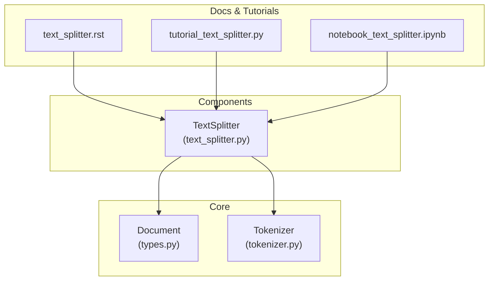
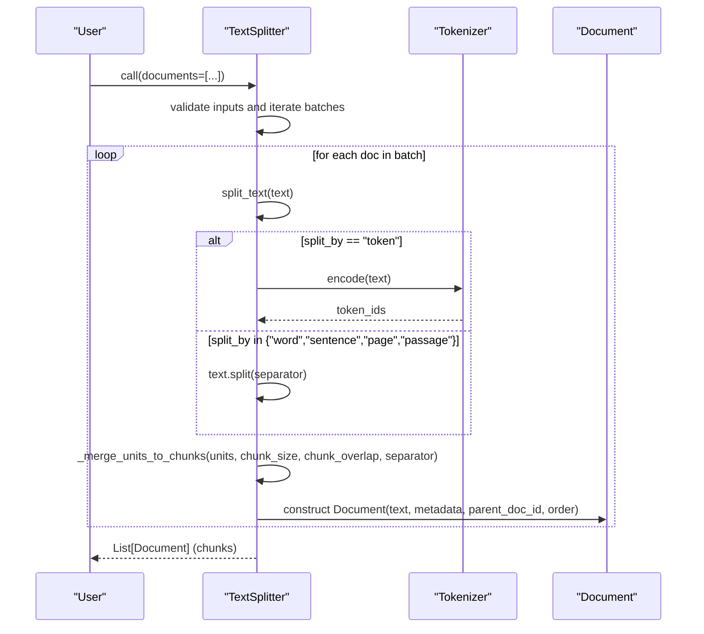
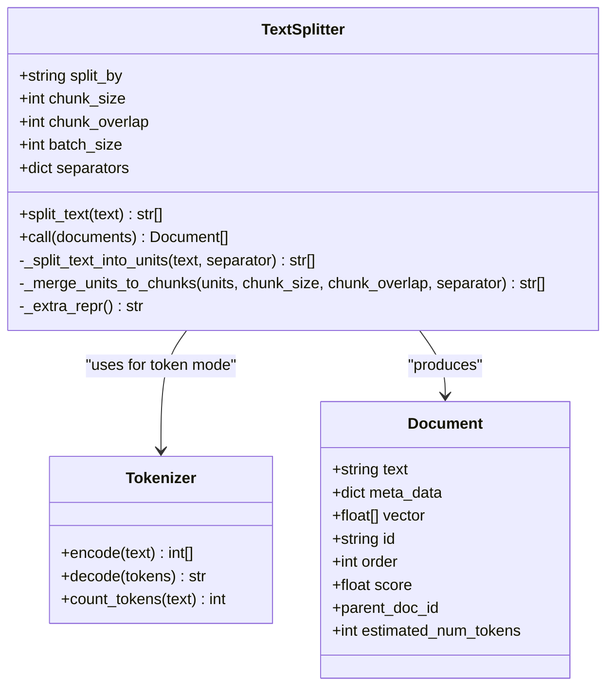
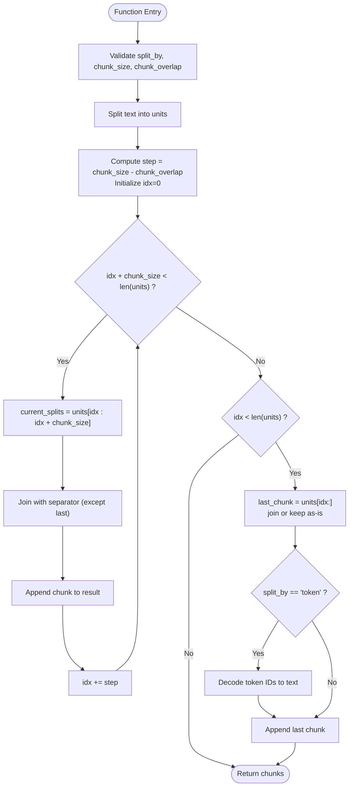
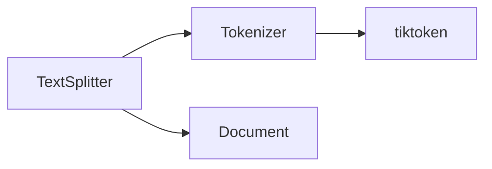

# Text Splitting and Chunking

<cite>
**Referenced Files in This Document**
- [text_splitter.py](file://adalflow/adalflow/components/data_process/text_splitter.py)
- [tokenizer.py](file://adalflow/adalflow/core/tokenizer.py)
- [types.py](file://adalflow/adalflow/core/types.py)
- [text_splitter.rst](file://docs/source/tutorials/text_splitter.rst)
- [tutorial_text_splitter.py](file://tutorials/adalflow_text_splitter.py)
- [notebook_text_splitter.ipynb](file://notebooks/tutorials/adalflow_text_splitter.ipynb)
</cite>

## Table of Contents
1. [Introduction](#introduction)
2. [Project Structure](#project-structure)
3. [Core Components](#core-components)
4. [Architecture Overview](#architecture-overview)
5. [Detailed Component Analysis](#detailed-component-analysis)
6. [Dependency Analysis](#dependency-analysis)
7. [Performance Considerations](#performance-considerations)
8. [Troubleshooting Guide](#troubleshooting-guide)
9. [Conclusion](#conclusion)
10. [Appendices](#appendices)

## Introduction
This document explains the Text Splitting and Chunking component used to prepare long-form text for downstream systems such as embeddings and retrieval. It focuses on the TextSplitter class, its splitting strategies (word, sentence, page, passage, token-based), the sliding window chunking algorithm, overlap handling, and batch processing. It also covers how chunked outputs integrate with embeddings and retrievers, along with performance considerations and optimization tips for large document sets.

## Project Structure
The Text Splitting and Chunking capability is implemented as a component within the data processing subsystem and integrates with the core types and tokenizer utilities.

**Diagram sources**
- [text_splitter.py](file://adalflow/adalflow/components/data_process/text_splitter.py#L47-L357)
- [tokenizer.py](file://adalflow/adalflow/core/tokenizer.py#L11-L57)
- [types.py](file://adalflow/adalflow/core/types.py#L883-L972)
- [text_splitter.rst](file://docs/source/tutorials/text_splitter.rst#L1-L244)
- [tutorial_text_splitter.py](file://tutorials/adalflow_text_splitter.py#L1-L81)
- [notebook_text_splitter.ipynb](file://notebooks/tutorials/adalflow_text_splitter.ipynb#L1-L172)

**Section sources**
- [text_splitter.py](file://adalflow/adalflow/components/data_process/text_splitter.py#L1-L357)
- [tokenizer.py](file://adalflow/adalflow/core/tokenizer.py#L1-L57)
- [types.py](file://adalflow/adalflow/core/types.py#L883-L972)
- [text_splitter.rst](file://docs/source/tutorials/text_splitter.rst#L1-L244)
- [tutorial_text_splitter.py](file://tutorials/adalflow_text_splitter.py#L1-L81)
- [notebook_text_splitter.ipynb](file://notebooks/tutorials/adalflow_text_splitter.ipynb#L1-L172)

## Core Components
- TextSplitter: A component that splits plain text into smaller chunks using configurable strategies and a sliding window approach. It supports:
  - split_by: word, sentence, page, passage, token
  - chunk_size: maximum units per chunk
  - chunk_overlap: units of overlap between adjacent chunks
  - batch_size: number of documents to process in each batch
- Document: The data structure representing a chunked unit with metadata, vector placeholder, parent document linkage, and ordering.
- Tokenizer: A wrapper around tiktoken for encoding/decoding and counting tokens.

Key behaviors:
- Validates split_by, chunk_size, and chunk_overlap.
- Applies a sliding window with step = chunk_size - chunk_overlap.
- Merges split units back into chunks, preserving separators for non-token modes.
- Token mode decodes token IDs back to text for chunk strings.
- Processes documents in batches with progress reporting.

**Section sources**
- [text_splitter.py](file://adalflow/adalflow/components/data_process/text_splitter.py#L159-L213)
- [text_splitter.py](file://adalflow/adalflow/components/data_process/text_splitter.py#L214-L236)
- [text_splitter.py](file://adalflow/adalflow/components/data_process/text_splitter.py#L238-L301)
- [text_splitter.py](file://adalflow/adalflow/components/data_process/text_splitter.py#L303-L352)
- [types.py](file://adalflow/adalflow/core/types.py#L883-L972)
- [tokenizer.py](file://adalflow/adalflow/core/tokenizer.py#L11-L57)

## Architecture Overview
The TextSplitter sits between raw text ingestion and downstream embedding/retrieval systems. It produces Document chunks that downstream components can consume.

**Diagram sources**
- [text_splitter.py](file://adalflow/adalflow/components/data_process/text_splitter.py#L238-L301)
- [text_splitter.py](file://adalflow/adalflow/components/data_process/text_splitter.py#L303-L352)
- [tokenizer.py](file://adalflow/adalflow/core/tokenizer.py#L41-L47)
- [types.py](file://adalflow/adalflow/core/types.py#L883-L972)

## Detailed Component Analysis

### TextSplitter Class
The TextSplitter is a DataComponent that:
- Accepts split_by, chunk_size, chunk_overlap, batch_size, and a custom separators map.
- Validates parameters and logs initialization.
- Splits text into units using either Python split or tokenizer encoding.
- Merges units into overlapping chunks using a sliding window.
- Produces Document instances with parent linkage and order.

**Diagram sources**
- [text_splitter.py](file://adalflow/adalflow/components/data_process/text_splitter.py#L47-L357)
- [tokenizer.py](file://adalflow/adalflow/core/tokenizer.py#L11-L57)
- [types.py](file://adalflow/adalflow/core/types.py#L883-L972)

Implementation highlights:
- Initialization validates split_by against supported separators and ensures chunk_size and chunk_overlap meet constraints.
- split_text orchestrates splitting and merging, logging counts for visibility.
- call processes documents in batches, validating each Document and constructing chunked Documents with parent_doc_id and order.
- _split_text_into_units selects token vs text splitting based on split_by.
- _merge_units_to_chunks implements the sliding window with overlap and handles the final chunk edge case. For token mode, it decodes token IDs back to text.

Practical configuration examples:
- Word-based splitting with overlap: see [tutorial_text_splitter.py](file://tutorials/adalflow_text_splitter.py#L8-L18).
- Token-based splitting: see [tutorial_text_splitter.py](file://tutorials/adalflow_text_splitter.py#L21-L31).
- Custom separator mapping: see [tutorial_text_splitter.py](file://tutorials/adalflow_text_splitter.py#L34-L52).

**Section sources**
- [text_splitter.py](file://adalflow/adalflow/components/data_process/text_splitter.py#L159-L213)
- [text_splitter.py](file://adalflow/adalflow/components/data_process/text_splitter.py#L214-L236)
- [text_splitter.py](file://adalflow/adalflow/components/data_process/text_splitter.py#L238-L301)
- [text_splitter.py](file://adalflow/adalflow/components/data_process/text_splitter.py#L303-L352)
- [tutorial_text_splitter.py](file://tutorials/adalflow_text_splitter.py#L8-L52)

### Sliding Window Chunking Algorithm
The algorithm uses a window of size chunk_size moving by step = chunk_size - chunk_overlap. It handles:
- Early termination when the window reaches the end of the unit list.
- Final chunk construction when remaining units are fewer than chunk_size.
- Separator handling for non-token modes to preserve formatting.
- Token mode decoding to reconstruct text chunks.

**Diagram sources**
- [text_splitter.py](file://adalflow/adalflow/components/data_process/text_splitter.py#L312-L352)

**Section sources**
- [text_splitter.py](file://adalflow/adalflow/components/data_process/text_splitter.py#L312-L352)

### Relationship to Downstream Components
- Embeddings: Each chunk Document can be passed to an embedder to produce dense vectors. The Document vector field is initialized as empty and populated by the embedder.
- Retrievers: Chunked Documents serve as candidate passages for retrieval. They carry parent_doc_id and order to support provenance and ranking.

Integration notes:
- The Document class includes an estimated_num_tokens field derived from the tokenizer, aiding cost estimation and budgeting.
- The tutorial documentation outlines chunking strategies and considerations for sentence, passage, page, and token-based splitting.

**Section sources**
- [types.py](file://adalflow/adalflow/core/types.py#L883-L972)
- [text_splitter.rst](file://docs/source/tutorials/text_splitter.rst#L196-L244)

## Dependency Analysis
- TextSplitter depends on:
  - Tokenizer for token-based splitting and decoding.
  - Document for chunk representation and metadata carrying.
- External dependency:
  - tiktoken for tokenization.

**Diagram sources**
- [text_splitter.py](file://adalflow/adalflow/components/data_process/text_splitter.py#L157-L158)
- [tokenizer.py](file://adalflow/adalflow/core/tokenizer.py#L25-L25)
- [types.py](file://adalflow/adalflow/core/types.py#L883-L972)

**Section sources**
- [text_splitter.py](file://adalflow/adalflow/components/data_process/text_splitter.py#L157-L158)
- [tokenizer.py](file://adalflow/adalflow/core/tokenizer.py#L25-L25)

## Performance Considerations
- Sliding window overhead: The step size determines how many units advance per iteration. Larger chunk_size with small overlap reduces iterations but increases memory footprint.
- Token-based splitting: Tokenization adds CPU overhead; consider batching and tuning chunk_size to stay within model token limits.
- Batch processing: Adjust batch_size to balance throughput and memory usage. Progress bars indicate batch-level processing.
- Memory management:
  - Avoid holding entire corpus in memory; process iteratively in batches.
  - Prefer token-based chunking for strict token budgets to reduce retries.
- Logging: The component logs counts for splits and chunks to help profile performance.

[No sources needed since this section provides general guidance]

## Troubleshooting Guide
Common issues and resolutions:
- Invalid split_by: Ensure split_by is one of the supported values. The component raises a ValueError if not.
- chunk_overlap >= chunk_size: The component enforces step > 0 by requiring chunk_overlap < chunk_size.
- chunk_size <= 0: Enforced by validation.
- chunk_overlap < 0: Enforced by validation.
- Input type errors: Documents must be a list of Document instances; each must have non-None text.
- Large batches: Reduce batch_size to mitigate memory pressure.

**Section sources**
- [text_splitter.py](file://adalflow/adalflow/components/data_process/text_splitter.py#L186-L206)
- [text_splitter.py](file://adalflow/adalflow/components/data_process/text_splitter.py#L256-L281)

## Conclusion
The TextSplitter provides a robust, configurable mechanism for transforming long text into manageable chunks using multiple strategies and a sliding window approach with overlap. Its integration with Document and Tokenizer enables seamless downstream processing for embeddings and retrieval, while batch processing and validation support scalable, production-grade workflows.

[No sources needed since this section summarizes without analyzing specific files]

## Appendices

### Practical Configuration Examples
- Word-based splitting with overlap:
  - See [tutorial_text_splitter.py](file://tutorials/adalflow_text_splitter.py#L8-L18).
- Token-based splitting:
  - See [tutorial_text_splitter.py](file://tutorials/adalflow_text_splitter.py#L21-L31).
- Custom separator mapping:
  - See [tutorial_text_splitter.py](file://tutorials/adalflow_text_splitter.py#L34-L52).
- Notebook walkthrough:
  - See [notebook_text_splitter.ipynb](file://notebooks/tutorials/adalflow_text_splitter.ipynb#L86-L154).

### Tutorial and Documentation References
- Official tutorial and usage guidance:
  - See [text_splitter.rst](file://docs/source/tutorials/text_splitter.rst#L1-L244).

**Section sources**
- [tutorial_text_splitter.py](file://tutorials/adalflow_text_splitter.py#L8-L52)
- [notebook_text_splitter.ipynb](file://notebooks/tutorials/adalflow_text_splitter.ipynb#L86-L154)
- [text_splitter.rst](file://docs/source/tutorials/text_splitter.rst#L1-L244)