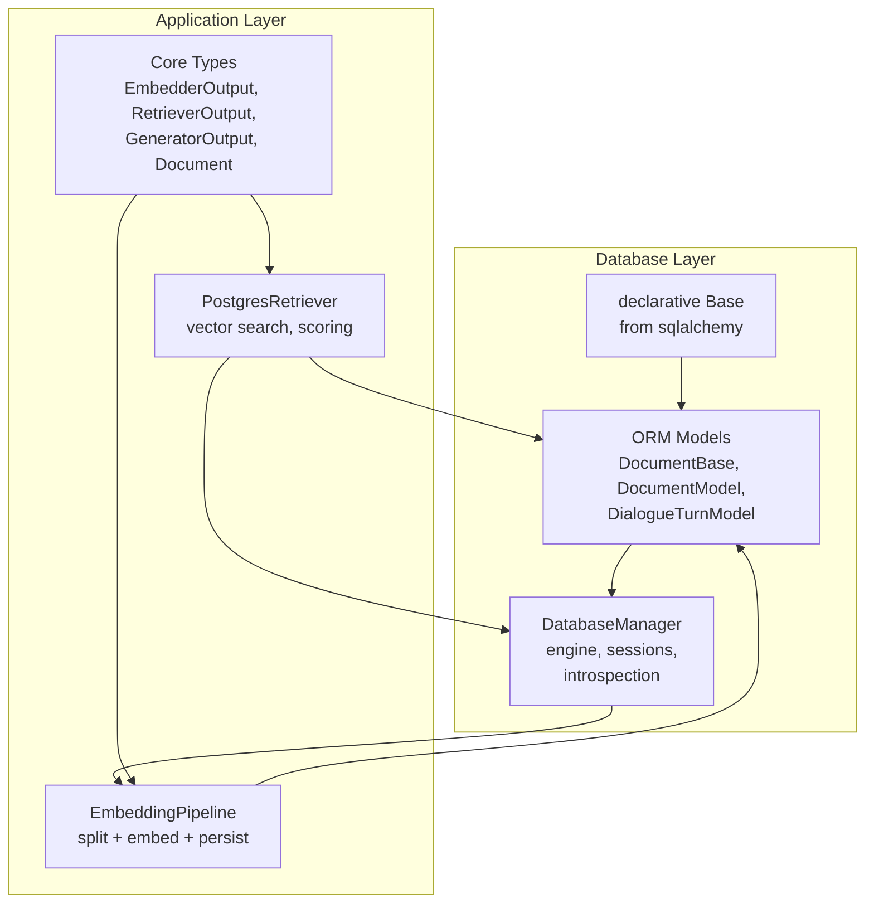
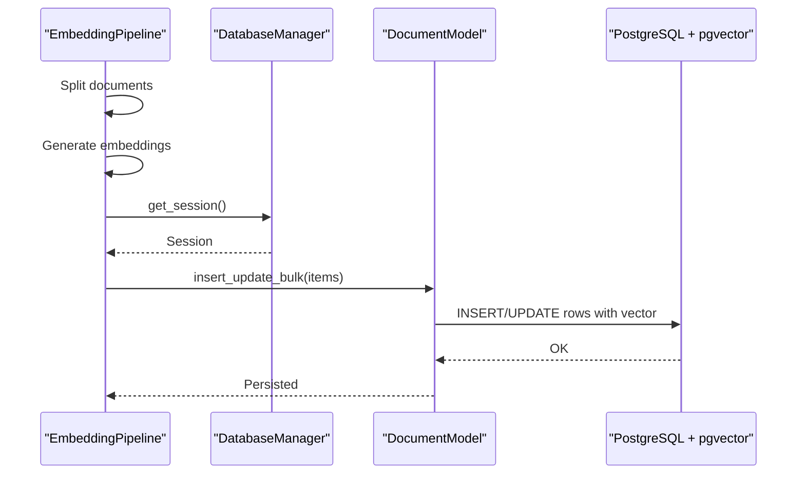
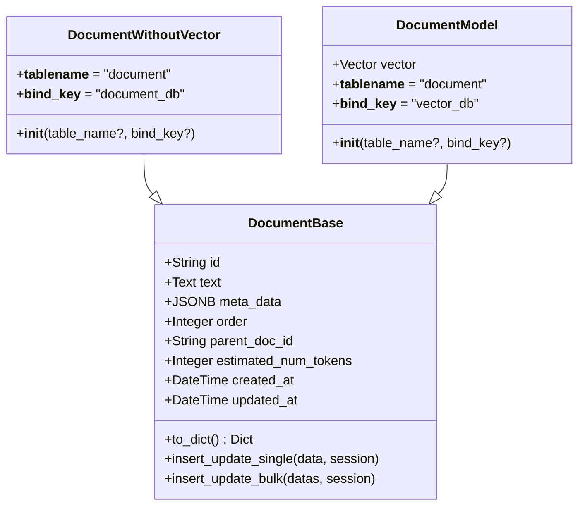
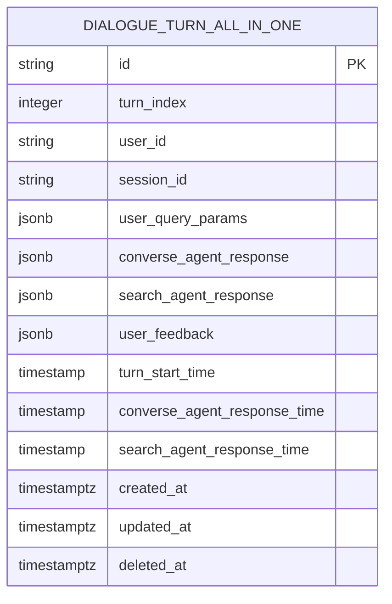
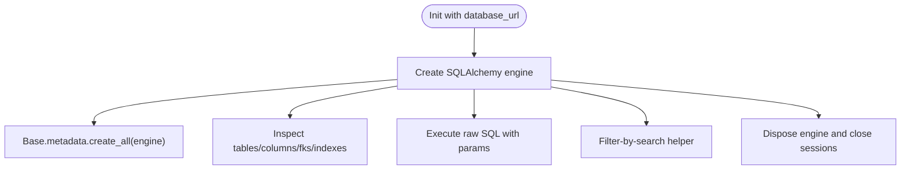
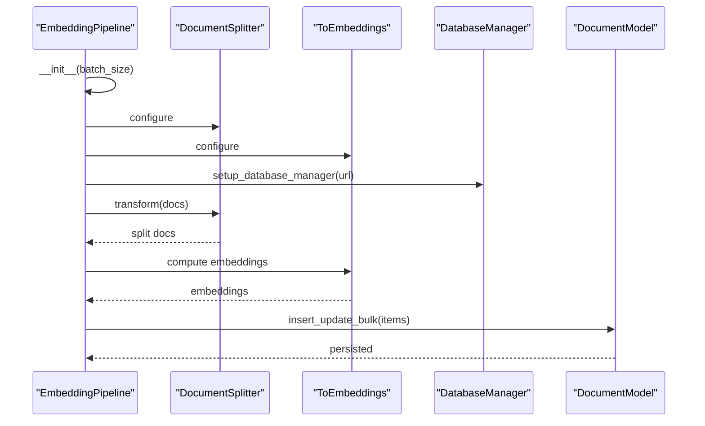
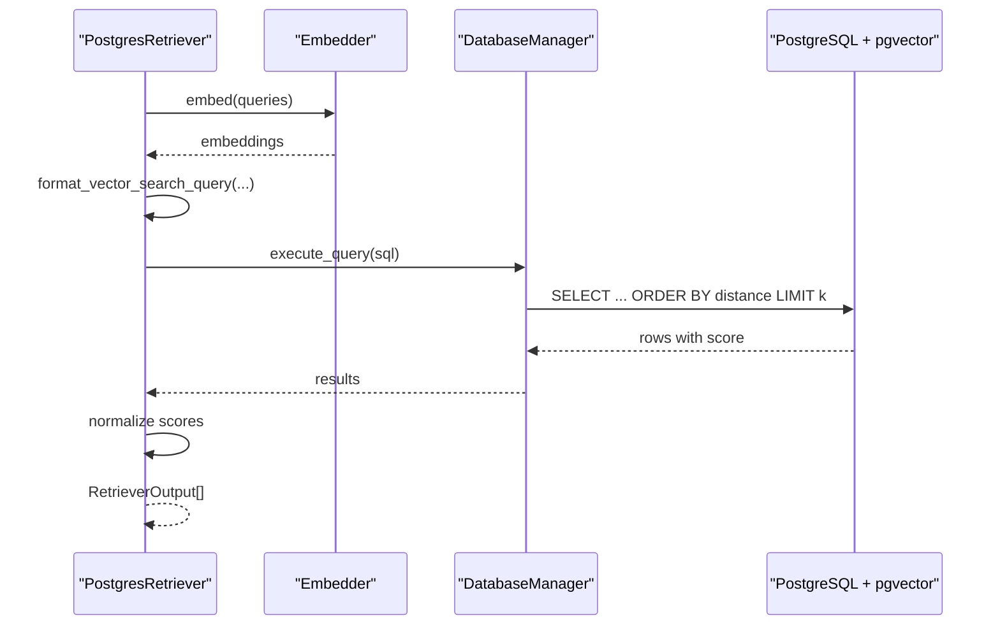
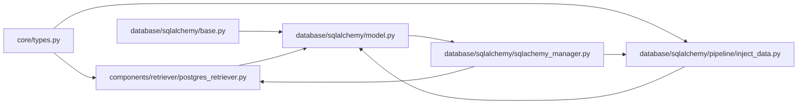

# Data Models

<cite>
**Referenced Files in This Document**
- [model.py](file://adalflow/adalflow/database/sqlalchemy/model.py)
- [base.py](file://adalflow/adalflow/database/sqlalchemy/base.py)
- [sqlachemy_manager.py](file://adalflow/adalflow/database/sqlalchemy/sqlachemy_manager.py)
- [create_tables.py](file://adalflow/adalflow/database/sqlalchemy/pipeline/create_tables.py)
- [inject_data.py](file://adalflow/adalflow/database/sqlalchemy/pipeline/inject_data.py)
- [types.py](file://adalflow/adalflow/core/types.py)
- [base_data_class.py](file://adalflow/adalflow/core/base_data_class.py)
- [postgres_retriever.py](file://adalflow/adalflow/components/retriever/postgres_retriever.py)
</cite>

## Table of Contents
1. [Introduction](#introduction)
2. [Project Structure](#project-structure)
3. [Core Components](#core-components)
4. [Architecture Overview](#architecture-overview)
5. [Detailed Component Analysis](#detailed-component-analysis)
6. [Dependency Analysis](#dependency-analysis)
7. [Performance Considerations](#performance-considerations)
8. [Troubleshooting Guide](#troubleshooting-guide)
9. [Conclusion](#conclusion)
10. [Appendices](#appendices)

## Introduction
This document explains the data models used in AdalFlow for schema definition, table relationships, and data persistence patterns. It focuses on the SQLAlchemy-based models that power vector-enabled document storage and dialogue turn logging, and how these models integrate with framework components such as agents, optimizers, and retrievers. It also covers data validation, serialization patterns, and performance optimization through indexing and vector operations.

## Project Structure
The data model layer centers around:
- Declarative SQLAlchemy base and ORM models
- Database manager for lifecycle operations
- Pipeline utilities for schema creation and data injection
- Retrieval integration with PostgreSQL and pgvector
- Core data types and serialization utilities for framework-wide compatibility

**Diagram sources**
- [base.py](file://adalflow/adalflow/database/sqlalchemy/base.py#L1-L4)
- [model.py](file://adalflow/adalflow/database/sqlalchemy/model.py#L64-L325)
- [sqlachemy_manager.py](file://adalflow/adalflow/database/sqlalchemy/sqlachemy_manager.py#L12-L94)
- [types.py](file://adalflow/adalflow/core/types.py#L140-L800)
- [postgres_retriever.py](file://adalflow/adalflow/components/retriever/postgres_retriever.py#L39-L244)
- [inject_data.py](file://adalflow/adalflow/database/sqlalchemy/pipeline/inject_data.py#L13-L137)

**Section sources**
- [base.py](file://adalflow/adalflow/database/sqlalchemy/base.py#L1-L4)
- [model.py](file://adalflow/adalflow/database/sqlalchemy/model.py#L1-L325)
- [sqlachemy_manager.py](file://adalflow/adalflow/database/sqlalchemy/sqlachemy_manager.py#L1-L94)
- [inject_data.py](file://adalflow/adalflow/database/sqlalchemy/pipeline/inject_data.py#L1-L137)
- [postgres_retriever.py](file://adalflow/adalflow/components/retriever/postgres_retriever.py#L1-L244)
- [types.py](file://adalflow/adalflow/core/types.py#L1-L800)

## Core Components
- DocumentBase: Abstract base for document-like records with shared fields and utilities.
- DocumentModel: Concrete vector-enabled document table using pgvector.
- DocumentWithoutVector: Concrete document table without vector column.
- DialogueTurnModel: Persistent record of conversational turns with timestamps and soft-delete support.
- DatabaseManager: Engine/session management, introspection, and raw SQL execution.
- EmbeddingPipeline: Orchestration of splitting, embedding, and bulk persistence.
- PostgresRetriever: Vector similarity search with configurable distance operators and score normalization.

Key capabilities:
- Primary keys: String UUID primary keys for documents and dialogue turns.
- Foreign keys: Intentionally absent in the shown models; relationships are not enforced at the ORM level.
- Indexes: No explicit indexes defined in the models; vector similarity relies on pgvector extension.
- Constraints: JSONB for metadata; soft-delete via a nullable deletion timestamp.

**Section sources**
- [model.py](file://adalflow/adalflow/database/sqlalchemy/model.py#L64-L325)
- [sqlachemy_manager.py](file://adalflow/adalflow/database/sqlalchemy/sqlachemy_manager.py#L12-L94)
- [inject_data.py](file://adalflow/adalflow/database/sqlalchemy/pipeline/inject_data.py#L13-L137)
- [postgres_retriever.py](file://adalflow/adalflow/components/retriever/postgres_retriever.py#L39-L244)

## Architecture Overview
The data models underpin vector-enabled retrieval and conversational logging. EmbeddingPipeline transforms textual documents into embeddings and persists them as vector-enabled rows. PostgresRetriever executes similarity queries against the vector column and normalizes scores according to the chosen distance metric.

**Diagram sources**
- [inject_data.py](file://adalflow/adalflow/database/sqlalchemy/pipeline/inject_data.py#L70-L90)
- [model.py](file://adalflow/adalflow/database/sqlalchemy/model.py#L120-L146)
- [sqlachemy_manager.py](file://adalflow/adalflow/database/sqlalchemy/sqlachemy_manager.py#L71-L73)

## Detailed Component Analysis

### DocumentBase and Derived Models
DocumentBase defines a shared schema for document records:
- Fields: id (String, PK), text (Text), meta_data (JSONB), order (Integer), parent_doc_id (String), estimated_num_tokens (Integer), created_at (DateTime), updated_at (DateTime).
- Utilities: insert_update_single and insert_update_bulk for upsert semantics.

DocumentModel extends DocumentBase with a vector column for pgvector similarity search. DocumentWithoutVector offers a variant without vector support.

**Diagram sources**
- [model.py](file://adalflow/adalflow/database/sqlalchemy/model.py#L64-L201)

**Section sources**
- [model.py](file://adalflow/adalflow/database/sqlalchemy/model.py#L64-L201)

### DialogueTurnModel
DialogueTurnModel captures conversational exchanges with:
- Composite identity: turn_index and session_id.
- Timestamps: turn_start_time, response timestamps, created_at, updated_at.
- Soft delete: deleted_at.
- JSONB fields for structured payloads.

**Diagram sources**
- [model.py](file://adalflow/adalflow/database/sqlalchemy/model.py#L203-L266)

**Section sources**
- [model.py](file://adalflow/adalflow/database/sqlalchemy/model.py#L203-L266)

### DatabaseManager
DatabaseManager encapsulates:
- Engine creation and session management.
- Schema introspection (schemas, tables, columns, foreign keys, indexes).
- Raw SQL execution and search helpers.

**Diagram sources**
- [sqlachemy_manager.py](file://adalflow/adalflow/database/sqlalchemy/sqlachemy_manager.py#L12-L94)

**Section sources**
- [sqlachemy_manager.py](file://adalflow/adalflow/database/sqlalchemy/sqlachemy_manager.py#L12-L94)

### EmbeddingPipeline
EmbeddingPipeline orchestrates:
- Component composition: splitter → embedder → vectorizer.
- Batch processing and bulk persistence to DocumentModel.
- Utility for executing similarity queries and retrieving nearest neighbors.

**Diagram sources**
- [inject_data.py](file://adalflow/adalflow/database/sqlalchemy/pipeline/inject_data.py#L13-L90)
- [model.py](file://adalflow/adalflow/database/sqlalchemy/model.py#L120-L146)

**Section sources**
- [inject_data.py](file://adalflow/adalflow/database/sqlalchemy/pipeline/inject_data.py#L13-L90)
- [create_tables.py](file://adalflow/adalflow/database/sqlalchemy/pipeline/create_tables.py#L1-L15)

### PostgresRetriever
PostgresRetriever integrates:
- Embedder for query embeddings.
- Distance operator selection (L2, inner product, cosine, L1).
- Score normalization to probabilities.
- SQL formatting and execution via DatabaseManager.

**Diagram sources**
- [postgres_retriever.py](file://adalflow/adalflow/components/retriever/postgres_retriever.py#L82-L205)
- [sqlachemy_manager.py](file://adalflow/adalflow/database/sqlalchemy/sqlachemy_manager.py#L74-L84)

**Section sources**
- [postgres_retriever.py](file://adalflow/adalflow/components/retriever/postgres_retriever.py#L39-L205)

### Serialization and Validation Patterns
Core types define standardized containers for embeddings, generator outputs, and retriever outputs. The base DataClass provides robust serialization (JSON/YAML) and schema generation, enabling consistent validation and interoperability across components.

Highlights:
- EmbedderOutput: embedding batches, usage, and raw responses.
- RetrieverOutput: indices, scores, query, and documents.
- GeneratorOutput: streaming, tool use, images, and usage.
- DataClass: to_dict/from_dict/to_json/to_yaml with include/exclude controls.

These types are used by retrievers and pipelines to exchange structured data reliably.

**Section sources**
- [types.py](file://adalflow/adalflow/core/types.py#L140-L800)
- [base_data_class.py](file://adalflow/adalflow/core/base_data_class.py#L97-L800)

## Dependency Analysis
- Models depend on SQLAlchemy declarative Base and pgvector Vector type.
- DatabaseManager depends on SQLAlchemy engine/session and Inspector/reflection.
- EmbeddingPipeline composes core components and persists to DocumentModel.
- PostgresRetriever depends on Embedder and DatabaseManager for vector search.
- Core types and DataClass underpin serialization and validation across components.

**Diagram sources**
- [types.py](file://adalflow/adalflow/core/types.py#L1-L800)
- [postgres_retriever.py](file://adalflow/adalflow/components/retriever/postgres_retriever.py#L1-L244)
- [inject_data.py](file://adalflow/adalflow/database/sqlalchemy/pipeline/inject_data.py#L1-L137)
- [base.py](file://adalflow/adalflow/database/sqlalchemy/base.py#L1-L4)
- [model.py](file://adalflow/adalflow/database/sqlalchemy/model.py#L1-L325)
- [sqlachemy_manager.py](file://adalflow/adalflow/database/sqlalchemy/sqlachemy_manager.py#L1-L94)

**Section sources**
- [types.py](file://adalflow/adalflow/core/types.py#L1-L800)
- [postgres_retriever.py](file://adalflow/adalflow/components/retriever/postgres_retriever.py#L1-L244)
- [inject_data.py](file://adalflow/adalflow/database/sqlalchemy/pipeline/inject_data.py#L1-L137)
- [base.py](file://adalflow/adalflow/database/sqlalchemy/base.py#L1-L4)
- [model.py](file://adalflow/adalflow/database/sqlalchemy/model.py#L1-L325)
- [sqlachemy_manager.py](file://adalflow/adalflow/database/sqlalchemy/sqlachemy_manager.py#L1-L94)

## Performance Considerations
- Vector similarity: Uses pgvector operators; ensure the vector column is populated and the extension is installed.
- Indexing: No explicit indexes are declared in the models; consider adding GIN/Gist or IVFFlat indexes on vector columns for large-scale similarity search.
- Batch operations: Bulk upsert reduces transaction overhead; tune batch sizes per workload.
- JSONB fields: Efficient for metadata; avoid overly large JSONB payloads to maintain query performance.
- Soft deletes: deleted_at enables selective filtering; consider partial indexes on active records.

[No sources needed since this section provides general guidance]

## Troubleshooting Guide
Common issues and resolutions:
- Extension not installed: Ensure the vector extension exists in the target database before creating tables or inserting vectors.
- Missing vector extension: Create the extension prior to schema creation or table population.
- Transaction errors: Upsert methods catch exceptions and roll back; verify session handling and connection health.
- Schema mismatches: Use introspection to verify table schemas and indexes; reconcile differences before running pipelines.

Operational checks:
- Verify database connectivity and credentials.
- Confirm table existence and column definitions.
- Validate vector dimensionality and normalization if using cosine similarity.

**Section sources**
- [sqlachemy_manager.py](file://adalflow/adalflow/database/sqlalchemy/sqlachemy_manager.py#L42-L69)
- [model.py](file://adalflow/adalflow/database/sqlalchemy/model.py#L96-L146)

## Conclusion
AdalFlow’s data models provide a solid foundation for vector-enabled document storage and conversational logging. The SQLAlchemy layer offers straightforward schema definition and introspection, while the pipeline and retriever components integrate seamlessly with PostgreSQL and pgvector. By leveraging core types and DataClass utilities, the system ensures consistent serialization and validation across framework components. Extending the models involves adding fields, indexes, and relationships as needed, and integrating new components through the established patterns.

[No sources needed since this section summarizes without analyzing specific files]

## Appendices

### Practical Examples and Guidelines
- Extending DocumentBase: Add new fields to DocumentBase or create a new derived model; ensure migrations or schema creation aligns with the intended structure.
- Polymorphic relationships: Not present in the current models; introduce discriminator columns and mapped classes if heterogeneous document types are required.
- Composite keys: Use tuple-based primary keys when appropriate; otherwise rely on UUID primary keys for simplicity.
- Data validation: Use DataClass to enforce required fields and generate schemas; leverage to_json/to_yaml for controlled serialization.
- Retrieval scoring: Choose distance operators based on embedding normalization; normalize scores to probabilities for downstream use.

**Section sources**
- [model.py](file://adalflow/adalflow/database/sqlalchemy/model.py#L64-L201)
- [base_data_class.py](file://adalflow/adalflow/core/base_data_class.py#L97-L800)
- [postgres_retriever.py](file://adalflow/adalflow/components/retriever/postgres_retriever.py#L39-L205)