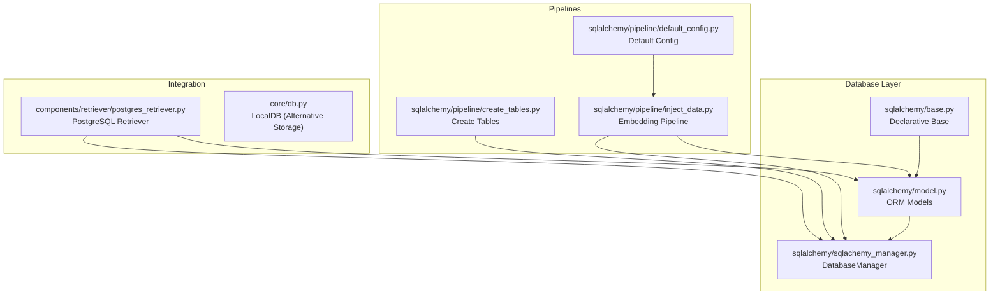
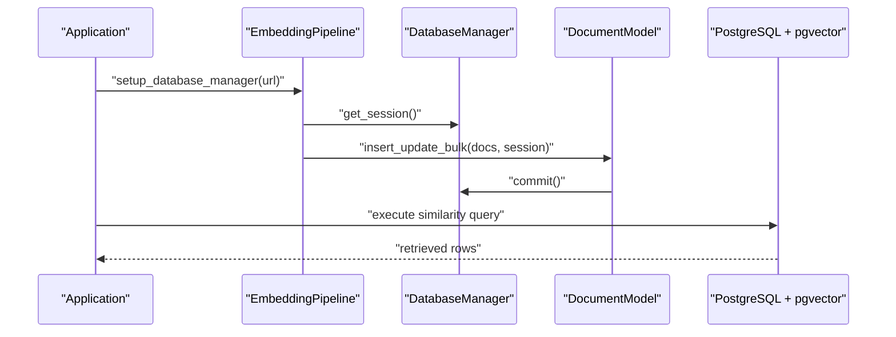
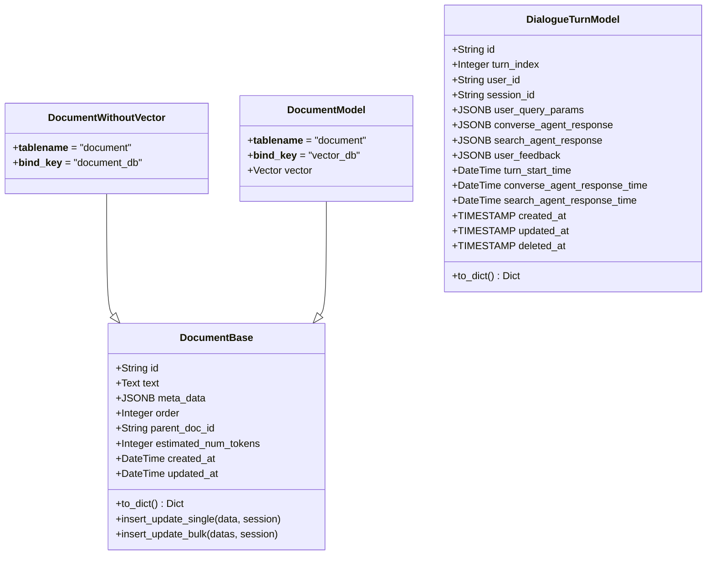
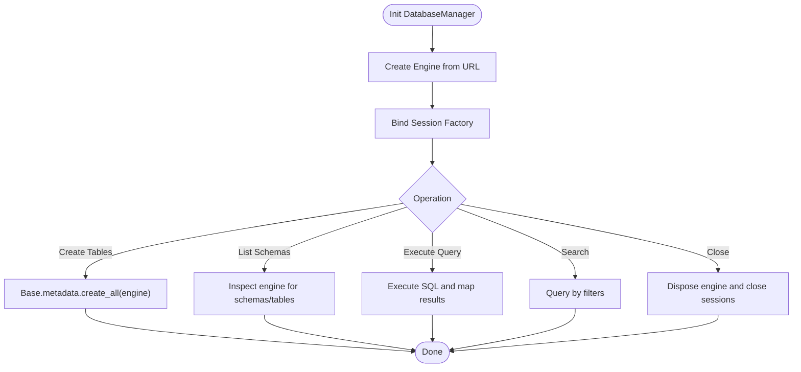
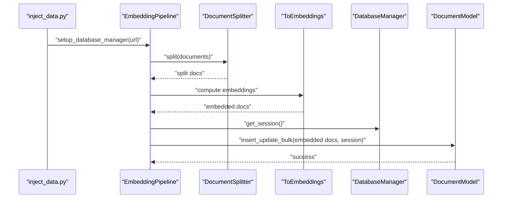
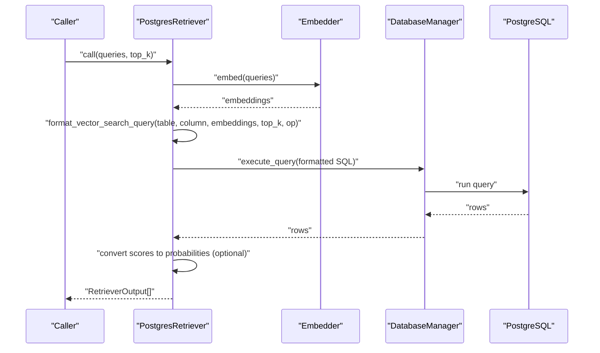
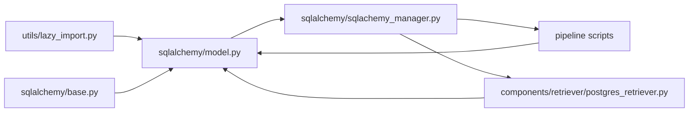

# Database Integration

<cite>
**Referenced Files in This Document**
- [database/README.md](file://adalflow/adalflow/database/README.md)
- [sqlalchemy/base.py](file://adalflow/adalflow/database/sqlalchemy/base.py)
- [sqlalchemy/model.py](file://adalflow/adalflow/database/sqlalchemy/model.py)
- [sqlalchemy/sqlachemy_manager.py](file://adalflow/adalflow/database/sqlalchemy/sqlachemy_manager.py)
- [sqlalchemy/pipeline/create_tables.py](file://adalflow/adalflow/database/sqlalchemy/pipeline/create_tables.py)
- [sqlalchemy/pipeline/inject_data.py](file://adalflow/adalflow/database/sqlalchemy/pipeline/inject_data.py)
- [sqlalchemy/pipeline/default_config.py](file://adalflow/adalflow/database/sqlalchemy/pipeline/default_config.py)
- [components/retriever/postgres_retriever.py](file://adalflow/adalflow/components/retriever/postgres_retriever.py)
- [core/db.py](file://adalflow/adalflow/core/db.py)
- [utils/lazy_import.py](file://adalflow/adalflow/utils/lazy_import.py)
</cite>

## Table of Contents
1. [Introduction](#introduction)
2. [Project Structure](#project-structure)
3. [Core Components](#core-components)
4. [Architecture Overview](#architecture-overview)
5. [Detailed Component Analysis](#detailed-component-analysis)
6. [Dependency Analysis](#dependency-analysis)
7. [Performance Considerations](#performance-considerations)
8. [Troubleshooting Guide](#troubleshooting-guide)
9. [Conclusion](#conclusion)
10. [Appendices](#appendices)

## Introduction
This section documents AdalFlow’s database integration built on SQLAlchemy. It explains the database abstraction layer, ORM model definitions, and data persistence patterns. It covers table creation, data injection, and retrieval workflows, and demonstrates how the database layer integrates with other framework components such as embedders and retrievers. Guidance is included for performance optimization, connection pooling, production deployment, and extending the database layer with custom models.

## Project Structure
The database integration is organized under the database/sqlalchemy package with supporting pipeline scripts and a PostgreSQL-focused retriever component. The structure emphasizes:
- Declarative ORM base and model definitions
- A lightweight DatabaseManager for engine/session lifecycle and schema introspection
- Pipeline scripts for table creation and data injection
- A PostgreSQL retriever leveraging vector similarity via pgvector

**Diagram sources**
- [sqlalchemy/base.py](file://adalflow/adalflow/database/sqlalchemy/base.py#L1-L4)
- [sqlalchemy/model.py](file://adalflow/adalflow/database/sqlalchemy/model.py#L1-L325)
- [sqlalchemy/sqlachemy_manager.py](file://adalflow/adalflow/database/sqlalchemy/sqlachemy_manager.py#L1-L94)
- [sqlalchemy/pipeline/create_tables.py](file://adalflow/adalflow/database/sqlalchemy/pipeline/create_tables.py#L1-L15)
- [sqlalchemy/pipeline/inject_data.py](file://adalflow/adalflow/database/sqlalchemy/pipeline/inject_data.py#L1-L137)
- [sqlalchemy/pipeline/default_config.py](file://adalflow/adalflow/database/sqlalchemy/pipeline/default_config.py#L1-L31)
- [components/retriever/postgres_retriever.py](file://adalflow/adalflow/components/retriever/postgres_retriever.py#L1-L244)
- [core/db.py](file://adalflow/adalflow/core/db.py#L1-L391)

**Section sources**
- [database/README.md](file://adalflow/adalflow/database/README.md#L1-L2)
- [sqlalchemy/base.py](file://adalflow/adalflow/database/sqlalchemy/base.py#L1-L4)
- [sqlalchemy/model.py](file://adalflow/adalflow/database/sqlalchemy/model.py#L1-L325)
- [sqlalchemy/sqlachemy_manager.py](file://adalflow/adalflow/database/sqlalchemy/sqlachemy_manager.py#L1-L94)
- [sqlalchemy/pipeline/create_tables.py](file://adalflow/adalflow/database/sqlalchemy/pipeline/create_tables.py#L1-L15)
- [sqlalchemy/pipeline/inject_data.py](file://adalflow/adalflow/database/sqlalchemy/pipeline/inject_data.py#L1-L137)
- [sqlalchemy/pipeline/default_config.py](file://adalflow/adalflow/database/sqlalchemy/pipeline/default_config.py#L1-L31)
- [components/retriever/postgres_retriever.py](file://adalflow/adalflow/components/retriever/postgres_retriever.py#L1-L244)
- [core/db.py](file://adalflow/adalflow/core/db.py#L1-L391)

## Core Components
- Declarative Base: Provides a shared declarative base for ORM models.
- ORM Models: Define persistent entities including documents with optional vector embeddings and dialogue turns.
- DatabaseManager: Encapsulates engine, session creation, schema introspection, and raw SQL execution.
- Pipelines: Scripts to create tables and inject data with configurable components.
- PostgreSQL Retriever: Uses pgvector similarity operators to retrieve semantically similar documents.

Key responsibilities:
- Abstraction: SQLAlchemy declarative base and session management
- Persistence: Model classes define schema and CRUD helpers
- Retrieval: Vector similarity queries via pgvector operators
- Orchestration: Pipelines chain splitting, embeddings, and bulk inserts

**Section sources**
- [sqlalchemy/base.py](file://adalflow/adalflow/database/sqlalchemy/base.py#L1-L4)
- [sqlalchemy/model.py](file://adalflow/adalflow/database/sqlalchemy/model.py#L64-L325)
- [sqlalchemy/sqlachemy_manager.py](file://adalflow/adalflow/database/sqlalchemy/sqlachemy_manager.py#L12-L94)
- [sqlalchemy/pipeline/create_tables.py](file://adalflow/adalflow/database/sqlalchemy/pipeline/create_tables.py#L7-L14)
- [sqlalchemy/pipeline/inject_data.py](file://adalflow/adalflow/database/sqlalchemy/pipeline/inject_data.py#L13-L90)
- [components/retriever/postgres_retriever.py](file://adalflow/adalflow/components/retriever/postgres_retriever.py#L39-L205)

## Architecture Overview
The database integration follows a layered pattern:
- Models define the schema and encapsulate common persistence logic
- DatabaseManager manages connections and exposes convenience methods
- Pipelines orchestrate data ingestion using configurable components
- Retrievers query the database using vector similarity

**Diagram sources**
- [sqlalchemy/pipeline/inject_data.py](file://adalflow/adalflow/database/sqlalchemy/pipeline/inject_data.py#L67-L90)
- [sqlalchemy/sqlachemy_manager.py](file://adalflow/adalflow/database/sqlalchemy/sqlachemy_manager.py#L71-L84)
- [sqlalchemy/model.py](file://adalflow/adalflow/database/sqlalchemy/model.py#L97-L146)
- [components/retriever/postgres_retriever.py](file://adalflow/adalflow/components/retriever/postgres_retriever.py#L126-L205)

## Detailed Component Analysis

### Declarative Base
- Purpose: Central declarative base for ORM models
- Usage: All models inherit from this base to participate in schema creation and metadata management

**Section sources**
- [sqlalchemy/base.py](file://adalflow/adalflow/database/sqlalchemy/base.py#L1-L4)

### ORM Models
- DocumentBase: Abstract base with common fields and helper methods for insert/update
- DocumentWithoutVector: Concrete table bound to a logical database key
- DocumentModel: Extends DocumentBase with a vector column for pgvector
- DialogueTurnModel: Stores conversational turns with JSONB fields and soft-delete support

Important behaviors:
- UUID primary keys
- JSONB metadata storage
- Timestamps for creation and updates
- Bulk insert/update helpers with rollback on errors
- Optional vector column for similarity search

**Diagram sources**
- [sqlalchemy/model.py](file://adalflow/adalflow/database/sqlalchemy/model.py#L64-L325)

**Section sources**
- [sqlalchemy/model.py](file://adalflow/adalflow/database/sqlalchemy/model.py#L64-L325)

### DatabaseManager
- Responsibilities:
  - Engine creation from URL
  - Session factory and per-call sessions
  - Schema introspection (database name, schemas, table details)
  - Raw SQL execution and query result mapping
  - Search helper and resource cleanup

- Typical usage:
  - Create tables via metadata
  - Inspect schemas and tables
  - Execute similarity queries
  - Close engine and dispose sessions

**Diagram sources**
- [sqlalchemy/sqlachemy_manager.py](file://adalflow/adalflow/database/sqlalchemy/sqlachemy_manager.py#L12-L94)

**Section sources**
- [sqlalchemy/sqlachemy_manager.py](file://adalflow/adalflow/database/sqlalchemy/sqlachemy_manager.py#L12-L94)

### Pipelines
- create_tables.py: Demonstrates creating tables for the vector database
- inject_data.py: Builds a pipeline to split documents, compute embeddings, and bulk insert into the database
- default_config.py: Provides default component configuration for splitting and embeddings

**Diagram sources**
- [sqlalchemy/pipeline/inject_data.py](file://adalflow/adalflow/database/sqlalchemy/pipeline/inject_data.py#L13-L90)
- [sqlalchemy/pipeline/default_config.py](file://adalflow/adalflow/database/sqlalchemy/pipeline/default_config.py#L1-L31)
- [sqlalchemy/sqlachemy_manager.py](file://adalflow/adalflow/database/sqlalchemy/sqlachemy_manager.py#L71-L84)
- [sqlalchemy/model.py](file://adalflow/adalflow/database/sqlalchemy/model.py#L97-L146)

**Section sources**
- [sqlalchemy/pipeline/create_tables.py](file://adalflow/adalflow/database/sqlalchemy/pipeline/create_tables.py#L7-L14)
- [sqlalchemy/pipeline/inject_data.py](file://adalflow/adalflow/database/sqlalchemy/pipeline/inject_data.py#L13-L90)
- [sqlalchemy/pipeline/default_config.py](file://adalflow/adalflow/database/sqlalchemy/pipeline/default_config.py#L1-L31)

### PostgreSQL Retriever
- Integrates embedder with DatabaseManager to perform vector similarity retrieval
- Supports multiple distance operators (L2, inner product, cosine, L1)
- Converts scores to probabilities based on operator selection
- Executes similarity queries and maps results to Documents

**Diagram sources**
- [components/retriever/postgres_retriever.py](file://adalflow/adalflow/components/retriever/postgres_retriever.py#L161-L205)
- [components/retriever/postgres_retriever.py](file://adalflow/adalflow/components/retriever/postgres_retriever.py#L82-L124)
- [sqlalchemy/sqlachemy_manager.py](file://adalflow/adalflow/database/sqlalchemy/sqlachemy_manager.py#L74-L84)

**Section sources**
- [components/retriever/postgres_retriever.py](file://adalflow/adalflow/components/retriever/postgres_retriever.py#L39-L205)

### Relationship to Other Framework Components
- Embedder and splitter components feed into the ingestion pipeline
- Retrievers depend on DatabaseManager and models to perform similarity search
- LocalDB provides an alternative in-memory persistence option for experimentation

**Section sources**
- [sqlalchemy/pipeline/inject_data.py](file://adalflow/adalflow/database/sqlalchemy/pipeline/inject_data.py#L54-L65)
- [components/retriever/postgres_retriever.py](file://adalflow/adalflow/components/retriever/postgres_retriever.py#L52-L69)
- [core/db.py](file://adalflow/adalflow/core/db.py#L24-L96)

## Dependency Analysis
- Lazy imports: Optional packages for SQLAlchemy and pgvector are imported safely
- Model dependencies: Models rely on the declarative base and pgvector vector type
- Manager dependencies: Manager depends on SQLAlchemy core and reflection utilities
- Pipeline dependencies: Pipeline depends on components and DatabaseManager
- Retriever dependencies: Depends on Embedder and DatabaseManager

**Diagram sources**
- [utils/lazy_import.py](file://adalflow/adalflow/utils/lazy_import.py#L96-L97)
- [sqlalchemy/model.py](file://adalflow/adalflow/database/sqlalchemy/model.py#L35-L40)
- [sqlalchemy/base.py](file://adalflow/adalflow/database/sqlalchemy/base.py#L1-L4)
- [sqlalchemy/sqlachemy_manager.py](file://adalflow/adalflow/database/sqlalchemy/sqlachemy_manager.py#L1-L10)
- [sqlalchemy/pipeline/inject_data.py](file://adalflow/adalflow/database/sqlalchemy/pipeline/inject_data.py#L1-L10)
- [components/retriever/postgres_retriever.py](file://adalflow/adalflow/components/retriever/postgres_retriever.py#L1-L20)

**Section sources**
- [utils/lazy_import.py](file://adalflow/adalflow/utils/lazy_import.py#L96-L97)
- [sqlalchemy/model.py](file://adalflow/adalflow/database/sqlalchemy/model.py#L35-L40)
- [sqlalchemy/sqlachemy_manager.py](file://adalflow/adalflow/database/sqlalchemy/sqlachemy_manager.py#L1-L10)
- [sqlalchemy/pipeline/inject_data.py](file://adalflow/adalflow/database/sqlalchemy/pipeline/inject_data.py#L1-L10)
- [components/retriever/postgres_retriever.py](file://adalflow/adalflow/components/retriever/postgres_retriever.py#L1-L20)

## Performance Considerations
- Vector indexing: Ensure pgvector extension is enabled and appropriate indexes are configured for similarity search
- Batch operations: Use bulk insert/update helpers to minimize round-trips
- Connection lifecycle: Reuse sessions within a request or operation; avoid long-lived engines
- Query tuning: Choose distance operators aligned with normalization and scoring needs
- Memory usage: Control batch sizes in pipelines to balance throughput and memory footprint

[No sources needed since this section provides general guidance]

## Troubleshooting Guide
Common issues and resolutions:
- Missing pgvector extension: Enable the vector extension in PostgreSQL before creating tables or inserting vectors
- Import failures: Verify optional packages are installed; lazy import guards are in place
- Transaction errors: Bulk operations include rollback on exceptions; review logs for error details
- Connection problems: Confirm database URL and credentials; ensure the database service is reachable

**Section sources**
- [sqlalchemy/model.py](file://adalflow/adalflow/database/sqlalchemy/model.py#L21-L27)
- [utils/lazy_import.py](file://adalflow/adalflow/utils/lazy_import.py#L96-L97)
- [sqlalchemy/model.py](file://adalflow/adalflow/database/sqlalchemy/model.py#L115-L118)
- [sqlalchemy/model.py](file://adalflow/adalflow/database/sqlalchemy/model.py#L142-L146)

## Conclusion
AdalFlow’s database integration leverages SQLAlchemy for robust ORM modeling and PostgreSQL with pgvector for vector similarity search. The DatabaseManager simplifies engine and session management, while pipelines and retrievers provide practical workflows for ingestion and retrieval. Following the outlined patterns ensures maintainable, scalable persistence and retrieval capabilities.

[No sources needed since this section summarizes without analyzing specific files]

## Appendices

### Practical Workflows

- Setup and table creation
  - Create tables for the vector database using the provided script
  - Confirm schema inspection and table details

- Configure and run the ingestion pipeline
  - Set up the embedding pipeline with default configuration
  - Split documents, compute embeddings, and bulk insert into the database

- Perform similarity retrieval
  - Instantiate a PostgreSQL retriever with an embedder
  - Execute similarity queries and optionally convert scores to probabilities

**Section sources**
- [sqlalchemy/pipeline/create_tables.py](file://adalflow/adalflow/database/sqlalchemy/pipeline/create_tables.py#L7-L14)
- [sqlalchemy/pipeline/inject_data.py](file://adalflow/adalflow/database/sqlalchemy/pipeline/inject_data.py#L54-L90)
- [components/retriever/postgres_retriever.py](file://adalflow/adalflow/components/retriever/postgres_retriever.py#L52-L205)

### Extending the Database Layer
- Add new models by inheriting from the declarative base
- Use bulk insert/update helpers for efficient persistence
- Integrate new retrieval logic by composing embedders with DatabaseManager
- Keep configuration modular via default_config and component factories

**Section sources**
- [sqlalchemy/base.py](file://adalflow/adalflow/database/sqlalchemy/base.py#L1-L4)
- [sqlalchemy/model.py](file://adalflow/adalflow/database/sqlalchemy/model.py#L97-L146)
- [sqlalchemy/pipeline/default_config.py](file://adalflow/adalflow/database/sqlalchemy/pipeline/default_config.py#L1-L31)
- [components/retriever/postgres_retriever.py](file://adalflow/adalflow/components/retriever/postgres_retriever.py#L52-L69)