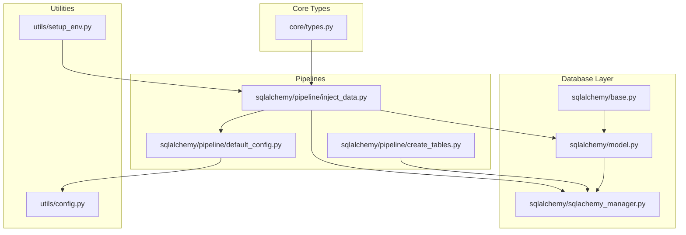
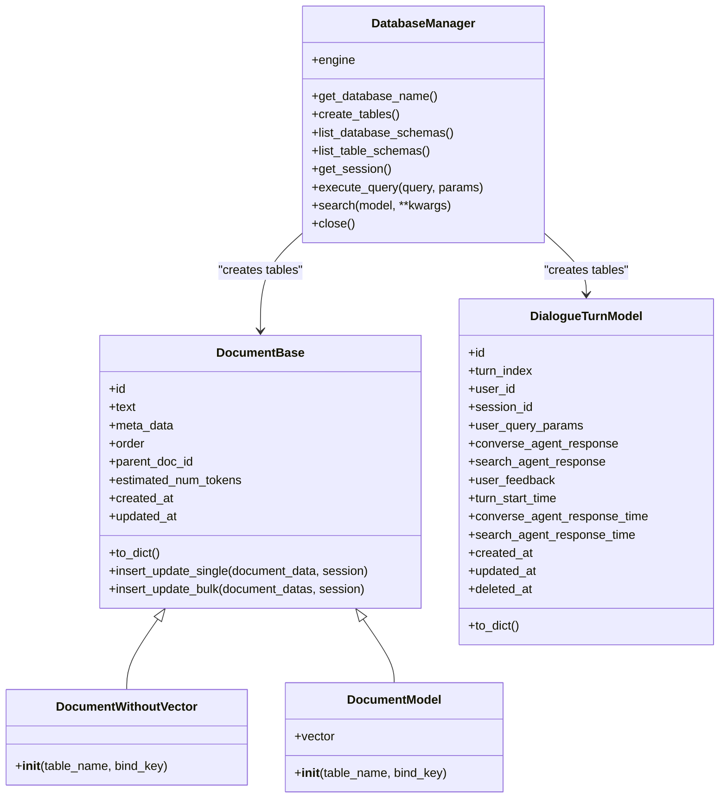
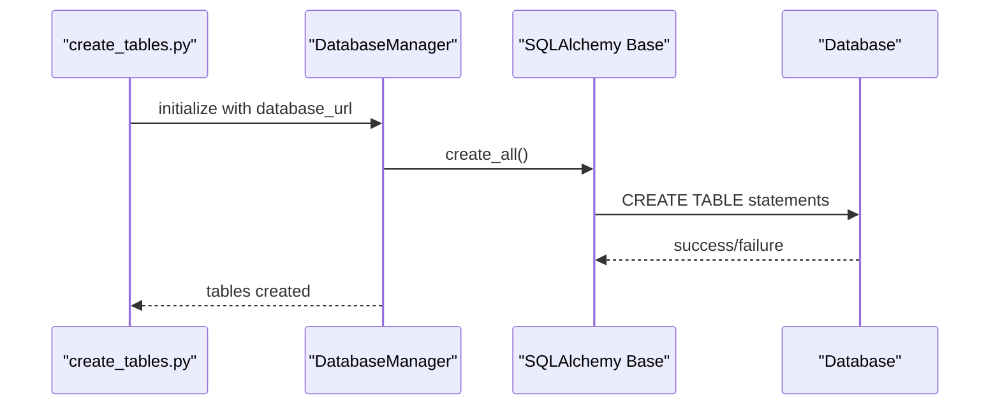
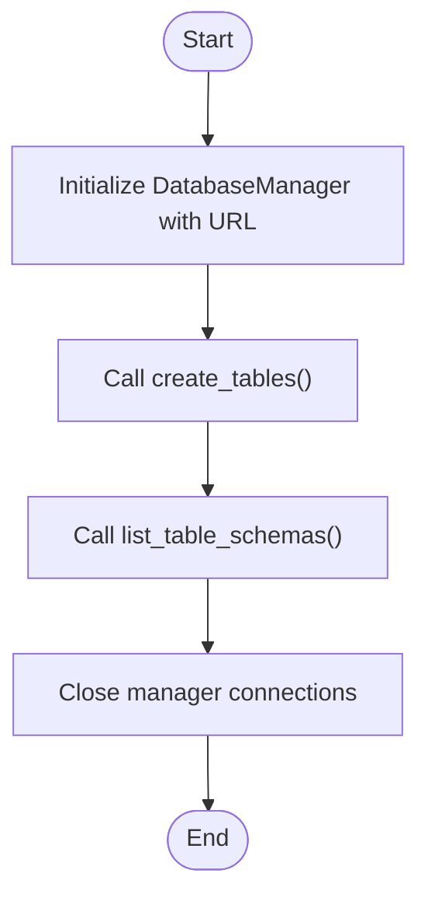
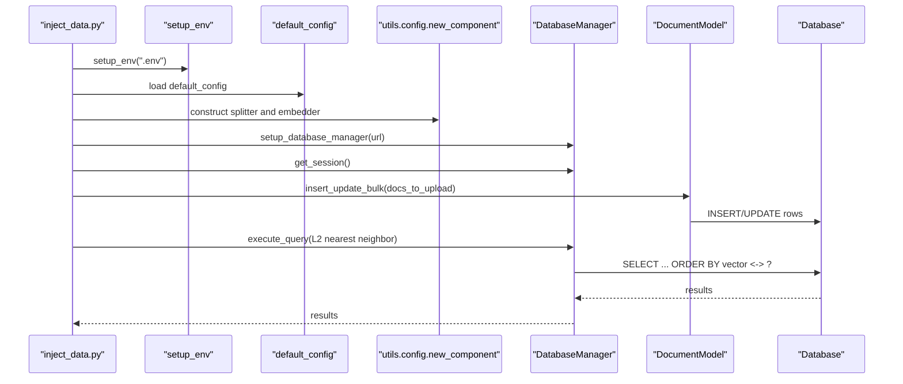
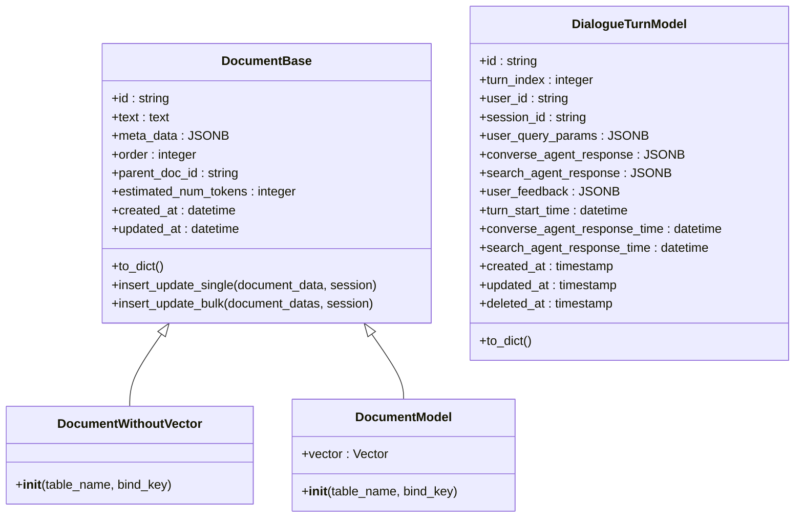
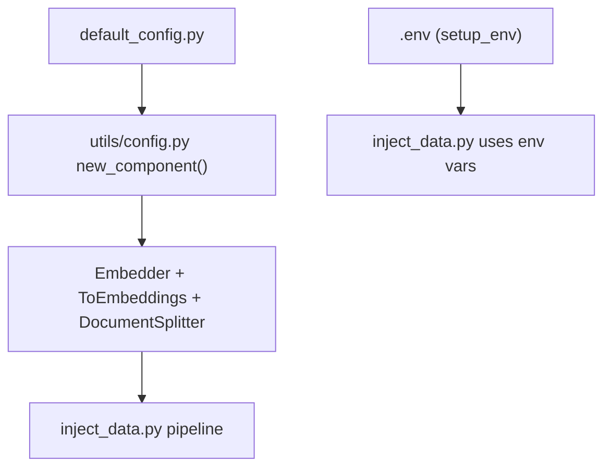
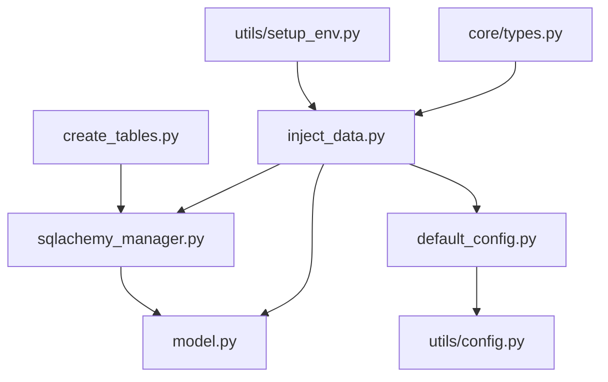

# Database Management

<cite>
**Referenced Files in This Document**
- [database/README.md](file://adalflow/adalflow/database/README.md)
- [sqlalchemy/base.py](file://adalflow/adalflow/database/sqlalchemy/base.py)
- [sqlalchemy/model.py](file://adalflow/adalflow/database/sqlalchemy/model.py)
- [sqlalchemy/sqlachemy_manager.py](file://adalflow/adalflow/database/sqlalchemy/sqlachemy_manager.py)
- [sqlalchemy/pipeline/create_tables.py](file://adalflow/adalflow/database/sqlalchemy/pipeline/create_tables.py)
- [sqlalchemy/pipeline/inject_data.py](file://adalflow/adalflow/database/sqlalchemy/pipeline/inject_data.py)
- [sqlalchemy/pipeline/default_config.py](file://adalflow/adalflow/database/sqlalchemy/pipeline/default_config.py)
- [utils/config.py](file://adalflow/adalflow/utils/config.py)
- [utils/setup_env.py](file://adalflow/adalflow/utils/setup_env.py)
- [core/types.py](file://adalflow/adalflow/core/types.py)
- [core/db.py](file://adalflow/adalflow/core/db.py)
- [tutorials/postgres.sql](file://tutorials/postgres.sql)
- [tutorials/database.ipynb](file://tutorials/database.ipynb)
</cite>

## Table of Contents
1. [Introduction](#introduction)
2. [Project Structure](#project-structure)
3. [Core Components](#core-components)
4. [Architecture Overview](#architecture-overview)
5. [Detailed Component Analysis](#detailed-component-analysis)
6. [Dependency Analysis](#dependency-analysis)
7. [Performance Considerations](#performance-considerations)
8. [Troubleshooting Guide](#troubleshooting-guide)
9. [Conclusion](#conclusion)
10. [Appendices](#appendices)

## Introduction
This document explains the database management subsystem in the project, focusing on table creation, data injection, and lifecycle management. It covers the database manager class, the table creation pipeline, and data initialization workflows. It also documents configuration management, environment-specific settings, and deployment automation. Practical examples include database setup scripts, data seeding processes, and migration procedures. The relationship between database management and application startup sequences is addressed, alongside backup strategies, maintenance procedures, and production deployment considerations. Guidelines are provided for customizing database initialization and managing database versions.

## Project Structure
The database management system is organized under the database/sqlalchemy package with supporting utilities and tutorials:
- Database models and ORM base
- Database manager for lifecycle operations
- Pipelines for table creation and data injection
- Configuration helpers for component construction
- Environment setup utilities
- Supporting tutorials and SQL examples



**Diagram sources**
- [sqlalchemy/base.py](file://adalflow/adalflow/database/sqlalchemy/base.py#L1-L4)
- [sqlalchemy/model.py](file://adalflow/adalflow/database/sqlalchemy/model.py#L1-L325)
- [sqlalchemy/sqlachemy_manager.py](file://adalflow/adalflow/database/sqlalchemy/sqlachemy_manager.py#L1-L94)
- [sqlalchemy/pipeline/create_tables.py](file://adalflow/adalflow/database/sqlalchemy/pipeline/create_tables.py#L1-L15)
- [sqlalchemy/pipeline/inject_data.py](file://adalflow/adalflow/database/sqlalchemy/pipeline/inject_data.py#L1-L137)
- [sqlalchemy/pipeline/default_config.py](file://adalflow/adalflow/database/sqlalchemy/pipeline/default_config.py#L1-L31)
- [utils/config.py](file://adalflow/adalflow/utils/config.py#L66-L101)
- [utils/setup_env.py](file://adalflow/adalflow/utils/setup_env.py#L8-L19)
- [core/types.py](file://adalflow/adalflow/core/types.py#L1-L800)

**Section sources**
- [database/README.md](file://adalflow/adalflow/database/README.md#L1-L2)
- [sqlalchemy/base.py](file://adalflow/adalflow/database/sqlalchemy/base.py#L1-L4)
- [sqlalchemy/model.py](file://adalflow/adalflow/database/sqlalchemy/model.py#L1-L325)
- [sqlalchemy/sqlachemy_manager.py](file://adalflow/adalflow/database/sqlalchemy/sqlachemy_manager.py#L1-L94)
- [sqlalchemy/pipeline/create_tables.py](file://adalflow/adalflow/database/sqlalchemy/pipeline/create_tables.py#L1-L15)
- [sqlalchemy/pipeline/inject_data.py](file://adalflow/adalflow/database/sqlalchemy/pipeline/inject_data.py#L1-L137)
- [sqlalchemy/pipeline/default_config.py](file://adalflow/adalflow/database/sqlalchemy/pipeline/default_config.py#L1-L31)
- [utils/config.py](file://adalflow/adalflow/utils/config.py#L1-L101)
- [utils/setup_env.py](file://adalflow/adalflow/utils/setup_env.py#L1-L19)
- [core/types.py](file://adalflow/adalflow/core/types.py#L1-L800)

## Core Components
- DatabaseManager: Central class for connecting to the database, creating tables, listing schemas, executing raw queries, and managing sessions.
- Data models: DocumentBase, DocumentWithoutVector, DocumentModel, and DialogueTurnModel define the schema and ORM mappings.
- Pipelines: create_tables.py initializes tables; inject_data.py builds and runs an embedding pipeline to seed data.
- Configuration: default_config.py defines the data transformation pipeline; utils/config.py constructs components from configuration.
- Environment: utils/setup_env.py loads environment variables from a .env file.
- Core types: core/types.py defines Document and related types used by the injection pipeline.

Key responsibilities:
- Table creation and schema introspection
- Data insertion and updates via ORM
- Raw SQL execution for advanced operations
- Component-based data transformation and embedding
- Environment-driven configuration

**Section sources**
- [sqlalchemy/sqlachemy_manager.py](file://adalflow/adalflow/database/sqlalchemy/sqlachemy_manager.py#L12-L94)
- [sqlalchemy/model.py](file://adalflow/adalflow/database/sqlalchemy/model.py#L64-L325)
- [sqlalchemy/pipeline/create_tables.py](file://adalflow/adalflow/database/sqlalchemy/pipeline/create_tables.py#L1-L15)
- [sqlalchemy/pipeline/inject_data.py](file://adalflow/adalflow/database/sqlalchemy/pipeline/inject_data.py#L1-L137)
- [sqlalchemy/pipeline/default_config.py](file://adalflow/adalflow/database/sqlalchemy/pipeline/default_config.py#L1-L31)
- [utils/config.py](file://adalflow/adalflow/utils/config.py#L66-L101)
- [utils/setup_env.py](file://adalflow/adalflow/utils/setup_env.py#L8-L19)
- [core/types.py](file://adalflow/adalflow/core/types.py#L1-L800)

## Architecture Overview
The database architecture centers around SQLAlchemy ORM with declarative models and a DatabaseManager facade. The injection pipeline composes a document splitter and an embedding transformer, then persists transformed documents to the database using bulk insert/update utilities.



**Diagram sources**
- [sqlalchemy/sqlachemy_manager.py](file://adalflow/adalflow/database/sqlalchemy/sqlachemy_manager.py#L12-L94)
- [sqlalchemy/model.py](file://adalflow/adalflow/database/sqlalchemy/model.py#L64-L325)

## Detailed Component Analysis

### Database Manager Class
The DatabaseManager encapsulates:
- Engine creation from a database URL
- Schema introspection (schemas, tables, columns, foreign keys, indexes)
- Table creation via Base.metadata.create_all
- Session management and raw SQL execution
- Utility methods for database name detection and cleanup



**Diagram sources**
- [sqlalchemy/pipeline/create_tables.py](file://adalflow/adalflow/database/sqlalchemy/pipeline/create_tables.py#L7-L14)
- [sqlalchemy/sqlachemy_manager.py](file://adalflow/adalflow/database/sqlalchemy/sqlachemy_manager.py#L38-L40)

**Section sources**
- [sqlalchemy/sqlachemy_manager.py](file://adalflow/adalflow/database/sqlalchemy/sqlachemy_manager.py#L12-L94)
- [sqlalchemy/pipeline/create_tables.py](file://adalflow/adalflow/database/sqlalchemy/pipeline/create_tables.py#L1-L15)

### Table Creation Pipeline
The pipeline performs:
- Initialization of DatabaseManager with a PostgreSQL URL
- Invocation of create_tables to generate schema
- Listing of table schemas for verification
- Cleanup of connections



**Diagram sources**
- [sqlalchemy/pipeline/create_tables.py](file://adalflow/adalflow/database/sqlalchemy/pipeline/create_tables.py#L7-L14)
- [sqlalchemy/sqlachemy_manager.py](file://adalflow/adalflow/database/sqlalchemy/sqlachemy_manager.py#L38-L69)

**Section sources**
- [sqlalchemy/pipeline/create_tables.py](file://adalflow/adalflow/database/sqlalchemy/pipeline/create_tables.py#L1-L15)
- [sqlalchemy/sqlachemy_manager.py](file://adalflow/adalflow/database/sqlalchemy/sqlachemy_manager.py#L38-L69)

### Data Injection Workflow
The injection pipeline:
- Loads environment variables from .env
- Constructs a data transformation pipeline from default_config
- Splits documents and converts them to embeddings
- Persists transformed documents to the database using bulk insert/update
- Executes a similarity search using vector extension syntax



**Diagram sources**
- [sqlalchemy/pipeline/inject_data.py](file://adalflow/adalflow/database/sqlalchemy/pipeline/inject_data.py#L12-L137)
- [utils/setup_env.py](file://adalflow/adalflow/utils/setup_env.py#L8-L19)
- [sqlalchemy/pipeline/default_config.py](file://adalflow/adalflow/database/sqlalchemy/pipeline/default_config.py#L1-L31)
- [utils/config.py](file://adalflow/adalflow/utils/config.py#L66-L101)
- [sqlalchemy/sqlachemy_manager.py](file://adalflow/adalflow/database/sqlalchemy/sqlachemy_manager.py#L71-L84)
- [sqlalchemy/model.py](file://adalflow/adalflow/database/sqlalchemy/model.py#L96-L146)

**Section sources**
- [sqlalchemy/pipeline/inject_data.py](file://adalflow/adalflow/database/sqlalchemy/pipeline/inject_data.py#L1-L137)
- [utils/setup_env.py](file://adalflow/adalflow/utils/setup_env.py#L1-L19)
- [sqlalchemy/pipeline/default_config.py](file://adalflow/adalflow/database/sqlalchemy/pipeline/default_config.py#L1-L31)
- [utils/config.py](file://adalflow/adalflow/utils/config.py#L1-L101)
- [sqlalchemy/model.py](file://adalflow/adalflow/database/sqlalchemy/model.py#L96-L146)

### Data Models and Relationships
The models define:
- DocumentBase: shared fields for documents (id, text, meta_data, timestamps)
- DocumentWithoutVector: table without vector column
- DocumentModel: extends DocumentBase with vector column for pgvector
- DialogueTurnModel: stores conversational turns with JSONB fields and soft delete



**Diagram sources**
- [sqlalchemy/model.py](file://adalflow/adalflow/database/sqlalchemy/model.py#L64-L325)

**Section sources**
- [sqlalchemy/model.py](file://adalflow/adalflow/database/sqlalchemy/model.py#L64-L325)

### Configuration Management and Environment Settings
- default_config.py defines the document splitting and embedding pipeline configuration.
- utils/config.py constructs components recursively from configuration dictionaries.
- utils/setup_env.py loads environment variables from a .env file for credentials and runtime settings.
- core/types.py defines Document and related types used by the pipeline.



**Diagram sources**
- [sqlalchemy/pipeline/default_config.py](file://adalflow/adalflow/database/sqlalchemy/pipeline/default_config.py#L1-L31)
- [utils/config.py](file://adalflow/adalflow/utils/config.py#L66-L101)
- [utils/setup_env.py](file://adalflow/adalflow/utils/setup_env.py#L8-L19)
- [sqlalchemy/pipeline/inject_data.py](file://adalflow/adalflow/database/sqlalchemy/pipeline/inject_data.py#L1-L137)

**Section sources**
- [sqlalchemy/pipeline/default_config.py](file://adalflow/adalflow/database/sqlalchemy/pipeline/default_config.py#L1-L31)
- [utils/config.py](file://adalflow/adalflow/utils/config.py#L1-L101)
- [utils/setup_env.py](file://adalflow/adalflow/utils/setup_env.py#L1-L19)
- [core/types.py](file://adalflow/adalflow/core/types.py#L1-L800)

### Deployment Automation and Application Startup
- The pipeline scripts demonstrate a typical startup sequence: environment setup, manager initialization, schema creation, and data ingestion.
- The injection script includes a direct SQL similarity search example, illustrating runtime usage of vector extensions.

```mermaid
sequenceDiagram
participant Dev as "Developer"
participant Env as "setup_env"
participant Create as "create_tables.py"
participant Inject as "inject_data.py"
participant DB as "PostgreSQL"
Dev->>Env : setup_env()
Dev->>Create : run create_tables.py
Create->>DB : create tables
Dev->>Inject : run inject_data.py
Inject->>DB : insert data + similarity search
```

**Diagram sources**
- [utils/setup_env.py](file://adalflow/adalflow/utils/setup_env.py#L8-L19)
- [sqlalchemy/pipeline/create_tables.py](file://adalflow/adalflow/database/sqlalchemy/pipeline/create_tables.py#L7-L14)
- [sqlalchemy/pipeline/inject_data.py](file://adalflow/adalflow/database/sqlalchemy/pipeline/inject_data.py#L92-L137)

**Section sources**
- [utils/setup_env.py](file://adalflow/adalflow/utils/setup_env.py#L1-L19)
- [sqlalchemy/pipeline/create_tables.py](file://adalflow/adalflow/database/sqlalchemy/pipeline/create_tables.py#L1-L15)
- [sqlalchemy/pipeline/inject_data.py](file://adalflow/adalflow/database/sqlalchemy/pipeline/inject_data.py#L1-L137)

### Backup Strategies and Maintenance Procedures
- Use standard database tools for backups (e.g., logical dumps for PostgreSQL).
- Maintain separate environments (development, staging, production) with distinct database URLs.
- Periodically verify schema integrity using list_database_schemas and list_table_schemas.
- Monitor vector extension availability and required privileges for extension creation.

[No sources needed since this section provides general guidance]

### Production Deployment Considerations
- Store database credentials in environment variables managed by setup_env.
- Use migrations or controlled schema updates; avoid ad-hoc raw SQL in production without review.
- Ensure proper indexing and constraints for performance and data integrity.
- Back up regularly and test restoration procedures.

[No sources needed since this section provides general guidance]

### Customization Guidelines
- Customize table names and bind keys via model constructors.
- Adjust default_config to change splitting strategy or embedding model.
- Extend models by inheriting from DocumentBase to add domain-specific fields.
- Integrate additional inspection methods for audit or monitoring.

**Section sources**
- [sqlalchemy/model.py](file://adalflow/adalflow/database/sqlalchemy/model.py#L155-L201)
- [sqlalchemy/pipeline/default_config.py](file://adalflow/adalflow/database/sqlalchemy/pipeline/default_config.py#L1-L31)
- [utils/config.py](file://adalflow/adalflow/utils/config.py#L66-L101)

## Dependency Analysis
The following diagram shows key dependencies among components involved in database management:



**Diagram sources**
- [sqlalchemy/sqlachemy_manager.py](file://adalflow/adalflow/database/sqlalchemy/sqlachemy_manager.py#L1-L94)
- [sqlalchemy/model.py](file://adalflow/adalflow/database/sqlalchemy/model.py#L1-L325)
- [sqlalchemy/pipeline/create_tables.py](file://adalflow/adalflow/database/sqlalchemy/pipeline/create_tables.py#L1-L15)
- [sqlalchemy/pipeline/inject_data.py](file://adalflow/adalflow/database/sqlalchemy/pipeline/inject_data.py#L1-L137)
- [sqlalchemy/pipeline/default_config.py](file://adalflow/adalflow/database/sqlalchemy/pipeline/default_config.py#L1-L31)
- [utils/config.py](file://adalflow/adalflow/utils/config.py#L1-L101)
- [utils/setup_env.py](file://adalflow/adalflow/utils/setup_env.py#L1-L19)
- [core/types.py](file://adalflow/adalflow/core/types.py#L1-L800)

**Section sources**
- [sqlalchemy/sqlachemy_manager.py](file://adalflow/adalflow/database/sqlalchemy/sqlachemy_manager.py#L1-L94)
- [sqlalchemy/model.py](file://adalflow/adalflow/database/sqlalchemy/model.py#L1-L325)
- [sqlalchemy/pipeline/create_tables.py](file://adalflow/adalflow/database/sqlalchemy/pipeline/create_tables.py#L1-L15)
- [sqlalchemy/pipeline/inject_data.py](file://adalflow/adalflow/database/sqlalchemy/pipeline/inject_data.py#L1-L137)
- [sqlalchemy/pipeline/default_config.py](file://adalflow/adalflow/database/sqlalchemy/pipeline/default_config.py#L1-L31)
- [utils/config.py](file://adalflow/adalflow/utils/config.py#L1-L101)
- [utils/setup_env.py](file://adalflow/adalflow/utils/setup_env.py#L1-L19)
- [core/types.py](file://adalflow/adalflow/core/types.py#L1-L800)

## Performance Considerations
- Use bulk insert/update methods for high-throughput data ingestion.
- Leverage vector indexes and appropriate similarity metrics for nearest-neighbor searches.
- Batch embedding operations to reduce overhead.
- Monitor session usage and ensure proper disposal to prevent connection leaks.

[No sources needed since this section provides general guidance]

## Troubleshooting Guide
Common issues and resolutions:
- Extension not available: Ensure the vector extension is enabled in PostgreSQL before creating tables that rely on it.
- Environment variables missing: Verify .env file presence and correctness; use setup_env to load variables.
- Transaction errors: Review insert/update logic and ensure rollback handling is triggered on exceptions.
- Schema mismatches: Use schema introspection methods to compare expected vs. actual schemas.

**Section sources**
- [sqlalchemy/model.py](file://adalflow/adalflow/database/sqlalchemy/model.py#L268-L295)
- [utils/setup_env.py](file://adalflow/adalflow/utils/setup_env.py#L8-L19)
- [sqlalchemy/sqlachemy_manager.py](file://adalflow/adalflow/database/sqlalchemy/sqlachemy_manager.py#L71-L84)

## Conclusion
The database management system provides a robust foundation for schema creation, data injection, and lifecycle operations using SQLAlchemy. The DatabaseManager class centralizes connectivity and schema management, while the injection pipeline demonstrates a practical approach to transforming and persisting data with embeddings. Configuration and environment utilities enable flexible deployments across environments. By following the customization guidelines and operational best practices outlined, teams can reliably manage database initialization, versioning, and production operations.

## Appendices

### Practical Examples
- Database setup script: [create_tables.py](file://adalflow/adalflow/database/sqlalchemy/pipeline/create_tables.py#L7-L14)
- Data seeding process: [inject_data.py](file://adalflow/adalflow/database/sqlalchemy/pipeline/inject_data.py#L92-L137)
- Migration procedure: Use schema introspection to compare and evolve tables; apply controlled changes with raw SQL when necessary.
- Vector extension usage: See similarity search example in the injection script and tutorial SQL.

**Section sources**
- [sqlalchemy/pipeline/create_tables.py](file://adalflow/adalflow/database/sqlalchemy/pipeline/create_tables.py#L1-L15)
- [sqlalchemy/pipeline/inject_data.py](file://adalflow/adalflow/database/sqlalchemy/pipeline/inject_data.py#L92-L137)
- [tutorials/postgres.sql](file://tutorials/postgres.sql#L1-L8)