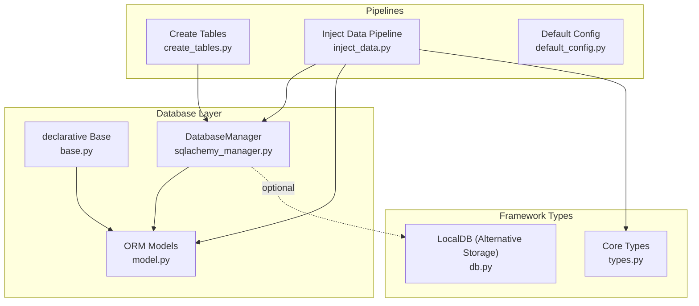
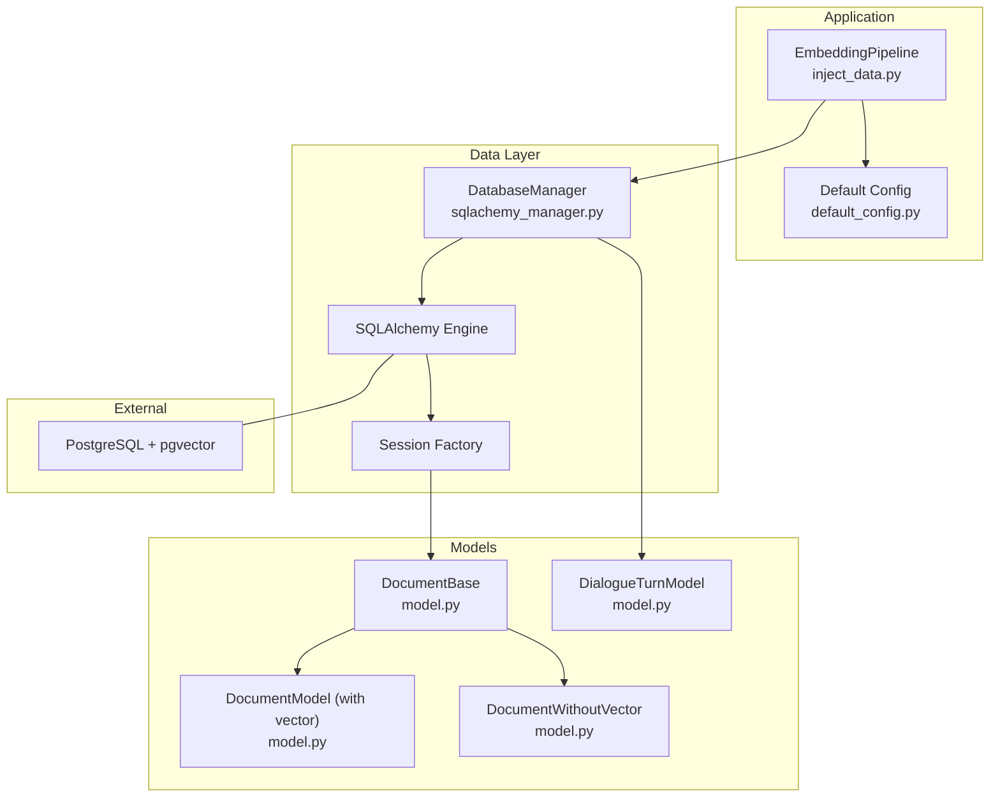
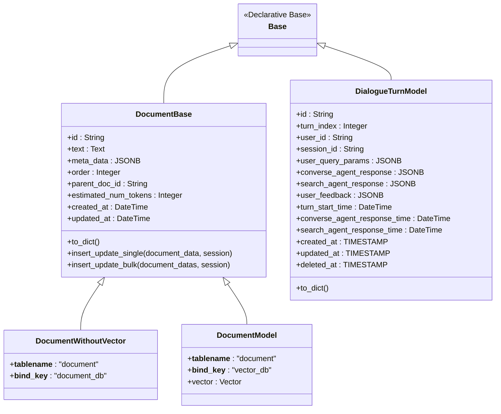
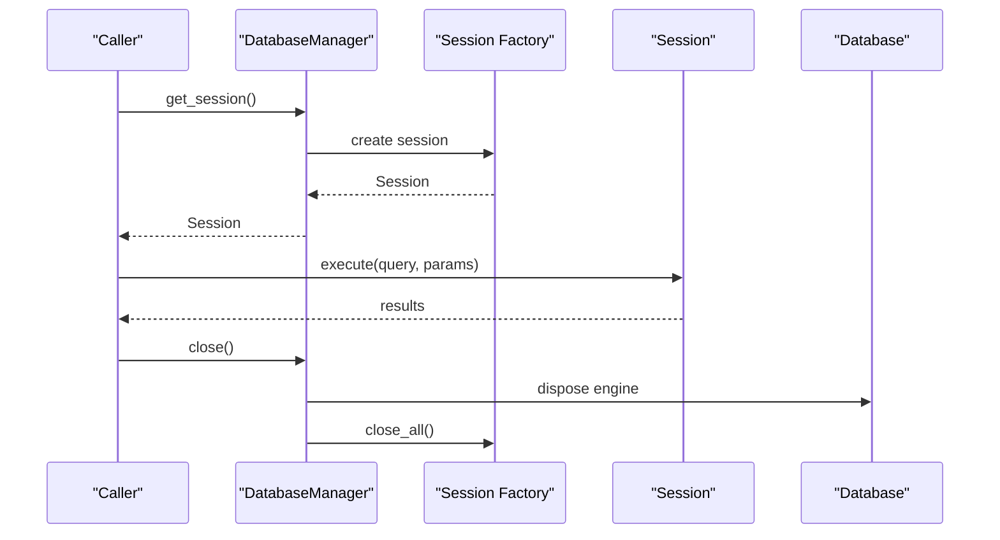
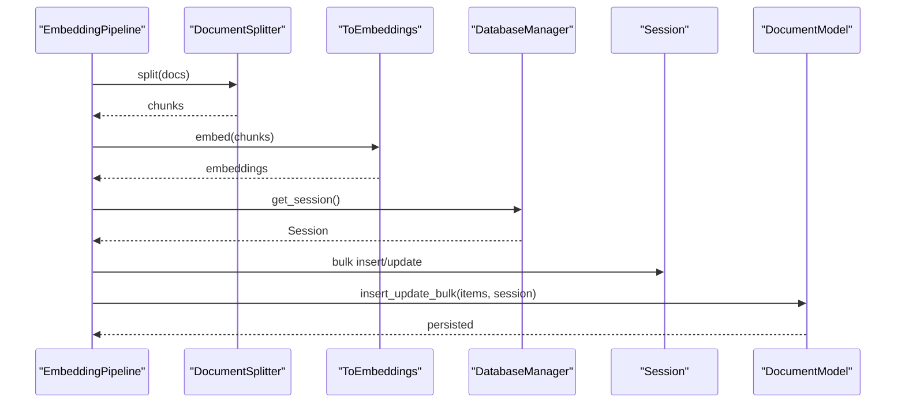
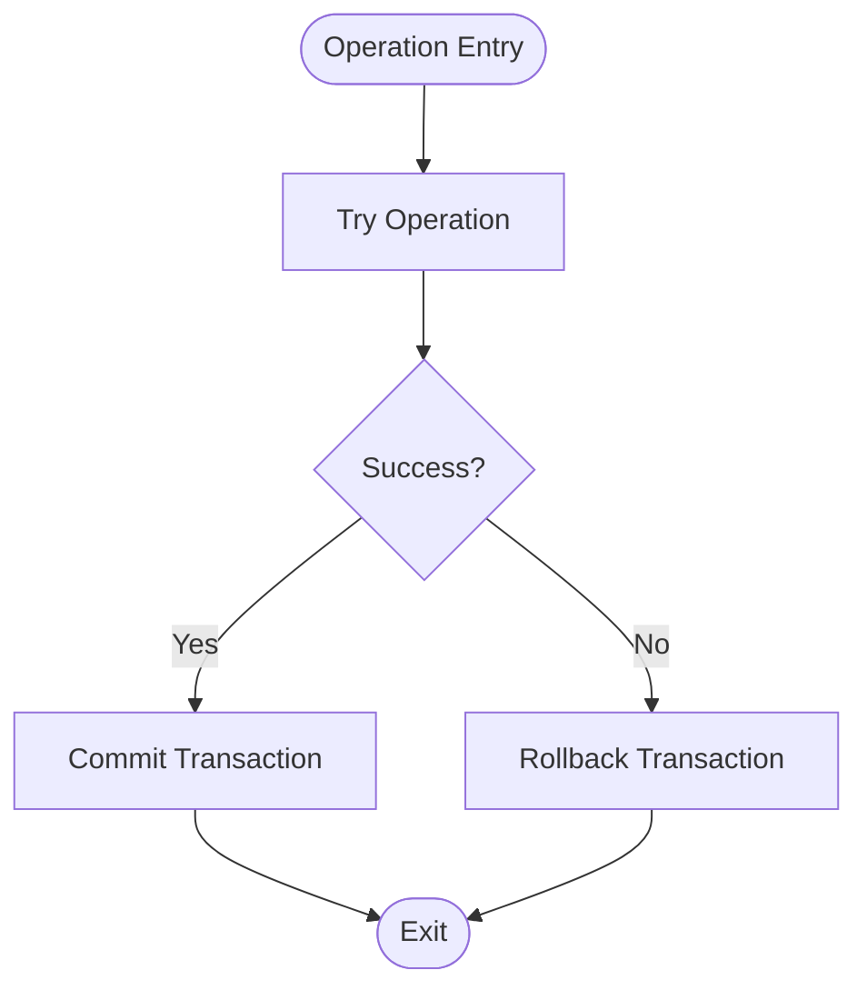
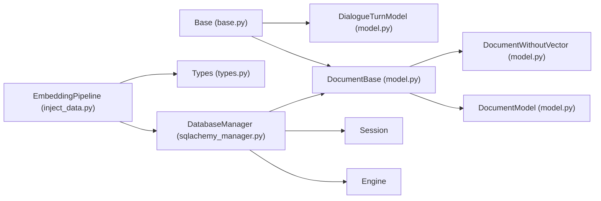

# SQLAlchemy Integration

<cite>
**Referenced Files in This Document**
- [base.py](file://adalflow/adalflow/database/sqlalchemy/base.py)
- [model.py](file://adalflow/adalflow/database/sqlalchemy/model.py)
- [sqlachemy_manager.py](file://adalflow/adalflow/database/sqlalchemy/sqlachemy_manager.py)
- [create_tables.py](file://adalflow/adalflow/database/sqlalchemy/pipeline/create_tables.py)
- [inject_data.py](file://adalflow/adalflow/database/sqlalchemy/pipeline/inject_data.py)
- [default_config.py](file://adalflow/adalflow/database/sqlalchemy/pipeline/default_config.py)
- [types.py](file://adalflow/adalflow/core/types.py)
- [db.py](file://adalflow/adalflow/core/db.py)
- [README.md](file://adalflow/adalflow/database/README.md)
</cite>

## Table of Contents
1. [Introduction](#introduction)
2. [Project Structure](#project-structure)
3. [Core Components](#core-components)
4. [Architecture Overview](#architecture-overview)
5. [Detailed Component Analysis](#detailed-component-analysis)
6. [Dependency Analysis](#dependency-analysis)
7. [Performance Considerations](#performance-considerations)
8. [Troubleshooting Guide](#troubleshooting-guide)
9. [Conclusion](#conclusion)
10. [Appendices](#appendices)

## Introduction
This document explains how AdalFlow integrates SQLAlchemy to power its ORM layer and database abstraction. It covers the declarative base setup, model inheritance patterns, and session management. It also documents how SQLAlchemy models relate to AdalFlow components, how to define models, construct queries, and perform database operations. Practical examples illustrate embedding pipelines, vector similarity search, and transaction management. Guidance is provided for extending models and implementing custom database operations, along with integration points into the framework’s data processing pipeline.

## Project Structure
The SQLAlchemy integration resides under the database/sqlalchemy package and includes:
- Declarative base definition
- ORM models for documents and dialogue turns
- Database manager for engine/session lifecycle and schema operations
- Pipeline utilities for table creation, data injection, and vectorized retrieval

**Diagram sources**
- [base.py](file://adalflow/adalflow/database/sqlalchemy/base.py#L1-L4)
- [model.py](file://adalflow/adalflow/database/sqlalchemy/model.py#L64-L325)
- [sqlachemy_manager.py](file://adalflow/adalflow/database/sqlalchemy/sqlachemy_manager.py#L12-L94)
- [create_tables.py](file://adalflow/adalflow/database/sqlalchemy/pipeline/create_tables.py#L1-L15)
- [inject_data.py](file://adalflow/adalflow/database/sqlalchemy/pipeline/inject_data.py#L1-L137)
- [default_config.py](file://adalflow/adalflow/database/sqlalchemy/pipeline/default_config.py#L1-L31)
- [types.py](file://adalflow/adalflow/core/types.py#L1-L200)
- [db.py](file://adalflow/adalflow/core/db.py#L25-L391)

**Section sources**
- [README.md](file://adalflow/adalflow/database/README.md#L1-L2)
- [base.py](file://adalflow/adalflow/database/sqlalchemy/base.py#L1-L4)
- [model.py](file://adalflow/adalflow/database/sqlalchemy/model.py#L1-L325)
- [sqlachemy_manager.py](file://adalflow/adalflow/database/sqlalchemy/sqlachemy_manager.py#L1-L94)
- [create_tables.py](file://adalflow/adalflow/database/sqlalchemy/pipeline/create_tables.py#L1-L15)
- [inject_data.py](file://adalflow/adalflow/database/sqlalchemy/pipeline/inject_data.py#L1-L137)
- [default_config.py](file://adalflow/adalflow/database/sqlalchemy/pipeline/default_config.py#L1-L31)
- [types.py](file://adalflow/adalflow/core/types.py#L1-L200)
- [db.py](file://adalflow/adalflow/core/db.py#L25-L391)

## Core Components
- Declarative Base: Central Base class for all ORM models.
- ORM Models: DocumentBase, DocumentWithoutVector, DocumentModel, and DialogueTurnModel.
- DatabaseManager: Engine/session lifecycle, schema introspection, table creation, raw SQL execution, and search helpers.
- Pipelines: Table creation and data injection pipeline with embedding transformation and vectorized retrieval.

Key responsibilities:
- Base defines the declarative metaclass used by all models.
- Models encapsulate schema and common operations (insert/update single/bulk).
- DatabaseManager centralizes connection and session management.
- Pipelines orchestrate data transformation and persistence.

**Section sources**
- [base.py](file://adalflow/adalflow/database/sqlalchemy/base.py#L1-L4)
- [model.py](file://adalflow/adalflow/database/sqlalchemy/model.py#L64-L325)
- [sqlachemy_manager.py](file://adalflow/adalflow/database/sqlalchemy/sqlachemy_manager.py#L12-L94)
- [inject_data.py](file://adalflow/adalflow/database/sqlalchemy/pipeline/inject_data.py#L13-L91)

## Architecture Overview
The integration follows a layered architecture:
- Data models inherit from a shared declarative Base.
- DatabaseManager manages engine and sessions, enabling schema creation and raw SQL operations.
- Pipelines transform data (e.g., splitting and embedding) and persist via ORM bulk operations.
- Vector similarity search leverages pgvector-specific operators via raw SQL executed through DatabaseManager.

**Diagram sources**
- [inject_data.py](file://adalflow/adalflow/database/sqlalchemy/pipeline/inject_data.py#L13-L91)
- [default_config.py](file://adalflow/adalflow/database/sqlalchemy/pipeline/default_config.py#L1-L31)
- [sqlachemy_manager.py](file://adalflow/adalflow/database/sqlalchemy/sqlachemy_manager.py#L12-L94)
- [model.py](file://adalflow/adalflow/database/sqlalchemy/model.py#L64-L325)

## Detailed Component Analysis

### Declarative Base Setup
- The Base class is imported from SQLAlchemy’s declarative extension and serves as the metaclass for all ORM models.
- All models inherit from this Base, enabling unified schema management and metadata handling.

Implementation highlights:
- Single import defines the declarative base used across the package.

**Section sources**
- [base.py](file://adalflow/adalflow/database/sqlalchemy/base.py#L1-L4)

### Model Inheritance Patterns
- DocumentBase defines common fields (id, text, meta_data, timestamps) and shared utilities (to_dict, insert/update helpers).
- DocumentWithoutVector extends DocumentBase without vector columns; useful for non-vectorized storage.
- DocumentModel extends DocumentBase and adds a vector column leveraging pgvector for similarity search.
- DialogueTurnModel captures conversational turns with JSONB fields and soft-delete support.

**Diagram sources**
- [model.py](file://adalflow/adalflow/database/sqlalchemy/model.py#L64-L325)
- [base.py](file://adalflow/adalflow/database/sqlalchemy/base.py#L1-L4)

**Section sources**
- [model.py](file://adalflow/adalflow/database/sqlalchemy/model.py#L64-L325)

### Database Session Management
- DatabaseManager encapsulates engine creation, session factory, and lifecycle management.
- Provides convenience methods for:
  - Creating tables from metadata
  - Listing schemas and table details
  - Executing raw SQL queries safely
  - Performing simple filter-based searches
  - Closing engine and disposing sessions

**Diagram sources**
- [sqlachemy_manager.py](file://adalflow/adalflow/database/sqlalchemy/sqlachemy_manager.py#L71-L94)

**Section sources**
- [sqlachemy_manager.py](file://adalflow/adalflow/database/sqlalchemy/sqlachemy_manager.py#L12-L94)

### Relationship Between SQLAlchemy Models and AdalFlow Components
- EmbeddingPipeline composes DocumentSplitter and ToEmbeddings components to transform Documents into embeddings, then persists them via DocumentModel bulk insert/update.
- Core types (e.g., Document) are used to feed the pipeline and to convert to/from dictionaries for ORM persistence.
- LocalDB offers an alternative in-memory persistence mechanism for experimentation and lightweight scenarios.

**Diagram sources**
- [inject_data.py](file://adalflow/adalflow/database/sqlalchemy/pipeline/inject_data.py#L54-L91)
- [model.py](file://adalflow/adalflow/database/sqlalchemy/model.py#L96-L147)
- [types.py](file://adalflow/adalflow/core/types.py#L1-L200)
- [db.py](file://adalflow/adalflow/core/db.py#L25-L391)

**Section sources**
- [inject_data.py](file://adalflow/adalflow/database/sqlalchemy/pipeline/inject_data.py#L13-L91)
- [types.py](file://adalflow/adalflow/core/types.py#L1-L200)
- [db.py](file://adalflow/adalflow/core/db.py#L25-L391)

### Practical Examples

- Defining a model
  - Extend DocumentBase for common fields and utilities.
  - Use DocumentModel for vectorized storage or DocumentWithoutVector for non-vectorized storage.
  - Reference model definitions for guidance:
    - [DocumentBase](file://adalflow/adalflow/database/sqlalchemy/model.py#L64-L95)
    - [DocumentModel](file://adalflow/adalflow/database/sqlalchemy/model.py#L179-L201)
    - [DocumentWithoutVector](file://adalflow/adalflow/database/sqlalchemy/model.py#L155-L177)
    - [DialogueTurnModel](file://adalflow/adalflow/database/sqlalchemy/model.py#L203-L266)

- Query construction and database operations
  - Bulk insert/update:
    - [DocumentBase.insert_update_bulk](file://adalflow/adalflow/database/sqlalchemy/model.py#L121-L147)
  - Single insert/update:
    - [DocumentBase.insert_update_single](file://adalflow/adalflow/database/sqlalchemy/model.py#L97-L118)
  - Raw SQL execution:
    - [DatabaseManager.execute_query](file://adalflow/adalflow/database/sqlalchemy/sqlachemy_manager.py#L74-L84)
  - Vector similarity search example:
    - [inject_data.py vector similarity usage](file://adalflow/adalflow/database/sqlalchemy/pipeline/inject_data.py#L128-L136)

- Integrating with the data processing pipeline
  - Configure components and run the pipeline:
    - [EmbeddingPipeline](file://adalflow/adalflow/database/sqlalchemy/pipeline/inject_data.py#L13-L91)
    - [Default configuration](file://adalflow/adalflow/database/sqlalchemy/pipeline/default_config.py#L1-L31)

**Section sources**
- [model.py](file://adalflow/adalflow/database/sqlalchemy/model.py#L64-L325)
- [sqlachemy_manager.py](file://adalflow/adalflow/database/sqlalchemy/sqlachemy_manager.py#L71-L94)
- [inject_data.py](file://adalflow/adalflow/database/sqlalchemy/pipeline/inject_data.py#L128-L136)
- [default_config.py](file://adalflow/adalflow/database/sqlalchemy/pipeline/default_config.py#L1-L31)

### Transaction Management and Error Handling Strategies
- Transactions are managed per operation:
  - Bulk insert/update wraps updates in a single transaction and rolls back on exceptions.
  - Raw SQL execution uses a session-scoped transaction and commits the result.
- Error handling:
  - Exceptions during bulk operations trigger rollback and return None.
  - Logging is used to capture errors and debug information.

**Diagram sources**
- [model.py](file://adalflow/adalflow/database/sqlalchemy/model.py#L121-L147)
- [sqlachemy_manager.py](file://adalflow/adalflow/database/sqlalchemy/sqlachemy_manager.py#L74-L84)

**Section sources**
- [model.py](file://adalflow/adalflow/database/sqlalchemy/model.py#L121-L147)
- [sqlachemy_manager.py](file://adalflow/adalflow/database/sqlalchemy/sqlachemy_manager.py#L74-L84)

### Extending Models and Custom Operations
- Extend DocumentBase to add fields and utilities common to document-like entities.
- For vectorized storage, use DocumentModel and ensure pgvector is enabled in PostgreSQL.
- For non-vectorized storage, use DocumentWithoutVector and customize table/bind keys as needed.
- Implement custom operations by adding class methods to models or by composing DatabaseManager for raw SQL operations.

Guidance references:
- [DocumentBase](file://adalflow/adalflow/database/sqlalchemy/model.py#L64-L95)
- [DocumentModel](file://adalflow/adalflow/database/sqlalchemy/model.py#L179-L201)
- [DocumentWithoutVector](file://adalflow/adalflow/database/sqlalchemy/model.py#L155-L177)
- [DatabaseManager](file://adalflow/adalflow/database/sqlalchemy/sqlachemy_manager.py#L12-L94)

**Section sources**
- [model.py](file://adalflow/adalflow/database/sqlalchemy/model.py#L64-L201)
- [sqlachemy_manager.py](file://adalflow/adalflow/database/sqlalchemy/sqlachemy_manager.py#L12-L94)

## Dependency Analysis
- Models depend on the declarative Base and SQLAlchemy constructs (Columns, DateTime, JSONB, Vector).
- DatabaseManager depends on SQLAlchemy engine/session and model imports to create tables.
- Pipelines depend on core types and components for data transformation and on DatabaseManager for persistence.

**Diagram sources**
- [base.py](file://adalflow/adalflow/database/sqlalchemy/base.py#L1-L4)
- [model.py](file://adalflow/adalflow/database/sqlalchemy/model.py#L64-L325)
- [sqlachemy_manager.py](file://adalflow/adalflow/database/sqlalchemy/sqlachemy_manager.py#L12-L94)
- [inject_data.py](file://adalflow/adalflow/database/sqlalchemy/pipeline/inject_data.py#L13-L91)
- [types.py](file://adalflow/adalflow/core/types.py#L1-L200)

**Section sources**
- [model.py](file://adalflow/adalflow/database/sqlalchemy/model.py#L64-L325)
- [sqlachemy_manager.py](file://adalflow/adalflow/database/sqlalchemy/sqlachemy_manager.py#L12-L94)
- [inject_data.py](file://adalflow/adalflow/database/sqlalchemy/pipeline/inject_data.py#L13-L91)
- [types.py](file://adalflow/adalflow/core/types.py#L1-L200)

## Performance Considerations
- Use bulk insert/update for high-throughput ingestion to minimize round-trips.
- Leverage vector similarity search with pgvector for efficient nearest neighbor retrieval.
- Batch processing in pipelines reduces overhead and improves throughput.
- Close sessions and dispose engines to prevent resource leaks.

[No sources needed since this section provides general guidance]

## Troubleshooting Guide
Common issues and resolutions:
- Missing pgvector extension in PostgreSQL:
  - Enable the extension using DatabaseManager’s raw SQL execution capability.
  - Reference: [DatabaseManager.execute_query](file://adalflow/adalflow/database/sqlalchemy/sqlachemy_manager.py#L74-L84)
- Schema mismatch or missing tables:
  - Use create_tables to initialize schema.
  - Reference: [DatabaseManager.create_tables](file://adalflow/adalflow/database/sqlalchemy/sqlachemy_manager.py#L38-L41)
- Transaction failures:
  - Inspect logs and rely on automatic rollback in bulk operations.
  - Reference: [DocumentBase.insert_update_bulk](file://adalflow/adalflow/database/sqlalchemy/model.py#L121-L147)
- Alternative storage for development:
  - Use LocalDB for in-memory persistence and experimentation.
  - Reference: [LocalDB](file://adalflow/adalflow/core/db.py#L25-L391)

**Section sources**
- [sqlachemy_manager.py](file://adalflow/adalflow/database/sqlalchemy/sqlachemy_manager.py#L38-L84)
- [model.py](file://adalflow/adalflow/database/sqlalchemy/model.py#L121-L147)
- [db.py](file://adalflow/adalflow/core/db.py#L25-L391)

## Conclusion
AdalFlow’s SQLAlchemy integration provides a robust ORM layer with clear model inheritance patterns, centralized session management, and practical pipelines for data ingestion and retrieval. By leveraging DocumentBase and specialized models, developers can implement vectorized and non-vectorized document storage, manage transactions safely, and integrate seamlessly with the framework’s data processing components. The provided examples and guidelines enable extending the system with custom models and operations while maintaining performance and reliability.

[No sources needed since this section summarizes without analyzing specific files]

## Appendices

### Appendix A: Table Creation Workflow
- Use the create_tables script to initialize schema.
- References:
  - [create_tables.py](file://adalflow/adalflow/database/sqlalchemy/pipeline/create_tables.py#L1-L15)
  - [DatabaseManager.create_tables](file://adalflow/adalflow/database/sqlalchemy/sqlachemy_manager.py#L38-L41)

**Section sources**
- [create_tables.py](file://adalflow/adalflow/database/sqlalchemy/pipeline/create_tables.py#L1-L15)
- [sqlachemy_manager.py](file://adalflow/adalflow/database/sqlalchemy/sqlachemy_manager.py#L38-L41)

### Appendix B: Embedding Pipeline Configuration
- Configure splitter and embeddings via default_config.
- References:
  - [default_config.py](file://adalflow/adalflow/database/sqlalchemy/pipeline/default_config.py#L1-L31)
  - [EmbeddingPipeline](file://adalflow/adalflow/database/sqlalchemy/pipeline/inject_data.py#L13-L91)

**Section sources**
- [default_config.py](file://adalflow/adalflow/database/sqlalchemy/pipeline/default_config.py#L1-L31)
- [inject_data.py](file://adalflow/adalflow/database/sqlalchemy/pipeline/inject_data.py#L13-L91)