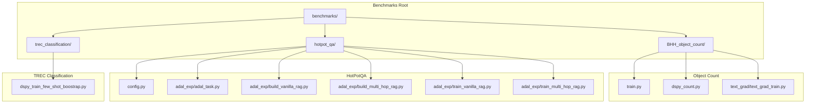
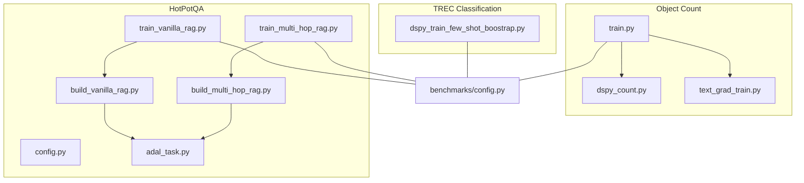
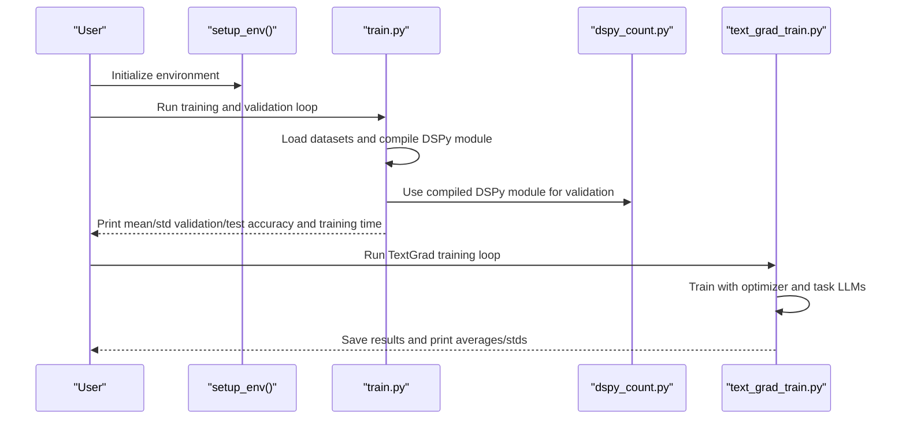
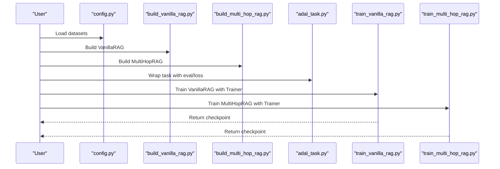
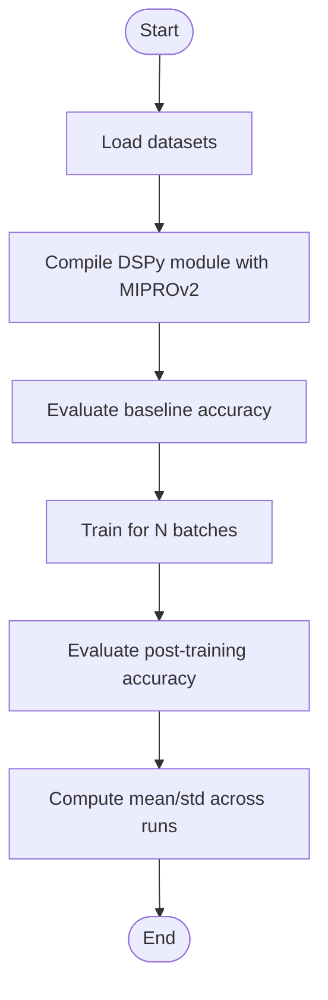
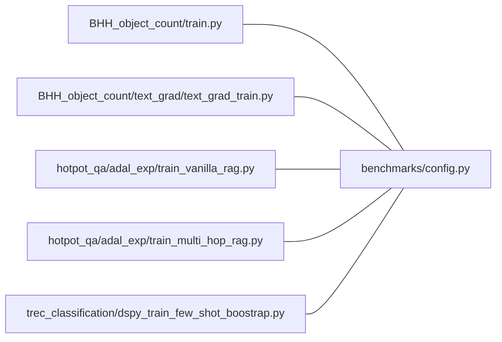

# Benchmarking and Comparison

<cite>
**Referenced Files in This Document**
- [benchmarks/README.md](file://benchmarks/README.md)
- [benchmarks/__init__.py](file://benchmarks/__init__.py)
- [benchmarks/config.py](file://benchmarks/config.py)
- [benchmarks/BHH_object_count/train.py](file://benchmarks/BHH_object_count/train.py)
- [benchmarks/BHH_object_count/dspy_count.py](file://benchmarks/BHH_object_count/dspy_count.py)
- [benchmarks/BHH_object_count/text_grad/text_grad_train.py](file://benchmarks/BHH_object_count/text_grad/text_grad_train.py)
- [benchmarks/hotpot_qa/config.py](file://benchmarks/hotpot_qa/config.py)
- [benchmarks/hotpot_qa/adal_exp/adal_task.py](file://benchmarks/hotpot_qa/adal_exp/adal_task.py)
- [benchmarks/hotpot_qa/adal_exp/build_multi_hop_rag.py](file://benchmarks/hotpot_qa/adal_exp/build_multi_hop_rag.py)
- [benchmarks/hotpot_qa/adal_exp/build_vanilla_rag.py](file://benchmarks/hotpot_qa/adal_exp/build_vanilla_rag.py)
- [benchmarks/hotpot_qa/adal_exp/train_multi_hop_rag.py](file://benchmarks/hotpot_qa/adal_exp/train_multi_hop_rag.py)
- [benchmarks/hotpot_qa/adal_exp/train_vanilla_rag.py](file://benchmarks/hotpot_qa/adal_exp/train_vanilla_rag.py)
- [benchmarks/trec_classification/dspy_train_few_shot_boostrap.py](file://benchmarks/trec_classification/dspy_train_few_shot_boostrap.py)
</cite>

## Table of Contents
1. [Introduction](#introduction)
2. [Project Structure](#project-structure)
3. [Core Components](#core-components)
4. [Architecture Overview](#architecture-overview)
5. [Detailed Component Analysis](#detailed-component-analysis)
6. [Dependency Analysis](#dependency-analysis)
7. [Performance Considerations](#performance-considerations)
8. [Troubleshooting Guide](#troubleshooting-guide)
9. [Conclusion](#conclusion)
10. [Appendices](#appendices)

## Introduction
This document explains AdalFlow’s benchmarking capabilities and performance comparison tools across representative tasks: object counting (Big-Bench Hard object counting), HotPotQA multi-hop question answering, and TREC classification. It covers benchmark methodology, experimental setup, comparative analysis frameworks, configuration management, reproducibility, and result tracking. It also provides guidance on statistical analysis, confidence intervals, significance testing, customization, parameter sweeps, and automated execution, enabling data-driven optimization decisions.

## Project Structure
The benchmarks are organized by task domain under the benchmarks/ directory. Each task includes:
- Task-specific training and evaluation scripts
- Model client configurations and save paths
- AdalFlow component wrappers for training and evaluation
- Optional third-party library integrations (e.g., DSPy, TextGrad)

**Diagram sources**
- [benchmarks/README.md](file://benchmarks/README.md#L1-L4)
- [benchmarks/__init__.py](file://benchmarks/__init__.py#L1-L2)
- [benchmarks/config.py](file://benchmarks/config.py#L1-L46)
- [benchmarks/BHH_object_count/train.py](file://benchmarks/BHH_object_count/train.py#L1-L158)
- [benchmarks/BHH_object_count/dspy_count.py](file://benchmarks/BHH_object_count/dspy_count.py#L1-L59)
- [benchmarks/BHH_object_count/text_grad/text_grad_train.py](file://benchmarks/BHH_object_count/text_grad/text_grad_train.py#L1-L180)
- [benchmarks/hotpot_qa/config.py](file://benchmarks/hotpot_qa/config.py#L1-L14)
- [benchmarks/hotpot_qa/adal_exp/adal_task.py](file://benchmarks/hotpot_qa/adal_exp/adal_task.py#L1-L73)
- [benchmarks/hotpot_qa/adal_exp/build_vanilla_rag.py](file://benchmarks/hotpot_qa/adal_exp/build_vanilla_rag.py#L1-L391)
- [benchmarks/hotpot_qa/adal_exp/build_multi_hop_rag.py](file://benchmarks/hotpot_qa/adal_exp/build_multi_hop_rag.py#L1-L908)
- [benchmarks/hotpot_qa/adal_exp/train_vanilla_rag.py](file://benchmarks/hotpot_qa/adal_exp/train_vanilla_rag.py#L1-L184)
- [benchmarks/hotpot_qa/adal_exp/train_multi_hop_rag.py](file://benchmarks/hotpot_qa/adal_exp/train_multi_hop_rag.py#L1-L168)
- [benchmarks/trec_classification/dspy_train_few_shot_boostrap.py](file://benchmarks/trec_classification/dspy_train_few_shot_boostrap.py#L1-L214)

**Section sources**
- [benchmarks/README.md](file://benchmarks/README.md#L1-L4)
- [benchmarks/__init__.py](file://benchmarks/__init__.py#L1-L2)

## Core Components
- Benchmark configuration management: centralized model client definitions and save paths for consistent comparisons.
- Task-specific trainers and evaluators: AdalFlow Trainer orchestration for HotPotQA RAG variants and standalone scripts for object counting and TREC classification.
- Evaluation metrics: exact match and F1-based accuracy wrappers for HotPotQA; exact match for TREC; custom accuracy for object counting.
- Reproducibility aids: fixed seeds, deterministic runs, and checkpoint saving.

Key implementation anchors:
- Model client and save path definitions: [benchmarks/config.py](file://benchmarks/config.py#L1-L46)
- Object counting training and validation loops: [benchmarks/BHH_object_count/train.py](file://benchmarks/BHH_object_count/train.py#L91-L158)
- TextGrad training loop and statistics: [benchmarks/BHH_object_count/text_grad/text_grad_train.py](file://benchmarks/BHH_object_count/text_grad/text_grad_train.py#L143-L180)
- HotPotQA dataset loading and task wrapper: [benchmarks/hotpot_qa/config.py](file://benchmarks/hotpot_qa/config.py#L7-L14), [benchmarks/hotpot_qa/adal_exp/adal_task.py](file://benchmarks/hotpot_qa/adal_exp/adal_task.py#L8-L73)
- Vanilla and multi-hop RAG builders and training: [benchmarks/hotpot_qa/adal_exp/build_vanilla_rag.py](file://benchmarks/hotpot_qa/adal_exp/build_vanilla_rag.py#L141-L391), [benchmarks/hotpot_qa/adal_exp/build_multi_hop_rag.py](file://benchmarks/hotpot_qa/adal_exp/build_multi_hop_rag.py#L604-L794), [benchmarks/hotpot_qa/adal_exp/train_vanilla_rag.py](file://benchmarks/hotpot_qa/adal_exp/train_vanilla_rag.py#L44-L184), [benchmarks/hotpot_qa/adal_exp/train_multi_hop_rag.py](file://benchmarks/hotpot_qa/adal_exp/train_multi_hop_rag.py#L41-L168)
- TREC classification training and evaluation: [benchmarks/trec_classification/dspy_train_few_shot_boostrap.py](file://benchmarks/trec_classification/dspy_train_few_shot_boostrap.py#L95-L214)

**Section sources**
- [benchmarks/config.py](file://benchmarks/config.py#L1-L46)
- [benchmarks/BHH_object_count/train.py](file://benchmarks/BHH_object_count/train.py#L91-L158)
- [benchmarks/BHH_object_count/text_grad/text_grad_train.py](file://benchmarks/BHH_object_count/text_grad/text_grad_train.py#L143-L180)
- [benchmarks/hotpot_qa/config.py](file://benchmarks/hotpot_qa/config.py#L7-L14)
- [benchmarks/hotpot_qa/adal_exp/adal_task.py](file://benchmarks/hotpot_qa/adal_exp/adal_task.py#L8-L73)
- [benchmarks/hotpot_qa/adal_exp/build_vanilla_rag.py](file://benchmarks/hotpot_qa/adal_exp/build_vanilla_rag.py#L141-L391)
- [benchmarks/hotpot_qa/adal_exp/build_multi_hop_rag.py](file://benchmarks/hotpot_qa/adal_exp/build_multi_hop_rag.py#L604-L794)
- [benchmarks/hotpot_qa/adal_exp/train_vanilla_rag.py](file://benchmarks/hotpot_qa/adal_exp/train_vanilla_rag.py#L44-L184)
- [benchmarks/hotpot_qa/adal_exp/train_multi_hop_rag.py](file://benchmarks/hotpot_qa/adal_exp/train_multi_hop_rag.py#L41-L168)
- [benchmarks/trec_classification/dspy_train_few_shot_boostrap.py](file://benchmarks/trec_classification/dspy_train_few_shot_boostrap.py#L95-L214)

## Architecture Overview
The benchmarking architecture integrates three major pipelines:
- Object counting: AdalFlow text-grad optimization vs. external library (DSPy) baselines.
- HotPotQA: AdalFlow RAG variants (Vanilla and Multi-Hop) with configurable model clients and evaluation.
- TREC classification: DSPy-based few-shot optimization with evaluation.

**Diagram sources**
- [benchmarks/BHH_object_count/train.py](file://benchmarks/BHH_object_count/train.py#L1-L158)
- [benchmarks/BHH_object_count/dspy_count.py](file://benchmarks/BHH_object_count/dspy_count.py#L1-L59)
- [benchmarks/BHH_object_count/text_grad/text_grad_train.py](file://benchmarks/BHH_object_count/text_grad/text_grad_train.py#L1-L180)
- [benchmarks/hotpot_qa/config.py](file://benchmarks/hotpot_qa/config.py#L1-L14)
- [benchmarks/hotpot_qa/adal_exp/adal_task.py](file://benchmarks/hotpot_qa/adal_exp/adal_task.py#L1-L73)
- [benchmarks/hotpot_qa/adal_exp/build_vanilla_rag.py](file://benchmarks/hotpot_qa/adal_exp/build_vanilla_rag.py#L1-L391)
- [benchmarks/hotpot_qa/adal_exp/build_multi_hop_rag.py](file://benchmarks/hotpot_qa/adal_exp/build_multi_hop_rag.py#L1-L908)
- [benchmarks/hotpot_qa/adal_exp/train_vanilla_rag.py](file://benchmarks/hotpot_qa/adal_exp/train_vanilla_rag.py#L1-L184)
- [benchmarks/hotpot_qa/adal_exp/train_multi_hop_rag.py](file://benchmarks/hotpot_qa/adal_exp/train_multi_hop_rag.py#L1-L168)
- [benchmarks/trec_classification/dspy_train_few_shot_boostrap.py](file://benchmarks/trec_classification/dspy_train_few_shot_boostrap.py#L1-L214)
- [benchmarks/config.py](file://benchmarks/config.py#L1-L46)

## Detailed Component Analysis

### Object Counting Benchmark
- Methodology: Multiple runs with fixed seeds; collect validation/test accuracy and training time; report means and standard deviations.
- Experimental setup: Loads BBH object counting data, compiles DSPy modules with bootstrapped few-shot optimization, validates on held-out sets.
- Comparative analysis: Runs TextGrad optimization against DSPy baselines; tracks per-run metrics and aggregates statistics.
- Reproducibility: Uses deterministic seeds and saves compiled models/checkpoints; logs training/validation/test scores and timing.

**Diagram sources**
- [benchmarks/BHH_object_count/train.py](file://benchmarks/BHH_object_count/train.py#L91-L158)
- [benchmarks/BHH_object_count/dspy_count.py](file://benchmarks/BHH_object_count/dspy_count.py#L1-L59)
- [benchmarks/BHH_object_count/text_grad/text_grad_train.py](file://benchmarks/BHH_object_count/text_grad/text_grad_train.py#L143-L180)

**Section sources**
- [benchmarks/BHH_object_count/train.py](file://benchmarks/BHH_object_count/train.py#L91-L158)
- [benchmarks/BHH_object_count/dspy_count.py](file://benchmarks/BHH_object_count/dspy_count.py#L1-L59)
- [benchmarks/BHH_object_count/text_grad/text_grad_train.py](file://benchmarks/BHH_object_count/text_grad/text_grad_train.py#L143-L180)

### HotPotQA Multi-Hop RAG Benchmark
- Methodology: Train vanilla and multi-hop RAG variants with configurable model clients; evaluate via AdalFlow Trainer; diagnose training bottlenecks.
- Experimental setup: Builds retriever/query-generator chains; wraps task with evaluation and loss functions; trains with constrained strategy and controlled shots.
- Comparative analysis: Compare vanilla vs. multi-hop variants; vary model clients for task/backward/teacher; track checkpoints and metrics.
- Reproducibility: Fixed seeds; optional resume from checkpoint; save trained components.

**Diagram sources**
- [benchmarks/hotpot_qa/config.py](file://benchmarks/hotpot_qa/config.py#L7-L14)
- [benchmarks/hotpot_qa/adal_exp/build_vanilla_rag.py](file://benchmarks/hotpot_qa/adal_exp/build_vanilla_rag.py#L141-L391)
- [benchmarks/hotpot_qa/adal_exp/build_multi_hop_rag.py](file://benchmarks/hotpot_qa/adal_exp/build_multi_hop_rag.py#L604-L794)
- [benchmarks/hotpot_qa/adal_exp/adal_task.py](file://benchmarks/hotpot_qa/adal_exp/adal_task.py#L8-L73)
- [benchmarks/hotpot_qa/adal_exp/train_vanilla_rag.py](file://benchmarks/hotpot_qa/adal_exp/train_vanilla_rag.py#L44-L184)
- [benchmarks/hotpot_qa/adal_exp/train_multi_hop_rag.py](file://benchmarks/hotpot_qa/adal_exp/train_multi_hop_rag.py#L41-L168)

**Section sources**
- [benchmarks/hotpot_qa/config.py](file://benchmarks/hotpot_qa/config.py#L7-L14)
- [benchmarks/hotpot_qa/adal_exp/adal_task.py](file://benchmarks/hotpot_qa/adal_exp/adal_task.py#L8-L73)
- [benchmarks/hotpot_qa/adal_exp/build_vanilla_rag.py](file://benchmarks/hotpot_qa/adal_exp/build_vanilla_rag.py#L141-L391)
- [benchmarks/hotpot_qa/adal_exp/build_multi_hop_rag.py](file://benchmarks/hotpot_qa/adal_exp/build_multi_hop_rag.py#L604-L794)
- [benchmarks/hotpot_qa/adal_exp/train_vanilla_rag.py](file://benchmarks/hotpot_qa/adal_exp/train_vanilla_rag.py#L44-L184)
- [benchmarks/hotpot_qa/adal_exp/train_multi_hop_rag.py](file://benchmarks/hotpot_qa/adal_exp/train_multi_hop_rag.py#L41-L168)

### TREC Classification Benchmark
- Methodology: Train DSPy modules with few-shot optimization; evaluate on validation and test sets; report accuracy and timing.
- Experimental setup: Define classification signature; load datasets; compile with MIPROv2; evaluate with answer_exact_match.
- Comparative analysis: Compare baseline performance before training and optimized performance after training; aggregate across runs.

**Diagram sources**
- [benchmarks/trec_classification/dspy_train_few_shot_boostrap.py](file://benchmarks/trec_classification/dspy_train_few_shot_boostrap.py#L95-L214)

**Section sources**
- [benchmarks/trec_classification/dspy_train_few_shot_boostrap.py](file://benchmarks/trec_classification/dspy_train_few_shot_boostrap.py#L95-L214)

## Dependency Analysis
- Centralized configuration: benchmarks/config.py defines model clients and save paths used across tasks.
- Task dependencies:
  - Object counting depends on dataset loaders and model clients.
  - HotPotQA depends on dataset loaders, AdalFlow components, and model clients.
  - TREC depends on dataset loaders and DSPy components.
- Coupling and cohesion:
  - Each task maintains its own training script and evaluation loop, promoting cohesion within task domains.
  - Shared configuration reduces duplication and improves comparability across strategies.

**Diagram sources**
- [benchmarks/config.py](file://benchmarks/config.py#L1-L46)
- [benchmarks/BHH_object_count/train.py](file://benchmarks/BHH_object_count/train.py#L1-L158)
- [benchmarks/BHH_object_count/text_grad/text_grad_train.py](file://benchmarks/BHH_object_count/text_grad/text_grad_train.py#L1-L180)
- [benchmarks/hotpot_qa/adal_exp/train_vanilla_rag.py](file://benchmarks/hotpot_qa/adal_exp/train_vanilla_rag.py#L1-L184)
- [benchmarks/hotpot_qa/adal_exp/train_multi_hop_rag.py](file://benchmarks/hotpot_qa/adal_exp/train_multi_hop_rag.py#L1-L168)
- [benchmarks/trec_classification/dspy_train_few_shot_boostrap.py](file://benchmarks/trec_classification/dspy_train_few_shot_boostrap.py#L1-L214)

**Section sources**
- [benchmarks/config.py](file://benchmarks/config.py#L1-L46)
- [benchmarks/BHH_object_count/train.py](file://benchmarks/BHH_object_count/train.py#L1-L158)
- [benchmarks/BHH_object_count/text_grad/text_grad_train.py](file://benchmarks/BHH_object_count/text_grad/text_grad_train.py#L1-L180)
- [benchmarks/hotpot_qa/adal_exp/train_vanilla_rag.py](file://benchmarks/hotpot_qa/adal_exp/train_vanilla_rag.py#L1-L184)
- [benchmarks/hotpot_qa/adal_exp/train_multi_hop_rag.py](file://benchmarks/hotpot_qa/adal_exp/train_multi_hop_rag.py#L1-L168)
- [benchmarks/trec_classification/dspy_train_few_shot_boostrap.py](file://benchmarks/trec_classification/dspy_train_few_shot_boostrap.py#L1-L214)

## Performance Considerations
- Deterministic runs: Fix seeds and avoid stochasticity in prompts to ensure reproducible results.
- Batch and step control: Limit batch sizes and steps to prevent LLM drift and maintain stability.
- Model client selection: Choose appropriate model clients for task, teacher, and backward engines to balance quality and cost.
- Metrics aggregation: Report means and standard deviations across runs; consider confidence intervals for significance testing.
- Timing instrumentation: Record training and evaluation durations to compare optimization strategies.

[No sources needed since this section provides general guidance]

## Troubleshooting Guide
Common issues and remedies:
- Empty or invalid inputs during retrieval: Validate inputs and handle None values gracefully in retriever components.
- Low accuracy due to insufficient shots: Increase bootstrap shots and adjust demo inclusion/exclusion flags.
- Long backward passes: Reduce batch size or limit proposals per step; disable backward gradients selectively for diagnostics.
- Environment setup: Ensure environment initialization is executed before running benchmarks.

**Section sources**
- [benchmarks/hotpot_qa/adal_exp/build_vanilla_rag.py](file://benchmarks/hotpot_qa/adal_exp/build_vanilla_rag.py#L191-L229)
- [benchmarks/hotpot_qa/adal_exp/train_vanilla_rag.py](file://benchmarks/hotpot_qa/adal_exp/train_vanilla_rag.py#L81-L98)
- [benchmarks/hotpot_qa/adal_exp/train_multi_hop_rag.py](file://benchmarks/hotpot_qa/adal_exp/train_multi_hop_rag.py#L75-L93)

## Conclusion
AdalFlow’s benchmarking framework enables rigorous, reproducible comparisons across tasks and optimization strategies. By centralizing configuration, standardizing evaluation metrics, and instrumenting timing, teams can systematically assess trade-offs among model clients, training strategies, and prompt/system prompt optimization. Statistical reporting and checkpointing further support iterative improvement and transparent sharing of results.

[No sources needed since this section summarizes without analyzing specific files]

## Appendices

### Benchmark Configuration Management
- Centralized model client definitions and save paths for consistent comparisons across tasks.
- Example references:
  - [benchmarks/config.py](file://benchmarks/config.py#L13-L46)

**Section sources**
- [benchmarks/config.py](file://benchmarks/config.py#L13-L46)

### Experiment Reproducibility
- Fixed seeds and deterministic training modes.
- Checkpoint saving and optional resume to continue experiments.
- Example references:
  - [benchmarks/hotpot_qa/adal_exp/train_vanilla_rag.py](file://benchmarks/hotpot_qa/adal_exp/train_vanilla_rag.py#L94-L109)
  - [benchmarks/hotpot_qa/adal_exp/train_multi_hop_rag.py](file://benchmarks/hotpot_qa/adal_exp/train_multi_hop_rag.py#L94-L104)

**Section sources**
- [benchmarks/hotpot_qa/adal_exp/train_vanilla_rag.py](file://benchmarks/hotpot_qa/adal_exp/train_vanilla_rag.py#L94-L109)
- [benchmarks/hotpot_qa/adal_exp/train_multi_hop_rag.py](file://benchmarks/hotpot_qa/adal_exp/train_multi_hop_rag.py#L94-L104)

### Result Tracking Mechanisms
- Logging of validation/test accuracy and training time.
- Aggregation across runs with means and standard deviations.
- Example references:
  - [benchmarks/BHH_object_count/train.py](file://benchmarks/BHH_object_count/train.py#L122-L133)
  - [benchmarks/BHH_object_count/text_grad/text_grad_train.py](file://benchmarks/BHH_object_count/text_grad/text_grad_train.py#L167-L179)
  - [benchmarks/trec_classification/dspy_train_few_shot_boostrap.py](file://benchmarks/trec_classification/dspy_train_few_shot_boostrap.py#L204-L214)

**Section sources**
- [benchmarks/BHH_object_count/train.py](file://benchmarks/BHH_object_count/train.py#L122-L133)
- [benchmarks/BHH_object_count/text_grad/text_grad_train.py](file://benchmarks/BHH_object_count/text_grad/text_grad_train.py#L167-L179)
- [benchmarks/trec_classification/dspy_train_few_shot_boostrap.py](file://benchmarks/trec_classification/dspy_train_few_shot_boostrap.py#L204-L214)

### Statistical Analysis and Significance Testing
- Compute means and standard deviations across runs for accuracy and timing.
- Construct confidence intervals using standard errors for significance testing.
- Example references:
  - [benchmarks/BHH_object_count/train.py](file://benchmarks/BHH_object_count/train.py#L122-L133)
  - [benchmarks/BHH_object_count/text_grad/text_grad_train.py](file://benchmarks/BHH_object_count/text_grad/text_grad_train.py#L167-L179)
  - [benchmarks/trec_classification/dspy_train_few_shot_boostrap.py](file://benchmarks/trec_classification/dspy_train_few_shot_boostrap.py#L204-L214)

**Section sources**
- [benchmarks/BHH_object_count/train.py](file://benchmarks/BHH_object_count/train.py#L122-L133)
- [benchmarks/BHH_object_count/text_grad/text_grad_train.py](file://benchmarks/BHH_object_count/text_grad/text_grad_train.py#L167-L179)
- [benchmarks/trec_classification/dspy_train_few_shot_boostrap.py](file://benchmarks/trec_classification/dspy_train_few_shot_boostrap.py#L204-L214)

### Benchmark Customization and Parameter Sweeping
- Customize model clients, shots, and optimization strategies per task.
- Sweep hyperparameters by iterating over configurations and aggregating results.
- Example references:
  - [benchmarks/hotpot_qa/adal_exp/train_vanilla_rag.py](file://benchmarks/hotpot_qa/adal_exp/train_vanilla_rag.py#L44-L98)
  - [benchmarks/hotpot_qa/adal_exp/train_multi_hop_rag.py](file://benchmarks/hotpot_qa/adal_exp/train_multi_hop_rag.py#L41-L93)
  - [benchmarks/trec_classification/dspy_train_few_shot_boostrap.py](file://benchmarks/trec_classification/dspy_train_few_shot_boostrap.py#L123-L141)

**Section sources**
- [benchmarks/hotpot_qa/adal_exp/train_vanilla_rag.py](file://benchmarks/hotpot_qa/adal_exp/train_vanilla_rag.py#L44-L98)
- [benchmarks/hotpot_qa/adal_exp/train_multi_hop_rag.py](file://benchmarks/hotpot_qa/adal_exp/train_multi_hop_rag.py#L41-L93)
- [benchmarks/trec_classification/dspy_train_few_shot_boostrap.py](file://benchmarks/trec_classification/dspy_train_few_shot_boostrap.py#L123-L141)

### Automated Experiment Execution
- Use command-line arguments to control strategies, proposal limits, and backward options.
- Save checkpoints and results for later analysis.
- Example references:
  - [benchmarks/hotpot_qa/adal_exp/train_vanilla_rag.py](file://benchmarks/hotpot_qa/adal_exp/train_vanilla_rag.py#L112-L184)
  - [benchmarks/hotpot_qa/adal_exp/train_multi_hop_rag.py](file://benchmarks/hotpot_qa/adal_exp/train_multi_hop_rag.py#L107-L168)
  - [benchmarks/trec_classification/dspy_train_few_shot_boostrap.py](file://benchmarks/trec_classification/dspy_train_few_shot_boostrap.py#L158-L214)

**Section sources**
- [benchmarks/hotpot_qa/adal_exp/train_vanilla_rag.py](file://benchmarks/hotpot_qa/adal_exp/train_vanilla_rag.py#L112-L184)
- [benchmarks/hotpot_qa/adal_exp/train_multi_hop_rag.py](file://benchmarks/hotpot_qa/adal_exp/train_multi_hop_rag.py#L107-L168)
- [benchmarks/trec_classification/dspy_train_few_shot_boostrap.py](file://benchmarks/trec_classification/dspy_train_few_shot_boostrap.py#L158-L214)

### Interpreting Results and Identifying Bottlenecks
- Compare accuracy and timing across strategies; inspect backward passes and gradient computation settings.
- Use diagnosis APIs to identify problematic components in training pipelines.
- Example references:
  - [benchmarks/hotpot_qa/adal_exp/train_vanilla_rag.py](file://benchmarks/hotpot_qa/adal_exp/train_vanilla_rag.py#L16-L39)
  - [benchmarks/hotpot_qa/adal_exp/train_multi_hop_rag.py](file://benchmarks/hotpot_qa/adal_exp/train_multi_hop_rag.py#L15-L39)

**Section sources**
- [benchmarks/hotpot_qa/adal_exp/train_vanilla_rag.py](file://benchmarks/hotpot_qa/adal_exp/train_vanilla_rag.py#L16-L39)
- [benchmarks/hotpot_qa/adal_exp/train_multi_hop_rag.py](file://benchmarks/hotpot_qa/adal_exp/train_multi_hop_rag.py#L15-L39)