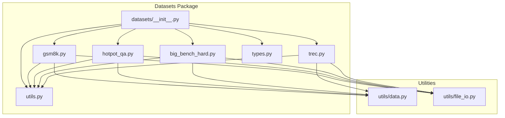
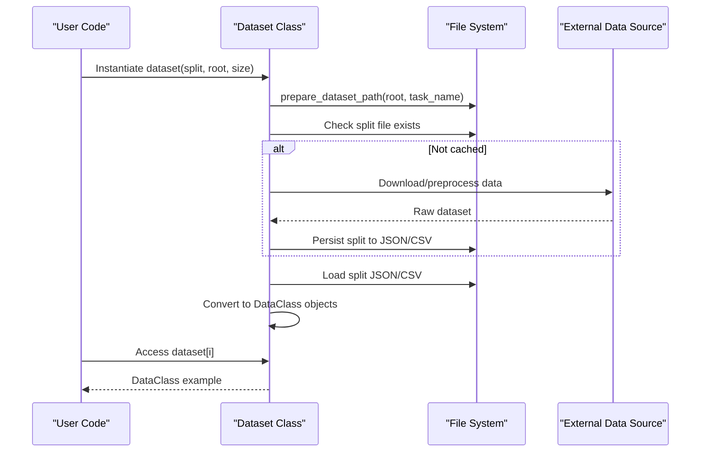
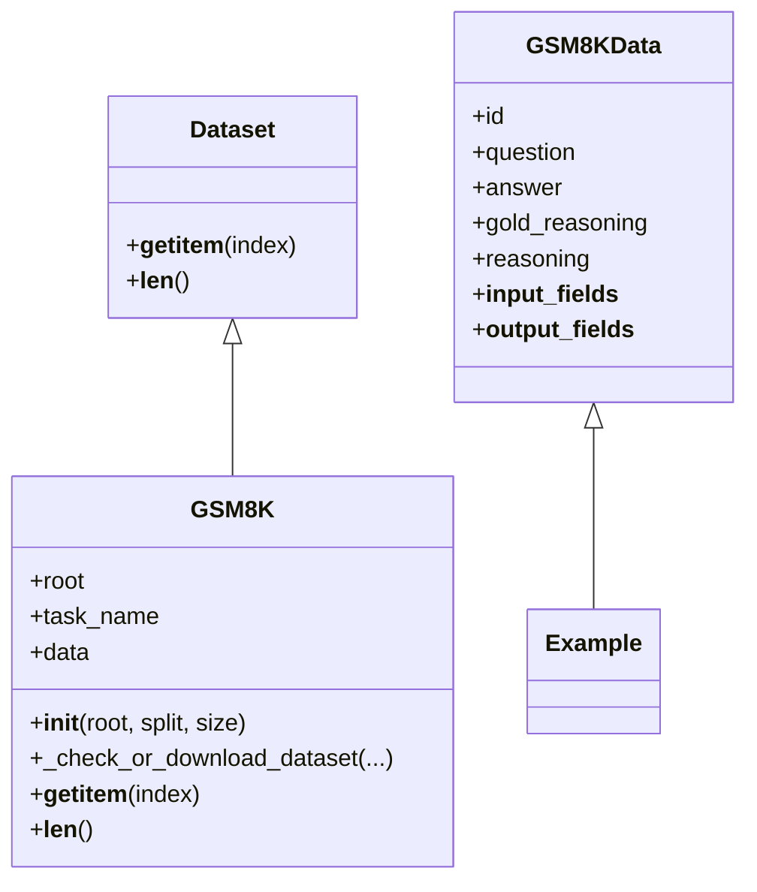
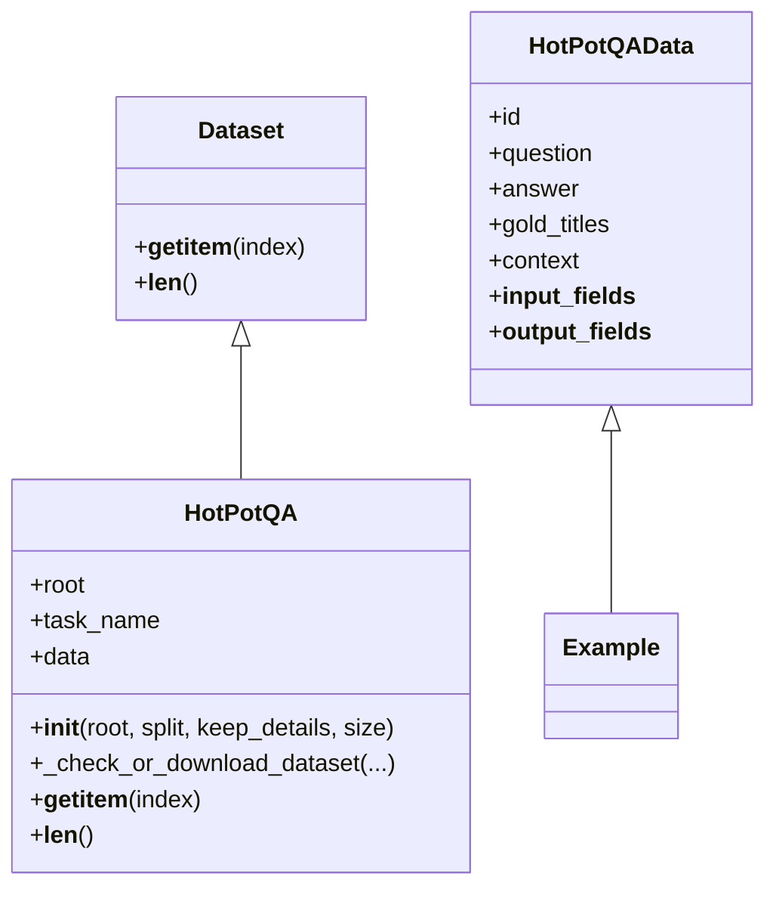
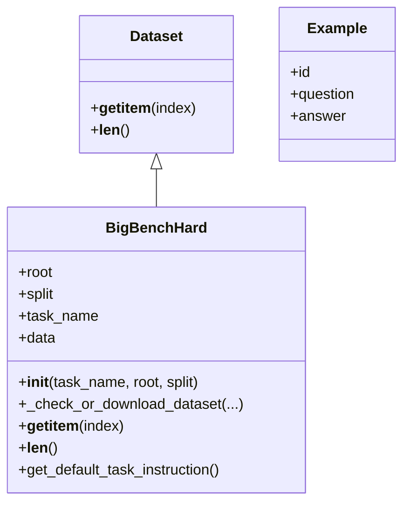
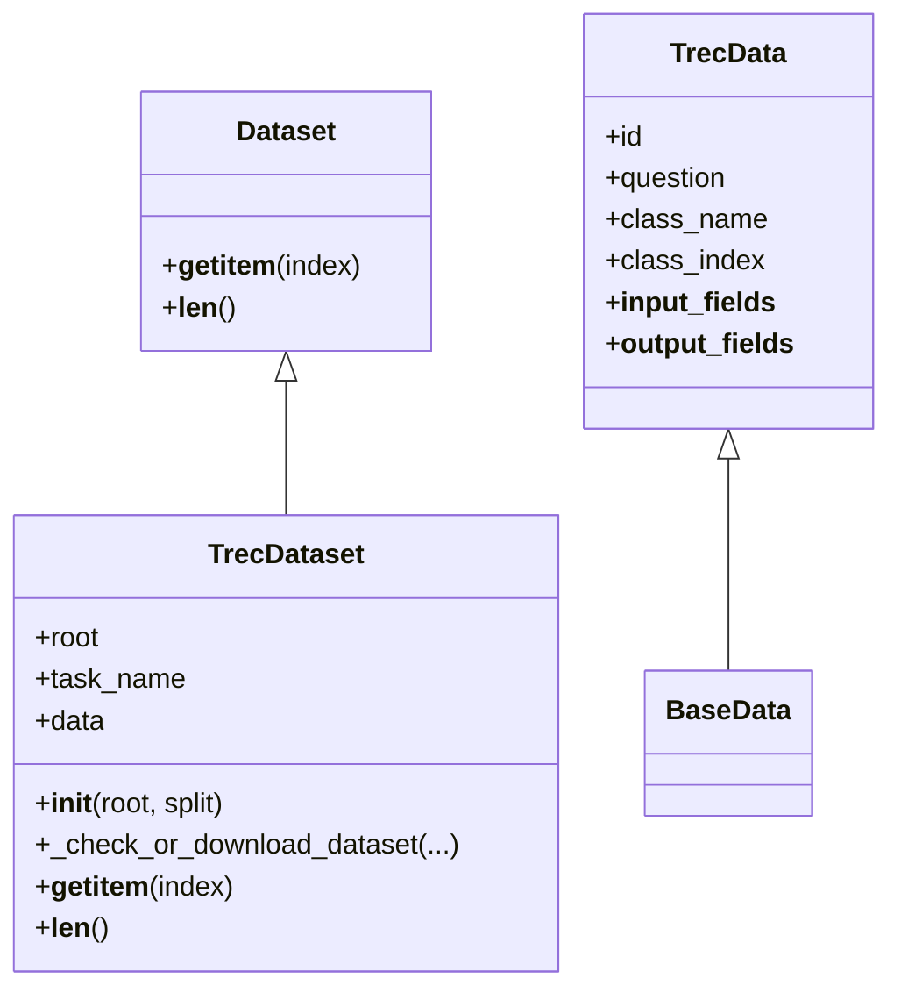
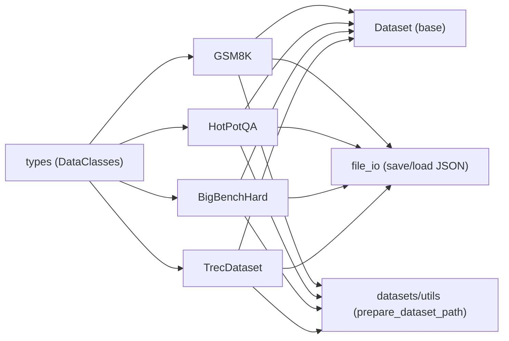

# Built-in Datasets

<cite>
**Referenced Files in This Document**
- [datasets/__init__.py](file://adalflow/adalflow/datasets/__init__.py)
- [datasets/gsm8k.py](file://adalflow/adalflow/datasets/gsm8k.py)
- [datasets/hotpot_qa.py](file://adalflow/adalflow/datasets/hotpot_qa.py)
- [datasets/big_bench_hard.py](file://adalflow/adalflow/datasets/big_bench_hard.py)
- [datasets/trec.py](file://adalflow/adalflow/datasets/trec.py)
- [datasets/types.py](file://adalflow/adalflow/datasets/types.py)
- [datasets/utils.py](file://adalflow/adalflow/datasets/utils.py)
- [utils/data.py](file://adalflow/adalflow/utils/data.py)
- [utils/file_io.py](file://adalflow/adalflow/utils/file_io.py)
- [use_cases/question_answering/gsm8k/train.py](file://use_cases/question_answering/gsm8k/train.py)
- [use_cases/classification/train.py](file://use_cases/classification/train.py)
- [use_cases/classification/trec_task_structured_output.py](file://use_cases/classification/trec_task_structured_output.py)
- [use_cases/question_answering/bbh/object_count/train.py](file://use_cases/question_answering/bbh/object_count/train.py)
- [benchmarks/hotpot_qa/adal_exp/train_vanilla_rag.py](file://benchmarks/hotpot_qa/adal_exp/train_vanilla_rag.py)
</cite>

## Table of Contents
1. [Introduction](#introduction)
2. [Project Structure](#project-structure)
3. [Core Components](#core-components)
4. [Architecture Overview](#architecture-overview)
5. [Detailed Component Analysis](#detailed-component-analysis)
6. [Dependency Analysis](#dependency-analysis)
7. [Performance Considerations](#performance-considerations)
8. [Troubleshooting Guide](#troubleshooting-guide)
9. [Conclusion](#conclusion)
10. [Appendices](#appendices)

## Introduction
This document explains AdalFlow’s built-in datasets for LLM evaluation and training. It covers:
- GSM8K: grade-school math problems with step-by-step solutions
- HotPotQA: knowledge-intensive multi-hop QA with supporting context
- Big-Bench Hard: reasoning tasks (currently object counting)
- TREC: question classification into coarse semantic categories

For each dataset, we describe loading mechanisms, data preprocessing, splits (train, val, test), data structures, and how to instantiate and use them. We also explain caching, custom split creation, size limits, metadata, evaluation targets, and typical use cases.

## Project Structure
The datasets are implemented under the datasets package and integrated via the package’s public interface.

**Diagram sources**
- [datasets/__init__.py](file://adalflow/adalflow/datasets/__init__.py#L1-L17)
- [datasets/gsm8k.py](file://adalflow/adalflow/datasets/gsm8k.py#L1-L171)
- [datasets/hotpot_qa.py](file://adalflow/adalflow/datasets/hotpot_qa.py#L1-L346)
- [datasets/big_bench_hard.py](file://adalflow/adalflow/datasets/big_bench_hard.py#L1-L164)
- [datasets/trec.py](file://adalflow/adalflow/datasets/trec.py#L1-L239)
- [datasets/types.py](file://adalflow/adalflow/datasets/types.py#L1-L133)
- [datasets/utils.py](file://adalflow/adalflow/datasets/utils.py#L1-L12)
- [utils/data.py](file://adalflow/adalflow/utils/data.py#L12-L35)
- [utils/file_io.py](file://adalflow/adalflow/utils/file_io.py#L1-L200)

**Section sources**
- [datasets/__init__.py](file://adalflow/adalflow/datasets/__init__.py#L1-L17)

## Core Components
- Dataset classes: GSM8K, HotPotQA, BigBenchHard, TrecDataset
- Data structures: Example, GSM8KData, HotPotQAData, TrecData
- Utilities: dataset path preparation, JSON/CSV persistence, lazy imports

Key behaviors:
- All dataset classes inherit from a common Dataset base and implement __getitem__ and __len__.
- Data is lazily downloaded and cached locally the first time a split is accessed.
- Data is persisted to JSON or CSV and later loaded into typed DataClass objects.

**Section sources**
- [utils/data.py](file://adalflow/adalflow/utils/data.py#L12-L35)
- [datasets/gsm8k.py](file://adalflow/adalflow/datasets/gsm8k.py#L17-L171)
- [datasets/hotpot_qa.py](file://adalflow/adalflow/datasets/hotpot_qa.py#L15-L346)
- [datasets/big_bench_hard.py](file://adalflow/adalflow/datasets/big_bench_hard.py#L16-L164)
- [datasets/trec.py](file://adalflow/adalflow/datasets/trec.py#L148-L239)
- [datasets/types.py](file://adalflow/adalflow/datasets/types.py#L7-L133)
- [datasets/utils.py](file://adalflow/adalflow/datasets/utils.py#L5-L12)

## Architecture Overview
End-to-end flow for dataset instantiation and access:

**Diagram sources**
- [datasets/gsm8k.py](file://adalflow/adalflow/datasets/gsm8k.py#L52-L78)
- [datasets/hotpot_qa.py](file://adalflow/adalflow/datasets/hotpot_qa.py#L16-L72)
- [datasets/big_bench_hard.py](file://adalflow/adalflow/datasets/big_bench_hard.py#L37-L67)
- [datasets/trec.py](file://adalflow/adalflow/datasets/trec.py#L161-L186)
- [datasets/utils.py](file://adalflow/adalflow/datasets/utils.py#L5-L12)
- [utils/file_io.py](file://adalflow/adalflow/utils/file_io.py#L13-L71)

## Detailed Component Analysis

### GSM8K Math Problems
- Purpose: Grade-school arithmetic word problems requiring multi-step reasoning.
- Split sizes and composition:
  - Official train/test: 7473/1319
  - Internal train/val/test: approximately 3736/3736/1319 after internal split
- Loading and caching:
  - Downloads from Hugging Face datasets, shuffles with fixed seeds, splits into train/val/test, and persists JSON files.
  - On subsequent loads, reads cached JSON and converts to GSM8KData.
- Data structure:
  - GSM8KData includes question, gold_reasoning, answer, plus base fields via Example.
  - Default output fields commonly include reasoning and answer.
- Typical use cases:
  - Training LLMs to produce chain-of-thought reasoning
  - Evaluating mathematical reasoning and accuracy
- Example usage:
  - Instantiate: GSM8K(split="train", size=N)
  - Access: dataset[0] returns a GSM8KData object
- Notes:
  - size parameter truncates the dataset to N examples
  - Uses lazy import for datasets library

**Diagram sources**
- [utils/data.py](file://adalflow/adalflow/utils/data.py#L12-L35)
- [datasets/gsm8k.py](file://adalflow/adalflow/datasets/gsm8k.py#L17-L171)
- [datasets/types.py](file://adalflow/adalflow/datasets/types.py#L30-L48)

**Section sources**
- [datasets/gsm8k.py](file://adalflow/adalflow/datasets/gsm8k.py#L17-L171)
- [datasets/types.py](file://adalflow/adalflow/datasets/types.py#L30-L48)

### HotPotQA Knowledge-Intensive QA
- Purpose: Multi-hop QA requiring retrieval and inference over Wikipedia contexts.
- Split sizes and composition:
  - Hard-only training set: ~15661; sampled train/val/test splits
  - Dev set is hard-only; internally split into val/test
- Loading and caching:
  - Loads from Hugging Face datasets, filters to hard examples, optionally keeps extra fields (all/dev_titles/none), shuffles with fixed seed, and saves JSON.
  - Converts to HotPotQAData with gold_titles and context.
- Data structure:
  - HotPotQAData includes question, answer, gold_titles (supporting titles), context (structured), plus base fields.
  - Output fields commonly include answer.
- Typical use cases:
  - RAG evaluation and training
  - Multi-step reasoning over external knowledge
- Example usage:
  - Instantiate: HotPotQA(only_hard_examples=True, keep_details="dev_titles", split="train", size=N)
  - Access: dataset[0] returns a HotPotQAData object
- Notes:
  - keep_details controls whether to include supporting facts and context
  - size parameter truncates dataset

**Diagram sources**
- [utils/data.py](file://adalflow/adalflow/utils/data.py#L12-L35)
- [datasets/hotpot_qa.py](file://adalflow/adalflow/datasets/hotpot_qa.py#L15-L346)
- [datasets/types.py](file://adalflow/adalflow/datasets/types.py#L51-L84)

**Section sources**
- [datasets/hotpot_qa.py](file://adalflow/adalflow/datasets/hotpot_qa.py#L15-L346)
- [datasets/types.py](file://adalflow/adalflow/datasets/types.py#L51-L84)

### Big-Bench Hard (Object Counting)
- Purpose: Reasoning task focusing on object counting with explicit instruction.
- Split sizes:
  - train: 50, val: 100, test: 100
- Loading and caching:
  - Downloads a task-specific JSON from the upstream repository, splits into train/val/test deterministically, and persists CSV files.
  - Loads CSV and wraps each row into Example with question and answer fields.
- Data structure:
  - Example includes id, question, answer.
  - Includes a helper to return a default task instruction for object counting.
- Typical use cases:
  - Evaluating chain-of-thought and logical reasoning
  - Small-scale reproducible experiments
- Example usage:
  - Instantiate: BigBenchHard(task_name="object_counting", split="test")
  - Access: dataset[0] returns an Example object
- Notes:
  - Task name must match upstream JSON filename (case-sensitive)
  - Deterministic splits align with prior work

**Diagram sources**
- [utils/data.py](file://adalflow/adalflow/utils/data.py#L12-L35)
- [datasets/big_bench_hard.py](file://adalflow/adalflow/datasets/big_bench_hard.py#L16-L164)
- [datasets/types.py](file://adalflow/adalflow/datasets/types.py#L17-L27)

**Section sources**
- [datasets/big_bench_hard.py](file://adalflow/adalflow/datasets/big_bench_hard.py#L16-L164)
- [datasets/types.py](file://adalflow/adalflow/datasets/types.py#L17-L27)

### TREC Classification
- Purpose: Question classification into coarse semantic categories (ABBR, ENTY, DESC, HUM, LOC, NUM).
- Split sizes (balanced subset):
  - train: 600 (100 per class), val: 36, test: 144
- Loading and caching:
  - Loads the full TREC dataset from Hugging Face, prepares class-balanced subsets, computes class weights, and persists CSV files.
  - Converts rows to TrecData with question, class_name, and class_index.
- Data structure:
  - TrecData includes question, class_name, class_index, plus base id.
  - Output fields commonly include class_name and class_index.
- Typical use cases:
  - Text classification training and evaluation
  - Prompt tuning and few-shot optimization
- Example usage:
  - Instantiate: TrecDataset(split="train")
  - Access: dataset[0] returns a TrecData object
- Notes:
  - Uses WeightedRandomSampler internally during preparation to balance classes
  - Only train/val/test splits are supported in this wrapper

**Diagram sources**
- [utils/data.py](file://adalflow/adalflow/utils/data.py#L12-L35)
- [datasets/trec.py](file://adalflow/adalflow/datasets/trec.py#L148-L239)
- [datasets/types.py](file://adalflow/adalflow/datasets/types.py#L88-L104)

**Section sources**
- [datasets/trec.py](file://adalflow/adalflow/datasets/trec.py#L148-L239)
- [datasets/types.py](file://adalflow/adalflow/datasets/types.py#L88-L104)

## Dependency Analysis
- Dataset classes depend on:
  - Dataset base class for map-style access
  - File IO utilities for JSON/CSV persistence and loading
  - Lazy import utilities for optional packages (datasets)
  - Path preparation utility for consistent cache locations
- Data structures depend on DataClass base for serialization and field metadata.

**Diagram sources**
- [utils/data.py](file://adalflow/adalflow/utils/data.py#L12-L35)
- [utils/file_io.py](file://adalflow/adalflow/utils/file_io.py#L13-L71)
- [datasets/utils.py](file://adalflow/adalflow/datasets/utils.py#L5-L12)
- [datasets/types.py](file://adalflow/adalflow/datasets/types.py#L7-L133)
- [datasets/gsm8k.py](file://adalflow/adalflow/datasets/gsm8k.py#L9-L14)
- [datasets/hotpot_qa.py](file://adalflow/adalflow/datasets/hotpot_qa.py#L8-L12)
- [datasets/big_bench_hard.py](file://adalflow/adalflow/datasets/big_bench_hard.py#L8-L12)
- [datasets/trec.py](file://adalflow/adalflow/datasets/trec.py#L14-L17)

**Section sources**
- [datasets/__init__.py](file://adalflow/adalflow/datasets/__init__.py#L1-L17)
- [datasets/utils.py](file://adalflow/adalflow/datasets/utils.py#L5-L12)
- [utils/file_io.py](file://adalflow/adalflow/utils/file_io.py#L13-L71)

## Performance Considerations
- Caching: First-time access triggers downloads and preprocessing; subsequent loads read cached JSON/CSV, minimizing network and CPU overhead.
- Deterministic shuffling: Fixed random seeds ensure reproducible splits across runs.
- Lightweight conversions: Data is converted to DataClass objects once per split load.
- Class balancing (TREC): Preparation computes inverse-frequency weights to support balanced sampling during training.
- Memory footprint: Using size parameter allows limiting dataset size for quick iterations and resource-constrained environments.

[No sources needed since this section provides general guidance]

## Troubleshooting Guide
Common issues and resolutions:
- Network errors when downloading:
  - BigBenchHard uses urllib; HTTP 404 indicates an invalid task name. Verify the task name against the upstream repository.
  - Other HTTP errors or URL errors indicate connectivity issues.
- Empty or corrupted files:
  - Ensure the downloaded file is non-empty; otherwise retry the download.
- Wrong split argument:
  - All dataset constructors validate split values; ensure split is one of "train", "val", "test" as applicable.
- Missing optional dependencies:
  - Some datasets rely on lazy imports for datasets; ensure the environment has the necessary packages installed.
- JSON parsing errors:
  - The file IO utilities include robust JSON loading with error handling; check file existence and encoding.

**Section sources**
- [datasets/big_bench_hard.py](file://adalflow/adalflow/datasets/big_bench_hard.py#L82-L114)
- [utils/file_io.py](file://adalflow/adalflow/utils/file_io.py#L120-L160)

## Conclusion
AdalFlow’s built-in datasets provide ready-to-use, reproducible datasets for math reasoning (GSM8K), knowledge-intensive QA (HotPotQA), logical reasoning (Big-Bench Hard), and classification (TREC). They handle caching, deterministic splits, and structured data conversion to DataClass objects, enabling straightforward integration into training and evaluation pipelines.

[No sources needed since this section summarizes without analyzing specific files]

## Appendices

### How to Instantiate and Use Each Dataset
- GSM8K
  - Instantiate: GSM8K(split="train", size=N)
  - Access: dataset[0] returns a GSM8KData object
  - Typical use: training chain-of-thought on math problems
  - References:
    - [datasets/gsm8k.py](file://adalflow/adalflow/datasets/gsm8k.py#L52-L78)
    - [use_cases/question_answering/gsm8k/train.py](file://use_cases/question_answering/gsm8k/train.py)

- HotPotQA
  - Instantiate: HotPotQA(only_hard_examples=True, keep_details="dev_titles", split="train", size=N)
  - Access: dataset[0] returns a HotPotQAData object
  - Typical use: RAG evaluation and multi-hop QA
  - References:
    - [datasets/hotpot_qa.py](file://adalflow/adalflow/datasets/hotpot_qa.py#L16-L72)
    - [benchmarks/hotpot_qa/adal_exp/train_vanilla_rag.py](file://benchmarks/hotpot_qa/adal_exp/train_vanilla_rag.py)

- Big-Bench Hard (Object Counting)
  - Instantiate: BigBenchHard(task_name="object_counting", split="test")
  - Access: dataset[0] returns an Example object
  - Typical use: evaluating reasoning with explicit instruction
  - References:
    - [datasets/big_bench_hard.py](file://adalflow/adalflow/datasets/big_bench_hard.py#L37-L67)
    - [use_cases/question_answering/bbh/object_count/train.py](file://use_cases/question_answering/bbh/object_count/train.py)

- TREC
  - Instantiate: TrecDataset(split="train")
  - Access: dataset[0] returns a TrecData object
  - Typical use: classification training and evaluation
  - References:
    - [datasets/trec.py](file://adalflow/adalflow/datasets/trec.py#L161-L186)
    - [use_cases/classification/train.py](file://use_cases/classification/train.py)
    - [use_cases/classification/trec_task_structured_output.py](file://use_cases/classification/trec_task_structured_output.py)

### Data Access Patterns and Conversions
- All datasets implement __getitem__ and __len__ for map-style access.
- Data is persisted to JSON/CSV and loaded via utilities that support sets and nested structures.
- Each dataset converts raw rows into strongly-typed DataClass objects for downstream use.

**Section sources**
- [utils/data.py](file://adalflow/adalflow/utils/data.py#L12-L35)
- [utils/file_io.py](file://adalflow/adalflow/utils/file_io.py#L13-L71)
- [datasets/types.py](file://adalflow/adalflow/datasets/types.py#L7-L133)

### Dataset Metadata and Evaluation Targets
- GSM8K: evaluation targets include numeric answer correctness and reasoning quality; default outputs include reasoning and answer.
- HotPotQA: evaluation targets include answer accuracy and ability to synthesize from supporting context; default outputs include answer.
- Big-Bench Hard (object counting): evaluation targets include exact numerical counts; default outputs include answer.
- TREC: evaluation targets include classification accuracy across six coarse categories; outputs include class_name and class_index.

**Section sources**
- [datasets/types.py](file://adalflow/adalflow/datasets/types.py#L30-L48)
- [datasets/types.py](file://adalflow/adalflow/datasets/types.py#L51-L64)
- [datasets/types.py](file://adalflow/adalflow/datasets/types.py#L88-L104)
- [datasets/big_bench_hard.py](file://adalflow/adalflow/datasets/big_bench_hard.py#L17-L35)