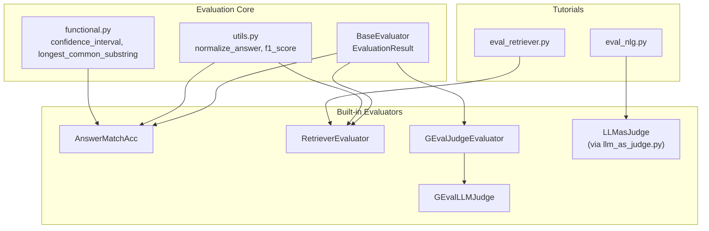
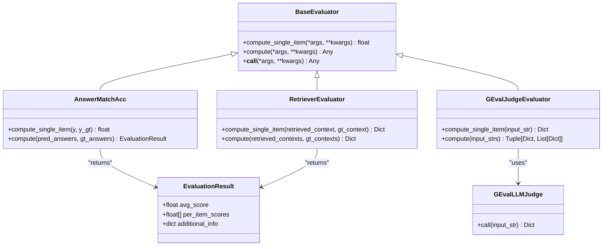
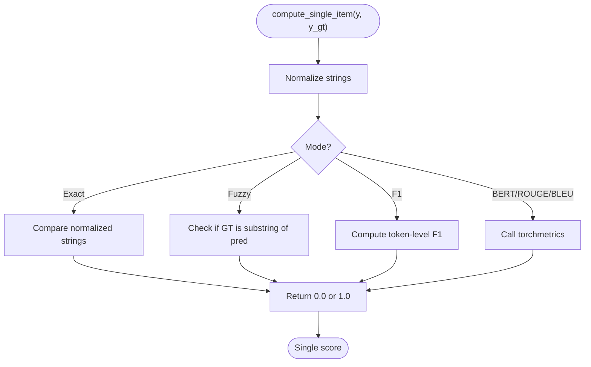
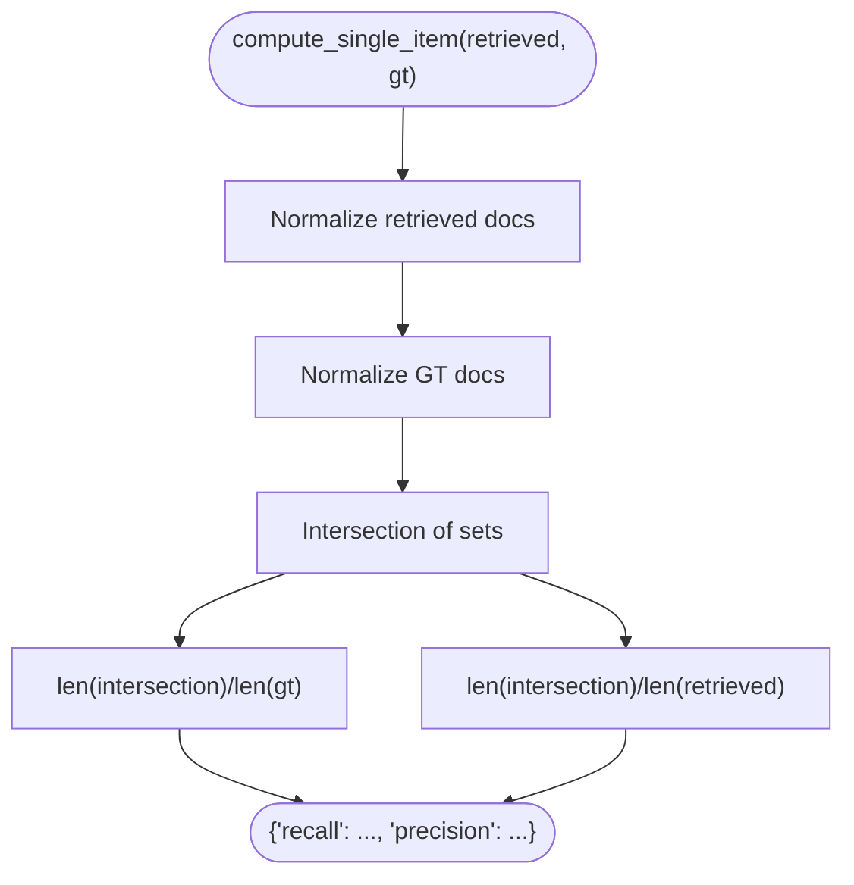
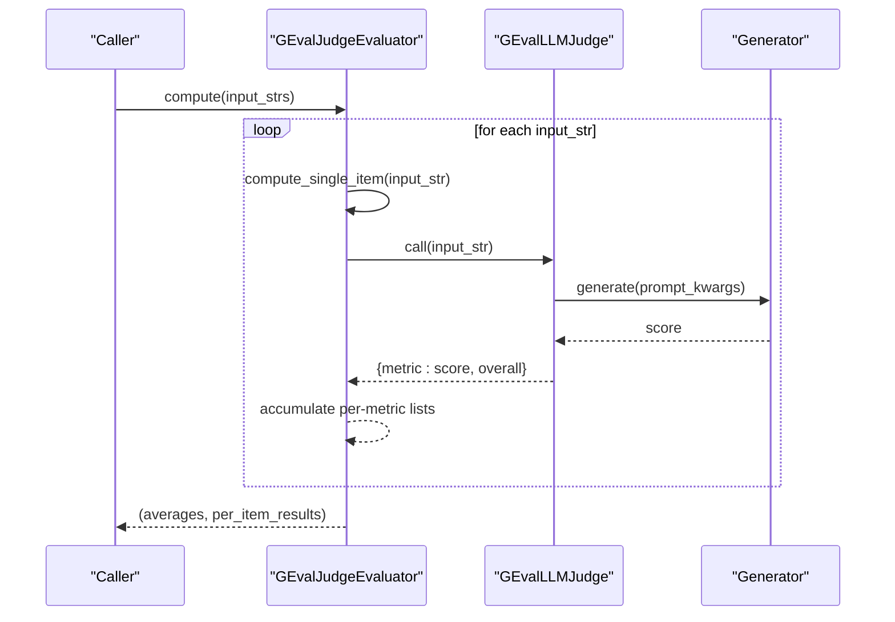
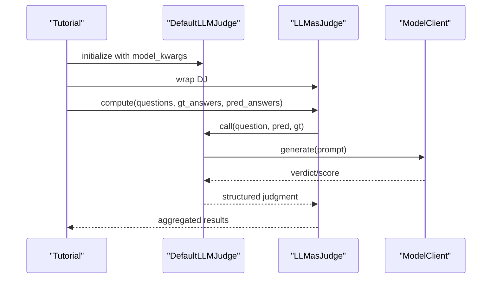
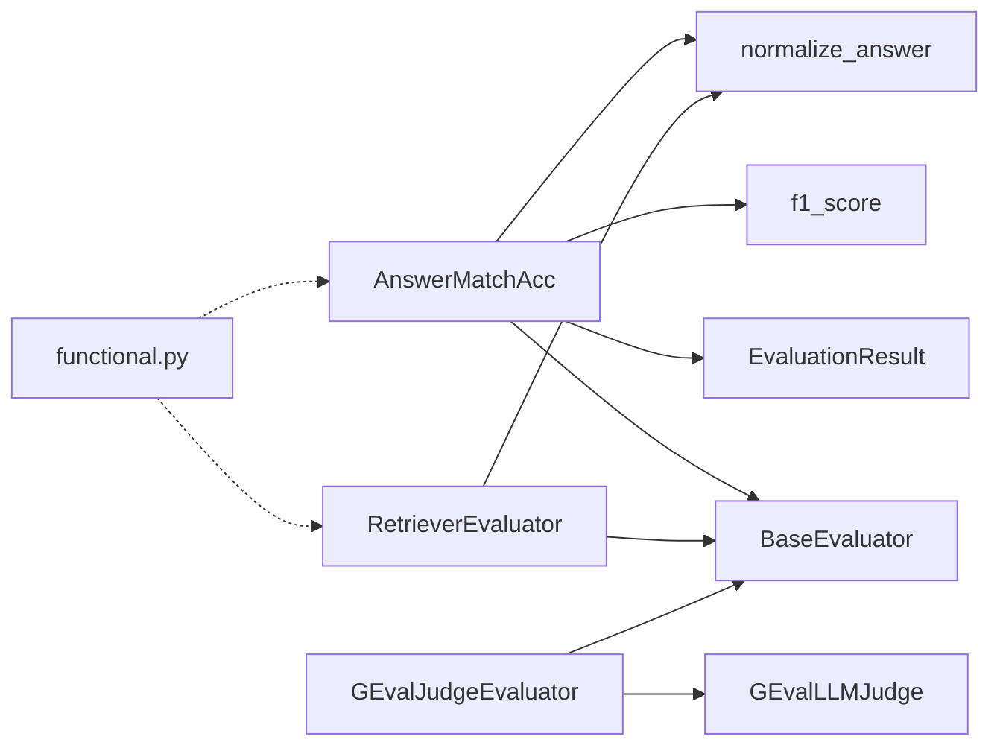

# Custom Evaluation

<cite>
**Referenced Files in This Document**
- [base.py](file://adalflow/adalflow/eval/base.py)
- [functional.py](file://adalflow/adalflow/eval/functional.py)
- [utils.py](file://adalflow/adalflow/eval/utils.py)
- [answer_match_acc.py](file://adalflow/adalflow/eval/answer_match_acc.py)
- [retriever_recall.py](file://adalflow/adalflow/eval/retriever_recall.py)
- [g_eval.py](file://adalflow/adalflow/eval/g_eval.py)
- [eval_nlg.py](file://tutorials/evaluation/eval_nlg.py)
- [eval_retriever.py](file://tutorials/evaluation/eval_retriever.py)
- [llm_as_judge.py](file://adalflow/adalflow/eval/llm_as_judge.py)
</cite>

## Table of Contents
1. [Introduction](#introduction)
2. [Project Structure](#project-structure)
3. [Core Components](#core-components)
4. [Architecture Overview](#architecture-overview)
5. [Detailed Component Analysis](#detailed-component-analysis)
6. [Dependency Analysis](#dependency-analysis)
7. [Performance Considerations](#performance-considerations)
8. [Troubleshooting Guide](#troubleshooting-guide)
9. [Conclusion](#conclusion)
10. [Appendices](#appendices)

## Introduction
This document explains how to extend AdalFlow’s evaluation framework with custom metrics and evaluation strategies. It focuses on the evaluation base classes, interface requirements, and implementation patterns for building domain-specific evaluators. You will learn how to compose evaluation functions, aggregate metrics, format results, integrate with evaluation pipelines, optimize batch and parallel execution, and apply robust testing and debugging techniques. Concrete examples demonstrate NLG evaluation, retriever recall, and chatbot-style quality assessment using LLM-as-judge.

## Project Structure
The evaluation subsystem centers around a small set of core abstractions and several built-in evaluators. Key locations:
- Core abstractions: evaluation base classes and shared utilities
- Built-in evaluators: answer matching, retriever recall, and LLM-as-judge (including G-Eval)
- Tutorials: runnable examples for NLG and retriever evaluation

**Diagram sources**
- [base.py](file://adalflow/adalflow/eval/base.py#L1-L32)
- [functional.py](file://adalflow/adalflow/eval/functional.py#L1-L96)
- [utils.py](file://adalflow/adalflow/eval/utils.py#L1-L49)
- [answer_match_acc.py](file://adalflow/adalflow/eval/answer_match_acc.py#L1-L158)
- [retriever_recall.py](file://adalflow/adalflow/eval/retriever_recall.py#L1-L148)
- [g_eval.py](file://adalflow/adalflow/eval/g_eval.py#L1-L264)
- [eval_nlg.py](file://tutorials/evaluation/eval_nlg.py#L1-L150)
- [eval_retriever.py](file://tutorials/evaluation/eval_retriever.py#L1-L26)

**Section sources**
- [base.py](file://adalflow/adalflow/eval/base.py#L1-L32)
- [functional.py](file://adalflow/adalflow/eval/functional.py#L1-L96)
- [utils.py](file://adalflow/adalflow/eval/utils.py#L1-L49)
- [answer_match_acc.py](file://adalflow/adalflow/eval/answer_match_acc.py#L1-L158)
- [retriever_recall.py](file://adalflow/adalflow/eval/retriever_recall.py#L1-L148)
- [g_eval.py](file://adalflow/adalflow/eval/g_eval.py#L1-L264)
- [eval_nlg.py](file://tutorials/evaluation/eval_nlg.py#L1-L150)
- [eval_retriever.py](file://tutorials/evaluation/eval_retriever.py#L1-L26)

## Core Components
- BaseEvaluator: Defines the contract for evaluation, including compute_single_item and compute, plus a convenience __call__ that delegates to compute.
- EvaluationResult: Standardized result container with average score, per-item scores, and optional additional info.
- Shared utilities:
  - normalize_answer and f1_score for QA-like matching
  - confidence_interval and longest_common_substring for generic statistics and string comparison

Key responsibilities:
- Implement compute_single_item to score a single example
- Implement compute to process batches and produce aggregated results
- Return EvaluationResult or a dict/list compatible with downstream consumers
- Handle input normalization and error conditions gracefully

**Section sources**
- [base.py](file://adalflow/adalflow/eval/base.py#L8-L32)
- [utils.py](file://adalflow/adalflow/eval/utils.py#L8-L49)
- [functional.py](file://adalflow/adalflow/eval/functional.py#L5-L96)

## Architecture Overview
The evaluation architecture separates concerns between:
- Evaluator implementations (domain-specific scoring)
- Utilities (text normalization, metrics)
- Pipeline integration (batching, aggregation, result formatting)

**Diagram sources**
- [base.py](file://adalflow/adalflow/eval/base.py#L17-L32)
- [answer_match_acc.py](file://adalflow/adalflow/eval/answer_match_acc.py#L9-L158)
- [retriever_recall.py](file://adalflow/adalflow/eval/retriever_recall.py#L9-L126)
- [g_eval.py](file://adalflow/adalflow/eval/g_eval.py#L199-L264)

## Detailed Component Analysis

### BaseEvaluator and EvaluationResult
- Contract:
  - compute_single_item: returns a scalar score for a single example
  - compute: processes a batch and returns either an EvaluationResult or a compatible structure
  - __call__: convenience delegation to compute
- Design intent:
  - Encourage consistent return types for downstream aggregation
  - Allow optional additional_info for richer diagnostics

Best practices:
- Normalize inputs early in compute_single_item
- Raise explicit exceptions for invalid inputs
- Keep compute_single_item pure and deterministic when possible

**Section sources**
- [base.py](file://adalflow/adalflow/eval/base.py#L17-L32)

### AnswerMatchAcc (QA/NLG Matching)
Purpose:
- Implements exact match, fuzzy match, F1, and optionally BERTScore, ROUGE, and BLEU via torchmetrics.

Inputs/Outputs:
- compute_single_item: takes predicted and ground-truth answers, returns a float score
- compute: returns an EvaluationResult with avg_score and per_item_scores

Implementation patterns:
- Normalize strings before comparison
- Support multiple metric modes via constructor argument
- Handle torchmetrics imports lazily

**Diagram sources**
- [answer_match_acc.py](file://adalflow/adalflow/eval/answer_match_acc.py#L63-L133)
- [utils.py](file://adalflow/adalflow/eval/utils.py#L8-L49)

**Section sources**
- [answer_match_acc.py](file://adalflow/adalflow/eval/answer_match_acc.py#L9-L158)
- [utils.py](file://adalflow/adalflow/eval/utils.py#L8-L49)

### RetrieverEvaluator (Retriever Recall/Precision)
Purpose:
- Computes recall and precision at K for retrieved contexts vs. ground-truth contexts.

Inputs/Outputs:
- compute_single_item: returns a dict with "recall" and "precision"
- compute: returns a dict with averages and per-item lists, plus top_k

Implementation patterns:
- Normalize each document string
- Use set intersection to count relevant matches
- Validate batch sizes and lengths

**Diagram sources**
- [retriever_recall.py](file://adalflow/adalflow/eval/retriever_recall.py#L53-L82)

**Section sources**
- [retriever_recall.py](file://adalflow/adalflow/eval/retriever_recall.py#L9-L126)

### GEval Judge (LLM-as-Judge for NLG)
Purpose:
- Provides a structured LLM-as-judge evaluator for NLG tasks using G-Eval criteria (Relevance, Fluency, Consistency, Coherence).

Components:
- GEvalLLMJudge: wraps a Generator with a prompt template and parses numeric scores
- GEvalJudgeEvaluator: orchestrates evaluation over a batch, aggregates per-metric averages and overall score

Inputs/Outputs:
- compute_single_item: takes a formatted input string and returns a dict of metric scores and overall
- compute: returns a tuple of (averages, per-item results)

**Diagram sources**
- [g_eval.py](file://adalflow/adalflow/eval/g_eval.py#L199-L264)
- [g_eval.py](file://adalflow/adalflow/eval/g_eval.py#L92-L197)

**Section sources**
- [g_eval.py](file://adalflow/adalflow/eval/g_eval.py#L21-L264)

### LLM-as-Judge (Chatbot/Answer Quality)
While not part of the eval module, the tutorial demonstrates constructing an LLM-as-judge evaluator for answer correctness. It composes:
- A model client (e.g., OpenAIClient)
- A default judge component
- An LLMasJudge evaluator wrapper
- Batched compute over questions, predictions, and ground truths

**Diagram sources**
- [eval_nlg.py](file://tutorials/evaluation/eval_nlg.py#L40-L91)
- [llm_as_judge.py](file://adalflow/adalflow/eval/llm_as_judge.py)

**Section sources**
- [eval_nlg.py](file://tutorials/evaluation/eval_nlg.py#L40-L91)

## Dependency Analysis
- AnswerMatchAcc depends on:
  - BaseEvaluator for the interface
  - EvaluationResult for standardized output
  - normalize_answer and f1_score for QA-like metrics
  - Optional torchmetrics modules for advanced metrics
- RetrieverEvaluator depends on:
  - BaseEvaluator
  - normalize_answer for document-level comparisons
- GEvalJudgeEvaluator depends on:
  - BaseEvaluator
  - GEvalLLMJudge
  - Generator and FloatParser for LLM scoring
- Functional utilities are standalone and reusable across evaluators.

**Diagram sources**
- [answer_match_acc.py](file://adalflow/adalflow/eval/answer_match_acc.py#L1-L158)
- [retriever_recall.py](file://adalflow/adalflow/eval/retriever_recall.py#L1-L148)
- [g_eval.py](file://adalflow/adalflow/eval/g_eval.py#L1-L264)
- [functional.py](file://adalflow/adalflow/eval/functional.py#L1-L96)
- [base.py](file://adalflow/adalflow/eval/base.py#L1-L32)

**Section sources**
- [answer_match_acc.py](file://adalflow/adalflow/eval/answer_match_acc.py#L1-L158)
- [retriever_recall.py](file://adalflow/adalflow/eval/retriever_recall.py#L1-L148)
- [g_eval.py](file://adalflow/adalflow/eval/g_eval.py#L1-L264)
- [functional.py](file://adalflow/adalflow/eval/functional.py#L1-L96)
- [base.py](file://adalflow/adalflow/eval/base.py#L1-L32)

## Performance Considerations
- Batch processing:
  - Prefer compute over per-item loops when possible to reduce overhead
  - Use vectorized operations where feasible (e.g., numpy-based confidence intervals)
- Parallel execution:
  - The base class hints at multi-threading or async support; consider concurrent evaluation for LLM-based metrics
  - For torchmetrics-heavy evaluators, reuse instantiated metric objects to avoid repeated imports
- Caching:
  - Leverage caching in LLM-based evaluators to avoid repeated generations
- Memory:
  - Normalize and tokenize once per item
  - Avoid materializing large intermediate lists when aggregating averages

[No sources needed since this section provides general guidance]

## Troubleshooting Guide
Common issues and strategies:
- Invalid input types:
  - Ensure strings are normalized and convertible; catch conversion errors early
- Empty or mismatched batches:
  - Validate lengths and shapes before aggregation
- LLM judge variability:
  - Set deterministic model_kwargs and enable caching
  - Log prompts and outputs for reproducibility
- Metric instability:
  - Use confidence intervals for binary judgments to quantify uncertainty
  - For string similarity, consider longest common substring as a baseline

**Section sources**
- [answer_match_acc.py](file://adalflow/adalflow/eval/answer_match_acc.py#L85-L91)
- [retriever_recall.py](file://adalflow/adalflow/eval/retriever_recall.py#L99-L102)
- [functional.py](file://adalflow/adalflow/eval/functional.py#L5-L49)

## Conclusion
AdalFlow’s evaluation framework provides a concise, extensible foundation for building custom metrics. By adhering to the BaseEvaluator interface, leveraging shared utilities, and composing LLM-based judges, you can implement domain-specific evaluators for NLG, retrieval, and chatbot quality. Focus on consistent input normalization, robust error handling, and clear result formatting to ensure reliable integration and reproducible results.

[No sources needed since this section summarizes without analyzing specific files]

## Appendices

### A. Evaluation Function Signatures and Specifications
- compute_single_item:
  - Purpose: Score a single example
  - Inputs: Domain-specific (e.g., strings for QA/NLG, lists of strings for retrieval)
  - Output: Scalar score or structured dict
- compute:
  - Purpose: Process a batch and aggregate results
  - Inputs: Lists/iterables of domain-specific inputs
  - Output: EvaluationResult or compatible structure (averages, per-item scores/lists, metadata)

**Section sources**
- [base.py](file://adalflow/adalflow/eval/base.py#L21-L28)
- [answer_match_acc.py](file://adalflow/adalflow/eval/answer_match_acc.py#L134-L157)
- [retriever_recall.py](file://adalflow/adalflow/eval/retriever_recall.py#L83-L125)
- [g_eval.py](file://adalflow/adalflow/eval/g_eval.py#L228-L259)

### B. Example Workflows from the Codebase
- NLG evaluation with LLM-as-judge:
  - Construct a default judge with a model client and kwargs
  - Wrap with LLMasJudge and call compute over questions, predictions, and ground truths
- NLG summarization with G-Eval:
  - Configure GEvalLLMJudge with a task template and model kwargs
  - Use GEvalJudgeEvaluator to score formatted input strings and aggregate results
- Retriever evaluation:
  - Instantiate RetrieverEvaluator
  - Call compute with lists of retrieved and ground-truth contexts

**Section sources**
- [eval_nlg.py](file://tutorials/evaluation/eval_nlg.py#L40-L91)
- [eval_nlg.py](file://tutorials/evaluation/eval_nlg.py#L93-L121)
- [eval_retriever.py](file://tutorials/evaluation/eval_retriever.py#L17-L20)

### C. Best Practices for Custom Evaluators
- Design:
  - Keep compute_single_item focused and deterministic
  - Support multiple modes via constructor arguments
  - Return EvaluationResult for standardization
- Testing:
  - Write unit tests for edge cases (empty inputs, mismatches)
  - Mock LLM clients for deterministic tests
- Documentation:
  - Include examples and references for each metric mode
  - Document input/output schemas and expected ranges

[No sources needed since this section provides general guidance]