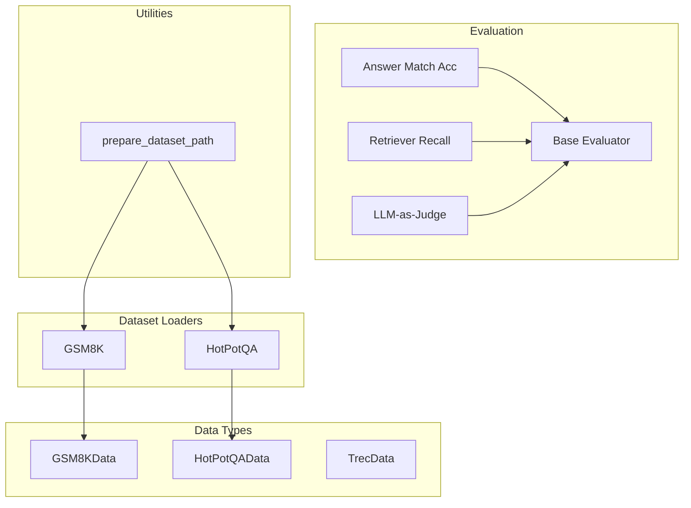
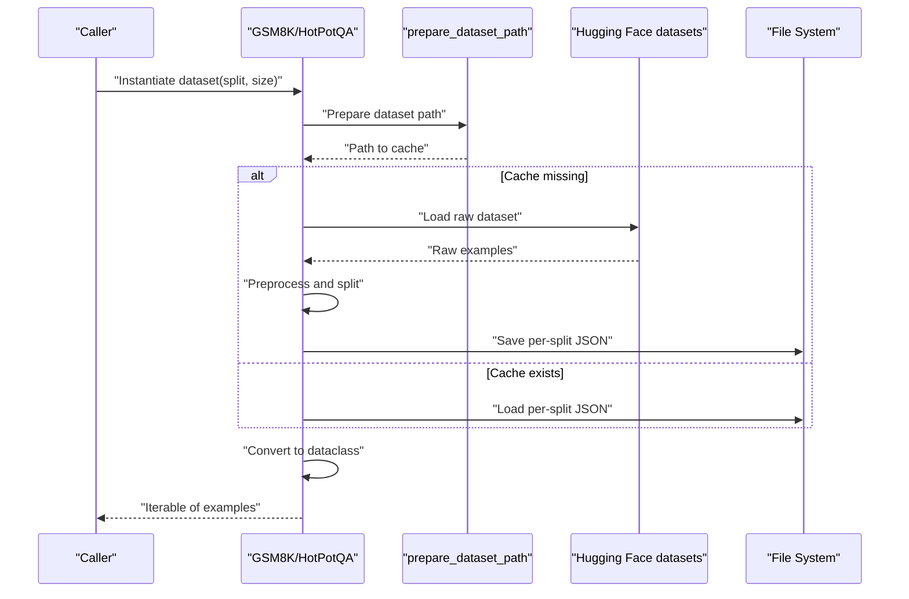
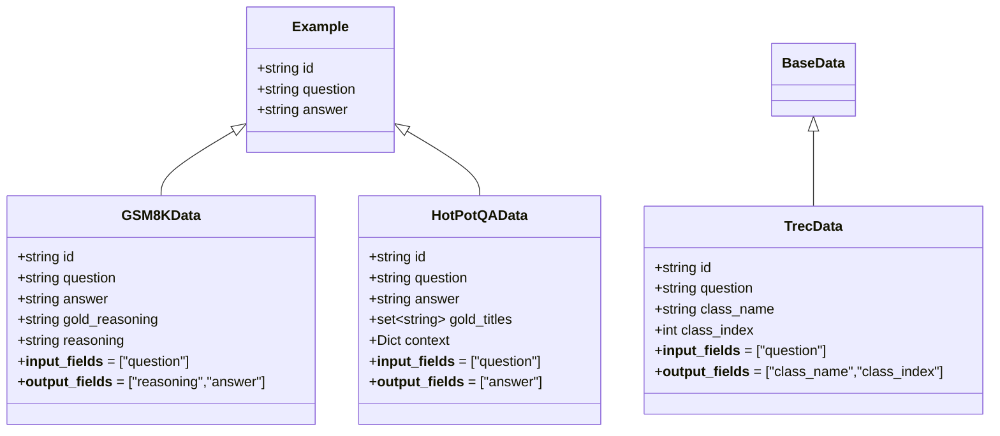
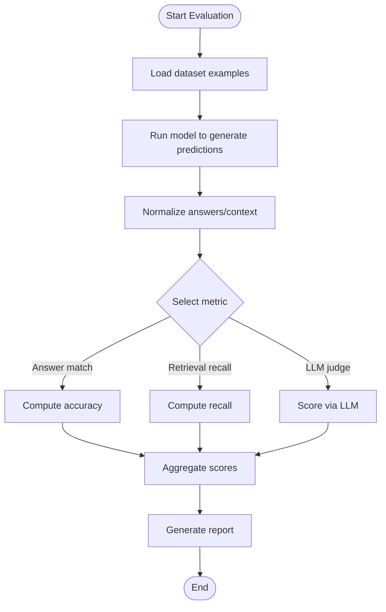
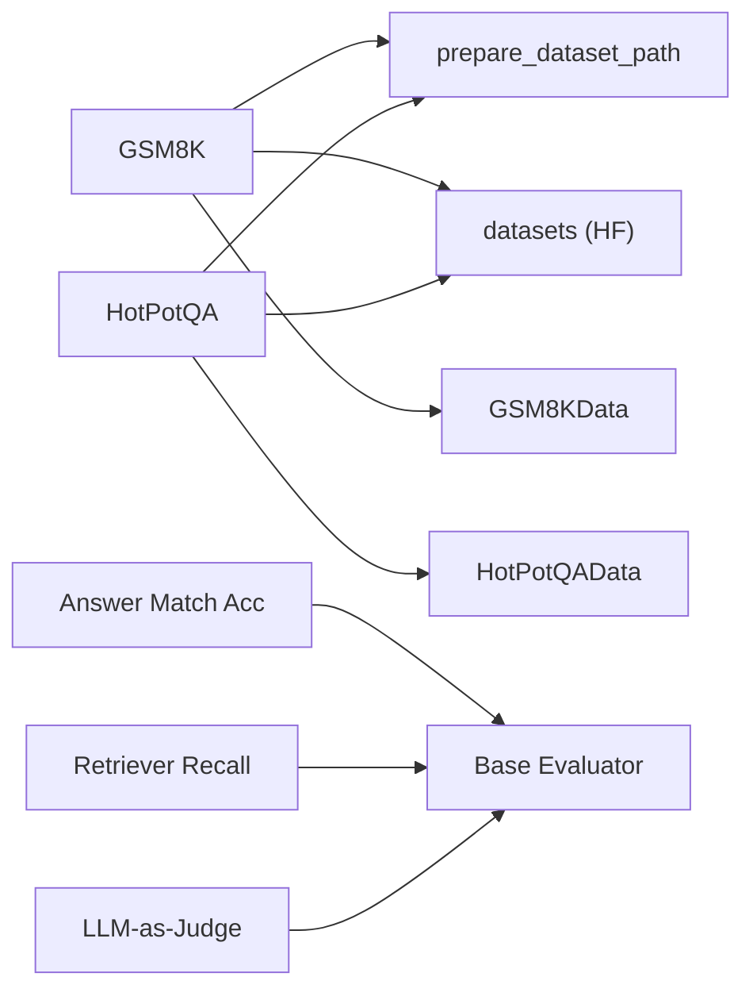

# Datasets and Evaluation

<cite>
**Referenced Files in This Document**
- [datasets/__init__.py](file://adalflow/adalflow/datasets/__init__.py)
- [datasets/gsm8k.py](file://adalflow/adalflow/datasets/gsm8k.py)
- [datasets/hotpot_qa.py](file://adalflow/adalflow/datasets/hotpot_qa.py)
- [datasets/types.py](file://adalflow/adalflow/datasets/types.py)
- [datasets/utils.py](file://adalflow/adalflow/datasets/utils.py)
- [eval/base.py](file://adalflow/adalflow/eval/base.py)
- [eval/functional.py](file://adalflow/adalflow/eval/functional.py)
- [eval/answer_match_acc.py](file://adalflow/adalflow/eval/answer_match_acc.py)
- [eval/retriever_recall.py](file://adalflow/adalflow/eval/retriever_recall.py)
- [eval/llm_as_judge.py](file://adalflow/adalflow/eval/llm_as_judge.py)
- [eval/utils.py](file://adalflow/adalflow/eval/utils.py)
- [use_cases/question_answering/gsm8k/task.py](file://use_cases/question_answering/gsm8k/task.py)
- [use_cases/question_answering/gsm8k/train.py](file://use_cases/question_answering/gsm8k/train.py)
- [use_cases/rag/rag_with_eval.py](file://use_cases/rag/rag_with_eval.py)
- [benchmarks/hotpot_qa/adal_exp/train_vanilla_rag.py](file://benchmarks/hotpot_qa/adal_exp/train_vanilla_rag.py)
- [benchmarks/hotpot_qa/adal_exp/build_vanilla_rag.py](file://benchmarks/hotpot_qa/adal_exp/build_vanilla_rag.py)
- [notebooks/evaluation/adalflow_llm_eval.ipynb](file://notebooks/evaluation/adalflow_llm_eval.ipynb)
</cite>

## Table of Contents
1. [Introduction](#introduction)
2. [Project Structure](#project-structure)
3. [Core Components](#core-components)
4. [Architecture Overview](#architecture-overview)
5. [Detailed Component Analysis](#detailed-component-analysis)
6. [Dependency Analysis](#dependency-analysis)
7. [Performance Considerations](#performance-considerations)
8. [Troubleshooting Guide](#troubleshooting-guide)
9. [Conclusion](#conclusion)
10. [Appendices](#appendices)

## Introduction
This document explains AdalFlow’s built-in dataset support and evaluation frameworks. It covers how datasets are loaded, preprocessed, and represented as structured dataclasses, and how evaluation workflows are designed to assess model performance across tasks such as GSM8K and HotPotQA. You will learn about dataset loading mechanisms, evaluation metrics, benchmarking capabilities, and practical examples drawn from the codebase. Guidance is provided for customization, metric definition, and comparison methodologies, alongside best practices and performance optimization tips.

## Project Structure
AdalFlow organizes datasets and evaluation under dedicated modules:
- Datasets: dataset loaders, data types, and utilities for path preparation
- Evaluation: evaluators for answer matching, retrieval recall, LLM-as-judge scoring, and shared utilities
- Use cases and benchmarks: runnable examples and end-to-end pipelines for QA and RAG evaluation
- Notebooks: interactive tutorials demonstrating evaluation workflows

```mermaid
graph TB
subgraph "Datasets"
DInit["datasets/__init__.py"]
DGSM["datasets/gsm8k.py"]
DHQ["datasets/hotpot_qa.py"]
DT["datasets/types.py"]
DU["datasets/utils.py"]
end
subgraph "Evaluation"
EBase["eval/base.py"]
EFunc["eval/functional.py"]
EAcc["eval/answer_match_acc.py"]
ERcll["eval/retriever_recall.py"]
ELJ["eval/llm_as_judge.py"]
EU["eval/utils.py"]
end
subgraph "Examples"
UC1["use_cases/question_answering/gsm8k/task.py"]
UC2["use_cases/question_answering/gsm8k/train.py"]
UCR["use_cases/rag/rag_with_eval.py"]
BenchV["benchmarks/hotpot_qa/adal_exp/train_vanilla_rag.py"]
BenchB["benchmarks/hotpot_qa/adal_exp/build_vanilla_rag.py"]
NB["notebooks/evaluation/adalflow_llm_eval.ipynb"]
end
DInit --> DGSM
DInit --> DHQ
DInit --> DT
DInit --> DU
EAcc --> EBase
ERcll --> EBase
ELJ --> EBase
EFunc --> EBase
EU --> EBase
UC1 --> DGSM
UC2 --> DGSM
UCR --> DHQ
BenchV --> DHQ
BenchB --> DHQ
NB --> EAcc
```

**Diagram sources**
- [datasets/__init__.py](file://adalflow/adalflow/datasets/__init__.py#L1-L17)
- [datasets/gsm8k.py](file://adalflow/adalflow/datasets/gsm8k.py#L1-L171)
- [datasets/hotpot_qa.py](file://adalflow/adalflow/datasets/hotpot_qa.py#L1-L346)
- [datasets/types.py](file://adalflow/adalflow/datasets/types.py#L1-L133)
- [datasets/utils.py](file://adalflow/adalflow/datasets/utils.py#L1-L12)
- [eval/base.py](file://adalflow/adalflow/eval/base.py)
- [eval/functional.py](file://adalflow/adalflow/eval/functional.py)
- [eval/answer_match_acc.py](file://adalflow/adalflow/eval/answer_match_acc.py)
- [eval/retriever_recall.py](file://adalflow/adalflow/eval/retriever_recall.py)
- [eval/llm_as_judge.py](file://adalflow/adalflow/eval/llm_as_judge.py)
- [eval/utils.py](file://adalflow/adalflow/eval/utils.py)
- [use_cases/question_answering/gsm8k/task.py](file://use_cases/question_answering/gsm8k/task.py)
- [use_cases/question_answering/gsm8k/train.py](file://use_cases/question_answering/gsm8k/train.py)
- [use_cases/rag/rag_with_eval.py](file://use_cases/rag/rag_with_eval.py)
- [benchmarks/hotpot_qa/adal_exp/train_vanilla_rag.py](file://benchmarks/hotpot_qa/adal_exp/train_vanilla_rag.py)
- [benchmarks/hotpot_qa/adal_exp/build_vanilla_rag.py](file://benchmarks/hotpot_qa/adal_exp/build_vanilla_rag.py)
- [notebooks/evaluation/adalflow_llm_eval.ipynb](file://notebooks/evaluation/adalflow_llm_eval.ipynb)

**Section sources**
- [datasets/__init__.py](file://adalflow/adalflow/datasets/__init__.py#L1-L17)
- [eval/base.py](file://adalflow/adalflow/eval/base.py)

## Core Components
- Dataset loaders
  - GSM8K: loads grade-school math problems, preprocesses answers and reasoning, splits into train/val/test, and returns structured examples via a dataclass.
  - HotPotQA: loads multihop QA examples, filters to hard instances, constructs train/validation/test splits, and returns structured examples with supporting context and titles.
- Data types
  - Example, GSM8KData, HotPotQAData, TrecData define consistent input/output fields and metadata for evaluation.
- Evaluation framework
  - Base evaluator interface and functional evaluators for answer matching, retrieval recall, and LLM-as-judge scoring.
- Utilities
  - Path preparation for dataset caching and shared evaluation helpers.

**Section sources**
- [datasets/gsm8k.py](file://adalflow/adalflow/datasets/gsm8k.py#L17-L171)
- [datasets/hotpot_qa.py](file://adalflow/adalflow/datasets/hotpot_qa.py#L15-L231)
- [datasets/types.py](file://adalflow/adalflow/datasets/types.py#L7-L105)
- [eval/base.py](file://adalflow/adalflow/eval/base.py)
- [eval/answer_match_acc.py](file://adalflow/adalflow/eval/answer_match_acc.py)
- [eval/retriever_recall.py](file://adalflow/adalflow/eval/retriever_recall.py)
- [eval/llm_as_judge.py](file://adalflow/adalflow/eval/llm_as_judge.py)
- [eval/utils.py](file://adalflow/adalflow/eval/utils.py)
- [datasets/utils.py](file://adalflow/adalflow/datasets/utils.py#L5-L12)

## Architecture Overview
The dataset and evaluation architecture centers around:
- Dataset loaders extending a common Dataset base, handling download, preprocessing, splitting, and JSON persistence.
- Structured dataclasses that define input/output fields and metadata for downstream evaluation.
- Evaluators implementing a common interface to compute metrics and aggregate results.
- Example pipelines in use cases and benchmarks demonstrating end-to-end evaluation workflows.

**Diagram sources**
- [datasets/gsm8k.py](file://adalflow/adalflow/datasets/gsm8k.py#L17-L171)
- [datasets/hotpot_qa.py](file://adalflow/adalflow/datasets/hotpot_qa.py#L15-L231)
- [datasets/types.py](file://adalflow/adalflow/datasets/types.py#L30-L105)
- [datasets/utils.py](file://adalflow/adalflow/datasets/utils.py#L5-L12)
- [eval/base.py](file://adalflow/adalflow/eval/base.py)
- [eval/answer_match_acc.py](file://adalflow/adalflow/eval/answer_match_acc.py)
- [eval/retriever_recall.py](file://adalflow/adalflow/eval/retriever_recall.py)
- [eval/llm_as_judge.py](file://adalflow/adalflow/eval/llm_as_judge.py)

## Detailed Component Analysis

### Dataset Loading Mechanisms
- GSM8K loader
  - Initializes with root, split, and optional size.
  - Prepares dataset path and checks for cached JSON; downloads and converts from Hugging Face datasets if missing.
  - Splits official training into train/val and preserves official test; saves per-split JSON.
  - Loads JSON, slices by size if requested, and converts to GSM8KData instances.
- HotPotQA loader
  - Initializes with root, split, filtering options for hard-only examples and detail retention.
  - Prepares dataset path and checks for cached JSON; downloads from Hugging Face datasets if missing.
  - Filters to “hard” examples, constructs train/validation/test splits, and saves per-split JSON.
  - Loads JSON, slices by size if requested, and converts to HotPotQAData instances.

**Diagram sources**
- [datasets/gsm8k.py](file://adalflow/adalflow/datasets/gsm8k.py#L52-L157)
- [datasets/hotpot_qa.py](file://adalflow/adalflow/datasets/hotpot_qa.py#L16-L224)
- [datasets/utils.py](file://adalflow/adalflow/datasets/utils.py#L5-L12)

**Section sources**
- [datasets/gsm8k.py](file://adalflow/adalflow/datasets/gsm8k.py#L17-L171)
- [datasets/hotpot_qa.py](file://adalflow/adalflow/datasets/hotpot_qa.py#L15-L231)
- [datasets/utils.py](file://adalflow/adalflow/datasets/utils.py#L5-L12)

### Data Models and Preprocessing
- Example and derived dataclasses define consistent input/output fields and metadata.
- GSM8KData adds gold reasoning and reasoning fields; HotPotQAData adds gold titles and context; TrecData adds classification fields.
- Preprocessing includes extracting numeric answers, normalizing tokens, and filtering to hard examples.

**Diagram sources**
- [datasets/types.py](file://adalflow/adalflow/datasets/types.py#L7-L105)

**Section sources**
- [datasets/types.py](file://adalflow/adalflow/datasets/types.py#L7-L105)

### Evaluation Metrics and Workflows
- Answer matching accuracy
  - Compares predicted answers against ground-truth answers using configurable normalization and matching strategies.
- Retrieval recall
  - Measures recall for retrieved documents against gold titles or supporting facts.
- LLM-as-judge
  - Uses an LLM to evaluate generated answers against prompts and criteria.
- Functional and base evaluators
  - Provide reusable building blocks for constructing evaluation pipelines.

**Diagram sources**
- [eval/answer_match_acc.py](file://adalflow/adalflow/eval/answer_match_acc.py)
- [eval/retriever_recall.py](file://adalflow/adalflow/eval/retriever_recall.py)
- [eval/llm_as_judge.py](file://adalflow/adalflow/eval/llm_as_judge.py)
- [eval/base.py](file://adalflow/adalflow/eval/base.py)

**Section sources**
- [eval/answer_match_acc.py](file://adalflow/adalflow/eval/answer_match_acc.py)
- [eval/retriever_recall.py](file://adalflow/adalflow/eval/retriever_recall.py)
- [eval/llm_as_judge.py](file://adalflow/adalflow/eval/llm_as_judge.py)
- [eval/base.py](file://adalflow/adalflow/eval/base.py)
- [eval/utils.py](file://adalflow/adalflow/eval/utils.py)

### Built-in Datasets: GSM8K and HotPotQA
- GSM8K
  - Loads grade-school math problems, extracts gold reasoning and numeric answers, and splits into train/val/test.
  - Supports limiting example count via size parameter.
- HotPotQA
  - Loads multihop QA examples, filters to hard instances, and constructs train/validation/test splits.
  - Supports retaining different levels of detail (all/dev titles/none) and selecting subsets via size.

Practical usage examples:
- GSM8K task and training pipelines demonstrate end-to-end usage of the dataset loader and evaluation metrics.
- HotPotQA vanilla RAG training and building scripts show how to integrate HotPotQA with retrieval and generation components.

**Section sources**
- [datasets/gsm8k.py](file://adalflow/adalflow/datasets/gsm8k.py#L17-L171)
- [datasets/hotpot_qa.py](file://adalflow/adalflow/datasets/hotpot_qa.py#L15-L231)
- [use_cases/question_answering/gsm8k/task.py](file://use_cases/question_answering/gsm8k/task.py)
- [use_cases/question_answering/gsm8k/train.py](file://use_cases/question_answering/gsm8k/train.py)
- [use_cases/rag/rag_with_eval.py](file://use_cases/rag/rag_with_eval.py)
- [benchmarks/hotpot_qa/adal_exp/train_vanilla_rag.py](file://benchmarks/hotpot_qa/adal_exp/train_vanilla_rag.py)
- [benchmarks/hotpot_qa/adal_exp/build_vanilla_rag.py](file://benchmarks/hotpot_qa/adal_exp/build_vanilla_rag.py)

### Evaluation Strategies and Benchmarking
- Strategy composition
  - Combine answer matching, retrieval recall, and LLM-as-judge scoring to comprehensively assess systems.
- Benchmarking
  - Use HotPotQA vanilla RAG training and building scripts as reproducible baselines.
  - Leverage notebook tutorials for interactive evaluation workflows.

**Section sources**
- [eval/answer_match_acc.py](file://adalflow/adalflow/eval/answer_match_acc.py)
- [eval/retriever_recall.py](file://adalflow/adalflow/eval/retriever_recall.py)
- [eval/llm_as_judge.py](file://adalflow/adalflow/eval/llm_as_judge.py)
- [benchmarks/hotpot_qa/adal_exp/train_vanilla_rag.py](file://benchmarks/hotpot_qa/adal_exp/train_vanilla_rag.py)
- [benchmarks/hotpot_qa/adal_exp/build_vanilla_rag.py](file://benchmarks/hotpot_qa/adal_exp/build_vanilla_rag.py)
- [notebooks/evaluation/adalflow_llm_eval.ipynb](file://notebooks/evaluation/adalflow_llm_eval.ipynb)

## Dependency Analysis
- Dataset loaders depend on:
  - Lazy-imported Hugging Face datasets library
  - Local dataset path preparation utility
  - JSON/CSV persistence utilities
  - Dataclass conversion helpers
- Evaluators depend on:
  - Base evaluator interface
  - Functional evaluators for specific metrics
  - Shared evaluation utilities

**Diagram sources**
- [datasets/gsm8k.py](file://adalflow/adalflow/datasets/gsm8k.py#L9-L14)
- [datasets/hotpot_qa.py](file://adalflow/adalflow/datasets/hotpot_qa.py#L8-L12)
- [datasets/utils.py](file://adalflow/adalflow/datasets/utils.py#L5-L12)
- [datasets/types.py](file://adalflow/adalflow/datasets/types.py#L30-L64)
- [eval/answer_match_acc.py](file://adalflow/adalflow/eval/answer_match_acc.py)
- [eval/retriever_recall.py](file://adalflow/adalflow/eval/retriever_recall.py)
- [eval/llm_as_judge.py](file://adalflow/adalflow/eval/llm_as_judge.py)
- [eval/base.py](file://adalflow/adalflow/eval/base.py)

**Section sources**
- [datasets/gsm8k.py](file://adalflow/adalflow/datasets/gsm8k.py#L9-L14)
- [datasets/hotpot_qa.py](file://adalflow/adalflow/datasets/hotpot_qa.py#L8-L12)
- [eval/base.py](file://adalflow/adalflow/eval/base.py)

## Performance Considerations
- Caching and reuse
  - Dataset loaders cache processed JSON files locally to avoid repeated downloads and preprocessing.
- Efficient slicing
  - Use the size parameter to limit examples for quick iterations and reduced latency.
- Selective detail retention
  - For HotPotQA, choose minimal details (e.g., dev titles only) to reduce IO overhead when not needed.
- Batched evaluation
  - Aggregate metrics in batches and leverage normalization strategies to minimize repeated computation.

[No sources needed since this section provides general guidance]

## Troubleshooting Guide
- Missing dependencies
  - Ensure optional packages for dataset loading are installed; the loaders use lazy imports to handle missing packages gracefully.
- Permission errors on dataset path
  - Verify write permissions to the dataset cache directory prepared by the path utility.
- Unexpected splits or sizes
  - Confirm split selection and size parameters; dataset loaders enforce valid split values and apply deterministic shuffling seeds.
- Evaluation mismatches
  - Align input/output fields with dataclass definitions; ensure normalization and matching strategies match the expected format.

**Section sources**
- [datasets/gsm8k.py](file://adalflow/adalflow/datasets/gsm8k.py#L99-L102)
- [datasets/hotpot_qa.py](file://adalflow/adalflow/datasets/hotpot_qa.py#L95-L97)
- [datasets/utils.py](file://adalflow/adalflow/datasets/utils.py#L5-L12)
- [datasets/types.py](file://adalflow/adalflow/datasets/types.py#L30-L64)

## Conclusion
AdalFlow’s dataset and evaluation framework provides robust, extensible support for QA tasks. The dataset loaders encapsulate downloading, preprocessing, and caching, while the dataclass models standardize input/output fields for consistent evaluation. The evaluation suite offers modular metrics and workflows suitable for both research and production benchmarking. By combining these components, teams can rapidly prototype, evaluate, and iterate on LLM applications with confidence.

[No sources needed since this section summarizes without analyzing specific files]

## Appendices

### Quick Reference: Dataset Usage Examples
- GSM8K
  - Instantiate and iterate examples with a selected split and optional size.
  - Convert to GSM8KData for standardized evaluation.
- HotPotQA
  - Choose hard-only filtering and detail retention level.
  - Split into train/validation/test for reproducible experiments.

**Section sources**
- [datasets/gsm8k.py](file://adalflow/adalflow/datasets/gsm8k.py#L17-L171)
- [datasets/hotpot_qa.py](file://adalflow/adalflow/datasets/hotpot_qa.py#L15-L231)
- [datasets/types.py](file://adalflow/adalflow/datasets/types.py#L30-L64)

### Quick Reference: Evaluation Workflows
- Answer matching
  - Prepare normalized predictions and ground-truth answers; compute accuracy.
- Retrieval recall
  - Compare retrieved titles/facts against gold titles.
- LLM-as-judge
  - Provide prompts and criteria; aggregate scores.

**Section sources**
- [eval/answer_match_acc.py](file://adalflow/adalflow/eval/answer_match_acc.py)
- [eval/retriever_recall.py](file://adalflow/adalflow/eval/retriever_recall.py)
- [eval/llm_as_judge.py](file://adalflow/adalflow/eval/llm_as_judge.py)