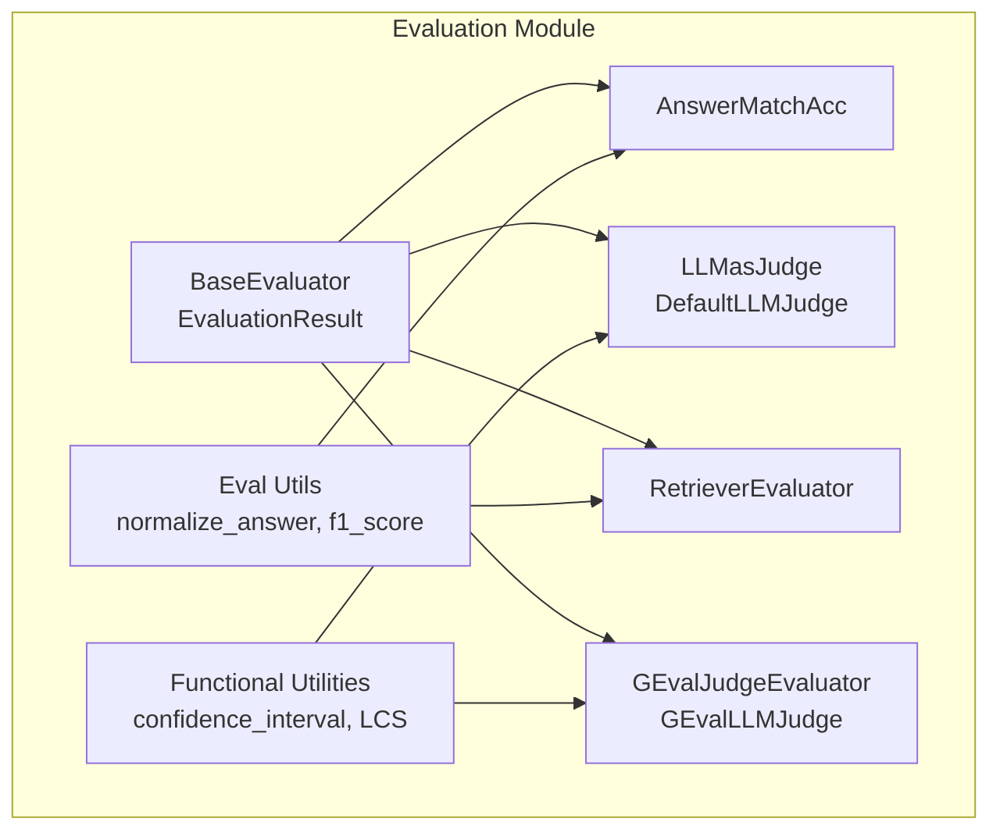
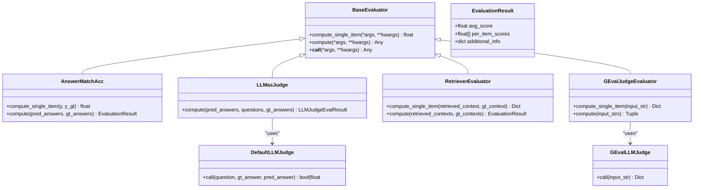
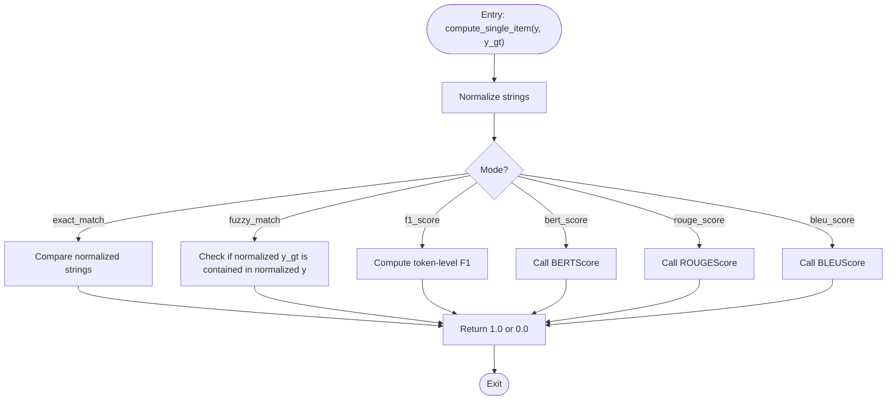
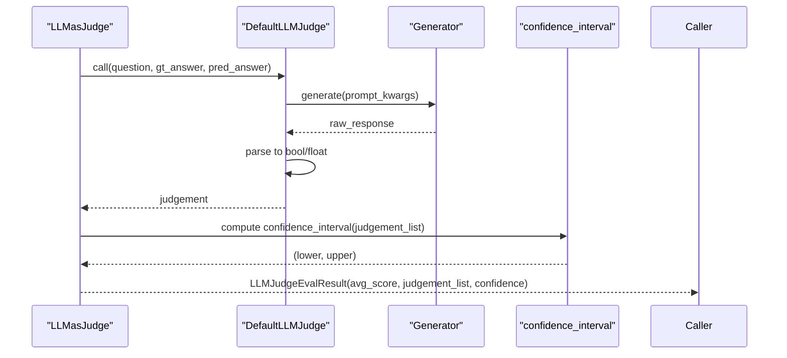
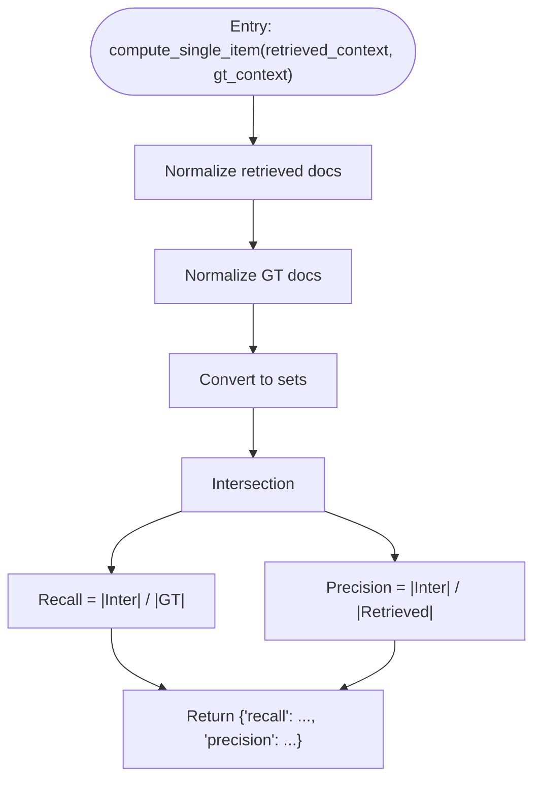
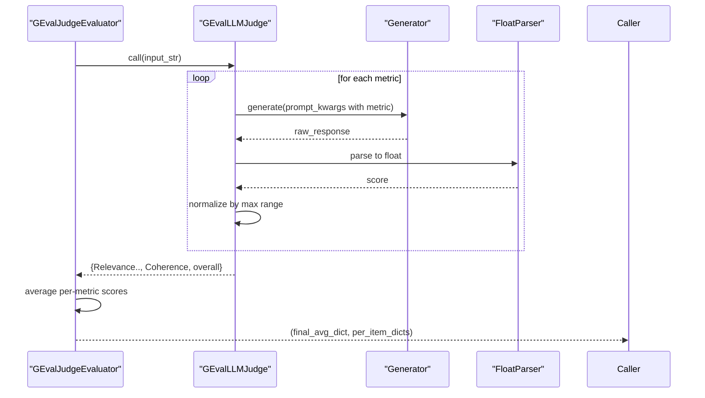
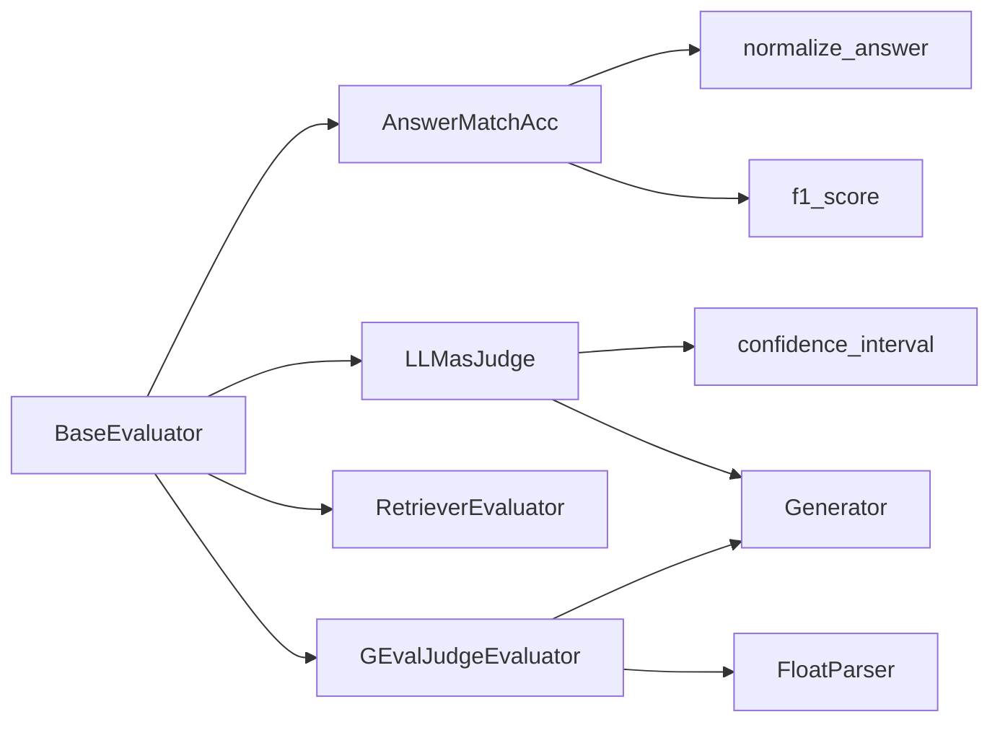

# Evaluation Framework

<cite>
**Referenced Files in This Document**
- [base.py](file://adalflow/adalflow/eval/base.py)
- [functional.py](file://adalflow/adalflow/eval/functional.py)
- [utils.py](file://adalflow/adalflow/eval/utils.py)
- [answer_match_acc.py](file://adalflow/adalflow/eval/answer_match_acc.py)
- [llm_as_judge.py](file://adalflow/adalflow/eval/llm_as_judge.py)
- [retriever_recall.py](file://adalflow/adalflow/eval/retriever_recall.py)
- [g_eval.py](file://adalflow/adalflow/eval/g_eval.py)
- [test_evaluators.py](file://tests/test_evaluators.py)
- [eval_retriever.py](file://tutorials/evaluation/eval_retriever.py)
- [eval_nlg.py](file://tutorials/evaluation/eval_nlg.py)
- [notebook_evaluation_adalflow_llm_eval.ipynb](file://notebooks/evaluation/adalflow_llm_eval.ipynb)
</cite>

## Table of Contents
1. [Introduction](#introduction)
2. [Project Structure](#project-structure)
3. [Core Components](#core-components)
4. [Architecture Overview](#architecture-overview)
5. [Detailed Component Analysis](#detailed-component-analysis)
6. [Dependency Analysis](#dependency-analysis)
7. [Performance Considerations](#performance-considerations)
8. [Troubleshooting Guide](#troubleshooting-guide)
9. [Conclusion](#conclusion)
10. [Appendices](#appendices)

## Introduction
This document explains AdalFlow’s comprehensive evaluation system for LLM applications. It covers the base evaluation classes, functional evaluation utilities, and specialized evaluators for answer matching accuracy, LLM-as-judge assessments, and retriever recall metrics. It also describes evaluation workflow patterns, metric computation methods, result aggregation strategies, and practical guidance for implementing custom evaluators, configuring evaluation parameters, interpreting results, and extending the framework with new metrics and external services.

## Project Structure
The evaluation module is organized around a shared base interface and several specialized evaluators. Supporting utilities provide normalization, F1 scoring, and confidence intervals. Specialized evaluators target typical LLM evaluation scenarios: QA answer matching, retrieval recall/precision, and NLG quality assessment via an LLM-as-judge paradigm.

**Diagram sources**
- [base.py](file://adalflow/adalflow/eval/base.py#L17-L31)
- [functional.py](file://adalflow/adalflow/eval/functional.py#L5-L49)
- [utils.py](file://adalflow/adalflow/eval/utils.py#L8-L48)
- [answer_match_acc.py](file://adalflow/adalflow/eval/answer_match_acc.py#L9-L157)
- [llm_as_judge.py](file://adalflow/adalflow/eval/llm_as_judge.py#L61-L245)
- [retriever_recall.py](file://adalflow/adalflow/eval/retriever_recall.py#L9-L125)
- [g_eval.py](file://adalflow/adalflow/eval/g_eval.py#L92-L259)

**Section sources**
- [base.py](file://adalflow/adalflow/eval/base.py#L1-L32)
- [functional.py](file://adalflow/adalflow/eval/functional.py#L1-L96)
- [utils.py](file://adalflow/adalflow/eval/utils.py#L1-L49)
- [answer_match_acc.py](file://adalflow/adalflow/eval/answer_match_acc.py#L1-L158)
- [llm_as_judge.py](file://adalflow/adalflow/eval/llm_as_judge.py#L1-L250)
- [retriever_recall.py](file://adalflow/adalflow/eval/retriever_recall.py#L1-L148)
- [g_eval.py](file://adalflow/adalflow/eval/g_eval.py#L1-L264)

## Core Components
- BaseEvaluator and EvaluationResult define the contract for all evaluators: a callable compute method returning an EvaluationResult with an overall average score, per-item scores, and optional additional info.
- Functional utilities include confidence_interval for binary judgments and longest common substring helpers.
- QA answer matching supports exact, fuzzy, F1, BLEU, ROUGE, and BERT scores.
- LLM-as-judge provides a configurable generator-based judge and a higher-level evaluator that aggregates scores and confidence intervals.
- Retriever recall/precision evaluator computes per-query metrics and averages across items.
- G-Eval evaluator wraps a multi-metric LLM judge for NLG tasks with normalized scores in [0, 1].

**Section sources**
- [base.py](file://adalflow/adalflow/eval/base.py#L8-L31)
- [functional.py](file://adalflow/adalflow/eval/functional.py#L5-L49)
- [answer_match_acc.py](file://adalflow/adalflow/eval/answer_match_acc.py#L9-L157)
- [llm_as_judge.py](file://adalflow/adalflow/eval/llm_as_judge.py#L54-L245)
- [retriever_recall.py](file://adalflow/adalflow/eval/retriever_recall.py#L9-L125)
- [g_eval.py](file://adalflow/adalflow/eval/g_eval.py#L21-L259)

## Architecture Overview
The evaluation architecture centers on a unified BaseEvaluator interface and a shared EvaluationResult data structure. Specialized evaluators encapsulate domain-specific logic and leverage shared utilities for normalization and confidence estimation. LLM-based evaluators integrate with a generator component to produce judgments or scores.

**Diagram sources**
- [base.py](file://adalflow/adalflow/eval/base.py#L17-L31)
- [answer_match_acc.py](file://adalflow/adalflow/eval/answer_match_acc.py#L9-L157)
- [llm_as_judge.py](file://adalflow/adalflow/eval/llm_as_judge.py#L61-L245)
- [retriever_recall.py](file://adalflow/adalflow/eval/retriever_recall.py#L9-L125)
- [g_eval.py](file://adalflow/adalflow/eval/g_eval.py#L92-L259)

## Detailed Component Analysis

### Base Evaluation Interface
- Purpose: Provide a consistent contract for all evaluators.
- Methods:
  - compute_single_item: Evaluate a single pair/item and return a scalar score.
  - compute: Evaluate a batch, returning an EvaluationResult with average and per-item scores.
- Design: Minimal interface encourages composability and uniform result handling.

**Section sources**
- [base.py](file://adalflow/adalflow/eval/base.py#L17-L31)

### Functional Utilities
- confidence_interval: Computes a confidence interval for a list of binary judgments using a normal approximation and clips bounds to [0, 1].
- longest_common_substring: Utility for string similarity comparisons (used conceptually in broader contexts).

**Section sources**
- [functional.py](file://adalflow/adalflow/eval/functional.py#L5-L49)

### Answer Matching Accuracy
- Supported modes:
  - exact_match: Normalized exact string equality.
  - fuzzy_match: Normalized containment check.
  - f1_score: Token-level F1 using normalized tokens.
  - bert_score, rouge_score, bleu_score: External metrics via torchmetrics (lazy import).
- compute_single_item: Converts inputs to strings, normalizes, and applies the selected mode.
- compute: Iterates over paired predictions and ground truths, collects per-item scores, and returns an EvaluationResult with average and per-item lists.

**Diagram sources**
- [answer_match_acc.py](file://adalflow/adalflow/eval/answer_match_acc.py#L63-L132)
- [utils.py](file://adalflow/adalflow/eval/utils.py#L8-L48)

**Section sources**
- [answer_match_acc.py](file://adalflow/adalflow/eval/answer_match_acc.py#L9-L157)
- [utils.py](file://adalflow/adalflow/eval/utils.py#L8-L48)

### LLM-as-Judge Evaluators
- DefaultLLMJudge:
  - Wraps a Generator with a configurable template and model kwargs.
  - Accepts question, ground truth answer, and predicted answer; returns a boolean or float based on output parsing.
- LLMasJudge:
  - Iterates over inputs using zip_longest to handle optional fields.
  - Aggregates per-item boolean judgments into an average score and constructs a confidence interval using functional.confidence_interval.
  - Returns a structured result containing average score, per-item scores, and confidence bounds.

**Diagram sources**
- [llm_as_judge.py](file://adalflow/adalflow/eval/llm_as_judge.py#L124-L245)
- [functional.py](file://adalflow/adalflow/eval/functional.py#L5-L49)

**Section sources**
- [llm_as_judge.py](file://adalflow/adalflow/eval/llm_as_judge.py#L61-L245)
- [functional.py](file://adalflow/adalflow/eval/functional.py#L5-L49)

### Retriever Recall and Precision
- compute_single_item:
  - Normalizes each retrieved and ground-truth context string.
  - Treats both as sets and computes intersection-based recall and precision.
- compute:
  - Validates input sizes, iterates pairs, collects per-item metrics, and returns an EvaluationResult-like dictionary with averages, per-item lists, and top-k metadata.

**Diagram sources**
- [retriever_recall.py](file://adalflow/adalflow/eval/retriever_recall.py#L53-L81)
- [utils.py](file://adalflow/adalflow/eval/utils.py#L8-L23)

**Section sources**
- [retriever_recall.py](file://adalflow/adalflow/eval/retriever_recall.py#L9-L125)
- [utils.py](file://adalflow/adalflow/eval/utils.py#L8-L23)

### G-Eval NLG Quality Evaluator
- GEvalLLMJudge:
  - Uses a predefined template and a set of evaluation criteria/steps for four metrics: Relevance, Fluency, Consistency, Coherence.
  - Calls the generator for each metric and normalizes scores by their maximum ranges to produce [0, 1] scores.
  - Aggregates per-metric scores and computes an overall average.
- GEvalJudgeEvaluator:
  - Applies GEvalLLMJudge to each input string and aggregates per-metric averages across the dataset.

**Diagram sources**
- [g_eval.py](file://adalflow/adalflow/eval/g_eval.py#L92-L259)

**Section sources**
- [g_eval.py](file://adalflow/adalflow/eval/g_eval.py#L21-L259)

## Dependency Analysis
- Cohesion: Each evaluator encapsulates a single evaluation paradigm (QA matching, LLM judge, retrieval metrics, G-Eval).
- Coupling:
  - Shared utilities (normalize_answer, f1_score) reduce duplication.
  - LLM-based evaluators depend on a generator component and optional model clients.
  - Confidence computations rely on functional utilities.
- External dependencies:
  - torchmetrics for advanced text metrics in answer matching.
  - Generator and ModelClient abstractions for LLM interactions.

**Diagram sources**
- [base.py](file://adalflow/adalflow/eval/base.py#L17-L31)
- [answer_match_acc.py](file://adalflow/adalflow/eval/answer_match_acc.py#L9-L157)
- [llm_as_judge.py](file://adalflow/adalflow/eval/llm_as_judge.py#L61-L245)
- [retriever_recall.py](file://adalflow/adalflow/eval/retriever_recall.py#L9-L125)
- [g_eval.py](file://adalflow/adalflow/eval/g_eval.py#L92-L259)
- [utils.py](file://adalflow/adalflow/eval/utils.py#L8-L48)
- [functional.py](file://adalflow/adalflow/eval/functional.py#L5-L49)

**Section sources**
- [base.py](file://adalflow/adalflow/eval/base.py#L17-L31)
- [answer_match_acc.py](file://adalflow/adalflow/eval/answer_match_acc.py#L9-L157)
- [llm_as_judge.py](file://adalflow/adalflow/eval/llm_as_judge.py#L61-L245)
- [retriever_recall.py](file://adalflow/adalflow/eval/retriever_recall.py#L9-L125)
- [g_eval.py](file://adalflow/adalflow/eval/g_eval.py#L92-L259)
- [utils.py](file://adalflow/adalflow/eval/utils.py#L8-L48)
- [functional.py](file://adalflow/adalflow/eval/functional.py#L5-L49)

## Performance Considerations
- Batch processing: All evaluators process lists of items and return per-item scores, enabling downstream analysis and stratification.
- Confidence estimation: Binary judgments benefit from confidence intervals to quantify uncertainty.
- Metric normalization: G-Eval normalizes scores to [0, 1] for consistent interpretation across diverse metrics.
- Asynchronous or multi-threaded evaluation: The base interface indicates future support for concurrency to accelerate evaluation.

[No sources needed since this section provides general guidance]

## Troubleshooting Guide
- Invalid inputs in answer matching:
  - Ensure predictions and ground truths are convertible to strings; normalization handles whitespace and punctuation.
- LLM judge output parsing:
  - The judge expects “True”/“False” (or equivalents) when output_type is boolean; otherwise numeric outputs are expected.
- Retrieval metrics:
  - Inputs must be lists of lists; ensure lengths match between retrieved and ground-truth context lists.
- G-Eval:
  - Ensure the generator returns numeric scores parsable by FloatParser; missing scores are ignored in averaging.

**Section sources**
- [answer_match_acc.py](file://adalflow/adalflow/eval/answer_match_acc.py#L81-L132)
- [llm_as_judge.py](file://adalflow/adalflow/eval/llm_as_judge.py#L124-L160)
- [retriever_recall.py](file://adalflow/adalflow/eval/retriever_recall.py#L99-L102)
- [g_eval.py](file://adalflow/adalflow/eval/g_eval.py#L171-L192)

## Conclusion
AdalFlow’s evaluation framework offers a modular, extensible foundation for LLM application evaluation. The base interface ensures consistent evaluation semantics, while specialized evaluators address common use cases: QA answer matching, retrieval recall/precision, and LLM-as-judge assessments. Advanced capabilities like confidence estimation and multi-metric NLG evaluation enable robust benchmarking and result interpretation.

[No sources needed since this section summarizes without analyzing specific files]

## Appendices

### Evaluation Workflow Patterns
- Single-item evaluation:
  - Call compute_single_item on the evaluator to obtain a scalar score for one prediction-ground-truth pair.
- Batch evaluation:
  - Call compute to receive an EvaluationResult with average and per-item scores.
- Confidence reporting:
  - For binary judgments, use confidence_interval to estimate uncertainty bands.

**Section sources**
- [base.py](file://adalflow/adalflow/eval/base.py#L21-L28)
- [functional.py](file://adalflow/adalflow/eval/functional.py#L5-L49)

### Metric Computation Methods
- Answer matching:
  - exact_match/fuzzy_match: String normalization followed by equality or containment checks.
  - f1_score: Token-level precision/recall harmonic mean.
  - external metrics: Lazy import and tensor-to-scalar conversion.
- Retrieval:
  - Set-based intersection for recall and precision; supports configurable top-k.
- LLM-as-judge:
  - Generator-driven binary or continuous scoring; aggregation with confidence intervals.
- G-Eval:
  - Multi-metric scoring with per-metric normalization and overall average.

**Section sources**
- [answer_match_acc.py](file://adalflow/adalflow/eval/answer_match_acc.py#L98-L129)
- [retriever_recall.py](file://adalflow/adalflow/eval/retriever_recall.py#L78-L79)
- [llm_as_judge.py](file://adalflow/adalflow/eval/llm_as_judge.py#L241-L244)
- [g_eval.py](file://adalflow/adalflow/eval/g_eval.py#L181-L190)

### Result Aggregation Strategies
- Averages across items: Used by AnswerMatchAcc, RetrieverEvaluator, and GEvalJudgeEvaluator.
- Per-item lists: Returned alongside averages for downstream analysis and stratification.
- Confidence intervals: Applied to binary judgment lists to bound uncertainty.

**Section sources**
- [answer_match_acc.py](file://adalflow/adalflow/eval/answer_match_acc.py#L154-L157)
- [retriever_recall.py](file://adalflow/adalflow/eval/retriever_recall.py#L119-L125)
- [llm_as_judge.py](file://adalflow/adalflow/eval/llm_as_judge.py#L241-L244)
- [g_eval.py](file://adalflow/adalflow/eval/g_eval.py#L244-L259)

### Implementing Custom Evaluators
- Extend BaseEvaluator:
  - Implement compute_single_item and compute to return EvaluationResult.
- Use shared utilities:
  - normalize_answer and f1_score for QA-style metrics.
  - confidence_interval for binary judgments.
- Integrate with LLMs:
  - Wrap a Generator with a custom template and output processors.
- Reference examples:
  - QA answer matching pattern: [answer_match_acc.py](file://adalflow/adalflow/eval/answer_match_acc.py#L134-L157)
  - LLM judge pattern: [llm_as_judge.py](file://adalflow/adalflow/eval/llm_as_judge.py#L206-L245)
  - Retrieval pattern: [retriever_recall.py](file://adalflow/adalflow/eval/retriever_recall.py#L83-L125)
  - G-Eval pattern: [g_eval.py](file://adalflow/adalflow/eval/g_eval.py#L209-L259)

**Section sources**
- [base.py](file://adalflow/adalflow/eval/base.py#L17-L31)
- [answer_match_acc.py](file://adalflow/adalflow/eval/answer_match_acc.py#L134-L157)
- [llm_as_judge.py](file://adalflow/adalflow/eval/llm_as_judge.py#L206-L245)
- [retriever_recall.py](file://adalflow/adalflow/eval/retriever_recall.py#L83-L125)
- [g_eval.py](file://adalflow/adalflow/eval/g_eval.py#L209-L259)

### Configuring Evaluation Parameters
- LLM judge:
  - model_client, model_kwargs, template, judgment query, output_type, and caching options.
- G-Eval:
  - model_client, model_kwargs, template, and default task configuration.
- Answer matching:
  - Metric type selection among exact, fuzzy, f1, and external metrics.

**Section sources**
- [llm_as_judge.py](file://adalflow/adalflow/eval/llm_as_judge.py#L80-L122)
- [g_eval.py](file://adalflow/adalflow/eval/g_eval.py#L107-L153)
- [answer_match_acc.py](file://adalflow/adalflow/eval/answer_match_acc.py#L36-L47)

### Interpreting Results
- QA metrics:
  - Scores reflect normalized matching; F1 balances precision and recall.
- Retrieval metrics:
  - Recall measures fraction of relevant docs retrieved; Precision measures relevance among retrieved docs.
- LLM-as-judge:
  - Average reflects proportion of “yes” judgments; confidence interval quantifies variability.
- G-Eval:
  - Per-metric scores normalized to [0, 1]; overall average provides a composite quality indicator.

**Section sources**
- [answer_match_acc.py](file://adalflow/adalflow/eval/answer_match_acc.py#L98-L129)
- [retriever_recall.py](file://adalflow/adalflow/eval/retriever_recall.py#L119-L125)
- [llm_as_judge.py](file://adalflow/adalflow/eval/llm_as_judge.py#L241-L244)
- [g_eval.py](file://adalflow/adalflow/eval/g_eval.py#L181-L190)

### Statistical Significance Testing
- Use confidence_interval on binary judgment lists to construct confidence bounds for proportions.
- For non-binary metrics, consider bootstrap-based confidence intervals or rank-based tests depending on distribution assumptions.

**Section sources**
- [functional.py](file://adalflow/adalflow/eval/functional.py#L5-L49)

### Benchmark Comparison Methodologies
- Stratified analysis: Use per-item scores to compare performance across subsets (e.g., question difficulty, domain).
- Confidence reporting: Report averages with confidence intervals to enable pairwise comparisons.
- Cross-dataset evaluation: Apply the same evaluator across datasets to ensure comparability.

[No sources needed since this section provides general guidance]

### Performance Profiling
- Measure wall-clock time per batch and per-item for each evaluator.
- Profile LLM calls separately to isolate latency contributions.
- Monitor memory usage during batched evaluations and adjust batch sizes accordingly.

[No sources needed since this section provides general guidance]

### Extending the Framework with Custom Metrics
- Add new metrics in answer_match_acc.py by selecting an appropriate mode or integrating external libraries.
- Implement new evaluators by subclassing BaseEvaluator and returning EvaluationResult.
- Integrate external services by wrapping them behind a Generator or a dedicated component similar to DefaultLLMJudge.

**Section sources**
- [answer_match_acc.py](file://adalflow/adalflow/eval/answer_match_acc.py#L48-L62)
- [base.py](file://adalflow/adalflow/eval/base.py#L17-L31)
- [llm_as_judge.py](file://adalflow/adalflow/eval/llm_as_judge.py#L61-L122)

### Integrating External Evaluation Services
- For LLM-as-judge or G-Eval, configure model_client and model_kwargs to connect to external providers.
- Ensure output processors (e.g., FloatParser) are compatible with service outputs.
- Validate service availability and handle import-time fallbacks gracefully.

**Section sources**
- [llm_as_judge.py](file://adalflow/adalflow/eval/llm_as_judge.py#L94-L102)
- [g_eval.py](file://adalflow/adalflow/eval/g_eval.py#L119-L127)

### Practical Examples and Tutorials
- Retrieval evaluation tutorial: [eval_retriever.py](file://tutorials/evaluation/eval_retriever.py)
- NLG evaluation tutorial: [eval_nlg.py](file://tutorials/evaluation/eval_nlg.py)
- Notebook-based LLM evaluation: [notebook_evaluation_adalflow_llm_eval.ipynb](file://notebooks/evaluation/adalflow_llm_eval.ipynb)
- Unit tests for evaluators: [test_evaluators.py](file://tests/test_evaluators.py)

**Section sources**
- [eval_retriever.py](file://tutorials/evaluation/eval_retriever.py)
- [eval_nlg.py](file://tutorials/evaluation/eval_nlg.py)
- [notebook_evaluation_adalflow_llm_eval.ipynb](file://notebooks/evaluation/adalflow_llm_eval.ipynb)
- [test_evaluators.py](file://tests/test_evaluators.py)