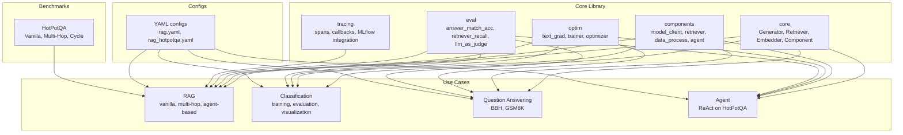
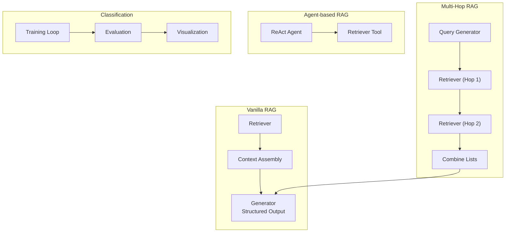
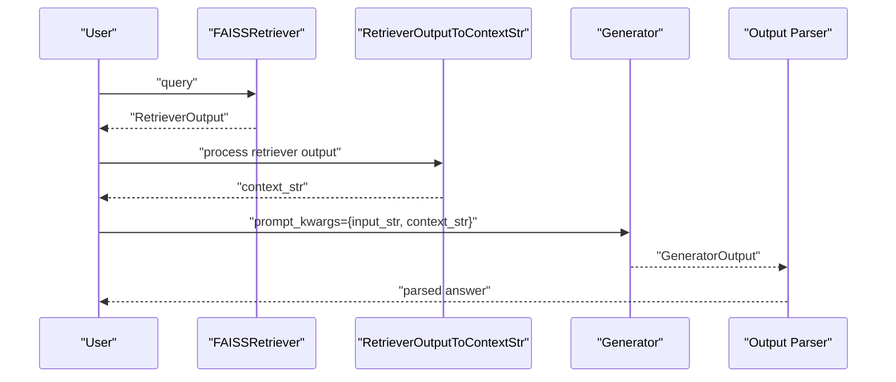
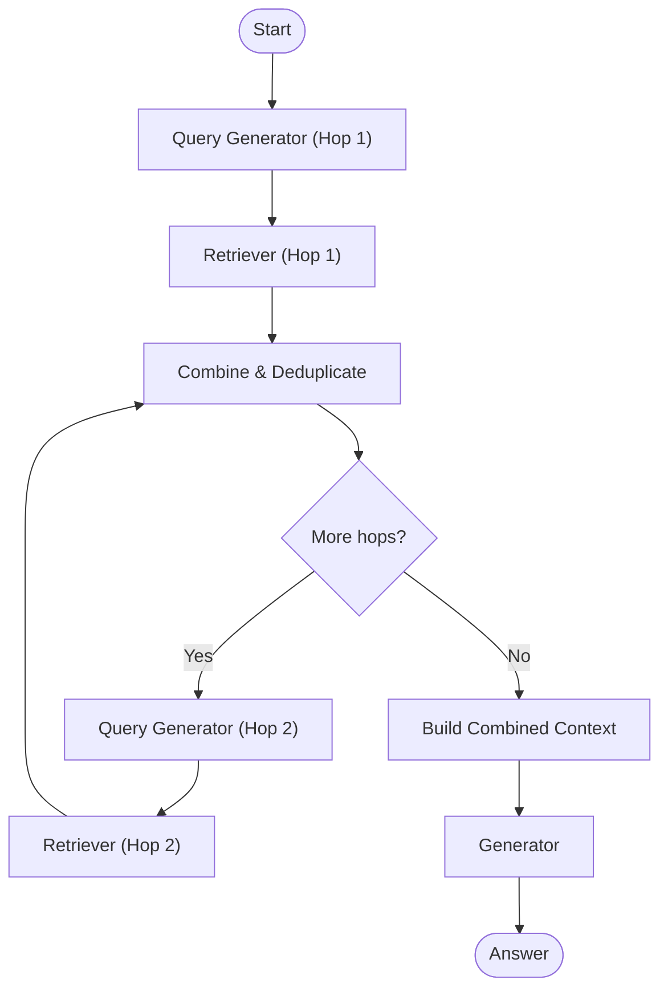
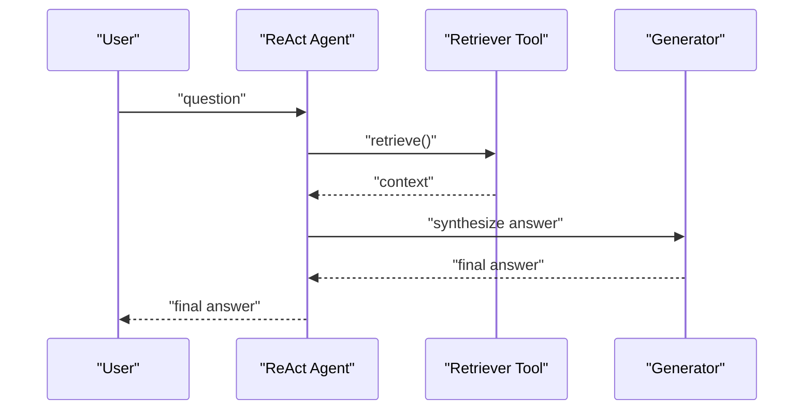
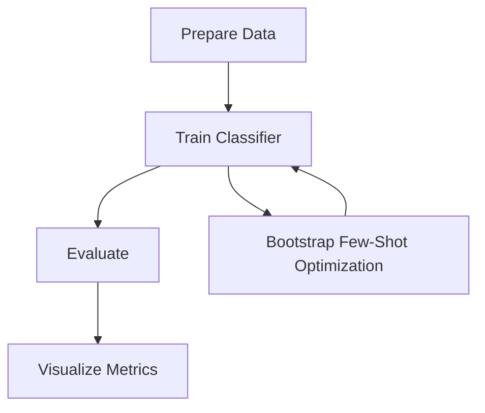
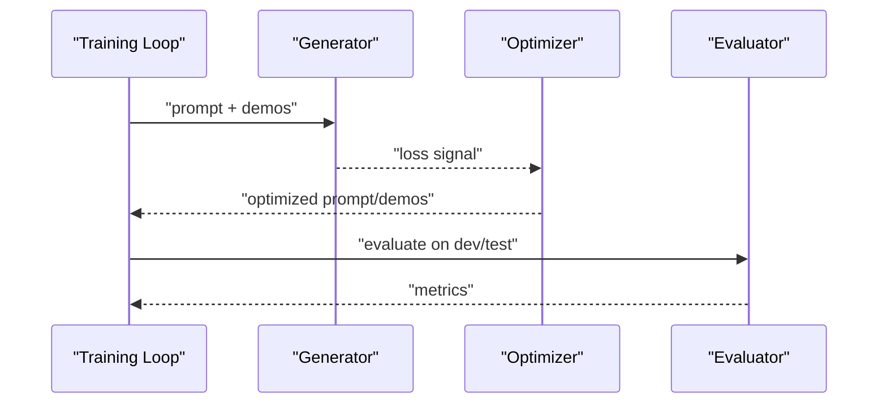
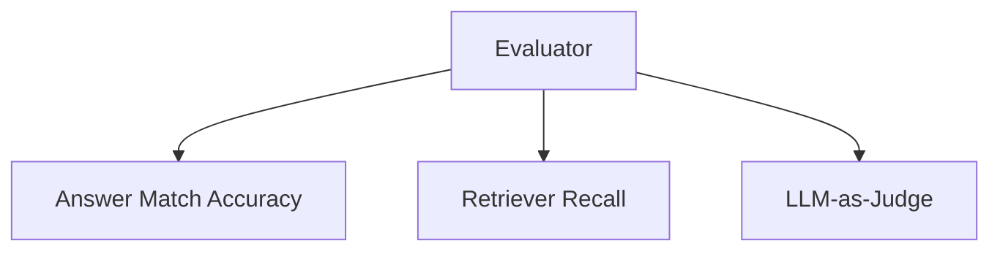
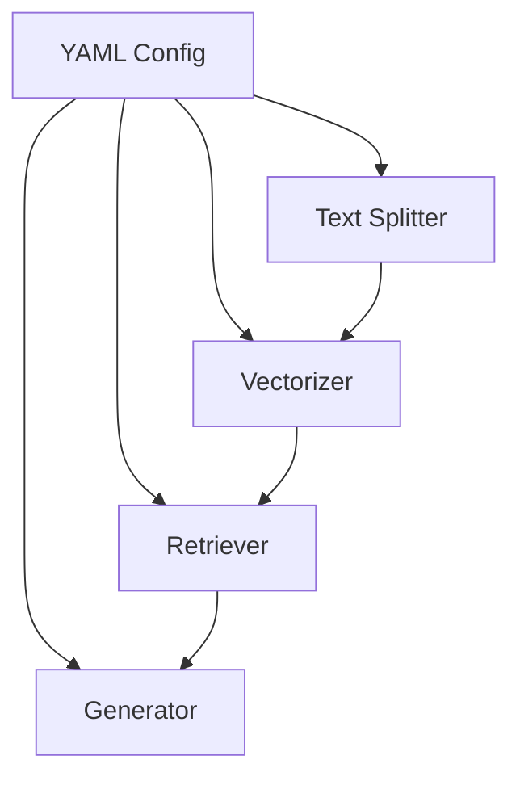
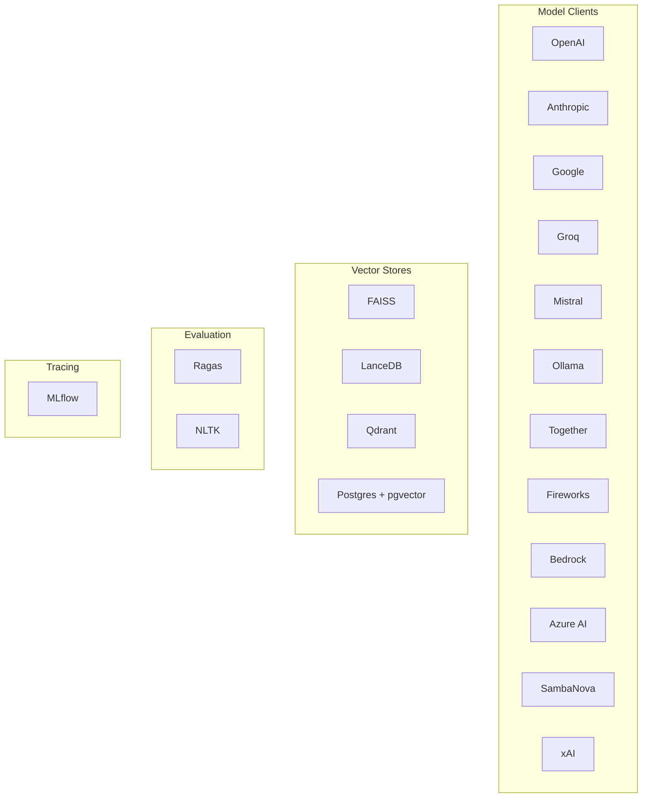

# Advanced Use Cases

<cite>
**Referenced Files in This Document**
- [README.md](file://README.md)
- [pyproject.toml](file://pyproject.toml)
- [use_cases/README.md](file://use_cases/README.md)
- [benchmarks/README.md](file://benchmarks/README.md)
- [use_cases/configs/rag.yaml](file://use_cases/configs/rag.yaml)
- [use_cases/configs/rag_hotpotqa.yaml](file://use_cases/configs/rag_hotpotqa.yaml)
- [use_cases/rag/build/rag.py](file://use_cases/rag/build/rag.py)
- [benchmarks/hotpot_qa/adal_exp/build_vanilla_rag.py](file://benchmarks/hotpot_qa/adal_exp/build_vanilla_rag.py)
- [benchmarks/hotpot_qa/adal_exp/build_multi_hop_rag.py](file://benchmarks/hotpot_qa/adal_exp/build_multi_hop_rag.py)
- [use_cases/classification/train.py](file://use_cases/classification/train.py)
- [use_cases/classification/eval.py](file://use_cases/classification/eval.py)
- [use_cases/classification/data.py](file://use_cases/classification/data.py)
- [use_cases/classification/visualize.py](file://use_cases/classification/visualize.py)
- [use_cases/question_answering/bbh/object_count/train_new.py](file://use_cases/question_answering/bbh/object_count/train_new.py)
- [use_cases/question_answering/gsm8k/train.py](file://use_cases/question_answering/gsm8k/train.py)
- [use_cases/rag/rag_with_eval.py](file://use_cases/rag/rag_with_eval.py)
- [use_cases/rag/bootstrap_weak_model.py](file://use_cases/rag/bootstrap_weak_model.py)
- [use_cases/unsorted/rag_optimized.py](file://use_cases/unsorted/rag_optimized.py)
- [use_cases/unsorted/rag_yaml_config.py](file://use_cases/unsorted/rag_yaml_config.py)
- [use_cases/unsorted/retriever_llm.py](file://use_cases/unsorted/retriever_llm.py)
- [use_cases/unsorted/llm_as_retriever.py](file://use_cases/unsorted/llm_as_retriever.py)
- [use_cases/unsorted/simple_rag_bm_25.py](file://use_cases/unsorted/simple_rag_bm_25.py)
- [use_cases/unsorted/use_embedder.py](file://use_cases/unsorted/use_embedder.py)
- [use_cases/unsorted/yaml_output.py](file://use_cases/unsorted/yaml_output.py)
- [use_cases/unsorted/fewshot_qa.py](file://use_cases/unsorted/fewshot_qa.py)
- [use_cases/unsorted/simple_qa.py](file://use_cases/unsorted/simple_qa.py)
- [use_cases/unsorted/simple_qa_trainable.py](file://use_cases/unsorted/simple_qa_trainable.py)
- [use_cases/unsorted/simple_qa_memory.py](file://use_cases/unsorted/simple_qa_memory.py)
- [use_cases/unsorted/simple_qa_anthropic.py](file://use_cases/unsorted/simple_qa_anthropic.py)
- [use_cases/unsorted/simple_qa_google.py](file://use_cases/unsorted/simple_qa_google.py)
- [use_cases/unsorted/simple_qa_groq.py](file://use_cases/unsorted/simple_qa_groq.py)
- [use_cases/unsorted/rag_hotpotqa.py](file://use_cases/unsorted/rag_hotpotqa.py)
- [use_cases/agent/react_agent_hotpot_qa.ipynb](file://use_cases/agent/react_agent_hotpot_qa.ipynb)
- [use_cases/tracing/trace_generator.py](file://use_cases/tracing/trace_generator.py)
- [tutorials/rag/rag.py](file://tutorials/rag/rag.py)
- [tutorials/retriever/local_db.py](file://tutorials/retriever/local_db.py)
- [tutorials/retriever/data.py](file://tutorials/retriever/data.py)
- [tutorials/retriever/adalflow_lancedb.py](file://tutorials/retriever/adalflow_lancedb.py)
- [tutorials/rag/config.py](file://tutorials/rag/config.py)
- [tutorials/rag/ipynb](file://tutorials/rag/ipynb)
- [tutorials/rag/ipynb](file://tutorials/rag/ipynb)
- [tutorials/rag/ipynb](file://tutorials/rag/ipynb)
- [tutorials/rag/ipynb](file://tutorials/rag/ipynb)
- [tutorials/rag/ipynb](file://tutorials/rag/ipynb)
- [tutorials/rag/ipynb](file://tutorials/rag/ipynb)
- [tutorials/rag/ipynb](file://tutorials/rag/ipynb)
- [tutorials/rag/ipynb](file://tutorials/rag/ipynb)
- [tutorials/rag/ipynb](file://tutorials/rag/ipynb)
- [tutorials/rag/ipynb](file://tutorials/rag/ipynb)
- [tutorials/rag/ipynb](file://tutorials/rag/ipynb)
- [tutorials/rag/ipynb](file://tutorials/rag/ipynb)
- [tutorials/rag/ipynb](file://tutorials/rag/ipynb)
- [tutorials/rag/ipynb](file://tutorials/rag/ipynb)
- [tutorials/rag/ipynb](file://tutorials/rag/ipynb)
- [tutorials/rag/ipynb](file://tutorials/rag/ipynb)
- [tutorials/rag/ipynb](file://tutorials/rag/ipynb)
- [tutorials/rag/ipynb](file://tutorials/rag/ipynb)
- [tutorials/rag/ipynb](file://tutorials/rag/ipynb)
- [tutorials/rag/ipynb](file://tutorials/rag/ipynb)
- [tutorials/rag/ipynb](file://tutorials/rag/ipynb)
- [tutorials/rag/ipynb](file://tutorials/rag/ipynb)
- [tutorials/rag/ipynb](file://tutorials/rag/ipynb)
- [tutorials/rag/ipynb](file://tutorials/rag/ipynb)
- [tutorials/rag/ipynb](file://tutorials/rag/ipynb......)
</cite>

## Table of Contents
1. [Introduction](#introduction)
2. [Project Structure](#project-structure)
3. [Core Components](#core-components)
4. [Architecture Overview](#architecture-overview)
5. [Detailed Component Analysis](#detailed-component-analysis)
6. [Dependency Analysis](#dependency-analysis)
7. [Performance Considerations](#performance-considerations)
8. [Troubleshooting Guide](#troubleshooting-guide)
9. [Conclusion](#conclusion)
10. [Appendices](#appendices)

## Introduction
This document presents advanced use cases for building complex LLM workflows with AdalFlow. It focuses on end-to-end RAG systems, evaluation frameworks, agent-based question answering, classification pipelines, and optimized retrieval systems. It explains multi-component orchestration, advanced configuration patterns, and performance optimization techniques. Guidance is provided for adapting examples across domains and requirements, including scalability, memory management, and production-ready patterns.

## Project Structure
The repository organizes advanced capabilities across:
- Core library modules under adalflow/adalflow for components, generators, retrievers, optimizers, evaluators, and tracing.
- Use cases under use_cases for domain-specific pipelines (RAG, classification, question answering).
- Benchmarks under benchmarks for comparative experiments (e.g., HotPotQA multi-hop).
- Tutorials and notebooks for learning and quick-start scenarios.
- Configuration files for YAML-based setups.

**Section sources**
- [README.md](file://README.md#L1-L392)
- [pyproject.toml](file://pyproject.toml#L1-L87)

## Core Components
Key building blocks used across advanced workflows:
- Generators: templated LLM calls with output processors and caching.
- Embedders/BatchEmbedders: vectorization for retrieval.
- Retriever family: FAISS, LanceDB, Qdrant, Postgres, BM25, LLM-as-retriever.
- Data processing: text splitting, embedding transforms, context assembly.
- Optimizers: textual gradient descent, bootstrapped few-shot optimization, trainer.
- Evaluators: answer match, retrieval recall, LLM-as-judge.
- Tracing: MLflow integration, span graphs, logging.

These components are composable and support both evaluation and training modes, enabling auto-optimization of prompts and demonstrations.

**Section sources**
- [use_cases/rag/build/rag.py](file://use_cases/rag/build/rag.py#L1-L252)
- [benchmarks/hotpot_qa/adal_exp/build_vanilla_rag.py](file://benchmarks/hotpot_qa/adal_exp/build_vanilla_rag.py#L1-L391)
- [benchmarks/hotpot_qa/adal_exp/build_multi_hop_rag.py](file://benchmarks/hotpot_qa/adal_exp/build_multi_hop_rag.py#L1-L908)

## Architecture Overview
The advanced architectures combine generators, retrievers, optimizers, and evaluators into computation graphs. Prominent patterns include:
- Vanilla RAG: retriever → context assembly → generator with structured output.
- Multi-hop RAG: iterative query rewriting and retrieval with cycle or fixed hops.
- Agent-based RAG: ReAct agent orchestrating retriever/tool calls.
- Classification pipelines: training with bootstrapped demonstrations and evaluation.
- Evaluation frameworks: automated metrics and LLM-as-judge scoring.

**Diagram sources**
- [benchmarks/hotpot_qa/adal_exp/build_vanilla_rag.py](file://benchmarks/hotpot_qa/adal_exp/build_vanilla_rag.py#L141-L229)
- [benchmarks/hotpot_qa/adal_exp/build_multi_hop_rag.py](file://benchmarks/hotpot_qa/adal_exp/build_multi_hop_rag.py#L171-L306)
- [use_cases/agent/react_agent_hotpot_qa.ipynb](file://use_cases/agent/react_agent_hotpot_qa.ipynb)

## Detailed Component Analysis

### End-to-End RAG System (Vanilla and Multi-Hop)
This section demonstrates constructing a production-grade RAG pipeline with retrieval, context assembly, and generator with structured output. It covers:
- Embedding and indexing with FAISS.
- Text splitting and batching.
- Retrieval with top-k selection.
- Context construction and generator prompt composition.
- Evaluation hooks and YAML configuration.

**Diagram sources**
- [use_cases/rag/build/rag.py](file://use_cases/rag/build/rag.py#L190-L205)

Implementation highlights:
- Embedding pipeline with batching and LocalDB persistence.
- FAISS-backed retriever with vector document mapping.
- Structured generator output via JSON parser.
- YAML configs for vectorizer, retriever, generator, and text splitter.

**Section sources**
- [use_cases/rag/build/rag.py](file://use_cases/rag/build/rag.py#L1-L252)
- [use_cases/configs/rag.yaml](file://use_cases/configs/rag.yaml#L1-L20)
- [use_cases/configs/rag_hotpotqa.yaml](file://use_cases/configs/rag_hotpotqa.yaml#L1-L25)

### Multi-Hop RAG with Iterative Query Rewriting
This advanced pattern enables complex reasoning by chaining query generation and retrieval across multiple hops. It supports:
- Fixed-hops and cyclic variants.
- Parameterized query generation with successor mapping.
- Context combination and deduplication.
- Integration with ReAct agents for tool orchestration.

**Diagram sources**
- [benchmarks/hotpot_qa/adal_exp/build_multi_hop_rag.py](file://benchmarks/hotpot_qa/adal_exp/build_multi_hop_rag.py#L171-L306)

**Section sources**
- [benchmarks/hotpot_qa/adal_exp/build_multi_hop_rag.py](file://benchmarks/hotpot_qa/adal_exp/build_multi_hop_rag.py#L1-L908)

### Agent-Based Question Answering
ReAct agents coordinate tool use (e.g., retriever) to answer complex queries. The agent can be integrated with RAG pipelines to dynamically decide when to search and synthesize.

**Diagram sources**
- [benchmarks/hotpot_qa/adal_exp/build_multi_hop_rag.py](file://benchmarks/hotpot_qa/adal_exp/build_multi_hop_rag.py#L642-L741)

**Section sources**
- [use_cases/agent/react_agent_hotpot_qa.ipynb](file://use_cases/agent/react_agent_hotpot_qa.ipynb)
- [benchmarks/hotpot_qa/adal_exp/build_multi_hop_rag.py](file://benchmarks/hotpot_qa/adal_exp/build_multi_hop_rag.py#L642-L741)

### Classification Pipelines with Bootstrapped Optimization
Classification tasks demonstrate training loops with bootstrapped few-shot demonstrations and evaluation. The pipeline includes:
- Data preparation and training.
- Evaluation metrics and visualization.
- Parameter optimization for prompts and demonstrations.

**Diagram sources**
- [use_cases/classification/train.py](file://use_cases/classification/train.py)
- [use_cases/classification/eval.py](file://use_cases/classification/eval.py)
- [use_cases/classification/visualize.py](file://use_cases/classification/visualize.py)

**Section sources**
- [use_cases/classification/train.py](file://use_cases/classification/train.py)
- [use_cases/classification/eval.py](file://use_cases/classification/eval.py)
- [use_cases/classification/visualize.py](file://use_cases/classification/visualize.py)

### Question Answering Tasks (BBH and GSM8K)
These tasks showcase training and optimization for reasoning-intensive QA:
- BBH object counting with textual gradient optimization.
- GSM8K with structured outputs and training loops.

**Diagram sources**
- [use_cases/question_answering/bbh/object_count/train_new.py](file://use_cases/question_answering/bbh/object_count/train_new.py)
- [use_cases/question_answering/gsm8k/train.py](file://use_cases/question_answering/gsm8k/train.py)

**Section sources**
- [use_cases/question_answering/bbh/object_count/train_new.py](file://use_cases/question_answering/bbh/object_count/train_new.py)
- [use_cases/question_answering/gsm8k/train.py](file://use_cases/question_answering/gsm8k/train.py)

### Evaluation Frameworks
Evaluation is central to optimizing and validating LLM workflows:
- Answer match accuracy.
- Retrieval recall.
- LLM-as-judge scoring.

**Diagram sources**
- [benchmarks/hotpot_qa/adal_exp/build_vanilla_rag.py](file://benchmarks/hotpot_qa/adal_exp/build_vanilla_rag.py#L1-L391)
- [use_cases/rag/rag_with_eval.py](file://use_cases/rag/rag_with_eval.py)

**Section sources**
- [benchmarks/hotpot_qa/adal_exp/build_vanilla_rag.py](file://benchmarks/hotpot_qa/adal_exp/build_vanilla_rag.py#L1-L391)
- [use_cases/rag/rag_with_eval.py](file://use_cases/rag/rag_with_eval.py)

### Optimized Retrieval Systems
Optimization techniques include:
- YAML-driven configuration for vectorizer, retriever, generator, and text splitter.
- Weak model bootstrapping for initial retrieval quality.
- BM25 baselines and LLM-as-retriever patterns.

**Diagram sources**
- [use_cases/configs/rag.yaml](file://use_cases/configs/rag.yaml#L1-L20)
- [use_cases/configs/rag_hotpotqa.yaml](file://use_cases/configs/rag_hotpotqa.yaml#L1-L25)
- [use_cases/rag/bootstrap_weak_model.py](file://use_cases/rag/bootstrap_weak_model.py)
- [use_cases/unsorted/simple_rag_bm_25.py](file://use_cases/unsorted/simple_rag_bm_25.py)
- [use_cases/unsorted/llm_as_retriever.py](file://use_cases/unsorted/llm_as_retriever.py)

**Section sources**
- [use_cases/configs/rag.yaml](file://use_cases/configs/rag.yaml#L1-L20)
- [use_cases/configs/rag_hotpotqa.yaml](file://use_cases/configs/rag_hotpotqa.yaml#L1-L25)
- [use_cases/rag/bootstrap_weak_model.py](file://use_cases/rag/bootstrap_weak_model.py)
- [use_cases/unsorted/simple_rag_bm_25.py](file://use_cases/unsorted/simple_rag_bm_25.py)
- [use_cases/unsorted/llm_as_retriever.py](file://use_cases/unsorted/llm_as_retriever.py)

## Dependency Analysis
External dependencies enable diverse model clients, vector databases, and evaluation tools. The project supports:
- Multiple model providers (OpenAI, Anthropic, Google, Groq, Mistral, Ollama, Together, Fireworks, Bedrock, Azure AI, SambaNova, xAI).
- Vector stores (FAISS, LanceDB, Qdrant, Postgres with pgvector).
- Evaluation libraries (Ragas, NLTK).
- MLflow for tracing and experiment tracking.

**Diagram sources**
- [pyproject.toml](file://pyproject.toml#L17-L67)

**Section sources**
- [pyproject.toml](file://pyproject.toml#L17-L67)

## Performance Considerations
Production-ready patterns and optimizations:
- Batching embeddings and retrievals to reduce overhead.
- Using YAML configs to tune top-k, chunk sizes, and dimensions.
- Caching generator outputs to avoid repeated LLM calls.
- FAISS indexing with efficient vector storage and retrieval.
- Memory management through LocalDB and incremental document loading.
- Streaming and async execution for latency-sensitive deployments.
- Tracing and MLflow integration for monitoring and debugging.

[No sources needed since this section provides general guidance]

## Troubleshooting Guide
Common issues and remedies:
- Empty or invalid retriever outputs: validate query preprocessing and context assembly.
- JSON parsing failures: ensure generator output processors are configured correctly.
- Slow retrieval: adjust top-k, chunk sizes, and embedding dimensions; consider BM25 or LLM-as-retriever alternatives.
- Training instability: reduce learning rates for textual gradients; bootstrap demonstrations; monitor loss curves.
- Tracing and logging: enable MLflow integration and generator call logs for diagnostics.

**Section sources**
- [use_cases/rag/build/rag.py](file://use_cases/rag/build/rag.py#L190-L205)
- [benchmarks/hotpot_qa/adal_exp/build_vanilla_rag.py](file://benchmarks/hotpot_qa/adal_exp/build_vanilla_rag.py#L151-L189)
- [use_cases/tracing/trace_generator.py](file://use_cases/tracing/trace_generator.py)

## Conclusion
AdalFlow enables sophisticated LLM workflows through modular components, auto-optimization, and robust evaluation. The advanced use cases presented here—RAG (vanilla and multi-hop), agent-based QA, classification pipelines, and optimized retrieval—provide production-ready patterns. By leveraging YAML configurations, tracing, and evaluation frameworks, teams can scale and adapt these workflows to diverse domains and requirements.

[No sources needed since this section summarizes without analyzing specific files]

## Appendices

### Adapting Examples Across Domains
- RAG: switch vectorizer dimensions and retriever type (FAISS vs LanceDB vs Qdrant vs Postgres); adjust text splitter for domain granularity.
- QA: tailor query generation prompts for subject-specific reasoning; integrate ReAct agents for dynamic tool use.
- Classification: vary bootstrap demos and evaluation metrics; visualize performance per class.
- Evaluation: choose appropriate metrics (exact match, recall, LLM-as-judge) aligned with task goals.

[No sources needed since this section provides general guidance]