# Agent Applications

<cite>
**Referenced Files in This Document**
- [agent.py](file://adalflow/adalflow/components/agent/agent.py)
- [react.py](file://adalflow/adalflow/components/agent/react.py)
- [runner.py](file://adalflow/adalflow/components/agent/runner.py)
- [prompts.py](file://adalflow/adalflow/components/agent/prompts.py)
- [memory.py](file://adalflow/adalflow/components/memory/memory.py)
- [tool_manager.py](file://adalflow/adalflow/core/tool_manager.py)
- [types.py](file://adalflow/adalflow/core/types.py)
- [build_multi_hop_rag.py](file://benchmarks/hotpot_qa/adal_exp/build_multi_hop_rag.py)
- [train_multi_hop_rag.py](file://benchmarks/hotpot_qa/adal_exp/train_multi_hop_rag.py)
- [tutorial_agent_advanced_features.py](file://tutorials/agent/tutorial_agent_advanced_features.py)
- [react_agent.py](file://tutorials/mcp_agent/react_agent.py)
</cite>

## Table of Contents
1. [Introduction](#introduction)
2. [Project Structure](#project-structure)
3. [Core Components](#core-components)
4. [Architecture Overview](#architecture-overview)
5. [Detailed Component Analysis](#detailed-component-analysis)
6. [Dependency Analysis](#dependency-analysis)
7. [Performance Considerations](#performance-considerations)
8. [Troubleshooting Guide](#troubleshooting-guide)
9. [Conclusion](#conclusion)
10. [Appendices](#appendices)

## Introduction
This document presents a comprehensive guide to building advanced agent applications with ReAct-style reasoning and complex multi-step workflows. It focuses on:
- ReAct agents and planning loops
- Multi-hop retrieval-augmented generation (RAG) optimization
- Computation graph construction and tracing
- Agent-memory integration and streaming execution
- Tool selection strategies and permission-aware workflows
- Decision-making processes and adaptive reasoning
- Scalability, monitoring, and debugging of end-to-end agent workflows

The content synthesizes the agent orchestration stack, tool management, memory, and benchmark-grade multi-hop RAG pipelines to help practitioners design autonomous agents that are robust, observable, and cost-efficient.

## Project Structure
The agent system is organized around modular components:
- Agent orchestration and planning
- Tool management and execution
- Memory and conversation context
- Runner for iterative planning and tool execution
- Prompts and output parsers
- Benchmarks for multi-hop RAG optimization
- Tutorials for streaming, tracing, and permission management

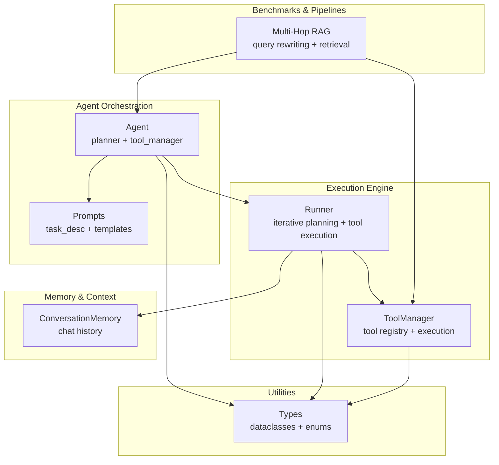

**Diagram sources**
- [agent.py](file://adalflow/adalflow/components/agent/agent.py#L216-L387)
- [runner.py](file://adalflow/adalflow/components/agent/runner.py#L107-L800)
- [tool_manager.py](file://adalflow/adalflow/core/tool_manager.py#L134-L626)
- [prompts.py](file://adalflow/adalflow/components/agent/prompts.py#L1-L121)
- [memory.py](file://adalflow/adalflow/components/memory/memory.py#L52-L226)
- [build_multi_hop_rag.py](file://benchmarks/hotpot_qa/adal_exp/build_multi_hop_rag.py#L171-L741)
- [types.py](file://adalflow/adalflow/core/types.py#L55-L135)

**Section sources**
- [agent.py](file://adalflow/adalflow/components/agent/agent.py#L1-L387)
- [runner.py](file://adalflow/adalflow/components/agent/runner.py#L1-L800)
- [tool_manager.py](file://adalflow/adalflow/core/tool_manager.py#L1-L626)
- [prompts.py](file://adalflow/adalflow/components/agent/prompts.py#L1-L121)
- [memory.py](file://adalflow/adalflow/components/memory/memory.py#L1-L226)
- [build_multi_hop_rag.py](file://benchmarks/hotpot_qa/adal_exp/build_multi_hop_rag.py#L1-L741)
- [types.py](file://adalflow/adalflow/core/types.py#L1-L200)

## Core Components
- Agent: Orchestrates a planner (LLM) and a tool manager. Provides default planner creation and optional thinking-model toggle.
- Runner: Iterative executor that calls the planner, executes tools, tracks step history, and processes final answers with type conversion.
- ToolManager: Central registry of tools, context mapping, and execution (sync/async, streaming).
- ConversationMemory: Stores and formats chat history for inclusion in prompts.
- Prompts: Structured templates for task description, tool definitions, and output schema.
- Types: Shared dataclasses and enums for tool/function representation and model types.

Key capabilities:
- ReAct-style planning with step history and termination signals
- Streaming and tracing for observability
- Permission-aware tool execution
- Multi-hop retrieval and computation graph construction

**Section sources**
- [agent.py](file://adalflow/adalflow/components/agent/agent.py#L216-L387)
- [runner.py](file://adalflow/adalflow/components/agent/runner.py#L107-L800)
- [tool_manager.py](file://adalflow/adalflow/core/tool_manager.py#L134-L626)
- [memory.py](file://adalflow/adalflow/components/memory/memory.py#L52-L226)
- [prompts.py](file://adalflow/adalflow/components/agent/prompts.py#L1-L121)
- [types.py](file://adalflow/adalflow/core/types.py#L55-L135)

## Architecture Overview
The agent architecture couples a planner with a tool execution engine and optional memory. The Runner drives iterative ReAct steps until a final answer is produced or max steps reached.

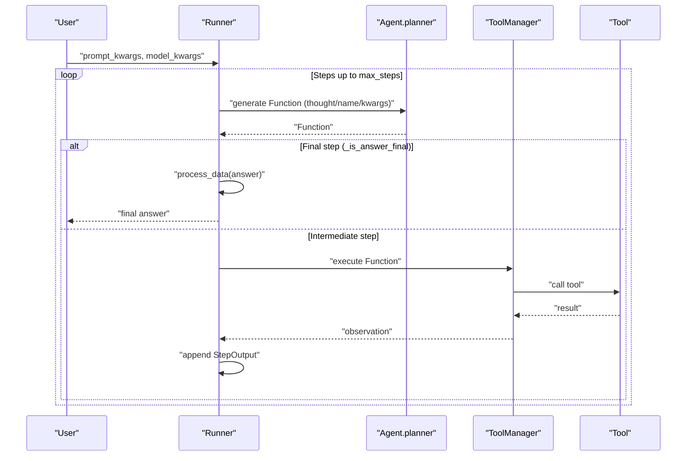

**Diagram sources**
- [runner.py](file://adalflow/adalflow/components/agent/runner.py#L529-L800)
- [agent.py](file://adalflow/adalflow/components/agent/agent.py#L216-L387)
- [tool_manager.py](file://adalflow/adalflow/core/tool_manager.py#L310-L427)

## Detailed Component Analysis

### Agent: Planner and Tool Manager Composition
- Creates a default planner using a system prompt template and JSON output parser tailored to Function actions.
- Supports a thinking-model mode that omits chain-of-thought fields in the output schema.
- Provides a fallback LLM tool for simple queries and integrates context variables into the planner’s prompt.

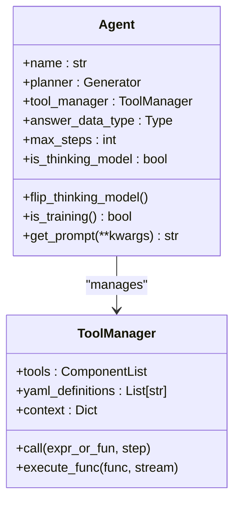

**Diagram sources**
- [agent.py](file://adalflow/adalflow/components/agent/agent.py#L216-L387)
- [tool_manager.py](file://adalflow/adalflow/core/tool_manager.py#L134-L210)

**Section sources**
- [agent.py](file://adalflow/adalflow/components/agent/agent.py#L216-L387)
- [prompts.py](file://adalflow/adalflow/components/agent/prompts.py#L1-L121)

### Runner: Iterative Planning and Execution
- Drives the ReAct loop: planner → tool execution → step history → termination.
- Handles both synchronous and asynchronous tool execution, including async generators.
- Integrates conversation memory and emits streaming events for real-time feedback.
- Tracks token consumption and exposes cancellation hooks.

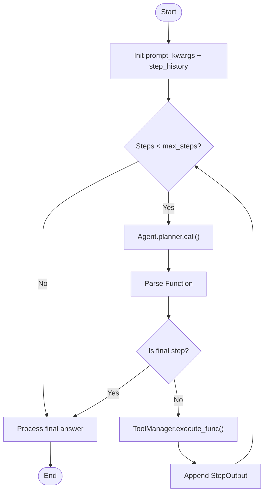

**Diagram sources**
- [runner.py](file://adalflow/adalflow/components/agent/runner.py#L529-L800)
- [tool_manager.py](file://adalflow/adalflow/core/tool_manager.py#L310-L427)

**Section sources**
- [runner.py](file://adalflow/adalflow/components/agent/runner.py#L107-L800)
- [memory.py](file://adalflow/adalflow/components/memory/memory.py#L52-L226)

### ToolManager: Function Registry and Execution
- Maintains a context map of tool names to FunctionTool instances.
- Parses FunctionExpression into Function and executes with proper error handling.
- Supports sync, async, and streaming tool execution; includes sandbox and eval modes for expression execution.

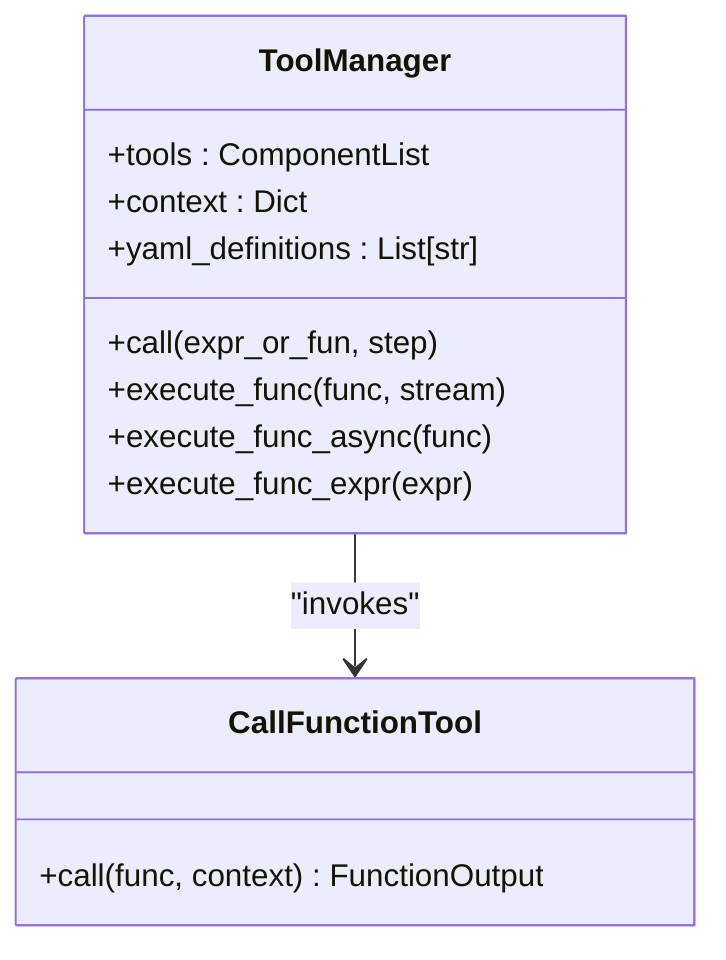

**Diagram sources**
- [tool_manager.py](file://adalflow/adalflow/core/tool_manager.py#L134-L626)

**Section sources**
- [tool_manager.py](file://adalflow/adalflow/core/tool_manager.py#L134-L626)

### Memory: Conversation Context Integration
- Formats chat history using a Jinja2 template and supports metadata filtering.
- Adds user queries and assistant responses to maintain conversational context across steps.

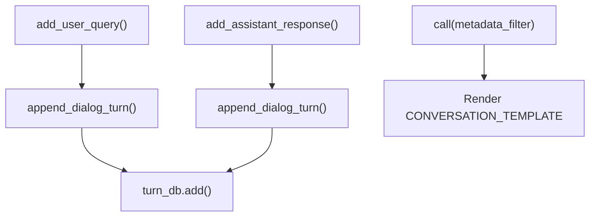

**Diagram sources**
- [memory.py](file://adalflow/adalflow/components/memory/memory.py#L52-L226)

**Section sources**
- [memory.py](file://adalflow/adalflow/components/memory/memory.py#L52-L226)

### Prompts: Structured Templates and Output Schema
- Defines task description and system prompt templates for ReAct reasoning.
- Includes placeholders for tools, context variables, output format, and step history.

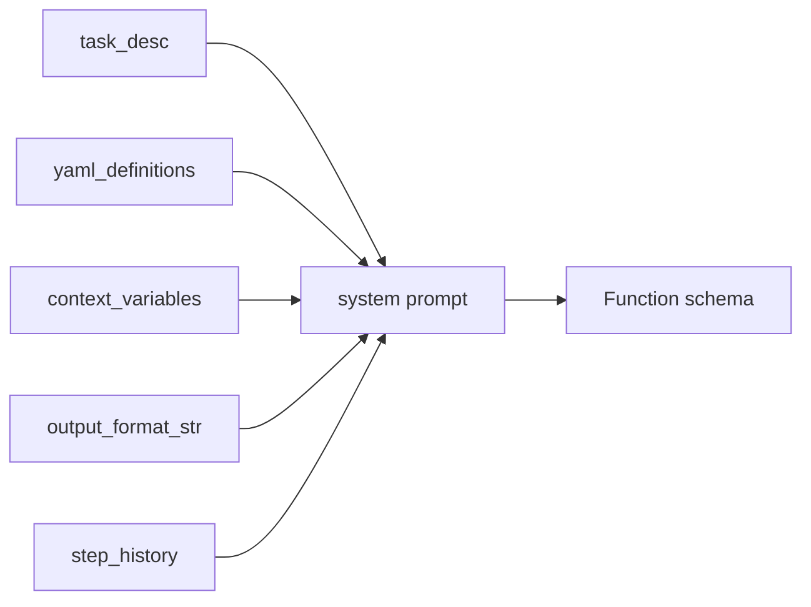

**Diagram sources**
- [prompts.py](file://adalflow/adalflow/components/agent/prompts.py#L1-L121)

**Section sources**
- [prompts.py](file://adalflow/adalflow/components/agent/prompts.py#L1-L121)

### ReAct Agent (Legacy/Reference)
- Provides a ReAct-style loop with explicit step history and finish action.
- Demonstrates how Function outputs are parsed and executed against ToolManager.

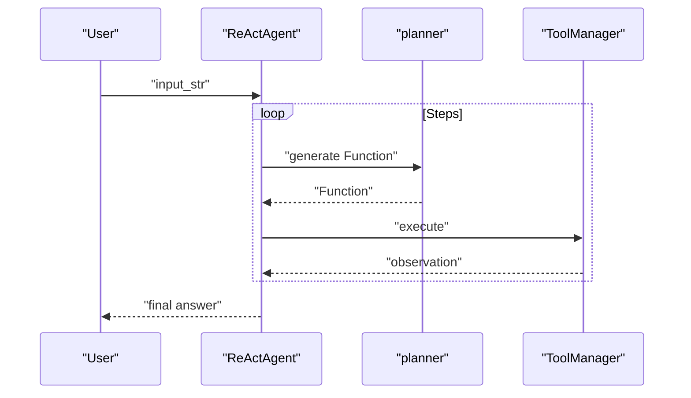

**Diagram sources**
- [react.py](file://adalflow/adalflow/components/agent/react.py#L182-L763)

**Section sources**
- [react.py](file://adalflow/adalflow/components/agent/react.py#L1-L800)

### Multi-Hop RAG Optimization
- Implements iterative query rewriting and retrieval with a cycle of generators and retrievers.
- Builds a computation graph linking query generations to retrievals and combines contexts across hops.

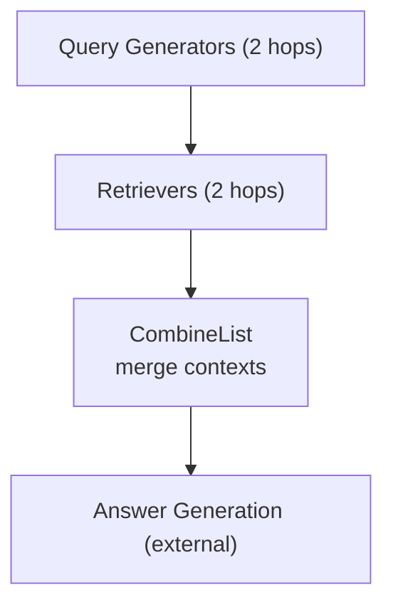

**Diagram sources**
- [build_multi_hop_rag.py](file://benchmarks/hotpot_qa/adal_exp/build_multi_hop_rag.py#L171-L514)

**Section sources**
- [build_multi_hop_rag.py](file://benchmarks/hotpot_qa/adal_exp/build_multi_hop_rag.py#L1-L741)
- [train_multi_hop_rag.py](file://benchmarks/hotpot_qa/adal_exp/train_multi_hop_rag.py#L1-L168)

### Streaming, Tracing, and Permission Management
- Demonstrates streaming execution with tool call and output events.
- Shows MLflow integration and tracing for observability.
- Illustrates permission-aware tool execution with CLI handlers.

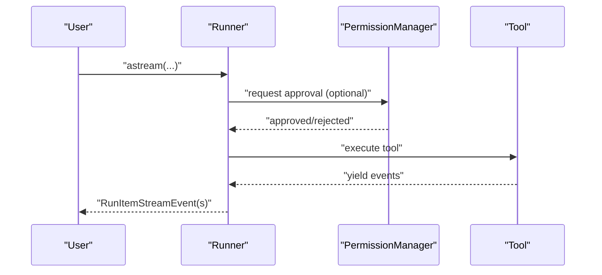

**Diagram sources**
- [tutorial_agent_advanced_features.py](file://tutorials/agent/tutorial_agent_advanced_features.py#L148-L251)
- [runner.py](file://adalflow/adalflow/components/agent/runner.py#L529-L800)

**Section sources**
- [tutorial_agent_advanced_features.py](file://tutorials/agent/tutorial_agent_advanced_features.py#L1-L566)
- [react_agent.py](file://tutorials/mcp_agent/react_agent.py#L1-L107)

## Dependency Analysis
- Agent depends on ToolManager for function execution and on Prompts for planner templates.
- Runner orchestrates Agent and ToolManager, optionally integrating ConversationMemory.
- ToolManager depends on FunctionTool and Function definitions; supports async and streaming.
- Benchmarks depend on the Agent and ToolManager to construct multi-hop RAG pipelines.

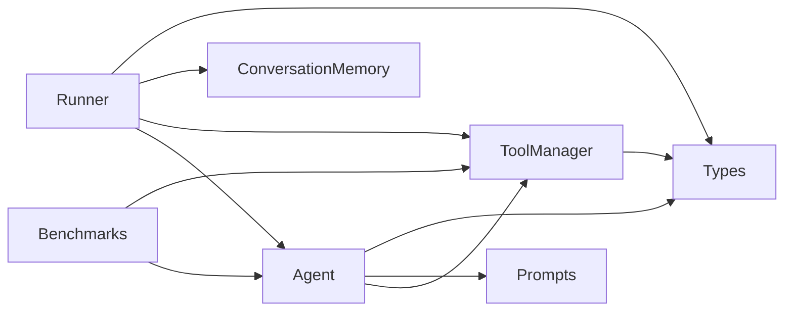

**Diagram sources**
- [agent.py](file://adalflow/adalflow/components/agent/agent.py#L216-L387)
- [runner.py](file://adalflow/adalflow/components/agent/runner.py#L107-L800)
- [tool_manager.py](file://adalflow/adalflow/core/tool_manager.py#L134-L626)
- [prompts.py](file://adalflow/adalflow/components/agent/prompts.py#L1-L121)
- [memory.py](file://adalflow/adalflow/components/memory/memory.py#L52-L226)
- [build_multi_hop_rag.py](file://benchmarks/hotpot_qa/adal_exp/build_multi_hop_rag.py#L171-L514)
- [types.py](file://adalflow/adalflow/core/types.py#L55-L135)

**Section sources**
- [agent.py](file://adalflow/adalflow/components/agent/agent.py#L216-L387)
- [runner.py](file://adalflow/adalflow/components/agent/runner.py#L107-L800)
- [tool_manager.py](file://adalflow/adalflow/core/tool_manager.py#L134-L626)
- [prompts.py](file://adalflow/adalflow/components/agent/prompts.py#L1-L121)
- [memory.py](file://adalflow/adalflow/components/memory/memory.py#L52-L226)
- [build_multi_hop_rag.py](file://benchmarks/hotpot_qa/adal_exp/build_multi_hop_rag.py#L171-L514)
- [types.py](file://adalflow/adalflow/core/types.py#L55-L135)

## Performance Considerations
- Token tracking: The Runner maintains cumulative token counts per step to estimate cost and detect long contexts.
- Caching: The Agent’s planner supports caching to reduce repeated LLM calls.
- Streaming: Use streaming execution to reduce latency and provide incremental feedback.
- Thinking model: Toggle thinking mode to reduce output verbosity when appropriate.
- Permission gating: Reduce unnecessary tool calls by requiring approvals only when needed.
- Async execution: Prefer async tools and generators to overlap I/O-bound operations.

[No sources needed since this section provides general guidance]

## Troubleshooting Guide
Common issues and remedies:
- Unrecoverable errors: The Runner treats certain HTTP error patterns as unrecoverable and stops execution. Review error messages and adjust prompts or context.
- Parsing failures: If the planner fails to produce a valid Function, the Runner appends a StepOutput with the error and continues for recoverable cases.
- Tool execution errors: ToolManager wraps execution results; inspect observations and error fields to diagnose failures.
- Permission denials: Ensure PermissionManager is configured and registered with the ToolManager.
- Streaming stalls: Verify async generators and event emission; check for blocked queues or missing stream handlers.

**Section sources**
- [runner.py](file://adalflow/adalflow/components/agent/runner.py#L634-L656)
- [tool_manager.py](file://adalflow/adalflow/core/tool_manager.py#L310-L427)

## Conclusion
AdalFlow’s agent stack enables robust, extensible ReAct agents with strong tool integration, memory, and observability. By combining iterative planning, permission-aware execution, streaming, and tracing, teams can build autonomous agents that scale across complex, multi-hop reasoning tasks. Benchmarks demonstrate how to optimize retrieval and computation graphs, while tutorials show practical deployment patterns for production-grade workflows.

[No sources needed since this section summarizes without analyzing specific files]

## Appendices

### Practical Recipes
- Build a ReAct agent with external tools: Define tools as functions or FunctionTool instances, pass them to Agent, and run via Runner.
- Integrate conversation memory: Pass a ConversationMemory instance to Runner to include chat history in prompts.
- Stream and trace workflows: Use Runner.astream for real-time events and enable tracing for MLflow or local tracking.
- Optimize multi-hop RAG: Use the benchmarked MultiHopRetriever to rewrite queries iteratively and combine contexts.

**Section sources**
- [tutorial_agent_advanced_features.py](file://tutorials/agent/tutorial_agent_advanced_features.py#L1-L566)
- [react_agent.py](file://tutorials/mcp_agent/react_agent.py#L1-L107)
- [build_multi_hop_rag.py](file://benchmarks/hotpot_qa/adal_exp/build_multi_hop_rag.py#L171-L514)