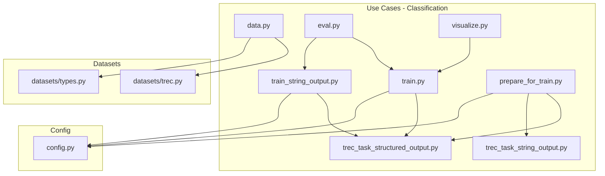
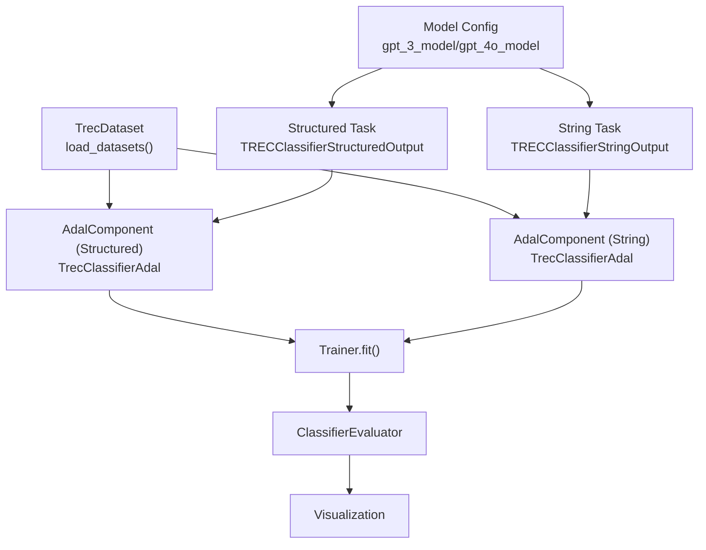
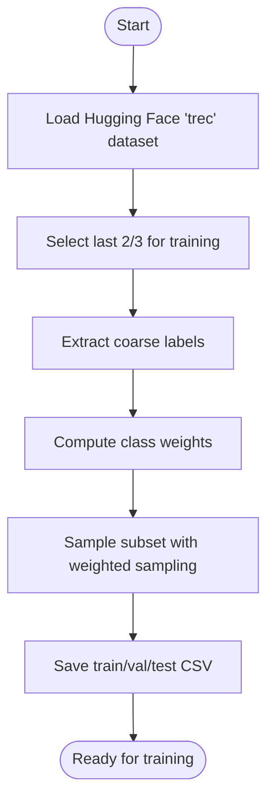
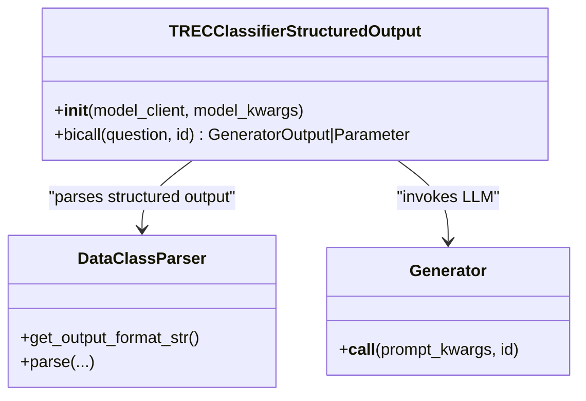
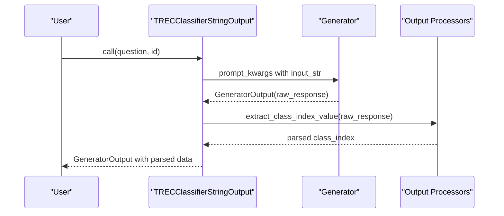
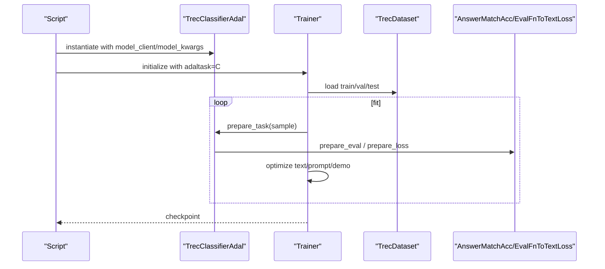
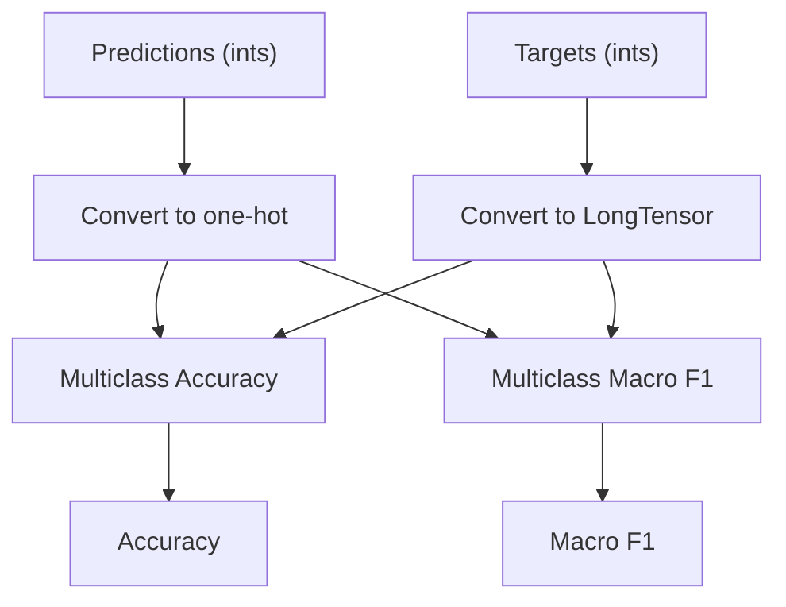
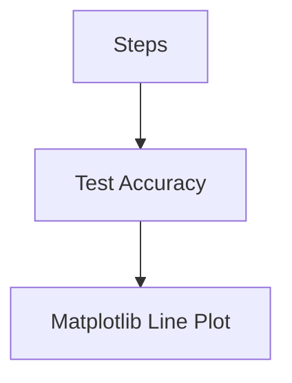
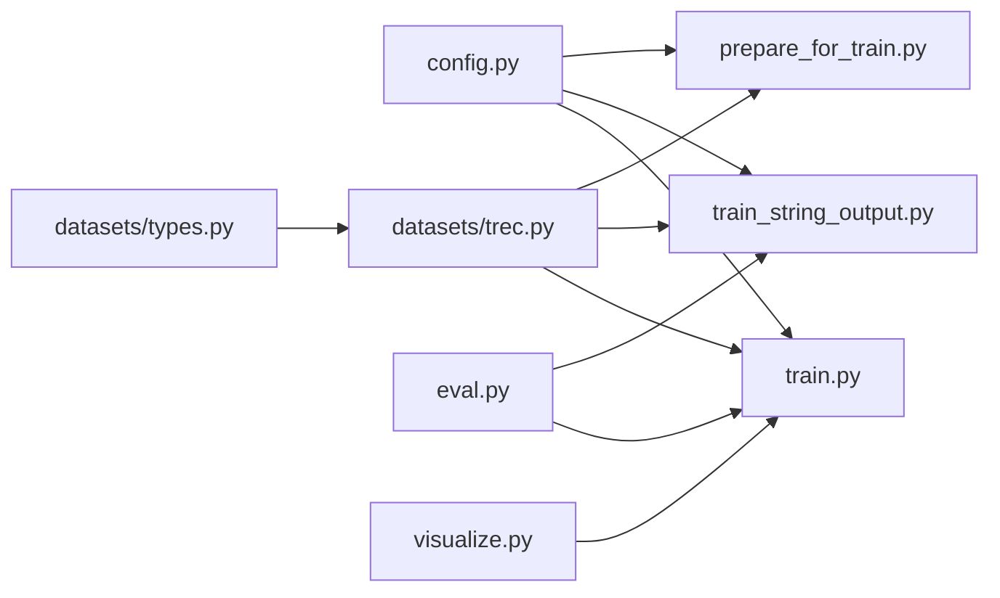

# Classification Tasks

<cite>
**Referenced Files in This Document**
- [use_cases/classification/data.py](file://use_cases/classification/data.py)
- [use_cases/classification/trec_task_structured_output.py](file://use_cases/classification/trec_task_structured_output.py)
- [use_cases/classification/trec_task_string_output.py](file://use_cases/classification/trec_task_string_output.py)
- [use_cases/classification/train.py](file://use_cases/classification/train.py)
- [use_cases/classification/train_string_output.py](file://use_cases/classification/train_string_output.py)
- [use_cases/classification/prepare_for_train.py](file://use_cases/classification/prepare_for_train.py)
- [use_cases/classification/eval.py](file://use_cases/classification/eval.py)
- [use_cases/classification/visualize.py](file://use_cases/classification/visualize.py)
- [use_cases/config.py](file://use_cases/config.py)
- [adalflow/adalflow/datasets/trec.py](file://adalflow/adalflow/datasets/trec.py)
- [adalflow/adalflow/datasets/types.py](file://adalflow/adalflow/datasets/types.py)
</cite>

## Table of Contents
1. [Introduction](#introduction)
2. [Project Structure](#project-structure)
3. [Core Components](#core-components)
4. [Architecture Overview](#architecture-overview)
5. [Detailed Component Analysis](#detailed-component-analysis)
6. [Dependency Analysis](#dependency-analysis)
7. [Performance Considerations](#performance-considerations)
8. [Troubleshooting Guide](#troubleshooting-guide)
9. [Conclusion](#conclusion)
10. [Appendices](#appendices)

## Introduction
This document explains classification task implementations in the repository, focusing on multi-class and structured output scenarios. It covers TREC classification workflows, string output processing, and structured data classification patterns. It also documents training pipelines, evaluation metrics, visualization techniques, and performance analysis methods. Practical guidance is included for data preprocessing strategies, feature engineering approaches, model optimization techniques, handling imbalanced datasets, cross-validation strategies, hyperparameter tuning, deployment considerations, batch processing optimizations, and real-time prediction systems.

## Project Structure
The classification use cases are organized under use_cases/classification with supporting datasets and configuration modules. The key areas include:
- Data loading and preprocessing for TREC classification
- Structured and string-output task definitions
- Training components and trainers
- Evaluation and visualization utilities
- Configuration for model clients and runtime parameters

**Diagram sources**
- [use_cases/classification/data.py](file://use_cases/classification/data.py#L30-L36)
- [use_cases/classification/trec_task_structured_output.py](file://use_cases/classification/trec_task_structured_output.py#L32-L94)
- [use_cases/classification/trec_task_string_output.py](file://use_cases/classification/trec_task_string_output.py#L36-L91)
- [use_cases/classification/train.py](file://use_cases/classification/train.py#L17-L139)
- [use_cases/classification/train_string_output.py](file://use_cases/classification/train_string_output.py#L16-L117)
- [use_cases/classification/prepare_for_train.py](file://use_cases/classification/prepare_for_train.py#L14-L84)
- [use_cases/classification/eval.py](file://use_cases/classification/eval.py#L12-L66)
- [use_cases/classification/visualize.py](file://use_cases/classification/visualize.py#L66-L130)
- [use_cases/config.py](file://use_cases/config.py#L16-L94)
- [adalflow/adalflow/datasets/trec.py](file://adalflow/adalflow/datasets/trec.py#L148-L229)
- [adalflow/adalflow/datasets/types.py](file://adalflow/adalflow/datasets/types.py#L87-L105)

**Section sources**
- [use_cases/classification/data.py](file://use_cases/classification/data.py#L1-L36)
- [use_cases/classification/trec_task_structured_output.py](file://use_cases/classification/trec_task_structured_output.py#L1-L114)
- [use_cases/classification/trec_task_string_output.py](file://use_cases/classification/trec_task_string_output.py#L1-L110)
- [use_cases/classification/train.py](file://use_cases/classification/train.py#L1-L197)
- [use_cases/classification/train_string_output.py](file://use_cases/classification/train_string_output.py#L1-L121)
- [use_cases/classification/prepare_for_train.py](file://use_cases/classification/prepare_for_train.py#L1-L104)
- [use_cases/classification/eval.py](file://use_cases/classification/eval.py#L1-L78)
- [use_cases/classification/visualize.py](file://use_cases/classification/visualize.py#L1-L136)
- [use_cases/config.py](file://use_cases/config.py#L1-L116)
- [adalflow/adalflow/datasets/trec.py](file://adalflow/adalflow/datasets/trec.py#L1-L239)
- [adalflow/adalflow/datasets/types.py](file://adalflow/adalflow/datasets/types.py#L1-L133)

## Core Components
- TREC dataset loader and preprocessing utilities for multi-class classification with balanced subsets and class-weight computation.
- Structured-output task that parses YAML-like structured outputs into a dataclass with rationale and class_name.
- String-output task that extracts a numeric class index from a two-line response format.
- Training components that wrap tasks with evaluation and loss functions, orchestrated by a Trainer.
- Evaluation utilities for multiclass accuracy and macro F1, plus per-class weighting strategies.
- Visualization helpers for plotting sequential optimization progress.

Key implementation references:
- TREC dataset and class balancing: [prepare_datasets](file://adalflow/adalflow/datasets/trec.py#L44-L126), [calculate_class_weights](file://adalflow/adalflow/datasets/trec.py#L20-L27)
- Structured output task: [TRECClassifierStructuredOutput](file://use_cases/classification/trec_task_structured_output.py#L32-L94)
- String output task: [TRECClassifierStringOutput](file://use_cases/classification/trec_task_string_output.py#L36-L91)
- Training with structured output: [TrecClassifierAdal](file://use_cases/classification/train.py#L17-L76), [train](file://use_cases/classification/train.py#L78-L139)
- Training with string output: [TrecClassifierAdal](file://use_cases/classification/train_string_output.py#L16-L77), [train](file://use_cases/classification/train_string_output.py#L79-L117)
- Evaluation metrics: [ClassifierEvaluator](file://use_cases/classification/eval.py#L12-L66)
- Visualization: [plot_* functions](file://use_cases/classification/visualize.py#L66-L130)
- Configuration: [gpt_3_model/gpt_4o_model](file://use_cases/config.py#L16-L94)

**Section sources**
- [adalflow/adalflow/datasets/trec.py](file://adalflow/adalflow/datasets/trec.py#L20-L126)
- [use_cases/classification/trec_task_structured_output.py](file://use_cases/classification/trec_task_structured_output.py#L32-L94)
- [use_cases/classification/trec_task_string_output.py](file://use_cases/classification/trec_task_string_output.py#L36-L91)
- [use_cases/classification/train.py](file://use_cases/classification/train.py#L17-L139)
- [use_cases/classification/train_string_output.py](file://use_cases/classification/train_string_output.py#L16-L117)
- [use_cases/classification/eval.py](file://use_cases/classification/eval.py#L12-L66)
- [use_cases/classification/visualize.py](file://use_cases/classification/visualize.py#L66-L130)
- [use_cases/config.py](file://use_cases/config.py#L16-L94)

## Architecture Overview
The classification pipeline integrates dataset preparation, task definition, training orchestration, evaluation, and visualization.

**Diagram sources**
- [use_cases/config.py](file://use_cases/config.py#L16-L94)
- [use_cases/classification/data.py](file://use_cases/classification/data.py#L30-L36)
- [use_cases/classification/trec_task_structured_output.py](file://use_cases/classification/trec_task_structured_output.py#L32-L94)
- [use_cases/classification/trec_task_string_output.py](file://use_cases/classification/trec_task_string_output.py#L36-L91)
- [use_cases/classification/train.py](file://use_cases/classification/train.py#L17-L139)
- [use_cases/classification/train_string_output.py](file://use_cases/classification/train_string_output.py#L16-L117)
- [use_cases/classification/eval.py](file://use_cases/classification/eval.py#L12-L66)
- [use_cases/classification/visualize.py](file://use_cases/classification/visualize.py#L66-L130)

## Detailed Component Analysis

### TREC Dataset and Data Preprocessing
- Balanced subsets: The dataset prepares class-balanced splits for training and evaluation, ensuring representative coverage across six coarse labels.
- Class weights: Per-sample weights are computed from inverse class frequencies to mitigate imbalance during training.
- CSV-backed caching: Datasets are cached locally as CSV files after initial download and preprocessing.

**Diagram sources**
- [adalflow/adalflow/datasets/trec.py](file://adalflow/adalflow/datasets/trec.py#L44-L126)

**Section sources**
- [adalflow/adalflow/datasets/trec.py](file://adalflow/adalflow/datasets/trec.py#L44-L126)
- [adalflow/adalflow/datasets/types.py](file://adalflow/adalflow/datasets/types.py#L87-L105)

### Structured Output Classification Task
- Task description: Provides explicit class definitions and output format requirements.
- Parser: Uses a dataclass parser to enforce structured output (rationale, class_name) with YAML-like format.
- Generator: Applies a prompt template with optional few-shot demos and caches responses.

**Diagram sources**
- [use_cases/classification/trec_task_structured_output.py](file://use_cases/classification/trec_task_structured_output.py#L32-L94)

**Section sources**
- [use_cases/classification/trec_task_structured_output.py](file://use_cases/classification/trec_task_structured_output.py#L32-L94)
- [use_cases/classification/data.py](file://use_cases/classification/data.py#L15-L28)

### String Output Classification Task
- Prompt format: Requires a two-line response with a rationale and a numeric class index.
- Output processors: Regex extraction of the class index followed by integer parsing.
- Generator: Caches responses and returns raw outputs for downstream evaluation.

**Diagram sources**
- [use_cases/classification/trec_task_string_output.py](file://use_cases/classification/trec_task_string_output.py#L36-L91)

**Section sources**
- [use_cases/classification/trec_task_string_output.py](file://use_cases/classification/trec_task_string_output.py#L36-L91)

### Training Pipelines
- Structured output training: Wraps the structured task with an exact-match accuracy evaluation and a text loss conversion for optimization.
- String output training: Similar setup but evaluates on numeric class indices extracted from raw responses.
- Trainer configuration: Supports batch size, bootstrap shots, raw shots, worker count, optimization strategies, and backward pass options.

**Diagram sources**
- [use_cases/classification/train.py](file://use_cases/classification/train.py#L17-L139)
- [use_cases/classification/train_string_output.py](file://use_cases/classification/train_string_output.py#L16-L117)

**Section sources**
- [use_cases/classification/train.py](file://use_cases/classification/train.py#L17-L139)
- [use_cases/classification/train_string_output.py](file://use_cases/classification/train_string_output.py#L16-L117)

### Evaluation Metrics and Per-Class Weighting
- Metrics: Multiclass accuracy and macro F1 computed via torchmetrics.
- Per-class weighting: Computes weights inversely proportional to per-class scores to adjust for class imbalance.
- Single-item scoring: Exact match scoring for classification tasks.

**Diagram sources**
- [use_cases/classification/eval.py](file://use_cases/classification/eval.py#L29-L41)

**Section sources**
- [use_cases/classification/eval.py](file://use_cases/classification/eval.py#L12-L66)

### Visualization Techniques
- Plotting sequential optimization: Compares performance across text-optimizer and demo-optimizer phases.
- Plotting single-phase runs: Visualizes pure text-grad or learn-to-reason progress.

**Diagram sources**
- [use_cases/classification/visualize.py](file://use_cases/classification/visualize.py#L66-L130)

**Section sources**
- [use_cases/classification/visualize.py](file://use_cases/classification/visualize.py#L1-L136)

## Dependency Analysis
The classification use cases depend on dataset utilities, configuration, and evaluation components. The training components couple tasks with evaluation and loss functions, while the Trainer orchestrates optimization.

**Diagram sources**
- [use_cases/config.py](file://use_cases/config.py#L16-L94)
- [use_cases/classification/train.py](file://use_cases/classification/train.py#L17-L139)
- [use_cases/classification/train_string_output.py](file://use_cases/classification/train_string_output.py#L16-L117)
- [use_cases/classification/prepare_for_train.py](file://use_cases/classification/prepare_for_train.py#L14-L84)
- [adalflow/adalflow/datasets/trec.py](file://adalflow/adalflow/datasets/trec.py#L148-L229)
- [adalflow/adalflow/datasets/types.py](file://adalflow/adalflow/datasets/types.py#L87-L105)
- [use_cases/classification/eval.py](file://use_cases/classification/eval.py#L12-L66)
- [use_cases/classification/visualize.py](file://use_cases/classification/visualize.py#L66-L130)

**Section sources**
- [use_cases/config.py](file://use_cases/config.py#L16-L94)
- [use_cases/classification/train.py](file://use_cases/classification/train.py#L17-L139)
- [use_cases/classification/train_string_output.py](file://use_cases/classification/train_string_output.py#L16-L117)
- [use_cases/classification/prepare_for_train.py](file://use_cases/classification/prepare_for_train.py#L14-L84)
- [adalflow/adalflow/datasets/trec.py](file://adalflow/adalflow/datasets/trec.py#L148-L229)
- [adalflow/adalflow/datasets/types.py](file://adalflow/adalflow/datasets/types.py#L87-L105)
- [use_cases/classification/eval.py](file://use_cases/classification/eval.py#L12-L66)
- [use_cases/classification/visualize.py](file://use_cases/classification/visualize.py#L66-L130)

## Performance Considerations
- Batch size and optimization order: Training scripts demonstrate trade-offs with batch size and sequential vs. random optimization strategies.
- Bootstrap and raw shots: Configurable bootstrap and raw demonstrations influence convergence speed and stability.
- Model selection: Different model configurations (e.g., GPT-3.5, GPT-4o) are exposed via configuration for cost/performance comparisons.
- Caching: Generators enable response caching to reduce latency and cost during repeated evaluations.
- Class imbalance: Dataset utilities compute class weights; evaluation utilities support per-class weighting to balance metric interpretation.

[No sources needed since this section provides general guidance]

## Troubleshooting Guide
- Parsing failures in string output: Extraction functions log fallback feedback when regex patterns fail; verify prompt formatting and output processors.
- Evaluation mismatch: Ensure evaluation functions compare against the correct label representation (class_name vs. class_index) depending on the task variant.
- Dataset path issues: Verify dataset CSV files exist or allow automatic download and caching.
- Imbalanced classes: Use class weights from dataset utilities and consider per-class metrics to avoid optimistic accuracy.

**Section sources**
- [use_cases/classification/trec_task_string_output.py](file://use_cases/classification/trec_task_string_output.py#L18-L34)
- [use_cases/classification/eval.py](file://use_cases/classification/eval.py#L42-L66)
- [adalflow/adalflow/datasets/trec.py](file://adalflow/adalflow/datasets/trec.py#L187-L223)

## Conclusion
The repository provides robust, modular components for multi-class classification with both structured and string outputs. It demonstrates practical training pipelines, evaluation strategies, and visualization techniques tailored for TREC classification. The design supports experimentation with different models, optimization strategies, and evaluation metrics, while offering utilities for handling class imbalance and deploying efficient inference workflows.

[No sources needed since this section summarizes without analyzing specific files]

## Appendices

### Appendix A: TREC Labels and Descriptions
- Coarse labels and descriptions are defined and used across tasks and datasets.

**Section sources**
- [adalflow/adalflow/datasets/trec.py](file://adalflow/adalflow/datasets/trec.py#L129-L145)
- [use_cases/classification/trec_task_structured_output.py](file://use_cases/classification/trec_task_structured_output.py#L21-L29)

### Appendix B: Configuration Options
- Model client and kwargs presets for OpenAI/Groq/Together clients.
- Temperature, top-p, max tokens, and other generation parameters are exposed for reproducibility and cost control.

**Section sources**
- [use_cases/config.py](file://use_cases/config.py#L16-L112)