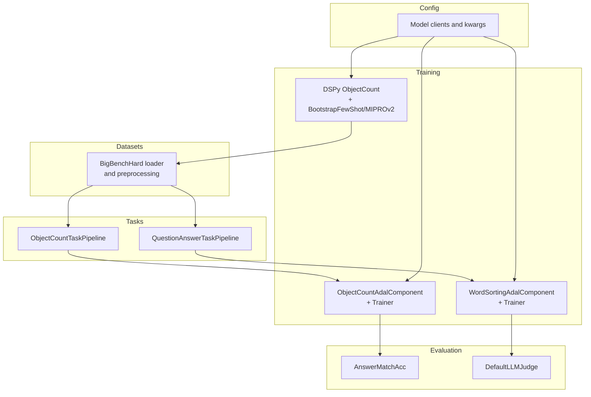
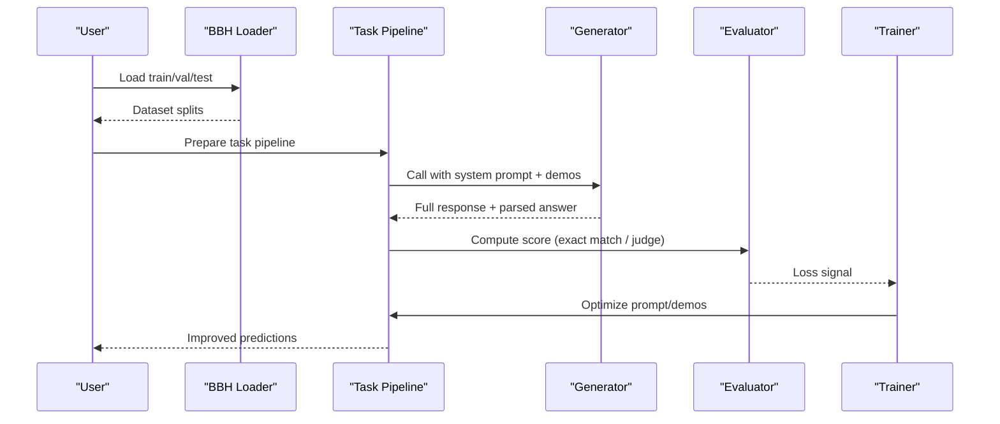
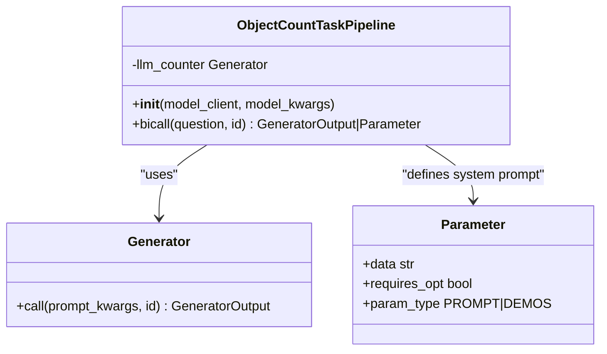
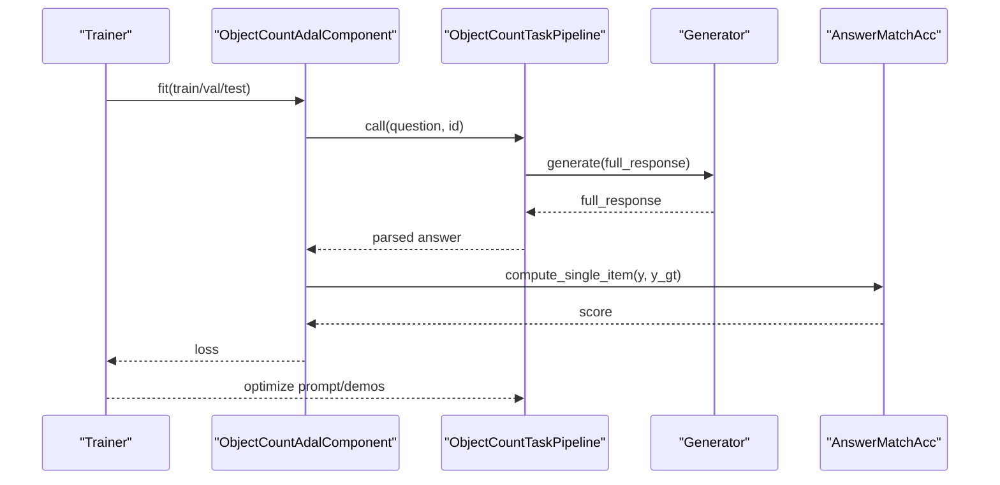
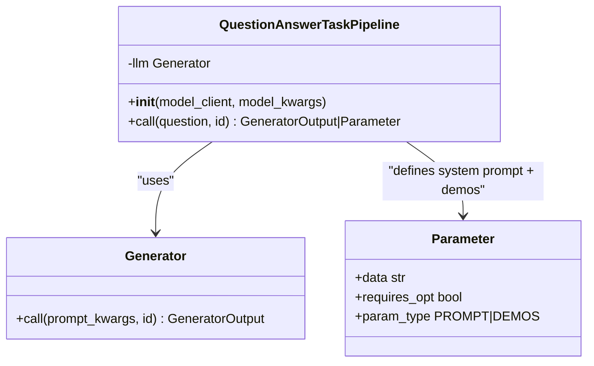
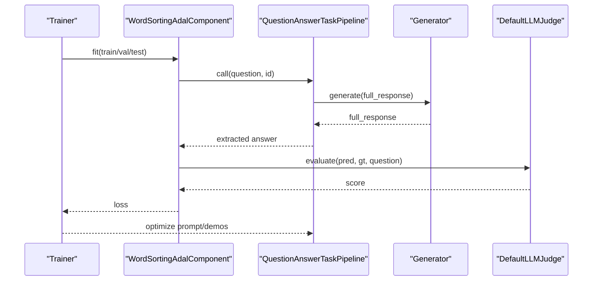
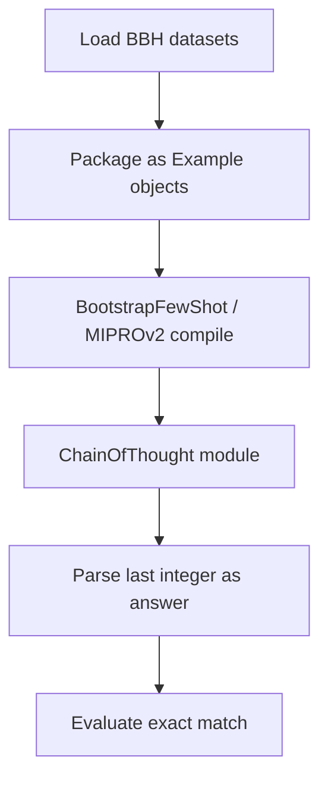
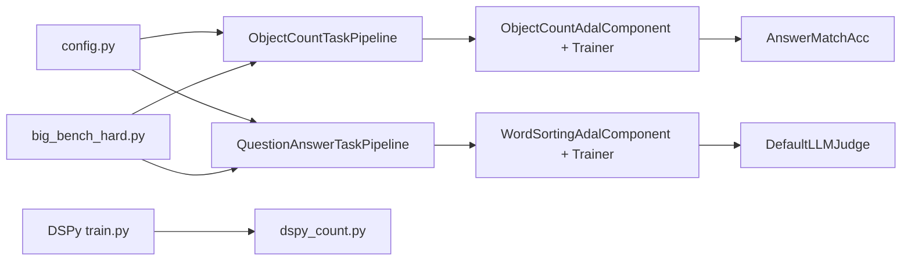

# Cognitive Tasks

<cite>
**Referenced Files in This Document**
- [big_bench_hard.py](file://adalflow/adalflow/datasets/big_bench_hard.py)
- [data.py](file://use_cases/question_answering/bbh/data.py)
- [task.py (Object Count)](file://use_cases/question_answering/bbh/object_count/task.py)
- [train_new.py (Object Count)](file://use_cases/question_answering/bbh/object_count/train_new.py)
- [task.py (Word Sorting)](file://use_cases/question_answering/bbh/word_sorting/task.py)
- [train.py (Word Sorting)](file://use_cases/question_answering/bbh/word_sorting/train.py)
- [train_paper.py (Word Sorting)](file://use_cases/question_answering/bbh/word_sorting/train_paper.py)
- [dspy_count.py](file://benchmarks/BHH_object_count/dspy_count.py)
- [train.py (BHH Object Count)](file://benchmarks/BHH_object_count/train.py)
- [config.py](file://use_cases/config.py)
- [answer_match_acc.py](file://adalflow/adalflow/eval/answer_match_acc.py)
- [llm_as_judge.py](file://adalflow/adalflow/eval/llm_as_judge.py)
- [trainer.py](file://adalflow/adalflow/optim/trainer/trainer.py)
</cite>

## Table of Contents
1. [Introduction](#introduction)
2. [Project Structure](#project-structure)
3. [Core Components](#core-components)
4. [Architecture Overview](#architecture-overview)
5. [Detailed Component Analysis](#detailed-component-analysis)
6. [Dependency Analysis](#dependency-analysis)
7. [Performance Considerations](#performance-considerations)
8. [Troubleshooting Guide](#troubleshooting-guide)
9. [Conclusion](#conclusion)
10. [Appendices](#appendices)

## Introduction
This document explains the cognitive task processing implementation for complex reasoning and pattern recognition, focusing on:
- Big-Bench Hard (BBH) benchmarks for abstract reasoning
- Object counting tasks requiring arithmetic and parsing
- Word sorting challenges requiring structured output and exact-match evaluation
- Training methodologies for abstract reasoning tasks
- Evaluation metrics for cognitive performance
- Multi-hop reasoning patterns and prompt engineering for complex logical inference
- Structured output generation for categorical data
- Optimization strategies for challenging cognitive tasks, including hierarchical reasoning and pattern matching

The implementation integrates AdalFlow’s component framework, text-gradient optimization, and LLM-as-a-judge evaluation, alongside traditional DSPy-based compilation for few-shot optimization.

## Project Structure
The repository organizes cognitive tasks around:
- Datasets: BBH loading and preprocessing utilities
- Task Pipelines: AdalFlow components for object counting and word sorting
- Training Orchestration: AdalFlow Trainer and evaluation wrappers
- Benchmarks: DSPy-based optimization baselines
- Configurations: Model client and runtime settings

**Diagram sources**
- [big_bench_hard.py](file://adalflow/adalflow/datasets/big_bench_hard.py#L1-L200)
- [data.py](file://use_cases/question_answering/bbh/data.py#L94-L106)
- [task.py (Object Count)](file://use_cases/question_answering/bbh/object_count/task.py#L28-L71)
- [task.py (Word Sorting)](file://use_cases/question_answering/bbh/word_sorting/task.py#L28-L62)
- [train_new.py (Object Count)](file://use_cases/question_answering/bbh/object_count/train_new.py#L18-L61)
- [train.py (Word Sorting)](file://use_cases/question_answering/bbh/word_sorting/train.py#L22-L95)
- [dspy_count.py](file://benchmarks/BHH_object_count/dspy_count.py#L35-L49)
- [train.py (BHH Object Count)](file://benchmarks/BHH_object_count/train.py#L40-L77)
- [config.py](file://use_cases/config.py#L16-L94)

**Section sources**
- [big_bench_hard.py](file://adalflow/adalflow/datasets/big_bench_hard.py#L1-L200)
- [data.py](file://use_cases/question_answering/bbh/data.py#L94-L106)
- [config.py](file://use_cases/config.py#L16-L94)

## Core Components
- BBH Dataset Loader: Loads train/val/test splits for object counting and word sorting tasks.
- Object Counting Pipeline: Generates answers via a Generator with a system prompt and optional demonstrations; parses numeric answers.
- Word Sorting Pipeline: Generates sorted lists with structured extraction of the final answer.
- AdalFlow Trainer: Optimizes prompts and demonstrations using text-gradient and constrained strategies.
- DSPy Baseline: Uses Chain-of-Thought and BootstrapFewShot/MIPROv2 for few-shot optimization.
- Evaluation: Exact match for numeric answers and LLM-as-a-judge for ordered-word tasks.

Key implementation references:
- Object counting pipeline and answer parsing: [task.py (Object Count)](file://use_cases/question_answering/bbh/object_count/task.py#L28-L71), [data.py](file://use_cases/question_answering/bbh/data.py#L67-L78)
- Word sorting pipeline and answer extraction: [task.py (Word Sorting)](file://use_cases/question_answering/bbh/word_sorting/task.py#L28-L62), [data.py](file://use_cases/question_answering/bbh/data.py#L81-L92)
- AdalFlow training harness: [train_new.py (Object Count)](file://use_cases/question_answering/bbh/object_count/train_new.py#L18-L61), [train.py (Word Sorting)](file://use_cases/question_answering/bbh/word_sorting/train.py#L22-L95)
- DSPy baseline: [dspy_count.py](file://benchmarks/BHH_object_count/dspy_count.py#L35-L49), [train.py (BHH Object Count)](file://benchmarks/BHH_object_count/train.py#L40-L77)
- Evaluation metrics: [answer_match_acc.py](file://adalflow/adalflow/eval/answer_match_acc.py#L1-L200), [llm_as_judge.py](file://adalflow/adalflow/eval/llm_as_judge.py#L1-L200)

**Section sources**
- [task.py (Object Count)](file://use_cases/question_answering/bbh/object_count/task.py#L28-L71)
- [task.py (Word Sorting)](file://use_cases/question_answering/bbh/word_sorting/task.py#L28-L62)
- [data.py](file://use_cases/question_answering/bbh/data.py#L67-L92)
- [train_new.py (Object Count)](file://use_cases/question_answering/bbh/object_count/train_new.py#L18-L61)
- [train.py (Word Sorting)](file://use_cases/question_answering/bbh/word_sorting/train.py#L22-L95)
- [dspy_count.py](file://benchmarks/BHH_object_count/dspy_count.py#L35-L49)
- [train.py (BHH Object Count)](file://benchmarks/BHH_object_count/train.py#L40-L77)
- [answer_match_acc.py](file://adalflow/adalflow/eval/answer_match_acc.py#L1-L200)
- [llm_as_judge.py](file://adalflow/adalflow/eval/llm_as_judge.py#L1-L200)

## Architecture Overview
The system supports two complementary training modes:
- Text-gradient optimization via AdalFlow Trainer for prompt and demo optimization
- DSPy-based few-shot compilation for rapid adaptation

**Diagram sources**
- [data.py](file://use_cases/question_answering/bbh/data.py#L94-L106)
- [task.py (Object Count)](file://use_cases/question_answering/bbh/object_count/task.py#L28-L71)
- [task.py (Word Sorting)](file://use_cases/question_answering/bbh/word_sorting/task.py#L28-L62)
- [answer_match_acc.py](file://adalflow/adalflow/eval/answer_match_acc.py#L1-L200)
- [llm_as_judge.py](file://adalflow/adalflow/eval/llm_as_judge.py#L1-L200)
- [trainer.py](file://adalflow/adalflow/optim/trainer/trainer.py#L1-L200)

## Detailed Component Analysis

### Object Counting Task
Purpose: Count items described in natural language and return a numeric answer. The pipeline:
- Defines a system prompt instructing step-by-step reasoning and a fixed-answer format
- Optionally includes demonstrations
- Uses a Generator to produce a full response, then parses the last integer as the answer
- Supports rate-limit handling during training vs. inference

**Diagram sources**
- [task.py (Object Count)](file://use_cases/question_answering/bbh/object_count/task.py#L28-L71)

Training and evaluation:
- AdalFlow training harness wraps the pipeline with an evaluation function and text-loss conversion
- Uses AnswerMatchAcc for exact-match scoring
- Trainer supports constrained/random strategies, bootstrap shots, and backward-pass tuning

**Diagram sources**
- [train_new.py (Object Count)](file://use_cases/question_answering/bbh/object_count/train_new.py#L18-L61)
- [answer_match_acc.py](file://adalflow/adalflow/eval/answer_match_acc.py#L1-L200)

**Section sources**
- [task.py (Object Count)](file://use_cases/question_answering/bbh/object_count/task.py#L28-L71)
- [data.py](file://use_cases/question_answering/bbh/data.py#L67-L78)
- [train_new.py (Object Count)](file://use_cases/question_answering/bbh/object_count/train_new.py#L18-L61)
- [answer_match_acc.py](file://adalflow/adalflow/eval/answer_match_acc.py#L1-L200)

### Word Sorting Task
Purpose: Sort a list of words alphabetically and return the ordered sequence. The pipeline:
- Provides a system prompt instructing alphabetical ordering and a fixed-answer format
- Optionally includes demonstrations
- Extracts the final answer after “Answer:” using a structured extractor
- Uses an LLM-as-a-judge evaluator for exact-order matching

**Diagram sources**
- [task.py (Word Sorting)](file://use_cases/question_answering/bbh/word_sorting/task.py#L28-L62)

Training and evaluation:
- AdalFlow training harness uses DefaultLLMJudge to compare predicted vs. ground-truth answers
- The judge ignores separator differences and checks exact order
- Trainer supports weighted sampling and constrained optimization

**Diagram sources**
- [train.py (Word Sorting)](file://use_cases/question_answering/bbh/word_sorting/train.py#L22-L95)
- [llm_as_judge.py](file://adalflow/adalflow/eval/llm_as_judge.py#L1-L200)

**Section sources**
- [task.py (Word Sorting)](file://use_cases/question_answering/bbh/word_sorting/task.py#L28-L62)
- [data.py](file://use_cases/question_answering/bbh/data.py#L81-L92)
- [train.py (Word Sorting)](file://use_cases/question_answering/bbh/word_sorting/train.py#L22-L95)
- [llm_as_judge.py](file://adalflow/adalflow/eval/llm_as_judge.py#L1-L200)

### DSPy Baseline for Object Counting
Purpose: Provide a strong few-shot baseline using DSPy’s compiler.

**Diagram sources**
- [train.py (BHH Object Count)](file://benchmarks/BHH_object_count/train.py#L22-L77)
- [dspy_count.py](file://benchmarks/BHH_object_count/dspy_count.py#L35-L49)

**Section sources**
- [train.py (BHH Object Count)](file://benchmarks/BHH_object_count/train.py#L22-L77)
- [dspy_count.py](file://benchmarks/BHH_object_count/dspy_count.py#L35-L49)

### Prompt Engineering and Structured Output
- System prompts emphasize step-by-step reasoning and a fixed “Answer: …” format to enable robust extraction
- Demonstrations can be optimized automatically via text-gradient training
- Extraction functions enforce structured output:
  - Numeric parsing for object counting
  - Regex-based extraction for ordered-word tasks

**Section sources**
- [task.py (Object Count)](file://use_cases/question_answering/bbh/object_count/task.py#L32-L38)
- [task.py (Word Sorting)](file://use_cases/question_answering/bbh/word_sorting/task.py#L32-L38)
- [data.py](file://use_cases/question_answering/bbh/data.py#L67-L92)

### Hierarchical Reasoning and Pattern Matching
- Hierarchical reasoning emerges from:
  - Step-by-step instructions embedded in system prompts
  - Chain-of-thought modules in DSPy baseline
  - Multi-step parsing and extraction in pipelines
- Pattern matching:
  - Regular expressions for extracting numeric answers and “Answer:” blocks
  - LLM-as-a-judge for exact-order matching in word sorting

**Section sources**
- [dspy_count.py](file://benchmarks/BHH_object_count/dspy_count.py#L24-L49)
- [data.py](file://use_cases/question_answering/bbh/data.py#L67-L92)
- [llm_as_judge.py](file://adalflow/adalflow/eval/llm_as_judge.py#L1-L200)

## Dependency Analysis
High-level dependencies among components:

**Diagram sources**
- [config.py](file://use_cases/config.py#L16-L94)
- [big_bench_hard.py](file://adalflow/adalflow/datasets/big_bench_hard.py#L1-L200)
- [task.py (Object Count)](file://use_cases/question_answering/bbh/object_count/task.py#L28-L71)
- [task.py (Word Sorting)](file://use_cases/question_answering/bbh/word_sorting/task.py#L28-L62)
- [train_new.py (Object Count)](file://use_cases/question_answering/bbh/object_count/train_new.py#L18-L61)
- [train.py (Word Sorting)](file://use_cases/question_answering/bbh/word_sorting/train.py#L22-L95)
- [answer_match_acc.py](file://adalflow/adalflow/eval/answer_match_acc.py#L1-L200)
- [llm_as_judge.py](file://adalflow/adalflow/eval/llm_as_judge.py#L1-L200)
- [train.py (BHH Object Count)](file://benchmarks/BHH_object_count/train.py#L40-L77)
- [dspy_count.py](file://benchmarks/BHH_object_count/dspy_count.py#L35-L49)

**Section sources**
- [config.py](file://use_cases/config.py#L16-L94)
- [big_bench_hard.py](file://adalflow/adalflow/datasets/big_bench_hard.py#L1-L200)
- [task.py (Object Count)](file://use_cases/question_answering/bbh/object_count/task.py#L28-L71)
- [task.py (Word Sorting)](file://use_cases/question_answering/bbh/word_sorting/task.py#L28-L62)
- [train_new.py (Object Count)](file://use_cases/question_answering/bbh/object_count/train_new.py#L18-L61)
- [train.py (Word Sorting)](file://use_cases/question_answering/bbh/word_sorting/train.py#L22-L95)
- [answer_match_acc.py](file://adalflow/adalflow/eval/answer_match_acc.py#L1-L200)
- [llm_as_judge.py](file://adalflow/adalflow/eval/llm_as_judge.py#L1-L200)
- [train.py (BHH Object Count)](file://benchmarks/BHH_object_count/train.py#L40-L77)
- [dspy_count.py](file://benchmarks/BHH_object_count/dspy_count.py#L35-L49)

## Performance Considerations
- Few-shot effectiveness: Demonstrations can degrade performance when base accuracy is high; consider adaptive demo inclusion
- Batch sizing: Larger batches may cause attention drift; smaller batches often yield better optimization for reasoning tasks
- Token limits and cost: Configure max_tokens and temperature per model client to balance quality and cost
- Rate limiting: Implement retries and error handling for 429 responses during training
- Evaluation caching: Enable cache for evaluators and generators to reduce latency and cost

[No sources needed since this section provides general guidance]

## Troubleshooting Guide
Common issues and resolutions:
- Rate limit errors: Detect and handle 429 responses differently in training vs. inference
- Parsing failures: Ensure regex extraction handles edge cases (e.g., decimals, multiple numbers)
- Separator differences in word sorting: LLM-as-a-judge ignores separators; confirm judge prompt covers edge cases
- Model availability: Verify model client credentials and endpoint configurations

**Section sources**
- [task.py (Object Count)](file://use_cases/question_answering/bbh/object_count/task.py#L63-L69)
- [data.py](file://use_cases/question_answering/bbh/data.py#L67-L92)
- [llm_as_judge.py](file://adalflow/adalflow/eval/llm_as_judge.py#L1-L200)
- [config.py](file://use_cases/config.py#L16-L94)

## Conclusion
The repository provides a comprehensive, modular framework for cognitive task processing:
- Object counting and word sorting are modeled as structured generation tasks with robust extraction
- AdalFlow’s Trainer enables automatic optimization of prompts and demonstrations
- DSPy offers a strong baseline for few-shot adaptation
- Evaluation pipelines support both exact-match and LLM-as-a-judge scoring
- The architecture supports hierarchical reasoning and pattern matching through step-by-step prompts, extraction, and judge-based validation

[No sources needed since this section summarizes without analyzing specific files]

## Appendices

### Evaluation Metrics Reference
- Exact match for numeric answers: [answer_match_acc.py](file://adalflow/adalflow/eval/answer_match_acc.py#L1-L200)
- LLM-as-a-judge for ordered-word tasks: [llm_as_judge.py](file://adalflow/adalflow/eval/llm_as_judge.py#L1-L200)

**Section sources**
- [answer_match_acc.py](file://adalflow/adalflow/eval/answer_match_acc.py#L1-L200)
- [llm_as_judge.py](file://adalflow/adalflow/eval/llm_as_judge.py#L1-L200)