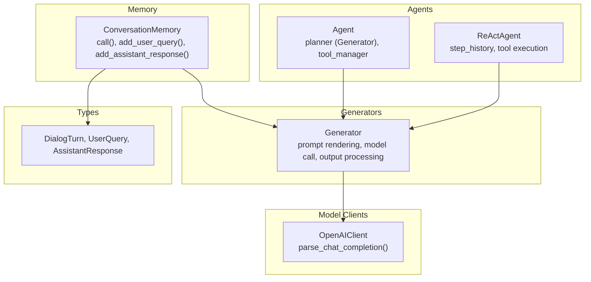
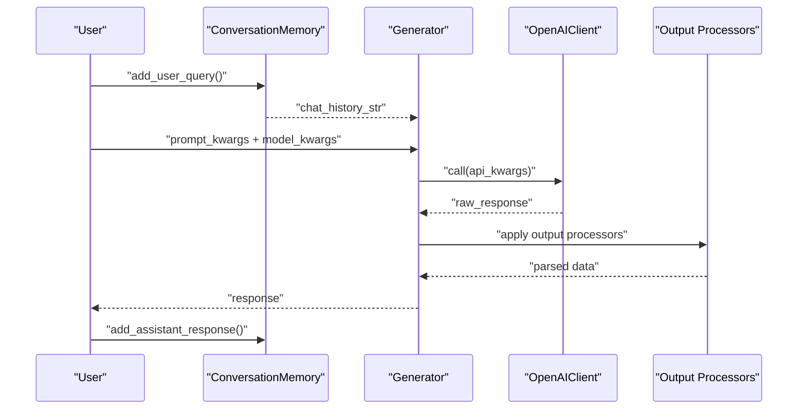
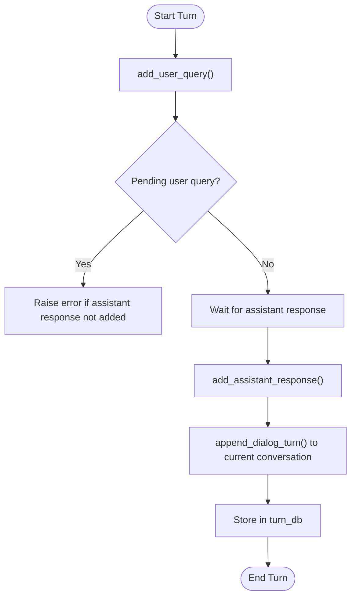
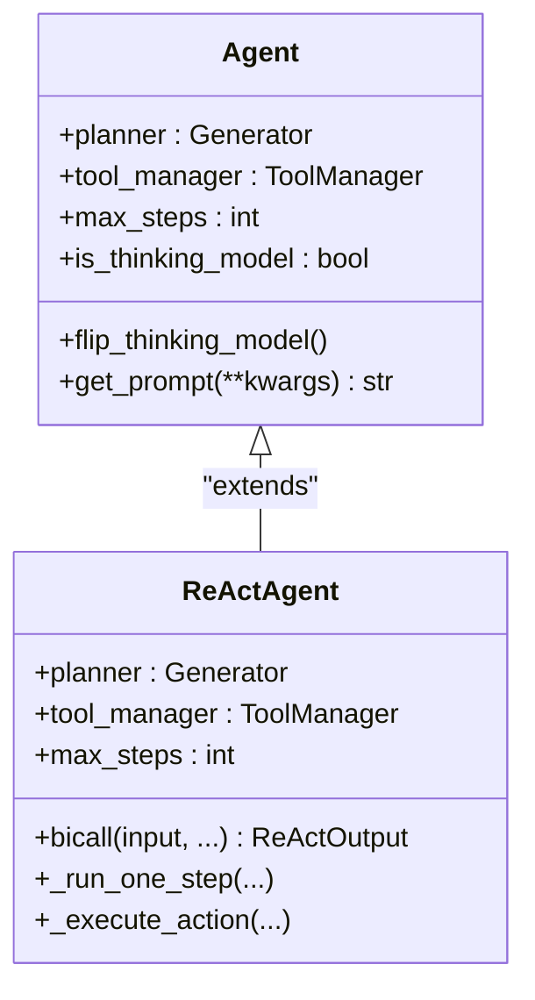
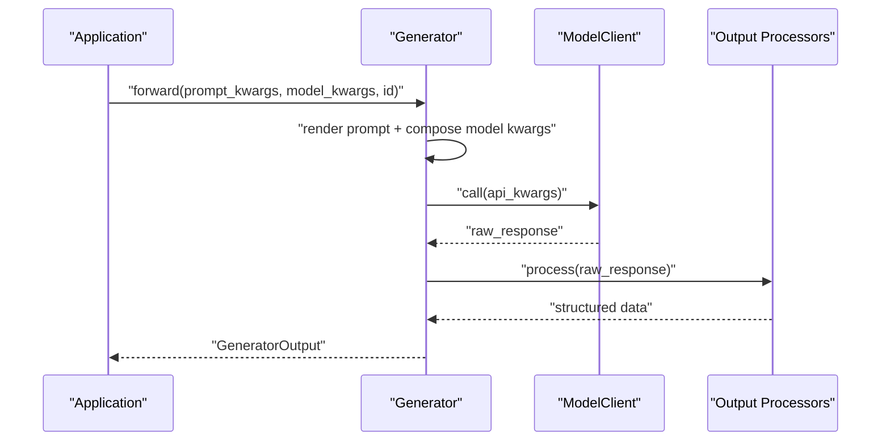
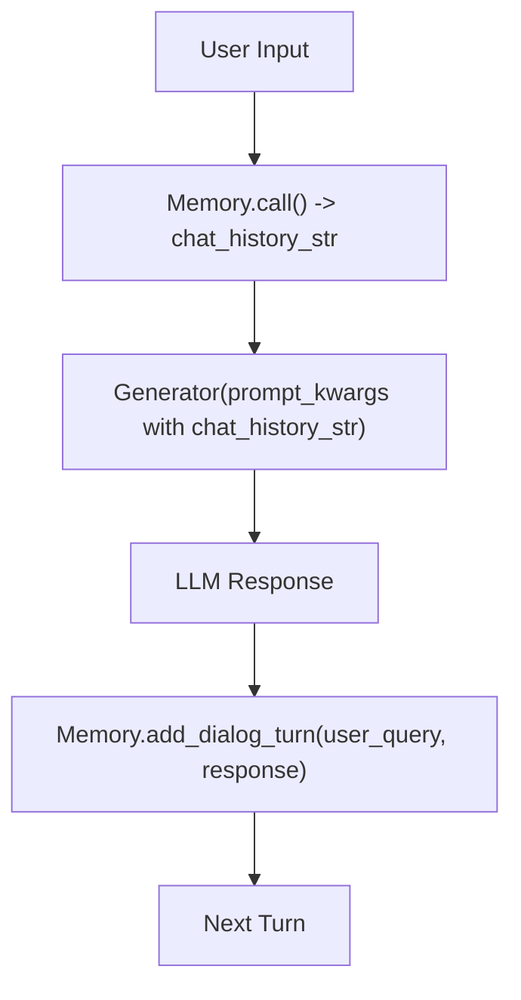
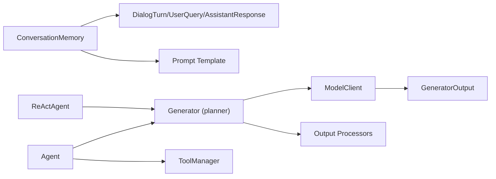

# Conversational AI

<cite>
**Referenced Files in This Document**
- [memory.py](file://adalflow/adalflow/components/memory/memory.py)
- [agent.py](file://adalflow/adalflow/components/agent/agent.py)
- [react.py](file://adalflow/adalflow/components/agent/react.py)
- [prompts.py](file://adalflow/adalflow/components/agent/prompts.py)
- [openai_client.py](file://adalflow/adalflow/components/model_client/openai_client.py)
- [generator.py](file://adalflow/adalflow/core/generator.py)
- [types.py](file://adalflow/adalflow/core/types.py)
- [chatbot.ipynb](file://use_cases/question_answering/chatbot.ipynb)
- [simple_qa_memory.py](file://use_cases/unsorted/simple_qa_memory.py)
- [rag.py](file://tutorials/rag/rag.py)
</cite>

## Table of Contents
1. [Introduction](#introduction)
2. [Project Structure](#project-structure)
3. [Core Components](#core-components)
4. [Architecture Overview](#architecture-overview)
5. [Detailed Component Analysis](#detailed-component-analysis)
6. [Dependency Analysis](#dependency-analysis)
7. [Performance Considerations](#performance-considerations)
8. [Troubleshooting Guide](#troubleshooting-guide)
9. [Conclusion](#conclusion)
10. [Appendices](#appendices)

## Introduction
This document provides a comprehensive guide to implementing conversational AI systems with a focus on dialogue management, interactive Q&A, and context preservation. It explains how to structure chatbot flows, maintain coherent conversation threads, and integrate multi-turn interactions with response generation. It also covers training methodologies for conversational datasets, evaluation metrics for dialogue quality, and production deployment considerations. The content is grounded in the repository’s components for memory, agents, generators, model clients, and data types.

## Project Structure
The conversational AI stack in this repository is organized around:
- Memory: conversation history management and formatting
- Agents: planning and tool orchestration with ReAct-style workflows
- Generators: unified LLM orchestration with prompt templating, output processing, and caching
- Model Clients: provider-specific integrations (e.g., OpenAI) with response parsing
- Types: shared data models for dialogs, turns, and structured outputs

**Diagram sources**
- [memory.py](file://adalflow/adalflow/components/memory/memory.py#L52-L226)
- [agent.py](file://adalflow/adalflow/components/agent/agent.py#L216-L387)
- [react.py](file://adalflow/adalflow/components/agent/react.py#L182-L763)
- [generator.py](file://adalflow/adalflow/core/generator.py#L82-L773)
- [openai_client.py](file://adalflow/adalflow/components/model_client/openai_client.py#L411-L800)
- [types.py](file://adalflow/adalflow/core/types.py#L977-L1000)

**Section sources**
- [memory.py](file://adalflow/adalflow/components/memory/memory.py#L1-L226)
- [agent.py](file://adalflow/adalflow/components/agent/agent.py#L1-L387)
- [react.py](file://adalflow/adalflow/components/agent/react.py#L1-L815)
- [generator.py](file://adalflow/adalflow/core/generator.py#L1-L800)
- [openai_client.py](file://adalflow/adalflow/components/model_client/openai_client.py#L1-L800)
- [types.py](file://adalflow/adalflow/core/types.py#L1-L1000)

## Core Components
- ConversationMemory: maintains a current conversation, formats history for prompts, and persists turns and conversations.
- Agent: orchestrates planning and tool execution with a ReAct-like system, integrating a planner (Generator) and a tool manager.
- ReActAgent: iterative step executor with tool invocation, observation handling, and final answer extraction.
- Generator: unified LLM interface with prompt templating, model client integration, output processors, caching, and streaming support.
- OpenAIClient: provider client for OpenAI with response parsing and multimodal/image generation support.
- Types: shared data structures for dialog turns, user queries, assistant responses, and structured outputs.

**Section sources**
- [memory.py](file://adalflow/adalflow/components/memory/memory.py#L52-L226)
- [agent.py](file://adalflow/adalflow/components/agent/agent.py#L216-L387)
- [react.py](file://adalflow/adalflow/components/agent/react.py#L182-L763)
- [generator.py](file://adalflow/adalflow/core/generator.py#L82-L773)
- [openai_client.py](file://adalflow/adalflow/components/model_client/openai_client.py#L411-L800)
- [types.py](file://adalflow/adalflow/core/types.py#L977-L1000)

## Architecture Overview
The conversational architecture integrates memory, planning, tool execution, and generation into a cohesive pipeline. The memory component formats chat history for prompts, while the agent/planner decides actions and invokes tools. The generator renders prompts, interacts with the model client, and applies output processors. The model client parses provider-specific responses and exposes a unified interface.

**Diagram sources**
- [memory.py](file://adalflow/adalflow/components/memory/memory.py#L137-L221)
- [generator.py](file://adalflow/adalflow/core/generator.py#L496-L543)
- [openai_client.py](file://adalflow/adalflow/components/model_client/openai_client.py#L779-L800)

**Section sources**
- [chatbot.ipynb](file://use_cases/question_answering/chatbot.ipynb#L66-L98)
- [generator.py](file://adalflow/adalflow/core/generator.py#L496-L543)
- [openai_client.py](file://adalflow/adalflow/components/model_client/openai_client.py#L779-L800)

## Detailed Component Analysis

### Memory and Dialogue Flow Management
- Maintains a current conversation with ordered dialog turns.
- Provides formatted chat history via a Jinja2 template for inclusion in prompts.
- Supports incremental turn addition and completion, ensuring strict alternation of user and assistant messages.
- Persists turns and complete conversations for downstream use.

**Diagram sources**
- [memory.py](file://adalflow/adalflow/components/memory/memory.py#L137-L221)

**Section sources**
- [memory.py](file://adalflow/adalflow/components/memory/memory.py#L52-L226)
- [types.py](file://adalflow/adalflow/core/types.py#L977-L1000)

### Agent Planning and Tool Execution
- Agent composes a planner (Generator) and a tool manager to execute multi-step plans.
- Uses structured Function objects to represent actions and answers, enabling output parsing and validation.
- Supports toggling thinking model behavior and caching for performance.

**Diagram sources**
- [agent.py](file://adalflow/adalflow/components/agent/agent.py#L216-L387)
- [react.py](file://adalflow/adalflow/components/agent/react.py#L182-L763)

**Section sources**
- [agent.py](file://adalflow/adalflow/components/agent/agent.py#L216-L387)
- [react.py](file://adalflow/adalflow/components/agent/react.py#L182-L763)
- [prompts.py](file://adalflow/adalflow/components/agent/prompts.py#L1-L121)

### Response Generation and Prompting Strategies
- Generator renders prompts, composes model kwargs, and handles both synchronous and streaming responses.
- Applies output processors to transform raw LLM output into structured data.
- Integrates caching to reduce latency and cost for repeated prompts.
- Supports multimodal inputs and reasoning models via the model client.

**Diagram sources**
- [generator.py](file://adalflow/adalflow/core/generator.py#L621-L773)
- [openai_client.py](file://adalflow/adalflow/components/model_client/openai_client.py#L779-L800)

**Section sources**
- [generator.py](file://adalflow/adalflow/core/generator.py#L82-L773)
- [openai_client.py](file://adalflow/adalflow/components/model_client/openai_client.py#L411-L800)

### Multi-Turn Interaction Handling and Context Preservation
- Use chat_history_str in prompt kwargs to include conversation history.
- Maintain a Memory instance to format and persist turns.
- For ReAct-style agents, step_history tracks observations and actions across iterations.

**Diagram sources**
- [chatbot.ipynb](file://use_cases/question_answering/chatbot.ipynb#L66-L98)
- [memory.py](file://adalflow/adalflow/components/memory/memory.py#L77-L98)

**Section sources**
- [chatbot.ipynb](file://use_cases/question_answering/chatbot.ipynb#L66-L98)
- [simple_qa_memory.py](file://use_cases/unsorted/simple_qa_memory.py#L10-L57)

### Intent Recognition, Context Switching, and Coherence
- Intent and context can be represented via prompt kwargs and context variables injected into the planner.
- For complex tasks, use ReActAgent to decompose into steps, switch contexts via tool execution, and maintain coherence through step history and final answer extraction.
- Structured Function outputs ensure consistent parsing and reduce ambiguity.

**Section sources**
- [prompts.py](file://adalflow/adalflow/components/agent/prompts.py#L9-L121)
- [react.py](file://adalflow/adalflow/components/agent/react.py#L286-L324)
- [types.py](file://adalflow/adalflow/core/types.py#L357-L404)

## Dependency Analysis
Key dependencies and relationships:
- Memory depends on types for dialog data structures and uses a prompt builder to format history.
- Agent and ReActAgent depend on Generator for planning and on ToolManager for function execution.
- Generator depends on ModelClient for provider-specific calls and on output processors for parsing.
- OpenAIClient parses provider-specific responses and exposes a unified GeneratorOutput.

**Diagram sources**
- [memory.py](file://adalflow/adalflow/components/memory/memory.py#L52-L98)
- [agent.py](file://adalflow/adalflow/components/agent/agent.py#L216-L342)
- [react.py](file://adalflow/adalflow/components/agent/react.py#L182-L324)
- [generator.py](file://adalflow/adalflow/core/generator.py#L82-L188)
- [openai_client.py](file://adalflow/adalflow/components/model_client/openai_client.py#L411-L800)
- [types.py](file://adalflow/adalflow/core/types.py#L977-L1000)

**Section sources**
- [memory.py](file://adalflow/adalflow/components/memory/memory.py#L52-L98)
- [agent.py](file://adalflow/adalflow/components/agent/agent.py#L216-L342)
- [react.py](file://adalflow/adalflow/components/agent/react.py#L182-L324)
- [generator.py](file://adalflow/adalflow/core/generator.py#L82-L188)
- [openai_client.py](file://adalflow/adalflow/components/model_client/openai_client.py#L411-L800)
- [types.py](file://adalflow/adalflow/core/types.py#L977-L1000)

## Performance Considerations
- Caching: Generator supports caching of non-streaming responses to reduce latency and cost. Configure cache_path and use_cache appropriately.
- Token estimation: Generator estimates prompt token counts to warn on oversized prompts.
- Streaming: For large outputs, enable streaming to improve perceived latency; output processors run after completion.
- Model selection: Choose appropriate model types (e.g., reasoning vs. standard) and tune model kwargs for quality/performance trade-offs.

[No sources needed since this section provides general guidance]

## Troubleshooting Guide
Common issues and resolutions:
- Prompt truncation warnings: Reduce prompt size or adjust max_tokens to prevent truncation.
- Output processor errors: Wrap raw responses and inspect error fields in GeneratorOutput.
- Streaming handling: Ensure output processors are compatible with final text after stream completion.
- Memory state errors: Ensure add_assistant_response follows add_user_query and vice versa.

**Section sources**
- [generator.py](file://adalflow/adalflow/core/generator.py#L474-L486)
- [generator.py](file://adalflow/adalflow/core/generator.py#L368-L379)
- [generator.py](file://adalflow/adalflow/core/generator.py#L409-L418)
- [memory.py](file://adalflow/adalflow/components/memory/memory.py#L147-L188)

## Conclusion
This repository provides a robust foundation for building conversational AI systems. By combining memory for context preservation, agents for planning and tool execution, and generators for unified LLM orchestration, developers can implement multi-turn, context-aware chatbots. The included model clients and data types ensure portability and extensibility across providers and use cases.

[No sources needed since this section summarizes without analyzing specific files]

## Appendices

### Training Methodologies for Conversational Datasets
- Few-shot demonstrations: Use demo parameters in prompt kwargs to inject examples for improved instruction-following.
- Self-supervised refinement: Leverage Generator’s backward pass and backward engine for prompt and output format optimization.
- Iterative optimization: Combine ReAct-style step history with tool execution feedback to correct errors and refine behavior.

**Section sources**
- [generator.py](file://adalflow/adalflow/core/generator.py#L545-L582)
- [react.py](file://adalflow/adalflow/components/agent/react.py#L528-L646)

### Evaluation Metrics for Dialogue Quality
- Answer matching accuracy: Compare generated answers against ground truth using evaluators.
- Retrieval-based metrics: For RAG-enabled chats, measure recall and relevance of retrieved context.
- Human-in-the-loop: Use LLM-as-judge evaluations for subjective quality assessment.

**Section sources**
- [rag.py](file://tutorials/rag/rag.py#L36-L89)

### Deployment Considerations for Production Chatbot Systems
- Provider abstraction: Use ModelClient abstractions to swap providers without changing application logic.
- Caching and rate limiting: Enable caching and implement retry/backoff strategies for provider APIs.
- Observability: Integrate tracing and logging to monitor prompt usage, latency, and error rates.
- Scalability: Use streaming for responsive UX and consider batching for embeddings and retrievals.

**Section sources**
- [openai_client.py](file://adalflow/adalflow/components/model_client/openai_client.py#L25-L41)
- [generator.py](file://adalflow/adalflow/core/generator.py#L231-L248)