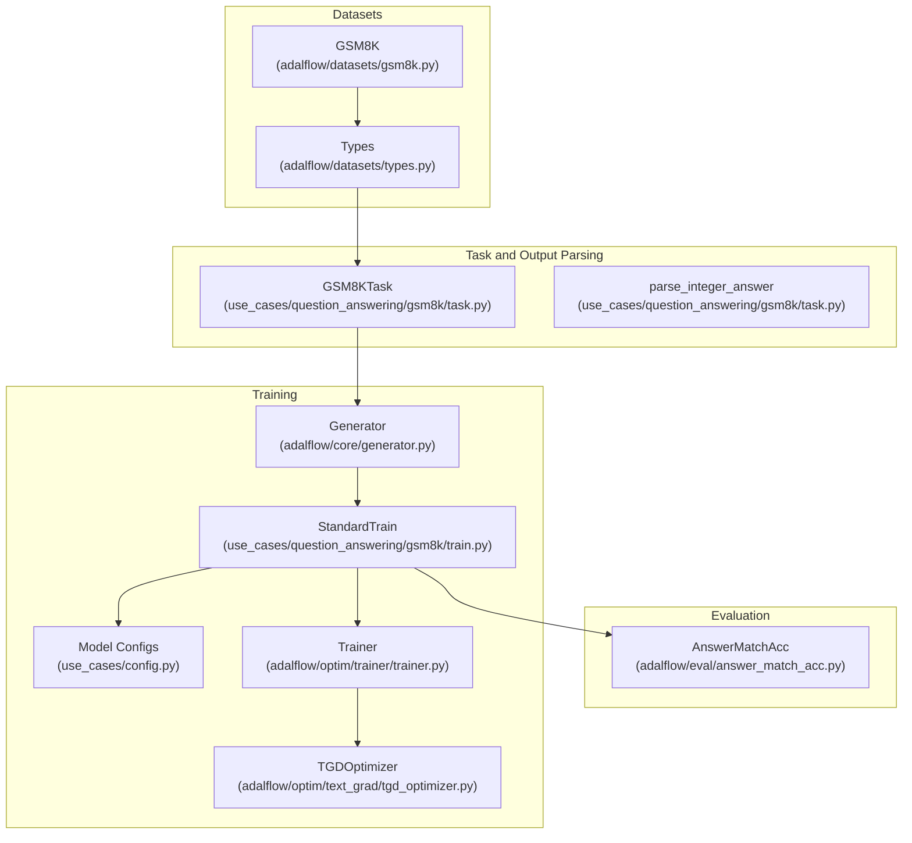
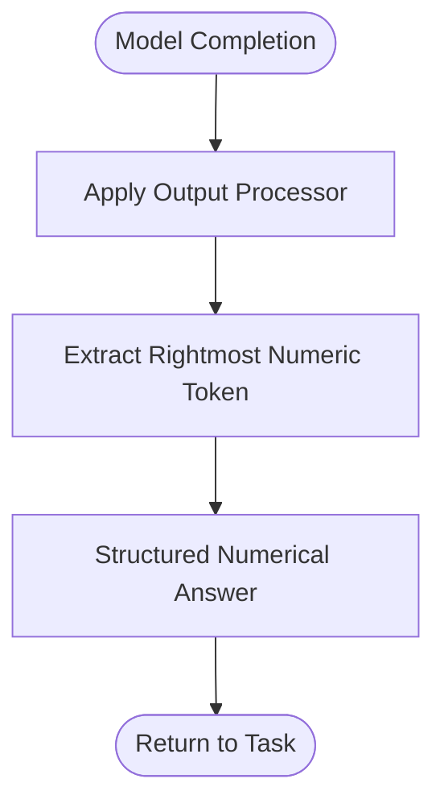
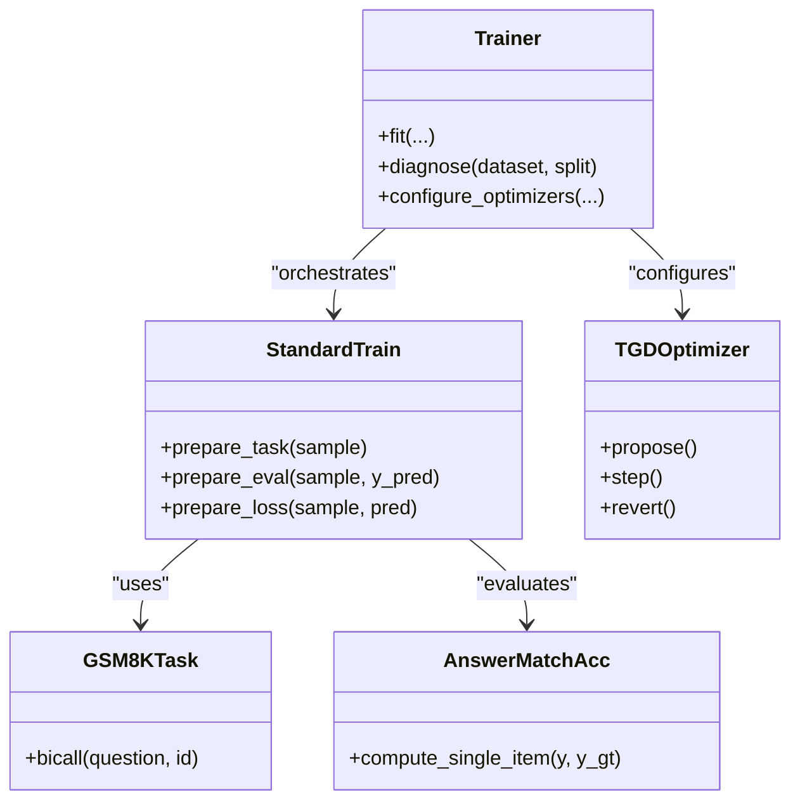
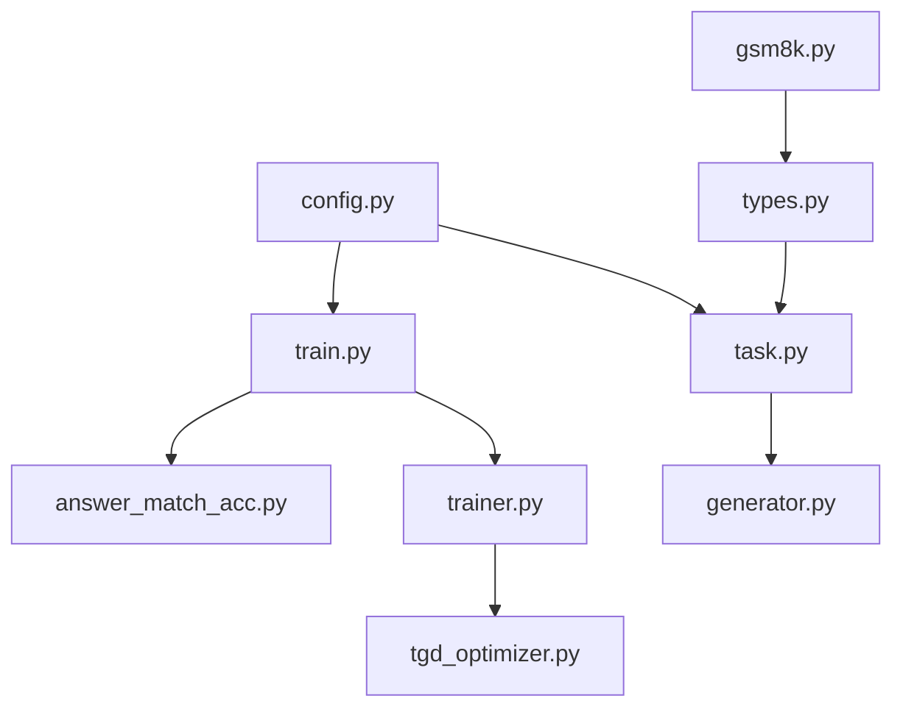

# Mathematical Reasoning

<cite>
**Referenced Files in This Document**
- [gsm8k.py](file://adalflow/adalflow/datasets/gsm8k.py)
- [types.py](file://adalflow/adalflow/datasets/types.py)
- [answer_match_acc.py](file://adalflow/adalflow/eval/answer_match_acc.py)
- [task.py](file://use_cases/question_answering/gsm8k/task.py)
- [train.py](file://use_cases/question_answering/gsm8k/train.py)
- [config.py](file://use_cases/config.py)
- [generator.py](file://adalflow/adalflow/core/generator.py)
- [trainer.py](file://adalflow/adalflow/optim/trainer/trainer.py)
- [tgd_optimizer.py](file://adalflow/adalflow/optim/text_grad/tgd_optimizer.py)
- [data.py](file://use_cases/question_answering/bbh/data.py)
</cite>

## Table of Contents
1. [Introduction](#introduction)
2. [Project Structure](#project-structure)
3. [Core Components](#core-components)
4. [Architecture Overview](#architecture-overview)
5. [Detailed Component Analysis](#detailed-component-analysis)
6. [Dependency Analysis](#dependency-analysis)
7. [Performance Considerations](#performance-considerations)
8. [Troubleshooting Guide](#troubleshooting-guide)
9. [Conclusion](#conclusion)
10. [Appendices](#appendices)

## Introduction
This document explains the mathematical reasoning system implemented in the repository, focusing on numerical computation and step-by-step problem solving. It covers:
- The GSM8K dataset implementation and data schema
- Exact match evaluation metrics for arithmetic reasoning
- Training pipelines for numerical reasoning tasks
- Structured output generation for numerical answers
- Prompt engineering strategies for mathematical problem decomposition
- Evaluation methodologies and optimization techniques for improving accuracy in computational tasks

## Project Structure
The mathematical reasoning stack integrates dataset loading, evaluation metrics, task definition, training orchestration, and textual gradient optimization. The following diagram maps the primary modules involved in GSM8K arithmetic reasoning.



**Diagram sources**
- [gsm8k.py](file://adalflow/adalflow/datasets/gsm8k.py#L17-L164)
- [types.py](file://adalflow/adalflow/datasets/types.py#L29-L48)
- [answer_match_acc.py](file://adalflow/adalflow/eval/answer_match_acc.py#L9-L158)
- [task.py](file://use_cases/question_answering/gsm8k/task.py#L30-L56)
- [train.py](file://use_cases/question_answering/gsm8k/train.py#L15-L87)
- [config.py](file://use_cases/config.py#L10-L112)
- [generator.py](file://adalflow/adalflow/core/generator.py#L82-L774)
- [trainer.py](file://adalflow/adalflow/optim/trainer/trainer.py#L42-L698)
- [tgd_optimizer.py](file://adalflow/adalflow/optim/text_grad/tgd_optimizer.py#L357-L713)

**Section sources**
- [gsm8k.py](file://adalflow/adalflow/datasets/gsm8k.py#L17-L164)
- [types.py](file://adalflow/adalflow/datasets/types.py#L29-L48)
- [answer_match_acc.py](file://adalflow/adalflow/eval/answer_match_acc.py#L9-L158)
- [task.py](file://use_cases/question_answering/gsm8k/task.py#L30-L56)
- [train.py](file://use_cases/question_answering/gsm8k/train.py#L15-L87)
- [config.py](file://use_cases/config.py#L10-L112)
- [generator.py](file://adalflow/adalflow/core/generator.py#L82-L774)
- [trainer.py](file://adalflow/adalflow/optim/trainer/trainer.py#L42-L698)
- [tgd_optimizer.py](file://adalflow/adalflow/optim/text_grad/tgd_optimizer.py#L357-L713)

## Core Components
- GSM8K dataset loader: Downloads and splits the GSM8K dataset, normalizes answers, and exposes train/val/test splits as DataClass instances.
- GSM8K data schema: Defines the input and output fields for GSM8K examples, including question, answer, and gold_reasoning.
- Exact match evaluator: Provides exact match and fuzzy match evaluation modes for comparing predicted and ground-truth answers.
- GSM8K task: Encapsulates a Generator with a system prompt that enforces step-by-step reasoning and a post-processing parser to extract numerical answers.
- Training component: Wraps the task with an evaluation function and a text-to-loss converter, enabling end-to-end optimization.
- Trainer: Orchestrates training loops, batching, validation, and checkpointing for prompt and demonstration optimization.
- Textual Gradient Descent (TGD) optimizer: Iteratively proposes improved prompt text guided by gradient feedback to maximize evaluation scores.

**Section sources**
- [gsm8k.py](file://adalflow/adalflow/datasets/gsm8k.py#L17-L164)
- [types.py](file://adalflow/adalflow/datasets/types.py#L29-L48)
- [answer_match_acc.py](file://adalflow/adalflow/eval/answer_match_acc.py#L9-L158)
- [task.py](file://use_cases/question_answering/gsm8k/task.py#L30-L56)
- [train.py](file://use_cases/question_answering/gsm8k/train.py#L15-L87)
- [trainer.py](file://adalflow/adalflow/optim/trainer/trainer.py#L42-L698)
- [tgd_optimizer.py](file://adalflow/adalflow/optim/text_grad/tgd_optimizer.py#L357-L713)

## Architecture Overview
The system follows a modular pipeline:
- Data ingestion: Load GSM8K examples and convert to typed data structures.
- Task execution: Use a Generator to produce model outputs, then parse numerical answers.
- Evaluation: Compare predictions against ground truth using exact match.
- Optimization: Train prompts and demonstrations via Trainer and TGDOptimizer to improve accuracy.

```mermaid
sequenceDiagram
participant Loader as "GSM8K Loader<br/>(gsm8k.py)"
participant Task as "GSM8KTask<br/>(task.py)"
participant Gen as "Generator<br/>(generator.py)"
participant Eval as "AnswerMatchAcc<br/>(answer_match_acc.py)"
participant Train as "StandardTrain<br/>(train.py)"
participant Trnr as "Trainer<br/>(trainer.py)"
participant Opt as "TGDOptimizer<br/>(tgd_optimizer.py)"
Loader->>Task : Provide GSM8KData
Task->>Gen : Call with question
Gen-->>Task : GeneratorOutput (raw + parsed)
Task-->>Train : Prediction (parsed answer)
Train->>Eval : compute_single_item(y, y_gt)
Eval-->>Train : Score (0 or 1)
Train->>Trnr : Prepare task/eval/loss
Trnr->>Opt : Propose improved prompt text
Opt-->>Trnr : Updated prompt
Trnr-->>Loader : Iterate training/validation/test
```

**Diagram sources**
- [gsm8k.py](file://adalflow/adalflow/datasets/gsm8k.py#L17-L164)
- [task.py](file://use_cases/question_answering/gsm8k/task.py#L30-L56)
- [generator.py](file://adalflow/adalflow/core/generator.py#L621-L774)
- [answer_match_acc.py](file://adalflow/adalflow/eval/answer_match_acc.py#L63-L133)
- [train.py](file://use_cases/question_answering/gsm8k/train.py#L15-L87)
- [trainer.py](file://adalflow/adalflow/optim/trainer/trainer.py#L418-L698)
- [tgd_optimizer.py](file://adalflow/adalflow/optim/text_grad/tgd_optimizer.py#L614-L713)

## Detailed Component Analysis

### GSM8K Dataset Implementation
- Loads GSM8K from Hugging Face, splits into train/val/test, and normalizes answers.
- Converts examples to a typed DataClass with question, answer, and gold_reasoning fields.
- Supports limiting dataset size for quick experiments.

Key behaviors:
- Download and cache logic ensures reproducibility.
- Answer normalization strips LaTeX-style answer markers and converts to integer strings.
- Data is shuffled deterministically before splitting.

**Section sources**
- [gsm8k.py](file://adalflow/adalflow/datasets/gsm8k.py#L17-L164)
- [types.py](file://adalflow/adalflow/datasets/types.py#L29-L48)

### Data Schema for GSM8K
- Defines input and output fields for GSM8K examples.
- Exposes default output fields for reasoning and answer, enabling structured output capture.

**Section sources**
- [types.py](file://adalflow/adalflow/datasets/types.py#L29-L48)

### Exact Match Evaluation Metrics
- Implements exact match, fuzzy match, and other text similarity metrics.
- Normalizes strings before comparison to reduce sensitivity to whitespace and minor variations.
- Designed for arithmetic reasoning tasks where numeric equality is paramount.

**Section sources**
- [answer_match_acc.py](file://adalflow/adalflow/eval/answer_match_acc.py#L9-L158)

### Structured Output Generation for Numerical Answers
- The task’s system prompt instructs the model to think step by step and provide a final answer line.
- A dedicated parser extracts the rightmost numeric token from the model output, ensuring structured numerical answers.
- The Generator applies output processors after model completion, enabling clean extraction of the final number.



**Diagram sources**
- [task.py](file://use_cases/question_answering/gsm8k/task.py#L16-L27)
- [generator.py](file://adalflow/adalflow/core/generator.py#L357-L379)

**Section sources**
- [task.py](file://use_cases/question_answering/gsm8k/task.py#L16-L27)
- [generator.py](file://adalflow/adalflow/core/generator.py#L357-L379)

### Prompt Engineering Strategies for Mathematical Problem Decomposition
- The system prompt encourages step-by-step reasoning and a final answer line format.
- The Trainer and TGDOptimizer iteratively refine prompts using gradient feedback and past histories.
- Constraints and examples can be injected to steer the model toward correct decomposition and formatting.

**Section sources**
- [task.py](file://use_cases/question_answering/gsm8k/task.py#L13-L13)
- [tgd_optimizer.py](file://adalflow/adalflow/optim/text_grad/tgd_optimizer.py#L46-L224)
- [trainer.py](file://adalflow/adalflow/optim/trainer/trainer.py#L418-L698)

### Training Pipelines for Arithmetic Reasoning Tasks
- The StandardTrain component wraps the task with an evaluation function and a text-to-loss converter.
- The Trainer coordinates training with configurable strategies, worker counts, and optimization orders.
- Checkpointing and diagnostics support iterative refinement and debugging.



**Diagram sources**
- [train.py](file://use_cases/question_answering/gsm8k/train.py#L15-L87)
- [trainer.py](file://adalflow/adalflow/optim/trainer/trainer.py#L42-L698)
- [tgd_optimizer.py](file://adalflow/adalflow/optim/text_grad/tgd_optimizer.py#L357-L713)
- [task.py](file://use_cases/question_answering/gsm8k/task.py#L30-L56)
- [answer_match_acc.py](file://adalflow/adalflow/eval/answer_match_acc.py#L63-L133)

**Section sources**
- [train.py](file://use_cases/question_answering/gsm8k/train.py#L15-L87)
- [trainer.py](file://adalflow/adalflow/optim/trainer/trainer.py#L42-L698)
- [tgd_optimizer.py](file://adalflow/adalflow/optim/text_grad/tgd_optimizer.py#L357-L713)

### Handling Multi-Step Mathematical Operations and Logical Inference
- The system relies on the model’s ability to produce step-by-step reasoning and a final answer line.
- The evaluation focuses on exact numeric match, encouraging models to reach correct numerical conclusions.
- Output parsing ensures robust extraction of the final number, minimizing format-induced errors.

**Section sources**
- [task.py](file://use_cases/question_answering/gsm8k/task.py#L13-L13)
- [answer_match_acc.py](file://adalflow/adalflow/eval/answer_match_acc.py#L92-L98)

### Equation Solving Patterns
- While the repository does not include a dedicated equation solver, the structured output and exact match evaluation facilitate validating solutions derived from chain-of-thought reasoning.
- The BBH data utilities demonstrate similar patterns for extracting answers and scoring correctness.

**Section sources**
- [data.py](file://use_cases/question_answering/bbh/data.py#L67-L92)

## Dependency Analysis
The following diagram highlights key dependencies among components used in arithmetic reasoning.



**Diagram sources**
- [config.py](file://use_cases/config.py#L10-L112)
- [gsm8k.py](file://adalflow/adalflow/datasets/gsm8k.py#L17-L164)
- [types.py](file://adalflow/adalflow/datasets/types.py#L29-L48)
- [answer_match_acc.py](file://adalflow/adalflow/eval/answer_match_acc.py#L9-L158)
- [task.py](file://use_cases/question_answering/gsm8k/task.py#L30-L56)
- [train.py](file://use_cases/question_answering/gsm8k/train.py#L15-L87)
- [generator.py](file://adalflow/adalflow/core/generator.py#L82-L774)
- [trainer.py](file://adalflow/adalflow/optim/trainer/trainer.py#L42-L698)
- [tgd_optimizer.py](file://adalflow/adalflow/optim/text_grad/tgd_optimizer.py#L357-L713)

**Section sources**
- [config.py](file://use_cases/config.py#L10-L112)
- [gsm8k.py](file://adalflow/adalflow/datasets/gsm8k.py#L17-L164)
- [types.py](file://adalflow/adalflow/datasets/types.py#L29-L48)
- [answer_match_acc.py](file://adalflow/adalflow/eval/answer_match_acc.py#L9-L158)
- [task.py](file://use_cases/question_answering/gsm8k/task.py#L30-L56)
- [train.py](file://use_cases/question_answering/gsm8k/train.py#L15-L87)
- [generator.py](file://adalflow/adalflow/core/generator.py#L82-L774)
- [trainer.py](file://adalflow/adalflow/optim/trainer/trainer.py#L42-L698)
- [tgd_optimizer.py](file://adalflow/adalflow/optim/text_grad/tgd_optimizer.py#L357-L713)

## Performance Considerations
- Use caching in the Generator to avoid redundant model calls during development and evaluation.
- Tune model kwargs (temperature, max_tokens) to balance reasoning depth and prompt length.
- Control batch sizes and worker counts in the Trainer to manage resource usage.
- Prefer exact match evaluation for arithmetic tasks to focus optimization on numeric correctness.

[No sources needed since this section provides general guidance]

## Troubleshooting Guide
Common issues and resolutions:
- Empty or malformed model outputs: Ensure the output processor is applied and handles exceptions gracefully.
- Incorrect answer extraction: Verify the parser regex captures the final numeric token and that the system prompt enforces a clear answer format.
- Evaluation score anomalies: Confirm that both prediction and ground truth are normalized before comparison.

**Section sources**
- [generator.py](file://adalflow/adalflow/core/generator.py#L357-L379)
- [answer_match_acc.py](file://adalflow/adalflow/eval/answer_match_acc.py#L81-L98)
- [task.py](file://use_cases/question_answering/gsm8k/task.py#L16-L27)

## Conclusion
The repository provides a cohesive framework for numerical reasoning tasks:
- Robust dataset ingestion and typed schemas
- Exact match evaluation tailored for arithmetic
- Modular task design with structured output parsing
- End-to-end training with textual gradient optimization

This foundation supports iterative improvements in prompt quality, demonstration selection, and model configuration to enhance accuracy in computational tasks.

[No sources needed since this section summarizes without analyzing specific files]

## Appendices

### Appendix A: Model Selection Criteria for Numerical Reasoning
- Choose models with strong reasoning capabilities and appropriate temperature/top-p settings for controlled generation.
- Use smaller temperature for deterministic numeric outputs in arithmetic tasks.

**Section sources**
- [config.py](file://use_cases/config.py#L16-L27)
- [config.py](file://use_cases/config.py#L63-L72)

### Appendix B: Training Configuration Highlights
- Strategy: random or constrained
- Max steps: number of optimization iterations
- Batch size: affects throughput and gradient stability
- Text optimizer config kwargs: control history and proposal behavior

**Section sources**
- [train.py](file://use_cases/question_answering/gsm8k/train.py#L75-L87)
- [trainer.py](file://adalflow/adalflow/optim/trainer/trainer.py#L112-L191)
- [tgd_optimizer.py](file://adalflow/adalflow/optim/text_grad/tgd_optimizer.py#L370-L424)