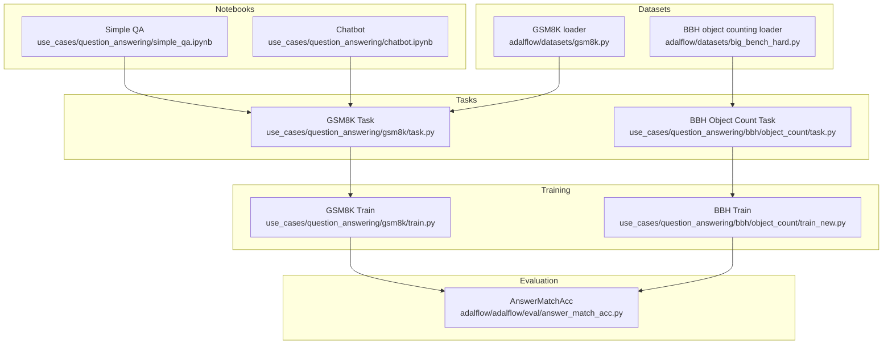
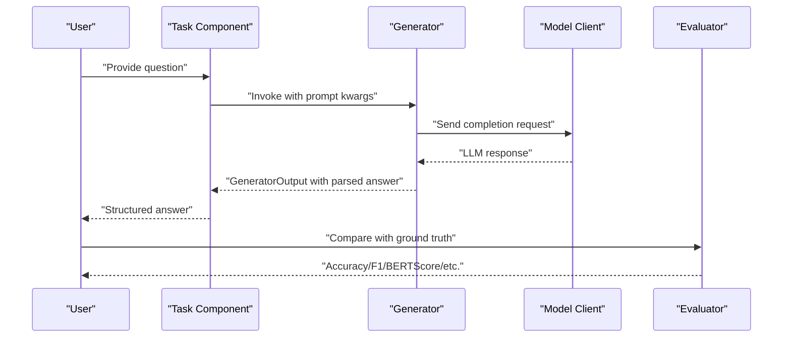
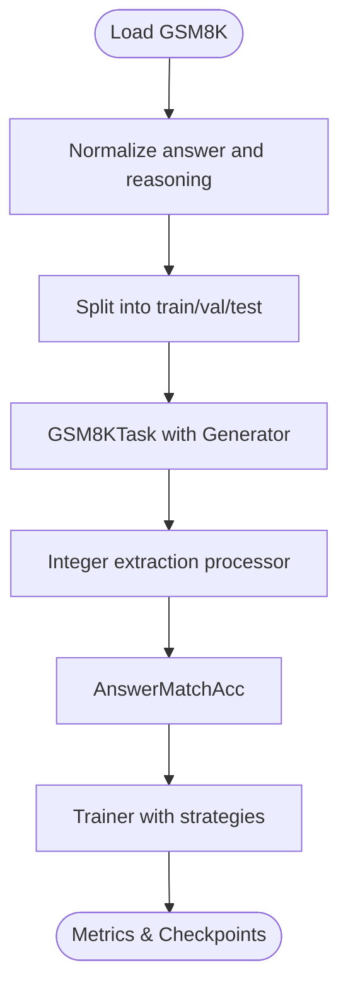
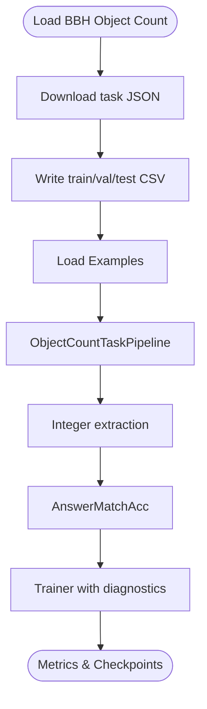
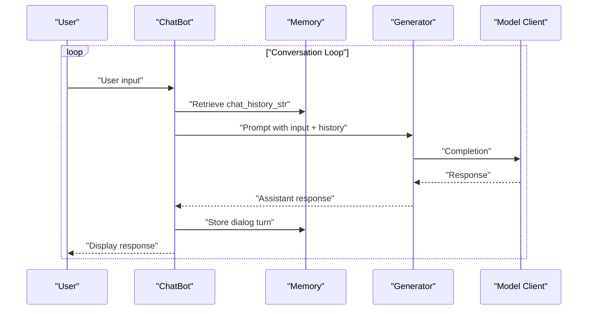
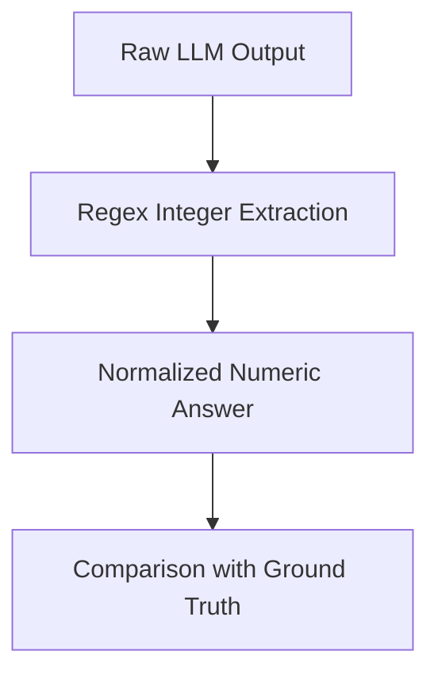
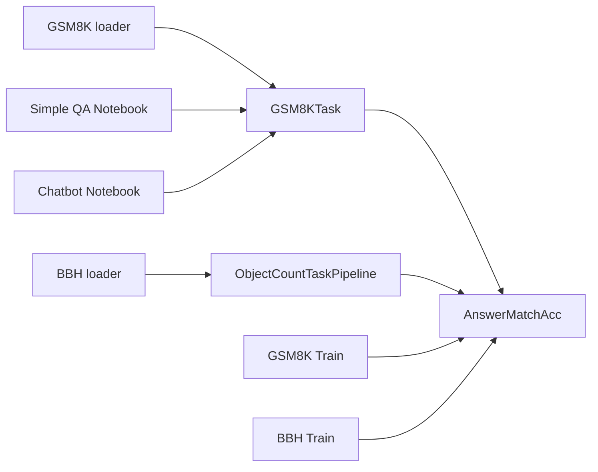

# Question Answering

<cite>
**Referenced Files in This Document**
- [gsm8k.py](file://adalflow/adalflow/datasets/gsm8k.py)
- [big_bench_hard.py](file://adalflow/adalflow/datasets/big_bench_hard.py)
- [data.py](file://use_cases/question_answering/bbh/data.py)
- [task.py (GSM8K)](file://use_cases/question_answering/gsm8k/task.py)
- [train.py (GSM8K)](file://use_cases/question_answering/gsm8k/train.py)
- [task.py (BBH Object Count)](file://use_cases/question_answering/bbh/object_count/task.py)
- [train_new.py (BBH Object Count)](file://use_cases/question_answering/bbh/object_count/train_new.py)
- [diagnose.py (BBH Object Count)](file://use_cases/question_answering/bbh/object_count/diagnose.py)
- [answer_match_acc.py](file://adalflow/adalflow/eval/answer_match_acc.py)
- [simple_qa.ipynb](file://use_cases/question_answering/simple_qa.ipynb)
- [chatbot.ipynb](file://use_cases/question_answering/chatbot.ipynb)
</cite>

## Table of Contents
1. [Introduction](#introduction)
2. [Project Structure](#project-structure)
3. [Core Components](#core-components)
4. [Architecture Overview](#architecture-overview)
5. [Detailed Component Analysis](#detailed-component-analysis)
6. [Dependency Analysis](#dependency-analysis)
7. [Performance Considerations](#performance-considerations)
8. [Troubleshooting Guide](#troubleshooting-guide)
9. [Conclusion](#conclusion)
10. [Appendices](#appendices)

## Introduction
This document explains how to build robust question answering (QA) systems using the AdalFlow framework. It covers:
- Mathematical reasoning QA with the GSM8K dataset
- Cognitive reasoning tasks with BBH object counting
- Conversational chatbots with persistent memory
- Structured output generation and parsing
- Multi-hop reasoning patterns (conceptual)
- Training pipelines, prompt engineering, and model selection
- Implementation details for numerical computation and logical inference
- Performance optimization, accuracy improvements, and production deployment considerations

## Project Structure
The repository organizes QA capabilities across datasets, tasks, training, evaluation, and notebooks:
- Datasets: GSM8K and BBH object counting loaders
- Tasks: GSM8K and BBH pipelines with Generators and output processors
- Training: AdalComponent-based trainers with configurable strategies
- Evaluation: AnswerMatchAcc and other metrics
- Notebooks: Simple QA and chatbot examples

**Diagram sources**
- [gsm8k.py](file://adalflow/adalflow/datasets/gsm8k.py#L17-L163)
- [big_bench_hard.py](file://adalflow/adalflow/datasets/big_bench_hard.py#L16-L149)
- [task.py (GSM8K)](file://use_cases/question_answering/gsm8k/task.py#L30-L56)
- [task.py (BBH Object Count)](file://use_cases/question_answering/bbh/object_count/task.py#L28-L71)
- [train.py (GSM8K)](file://use_cases/question_answering/gsm8k/train.py#L15-L61)
- [train_new.py (BBH Object Count)](file://use_cases/question_answering/bbh/object_count/train_new.py#L18-L61)
- [answer_match_acc.py](file://adalflow/adalflow/eval/answer_match_acc.py#L9-L157)
- [simple_qa.ipynb](file://use_cases/question_answering/simple_qa.ipynb#L120-L133)
- [chatbot.ipynb](file://use_cases/question_answering/chatbot.ipynb#L66-L94)

**Section sources**
- [gsm8k.py](file://adalflow/adalflow/datasets/gsm8k.py#L17-L163)
- [big_bench_hard.py](file://adalflow/adalflow/datasets/big_bench_hard.py#L16-L149)
- [task.py (GSM8K)](file://use_cases/question_answering/gsm8k/task.py#L30-L56)
- [task.py (BBH Object Count)](file://use_cases/question_answering/bbh/object_count/task.py#L28-L71)
- [train.py (GSM8K)](file://use_cases/question_answering/gsm8k/train.py#L15-L61)
- [train_new.py (BBH Object Count)](file://use_cases/question_answering/bbh/object_count/train_new.py#L18-L61)
- [answer_match_acc.py](file://adalflow/adalflow/eval/answer_match_acc.py#L9-L157)
- [simple_qa.ipynb](file://use_cases/question_answering/simple_qa.ipynb#L120-L133)
- [chatbot.ipynb](file://use_cases/question_answering/chatbot.ipynb#L66-L94)

## Core Components
- Dataset loaders:
  - GSM8K: loads official train/test splits, converts to a dataclass with question, gold reasoning, and answer
  - BBH object counting: downloads task JSON, splits into train/val/test CSV, exposes question-answer pairs
- Task pipelines:
  - GSM8KTask: wraps a Generator with a system prompt and integer extraction post-processing
  - ObjectCountTaskPipeline: similar pipeline for BBH with numeric answer extraction
- Training:
  - StandardTrain (GSM8K) and ObjectCountAdalComponent (BBH): define prepare_task/prepare_eval/prepare_loss, integrate AnswerMatchAcc
  - Trainer configured with strategies, sampling, and backward pass options
- Evaluation:
  - AnswerMatchAcc: exact match, fuzzy match, and text similarity metrics (F1, BERTScore, ROUGE, BLEU)
- Notebooks:
  - Simple QA and Chatbot demonstrate Generator usage, prompt templates, and memory-backed chat histories

**Section sources**
- [gsm8k.py](file://adalflow/adalflow/datasets/gsm8k.py#L17-L163)
- [big_bench_hard.py](file://adalflow/adalflow/datasets/big_bench_hard.py#L16-L149)
- [task.py (GSM8K)](file://use_cases/question_answering/gsm8k/task.py#L30-L56)
- [task.py (BBH Object Count)](file://use_cases/question_answering/bbh/object_count/task.py#L28-L71)
- [train.py (GSM8K)](file://use_cases/question_answering/gsm8k/train.py#L15-L61)
- [train_new.py (BBH Object Count)](file://use_cases/question_answering/bbh/object_count/train_new.py#L18-L61)
- [answer_match_acc.py](file://adalflow/adalflow/eval/answer_match_acc.py#L9-L157)
- [simple_qa.ipynb](file://use_cases/question_answering/simple_qa.ipynb#L120-L133)
- [chatbot.ipynb](file://use_cases/question_answering/chatbot.ipynb#L66-L94)

## Architecture Overview
The QA system follows a modular pipeline:
- Data ingestion via Dataset classes
- Task-specific prompting and Generator invocation
- Output processors to extract structured answers
- Evaluation against ground truth
- Training loops with configurable strategies and backward passes

**Diagram sources**
- [task.py (GSM8K)](file://use_cases/question_answering/gsm8k/task.py#L51-L55)
- [task.py (BBH Object Count)](file://use_cases/question_answering/bbh/object_count/task.py#L58-L70)
- [answer_match_acc.py](file://adalflow/adalflow/eval/answer_match_acc.py#L134-L157)

## Detailed Component Analysis

### Mathematical Reasoning QA (GSM8K)
- Dataset loading:
  - Loads official GSM8K splits, normalizes answers, and saves train/val/test JSON
  - Converts entries to a typed dataclass for downstream use
- Task pipeline:
  - System prompt instructs step-by-step reasoning and numeric answer formatting
  - Generator uses a template and an integer extraction processor
- Training:
  - StandardTrain integrates AnswerMatchAcc and EvalFnToTextLoss
  - Trainer runs with configurable strategies and sampling

**Diagram sources**
- [gsm8k.py](file://adalflow/adalflow/datasets/gsm8k.py#L105-L150)
- [task.py (GSM8K)](file://use_cases/question_answering/gsm8k/task.py#L30-L56)
- [train.py (GSM8K)](file://use_cases/question_answering/gsm8k/train.py#L15-L61)
- [answer_match_acc.py](file://adalflow/adalflow/eval/answer_match_acc.py#L9-L157)

**Section sources**
- [gsm8k.py](file://adalflow/adalflow/datasets/gsm8k.py#L17-L163)
- [task.py (GSM8K)](file://use_cases/question_answering/gsm8k/task.py#L30-L56)
- [train.py (GSM8K)](file://use_cases/question_answering/gsm8k/train.py#L15-L61)
- [answer_match_acc.py](file://adalflow/adalflow/eval/answer_match_acc.py#L9-L157)

### Cognitive Reasoning QA (BBH Object Counting)
- Dataset preparation:
  - Downloads task JSON from the BBH repository and writes train/val/test CSV
  - Provides a default task instruction encouraging step-by-step reasoning and numeric answers
- Data processing:
  - Dataclasses and parsing helpers extract integers and standardized answers
- Task pipeline:
  - ObjectCountTaskPipeline composes a system prompt and a Generator with integer extraction
- Training:
  - ObjectCountAdalComponent defines prepare_task/prepare_eval/prepare_loss
  - train_new.py demonstrates diagnostics, constrained strategies, and backward pass tuning

**Diagram sources**
- [big_bench_hard.py](file://adalflow/adalflow/datasets/big_bench_hard.py#L68-L144)
- [data.py](file://use_cases/question_answering/bbh/data.py#L94-L106)
- [task.py (BBH Object Count)](file://use_cases/question_answering/bbh/object_count/task.py#L28-L71)
- [train_new.py (BBH Object Count)](file://use_cases/question_answering/bbh/object_count/train_new.py#L18-L61)

**Section sources**
- [big_bench_hard.py](file://adalflow/adalflow/datasets/big_bench_hard.py#L16-L149)
- [data.py](file://use_cases/question_answering/bbh/data.py#L94-L106)
- [task.py (BBH Object Count)](file://use_cases/question_answering/bbh/object_count/task.py#L28-L71)
- [train_new.py (BBH Object Count)](file://use_cases/question_answering/bbh/object_count/train_new.py#L18-L61)
- [diagnose.py (BBH Object Count)](file://use_cases/question_answering/bbh/object_count/diagnose.py#L9-L41)

### Conversational Chatbots
- Simple QA notebook demonstrates a minimal Generator-based pipeline
- Chatbot notebook builds a looped chat with persistent Memory and chat_history_str injection into prompts

**Diagram sources**
- [chatbot.ipynb](file://use_cases/question_answering/chatbot.ipynb#L74-L93)

**Section sources**
- [simple_qa.ipynb](file://use_cases/question_answering/simple_qa.ipynb#L120-L133)
- [chatbot.ipynb](file://use_cases/question_answering/chatbot.ipynb#L66-L94)

### Structured Output Generation and Parsing
- Numeric extraction:
  - GSM8KTask and BBH pipelines use regex-based integer extraction to isolate final numeric answers
- Prompt templates:
  - System prompt + user prompt templates guide the model to produce structured outputs
- Output processors:
  - Applied after generation to normalize and extract target values

**Diagram sources**
- [task.py (GSM8K)](file://use_cases/question_answering/gsm8k/task.py#L16-L27)
- [task.py (BBH Object Count)](file://use_cases/question_answering/bbh/object_count/task.py#L54-L56)
- [data.py](file://use_cases/question_answering/bbh/data.py#L67-L92)

**Section sources**
- [task.py (GSM8K)](file://use_cases/question_answering/gsm8k/task.py#L16-L27)
- [task.py (BBH Object Count)](file://use_cases/question_answering/bbh/object_count/task.py#L54-L56)
- [data.py](file://use_cases/question_answering/bbh/data.py#L67-L92)

### Multi-Hop Reasoning Patterns (Conceptual)
- The framework supports multi-step reasoning through:
  - System prompts that require step-by-step thinking
  - Few-shot demonstrations (BBH pipeline includes a few-shot template)
  - Iterative refinement via training strategies and backward passes
- Production-ready patterns:
  - Use diagnostics to identify bottlenecks
  - Tune sampling and optimization order
  - Apply rate-limit handling during training

[No sources needed since this section provides conceptual guidance]

## Dependency Analysis
Key dependencies and relationships:
- Datasets depend on local caching and CSV/JSON persistence
- Tasks depend on Generators and output processors
- Training depends on evaluators and Trainer configurations
- Notebooks depend on environment setup and model clients

**Diagram sources**
- [gsm8k.py](file://adalflow/adalflow/datasets/gsm8k.py#L65-L78)
- [big_bench_hard.py](file://adalflow/adalflow/datasets/big_bench_hard.py#L56-L66)
- [task.py (GSM8K)](file://use_cases/question_answering/gsm8k/task.py#L30-L56)
- [task.py (BBH Object Count)](file://use_cases/question_answering/bbh/object_count/task.py#L28-L71)
- [train.py (GSM8K)](file://use_cases/question_answering/gsm8k/train.py#L15-L61)
- [train_new.py (BBH Object Count)](file://use_cases/question_answering/bbh/object_count/train_new.py#L18-L61)
- [answer_match_acc.py](file://adalflow/adalflow/eval/answer_match_acc.py#L9-L157)
- [simple_qa.ipynb](file://use_cases/question_answering/simple_qa.ipynb#L120-L133)
- [chatbot.ipynb](file://use_cases/question_answering/chatbot.ipynb#L66-L94)

**Section sources**
- [gsm8k.py](file://adalflow/adalflow/datasets/gsm8k.py#L65-L78)
- [big_bench_hard.py](file://adalflow/adalflow/datasets/big_bench_hard.py#L56-L66)
- [task.py (GSM8K)](file://use_cases/question_answering/gsm8k/task.py#L30-L56)
- [task.py (BBH Object Count)](file://use_cases/question_answering/bbh/object_count/task.py#L28-L71)
- [train.py (GSM8K)](file://use_cases/question_answering/gsm8k/train.py#L15-L61)
- [train_new.py (BBH Object Count)](file://use_cases/question_answering/bbh/object_count/train_new.py#L18-L61)
- [answer_match_acc.py](file://adalflow/adalflow/eval/answer_match_acc.py#L9-L157)
- [simple_qa.ipynb](file://use_cases/question_answering/simple_qa.ipynb#L120-L133)
- [chatbot.ipynb](file://use_cases/question_answering/chatbot.ipynb#L66-L94)

## Performance Considerations
- Prompt engineering:
  - Provide explicit instructions for step-by-step reasoning and numeric answer formatting
  - Use few-shot examples judiciously; effectiveness can degrade at high baseline performance
- Model selection:
  - Choose stronger models for complex reasoning tasks (e.g., GPT-4o variants) and lighter models for simple QA
- Training strategies:
  - Random vs constrained strategies; adjust proposals per step and optimization order
  - Weighted sampling and bootstrap shots can improve coverage
- Backward pass tuning:
  - Disable gradients selectively for stability
  - Control max_past_history for text gradients
- Rate limiting:
  - Handle 429 errors during training; raise or retry as appropriate

[No sources needed since this section provides general guidance]

## Troubleshooting Guide
- Rate limit handling:
  - Training and inference branches raise on 429; adjust model choice or rate limits accordingly
- Data loading issues:
  - Ensure dataset caches exist and network connectivity for remote downloads
- Parsing failures:
  - Regex extraction may fail if the model does not follow the expected format; refine prompts or add examples
- Evaluation mismatches:
  - Normalize answers consistently; choose exact vs fuzzy matching based on task needs

**Section sources**
- [task.py (BBH Object Count)](file://use_cases/question_answering/bbh/object_count/task.py#L63-L70)
- [big_bench_hard.py](file://adalflow/adalflow/datasets/big_bench_hard.py#L77-L114)
- [answer_match_acc.py](file://adalflow/adalflow/eval/answer_match_acc.py#L85-L132)

## Conclusion
AdalFlow enables end-to-end QA pipelines spanning mathematical reasoning, cognitive tasks, and chatbots. By combining dataset loaders, task pipelines with structured output parsing, configurable training strategies, and robust evaluation metrics, teams can rapidly prototype and deploy production-grade QA systems. Use diagnostics, prompt engineering, and careful model selection to optimize accuracy and performance.

[No sources needed since this section summarizes without analyzing specific files]

## Appendices

### Evaluation Metrics Reference
- Exact match, fuzzy match, F1-score, BERTScore, ROUGE, BLEU
- Normalization applied before comparison

**Section sources**
- [answer_match_acc.py](file://adalflow/adalflow/eval/answer_match_acc.py#L9-L157)

### Training Pipelines Quick Reference
- GSM8K: StandardTrain with EvalFnToTextLoss and AnswerMatchAcc
- BBH: ObjectCountAdalComponent with Trainer diagnostics and configurable strategies

**Section sources**
- [train.py (GSM8K)](file://use_cases/question_answering/gsm8k/train.py#L15-L61)
- [train_new.py (BBH Object Count)](file://use_cases/question_answering/bbh/object_count/train_new.py#L18-L61)