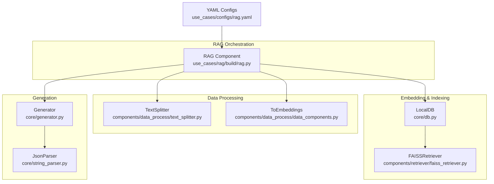
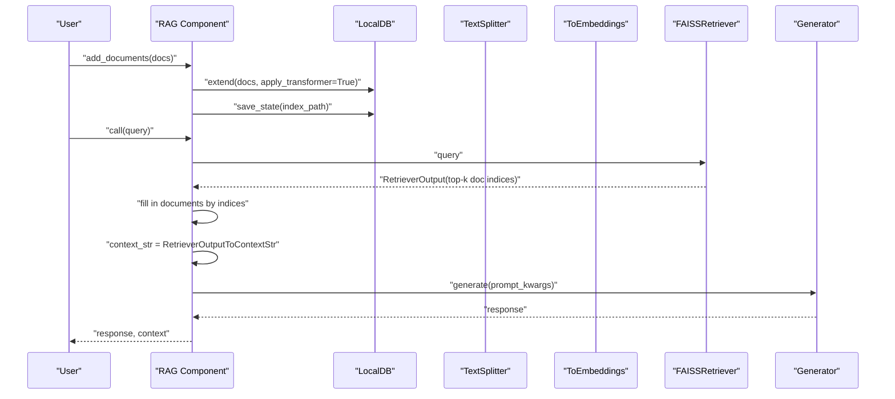
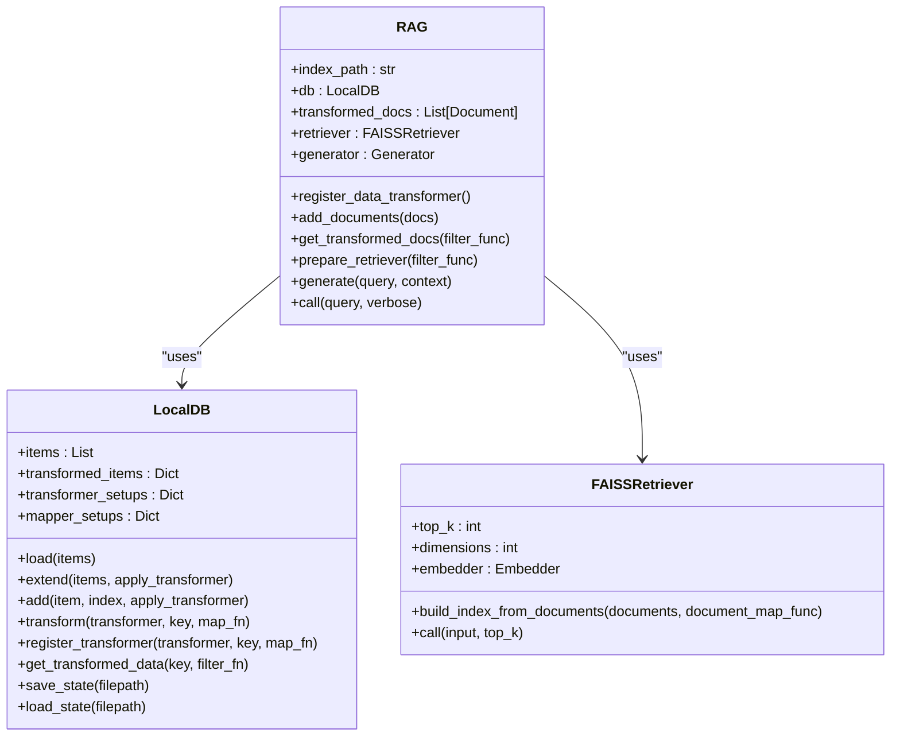
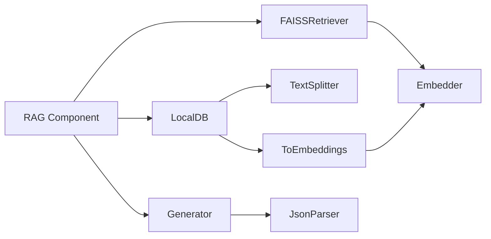

# End-to-End RAG Pipeline

<cite>
**Referenced Files in This Document**
- [rag.py](file://use_cases/rag/build/rag.py)
- [simple_rag.yaml](file://use_cases/rag/simple_rag.yaml)
- [rag.yaml](file://use_cases/configs/rag.yaml)
- [faiss_retriever.py](file://adalflow/adalflow/components/retriever/faiss_retriever.py)
- [retriever.py](file://adalflow/adalflow/core/retriever.py)
- [db.py](file://adalflow/adalflow/core/db.py)
- [data_components.py](file://adalflow/adalflow/components/data_process/data_components.py)
- [text_splitter.py](file://adalflow/adalflow/components/data_process/text_splitter.py)
- [types.py](file://adalflow/adalflow/core/types.py)
- [rag_with_eval.py](file://use_cases/rag/rag_with_eval.py)
- [rag_yaml_config.py](file://use_cases/unsorted/rag_yaml_config.py)
- [use_embedder.py](file://use_cases/unsorted/use_embedder.py)
</cite>

## Table of Contents
1. [Introduction](#introduction)
2. [Project Structure](#project-structure)
3. [Core Components](#core-components)
4. [Architecture Overview](#architecture-overview)
5. [Detailed Component Analysis](#detailed-component-analysis)
6. [Dependency Analysis](#dependency-analysis)
7. [Performance Considerations](#performance-considerations)
8. [Troubleshooting Guide](#troubleshooting-guide)
9. [Conclusion](#conclusion)
10. [Appendices](#appendices)

## Introduction
This document describes the complete Retrieval Augmented Generation (RAG) pipeline implemented in the repository. It covers the RAG component class architecture, including document ingestion, text preprocessing, embedding generation, vector indexing, and retrieval mechanisms. It explains the sequential data processing workflow from raw documents to query responses, integrates the FAISS retriever, manages LocalDB storage and state persistence, and documents configuration via YAML files. It also covers batch processing for embeddings, streaming capabilities, and practical guidance for building production-ready RAG systems with robust error handling, caching strategies, scalability, and enterprise deployment patterns.

## Project Structure
The RAG pipeline is composed of:
- A high-level RAG component orchestrating data ingestion, preprocessing, embedding, indexing, retrieval, and generation.
- A FAISS-based semantic retriever for efficient nearest-neighbor search over embeddings.
- A LocalDB for in-memory storage, transformation pipelines, and persistence.
- Data processing components for text splitting and embedding assignment.
- Configuration via YAML files for vectorizer, retriever, generator, and text splitter settings.



**Diagram sources**
- [rag.py](file://use_cases/rag/build/rag.py#L104-L206)
- [faiss_retriever.py](file://adalflow/adalflow/components/retriever/faiss_retriever.py#L51-L369)
- [db.py](file://adalflow/adalflow/core/db.py#L24-L391)
- [data_components.py](file://adalflow/adalflow/components/data_process/data_components.py#L74-L132)
- [text_splitter.py](file://adalflow/adalflow/components/data_process/text_splitter.py#L47-L357)
- [rag.yaml](file://use_cases/configs/rag.yaml#L1-L20)

**Section sources**
- [rag.py](file://use_cases/rag/build/rag.py#L1-L252)
- [faiss_retriever.py](file://adalflow/adalflow/components/retriever/faiss_retriever.py#L1-L369)
- [db.py](file://adalflow/adalflow/core/db.py#L1-L391)
- [data_components.py](file://adalflow/adalflow/components/data_process/data_components.py#L1-L132)
- [text_splitter.py](file://adalflow/adalflow/components/data_process/text_splitter.py#L1-L357)
- [rag.yaml](file://use_cases/configs/rag.yaml#L1-L20)

## Core Components
- RAG Component: Orchestrates ingestion, preprocessing, embedding, indexing, retrieval, and generation. Supports runtime addition of documents and incremental index updates.
- FAISSRetriever: Semantic retriever using FAISS for embedding-based nearest neighbor search with configurable metrics and top-k retrieval.
- LocalDB: In-memory storage with transformation pipelines and persistence to disk via pickle, enabling experiment versioning and state restoration.
- TextSplitter: Chunking engine supporting multiple strategies (word, sentence, page, passage, token) with configurable chunk size and overlap.
- ToEmbeddings: Applies batched embedding generation to documents and assigns vectors back to Document objects.
- RetrieverOutputToContextStr: Converts retrieved documents into a deduplicated or concatenated context string for the generator.
- YAML Configuration: Centralized configuration for vectorizer, retriever, generator, and text splitter.

**Section sources**
- [rag.py](file://use_cases/rag/build/rag.py#L104-L206)
- [faiss_retriever.py](file://adalflow/adalflow/components/retriever/faiss_retriever.py#L51-L369)
- [db.py](file://adalflow/adalflow/core/db.py#L24-L391)
- [data_components.py](file://adalflow/adalflow/components/data_process/data_components.py#L74-L132)
- [text_splitter.py](file://adalflow/adalflow/components/data_process/text_splitter.py#L47-L357)
- [simple_rag.yaml](file://use_cases/rag/simple_rag.yaml#L1-L20)
- [rag.yaml](file://use_cases/configs/rag.yaml#L1-L20)

## Architecture Overview
The RAG pipeline follows a sequential workflow:
1. Prepare data pipeline: TextSplitter → ToEmbeddings.
2. Build or restore LocalDB state and transform documents.
3. Build FAISS index from transformed embeddings.
4. On query: FAISSRetriever retrieves top-k candidates; context string assembled; Generator produces answer.



**Diagram sources**
- [rag.py](file://use_cases/rag/build/rag.py#L156-L206)
- [faiss_retriever.py](file://adalflow/adalflow/components/retriever/faiss_retriever.py#L325-L369)
- [data_components.py](file://adalflow/adalflow/components/data_process/data_components.py#L112-L132)
- [db.py](file://adalflow/adalflow/core/db.py#L243-L264)

## Detailed Component Analysis

### RAG Component
Responsibilities:
- Initialize FAISSRetriever with an Embedder and pre-transformed documents.
- Register and persist a data transformation pipeline (TextSplitter + ToEmbeddings).
- Support runtime addition of documents and incremental index rebuilding.
- Convert retriever outputs to a context string and generate answers.

Key behaviors:
- State restoration: Loads LocalDB from persisted state if index exists.
- Incremental updates: Adds new documents and saves state.
- Dynamic retriever preparation: Builds retriever index from filtered transformed documents.



**Diagram sources**
- [rag.py](file://use_cases/rag/build/rag.py#L104-L206)
- [db.py](file://adalflow/adalflow/core/db.py#L24-L391)
- [faiss_retriever.py](file://adalflow/adalflow/components/retriever/faiss_retriever.py#L51-L369)

**Section sources**
- [rag.py](file://use_cases/rag/build/rag.py#L104-L206)

### FAISSRetriever
Capabilities:
- Accepts string or embedding queries.
- Normalizes embeddings when using inner-product-based cosine similarity.
- Supports configurable metrics: cosine, euclidean, prob (converted cosine to probability).
- Builds in-memory FAISS index from document embeddings.

Processing logic:
- Validates index readiness and input shape.
- Converts queries to embeddings when needed.
- Performs search and returns structured output with indices and scores.

```mermaid
flowchart TD
Start(["Call FAISSRetriever"]) --> TypeCheck{"Input type?"}
TypeCheck --> |String/List[str]| Embed["Embedder(vectorize queries)"]
TypeCheck --> |Embedding/Embeddings| UseEmb["Use input embeddings"]
Embed --> Search["FAISS index.search(xq, k)"]
UseEmb --> Search
Search --> Post["Normalize/Convert scores"]
Post --> Out(["Return RetrieverOutput"])
```

**Diagram sources**
- [faiss_retriever.py](file://adalflow/adalflow/components/retriever/faiss_retriever.py#L261-L323)

**Section sources**
- [faiss_retriever.py](file://adalflow/adalflow/components/retriever/faiss_retriever.py#L51-L369)

### LocalDB
Features:
- Stores original items and multiple transformed datasets keyed by transformer name.
- Registers transformers and applies them lazily or on updates.
- Persists state to disk using pickle and restores it with transformer reconstruction.

Operational highlights:
- Transformations are applied to new items upon extension/add.
- Provides filtered access to transformed data via filter functions.

**Section sources**
- [db.py](file://adalflow/adalflow/core/db.py#L24-L391)

### TextSplitter
Behavior:
- Splits text by word, sentence, page, passage, or token.
- Uses sliding window merging with configurable chunk size and overlap.
- Supports batch processing for large document sets.

**Section sources**
- [text_splitter.py](file://adalflow/adalflow/components/data_process/text_splitter.py#L47-L357)

### ToEmbeddings
Role:
- Applies batched embedding generation to document texts.
- Assigns vectors back to Document objects in the original order.

**Section sources**
- [data_components.py](file://adalflow/adalflow/components/data_process/data_components.py#L74-L106)

### RetrieverOutputToContextStr
Purpose:
- Converts retrieved documents into a context string.
- Deduplication option to avoid repeated content when using query expansion.

**Section sources**
- [data_components.py](file://adalflow/adalflow/components/data_process/data_components.py#L112-L132)

### YAML Configuration Management
Two configuration examples:
- simple_rag.yaml: Minimal configuration for vectorizer, retriever, generator, and text splitter.
- rag.yaml: Production-oriented defaults for chunking and embedding dimensions.

Usage:
- Both RAG implementations load YAML to configure components at runtime.

**Section sources**
- [simple_rag.yaml](file://use_cases/rag/simple_rag.yaml#L1-L20)
- [rag.yaml](file://use_cases/configs/rag.yaml#L1-L20)

## Dependency Analysis
High-level dependencies:
- RAG depends on LocalDB for storage and transformation, FAISSRetriever for retrieval, and Generator for answer synthesis.
- FAISSRetriever depends on Embedder and FAISS library.
- Data processing components depend on Document types and tokenizer utilities.



**Diagram sources**
- [rag.py](file://use_cases/rag/build/rag.py#L104-L206)
- [faiss_retriever.py](file://adalflow/adalflow/components/retriever/faiss_retriever.py#L51-L369)
- [db.py](file://adalflow/adalflow/core/db.py#L24-L391)
- [data_components.py](file://adalflow/adalflow/components/data_process/data_components.py#L74-L132)

**Section sources**
- [rag.py](file://use_cases/rag/build/rag.py#L104-L206)
- [faiss_retriever.py](file://adalflow/adalflow/components/retriever/faiss_retriever.py#L51-L369)
- [db.py](file://adalflow/adalflow/core/db.py#L24-L391)
- [data_components.py](file://adalflow/adalflow/components/data_process/data_components.py#L74-L132)

## Performance Considerations
- Embedding batch size: Control throughput vs. memory trade-offs via batch_size in ToEmbeddings and YAML configurations.
- Chunk size and overlap: Tune chunk_size and chunk_overlap in TextSplitter to balance recall and context length.
- FAISS metric and normalization: Use cosine with normalized embeddings for best semantic similarity; consider prob conversion for interpretable scores.
- Top-k tuning: Adjust top_k to balance precision and recall; larger k increases cost.
- Streaming: Generator supports streaming configuration; enable for latency-sensitive deployments.
- Persistence and incremental updates: Use LocalDB to persist state and rebuild FAISS index incrementally to avoid reprocessing entire corpus.
- Memory management: FAISS index resides in memory; monitor index size and consider eviction strategies for large corpora.

[No sources needed since this section provides general guidance]

## Troubleshooting Guide
Common issues and resolutions:
- Empty documents list when building index: The retriever logs a warning and resets the index; ensure non-empty document embeddings.
- Unnormalized embeddings: The retriever warns and normalizes embeddings when using cosine similarity; ensure consistent normalization.
- Index not built: The retriever raises an error if the index is empty; call build_index_from_documents with transformed documents.
- Missing transformer keys: LocalDB raises errors if a key is not found; ensure registration and correct key usage.
- YAML configuration mismatches: Validate model kwargs and dimensions; ensure embedding dimensions match FAISSRetriever dimensions.

**Section sources**
- [faiss_retriever.py](file://adalflow/adalflow/components/retriever/faiss_retriever.py#L168-L202)
- [faiss_retriever.py](file://adalflow/adalflow/components/retriever/faiss_retriever.py#L241-L244)
- [faiss_retriever.py](file://adalflow/adalflow/components/retriever/faiss_retriever.py#L349-L351)
- [db.py](file://adalflow/adalflow/core/db.py#L143-L146)

## Conclusion
The RAG pipeline integrates modular components for ingestion, preprocessing, embedding, indexing, retrieval, and generation. FAISS provides efficient semantic search, LocalDB offers flexible storage and persistence, and YAML configurations enable easy customization. With careful tuning of chunking, embedding batch sizes, and top-k, plus robust error handling and incremental updates, the system supports scalable, production-grade deployments.

[No sources needed since this section summarizes without analyzing specific files]

## Appendices

### Practical Examples and Patterns
- Building a RAG system with YAML configuration:
  - Load settings from rag.yaml or simple_rag.yaml.
  - Instantiate RAG with configured components.
  - Add documents and persist state; reuse state on restart.
- Runtime document addition:
  - Use add_documents to append new items; LocalDB applies registered transformers and persists state.
- Incremental retriever preparation:
  - Filter transformed documents by metadata and rebuild retriever index for targeted retrieval.
- Evaluation workflow:
  - Use rag_with_eval to evaluate retriever recall and answer accuracy against ground-truth.

**Section sources**
- [rag.py](file://use_cases/rag/build/rag.py#L156-L206)
- [rag_with_eval.py](file://use_cases/rag/rag_with_eval.py#L56-L136)
- [rag.yaml](file://use_cases/configs/rag.yaml#L1-L20)
- [simple_rag.yaml](file://use_cases/rag/simple_rag.yaml#L1-L20)

### Streaming and Async Embedding
- Embedder supports both synchronous and asynchronous calls; use async variants for concurrent batch requests.

**Section sources**
- [use_embedder.py](file://use_cases/unsorted/use_embedder.py#L26-L27)

### Data Types and Embedding Standards
- Embedding and usage dataclasses define standardized output structures for embedding responses and token usage.

**Section sources**
- [types.py](file://adalflow/adalflow/core/types.py#L140-L200)