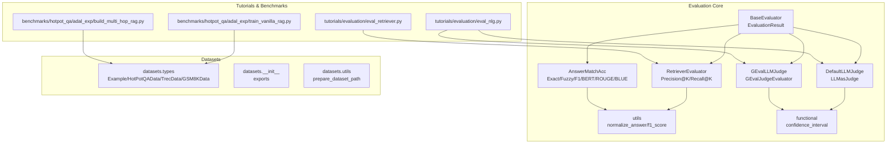
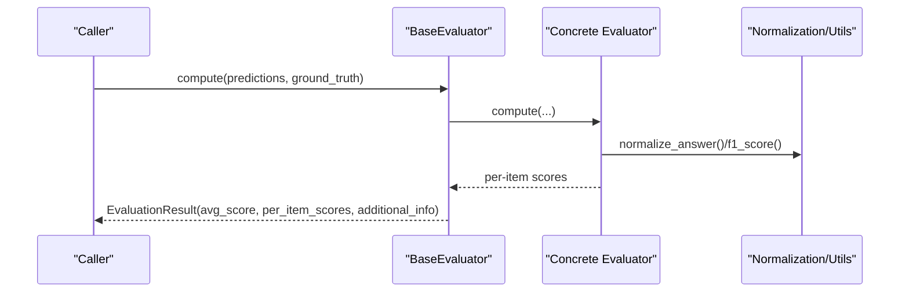
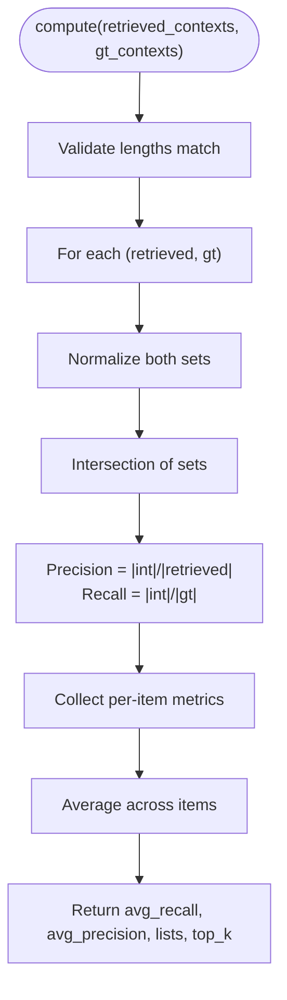
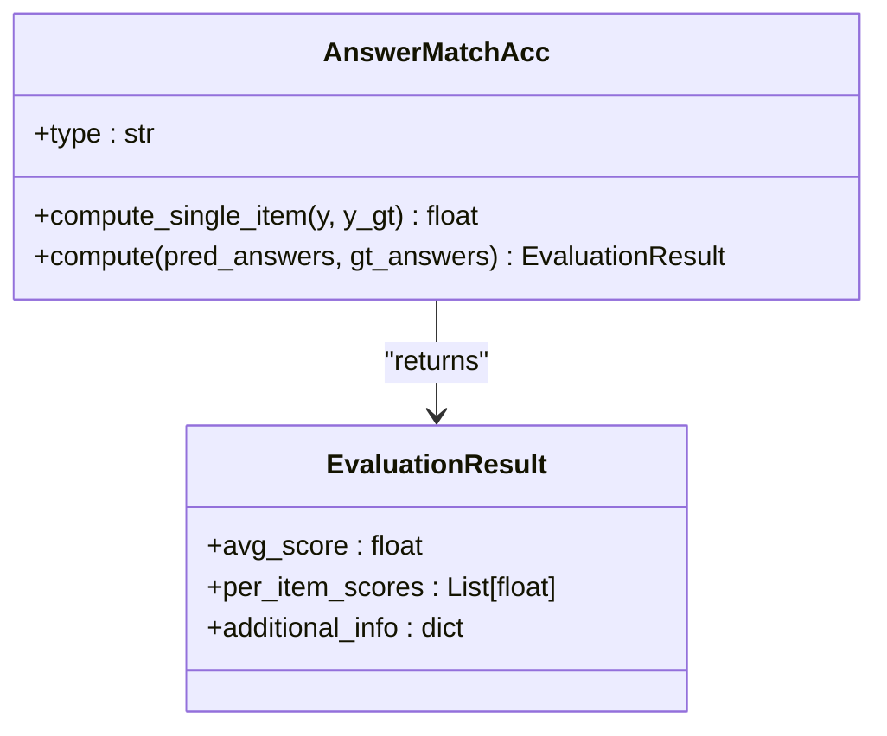
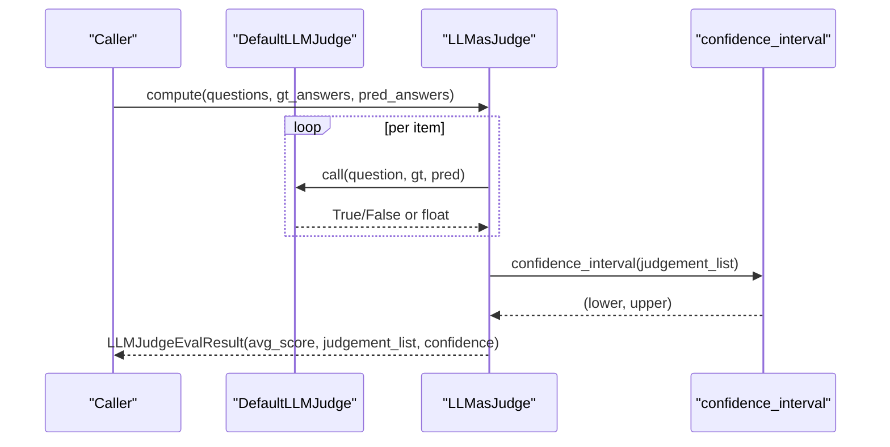
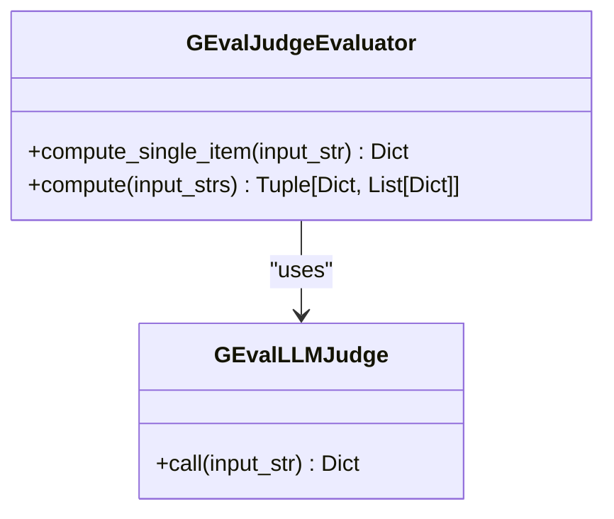
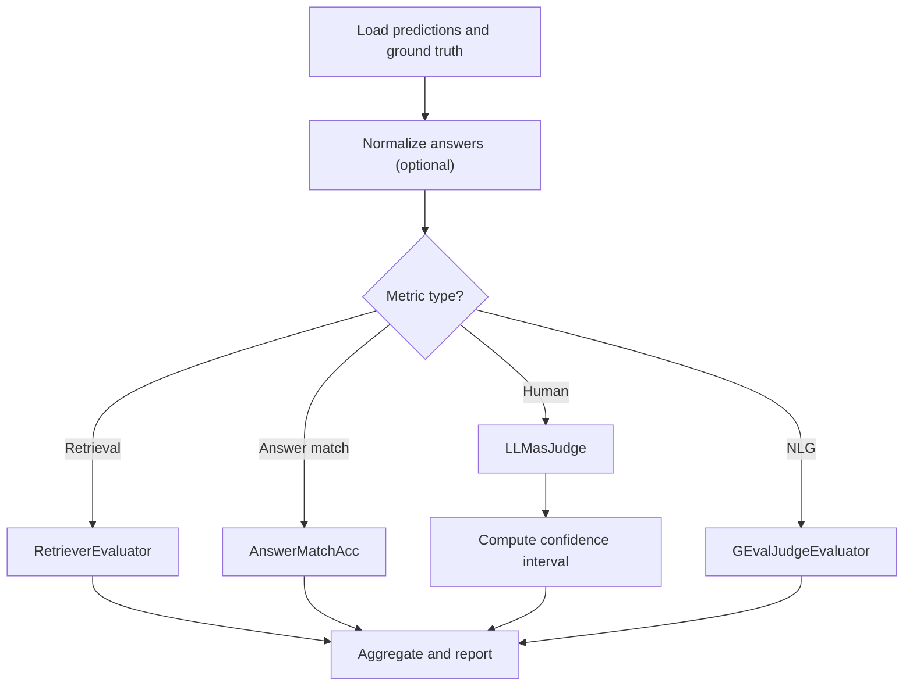
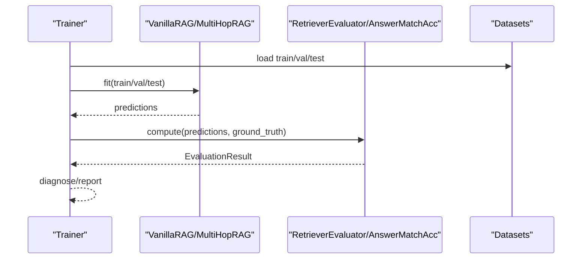
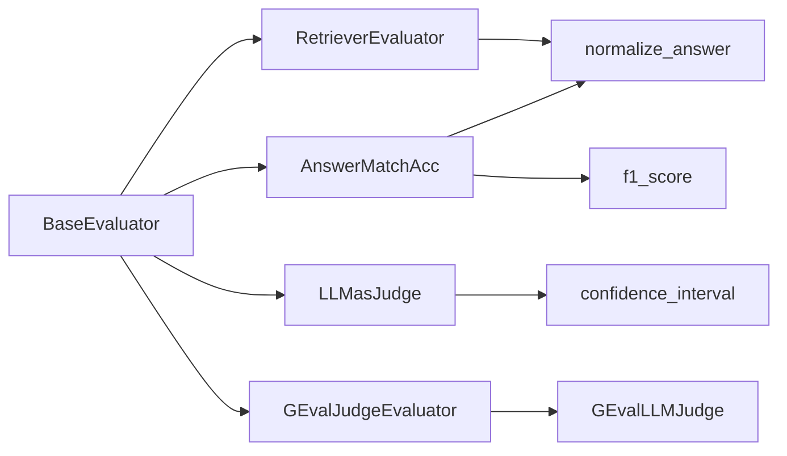

# Evaluation Frameworks

<cite>
**Referenced Files in This Document**
- [base.py](file://adalflow/adalflow/eval/base.py)
- [retriever_recall.py](file://adalflow/adalflow/eval/retriever_recall.py)
- [answer_match_acc.py](file://adalflow/adalflow/eval/answer_match_acc.py)
- [llm_as_judge.py](file://adalflow/adalflow/eval/llm_as_judge.py)
- [g_eval.py](file://adalflow/adalflow/eval/g_eval.py)
- [utils.py](file://adalflow/adalflow/eval/utils.py)
- [functional.py](file://adalflow/adalflow/eval/functional.py)
- [types.py](file://adalflow/adalflow/datasets/types.py)
- [__init__.py](file://adalflow/adalflow/datasets/__init__.py)
- [utils.py](file://adalflow/adalflow/datasets/utils.py)
- [eval_retriever.py](file://tutorials/evaluation/eval_retriever.py)
- [eval_nlg.py](file://tutorials/evaluation/eval_nlg.py)
- [train_vanilla_rag.py](file://benchmarks/hotpot_qa/adal_exp/train_vanilla_rag.py)
- [build_multi_hop_rag.py](file://benchmarks/hotpot_qa/adal_exp/build_multi_hop_rag.py)
</cite>

## Table of Contents
1. [Introduction](#introduction)
2. [Project Structure](#project-structure)
3. [Core Components](#core-components)
4. [Architecture Overview](#architecture-overview)
5. [Detailed Component Analysis](#detailed-component-analysis)
6. [Dependency Analysis](#dependency-analysis)
7. [Performance Considerations](#performance-considerations)
8. [Troubleshooting Guide](#troubleshooting-guide)
9. [Conclusion](#conclusion)
10. [Appendices](#appendices)

## Introduction
This document describes evaluation methodologies and frameworks for Retrieval-Augmented Generation (RAG) systems implemented in the repository. It explains how to measure retrieval quality, answer accuracy, and system efficiency; documents evaluation metrics such as precision, recall, F1-score, and semantic similarity; and outlines automated evaluation pipelines, ground-truth comparisons, human evaluation protocols via LLM-as-judge, and G-Eval. It also covers optimization strategies for retrieval efficiency and cost reduction, practical evaluation workflows, statistical significance testing, A/B testing, and benchmarking against standard datasets.

## Project Structure
The evaluation subsystem centers around:
- A generic evaluation interface and result abstraction
- Metrics for retrieval recall/precision and answer matching
- Human-in-the-loop evaluation via LLM-as-judge and G-Eval
- Utilities for normalization and confidence intervals
- Dataset types and helpers for standard tasks
- Tutorials and benchmarks demonstrating end-to-end evaluation workflows

**Diagram sources**
- [base.py](file://adalflow/adalflow/eval/base.py#L1-L32)
- [retriever_recall.py](file://adalflow/adalflow/eval/retriever_recall.py#L1-L148)
- [answer_match_acc.py](file://adalflow/adalflow/eval/answer_match_acc.py#L1-L158)
- [llm_as_judge.py](file://adalflow/adalflow/eval/llm_as_judge.py#L1-L250)
- [g_eval.py](file://adalflow/adalflow/eval/g_eval.py#L1-L264)
- [utils.py](file://adalflow/adalflow/eval/utils.py#L1-L49)
- [functional.py](file://adalflow/adalflow/eval/functional.py#L1-L96)
- [types.py](file://adalflow/adalflow/datasets/types.py#L1-L133)
- [__init__.py](file://adalflow/adalflow/datasets/__init__.py#L1-L17)
- [utils.py](file://adalflow/adalflow/datasets/utils.py#L1-L12)
- [eval_retriever.py](file://tutorials/evaluation/eval_retriever.py#L1-L26)
- [eval_nlg.py](file://tutorials/evaluation/eval_nlg.py#L1-L150)
- [train_vanilla_rag.py](file://benchmarks/hotpot_qa/adal_exp/train_vanilla_rag.py#L1-L184)
- [build_multi_hop_rag.py](file://benchmarks/hotpot_qa/adal_exp/build_multi_hop_rag.py#L1-L908)

**Section sources**
- [base.py](file://adalflow/adalflow/eval/base.py#L1-L32)
- [__init__.py](file://adalflow/adalflow/datasets/__init__.py#L1-L17)

## Core Components
- BaseEvaluator and EvaluationResult define a unified interface for computing scores per item and aggregating per-item scores into an overall result.
- RetrieverEvaluator computes precision and recall at K for retrieved contexts versus ground-truth contexts, with normalization and set-based matching.
- AnswerMatchAcc supports exact match, fuzzy containment, and semantic similarity via F1-score and external metrics (BERTScore, ROUGE, BLEU).
- LLMasJudge and DefaultLLMJudge enable human-in-the-loop evaluation by prompting an LLM to judge whether a predicted answer contains or matches a ground truth answer, returning a confidence interval.
- GEvalJudgeEvaluator and GEvalLLMJudge implement G-Eval scoring across relevance, fluency, consistency, and coherence, normalizing to [0,1] scales and computing an overall score.
- Functional utilities include confidence intervals for binary judgments and LCS-based string operations; normalization utilities support robust answer matching.

**Section sources**
- [base.py](file://adalflow/adalflow/eval/base.py#L8-L32)
- [retriever_recall.py](file://adalflow/adalflow/eval/retriever_recall.py#L9-L126)
- [answer_match_acc.py](file://adalflow/adalflow/eval/answer_match_acc.py#L9-L158)
- [llm_as_judge.py](file://adalflow/adalflow/eval/llm_as_judge.py#L61-L250)
- [g_eval.py](file://adalflow/adalflow/eval/g_eval.py#L92-L264)
- [utils.py](file://adalflow/adalflow/eval/utils.py#L8-L49)
- [functional.py](file://adalflow/adalflow/eval/functional.py#L5-L96)

## Architecture Overview
The evaluation architecture composes modular evaluators that accept predictions and ground truth, apply normalization and matching logic, and return standardized results. LLM-based evaluators integrate with model clients and templates to produce human-like judgments with confidence bounds. G-Eval wraps multiple metric evaluations into a unified scorer.

**Diagram sources**
- [base.py](file://adalflow/adalflow/eval/base.py#L17-L32)
- [utils.py](file://adalflow/adalflow/eval/utils.py#L8-L49)

## Detailed Component Analysis

### Retrieval Quality: RetrieverEvaluator
- Purpose: Compute precision@K and recall@K for retrieved contexts vs. ground-truth contexts.
- Methodology:
  - Normalize both retrieved and ground-truth contexts.
  - Convert to sets and compute intersection-based precision and recall.
  - Aggregate per-item metrics into averages and return a structured result.
- Notes:
  - Supports exact string matching; comments suggest extending to LCS or embedding-based similarity.
  - Expects aligned lists of retrieved and ground-truth context lists.

**Diagram sources**
- [retriever_recall.py](file://adalflow/adalflow/eval/retriever_recall.py#L83-L126)

**Section sources**
- [retriever_recall.py](file://adalflow/adalflow/eval/retriever_recall.py#L9-L126)

### Answer Accuracy: AnswerMatchAcc
- Purpose: Compare predicted answers to ground-truth answers using multiple strategies.
- Strategies:
  - Exact match: normalized strings must be identical.
  - Fuzzy match: ground truth must be contained in prediction (after normalization).
  - F1-score: token-level overlap normalized by precision and recall.
  - Semantic similarity: BERTScore, ROUGE, BLEU via torchmetrics.
- Output: EvaluationResult with average score and per-item scores.

**Diagram sources**
- [answer_match_acc.py](file://adalflow/adalflow/eval/answer_match_acc.py#L9-L158)
- [base.py](file://adalflow/adalflow/eval/base.py#L8-L15)

**Section sources**
- [answer_match_acc.py](file://adalflow/adalflow/eval/answer_match_acc.py#L9-L158)
- [utils.py](file://adalflow/adalflow/eval/utils.py#L26-L49)

### Human Evaluation: LLM-as-Judge
- DefaultLLMJudge: A Component that constructs a Generator with a configurable template and model kwargs, returning a boolean or float judgment.
- LLMasJudge: A BaseEvaluator that orchestrates per-item judgments across questions, ground truths, and predictions, returning an averaged score and confidence interval.
- Confidence Interval: Uses sample standard deviation and a Z-critical value to bound the true proportion of correct judgments.

**Diagram sources**
- [llm_as_judge.py](file://adalflow/adalflow/eval/llm_as_judge.py#L61-L250)
- [functional.py](file://adalflow/adalflow/eval/functional.py#L5-L49)

**Section sources**
- [llm_as_judge.py](file://adalflow/adalflow/eval/llm_as_judge.py#L61-L250)
- [functional.py](file://adalflow/adalflow/eval/functional.py#L5-L49)

### NLG Evaluation: G-Eval
- GEvalLLMJudge: A Component that evaluates a single input string across multiple metrics (Relevance, Fluency, Consistency, Coherence) using a templated prompt and returns normalized scores plus an overall average.
- GEvalJudgeEvaluator: A BaseEvaluator that aggregates per-item G-Eval outputs into metric-wise averages and an overall score.

**Diagram sources**
- [g_eval.py](file://adalflow/adalflow/eval/g_eval.py#L92-L264)

**Section sources**
- [g_eval.py](file://adalflow/adalflow/eval/g_eval.py#L92-L264)

### Practical Evaluation Workflows
- Retrieval evaluation tutorial demonstrates computing recall and precision for a small example.
- NLG evaluation tutorial shows ROUGE, BLEU, BERTScore, and LLM-as-judge usage; G-Eval summarization scoring is demonstrated.

**Diagram sources**
- [eval_retriever.py](file://tutorials/evaluation/eval_retriever.py#L17-L26)
- [eval_nlg.py](file://tutorials/evaluation/eval_nlg.py#L40-L150)
- [retriever_recall.py](file://adalflow/adalflow/eval/retriever_recall.py#L83-L126)
- [answer_match_acc.py](file://adalflow/adalflow/eval/answer_match_acc.py#L134-L158)
- [llm_as_judge.py](file://adalflow/adalflow/eval/llm_as_judge.py#L206-L245)
- [g_eval.py](file://adalflow/adalflow/eval/g_eval.py#L228-L259)

**Section sources**
- [eval_retriever.py](file://tutorials/evaluation/eval_retriever.py#L1-L26)
- [eval_nlg.py](file://tutorials/evaluation/eval_nlg.py#L1-L150)

### Benchmarking and RAG Pipelines
- Vanilla RAG training and diagnosis pipeline integrates evaluation during training and diagnostics.
- Multi-hop RAG builds a retriever cycle and combines contexts across hops; evaluation can be applied to the final context and answers.

**Diagram sources**
- [train_vanilla_rag.py](file://benchmarks/hotpot_qa/adal_exp/train_vanilla_rag.py#L16-L109)
- [build_multi_hop_rag.py](file://benchmarks/hotpot_qa/adal_exp/build_multi_hop_rag.py#L604-L640)

**Section sources**
- [train_vanilla_rag.py](file://benchmarks/hotpot_qa/adal_exp/train_vanilla_rag.py#L16-L109)
- [build_multi_hop_rag.py](file://benchmarks/hotpot_qa/adal_exp/build_multi_hop_rag.py#L604-L640)

## Dependency Analysis
- Cohesion: Evaluators are cohesive around a single responsibility—computing a specific metric—and rely on shared normalization and utility functions.
- Coupling:
  - BaseEvaluator defines a contract; concrete evaluators depend on it.
  - LLM-based evaluators depend on model clients and templates.
  - G-Eval depends on torchmetrics for semantic similarity and a Generator with a FloatParser.
- External dependencies: torchmetrics for BERTScore, ROUGE, BLEU; model clients for LLM-based evaluators.

**Diagram sources**
- [base.py](file://adalflow/adalflow/eval/base.py#L17-L32)
- [retriever_recall.py](file://adalflow/adalflow/eval/retriever_recall.py#L6-L7)
- [answer_match_acc.py](file://adalflow/adalflow/eval/answer_match_acc.py#L5-L6)
- [utils.py](file://adalflow/adalflow/eval/utils.py#L8-L49)
- [functional.py](file://adalflow/adalflow/eval/functional.py#L5-L49)
- [g_eval.py](file://adalflow/adalflow/eval/g_eval.py#L92-L264)

**Section sources**
- [base.py](file://adalflow/adalflow/eval/base.py#L17-L32)
- [utils.py](file://adalflow/adalflow/eval/utils.py#L8-L49)
- [functional.py](file://adalflow/adalflow/eval/functional.py#L5-L49)
- [g_eval.py](file://adalflow/adalflow/eval/g_eval.py#L92-L264)

## Performance Considerations
- Retrieval efficiency:
  - Reduce top_k and refine query rewriting to minimize redundant passages.
  - Use deduplication strategies to merge overlapping contexts across hops.
- Cost reduction:
  - Prefer smaller models for retrieval and reranking; use caching in LLM evaluators.
  - Batch evaluation where possible and avoid repeated LLM calls.
- Scalability:
  - Vector databases and approximate nearest neighbor indices can accelerate retrieval.
  - Parallelize per-item computations; note the BaseEvaluator TODO for multi-threading/async support.

[No sources needed since this section provides general guidance]

## Troubleshooting Guide
- Normalization mismatches:
  - Ensure both predictions and ground truths are normalized consistently before comparison.
- LLM judge invalid outputs:
  - DefaultLLMJudge converts outputs to boolean or float; invalid outputs are handled by defaulting to False/0.0.
- Confidence interval assumptions:
  - Binary judgments must be 0/1; ensure inputs conform to this requirement.
- G-Eval metric ranges:
  - Scores are normalized by predefined ranges; verify inputs and template correctness.

**Section sources**
- [utils.py](file://adalflow/adalflow/eval/utils.py#L8-L49)
- [llm_as_judge.py](file://adalflow/adalflow/eval/llm_as_judge.py#L124-L160)
- [functional.py](file://adalflow/adalflow/eval/functional.py#L5-L49)
- [g_eval.py](file://adalflow/adalflow/eval/g_eval.py#L171-L192)

## Conclusion
The repository provides a modular, extensible evaluation framework for RAG systems. It supports retrieval quality assessment, answer accuracy measurement, and human-in-the-loop and G-Eval-based NLG evaluation. With utilities for normalization, confidence estimation, and dataset abstractions, practitioners can implement automated evaluation pipelines, A/B tests, and benchmarking against standard datasets. Optimizations in retrieval and model usage can reduce latency and cost while maintaining reliable metrics.

[No sources needed since this section summarizes without analyzing specific files]

## Appendices

### Evaluation Metrics Reference
- Precision@K and Recall@K: retrieval quality for top-K contexts.
- F1-score: token-level overlap between predicted and ground-truth answers.
- Semantic similarity: BERTScore, ROUGE, BLEU.
- LLM-as-judge: human-like judgment with confidence intervals.
- G-Eval: multi-dimension NLG scoring (Relevance, Fluency, Consistency, Coherence).

[No sources needed since this section provides general guidance]