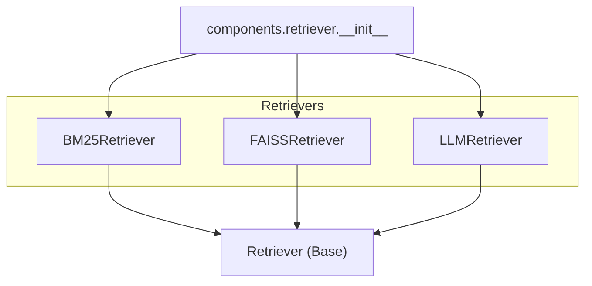
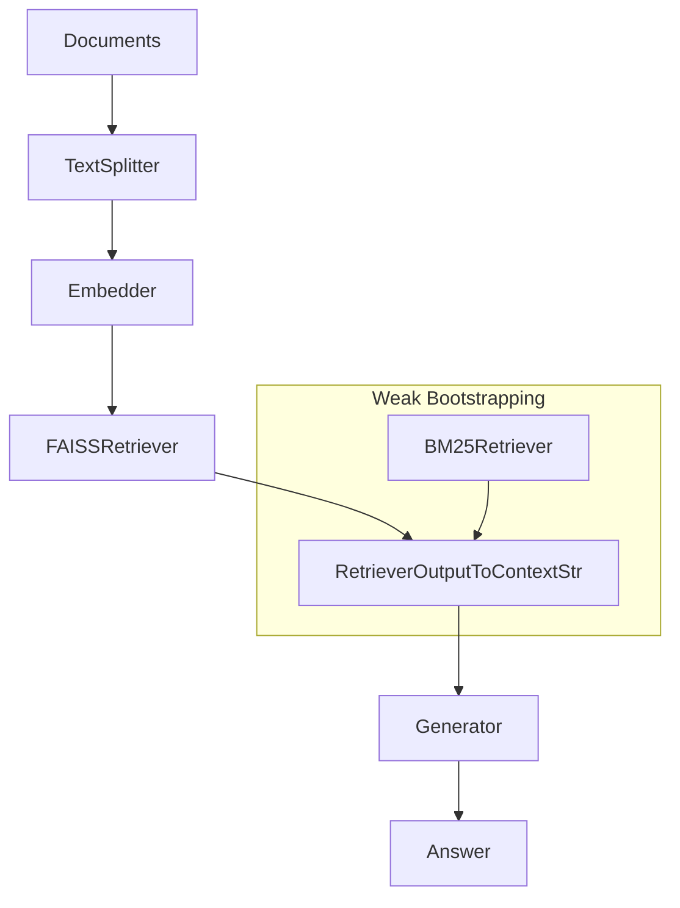
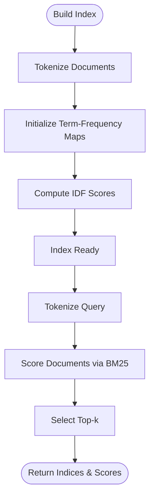
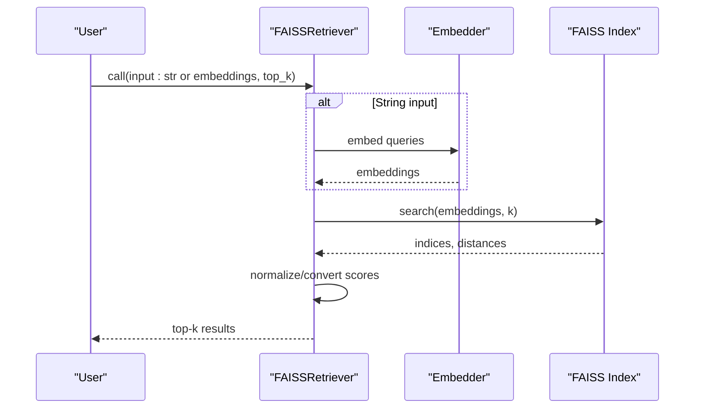
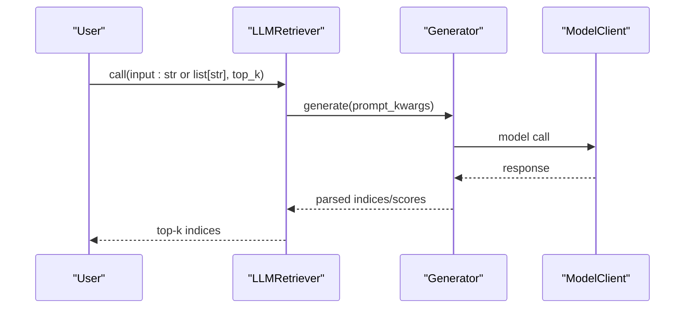
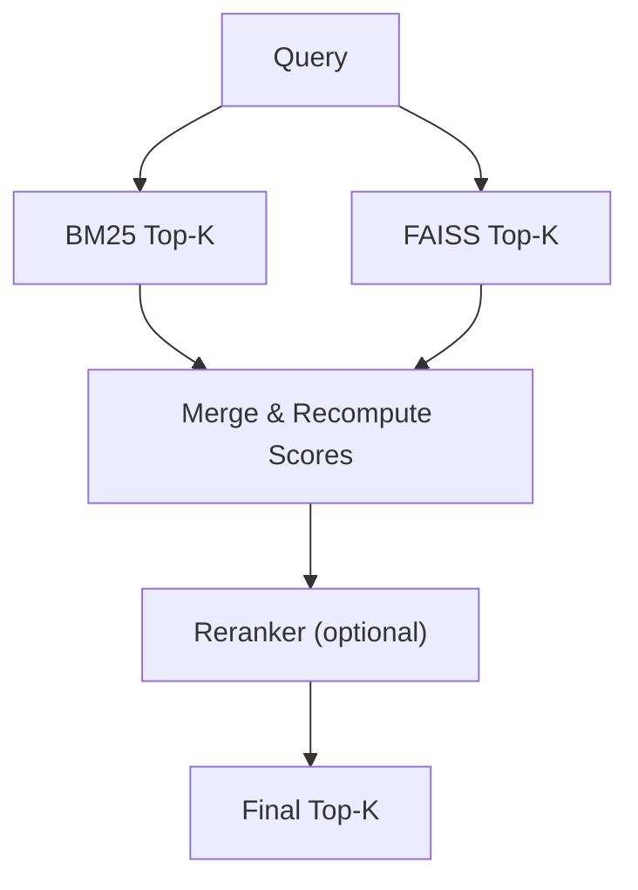
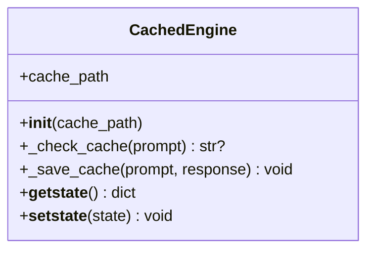
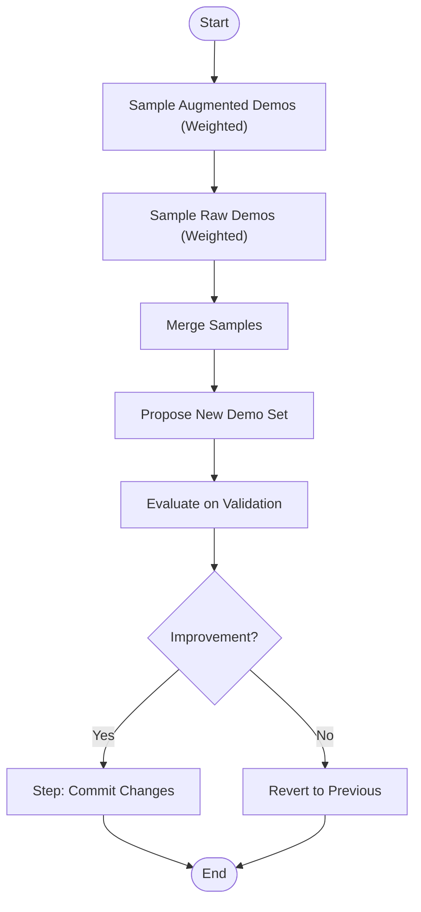
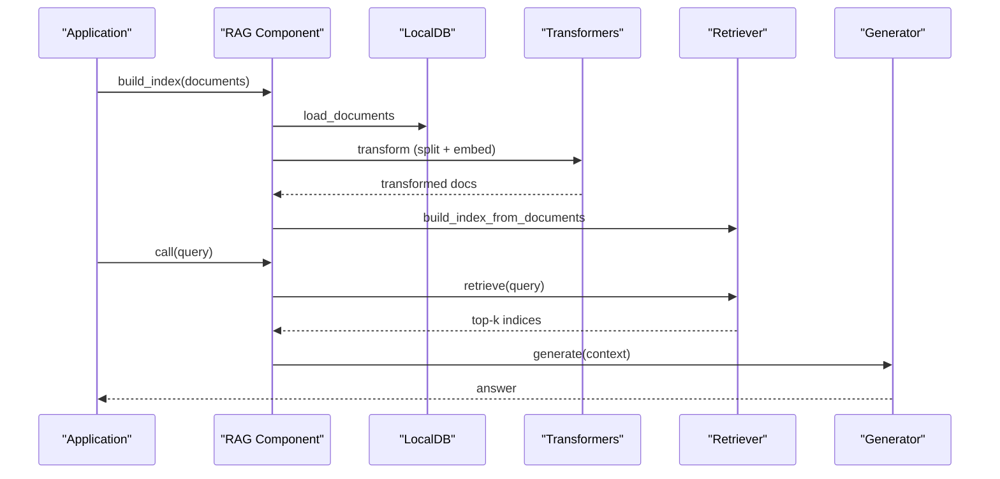
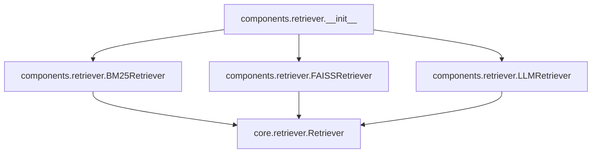

# Optimization Techniques

<cite>
**Referenced Files in This Document**
- [__init__.py](file://adalflow/adalflow/components/retriever/__init__.py)
- [retriever.py](file://adalflow/adalflow/core/retriever.py)
- [bm25_retriever.py](file://adalflow/adalflow/components/retriever/bm25_retriever.py)
- [faiss_retriever.py](file://adalflow/adalflow/components/retriever/faiss_retriever.py)
- [llm_retriever.py](file://adalflow/adalflow/components/retriever/llm_retriever.py)
- [cache.py](file://adalflow/adalflow/utils/cache.py)
- [bootstrap_optimizer.py](file://adalflow/adalflow/optim/few_shot/bootstrap_optimizer.py)
- [rag_optimized.py](file://use_cases/unsorted/rag_optimized.py)
- [llm_as_retriever.py](file://use_cases/unsorted/llm_as_retriever.py)
- [retriever_llm.py](file://use_cases/unsorted/retriever_llm.py)
- [simple_rag.yaml](file://use_cases/rag/simple_rag.yaml)
- [rag.py](file://use_cases/rag/build/rag.py)
</cite>

## Table of Contents
1. [Introduction](#introduction)
2. [Project Structure](#project-structure)
3. [Core Components](#core-components)
4. [Architecture Overview](#architecture-overview)
5. [Detailed Component Analysis](#detailed-component-analysis)
6. [Dependency Analysis](#dependency-analysis)
7. [Performance Considerations](#performance-considerations)
8. [Troubleshooting Guide](#troubleshooting-guide)
9. [Conclusion](#conclusion)
10. [Appendices](#appendices)

## Introduction
This document presents a comprehensive guide to optimizing Retrieval-Augmented Generation (RAG) systems using the AdalFlow codebase. It focuses on weak model bootstrapping for initial retrieval systems, cost-effective embedding strategies, retrieval algorithm optimizations, LLM-as-retriever patterns, hybrid retrieval methods, and multi-stage ranking. It also covers performance optimization through caching, batching, and memory-efficient structures, along with cost optimization and production deployment strategies such as scalability, latency reduction, and throughput enhancement.

## Project Structure
The repository organizes retrieval capabilities under components/retriever and exposes a unified interface via an initialization module. Retrievers are built upon a shared base class that supports gradient-aware optimization and parameter tracing. Supporting utilities include caching and optimization helpers.

**Diagram sources**
- [__init__.py](file://adalflow/adalflow/components/retriever/__init__.py#L1-L50)
- [retriever.py](file://adalflow/adalflow/core/retriever.py#L22-L143)
- [bm25_retriever.py](file://adalflow/adalflow/components/retriever/bm25_retriever.py#L58-L381)
- [faiss_retriever.py](file://adalflow/adalflow/components/retriever/faiss_retriever.py#L51-L369)
- [llm_retriever.py](file://adalflow/adalflow/components/retriever/llm_retriever.py#L39-L148)

**Section sources**
- [__init__.py](file://adalflow/adalflow/components/retriever/__init__.py#L1-L50)
- [retriever.py](file://adalflow/adalflow/core/retriever.py#L22-L143)

## Core Components
- Retriever base class defines the contract for building indexes, retrieving documents, and supporting gradient-aware optimization. It tracks inputs and hyperparameters as parameters for training-friendly workflows.
- BM25Retriever implements a fast, exact, lexical retrieval method with tunable parameters and tokenization options.
- FAISSRetriever provides semantic retrieval leveraging FAISS with configurable metrics and embedding normalization.
- LLMRetriever delegates retrieval decisions to an LLM via a templated prompt and output processors.

Key capabilities:
- Index lifecycle: reset, build from documents, persistence, and async retrieval support.
- Parameter tracing and hyperparameter tracking for optimization.
- Prompt customization and output parsing for LLM-driven retrievers.

**Section sources**
- [retriever.py](file://adalflow/adalflow/core/retriever.py#L22-L143)
- [bm25_retriever.py](file://adalflow/adalflow/components/retriever/bm25_retriever.py#L58-L381)
- [faiss_retriever.py](file://adalflow/adalflow/components/retriever/faiss_retriever.py#L51-L369)
- [llm_retriever.py](file://adalflow/adalflow/components/retriever/llm_retriever.py#L39-L148)

## Architecture Overview
The RAG pipeline integrates data preprocessing, embedding, indexing, retrieval, context assembly, and generation. Two representative implementations demonstrate different optimization strategies: a lightweight, batched embedding pipeline and a FAISS-based semantic retrieval pipeline.

**Diagram sources**
- [rag_optimized.py](file://use_cases/unsorted/rag_optimized.py#L33-L136)
- [rag.py](file://use_cases/rag/build/rag.py#L104-L206)
- [faiss_retriever.py](file://adalflow/adalflow/components/retriever/faiss_retriever.py#L51-L369)
- [bm25_retriever.py](file://adalflow/adalflow/components/retriever/bm25_retriever.py#L58-L381)

## Detailed Component Analysis

### BM25 Retrieval: Weak Model Bootstrapping
BM25 serves as a cost-free, fast lexical baseline for initial retrieval. It builds an in-memory index of tokenized documents and computes BM25 scores per query.

Optimization levers:
- Tokenization strategy: choose between raw word splitting or tokenized splitting via the internal tokenizer.
- Parameter tuning: k1, b, and epsilon adjust term frequency saturation, length normalization, and negative IDF mitigation.
- Batch scoring: supports per-query scoring and can be extended to batched scoring for improved throughput.

**Diagram sources**
- [bm25_retriever.py](file://adalflow/adalflow/components/retriever/bm25_retriever.py#L210-L287)

Practical tips:
- Use BM25 for cold-start retrieval or when embedding costs are prohibitive.
- Combine BM25 with a reranker for multi-stage ranking to improve precision without heavy inference.

**Section sources**
- [bm25_retriever.py](file://adalflow/adalflow/components/retriever/bm25_retriever.py#L58-L381)

### FAISS Semantic Retrieval: Cost-Effective Embeddings
FAISSRetriever enables scalable semantic retrieval with configurable metrics and embedding normalization. It supports both string and embedding queries and converts cosine similarity to a probability-like score.

Optimization levers:
- Metric choice: cosine (inner product on normalized vectors) or Euclidean distance.
- Normalization: ensures cosine similarity semantics; warning emitted if embeddings are not normalized.
- Batched embedding pipeline: integrate with a batching embedder to reduce overhead and amortize costs.

**Diagram sources**
- [faiss_retriever.py](file://adalflow/adalflow/components/retriever/faiss_retriever.py#L261-L323)

Best practices:
- Prefer normalized embeddings for cosine similarity to maintain semantic equivalence.
- Tune top_k to balance recall and downstream generation cost.
- Persist and reuse indices to avoid rebuilding costs.

**Section sources**
- [faiss_retriever.py](file://adalflow/adalflow/components/retriever/faiss_retriever.py#L51-L369)

### LLM-as-Retriever Pattern
LLMRetriever delegates retrieval to an LLM with a templated prompt and output processors. It is flexible for custom ranking and can incorporate scores alongside indices.

Implementation highlights:
- Prompt template defines document presentation and desired output format.
- Output processors parse structured responses (e.g., list of indices).
- Model switching via model_kwargs without reinitialization.

**Diagram sources**
- [llm_retriever.py](file://adalflow/adalflow/components/retriever/llm_retriever.py#L97-L143)

Guidelines:
- Keep prompts concise and deterministic to reduce token usage.
- Use structured output parsers to minimize post-processing overhead.
- Consider few-shot demonstrations to stabilize retrieval behavior.

**Section sources**
- [llm_retriever.py](file://adalflow/adalflow/components/retriever/llm_retriever.py#L39-L148)

### Hybrid Retrieval and Multi-Stage Ranking
Hybrid retrieval combines lexical and semantic signals. A common pattern is to use BM25 for coarse filtering and FAISS for fine-grained ranking, followed by a reranker.

[No sources needed since this diagram shows conceptual workflow, not actual code structure]

### Caching Mechanisms
Caching reduces repeated computation for identical prompts or queries. The cache utility hashes prompts and stores responses on disk.

**Diagram sources**
- [cache.py](file://adalflow/adalflow/utils/cache.py#L19-L48)

Usage guidance:
- Apply caching to expensive steps like embedding or model calls.
- Ensure cache keys reflect prompt and configuration variations to avoid collisions.

**Section sources**
- [cache.py](file://adalflow/adalflow/utils/cache.py#L1-L48)

### Few-Shot Bootstrapping for Initial Retrieval
BootstrapFewShot demonstrates a practical approach to iteratively improving retrieval demonstrations using weighted sampling and teacher/student feedback loops.

**Diagram sources**
- [bootstrap_optimizer.py](file://adalflow/adalflow/optim/few_shot/bootstrap_optimizer.py#L233-L300)

Operational notes:
- Weighted sampling prioritizes demos that failed in the current model but succeed with augmented versions.
- Exclude input fields from bootstrap demos to reduce token usage when appropriate.

**Section sources**
- [bootstrap_optimizer.py](file://adalflow/adalflow/optim/few_shot/bootstrap_optimizer.py#L22-L308)

### Practical Implementation Workflows
Two end-to-end examples illustrate optimization workflows:

- Lightweight batched embedding pipeline with FAISS retrieval and generator:
  - Data transformation pipeline: text splitting, embeddings, and FAISS indexing.
  - Runtime retrieval: query embedding, FAISS search, context assembly, and generation.

- LLM-as-retriever example:
  - Demonstrates prompt construction, document indexing, and structured output parsing.

**Diagram sources**
- [rag_optimized.py](file://use_cases/unsorted/rag_optimized.py#L101-L136)
- [rag.py](file://use_cases/rag/build/rag.py#L190-L206)

**Section sources**
- [rag_optimized.py](file://use_cases/unsorted/rag_optimized.py#L33-L136)
- [llm_as_retriever.py](file://use_cases/unsorted/llm_as_retriever.py#L7-L23)
- [retriever_llm.py](file://use_cases/unsorted/retriever_llm.py#L47-L82)
- [simple_rag.yaml](file://use_cases/rag/simple_rag.yaml#L1-L20)
- [rag.py](file://use_cases/rag/build/rag.py#L104-L206)

## Dependency Analysis
The retriever ecosystem is modular and extensible. The base class centralizes retrieval semantics, while specialized retrievers encapsulate domain-specific logic.

**Diagram sources**
- [__init__.py](file://adalflow/adalflow/components/retriever/__init__.py#L1-L50)
- [retriever.py](file://adalflow/adalflow/core/retriever.py#L22-L143)

**Section sources**
- [__init__.py](file://adalflow/adalflow/components/retriever/__init__.py#L1-L50)
- [retriever.py](file://adalflow/adalflow/core/retriever.py#L22-L143)

## Performance Considerations
- Latency optimization
  - Use BM25 for initial filtering to reduce downstream computation.
  - Normalize embeddings for cosine similarity to avoid extra conversion overhead.
  - Persist and reuse FAISS indices to skip rebuilds.

- Throughput enhancement
  - Batch embedding calls and FAISS searches where possible.
  - Use caching for repeated prompts or queries.
  - Employ token-efficient prompts for LLM-as-retriever.

- Memory efficiency
  - Keep only necessary metadata in indexed documents.
  - Use smaller embedding dimensions when acceptable for cost/performance trade-offs.
  - De-duplicate contexts during retrieval output processing.

[No sources needed since this section provides general guidance]

## Troubleshooting Guide
Common issues and resolutions:
- Empty or mis-sized embeddings
  - Ensure consistent embedding dimensions and normalization.
  - Validate batch shapes and handle empty inputs gracefully.

- Unbuilt index errors
  - Verify that build_index_from_documents was called before retrieval.
  - Confirm that the index is not reset unexpectedly.

- LLM output parsing failures
  - Align prompt templates with output processors.
  - Handle empty or malformed responses and log detailed errors.

**Section sources**
- [faiss_retriever.py](file://adalflow/adalflow/components/retriever/faiss_retriever.py#L164-L203)
- [llm_retriever.py](file://adalflow/adalflow/components/retriever/llm_retriever.py#L115-L143)

## Conclusion
Optimizing RAG involves balancing speed, cost, and quality. Start with a weak model (BM25) for bootstrapping, augment with semantic retrieval (FAISS), optionally refine with reranking, and stabilize behavior with few-shot bootstrapping. Leverage caching, batching, and memory-efficient structures to achieve production-grade performance. The provided components and examples offer a practical foundation for iterative improvement and scalable deployment.

[No sources needed since this section summarizes without analyzing specific files]

## Appendices
- Configuration examples
  - YAML configuration for vectorizer, retriever, generator, and text splitter.

**Section sources**
- [simple_rag.yaml](file://use_cases/rag/simple_rag.yaml#L1-L20)