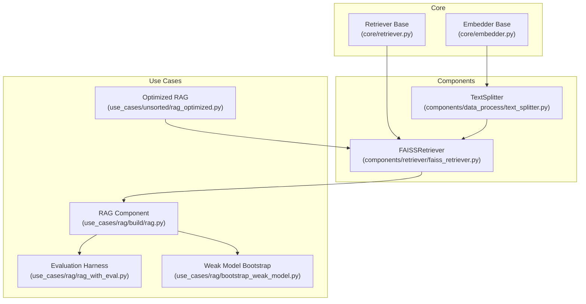
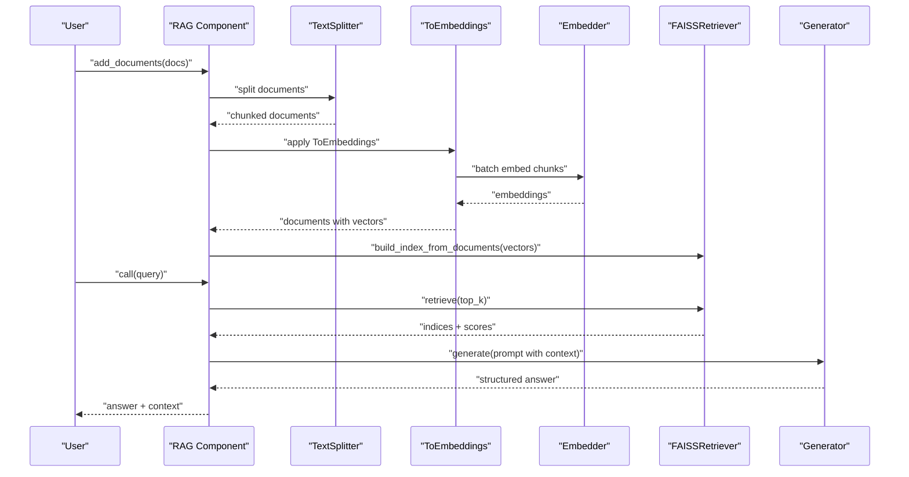
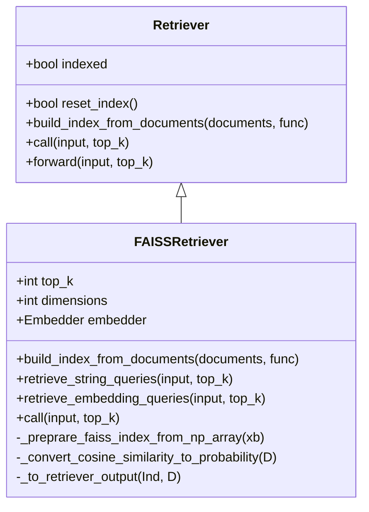
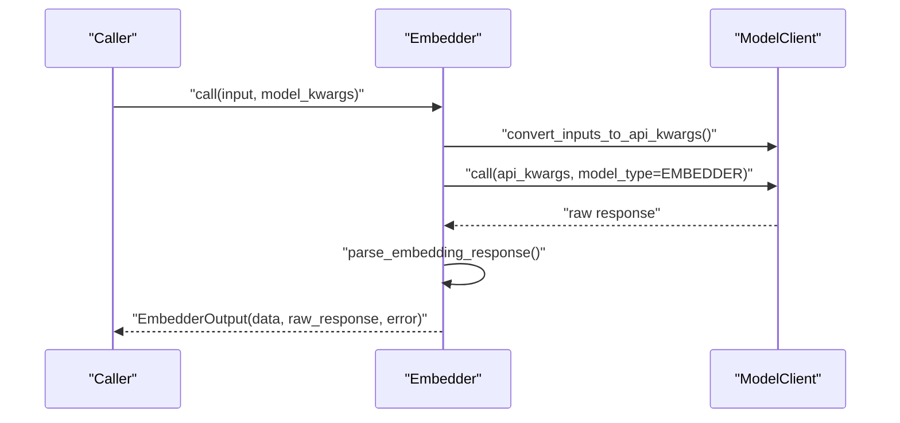
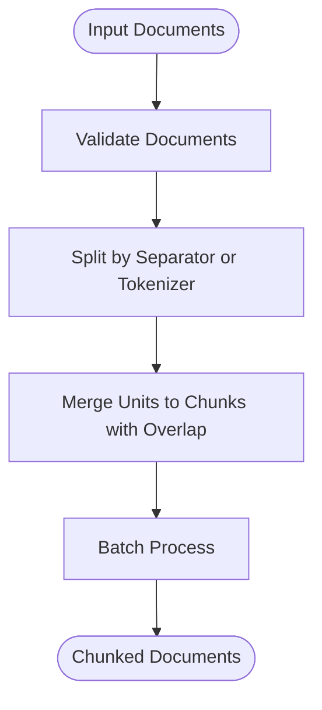
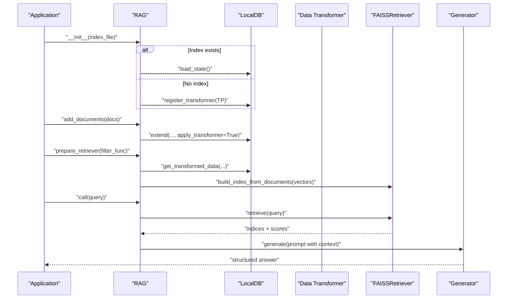
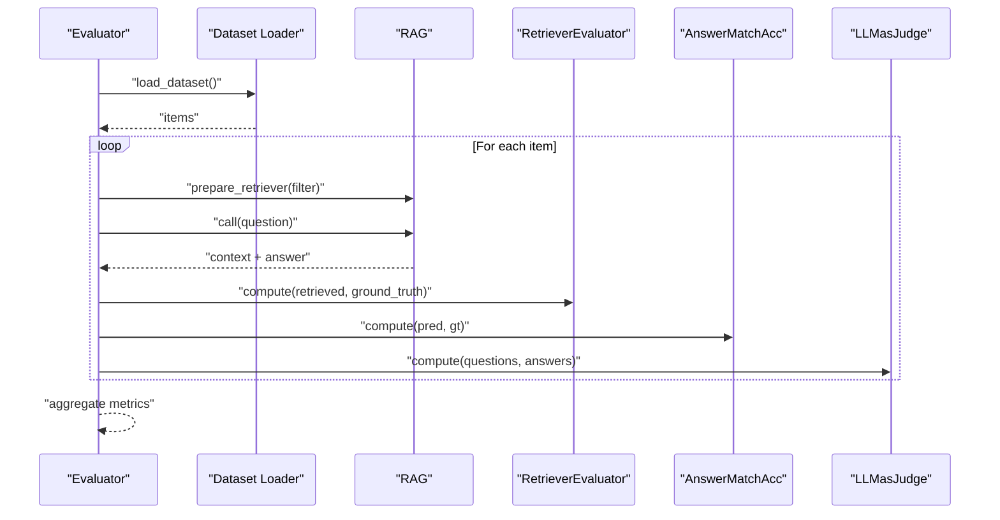
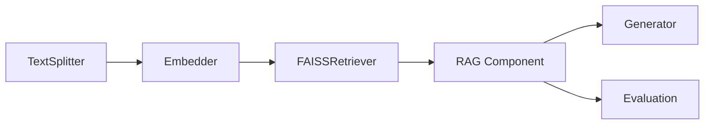

# RAG Systems

<cite>
**Referenced Files in This Document**
- [faiss_retriever.py](file://adalflow/adalflow/components/retriever/faiss_retriever.py)
- [retriever.py](file://adalflow/adalflow/core/retriever.py)
- [text_splitter.py](file://adalflow/adalflow/components/data_process/text_splitter.py)
- [embedder.py](file://adalflow/adalflow/core/embedder.py)
- [rag.py](file://use_cases/rag/build/rag.py)
- [bootstrap_weak_model.py](file://use_cases/rag/bootstrap_weak_model.py)
- [rag_with_eval.py](file://use_cases/rag/rag_with_eval.py)
- [simple_rag.yaml](file://use_cases/configs/simple_rag.yaml)
- [rag.yaml](file://use_cases/configs/rag.yaml)
- [rag_hotpotqa.yaml](file://use_cases/configs/rag_hotpotqa.yaml)
- [rag_optimized.py](file://use_cases/unsorted/rag_optimized.py)
- [rag_hotpotqa.py](file://use_cases/unsorted/rag_hotpotqa.py)
- [rag_yaml_config.py](file://use_cases/unsorted/rag_yaml_config.py)
</cite>

## Table of Contents
1. [Introduction](#introduction)
2. [Project Structure](#project-structure)
3. [Core Components](#core-components)
4. [Architecture Overview](#architecture-overview)
5. [Detailed Component Analysis](#detailed-component-analysis)
6. [Dependency Analysis](#dependency-analysis)
7. [Performance Considerations](#performance-considerations)
8. [Troubleshooting Guide](#troubleshooting-guide)
9. [Conclusion](#conclusion)
10. [Appendices](#appendices)

## Introduction
This document explains how to build production-ready Retrieval Augmented Generation (RAG) systems using the AdalFlow framework. It covers the complete RAG pipeline: document preprocessing, embedding generation, vector indexing, retrieval, and generation. It also documents the RAG component class structure, data transformation workflows, integration patterns with FAISS retrievers, evaluation frameworks, weak model bootstrapping, and optimization strategies for scalability and reliability.

## Project Structure
The RAG implementation spans reusable core components and example use cases:
- Core abstractions and base classes for retrievers and embedders
- FAISS-based semantic retriever
- Text splitting for preprocessing
- Example RAG pipeline with persistent index and evaluation
- Configuration-driven setups and evaluation harnesses

**Diagram sources**
- [retriever.py](file://adalflow/adalflow/core/retriever.py#L22-L143)
- [embedder.py](file://adalflow/adalflow/core/embedder.py#L23-L236)
- [text_splitter.py](file://adalflow/adalflow/components/data_process/text_splitter.py#L47-L357)
- [faiss_retriever.py](file://adalflow/adalflow/components/retriever/faiss_retriever.py#L51-L369)
- [rag.py](file://use_cases/rag/build/rag.py#L104-L252)
- [rag_with_eval.py](file://use_cases/rag/rag_with_eval.py#L1-L136)
- [bootstrap_weak_model.py](file://use_cases/rag/bootstrap_weak_model.py#L1-L47)
- [rag_optimized.py](file://use_cases/unsorted/rag_optimized.py#L33-L167)

**Section sources**
- [retriever.py](file://adalflow/adalflow/core/retriever.py#L22-L143)
- [embedder.py](file://adalflow/adalflow/core/embedder.py#L23-L236)
- [text_splitter.py](file://adalflow/adalflow/components/data_process/text_splitter.py#L47-L357)
- [faiss_retriever.py](file://adalflow/adalflow/components/retriever/faiss_retriever.py#L51-L369)
- [rag.py](file://use_cases/rag/build/rag.py#L104-L252)
- [rag_with_eval.py](file://use_cases/rag/rag_with_eval.py#L1-L136)
- [bootstrap_weak_model.py](file://use_cases/rag/bootstrap_weak_model.py#L1-L47)
- [rag_optimized.py](file://use_cases/unsorted/rag_optimized.py#L33-L167)

## Core Components
- Retriever base class defines the interface for index management and retrieval, including forward tracing and parameterized hyperparameters.
- Embedder orchestrates model clients, composes model kwargs, and applies output processors to produce standardized embedding outputs.
- TextSplitter performs configurable chunking of documents for downstream embedding and retrieval.
- FAISSRetriever implements semantic retrieval with FAISS, supporting string and embedding queries, normalization, and probability conversion for cosine similarity.

Key responsibilities:
- Preprocessing: TextSplitter handles chunking and merging with configurable separators and tokenization.
- Embedding: Embedder manages model client calls and post-processing of embeddings.
- Indexing: FAISSRetriever builds in-memory indexes from precomputed embeddings.
- Retrieval: FAISSRetriever supports both string and embedding queries, returning ranked document indices and scores.
- Generation: Example RAG integrates retriever output into a generator with structured output parsing.

**Section sources**
- [retriever.py](file://adalflow/adalflow/core/retriever.py#L22-L143)
- [embedder.py](file://adalflow/adalflow/core/embedder.py#L23-L236)
- [text_splitter.py](file://adalflow/adalflow/components/data_process/text_splitter.py#L47-L357)
- [faiss_retriever.py](file://adalflow/adalflow/components/retriever/faiss_retriever.py#L51-L369)

## Architecture Overview
The RAG pipeline follows a modular, component-based design:
- Data ingestion and preprocessing: Documents enter via a data pipeline combining TextSplitter and ToEmbeddings.
- Embedding generation: Embedder produces fixed-dimension vectors for each chunk.
- Indexing: FAISSRetriever constructs an in-memory index from chunk embeddings.
- Retrieval: Queries are embedded (when needed) and matched against the index to return top-k chunks.
- Generation: Retrieved context is formatted and passed to a generator with a structured output parser.

**Diagram sources**
- [rag.py](file://use_cases/rag/build/rag.py#L104-L252)
- [text_splitter.py](file://adalflow/adalflow/components/data_process/text_splitter.py#L238-L301)
- [embedder.py](file://adalflow/adalflow/core/embedder.py#L133-L160)
- [faiss_retriever.py](file://adalflow/adalflow/components/retriever/faiss_retriever.py#L150-L202)

## Detailed Component Analysis

### FAISSRetriever
FAISSRetriever extends the Retriever base class and encapsulates FAISS-based semantic search:
- Supports string and embedding queries, with automatic normalization for cosine similarity.
- Builds an in-memory index from precomputed embeddings and returns top-k matches.
- Converts cosine similarity to a probability-like score when metric is set to probability.
- Provides robust error handling and logging for invalid inputs and empty documents.

**Diagram sources**
- [retriever.py](file://adalflow/adalflow/core/retriever.py#L22-L143)
- [faiss_retriever.py](file://adalflow/adalflow/components/retriever/faiss_retriever.py#L51-L369)

**Section sources**
- [faiss_retriever.py](file://adalflow/adalflow/components/retriever/faiss_retriever.py#L51-L369)
- [retriever.py](file://adalflow/adalflow/core/retriever.py#L22-L143)

### Embedder
Embedder orchestrates model client calls and output processing:
- Composes model kwargs and converts inputs to API-compatible kwargs.
- Calls the model client, parses embedding responses, and applies optional output processors.
- Supports synchronous and asynchronous invocation and includes error propagation.

**Diagram sources**
- [embedder.py](file://adalflow/adalflow/core/embedder.py#L92-L160)

**Section sources**
- [embedder.py](file://adalflow/adalflow/core/embedder.py#L23-L236)

### TextSplitter
TextSplitter performs configurable chunking:
- Supports multiple split strategies: word, sentence, page, passage, and token-based.
- Applies sliding window merging with configurable chunk size and overlap.
- Processes documents in batches and enforces input validation.

**Diagram sources**
- [text_splitter.py](file://adalflow/adalflow/components/data_process/text_splitter.py#L238-L301)

**Section sources**
- [text_splitter.py](file://adalflow/adalflow/components/data_process/text_splitter.py#L47-L357)

### RAG Component
The RAG component demonstrates a production-ready pipeline:
- Loads or restores persisted transformed documents.
- Prepares a data pipeline combining TextSplitter and ToEmbeddings.
- Builds a FAISSRetriever from precomputed embeddings.
- Integrates a generator with a structured output parser and prompt template.
- Supports dynamic addition of documents and incremental index updates.

**Diagram sources**
- [rag.py](file://use_cases/rag/build/rag.py#L104-L252)
- [faiss_retriever.py](file://adalflow/adalflow/components/retriever/faiss_retriever.py#L150-L202)

**Section sources**
- [rag.py](file://use_cases/rag/build/rag.py#L104-L252)

### Evaluation Framework
The evaluation harness measures retriever recall and generator accuracy:
- Loads datasets (e.g., HotpotQA), prepares documents, and filters for each query.
- Computes retriever recall and answer match accuracy; optionally uses an LLM-as-judge evaluator.
- Demonstrates end-to-end evaluation of a deployed RAG system.

**Diagram sources**
- [rag_with_eval.py](file://use_cases/rag/rag_with_eval.py#L62-L136)

**Section sources**
- [rag_with_eval.py](file://use_cases/rag/rag_with_eval.py#L1-L136)

### Weak Model Bootstrapping
Weak model bootstrapping enables low-cost generation for small or constrained environments:
- Uses a lightweight model client (e.g., Groq) to generate structured answers under a simple prompt template.
- Demonstrates how to integrate a minimal generator for rapid prototyping or fallback scenarios.

**Section sources**
- [bootstrap_weak_model.py](file://use_cases/rag/bootstrap_weak_model.py#L1-L47)

## Dependency Analysis
The RAG system exhibits clear separation of concerns:
- Retriever depends on Embedder for query embeddings and FAISS for index operations.
- Embedder depends on a ModelClient abstraction and output processors.
- TextSplitter is independent and feeds into the embedding stage.
- RAG composes these components into a cohesive pipeline with persistence and evaluation hooks.

**Diagram sources**
- [text_splitter.py](file://adalflow/adalflow/components/data_process/text_splitter.py#L47-L357)
- [embedder.py](file://adalflow/adalflow/core/embedder.py#L23-L236)
- [faiss_retriever.py](file://adalflow/adalflow/components/retriever/faiss_retriever.py#L51-L369)
- [rag.py](file://use_cases/rag/build/rag.py#L104-L252)

**Section sources**
- [text_splitter.py](file://adalflow/adalflow/components/data_process/text_splitter.py#L47-L357)
- [embedder.py](file://adalflow/adalflow/core/embedder.py#L23-L236)
- [faiss_retriever.py](file://adalflow/adalflow/components/retriever/faiss_retriever.py#L51-L369)
- [rag.py](file://use_cases/rag/build/rag.py#L104-L252)

## Performance Considerations
- Embedding batch sizing: Use BatchEmbedder or configure batch_size to balance throughput and memory.
- Index dimensionality: Ensure consistent dimensions across stored vectors and FAISS index construction.
- Normalization: FAISSRetriever normalizes embeddings when using cosine similarity to maximize accuracy.
- Metric selection: Choose euclidean vs cosine vs prob depending on downstream scoring needs.
- Preprocessing tuning: Adjust chunk size and overlap to optimize recall while controlling cost.
- Persistence and incremental updates: Persist transformed data and rebuild retriever indexes incrementally as new documents arrive.
- Async and tracing: Embedder supports async calls; Retriever’s forward method integrates tracing for diagnostics.

[No sources needed since this section provides general guidance]

## Troubleshooting Guide
Common issues and resolutions:
- Empty documents list during index build: The FAISSRetriever logs a warning and resets the index; ensure non-empty inputs and correct mapping functions.
- Dimension mismatch: FAISSRetriever asserts consistent embedding dimensions; verify model output dimensions match the index.
- Unnormalized embeddings: FAISSRetriever warns and normalizes when needed; ensure consistent normalization policy.
- Missing embedder for string queries: FAISSRetriever requires an embedder when retrieving with strings; provide one during initialization.
- Index not built: Retriever raises an error if the index is empty; call build_index_from_documents before retrieval.
- Generator errors: Propagate and surface generator errors; inspect output.error for details.

**Section sources**
- [faiss_retriever.py](file://adalflow/adalflow/components/retriever/faiss_retriever.py#L164-L202)
- [faiss_retriever.py](file://adalflow/adalflow/components/retriever/faiss_retriever.py#L241-L258)
- [faiss_retriever.py](file://adalflow/adalflow/components/retriever/faiss_retriever.py#L350-L358)
- [embedder.py](file://adalflow/adalflow/core/embedder.py#L142-L155)

## Conclusion
AdalFlow provides a modular, extensible foundation for building production-grade RAG systems. By composing TextSplitter, Embedder, FAISSRetriever, and a generator with structured output parsing, teams can implement scalable retrieval pipelines with robust evaluation and deployment patterns. The included examples demonstrate configuration-driven setups, weak model bootstrapping, and end-to-end evaluation for real-world datasets.

[No sources needed since this section summarizes without analyzing specific files]

## Appendices

### Configuration Management
- YAML configurations define vectorizer, retriever, generator, and text splitter settings.
- Example configurations are provided for different use cases (simple, HotpotQA).

**Section sources**
- [simple_rag.yaml](file://use_cases/configs/simple_rag.yaml#L1-L20)
- [rag.yaml](file://use_cases/configs/rag.yaml#L1-L20)
- [rag_hotpotqa.yaml](file://use_cases/configs/rag_hotpotqa.yaml#L1-L25)

### Deployment Patterns
- Persist transformed documents and FAISS indexes for reuse across runs.
- Support incremental document ingestion with re-indexing of filtered subsets for targeted retrieval.
- Use tracing and logging to monitor performance and diagnose issues in production.

**Section sources**
- [rag.py](file://use_cases/rag/build/rag.py#L66-L81)
- [rag.py](file://use_cases/rag/build/rag.py#L156-L178)