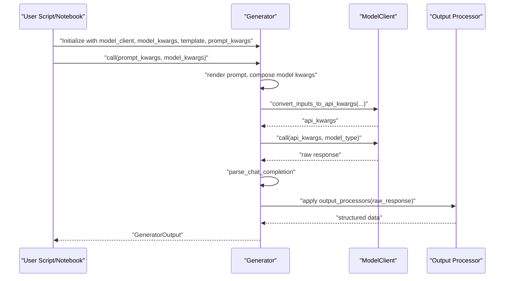
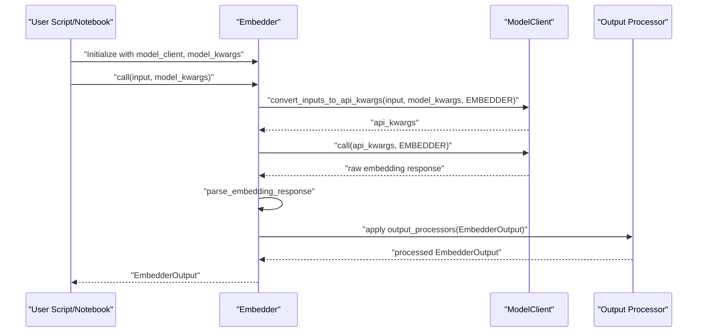
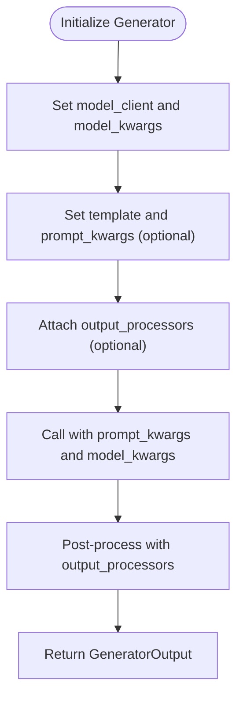
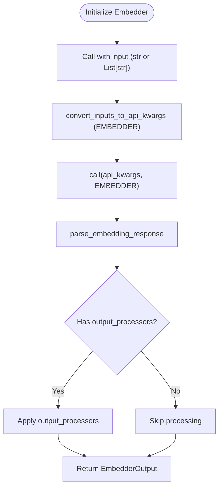
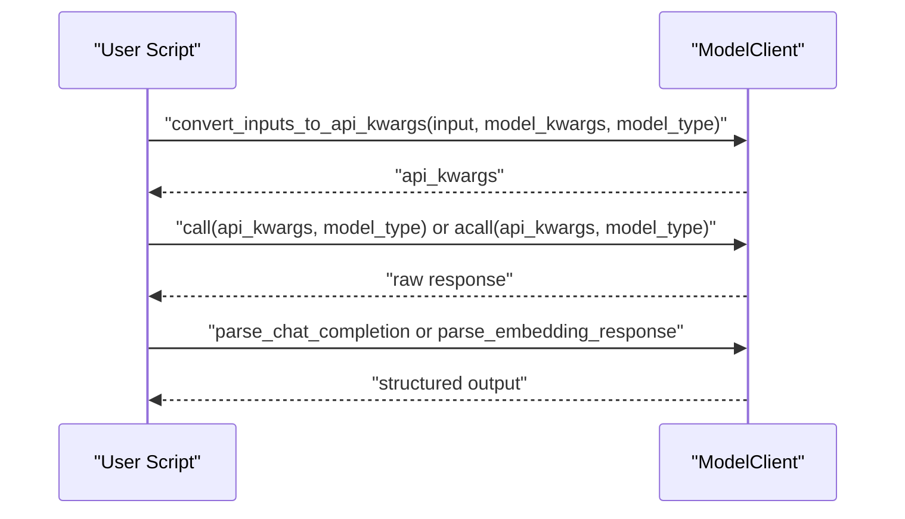
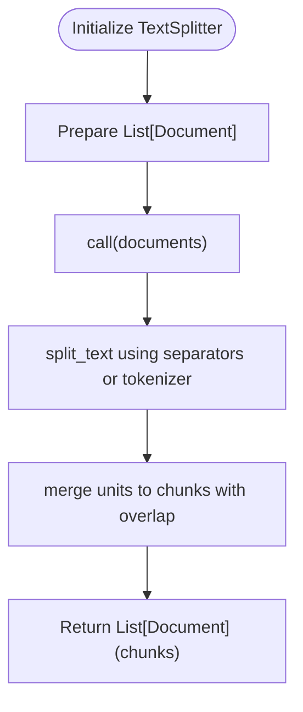
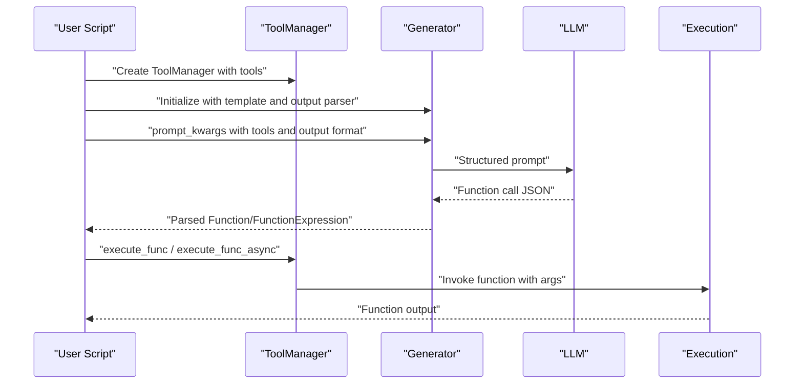
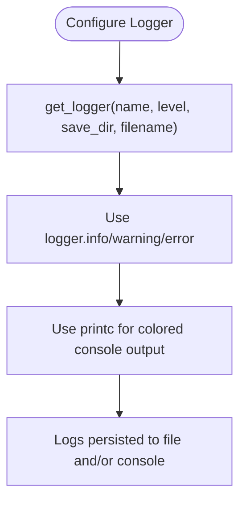
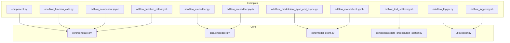

# Basic Examples

<cite>
**Referenced Files in This Document**
- [__init__.py](file://adalflow/adalflow/__init__.py)
- [core/__init__.py](file://adalflow/adalflow/core/__init__.py)
- [core/generator.py](file://adalflow/adalflow/core/generator.py)
- [core/embedder.py](file://adalflow/adalflow/core/embedder.py)
- [core/model_client.py](file://adalflow/adalflow/core/model_client.py)
- [utils/logger.py](file://adalflow/adalflow/utils/logger.py)
- [components/data_process/text_splitter.py](file://adalflow/adalflow/components/data_process/text_splitter.py)
- [tutorials/component.py](file://tutorials/component.py)
- [tutorials/adalflow_embedder.py](file://tutorials/adalflow_embedder.py)
- [tutorials/adalflow_function_calls.py](file://tutorials/adalflow_function_calls.py)
- [tutorials/adalflow_logger.py](file://tutorials/adalflow_logger.py)
- [tutorials/adalflow_modelclient_sync_and_async.py](file://tutorials/adalflow_modelclient_sync_and_async.py)
- [notebooks/tutorials/adalflow_component.ipynb](file://notebooks/tutorials/adalflow_component.ipynb)
- [notebooks/tutorials/adalflow_embedder.ipynb](file://notebooks/tutorials/adalflow_embedder.ipynb)
- [notebooks/tutorials/adalflow_function_calls.ipynb](file://notebooks/tutorials/adalflow_function_calls.ipynb)
- [notebooks/tutorials/adalflow_logger.ipynb](file://notebooks/tutorials/adalflow_logger.ipynb)
- [notebooks/tutorials/adalflow_modelclient.ipynb](file://notebooks/tutorials/adalflow_modelclient.ipynb)
- [notebooks/tutorials/adalflow_text_splitter.ipynb](file://notebooks/tutorials/adalflow_text_splitter.ipynb)
</cite>

## Table of Contents
1. [Introduction](#introduction)
2. [Project Structure](#project-structure)
3. [Core Components](#core-components)
4. [Architecture Overview](#architecture-overview)
5. [Detailed Component Analysis](#detailed-component-analysis)
6. [Dependency Analysis](#dependency-analysis)
7. [Performance Considerations](#performance-considerations)
8. [Troubleshooting Guide](#troubleshooting-guide)
9. [Conclusion](#conclusion)

## Introduction
This document presents the Basic Examples for AdalFlow, focusing on fundamental components and workflows. It explains how to initialize and use core building blocks such as Generator, Embedder, ModelClient, TextSplitter, function calls, logging, and how to wire them together into simple, reproducible scripts and notebooks. Each example includes step-by-step instructions, interactive notebook equivalents, and Python script versions. It also highlights common beginner mistakes and provides troubleshooting guidance to help you avoid pitfalls and write robust, maintainable code.

## Project Structure
AdalFlow organizes its public API and core components under the adalflow package. Key areas include:
- Core components: Generator, Embedder, ModelClient, TextSplitter, and related types/parsers
- Utilities: Logging helpers and environment setup
- Tutorials and notebooks: Practical examples for each component
- Components: Agent, data processing, memory, retriever, and model clients

```mermaid
graph TB
subgraph "Public API"
A["__init__.py<br/>Exports major components"]
B["core/__init__.py<br/>Core exports"]
end
subgraph "Core Components"
C["Generator<br/>core/generator.py"]
D["Embedder<br/>core/embedder.py"]
E["ModelClient<br/>core/model_client.py"]
F["TextSplitter<br/>components/data_process/text_splitter.py"]
end
subgraph "Utilities"
G["Logger<br/>utils/logger.py"]
end
subgraph "Tutorials"
H["component.py"]
I["adalflow_embedder.py"]
J["adalflow_function_calls.py"]
K["adalflow_logger.py"]
L["adalflow_modelclient_sync_and_async.py"]
end
subgraph "Notebooks"
N["adlflow_component.ipynb"]
O["adlflow_embedder.ipynb"]
P["adlflow_function_calls.ipynb"]
Q["adlflow_logger.ipynb"]
R["adlflow_modelclient.ipynb"]
S["adlflow_text_splitter.ipynb"]
end
A --> C
A --> D
A --> E
A --> F
A --> G
B --> C
B --> D
B --> E
B --> F
H --> C
I --> D
J --> C
K --> G
L --> E
N --> C
O --> D
P --> C
Q --> G
R --> E
S --> F
```

**Diagram sources**
- [__init__.py](file://adalflow/adalflow/__init__.py#L1-L154)
- [core/__init__.py](file://adalflow/adalflow/core/__init__.py#L1-L134)
- [core/generator.py](file://adalflow/adalflow/core/generator.py#L1-L120)
- [core/embedder.py](file://adalflow/adalflow/core/embedder.py#L1-L60)
- [core/model_client.py](file://adalflow/adalflow/core/model_client.py#L1-L60)
- [components/data_process/text_splitter.py](file://adalflow/adalflow/components/data_process/text_splitter.py#L1-L60)
- [utils/logger.py](file://adalflow/adalflow/utils/logger.py#L1-L60)
- [tutorials/component.py](file://tutorials/component.py#L1-L40)
- [tutorials/adalflow_embedder.py](file://tutorials/adalflow_embedder.py#L1-L40)
- [tutorials/adalflow_function_calls.py](file://tutorials/adalflow_function_calls.py#L1-L40)
- [tutorials/adalflow_logger.py](file://tutorials/adalflow_logger.py#L1-L40)
- [tutorials/adalflow_modelclient_sync_and_async.py](file://tutorials/adalflow_modelclient_sync_and_async.py#L1-L40)
- [notebooks/tutorials/adalflow_component.ipynb](file://notebooks/tutorials/adalflow_component.ipynb#L1-L60)
- [notebooks/tutorials/adalflow_embedder.ipynb](file://notebooks/tutorials/adalflow_embedder.ipynb#L1-L60)
- [notebooks/tutorials/adalflow_function_calls.ipynb](file://notebooks/tutorials/adalflow_function_calls.ipynb#L1-L60)
- [notebooks/tutorials/adalflow_logger.ipynb](file://notebooks/tutorials/adalflow_logger.ipynb#L1-L60)
- [notebooks/tutorials/adalflow_modelclient.ipynb](file://notebooks/tutorials/adalflow_modelclient.ipynb#L1-L60)
- [notebooks/tutorials/adalflow_text_splitter.ipynb](file://notebooks/tutorials/adalflow_text_splitter.ipynb#L1-L60)

**Section sources**
- [__init__.py](file://adalflow/adalflow/__init__.py#L1-L154)
- [core/__init__.py](file://adalflow/adalflow/core/__init__.py#L1-L134)

## Core Components
This section introduces the fundamental building blocks you will use in basic examples.

- Generator: Orchestrates prompts, model clients, and output processors for LLM calls. Supports sync and async, caching, and structured output parsing.
- Embedder: Wraps embedding model clients and output processors to produce standardized EmbedderOutput.
- ModelClient: Protocol/base class for model integrations (sync/async, input conversion, response parsing).
- TextSplitter: Splits documents into chunks using configurable separators and tokenization.
- Logging: Provides a simple logger and colored console printing for debugging and observability.

Key initialization patterns:
- Generator(model_client=..., model_kwargs=..., template=..., prompt_kwargs=..., output_processors=...)
- Embedder(model_client=..., model_kwargs=...)
- ModelClient(...): subclass implementations (e.g., OpenAIClient)
- TextSplitter(split_by=..., chunk_size=..., chunk_overlap=...)
- Logger: get_logger(...) and printc(...)

Best practices:
- Always set environment variables for API keys before running examples.
- Use setup_env() to load .env files.
- Keep model_kwargs minimal and explicit for reproducibility.
- Use output_processors to enforce structured outputs.

**Section sources**
- [core/generator.py](file://adalflow/adalflow/core/generator.py#L108-L210)
- [core/embedder.py](file://adalflow/adalflow/core/embedder.py#L23-L90)
- [core/model_client.py](file://adalflow/adalflow/core/model_client.py#L16-L120)
- [components/data_process/text_splitter.py](file://adalflow/adalflow/components/data_process/text_splitter.py#L47-L120)
- [utils/logger.py](file://adalflow/adalflow/utils/logger.py#L100-L168)

## Architecture Overview
The basic workflow connects user-defined components to model clients and utilities. The following diagram maps the main flows for Generator and Embedder.

**Diagram sources**
- [core/generator.py](file://adalflow/adalflow/core/generator.py#L463-L520)
- [core/model_client.py](file://adalflow/adalflow/core/model_client.py#L73-L98)

**Diagram sources**
- [core/embedder.py](file://adalflow/adalflow/core/embedder.py#L96-L160)
- [core/model_client.py](file://adalflow/adalflow/core/model_client.py#L73-L109)

## Detailed Component Analysis

### Generator: Step-by-Step Basic Usage
- Initialize a Generator with a model client and model kwargs.
- Optionally set a template and prompt_kwargs.
- Optionally attach output_processors for structured parsing.
- Call the generator with prompt_kwargs and model_kwargs.
- Inspect the returned GeneratorOutput (raw_response, data, error, usage).

Interactive notebook equivalent:
- See [notebooks/tutorials/adalflow_component.ipynb](file://notebooks/tutorials/adalflow_component.ipynb#L254-L320) for a custom Component wrapping a Generator and end-to-end usage.

Python script equivalent:
- See [tutorials/component.py](file://tutorials/component.py#L19-L30) for a simple DocQA component that wraps a Generator.

**Diagram sources**
- [core/generator.py](file://adalflow/adalflow/core/generator.py#L120-L190)
- [tutorials/component.py](file://tutorials/component.py#L19-L30)
- [notebooks/tutorials/adalflow_component.ipynb](file://notebooks/tutorials/adalflow_component.ipynb#L254-L320)

**Section sources**
- [core/generator.py](file://adalflow/adalflow/core/generator.py#L108-L210)
- [tutorials/component.py](file://tutorials/component.py#L19-L30)
- [notebooks/tutorials/adalflow_component.ipynb](file://notebooks/tutorials/adalflow_component.ipynb#L254-L320)

### Embedder: Step-by-Step Basic Usage
- Initialize an Embedder with a model client and model kwargs.
- Call with a single string or a list of strings.
- Optionally attach output_processors to transform embeddings (e.g., dimension reduction).
- Use BatchEmbedder for large-scale batching.

Interactive notebook equivalent:
- See [notebooks/tutorials/adalflow_embedder.ipynb](file://notebooks/tutorials/adalflow_embedder.ipynb#L162-L200) for OpenAI Embedder usage and [notebooks/tutorials/adalflow_embedder.ipynb](file://notebooks/tutorials/adalflow_embedder.ipynb#L258-L271) for TransformersClient usage.

Python script equivalent:
- See [tutorials/adalflow_embedder.py](file://tutorials/adalflow_embedder.py#L34-L57) for OpenAI Embedder, [tutorials/adalflow_embedder.py](file://tutorials/adalflow_embedder.py#L78-L99) for TransformersClient, and [tutorials/adalflow_embedder.py](file://tutorials/adalflow_embedder.py#L117-L133) for BatchEmbedder.

**Diagram sources**
- [core/embedder.py](file://adalflow/adalflow/core/embedder.py#L96-L160)
- [tutorials/adalflow_embedder.py](file://tutorials/adalflow_embedder.py#L34-L57)
- [notebooks/tutorials/adalflow_embedder.ipynb](file://notebooks/tutorials/adalflow_embedder.ipynb#L162-L200)

**Section sources**
- [core/embedder.py](file://adalflow/adalflow/core/embedder.py#L23-L160)
- [tutorials/adalflow_embedder.py](file://tutorials/adalflow_embedder.py#L34-L133)
- [notebooks/tutorials/adalflow_embedder.ipynb](file://notebooks/tutorials/adalflow_embedder.ipynb#L162-L271)

### ModelClient Integration: Sync and Async
- Initialize a specific ModelClient (e.g., OpenAIClient).
- Convert inputs to api_kwargs using convert_inputs_to_api_kwargs.
- Call or acall with model_type (LLM or EMBEDDER).
- Parse responses using parse_chat_completion or parse_embedding_response.

Interactive notebook equivalent:
- See [notebooks/tutorials/adalflow_modelclient.ipynb](file://notebooks/tutorials/adalflow_modelclient.ipynb#L169-L222) for LLM chat and [notebooks/tutorials/adalflow_modelclient.ipynb](file://notebooks/tutorials/adalflow_modelclient.ipynb#L254-L283) for embeddings.

Python script equivalent:
- See [tutorials/adalflow_modelclient_sync_and_async.py](file://tutorials/adalflow_modelclient_sync_and_async.py#L12-L83) for benchmarking sync vs async.

**Diagram sources**
- [core/model_client.py](file://adalflow/adalflow/core/model_client.py#L58-L109)
- [tutorials/adalflow_modelclient_sync_and_async.py](file://tutorials/adalflow_modelclient_sync_and_async.py#L12-L83)
- [notebooks/tutorials/adalflow_modelclient.ipynb](file://notebooks/tutorials/adalflow_modelclient.ipynb#L169-L283)

**Section sources**
- [core/model_client.py](file://adalflow/adalflow/core/model_client.py#L16-L120)
- [tutorials/adalflow_modelclient_sync_and_async.py](file://tutorials/adalflow_modelclient_sync_and_async.py#L12-L83)
- [notebooks/tutorials/adalflow_modelclient.ipynb](file://notebooks/tutorials/adalflow_modelclient.ipynb#L169-L283)

### Text Splitter: Step-by-Step Basic Usage
- Initialize TextSplitter with split_by, chunk_size, chunk_overlap.
- Prepare a list of Document objects.
- Call TextSplitter.call(documents=[...]) to produce chunked documents.

Interactive notebook equivalent:
- See [notebooks/tutorials/adalflow_text_splitter.ipynb](file://notebooks/tutorials/adalflow_text_splitter.ipynb#L86-L102) for word-based splitting and [notebooks/tutorials/adalflow_text_splitter.ipynb](file://notebooks/tutorials/adalflow_text_splitter.ipynb#L140-L154) for token-based splitting.

**Diagram sources**
- [components/data_process/text_splitter.py](file://adalflow/adalflow/components/data_process/text_splitter.py#L159-L301)
- [notebooks/tutorials/adalflow_text_splitter.ipynb](file://notebooks/tutorials/adalflow_text_splitter.ipynb#L86-L102)

**Section sources**
- [components/data_process/text_splitter.py](file://adalflow/adalflow/components/data_process/text_splitter.py#L47-L301)
- [notebooks/tutorials/adalflow_text_splitter.ipynb](file://notebooks/tutorials/adalflow_text_splitter.ipynb#L86-L154)

### Function Calls: Tool and ToolManager
- Define functions or use dataclass-based signatures.
- Wrap functions with FunctionTool or use ToolManager to manage tool definitions.
- Use a Generator with a template that includes tool definitions and output format instructions.
- Parse the LLM’s function call into a structured Function or FunctionExpression.
- Execute the function via ToolManager.execute_func or execute_func_async.

Interactive notebook equivalent:
- See [notebooks/tutorials/adalflow_function_calls.ipynb](file://notebooks/tutorials/adalflow_function_calls.ipynb#L529-L651) for end-to-end function call flow.

Python script equivalent:
- See [tutorials/adalflow_function_calls.py](file://tutorials/adalflow_function_calls.py#L142-L185) for synchronous function call and [tutorials/adalflow_function_calls.py](file://tutorials/adalflow_function_calls.py#L226-L256) for asynchronous function expressions.

**Diagram sources**
- [tutorials/adalflow_function_calls.py](file://tutorials/adalflow_function_calls.py#L142-L185)
- [tutorials/adalflow_function_calls.py](file://tutorials/adalflow_function_calls.py#L226-L256)
- [notebooks/tutorials/adalflow_function_calls.ipynb](file://notebooks/tutorials/adalflow_function_calls.ipynb#L529-L651)

**Section sources**
- [tutorials/adalflow_function_calls.py](file://tutorials/adalflow_function_calls.py#L142-L256)
- [notebooks/tutorials/adalflow_function_calls.ipynb](file://notebooks/tutorials/adalflow_function_calls.ipynb#L529-L651)

### Logging: Getting Started
- Use get_logger to configure root or named loggers.
- Use printc for colored console prints with contextual metadata.
- Attach file handlers to persist logs.

Interactive notebook equivalent:
- See [notebooks/tutorials/adalflow_logger.ipynb](file://notebooks/tutorials/adalflow_logger.ipynb#L122-L151) for logger setup and [notebooks/tutorials/adalflow_logger.ipynb](file://notebooks/tutorials/adalflow_logger.ipynb#L230-L241) for named logger usage.

Python script equivalent:
- See [tutorials/adalflow_logger.py](file://tutorials/adalflow_logger.py#L15-L36) for logger setup and [tutorials/adalflow_logger.py](file://tutorials/adalflow_logger.py#L52-L78) for processing queries with logging.

**Diagram sources**
- [utils/logger.py](file://adalflow/adalflow/utils/logger.py#L100-L168)
- [tutorials/adalflow_logger.py](file://tutorials/adalflow_logger.py#L15-L36)
- [notebooks/tutorials/adalflow_logger.ipynb](file://notebooks/tutorials/adalflow_logger.ipynb#L122-L151)

**Section sources**
- [utils/logger.py](file://adalflow/adalflow/utils/logger.py#L100-L168)
- [tutorials/adalflow_logger.py](file://tutorials/adalflow_logger.py#L15-L78)
- [notebooks/tutorials/adalflow_logger.ipynb](file://notebooks/tutorials/adalflow_logger.ipynb#L122-L241)

## Dependency Analysis
This section maps how basic examples depend on core components and utilities.

**Diagram sources**
- [tutorials/component.py](file://tutorials/component.py#L1-L40)
- [tutorials/adalflow_embedder.py](file://tutorials/adalflow_embedder.py#L1-L40)
- [tutorials/adalflow_function_calls.py](file://tutorials/adalflow_function_calls.py#L1-L40)
- [tutorials/adalflow_logger.py](file://tutorials/adalflow_logger.py#L1-L40)
- [tutorials/adalflow_modelclient_sync_and_async.py](file://tutorials/adalflow_modelclient_sync_and_async.py#L1-L40)
- [notebooks/tutorials/adalflow_component.ipynb](file://notebooks/tutorials/adalflow_component.ipynb#L1-L60)
- [notebooks/tutorials/adalflow_embedder.ipynb](file://notebooks/tutorials/adalflow_embedder.ipynb#L1-L60)
- [notebooks/tutorials/adalflow_function_calls.ipynb](file://notebooks/tutorials/adalflow_function_calls.ipynb#L1-L60)
- [notebooks/tutorials/adalflow_logger.ipynb](file://notebooks/tutorials/adalflow_logger.ipynb#L1-L60)
- [notebooks/tutorials/adalflow_modelclient.ipynb](file://notebooks/tutorials/adalflow_modelclient.ipynb#L1-L60)
- [notebooks/tutorials/adalflow_text_splitter.ipynb](file://notebooks/tutorials/adalflow_text_splitter.ipynb#L1-L60)
- [core/generator.py](file://adalflow/adalflow/core/generator.py#L1-L120)
- [core/embedder.py](file://adalflow/adalflow/core/embedder.py#L1-L60)
- [core/model_client.py](file://adalflow/adalflow/core/model_client.py#L1-L60)
- [components/data_process/text_splitter.py](file://adalflow/adalflow/components/data_process/text_splitter.py#L1-L60)
- [utils/logger.py](file://adalflow/adalflow/utils/logger.py#L1-L60)

**Section sources**
- [tutorials/component.py](file://tutorials/component.py#L1-L40)
- [tutorials/adalflow_embedder.py](file://tutorials/adalflow_embedder.py#L1-L40)
- [tutorials/adalflow_function_calls.py](file://tutorials/adalflow_function_calls.py#L1-L40)
- [tutorials/adalflow_logger.py](file://tutorials/adalflow_logger.py#L1-L40)
- [tutorials/adalflow_modelclient_sync_and_async.py](file://tutorials/adalflow_modelclient_sync_and_async.py#L1-L40)
- [notebooks/tutorials/adalflow_component.ipynb](file://notebooks/tutorials/adalflow_component.ipynb#L1-L60)
- [notebooks/tutorials/adalflow_embedder.ipynb](file://notebooks/tutorials/adalflow_embedder.ipynb#L1-L60)
- [notebooks/tutorials/adalflow_function_calls.ipynb](file://notebooks/tutorials/adalflow_function_calls.ipynb#L1-L60)
- [notebooks/tutorials/adalflow_logger.ipynb](file://notebooks/tutorials/adalflow_logger.ipynb#L1-L60)
- [notebooks/tutorials/adalflow_modelclient.ipynb](file://notebooks/tutorials/adalflow_modelclient.ipynb#L1-L60)
- [notebooks/tutorials/adalflow_text_splitter.ipynb](file://notebooks/tutorials/adalflow_text_splitter.ipynb#L1-L60)

## Performance Considerations
- Prefer batching for Embedder when processing large lists of texts; use BatchEmbedder to avoid memory pressure.
- Use caching in Generator to avoid repeated API calls for identical inputs.
- Limit max_tokens in prompts to prevent truncation and excessive costs.
- Use async ModelClient calls when handling many concurrent requests.
- Normalize embeddings only when necessary to reduce computational overhead.

[No sources needed since this section provides general guidance]

## Troubleshooting Guide
Common beginner mistakes and fixes:
- Missing API keys: Ensure OPENAI_API_KEY (and others) are set via environment variables or .env and call setup_env().
- Incorrect model_client type: Generator requires a ModelClient instance; pass the client class (e.g., OpenAIClient) to model_client.
- Wrong model_kwargs: For Embedder, ensure model, dimensions, and encoding_format match the provider’s expectations.
- Output processors errors: If output_processors raise exceptions, the error is captured in EmbedderOutput.error or logged; verify processor compatibility with the output type.
- TextSplitter invalid parameters: chunk_size must be > 0 and chunk_overlap < chunk_size; split_by must be one of supported values.
- Function call parsing failures: Ensure output format instructions match the LLM’s output schema; validate function signatures and types.

Helpful checks:
- Verify environment variables with setup_env().
- Use get_logger to capture detailed logs for debugging.
- For function calls, confirm tool definitions and output parsers are aligned.

**Section sources**
- [tutorials/adalflow_embedder.py](file://tutorials/adalflow_embedder.py#L34-L57)
- [components/data_process/text_splitter.py](file://adalflow/adalflow/components/data_process/text_splitter.py#L182-L200)
- [utils/logger.py](file://adalflow/adalflow/utils/logger.py#L100-L168)

## Conclusion
These basic examples demonstrate how to initialize and use AdalFlow’s core components—Generator, Embedder, ModelClient, TextSplitter, function calls, and logging—in simple scripts and notebooks. By following the step-by-step workflows and best practices outlined here, you can quickly assemble reliable LLM pipelines, integrate external models, and instrument your applications with robust logging and structured outputs.